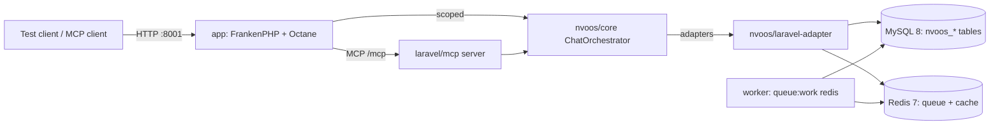

# Proposal 090 — Laravel Adapter Spike: Comprehensive Implementation Plan

**Status:** Implemented (dev-verified 2026-11-12) — see [`090-laravel-adapter-spike-report.md`](./090-laravel-adapter-spike-report.md)
**Date:** 2026-11-12
**Companion to:** [`../proposals/090-laravel-adapter-spike-implementation-plan.md`](../proposals/090-laravel-adapter-spike-implementation-plan.md)
**Target release:** v1.4.0 (spike only; no production deployment)
**Author:** NV oOS coding agent (Zed)

---

## 1. Executive summary

Prove the Laravel standalone track end-to-end in a dev environment:

> `nvoos/core` + `nvoos/laravel-adapter`, running on **Laravel Octane (FrankenPHP)**, executing a real tool, streaming SSE, dispatching a real queue job with a retry, round-tripping persistence, and serving MCP over Streamable HTTP — **without WordPress in the request path**.

The research (2026-11-12) confirms the plan is feasible, but changes three assumptions in Proposal 090:

1. **The adapter has never been booted.** The service-provider binding for `ChatOrchestrator` omits two required constructor arguments, no `PlatformFlushInterface` implementation exists, and no tools or providers are registered. Phase 0 fixes this before any Octane work.
2. **The tooling landscape moved.** There is now a first-party [`laravel/mcp`](https://github.com/laravel/mcp) package (v1.2.0, 55M+ Packagist downloads) that serves **both** MCP protocol eras, validates `Origin`, supports Sanctum/OAuth, and ships an inspector + test helpers. The official [`mcp/sdk`](https://github.com/modelcontextprotocol/php-sdk) (v0.10.0) is the framework-agnostic fallback with weekly conformance runs. Hand-rolling JSON-RPC is no longer justified.
3. **Version floor moved.** `laravel/mcp` requires PHP `^8.2` and Laravel `^12.41.1 || ^13.0`; `laravel/octane` v2.24 requires PHP `^8.2`. The adapter currently requires `illuminate/* ^10 || ^11`, so its constraints must be widened before the spike app can install it.

**Execution result:** P1–P7 passed in the dev stack, including the formal 30-minute soak; see the [spike report](./090-laravel-adapter-spike-report.md) for evidence, the benchmark, and residual production hardening items.

---

## 2. What changed vs. Proposal 090

| # | Proposal 090 assumption | Verified reality (2026-11-12) | Plan change |
|---|---|---|---|
| 1 | Candidate tool: `get_environment_status` | No such tool exists in `lib/core/src/Tool/` | Use `color_convert` (self-contained, capability `read`, canonical envelope) |
| 2 | “8 adapters complete” = ready to boot | `NvoosServiceProvider` constructs `ChatOrchestrator` with 4 of 6 required args; no `PlatformFlush`; empty `ToolRegistry`; no provider clients | Phase 0: signature drift audit + binding fixes |
| 3 | Dev image needs Octane added | Image is `php:8.2-cli-alpine`, boots `php artisan serve`; no `pcntl`, no FrankenPHP | Replace with `dunglas/frankenphp:1-php8.3` + `install-php-extensions` |
| 4 | MCP is the main tooling risk (F2) | `laravel/mcp` and official `mcp/sdk` both exist and are maintained; PHP MCP risk is now integration, not existence | P6 uses `laravel/mcp`; `mcp/sdk` is the documented fallback; F2 trigger narrows to conformance failure |
| 5 | Laravel 10/11 adapter constraints | `laravel/mcp` requires Laravel 12.41.1+; Octane 2.24 requires PHP 8.2+ | Widen adapter to `illuminate/* ^12.41.1 || ^13.0`; spike app on Laravel 12.41+ / PHP 8.3 |
| 6 | Scale doc’s Octane snippet (`'warm' => true`) | Octane’s config shape is `'warm' => [...Octane::defaultServicesToWarm()]`; default `max_execution_time` is 30s | Do not copy the old snippet; set `max_execution_time` explicitly for SSE |
| 7 | Scale doc §4.1 deliverables marked `[x]` | No `deploy/laravel-orchestrator/` exists in the repo | Treat those checkboxes as stale; this plan is the source of truth |

---

## 3. Verified starting state (repo truth)

### 3.1 Assets that exist

| Asset | State | Notes |
|---|---|---|
| `lib/core/` (`nvoos/core`) | ✅ Engine | 109 tools, 58 contracts, `ChatOrchestrator`, `ProviderRouter`, `SseHandler`, `CostCalculator`, `CancellationToken` (with `probe` support) |
| `lib/laravel-adapter/` (`nvoos/laravel-adapter`) | ✅ Code, ❌ not booted | 8 adapters, Eloquent models, 7 migrations, `NvoosToolJob`, 2 tests only |
| `docker/docker-compose.laravel.yml` | ✅ Scaffold | App + MySQL 8 + Redis 7; port 8001; app bind mount at `/var/www/html` |
| `docker/laravel/Dockerfile` | ⚠️ Outdated | PHP 8.2 CLI Alpine, no Octane/FrankenPHP/pcntl |
| `docker/laravel/entrypoint.sh` | ⚠️ Outdated | Runtime `composer create-project`, then `php artisan serve` |
| `lib/wordpress-adapter` bridge | ✅ Reference | `includes/bootstrap/oos-bridge.php` shows the real provider/tool registration pattern |

### 3.2 Defects and gaps found (severity order)

| ID | Finding | Impact | Evidence |
|---|---|---|---|
| G1 | `ChatOrchestrator` binding passes only `tools/providers/events/errors`; constructor also requires `CostCalculator` and `SseHandler` | P1 fails with `ArgumentCountError` | `lib/laravel-adapter/src/ServiceProvider/NvoosServiceProvider.php:62`; `lib/core/src/Application/Chat/ChatOrchestrator.php:172` |
| G2 | No `PlatformFlushInterface` implementation in any adapter | `SseHandler` cannot be constructed | `lib/core/src/Infrastructure/Streaming/PlatformFlushInterface.php`; no `lib/*/src` match |
| G3 | No tool is ever registered in `ToolRegistry` | P2/P6 cannot execute a tool | `NvoosServiceProvider::boot()` only publishes config/migrations |
| G4 | No provider clients are registered; no `HttpClientInterface` adapter exists | P3 needs a provider | `includes/bootstrap/oos-bridge.php:146-157` shows the missing registration pattern |
| G5 | `QueueClient` reads `env()` in its constructor; `getStatus()`/`getLastJobId()` assume the database `jobs` table; the adapter reads `NVOOS_QUEUE_CONNECTION` while the compose file sets `OOS_QUEUE_CONNECTION` | P4 on Redis reports “completed” and returns a fake ID | `lib/laravel-adapter/src/Adapter/QueueClient.php:33,84,242`; `lib/laravel-adapter/config/nvoos.php:104`; `docker/docker-compose.laravel.yml:42` |
| G6 | Adapter tests are only `ErrorFactoryTest` + `SettingsStoreContractTest` | P7 “suite green” is not meaningful yet | `lib/laravel-adapter/tests/` |
| G7 | `docker/laravel/app/*` is gitignored; the app is created at runtime | Spike is not reproducible in CI | `.gitignore:280` |
| G8 | Adapter requires `illuminate/* ^10 || ^11` | Cannot install with Laravel 12.41+ / `laravel/mcp` | `lib/laravel-adapter/composer.json:9-17` |
| G9 | Scale doc §4.1 marks deliverables `[x]` that do not exist | Misleading status | `docs/project/proposals/laravel-scale-deployment-architecture.md:350-355` |
| G10 | `SseHandler::sendHeaders()` uses global `header()`, `ini_set()`, `ob_end_clean()` | Incompatible with a Laravel `StreamedResponse` (headers already sent) | `lib/core/src/Infrastructure/Streaming/SseHandler.php:63-93` |
| G11 | `SettingsStore` caches merged settings in an instance property | A singleton would serve stale settings across Octane requests | `lib/laravel-adapter/src/Adapter/SettingsStore.php:60` |
| G12 | `NvoosToolJob` has no `$tries`/`$backoff`/`failed()` | Retry is not deterministic on a forced failure | `lib/laravel-adapter/src/Jobs/NvoosToolJob.php` |
| G13 | Config typo `NVNVOOS_CONTENT_MODEL` | `NVOOS_CONTENT_MODEL` overrides are silently ignored | `lib/laravel-adapter/config/nvoos.php:22` |

**Positive findings:** `CancellationToken` already accepts a `probe` callback (`lib/core/src/Domain/ValueObject/CancellationToken.php:59`) — ideal for `connection_aborted()`. `AbstractTool::success()` returns the canonical envelope. `ContentStore` + migrations exist. `orchestra/testbench` is already a dev dependency (needs a version bump).

---

## 4. Industry standards and decisions

### 4.1 Runtime: Octane + FrankenPHP

Verified from the Laravel Octane docs, FrankenPHP worker docs, and `laravel/octane` 2.24 metadata:

| Topic | Standard / behavior | Plan implication |
|---|---|---|
| Server | FrankenPHP is supported by Octane; official Docker image is `dunglas/frankenphp` | Use the official image, not the static binary, for dev/CI |
| Docker entrypoint | `php artisan octane:frankenphp` is the documented image entrypoint | Use it with `--workers`/`--max-requests` |
| Required extension | Octane requires `pcntl` | `install-php-extensions pcntl` |
| Worker count | Default 1 per CPU; `--workers=N` | Dev: 2; soak: 2–4; record |
| Leak protection | `--max-requests` defaults to 500 | Dev uses `1` for code reload; benchmark uses `500` |
| Execution limit | `config/octane.php` `max_execution_time` defaults to **30s** | Set `0` (or 300) for SSE routes; do not leave 30 |
| Warmup | `warm` is an array of services (`...Octane::defaultServicesToWarm()`), not a boolean | Use the generated config; ignore the old scale-doc snippet |
| State | Worker-mode static variables, class statics, globals, `ini_set()` state, shutdown functions and `$_ENV` persist per thread | No per-request mutable singletons; use `scoped()` |
| DI | Avoid injecting container/request/config into singletons; use resolver closures or scoped bindings | `ChatOrchestrator` and `SseHandler` are `scoped`; `ProviderRouter` is a singleton after the adapter's `SettingsStore` in-memory cache was removed |
| Config | `env()` outside config files is unreliable after `config:cache` | Replace `env()` in adapters with `config()` |
| Deployment | `octane:reload` after code changes; Supervisor/systemd in production | Out of scope for the spike, documented |

### 4.2 SSE under Laravel/Octane

Verified from `Illuminate/Routing/ResponseFactory::eventStream()` and the SSE implementation:

- Laravel’s `eventStream()` checks `connection_aborted()`, calls `ob_flush()`/`flush()`, and emits `event:`/`data:` frames. Our core `SseHandler` does the same, but also writes headers with global `header()`.
- **Decision:** keep `SseHandler` as the frame writer; add `SseHandler::markHeadersSent()` so a Laravel controller can set headers on the `StreamedResponse` and suppress the global-header path.
- **Disconnect:** construct `new CancellationToken(probe: static fn () => connection_aborted())`; `handleChatStreaming()` already checks `isCancelled()` in its chunk callback. If `connection_aborted()` proves unreliable under FrankenPHP, add a `CancellationToken::withDeadline()` hard cap and treat a failed write as a disconnect; record the behavior in the report.
- **Headers:** `Content-Type: text/event-stream`, `Cache-Control: no-cache, no-store, must-revalidate`, `X-Accel-Buffering: no`.
- **Buffering:** if a Caddyfile enables compression (`encode`), exclude `text/event-stream` (or leave compression off in the dev Caddyfile). `X-Accel-Buffering` only affects nginx.
- **Timeouts:** Octane’s 30s default would kill a long stream; set `max_execution_time` to `0` for the spike and record it as a production hardening item.

### 4.3 MCP: Streamable HTTP, both eras

Verified from the MCP 2025-06-18 transports spec, the repo’s `mcp-ai-sdk-v2-server-ops` skill (2026-07-28 dialect), and both PHP packages:

| Requirement (2025-06-18) | Implementation |
|---|---|
| Single endpoint, POST + GET | `Mcp::web('/mcp', Server::class)` |
| POST accepts JSON-RPC request/notification/response; notification/response → `202` | `laravel/mcp` |
| Request → `application/json` or `text/event-stream` | `laravel/mcp` |
| GET → SSE or `405` | `laravel/mcp` |
| `Mcp-Session-Id` on initialize; `MCP-Protocol-Version` on subsequent requests | `laravel/mcp` (v0.5.1+ session header; v0.9+ protocol negotiation) |
| `Last-Event-ID` resumability (MAY) | Not required for P6; document as follow-up |
| `Origin` validation (MUST) | `laravel/mcp` v1.2.0 |
| Auth | `auth:sanctum` middleware + bearer token |

**Modern dialect (2026-07-28)** used by NV oOS clients: `server/discover` replaces `initialize`; per-request identity in `params._meta` (`io.modelcontextprotocol/protocolVersion`, `clientCapabilities`); SEP-2243 headers `MCP-Protocol-Version`, `Mcp-Method`, `Mcp-Name`; results stamped `resultType: "complete"`. `laravel/mcp` v1.0.0 explicitly “serve[s] legacy initialize clients alongside the modern protocol.”

**Decision D1:** use `laravel/mcp` `^1.2` for P6 (Laravel-native HTTP, auth, inspector, test helpers, both eras). **Verified:** v1.2.0 serves modern `2026-07-28` (`server/discover` + SEP-2243 headers) and legacy `2025-06-18` (`initialize`) in the same endpoint; the `mcp/sdk` fallback was not activated.

### 4.4 Queue + retries

- Redis queue via `QUEUE_CONNECTION=redis`; worker command `php artisan queue:work redis --queue=oos --tries=3 ...`.
- Job-level `$tries`, `$backoff`, `$timeout`, and `failed(Throwable)`; Laravel’s default `--tries=1` would otherwise prevent the retry P4 requires.
- `QueueClient` must not infer status from the database `jobs` table when the driver is Redis. Add a small `nvoos_jobs` status table written by the job lifecycle (durable, driver-agnostic, testable).
- Horizon is optional and out of scope for the spike.

### 4.5 Testing standards

- `orchestra/testbench` for package-level feature tests (`^10.8 || ^11.0` for Laravel 12/13).
- Native MCP Inspector (`php artisan mcp:inspector mcp`) + `Server::tool(...)` unit assertions.
- Wire-level tests: raw POSTs for modern and legacy eras, including the SEP-2243 header ladder.
- Soak with 10+ concurrent SSE clients for 30 minutes; sample worker RSS via `docker stats`.
- Benchmark with OPcache `validate_timestamps=0`; compare `/health` and first-token latency against PHP-FPM/`artisan serve`.

---

## 5. Target architecture



### 5.1 Container topology (dev)

| Service | Image / command | Purpose |
|---|---|---|
| `app` | `dunglas/frankenphp:1-php8.3` + `octane:frankenphp` | HTTP, SSE, MCP |
| `worker` | Same image; `php artisan queue:work redis --queue=oos --tries=3 --max-time=3600 --max-jobs=500` | P4 |
| `db` | `mysql:8.0` (existing) | Persistence |
| `redis` | `redis:7-alpine` (existing) | Queue + cache |

### 5.2 DI lifetimes (Octane-safe)

| Binding | Lifetime | Reason |
|---|---|---|
| `ErrorFactoryInterface`, `CacheStoreInterface`, `SettingsStoreInterface`, `EventDispatcherInterface`, `FileStoreInterface`, `QueueClientInterface`, `AuthProviderInterface`, `ContentStoreInterface` | `bind` (current) | New instance per resolution; avoids cached settings |
| `PlatformFlushInterface` | `scoped` | Request-bound output handling |
| `SseHandler` | `scoped` | Holds `headersSent` state per request |
| `ChatOrchestrator` | `scoped` | Holds per-request session/telemetry/rate-limit state |
| `ProviderRouter` | `singleton` | Holds mutable health/fallback state, not request/user state; clients are registered once at boot |
| `ToolRegistry` | `singleton` | Stateless registry; register tools once at boot |
| `CostCalculator` | `singleton` (if stateless) | No per-request state observed |

**Rule:** never store a request, user, or mutable settings snapshot in a singleton. If a tool needs request context, pass it through `execute()` arguments, not constructor state.

---

## 6. Work plan

### Phase 0 — Reality check and adapter baseline (2–3 days)

| ID | Task | Files | Acceptance |
|---|---|---|---|
| 0.1 | Create spike branch; record baseline `git rev-parse` and `composer validate` | — | Branch + baseline in report |
| 0.2 | Widen adapter constraints; bump Testbench/PHPUnit; add a `composer test` script | `lib/laravel-adapter/composer.json` | `composer validate` green; Testbench resolves on Laravel 12.41+; `composer test` runs the suite |
| 0.3 | Add a Testbench harness + provider boot test | `lib/laravel-adapter/tests/TestCase.php`, `tests/ServiceProviderTest.php` | All 8 interfaces + `ChatOrchestrator` resolve |
| 0.4 | Fix `ChatOrchestrator` binding (`CostCalculator`, `SseHandler`); convert it to `scoped` | `NvoosServiceProvider.php` | Container resolves orchestrator without `ArgumentCountError` |
| 0.5 | Add `LaravelPlatformFlush`; add `SseHandler::markHeadersSent()` | `lib/laravel-adapter/src/Adapter/PlatformFlush.php`, `lib/core/src/Infrastructure/Streaming/SseHandler.php` | Unit tests green; headers can be managed by a `StreamedResponse` |
| 0.6 | Add tool + provider registrars; register `color_convert` and a deterministic fake streaming provider | `NvoosServiceProvider.php`, `src/Provider/ProviderRegistrar.php` | `ToolRegistry::has('color_convert')`; `ProviderRouter` has `spike` |
| 0.7 | Fix `QueueClient` (`config()`, UUID job ID) and add `nvoos_jobs` status store + job retry fields | `QueueClient.php`, `NvoosToolJob.php`, migration | P4 test plan is executable |
| 0.8 | Decide app reproducibility: commit `docker/laravel/app-skeleton/` (pinned `composer.json`) and copy on first boot | `docker/laravel/app-skeleton/`, `entrypoint.sh`, `.gitignore` note | Fresh volume boots without network-time `create-project` |

**Exit gate:** `composer test` in `lib/laravel-adapter` is green and the provider boots under Testbench. No Octane yet.

### Week 1 — P1: Octane/FrankenPHP boot

| ID | Task | Files | Acceptance |
|---|---|---|---|
| 1.1 | Replace dev image with FrankenPHP + PHP 8.3 extensions (`pcntl`, `pdo_mysql`, `intl`, `zip`, `opcache`, `redis`) | `docker/laravel/Dockerfile` | Image builds |
| 1.2 | Add app skeleton (Laravel 12.41+, path repos, Sanctum, Octane, laravel/mcp) | `docker/laravel/app-skeleton/composer.json` | `composer install` succeeds |
| 1.3 | Boot with `octane:frankenphp`; add `config/octane.php` (`server=frankenphp`, `max_execution_time=0`) | `entrypoint.sh`, app config | `octane:status` reports running |
| 1.4 | Add `/health` + `nvoos:doctor` command | app routes/commands | `/health` returns `abspath:false`, resolved bindings, worker runtime |
| 1.5 | Add the no-WordPress guard assertion | health test | `defined('ABSPATH') === false` |
| 1.6 | Smoke `config:cache` + `route:cache` | smoke script | Health still green after caching |

**Exit gate (P1):** Octane serves `/health`; all 8 adapters resolve; no WP symbols loaded.

### Week 2 — P2 + P5: real tool + persistence round-trip

| ID | Task | Files | Acceptance |
|---|---|---|---|
| 2.1 | Dev-only `POST /dev/tools/{slug}` endpoint guarded by `local` env + auth | app controller/routes | `color_convert` returns canonical envelope |
| 2.2 | Capability test: authenticated user lacks `read` → forbidden | feature test | 403 envelope, no execution |
| 2.3 | ContentStore round-trip (create post → read by ID) | feature test + `ContentStoreTest` | Eloquent row + domain entity match |
| 2.4 | Publish/run migrations on boot | entrypoint | `nvoos_posts`, `nvoos_terms`, `nvoos_settings`, `nvoos_schedules`, `nvoos_files`, `nvoos_file_metadata` exist |

**Exit gate (P2, P5):** tool executes through `ToolRegistry::execute()` with the canonical envelope; persistence round-trips.

### Week 3 — P4 + P3: queue retry + SSE stream

| ID | Task | Files | Acceptance |
|---|---|---|---|
| 3.1 | `nvoos_jobs` migration + `JobStatusStore` | adapter | Status transitions `queued → running → completed/failed` |
| 3.2 | `NvoosToolJob`: `$tries=3`, `$backoff=[5,15,30]`, `$timeout=300`, `failed()` | adapter | Forced failure retries and records error |
| 3.3 | Worker service in compose | `docker-compose.laravel.yml` | Job lands in Redis (`queues:oos`), executes, retries |
| 3.4 | SSE controller: `response()->stream()`, headers, `markHeadersSent()`, `CancellationToken(probe: connection_aborted)` | app controller/routes | `event: message` frames arrive; done event closes |
| 3.5 | Fake streaming provider (deterministic tokens) | app provider registrar | No API keys required |
| 3.6 | Disconnect test: abort mid-stream, then call `/health` | feature/soak script | Worker survives; next request succeeds |

**Exit gate (P3, P4):** one real SSE stream with mid-stream disconnect handled; one Redis job with an observed retry.

### Week 4 — P6: MCP Streamable HTTP

| ID | Task | Files | Acceptance |
|---|---|---|---|
| 4.1 | Install `laravel/mcp`; publish `routes/ai.php` | app | `Mcp::web('/mcp', NvoosServer::class)` |
| 4.2 | `NvoosServer` + `ColorConvertMcpTool` bridge to `ToolRegistry::execute()` | app `app/Mcp/*` | `tools/list` and `tools/call` work |
| 4.3 | Sanctum auth + `Origin` validation | app | No token → 401; bad Origin → rejected |
| 4.4 | Wire-level tests: modern `server/discover` + legacy `initialize` | app tests | Both eras pass; SEP-2243 ladder cases pass |
| 4.5 | Run `php artisan mcp:inspector mcp` | manual + report | Inspector lists/calls the tool |
| 4.6 | Decision gate: if conformance fails, mount `mcp/sdk` instead | app | Documented fallback executed within 2 days |

**Exit gate (P6):** `initialize`/`tools/list` (2025-era) **and** modern discover/list/call pass; auth fail-closed.

### Week 5 — Soak, performance, and hardening

| ID | Task | Acceptance |
|---|---|---|
| 5.1 | 10 concurrent SSE streams × 30 min | No worker crash; no unbounded RSS growth |
| 5.2 | Benchmark `/health` and first-token latency vs PHP-FPM/`artisan serve` | p50/p95 recorded; Octane advantage quantified |
| 5.3 | Run with `--max-requests=500`, OPcache `validate_timestamps=0` | Same results; worker restarts cleanly |
| 5.4 | Security pass: auth, Origin, throttles, no secrets/log leakage | Checklist green |
| 5.5 | Repeat with `config:cache` + `route:cache` | No `env()` regressions |

### Week 6 — Report and Go/No-Go

| ID | Task | Acceptance |
|---|---|---|
| 6.1 | Write `090-laravel-adapter-spike-report.md` with the P1–P7 evidence table | Report committed |
| 6.2 | Bookkeeping (see §10) | Gate 3 ticked only if Go |
| 6.3 | Go/No-Go decision recorded with F1–F4 status | Decision in report + proposal status line |

---

## 7. Detailed implementation specifications

### 7.1 Dependency changes

**`lib/laravel-adapter/composer.json`**

```json
"require": {
  "php": "^8.1",
  "nvoos/core": "^1.0",
  "illuminate/support": "^12.41.1 || ^13.0",
  "illuminate/cache": "^12.41.1 || ^13.0",
  "illuminate/config": "^12.41.1 || ^13.0",
  "illuminate/database": "^12.41.1 || ^13.0",
  "illuminate/events": "^12.41.1 || ^13.0",
  "illuminate/filesystem": "^12.41.1 || ^13.0",
  "illuminate/queue": "^12.41.1 || ^13.0",
  "illuminate/auth": "^12.41.1 || ^13.0",
  "illuminate/contracts": "^12.41.1 || ^13.0"
},
"require-dev": {
  "phpunit/phpunit": "^11.0",
  "mockery/mockery": "^1.6",
  "orchestra/testbench": "^10.8 || ^11.0"
}
```

**Spike app `composer.json`**

```json
"require": {
  "php": "^8.3",
  "laravel/framework": "^12.41.1",
  "laravel/octane": "^2.24",
  "laravel/mcp": "^1.2",
  "laravel/sanctum": "^4.0",
  "nvoos/core": "*",
  "nvoos/laravel-adapter": "*"
}
```

If the spike upgrades to Laravel 13, bump Sanctum to the version that supports 13; pin Laravel 12.41+ for the first pass to keep variables low.

Path repositories point at `../../lib/core` and `../../lib/laravel-adapter`. Commit the app’s `composer.lock` as spike evidence.

### 7.2 Dockerfile and entrypoint

```dockerfile
FROM dunglas/frankenphp:1-php8.3

RUN install-php-extensions pdo_mysql intl zip opcache redis pcntl

COPY --from=composer:2 /usr/bin/composer /usr/bin/composer
WORKDIR /app

COPY docker/laravel/entrypoint.sh /usr/local/bin/entrypoint.sh
RUN chmod +x /usr/local/bin/entrypoint.sh
ENTRYPOINT ["/usr/local/bin/entrypoint.sh"]
```

```sh
#!/bin/sh
set -e
[ -f artisan ] || cp -r /workspace/oos/docker/laravel/app-skeleton/. /app/
[ -f .env ] || cp .env.example .env
[ -f vendor/autoload.php ] || composer install --no-interaction --prefer-dist
php artisan key:generate --force
php artisan migrate --force --no-interaction || true
exec php artisan octane:frankenphp \
  --host=0.0.0.0 --port=8000 \
  --workers="${OCTANE_WORKERS:-2}" \
  --max-requests="${OCTANE_MAX_REQUESTS:-1}"
```

Update the compose volumes from `/var/www/html` to `/app` (`./laravel/app:/app`, `laravel_vendor:/app/vendor`, `laravel_storage:/app/storage`). Dev uses `--max-requests=1` so code changes are picked up without `--watch`/Node. Benchmarks set `500`.

### 7.3 Octane configuration

```php
// config/octane.php
'server' => env('OCTANE_SERVER', 'frankenphp'),
'max_execution_time' => 0, // spike: long SSE streams
'warm' => [...\Laravel\Octane\Octane::defaultServicesToWarm()],
```

Notes:
- Do **not** use `'warm' => true` (not an Octane config shape).
- `max_execution_time=0` is spike-only; production should use a bounded value plus per-route timeouts.
- `octane:reload` after deploy; `octane:status` for health.

### 7.4 Service provider fixes

```php
$this->app->scoped( PlatformFlushInterface::class, PlatformFlush::class );
$this->app->scoped( SseHandler::class, fn ( $app ) => new SseHandler( $app->make( PlatformFlushInterface::class ) ) );
$this->app->scoped( ChatOrchestrator::class, fn ( $app ) => new ChatOrchestrator(
    tools: $app->make( ToolRegistry::class ),
    providers: $app->make( ProviderRouter::class ),
    events: $app->make( EventDispatcherInterface::class ),
    errors: $app->make( ErrorFactoryInterface::class ),
    costs: $app->make( CostCalculator::class ),
    sse: $app->make( SseHandler::class ),
) );
$this->app->singleton( ToolRegistry::class, fn ( $app ) => new ToolRegistry(
    $app->make( EventDispatcherInterface::class ),
    $app->make( ErrorFactoryInterface::class ),
) );
```

Register tools in `boot()`:

```php
$registry = $this->app->make( ToolRegistry::class );
if ( ! $registry->has( 'color_convert' ) ) {
    $registry->register( new ColorConvertTool( $this->app->make( ErrorFactoryInterface::class ) ) );
}
$registry->notifyRegistered();
```

The `ProviderRouter` is a singleton; providers are registered once at boot. `SettingsStore` no longer keeps an in-memory cache, so worker-global routers cannot serve stale settings across Octane requests.

### 7.5 SSE integration

**Core change:** add a public `markHeadersSent()` to `SseHandler`.

```php
public function markHeadersSent(): void {
    $this->headersSent = true;
}
```

**Adapter:** `LaravelPlatformFlush` implements `flushPlatformBuffers()` as a no-op (the response headers are owned by Laravel; there are no WordPress buffers to clear).

**Controller:**

```php
Route::middleware( [ 'auth:sanctum', 'throttle:chat' ] )->post( '/chat/stream', function ( Request $request ) {
    $headers = array(
        'Content-Type'      => 'text/event-stream; charset=utf-8',
        'Cache-Control'     => 'no-cache, no-store, must-revalidate',
        'X-Accel-Buffering' => 'no',
    );

    return response()->stream( function () use ( $request ) {
        $sse = app( SseHandler::class );
        $sse->markHeadersSent();

        $token = new CancellationToken( probe: static fn () => connection_aborted() );

        try {
            app( ChatOrchestrator::class )->handleChatStreaming(
                messages: $request->input( 'messages', array() ),
                assistantConfig: $request->input( 'assistant', array() ),
                userId: (int) $request->user()->id,
                assistantId: (int) $request->input( 'assistant_id', 0 ),
                options: $request->input( 'options', array() ),
                cancellation: $token,
            );
        } catch ( \Throwable $e ) {
            $sse->sendEvent( 'error', array( 'code' => 'stream_failed', 'message' => $e->getMessage() ) );
            $sse->sendDone();
        }
    }, 200, $headers );
} );
```

Operational notes:
- `handleChatStreaming()` already emits `done` on its normal and error paths; do **not** call `sendDone()` after a successful return. The `catch` branch above is only for uncaught transport exceptions.
- Do not call `$sse->sendHeaders()` in Laravel; it would emit global headers after the response started.
- If Caddy compression is enabled, add a matcher excluding `text/event-stream`.

### 7.6 Queue and job status

**Migration `nvoos_jobs`:** `id` (UUID PK), `handler`, `payload` (json), `status` (`queued|running|completed|failed|cancelled`), `attempts`, `error` (text), `queued_at`, `started_at`, `finished_at`.

**`NvoosToolJob`:**

```php
public int $tries = 3;
public array $backoff = [ 5, 15, 30 ];
public int $timeout = 300;

public function __construct(
    public readonly string $jobId,
    public readonly string $handler,
    public readonly array $payload,
) {}
```

`handle()` marks `running`, resolves the handler, invokes it, marks `completed`; `failed(Throwable $e)` marks `failed` with the exception message. Use a `JobStatusStore` abstraction so the job does not depend on the database directly in tests.

**`QueueClient` changes:**

```php
$connection = config( 'oos.queue_connection', config( 'queue.default' ) );
$jobId = (string) Str::uuid();
$job = new NvoosToolJob( jobId: $jobId, handler: $handler, payload: $payload );
// push/later ...
return $jobId;
```

`getStatus()` reads `nvoos_jobs`; `cancel()` marks `cancelled` (and best-effort deletes a reserved DB job). Remove the `jobs`-table auto-complete fallback or keep it only as a legacy DB-driver branch.

**Worker:** add a `worker` service. For the retry proof, use a `SpikeFlakyHandler` that throws on attempt 1 and succeeds on attempt 2 (attempt counter in cache).

**Env alignment:** the adapter config key is `oos.queue_connection` (file `config/nvoos.php`, merged under `'oos'`). Either set `NVOOS_QUEUE_CONNECTION=redis` or change the config to fall back to `QUEUE_CONNECTION`; the current compose file sets `OOS_QUEUE_CONNECTION`, which the adapter does not read. Also fix the `NVNVOOS_CONTENT_MODEL` typo while in this file.

### 7.7 MCP server and bridge

```php
// routes/ai.php
Mcp::web( '/mcp', \App\Mcp\Servers\NvoosServer::class )
    ->middleware( [ 'auth:sanctum', 'throttle:mcp' ] );
```

```php
#[Name( 'NV oOS Engine' )]
#[Version( '1.0.0' )]
#[Instructions( 'NV oOS core tools over MCP.' )]
class NvoosServer extends Server {
    protected array $tools = [ ColorConvertMcpTool::class ];
}
```

```php
#[Name( 'color_convert' )]
#[Description( 'Convert colors between HEX, RGB, and HSL.' )]
#[IsReadOnly]
#[IsIdempotent]
class ColorConvertMcpTool extends Tool {
    public function handle( Request $request ): Response {
        $errors = app( ErrorFactoryInterface::class );

        try {
            $result = app( ToolRegistry::class )->execute(
                'color_convert',
                $request->all(),
                array(
                    'user_id'       => $request->user()?->id ?? 0,
                    'auth_provider' => app( AuthProviderInterface::class ),
                ),
            );
        } catch ( \Throwable $e ) {
            return Response::error( $e->getMessage() );
        }

        if ( $errors->isError( $result ) ) {
            return Response::error( $errors->normalize( $result )['message'] );
        }

        return Response::structured( $result['data'] ?? array() );
    }

    public function schema( JsonSchema $schema ): array {
        return array(
            'color'     => $schema->string()->description( 'HEX, RGB, or HSL value.' )->required(),
            'to_format' => $schema->string()->enum( array( 'hex', 'rgb', 'hsl' ) )->default( 'hex' ),
        );
    }
}
```

**Conformance checklist (must pass):**

| Case | Expected |
|---|---|
| `server/discover` (modern) with `params._meta` + `MCP-Protocol-Version` + `Mcp-Method` | JSON result, `resultType: complete`, supported versions include the modern revision |
| `tools/list` modern with headers | Tool list includes `color_convert` |
| `tools/call` modern with `Mcp-Name` | Structured result; no `-32603` |
| Legacy `initialize` (2025-era) | SSE response; negotiated version; `Mcp-Session-Id` if issued |
| Missing `Mcp-Name` on `tools/call` | `400` + `-32020` (headers/body disagree) |
| Legacy initialize + modern `MCP-Protocol-Version` | `400` + `-32020` |
| No bearer token | `401` fail-closed |
| Disallowed `Origin` | Rejected by `laravel/mcp` v1.2 validation |

Run `php artisan mcp:inspector mcp` and the package’s local conformance suite in W4. If the modern era fails and cannot be fixed in 2 days, mount `mcp/sdk` on a Laravel route (fallback D1).

### 7.8 Health and doctor

`GET /health` returns:

```json
{
  "ok": true,
  "php": "8.3.x",
  "octane": true,
  "frankenphp": true,
  "abspath": false,
  "bindings": ["ContentStoreInterface", "QueueClientInterface", "..."],
  "tools": ["color_convert"]
}
```

`php artisan nvoos:doctor` prints the resolved bindings, tool slugs, provider slugs, queue connection, and the Octane/server state. Both are evidence for P1.

### 7.9 Test matrix

| Layer | Tests |
|---|---|
| Unit | `SseHandler::markHeadersSent`, `PlatformFlush`, `QueueClient`, `JobStatusStore`, tool/provider registrars |
| Feature (Testbench) | Provider boots; all bindings resolve; `ChatOrchestrator` resolves; sequential requests do not leak state |
| Integration | MySQL migrations; `ContentStore` round-trip; Redis job + retry |
| MCP wire | Modern + legacy handshakes; header ladder; auth; Origin |
| Non-functional | 10× SSE soak; memory; `config:cache`; benchmark |

Commands:

```bash
vendor/bin/phpunit --configuration lib/laravel-adapter/phpunit.xml
php artisan test --testsuite=spike
```

---

## 8. Validation matrix (P1–P7)

| Criterion | Command / action | Expected evidence |
|---|---|---|
| **P1 Boot** | `docker compose -f docker/docker-compose.laravel.yml up -d --build`; `curl localhost:8001/health` | `ok:true`, `abspath:false`, bindings resolved, Octane/FrankenPHP true |
| **P2 Tool** | `POST /dev/tools/color_convert` or `php artisan nvoos:tool color_convert --color=#ff0000` | Canonical `{success:true,message,data}` envelope |
| **P3 SSE** | `curl -N -H 'Accept: text/event-stream' .../chat/stream`; abort mid-stream | `event: message` frames; done event; worker survives; next `/health` 200 |
| **P4 Queue** | `php artisan queue:work redis --queue=oos --tries=3 --once`; flaky handler | Job in `queues:oos`, retry attempt 2, `nvoos_jobs` transitions |
| **P5 Persistence** | `php artisan test --filter=ContentStoreRoundTripTest` | Row in `nvoos_posts`; domain entity matches |
| **P6 MCP** | `php artisan mcp:inspector mcp`; wire tests | Modern + legacy pass; auth/Origin fail-closed |
| **P7 Regression** | `vendor/bin/phpunit -c lib/laravel-adapter/phpunit.xml` | Suite green, ≥ the new tests |

**Soak:** `php bin/laravel-spike-soak.php --streams=10 --minutes=30`; sample `docker stats --no-stream` every 10s. Pass = no crash, no unbounded RSS growth, all streams complete or abort cleanly.

**Benchmark:** `php -d opcache.validate_timestamps=0 bin/laravel-spike-bench.php --requests=200` against `/health` and first-token. Record p50/p95 and compare to `php artisan serve`.

---

## 9. Risk register

| ID | Risk | Impact | Mitigation | Trigger |
|---|---|---|---|---|
| R1 | Adapter/core signature drift | P1 fails | Phase 0 provider boot test; pin `nvoos/core` | Any `ArgumentCountError` |
| R2 | Octane singleton state leak | Cross-request data bleed | `scoped` bindings; sequential-request test | Test shows user A data in user B request |
| R3 | `env()` + `config:cache` | Wrong queue/settings in production | Replace `env()` with `config()`; smoke with caches | Cached-config smoke fails |
| R4 | `SseHandler` global headers | Stream fails after headers sent | `markHeadersSent()` + `LaravelPlatformFlush` | “headers already sent” warning/500 |
| R5 | MCP era/package gap | P6 fails | `laravel/mcp` conformance gate; fallback `mcp/sdk` | Conformance red on modern era |
| R6 | SSE under Octane | Truncated/hung streams | `max_execution_time=0`, flush per event, soak | Stream stalls or worker crashes |
| R7 | Redis job status | P4 false “completed” | `nvoos_jobs` status store; job lifecycle writes | Status never leaves `queued` |
| R8 | FrankenPHP extensions | Boot failure | Official image + `install-php-extensions`; CI build | Missing `pcntl`/`redis` |
| R9 | Dependency floor | Adapter won’t install | Widen constraints; commit lock; test Laravel 12.41+ | Composer conflict |
| R10 | App not reproducible | CI cannot repeat P1/P6 | Commit `app-skeleton/` + lock; entrypoint copy | Fresh volume differs |
| R11 | Memory growth | Worker restarts/crashes | `--max-requests=500`; soak; OPcache | RSS grows monotonically |
| R12 | Proxy/Caddy buffering | SSE appears “stuck” | No compression for `text/event-stream`; direct port in dev | Events arrive in bursts |

**Flip-condition mapping:** R1/R4/R6 → **F1** (Octane instability); R5 → **F2** (MCP tooling cannot meet the spec); R1/R3 → **F3** (engine redesign needed); R9/R10 → schedule/scope risk, not a flip trigger. Strategic triggers **F4** remain owner-driven.

---

## 10. Go/No-Go and bookkeeping

**Go** requires all of:

- P1–P7 green with attached evidence.
- Soak: 10 concurrent SSE streams × 30 min, no crash, stable RSS.
- MCP modern + legacy conformance green (or the documented `mcp/sdk` fallback green).
- No F1–F4 trigger observed.

**Conditional Go:** one pass criterion needs a documented workaround that does not change the engine’s architecture (e.g., `mcp/sdk` fallback). Record the deviation in the report.

**No-Go:** any F1–F4 trigger; or P1/P2/P6 cannot pass after two focused remediation attempts.

On completion:

1. Tick gate 3 in `docs/project/plans/funiq-bridge-velocity-storefront-implementation.md` §8.1 **only if Go**.
2. Update `docs/project/proposals/PROPOSALS_COMPLETION_STATUS.md` (next-priority #2).
3. Update the status line and §4.1 stale checkboxes in `docs/project/proposals/laravel-scale-deployment-architecture.md`; correct the `'warm' => true` snippet.
4. Write `docs/project/plans/090-laravel-adapter-spike-report.md` with the P1–P7 evidence table.
5. Update `.context/cross-platform-extraction.md` current state.
6. Bump `nvoos/laravel-adapter` minor version (dependency constraint change) and note it in the package README.
7. Add the plan + report to `docs/project/proposals/README.md`.

---

## 11. Out of scope

- Production deployment (Supervisor/systemd, TLS, multi-node).
- Horizon/Reverb/pgvector production wiring.
- Porting all 109 core tools to the standalone app.
- Funiq service build, console re-scoping, golden-contract suite (separate gates).
- Production OAuth (Passport) — Sanctum bearer tokens are enough for P6.
- `Last-Event-ID` resumability (MAY in the spec; follow-up).
- Multi-tenant authorization and rate-limit tuning.

---

## 12. References

### Repo

- [`docs/project/proposals/090-laravel-adapter-spike-implementation-plan.md`](../proposals/090-laravel-adapter-spike-implementation-plan.md)
- [`docs/project/proposals/085-funiq-laravel-standalone-integration-appendix.md`](../proposals/085-funiq-laravel-standalone-integration-appendix.md)
- [`docs/project/proposals/laravel-scale-deployment-architecture.md`](../proposals/laravel-scale-deployment-architecture.md)
- [`docs/project/plans/funiq-bridge-velocity-storefront-implementation.md`](./funiq-bridge-velocity-storefront-implementation.md) §8.1
- `lib/core/src/Application/Chat/ChatOrchestrator.php`, `lib/core/src/Infrastructure/Streaming/SseHandler.php`
- `lib/laravel-adapter/src/ServiceProvider/NvoosServiceProvider.php`, `src/Adapter/QueueClient.php`, `src/Jobs/NvoosToolJob.php`
- `includes/bootstrap/oos-bridge.php` (provider/tool registration reference)
- `.agents/skills/mcp-ai-sdk-v2-server-ops/SKILL.md` (2026-07-28 dialect + conformance ladder)

### External

- Laravel Octane: <https://laravel.com/docs/octane>
- FrankenPHP worker mode: <https://frankenphp.dev/docs/worker/>
- FrankenPHP Docker image: <https://frankenphp.dev/docs/docker/>
- MCP transports (2025-06-18): <https://modelcontextprotocol.io/specification/2025-06-18/basic/transports>
- Laravel MCP: <https://laravel.com/docs/mcp>
- Laravel MCP changelog: <https://github.com/laravel/mcp/blob/main/CHANGELOG.md>
- Official PHP MCP SDK: <https://github.com/modelcontextprotocol/php-sdk>
- MCP conformance framework: <https://github.com/modelcontextprotocol/conformance>
