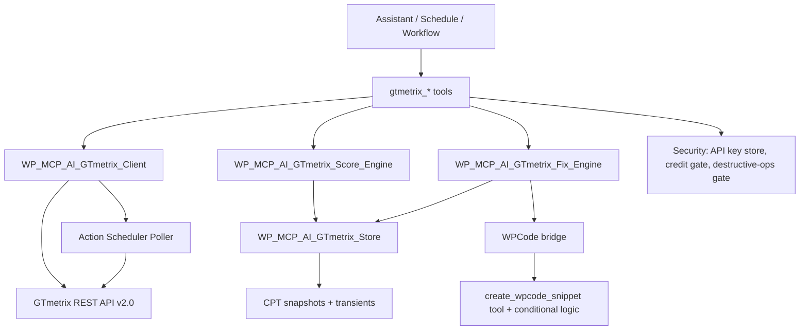

# Proposal: GTmetrix × WPCode Performance Optimization Pro Toolkit

**Date:** 2026-10-12
**Status:** 🔮 PENDING — proposal (docs only)
**Estimated Effort:** 25–35 hours (Phases 1–7, mirroring the food-beverage build)
**Priority:** MEDIUM-HIGH (greenfield vertical; no WordPress-native performance toolkit exists in the plugin)
**Related:** [`.agents/skills/design-performance-audit`](../../../.agents/skills/design-performance-audit/SKILL.md) (the manual GTmetrix-audit workflow this productizes) · [`062-food-beverage-management-pro-toolkit-proposal.md`](./062-food-beverage-management-pro-toolkit-proposal.md) (Pro toolkit precedent + validation gate) · [`063-phreshos-pro-toolkit-cloudways-velocity-addon-proposal.md`](./063-phreshos-pro-toolkit-cloudways-velocity-addon-proposal.md) (research-appendix pattern) · `sse-stream-hardening-long-run-offload-proposal.md` (long-poll offload precedent) · GTmetrix REST API v2.0 docs (fetched 2026-10-12: <https://gtmetrix.com/api/docs/2.0/>)

> Scope: ship a **GTmetrix × WPCode Performance Optimization Pro Toolkit**
> (`addons/pro/includes/tools/gtmetrix/`) that makes NV oOS a first-class
> WordPress performance operator: run GTmetrix tests from WordPress over the
> GTmetrix REST API v2.0, read scores/metrics/audits deterministically, assess
> results against researched industry standards (Core Web Vitals 2026
> thresholds, GTmetrix grade bands, page-weight budgets), map every failing
> audit to a concrete WordPress fix, generate WPCode-ready PHP optimization
> snippets scoped to the site's actual findings, and wire it all into
> schedule/workflow presets so performance regressions are caught on a cadence,
> not by accident.

> Related in-repo work: `developer` toolkit's `create_wpcode_snippet` tool
> (WPCode write precedent — extended in Phase 4 with conditional logic),
> `cloudways` toolkit (host-level precedent; Breeze settings bridge is a
> deferred follow-up), `mcp-ai-wpoos-toolkit-creation` skill (the 7-surface
> registration checklist this build follows), `mcp-ai-wpoos-toolkit-audit` skill
> (pre-PR four-failure-class scan), `wp-action-scheduler` skill (test-poll
> queue), `design-document-generation` skill (shareable HTML/PDF optimization
> reports), `security` toolkit API key store + destructive-ops gate.

---

## 1. Executive Summary

WordPress performance work today lives in two disconnected worlds: **GTmetrix**
(run a test in a browser tab, stare at a waterfall, hand-craft fixes) and
**WPCode** (paste snippets with manual conditional logic). The gap between
them — *"the report says X, so which snippet fixes it, and where does it
load?"* — is exactly the kind of deterministic, standards-anchored work an NV
oOS assistant should own. The plugin currently has **zero** GTmetrix
integration and only a single generic WPCode tool.

The plan builds one Pro toolkit with four layers:

1. **A GTmetrix API v2.0 client service** (`WP_MCP_AI_GTmetrix_Client`) —
   HTTPS Basic auth (API key as username), JSON:API v1.1 request/response
   handling, credit-aware, rate-limit-aware (429 backoff), test-polling
   lifecycle (queued → started → completed → 303 report).
2. **A deterministic scoring/assessment engine**
   (`WP_MCP_AI_GTmetrix_Score_Engine`) — Core Web Vitals assessment (LCP,
   TBT/INP-proxy, CLS), GTmetrix grade banding, page-weight and request-count
   budgets, impact-ranked audit sorting, before/after regression deltas. All
   math in PHP — no model arithmetic (the F&B rule G-02 applied to
   performance).
3. **An audit → fix engine** (`WP_MCP_AI_GTmetrix_Fix_Engine`) — encodes the
   `design-performance-audit` skill's `common-fixes.md` knowledge base as
   code: each GTmetrix audit maps to concrete WordPress fixes (handle names,
   filter names, plugin settings) with risk levels and staging warnings.
4. **A WPCode bridge** — generates WPCode-ready PHP optimization snippets
   (safe blocks enabled, risky blocks commented with staging warnings), with
   optional direct installation through the existing `create_wpcode_snippet`
   tool extended to support WPCode Smart Conditional Logic.

GTmetrix itself now also ships an **official GTmetrix MCP server** (linked in
the GTmetrix docs footer) — the proposal positions this toolkit as the
complement: the official MCP is a generic read surface; the native toolkit
adds WordPress-side state (page registry per site, snapshot history,
regression deltas), deterministic fix mapping, WPCode actionability, and
scheduled governance. Registering the official GTmetrix MCP as an MCP App
remains a cheap fallback for accounts that prefer it (§7.5).

**Outcome:** an assistant can run `gtmetrix_start_test` on a site URL, poll to
completion, get an impact-ranked fix list mapped to the site's stack
(Elementor/WooCommerce/Breeze/reCAPTCHA/etc.), generate a WPCode snippet that
only contains blocks matching the findings, install it as an inactive draft,
re-test, and report the before/after delta — all with credit budgets, audit
trails, and default-deny write tools.

---

## 2. Problem Statement

1. **No GTmetrix surface in NV oOS.** Performance testing requires a human in
   a browser tab; assistants cannot run tests, read results, or answer "why is
   LCP 4.2s" from live data. The `design-performance-audit` skill works
   manually on PDFs; there is no API-backed path.
2. **Audit → fix translation is tribal knowledge.** The valuable work — "this
   LCP finding is caused by lazy-loading the hero image, fix it by excluding
   it in Breeze or unsetting lazy-load on the Elementor widget" — lives in a
   skill markdown file, applied by hand per site. It should be executable
   code with impact ordering and risk levels.
3. **WPCode integration is one-dimensional.** The existing
   `create_wpcode_snippet` tool creates/updates snippets but cannot set
   **Smart Conditional Logic** (WPCode's headline feature — scope snippets to
   post types, URLs, user roles, devices), cannot list/read existing snippets
   for dedupe checks, and has no link to performance findings.
4. **No regression governance.** Sites get slower silently: a plugin update, a
   new marketing script, a heavier theme. GTmetrix's own monitoring and
   performance-alert endpoints exist but are unconfigured from WordPress, and
   NV oOS has no scheduled audit presets for performance.
5. **No performance domain toolkit exists.** The ~60 Pro toolkits cover
   finance, CRM, healthcare, ecommerce, media — none cover page-speed
   testing, CWV assessment, or optimization snippet generation. Every client
   site's speed work is currently hand-built per engagement.

---

## 3. Research: Industry Standards & Best Practices

Research performed 2026-10-12. Sources: GTmetrix REST API v2.0 documentation
(fetched in full), 2026 Core Web Vitals guides (GigaPress, WP Rocket, Overnatic,
webhelpagency, rivuletiq), WPCode.com feature/docs pages, and the repo's own
`design-performance-audit` knowledge base.

### 3.1 Core Web Vitals — 2026 thresholds (lab proxies in parentheses)

| Metric | "Good" threshold (p75 of real users) | Lab proxy available in GTmetrix |
|---|---|---|
| **LCP** (Largest Contentful Paint) | **< 2.5 s** (poor > 4.0 s) | `largest_contentful_paint` (ms) — primary lab metric |
| **INP** (Interaction to Next Paint, replaced FID 2024-03) | **< 200 ms** | Not directly — **TBT** (`total_blocking_time`) is the standard lab proxy; GTmetrix Lighthouse reports TBT |
| **CLS** (Cumulative Layout Shift) | **< 0.1** (poor > 0.25) | `cumulative_layout_shift` (unitless) |
| TTFB (supporting) | < 600 ms typical; < 150–200 ms excellent | `time_to_first_byte` |

LCP decomposition discipline (from the performance-audit skill): always read
LCP as TTFB + Load Delay + Load Time + Render Delay — each phase has a
different fix class (server/caching, lazy-load/priority, transfer size, render
work). The assessment engine reports all four phases.

### 3.2 GTmetrix scoring model (verified against API docs)

- **Grades**: `gtmetrix_grade` A–F with band mapping A ≥ 0.9, B ≥ 0.8,
  C ≥ 0.7, D ≥ 0.6, E ≥ 0.5, F < 0.5 (of `_gtmetrixScore` in lighthouse.json).
- **Scores**: `performance_score` (how fast it loads), `structure_score` (how
  well it's built), plus legacy `pagespeed_score`/`yslow_score`.
- **Lighthouse extensions** in `lighthouse.json`: `_structureScore` (0–1),
  `_impactScore` per audit (0–1: None = 0, Low ≤ 0.12, Med-Low ≤ 0.24,
  Med ≤ 0.36, Med-High ≤ 0.48, High ≤ 1) — **the impact bands are the
  ordering key for the fix list**.

### 3.3 GTmetrix REST API v2.0 — capability map (fetched 2026-10-12)

Full digest in Appendix A. Design-relevant facts:

| Fact | Value | Design consequence |
|---|---|---|
| Base URL / protocol | `https://gtmetrix.com/api/2.0/`, HTTPS required | Hardcode base; no http fallback |
| Auth | HTTP Basic; API key as username, blank password | API key store integration; key never logged/returned |
| Content-Type | `application/vnd.api+json` required on POSTs (else 415) | Client sets it on every write |
| Credits | Lighthouse 1.0, Legacy 0.7, both 1.1, metrics-only 0.6; PDF +0.2/+0.3, video +0.9; retention 6/12/24 mo +0.4/+0.9/+1.8 | Credit budget gate + preflight via `/status`; metrics-only reports for cheap scheduled sweeps |
| Rate limit | 240 req/60 s (Basic), 960 (most PRO); `X-RateLimit-*` headers | Client parses headers, backs off on 429 E42901 |
| Test concurrency | 2 (Basic) / 8 (PRO); 429 E42900 when exceeded | Single-flight poller; queue excess tests |
| Test lifecycle | POST → 202 queued → poll `GET /tests/{id}` every 3 s (`Retry-After: 3`) → 303 → report | Action Scheduler poller (3 s × N); chat returns queued + poll hint |
| Tests retention | 24 hours only | Snapshot what matters into WP-side store immediately |
| Reports | 1-month default retention; `expires` attribute | WP-side snapshot store keeps history beyond GTmetrix retention |
| Report metrics | grade, performance/structure score, page_bytes, page_requests, TTFB, FCP, LCP, TTI, TBT, CLS, speed_index, onload/fully-loaded, redirect/connect/backend durations | Direct feed for the score engine |
| Resources | screenshot, filmstrip (+base64), HAR (cookies stripped, `_resourceUsage` CPU/mem/bandwidth), `optimized-images.tar` (24 h only), `report.pdf` (+credits), `lighthouse.json`, `pagespeed.json`, `yslow.json`, `resource-summary` | Fetch lighthouse.json + resource-summary for analysis; never return raw HAR/analysis-options to chat (sensitive) |
| Pages | Aggregated per URL + analysis options; `monitored` (no/hourly/daily/weekly/monthly); `latest_report`; `report_count`; `page_tags` | WP-side site → page-id registry; monitoring + alerts per page |
| Performance alerts (added 2026-09-15) | Conditions per page: metric + operator (`<` `=` `>`) + threshold, max 10; events history with triggered values; Team-plan email recipients | Map to site-specific alert presets (CWV + size budgets) |
| Tags (added 2026-09-15) | CRUD + attach/detach (≤ 500/page call); pages filter by tag with AND/OR | Client-site segmentation (prod/staging, landing/blog) |
| Locations | `region`, `account_has_access`, `browsers[]`, `servers`, `active_location` | Surface availability; pick nearest region |
| Simulated devices | Full iPhone/Pixel/Galaxy/iPad matrix (PRO only) | Mobile-first audit presets |
| Throttling presets | `20000/5000/25` … `750/500/250` (down/up/latency) | Mobile-throttled audits without device sim on non-PRO |
| `/status` | `api_credits`, `api_refill`, `api_refill_amount`, `account_type`, PRO feature flags | Credit gate + plan-aware parameter validation |
| OpenAPI v3 spec | Downloadable | Version-tolerant client scaffolding + drift checks |

### 3.4 Credit economics (the cost model the toolkit must respect)

| Operation | Cost (credits) |
|---|---|
| Lighthouse report | 1.0 |
| PageSpeed + YSlow (legacy) | 0.7 |
| Both | 1.1 |
| Metrics-only (`report: none`) | 0.6 |
| PDF / full PDF | +0.2 / +0.3 |
| Video | +0.9 |
| Retention 6 / 12 / 24 months | +0.4 / +0.9 / +1.8 |

First API key grants 5 trial credits; credits refill daily to the plan
allowance and do not accumulate past it. **Consequence:** scheduled sweeps
should default to metrics-only (0.6) or Lighthouse without PDF/video;
PDF/video/retention upgrades must be explicit, budget-checked, and logged
through the cost tracker.

### 3.5 WPCode platform capabilities (the delivery surface)

- **Smart Conditional Logic** — per-snippet rule builder (post type, page,
  taxonomy, user role, device, URL, referrer, logged-in state, groups since
  2.18). This is the mechanism that makes fix snippets *scoped* instead of
  site-wide (e.g. dequeue a plugin stylesheet only where that plugin's UI is
  absent).
- **Code types**: PHP, HTML, CSS, JS, Universal, Text — the fix engine emits
  PHP (hooks/filters) and CSS/HTML (preconnect, font-display) types.
- **Auto-insert locations** — `site_wide_header`, `site_wide_footer`,
  `everywhere`, before/after content, etc.; validated against
  `wpcode()->auto_insert->get_types()` (already implemented in the existing
  tool).
- **Library + generators** — 100+ ready-made snippets ("replace plugins with
  lightweight snippets"), CPT/taxonomy/cron generators.
- **Safety** — error handling with safe mode, revisions, active/inactive
  state. The toolkit's discipline: **generate active, install inactive** —
  activation is a human step after staging verification.

### 3.6 WordPress optimization fix taxonomy (audit → fix → risk)

Condensed from `design-performance-audit/references/common-fixes.md`; the full
mapping becomes the `WP_MCP_AI_GTmetrix_Fix_Engine` data contract (Appendix B):

| Audit family | Typical WP fix | Risk |
|---|---|---|
| Enormous payloads / encode images | PNG→WebP/AVIF (Breeze, ShortPixel), recompress JPEG q≈82 | Low |
| LCP lazy-loaded | Exclude hero from lazy-load (widget "Lazy Load: No", `wp_omit_loading_attr_threshold`, Breeze exclusion) | Low |
| LCP slow TTFB | Page cache warmth, object cache, PHP-FPM health | Low (config) |
| CLS shifts | Fixed dimensions on SVGs, remove above-fold entrance animations, `font-display: swap` + font preload | Medium |
| Render-blocking duplicates | Dequeue CDN jQuery UI, FontAwesome v4 shims, conditional `style_loader_src` | High — staging test |
| reCAPTCHA site-wide | Turnstile/hCaptcha switch, or interaction-lazy-load script | High — staging test |
| Duplicate analytics | Keep one path (GTM or direct); remove local-GA/direct enqueues | Medium |
| Third-party no-cache | N/A (can't fix from site) — engine marks `unfixable` | — |
| Cache-busting anti-pattern | `rand()`/`time()` versions → `filemtime()` | Low |

Every fix entry carries: audit ID, human-readable symptom, fix action, target
plugin/setting or hook + handle, risk level, staging note, and the WPCode
block name. Risky blocks ship **commented out** in generated snippets.

### 3.7 Monitoring & reporting cadence standards

Industry norm for agency-managed WordPress: **on-demand audit per deploy,
weekly sweep of core pages, monthly optimization review with before/after
deltas**. Maps to: retest-on-deploy workflow preset, weekly metrics-only sweep
schedule preset, monthly full-Lighthouse review with `gtmetrix_compare_reports`
delta report.

---

## 4. Design

### 4.1 Architecture



- **Client** — pure HTTP adapter (`wp_remote_request`), JSON:API
  envelope parsing, error-code taxonomy, rate-limit header parsing, retry
  with exponential backoff on 429, plan-aware parameter validation
  (device/PRO-location checks via `/status` flags + `/locations`
  `account_has_access`).
- **Poller** — Action Scheduler one-shot jobs: poll every 3 s (per API
  recommendation) up to a configurable budget (default 20 polls / 60 s),
  snapshot on completion, mark on error. Chat surfaces return "queued" with a
  poll hint; long chat runs use the deadline-offload pattern from
  `sse-stream-hardening-long-run-offload-proposal.md`.
- **Store** — storage-agnostic reader interface (toolkit-creation skill
  pattern): transient cache for API reads (5 min), a `mcp_ai_gtmetrix_report`
  CPT for snapshots (metrics + audit subset + resource-summary) so
  comparisons and history survive GTmetrix's 1-month report retention; CSV
  fixture adapter for tests.
- **Score engine** — pure functions: `assess_cwv()`, `band_grade()`,
  `page_budgets()`, `impact_order()`, `report_delta()`. Oracle-tested against
  fixture JSON (§5).
- **Fix engine** — static taxonomy table (Appendix B) + matcher that walks
  failing audits (impact-sorted) and emits `fix[]` records with actions,
  risk, and WPCode block names.

### 4.2 Folder layout

```
addons/pro/includes/tools/gtmetrix/
├── init.php                                  # requires services; settings-defaults filter
├── README.md                                 # Purpose/Tier/Surface/Inputs-Outputs/Conventions/Tests/Also Load
├── TOOLS_LIST.txt                            # one slug per line
├── class-wp-mcp-ai-gtmetrix-settings.php     # wp_mcp_ai_gtmetrix_settings wrapper
├── class-wp-mcp-ai-gtmetrix-client.php       # HTTP adapter + error/rate-limit/credit handling
├── class-wp-mcp-ai-gtmetrix-poller.php       # Action Scheduler lifecycle
├── class-wp-mcp-ai-gtmetrix-store.php        # storage reader interface
├── class-wp-mcp-ai-gtmetrix-snapshot-store.php  # CPT + transient implementation
├── class-wp-mcp-ai-gtmetrix-fixture-reader.php  # CSV/JSON fixture adapter (tests + no-key fallback)
├── class-wp-mcp-ai-gtmetrix-score-engine.php    # deterministic CWV/budget/delta maths
├── class-wp-mcp-ai-gtmetrix-fix-engine.php      # audit → fix taxonomy + matcher
├── class-wp-mcp-ai-gtmetrix-wpcode-bridge.php   # snippet generation + install (draft)
├── class-wp-mcp-ai-gtmetrix-tool-base.php       # abstract base: guard(), arg helpers
├── class-wp-mcp-ai-tool-gtmetrix-*.php          # one file per tool
└── tests/fixtures/*.json                        # captured API responses (redacted)
```

### 4.3 Tool inventory (~20 tools)

| # | Slug | Tier | Type | Credits | Notes |
|---|---|---|---|---|---|
| 1 | `gtmetrix_account_status` | read | status | 0 | credits, refill, plan flags — the gate input |
| 2 | `gtmetrix_list_locations` | read | reference | 0 | availability + regions |
| 3 | `gtmetrix_list_browsers` | read | reference | 0 | feature flags per browser |
| 4 | `gtmetrix_list_simulated_devices` | read | reference | 0 | PRO-gated |
| 5 | `gtmetrix_start_test` | write | test | 0.6–1.1+ | URL allowlist, budget check, options passthrough |
| 6 | `gtmetrix_get_test_status` | read | test | 0 | poll state / error |
| 7 | `gtmetrix_list_tests` | read | test | 0 | 24 h window |
| 8 | `gtmetrix_get_report` | read | report | 0 | scores + metrics summary |
| 9 | `gtmetrix_get_lighthouse_audits` | read | report | 0 | full audits, optional `min_impact` filter |
| 10 | `gtmetrix_get_resource_summary` | read | report | 0 | per-type bytes/requests |
| 11 | `gtmetrix_list_report_resources` | read | report | 0 | available links incl. 24 h expiries |
| 12 | `gtmetrix_compare_reports` | read | analysis | 0 | deterministic before/after delta |
| 13 | `gtmetrix_analyze_report` | read | analysis | 0 | CWV assessment + budgets + impact-ordered fix list |
| 14 | `gtmetrix_generate_wpcode_snippet` | read | analysis | 0 | WPCode-ready PHP from findings (no WP write) |
| 15 | `gtmetrix_install_wpcode_fix` | write | fix | 0 | draft-only WPCode install via bridge (chat-restricted) |
| 16 | `gtmetrix_list_pages` | read | page | 0 | account pages + latest report + monitored |
| 17 | `gtmetrix_get_page` | read | page | 0 | page detail + history |
| 18 | `gtmetrix_retest_page` | write | page | 0.6–1.1 | same options, new run |
| 19 | `gtmetrix_set_monitoring` | write | ops | 0 | frequency on/off per page |
| 20 | `gtmetrix_get_alert_conditions` | read | ops | 0 | per-page alert config |
| 21 | `gtmetrix_set_alert_conditions` | write | ops | 0 | metric/operator/threshold set (max 10) |
| 22 | `gtmetrix_get_alert_events` | read | ops | 0 | trigger history w/ values |
| 23 | `gtmetrix_manage_page_tags` | write | ops | 0 | tag CRUD + attach (site segmentation) |

Deletes (report/page/tag) are **not** exposed as standalone chat tools in
Phase 1 — they sit behind the destructive-ops gate as capability-flagged
operations on the client, revisit in Phase 6. Every read tool declares
`read-only`, `cacheable`, `local-only`, `idempotent` capability flags; write
tools declare `pro`, cost flags, and (for #15) chat-client restriction.

### 4.4 WPCode bridge & conditional-logic gap

The existing `create_wpcode_snippet` tool covers create/update, auto-insert
location validation, tags, priority, device_type — but **not** Smart
Conditional Logic and **not** list/read. Phase 4:

- Extend the `developer` tool with a `conditional_logic` argument
  (`rules[]` groups: `rule_type`, `operator`, `value`) persisted via
  `WPCode_Conditional_Logic` — shape verified against the live plugin during
  implementation (admin access required; fall back to returning the
  conditional-logic JSON for manual paste if the API shape differs).
- Add `gtmetrix_install_wpcode_fix` in this toolkit: takes an
  `analyze_report` fix ID → generates the snippet via the fix engine → saves
  as an **inactive draft** through the bridge with a `[GTmetrix fix]` tag and
  a note citing the report ID. Activation stays human (staging-first rule
  from the performance-audit skill).
- Optional `list_wpcode_snippets` read companion for dedupe checks before
  install (same WPCode availability guard as the existing tool).

### 4.5 Safety model

| Concern | Control |
|---|---|
| API key exposure | Stored in the existing API key store; masked in settings; never in tool responses or logs |
| Credit exhaustion | `gtmetrix_start_test`/`retest` preflight against `/status` + site budget setting (default e.g. 25 credits/day) — fail-closed with clear message; every charge logged via cost tracker |
| Test-target SSRF/abuse | URL allowlist setting (default: `home_url()` host only) + optional explicit extra hosts |
| Rate limits | Client parses `X-RateLimit-*`, exponential backoff on 429; single-flight poller respects 2/8 concurrency |
| Destructive ops | Deletes behind destructive-ops gate; not chat-exposed in Phase 1 |
| WPCode execution risk | `wpcode_edit_snippets` capability check (existing pattern), chat-client restriction on install tool, drafts-only, staging warnings in every risky block |
| Sensitive resources | `analysis-options` (contains httpauth creds) and raw HAR never fetched/cached/returned to chat; HAR surfaced as summary only |
| Toolkit default | `enable_gtmetrix_toolkit` default **off**; without an API key every tool returns `get_unavailable_reason()` gracefully |

### 4.6 Registration surfaces (the 7-surface checklist + manifests)

Per the toolkit-creation skill: central registry gate in
`mcp-ai-wpoos-pro.php`, admin Tools section checkbox, Pro settings status map,
`wp mcp-ai pro toolkit` + status command entries, schedule presets, workflow
presets (with `edges`), and the two tool-class coverage manifests
(`tests/tools/.coverage-manifest.txt` + `addons/pro/tests/tools/.coverage-manifest.txt`
via `bin/generate-tool-coverage-manifest.sh`).

### 4.7 Schedule & workflow presets

Schedule presets (Pro Schedule Manager):
- **Weekly core-pages sweep** — metrics-only reports on registered core URLs,
  Monday 09:00; alert if CWV regression beyond threshold.
- **Monthly optimization review** — full Lighthouse on core pages, first
  Monday 09:00; produces compare report vs last month.

Workflow presets (Pro Workflow Builder):
- **Audit → Fix pipeline**: input URL → `gtmetrix_start_test` → poll →
  `gtmetrix_analyze_report` → `gtmetrix_generate_wpcode_snippet` →
  conditional: risky blocks present? → `gtmetrix_install_wpcode_fix` (draft) →
  output summary.
- **Deploy regression gate**: `gtmetrix_retest_page` on tagged prod pages →
  `gtmetrix_compare_reports` → condition (score delta < −5 or LCP +20%) →
  `gtmetrix_get_alert_events` context → output pass/fail.

Assistant pack (Phase 6): `gtmetrix-performance-optimizer` blueprint —
tool allowlist (read tools + generate, minus install by default), system
prompt anchoring CWV thresholds, grade bands, staging-first rule, and the fix
taxonomy summary.

---

## 5. Testing strategy

- **Fixtures**: capture redacted API responses (status, locations, browsers,
  test lifecycle states, full report, lighthouse.json subset,
  resource-summary, pages, alert conditions/events) as `tests/fixtures/*.json`
  committed to the repo.
- **Client tests**: `pre_http_request` filter mocks; assert URL construction,
  Basic-auth header, `application/vnd.api+json` content type, 429 backoff,
  error-code → WP_Error mapping (E40100, E40201, E42900, E40401…).
- **Score engine oracle**: golden JSON → expected assessment rows
  (`tests/expected-values.php` pattern): CWV good/needs-improvement/poor per
  threshold, grade band edges (0.9/0.8/0.7/0.6/0.5 boundaries), budget
  classes, delta math ±1 tolerance on floats (the F&B lesson).
- **Fix engine**: taxonomy completeness test — every `fix[]` entry has
  audit_id, action, risk, block; matcher maps fixture lighthouse audits to
  expected fixes without hallucinated blocks.
- **WPCode bridge**: availability-gated tests following the existing
  `create_wpcode_snippet` pattern; conditional-logic shape test skipped with
  reason when WPCode is absent.
- **Smoke harness** (`smoke-run.php`): standalone run with WP stubs +
  fixture reader reproducing the score-oracle rows (F&B pattern).
- **Registration**: preset-class stub tests (required keys incl. `edges`),
  coverage manifests regenerated; Docker PHPUnit per
  `mcp-ai-wpoos-test-suite`.
- **Pre-PR scan**: `mcp-ai-wpoos-toolkit-audit` four-failure-class pass
  (no unguarded shell calls, no nonexistent client methods, array-safe
  response parsing, correct provider enums).

---

## 6. Phased rollout

| Phase | Scope | Gate |
|---|---|---|
| 0 | This proposal + fixtures captured | — |
| 1 | Settings + API key wiring, client service, tools #1–4 + tests | phpcs clean, client tests green |
| 2 | Test lifecycle (#5–7) + poller + snapshot store, report reads (#8–11) | smoke run on fixture lifecycle |
| 3 | Score engine + #12–13 | oracle rows PASS |
| 4 | Fix engine + #14–15 + developer-tool conditional-logic extension | taxonomy completeness + bridge tests |
| 5 | Pages/monitoring/alerts/tags (#16–23) | fixture-driven green |
| 6 | Presets (schedule + workflow), assistant pack, 7-surface registration sweep, coverage manifests, docs | preset stub tests + registry coverage CI |
| 7 | Validation gate: phpcs both standards, Docker PHPUnit, toolkit-audit scan | full CI green |

---

## 7. Risks & mitigations

| Risk | Likelihood | Mitigation |
|---|---|---|
| Credit exhaustion from scheduled sweeps | Medium | Budget gate, metrics-only defaults, cost-tracker logging, `/status` preflight |
| Long-running tests vs chat stream | Medium | Poller decoupled from chat; queued-return + poll hint; sse offload precedent |
| Rate-limit / concurrency 429s | Medium | Backoff, single-flight, queue excess; surface `X-RateLimit-Remaining` in status tool |
| WPCode conditional-logic API shape drift | Medium | Verify against live plugin in Phase 4; draft-only writes; manual-paste JSON fallback |
| BYO-key dependency (no key = inert toolkit) | High | Graceful `get_unavailable_reason()`, clear settings onboarding, fixture-mode for demos |
| Overlap with official GTmetrix MCP | Low | Position as complementary (WP-side state + fixes + governance); optionally register official MCP as MCP App read fallback |
| API drift (endpoints added 2026-09-15 — active surface) | Low | Version-tolerant client keyed to OpenAPI spec; error-code taxonomy independent of endpoint list |
| Snapshot storage growth | Low | Bounded retention setting (default 90 days), cleanup on schedule |

---

## 8. Open questions / decision points

1. **Slug & naming** — `gtmetrix` folder + `enable_gtmetrix_toolkit` toggle?
   (alternative: `performance` — broader but collides conceptually with
   future PageSpeed tooling.)
2. **Key model** — BYO-key per site (Finnhub precedent) vs a single agency
   key provisioned at network level for multisite?
3. **Credit budget default** — 25 credits/day reasonable, or per-tool
   cost-confirm?
4. **Test-target policy** — same-site-only default confirmed? (Staging +
   prod subdomains both need allowlisting.)
5. **Snapshot retention** — 90 days default OK?
6. **Delete tools** — expose gated delete in Phase 6 or keep client-only?
7. **Ecosystem port** — port to `nvoos-content-graph-pro` in the same PR
   window (ecosystem-port loop) or defer?
8. **Breeze bridge** — follow-up toolkit tooling for `cloudways` Breeze
   settings (WebP, cache warmth) after Phase 7?

---

## Appendix A — GTmetrix API v2.0 digest (verified 2026-10-12)

### A.1 Endpoints

| Method + path | Purpose | Key notes |
|---|---|---|
| `POST /tests` | Start test | 202 → test_id; params: `url`*, `location`, `browser`, `report` (lighthouse/legacy/`lighthouse,legacy`/none), `retention` (1/6/12/24), `httpauth_*`, `adblock`, `cookies[]`, `video`, `stop_onload`, `throttle`, `allow_url[]`, `block_url[]`, `dns[]`, `simulate_device`, `user_agent`, `browser_width/height/dppx/rotate` |
| `GET /tests` | List tests (24 h) | sort/filter on created/started/finished/state/source/browser/location |
| `GET /tests/{id}` | Poll test | 200 + `Retry-After: 3` while running; **303 → report** when done; `state` ∈ queued/started/error/completed |
| `GET /reports/{id}` | Report | metrics below + `links[]` to all resources |
| `DELETE /reports/{id}` | Delete report | irreversible |
| `POST /reports/{id}/retest` | Retest | same options |
| `GET /reports/{id}/resources/{name}` | Resource | screenshot.jpg, filmstrip.json (`?base64=1`), filmstrip-frame.jpg?id=N, net.har, analysis-options, video.mp4, optimized-images.tar (24 h), report.pdf (`?full=1`, +credits), lighthouse.json, pagespeed.json, pagespeed-files.tar (24 h), yslow.json, resource-summary |
| `GET /pages`, `GET /pages/{id}` | Page registry | aggregation per URL+options; `monitored`, `latest_report`, `report_count`, `page_tags`; filters incl. `filter[url]` fuzzy, `filter[page_tag]` AND/OR |
| `DELETE /pages/{id}` | Delete page | deletes all reports |
| `POST /pages/{id}/retest` | Retest page | — |
| `POST /pages/{id}/performance_monitor` | Monitoring | `frequency` ∈ no/none/hourly/daily/weekly/monthly |
| `GET /pages/{id}/latest-report` | Latest report | — |
| `GET /pages/{id}/reports` | Page reports | sortable/filterable on scores; single concurrent query (429 E42902) |
| `GET/POST/DELETE /pages/{id}/performance_alert_conditions` | Alert config | `conditions[]` {metric, operator `<`/`=`/`>`, value} max 10; `create_video` (PRO); `send_to[]` (Team only, required for Team) |
| `GET /pages/{id}/performance_alert_events` | Alert history | timestamp, report_id, `alerts[]` {metric/operator/threshold/value} or error entries |
| `GET/POST /page_tags`, `GET/POST/DELETE /page_tags/{id}` | Tag CRUD | name unique ≤45 chars, description ≤255, color hex no `#`; create-with-`data.id` = update |
| `POST /pages/{id}/attach_tags` / `detach_tags`, `POST /page_tags/{id}/attach` / `detach` | Tag links | ≤500 ids per call |
| `GET /locations`, `/locations/{id}` | Locations | region, account_has_access, browsers[], ips[], servers, active_location |
| `GET /browsers`, `/browsers/{id}` | Browsers | platform, device, per-feature support flags |
| `GET /simulated-devices`, `/{id}` | Devices (PRO) | category, width/height, dppx, user_agent |
| `GET /status` | Account | api_credits, api_refill, api_refill_amount, account_type, PRO flags |

### A.2 Report metrics (feed the score engine)

`gtmetrix_grade`, `gtmetrix_score`, `performance_score`, `structure_score`,
`pagespeed_score`, `yslow_score`, `html_bytes`, `page_bytes`,
`page_requests`, `redirect_duration`, `connect_duration`,
`backend_duration`, `time_to_first_byte`, `first_paint_time`,
`first_contentful_paint`, `dom_interactive_time`,
`dom_content_loaded_time`/`_duration`, `onload_time`/`_duration`,
`fully_loaded_time` (−1 with stop_onload), `rum_speed_index`, `speed_index`,
`largest_contentful_paint`, `time_to_interactive`, `total_blocking_time`,
`cumulative_layout_shift`.

### A.3 Performance-alert metric IDs

Scores: `gtmetrix_score`, `performance_score`, `structure_score`. Metrics:
`first_contentful_paint`, `largest_contentful_paint`, `total_blocking_time`,
`cumulative_layout_shift`, `time_to_interactive`, `speed_index`. Timings:
`redirect_time`, `connect_time`, `backend_time`, `ttfb`, `onload`,
`fully_loaded`. Details: `total_size`, `requests`. Legacy: `html_size`,
`first_paint`, `dom_interactive`, `dom_content_loaded`,
`dom_content_loaded_time`, `onload_time`, `rum_speed_index`,
`pagespeed_score`, `yslow_score`.

### A.4 Error codes the client must map

`E40100` invalid key · `E40300` email unvalidated · `E40301` role/feature
denied · `E40201` insufficient credits · `E41500` wrong content-type ·
`E42900` too many tests pending · `E42901` rate limit · `E42902` report-list
query busy · `E42903` PDF queue · `E40001–E40011` parameter errors ·
`E40400–E40417` not founds (test/report/page/browser/location/screenshot/HAR/
PDF/video/filmstrip/lighthouse/images/pagespeed/yslow/tag) · `E40500` method ·
`E50000–E50002` server/PDF/lighthouse · `E50200`/`E50300` unavailable.
Responses are JSON:API v1.1 (`data`/`errors[]`/`links`/`meta`).

### A.5 Rate limits & concurrency

`X-RateLimit-Limit: {quota},{quota};window=60` · 240 req/min Basic, 960 most
PRO · 2 concurrent tests Basic, 8 PRO · tests retained 24 h, reports 1 month
default.

---

## Appendix B — Fix taxonomy (audit → WPCode block map)

The `WP_MCP_AI_GTmetrix_Fix_Engine` contract. Each row is a `fix[]` record:
audit IDs (Lighthouse `id` strings), symptom, action, target, risk, WPCode
block. Condensed from `common-fixes.md`; the engine ships the full version
with handle/filter names.

| Audit ID(s) | Fix record | WPCode block | Risk |
|---|---|---|---|
| `lcp-lazy-loaded` / LCP phase = Load Delay | Exclude hero from lazy-load: Elementor widget "Lazy Load: No"; else `add_filter( 'wp_omit_loading_attr_threshold', fn() => 1 );`; Breeze exclusion | `lcp-eager-hero` | Low |
| `uses-optimized-images` / `uses-responsive-images` | PNG→WebP/AVIF (Breeze/ShortPixel/Imagify); recompress q≈82; register `add_image_size` + regenerate for srcset gaps | config (no block) | Low |
| `total-byte-weight` / `resource-summary` image share high | Same as above + defer offscreen via native lazy-load only after LCP excluded | `image-weight` (guidance) | Low |
| `ttfb` high / backend_duration high | Page cache warmth, object cache, PHP-FPM health — Cloudways Breeze/CDN | config (no block) | Low |
| `cls` / `layout-shifts` from SVGs & animations | Fixed dimensions on SVGs; strip above-fold Elementor entrance animations (`elementor-invisible`) | `cls-stabilize` (CSS) | Medium |
| `font-display` | `elementor_pro_custom_fonts_font_display` → `swap`; redeclare `@font-face` in child CSS; preload 2–3 critical woff2 | `font-display-swap` + `preload-critical-fonts` | Medium |
| `render-blocking-resources` — CDN jQuery UI | Delete hardcoded CDN tag; WP core ships `jquery-ui-core` | `remove-cdn-jquery-ui` (HTML/header) | High |
| `unused-css-rules` — FA v4 shims | `wp_dequeue_style( 'font-awesome-4-shim-css' ); wp_dequeue_script( 'font-awesome-4-shim-js' );` @ priority 999 | `dequeue-fa4-shims` | High |
| `unused-css-rules` — plugin CSS site-wide | Conditional `style_loader_src` dequeue by URL where plugin UI absent | `conditional-plugin-css` | High |
| `third-party-summary` reCAPTCHA 348 KB | Turnstile/hCaptcha switch (preferred, no code) or interaction-lazy-load `recaptcha/api.js` | `lazy-recaptcha` | High |
| `third-party-summary` duplicate GA | Keep one path (GTM or direct); remove local-GA plugin/direct enqueues | config (diagnostic steps) | Medium |
| `uses-long-cache-ttl` first-party URLs | Breeze/CDN long TTL headers | config | Low |
| Cache-busting anti-pattern (not an audit — code scan) | Replace `rand()`/`time()` enqueue versions with `(string) ( filemtime( $file ) ?: 1 )` | `filemtime-cache-busting` | Low |
| `unminified-*` / unused JS | Minify via Breeze; conditional dequeue for real wins | config | Medium |
| `third-party-summary` misc (Brevo/Noptin/Yotpo/fkcart) | Deactivate unused plugins; keep only business-active scripts | config | Low |
| `dom-size` > ~3k nodes | Normal for Elementor+Woo; act only if TBT suffers | N/A | — |

Generated snippets follow the repo template discipline: `ABSPATH` guard,
one feature per block, escaped output, risky blocks commented with explicit
"test on staging" warnings, and a header noting the source report ID and
deploy instructions (WPCode → Add Snippet → PHP → Auto Insert → Run
Everywhere; activate blocks one at a time and re-test).
