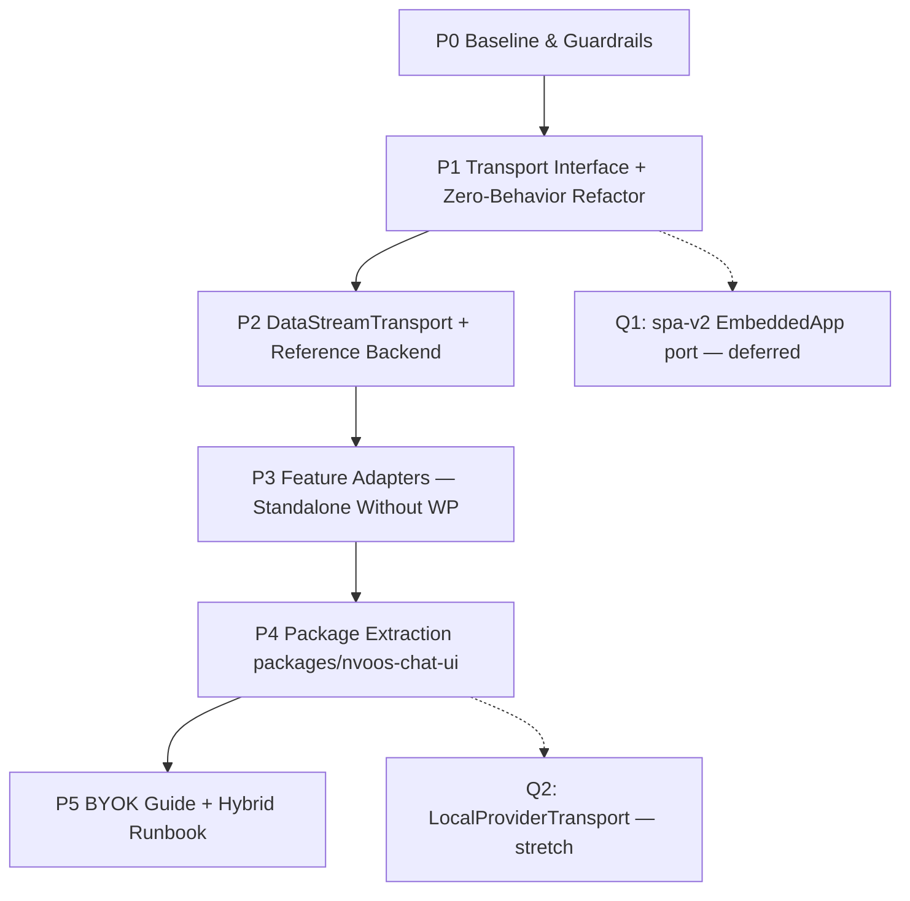

# Implementation Plan: Chat Frontend Transport Abstraction (BYOK Backend)

**Date:** 2026-10-24
**Status:** PROPOSED — not started
**Parent proposal:** `086-chat-frontend-transport-abstraction-proposal.md`
**Owner:** NV Digital Solutions

---

## 0. Summary

Execute the proposal in five phases so every intermediate commit keeps the
chat-spa suite, typecheck, a11y lint, and the esbuild bundle green. The
ordering rule is: **interface + zero-behavior refactor first, foreign transport
second, feature adapters third, packaging fourth, BYOK guide last** — because
the Data Stream transport must inherit an already-proven interface, and the
standalone story needs the null adapters before the package can claim
"no WordPress required."

All paths are repo-relative. The frontend lives at `addons/chat-spa/src/`; the
reference backend at `examples/chat-ui-provider-sdk/`; the extracted package at
`packages/nvoos-chat-ui/`.

Gates run per phase (see §G for the exact commands):

```
cd addons/chat-spa && npm run test && npm run typecheck && npm run lint:a11y && npm run build
```

---

## P0 — Baseline & Guardrails

### 0.1 Record the current seams
Document in the plan tracker (not code):

- `App.tsx` `useChat({ api, fetch: customFetch, streamProtocol: 'data' })` —
  the single wiring point (§1 of the proposal).
- `sse-adapter.ts` exports: `createChatFetch`, `translateFrame`,
  `parseSseBuffer`, `extractCapabilityFlags` — the frame translator.
- `src/api/*` surface per file: config, transcripts, memory, threads, tools,
  hitl, markdown, chartRecipes.
- Bundle sizes: record esbuild output totals (min+gzip) for the current build.

### 0.2 Confirm the green baseline
Run the full gate set and record results. Any pre-existing failure is fixed or
explicitly excluded before P1 starts (no new work rides along).

### 0.3 Docs housekeeping
- Add Proposal 086 to `docs/project/proposals/README.md` (status line) and
  `RELATED_PROPOSALS_INDEX.md`.

**Gate:** green baseline captured.

---

## P1 — Transport Interface + Zero-Behavior Refactor

### 1.1 Define the interface
Create `src/transport/types.ts`:

| Export | Purpose |
| --- | --- |
| `ChatTransport` | `id`, `capabilities`, `stream( request, ctx )` returning a Data Stream `ReadableStream` |
| `ChatTransportCapabilities` | `reasoningDeltas`, `toolLifecycle: 'nvoos' \| 'data-stream' \| 'none'`, `usageReporting`, `attachments` |
| `ChatTransportContext` | nonce, assistant id, guest flag, `allowSensitiveTools`, `AbortSignal` |

Keep the interface intentionally small: it must be implementable by a stock
`fetch` (Data Stream), the existing SSE parser, and — later — a local
provider client.

### 1.2 Wrap the existing adapter as `NvOosRestTransport`
Create `src/transport/nvoos-rest-transport.ts`:

- Move `createChatFetch` (and its private helpers) behind the `ChatTransport`
  interface — **no logic changes to `translateFrame` / `parseSseBuffer`**.
- Declare capabilities: `reasoningDeltas: true`,
  `toolLifecycle: 'nvoos'`, `usageReporting: true`, `attachments: true`.
- Keep `sse-adapter.ts` as a thin re-export during this phase so diff
  reviewers see pure moves; delete the shim at the end of P1.

### 1.3 Rewire `App.tsx`
Replace the `fetch: customFetch` wiring with transport construction:

```ts
const transport = useMemo( () => new NvOosRestTransport( { endpoint, nonce, assistantId, guest, allowSensitiveTools } ), [ ... ] );
const { messages, ... } = useChat( { id, api: endpoint, transport /* AI SDK 4 fallback: fetch: transport.toFetch() */, streamProtocol: 'data', ... } );
```

If the vendored `@ai-sdk/react` 1.2.12 has no `transport` option (AI SDK 5 API),
fall back to `fetch: transport.toFetch()` — the interface must support both
call shapes; note the v5 migration as a follow-on.

### 1.4 Tests
- Port existing sse-adapter tests to target `NvOosRestTransport` (rename
  fixture imports; assertions unchanged).
- Add capability-flag tests: `capabilities` of the shipped transport.

**Gate:** full gate set green; manual smoke of streaming, reasoning deltas,
tool calls, approvals, transcripts sidebar — all unchanged.

---

## P2 — `DataStreamTransport` + Reference Backend

### 2.1 Implement the transport
Create `src/transport/data-stream-transport.ts`:

- Stock `fetch` POST of the AI SDK message format (`{ messages, id }` +
  passthrough body) to a configurable endpoint; `streamProtocol: 'data'`.
- Capabilities: `reasoningDeltas: false`, `toolLifecycle: 'data-stream'`,
  `usageReporting: false`, `attachments: false` (v1).
- Auth: accept a configurable `headers` factory (token from config; **never
  hosted-provider keys in the bundle** — §2.4 of the proposal).

### 2.2 Degrade UI by capability
- When `reasoningDeltas` is false, hide reasoning accordions.
- When `toolLifecycle` is `'data-stream'`, keep the tool-call chips (Data
  Stream emits tool-input/tool-output frames) but disable NV oOS-only
  affordances (approval buttons, tool registry metadata).

### 2.3 Reference backend
Create `examples/chat-ui-provider-sdk/` (Node, Express or a plain
`node:http` route — smallest footprint):

- `POST /api/chat` → `streamText({ model: openai( ... ) }).toDataStreamResponse()`.
- Provider chosen by env (`OPENAI_API_KEY` / `ANTHROPIC_API_KEY` + a
  `MODEL_PROVIDER` switch) — one example, two SDKs.
- A tiny static host serving the built chat-spa UI pointed at `/api/chat`
  (reuse the `examples/nvoos-pro-spa-vite` alias recipe).
- README: env vars, run steps, and the explicit note that keys live
  server-side only.

### 2.4 Tests
- vitest for `DataStreamTransport` against a mocked Data Stream response
  (streaming text + a tool call round trip).
- Manual: run the reference backend with a real key; verify streaming and a
  tool call end-to-end.

**Gate:** full gate set green; reference backend demo passes the
multi-turn + tool-call smoke.

---

## P3 — Feature Adapters (Standalone Without WordPress)

### 3.1 Adapter interfaces
Create `src/features/types.ts` and implementations:

| Adapter | Default implementation | Null/in-memory implementation |
| --- | --- | --- |
| `TranscriptsAdapter` | existing `src/api/transcripts.ts` client | in-memory per-session store |
| `MemoryAdapter` | existing `src/api/memory.ts` client | in-memory, no persistence |
| `ThreadsAdapter` | existing `src/api/threads.ts` client | in-memory list |
| `ApprovalsAdapter` | existing `src/api/hitl.ts` client | auto-approve (opt-in flag) |
| `ToolsAdapter` | existing `src/api/tools.ts` client | static manifest or MCP `tools/list` (stretch) |

### 3.2 Wire `App.tsx` through adapters
Replace direct imports of `src/api/*` with the `ChatFeatureAdapters` bundle
from config. The default bundle preserves current behavior exactly (WP REST);
the null bundle is selected when config declares `backend: 'external'`.

### 3.3 Standalone demo
- Extend `examples/nvoos-pro-spa-vite` with a "no-WordPress" connection mode:
  chat via the reference backend, null feature adapters, no nonce, no WP
  origin.

**Gate:** full gate set green; standalone demo renders, chats, and retains
session history in memory without a single WP REST call.

---

## P4 — Package Extraction (`packages/nvoos-chat-ui`)

### 4.1 Move the reusable surface
Create `packages/nvoos-chat-ui/` (npm workspace, following the Proposal 065
pattern):

- `src/transport/*` + `src/features/*` interfaces (P1–P3 code).
- The UI components from `addons/chat-spa/src/components/` (unchanged
  rendering code).
- Exports: `createNvOosRestTransport`, `createDataStreamTransport`,
  `createLocalProviderTransport` (if Q2 approved), adapter interfaces, and the
  component set.

### 4.2 Re-point the consumers
- `addons/chat-spa` imports the package (bundler alias), keeping its WP glue
  (config loading, shortcode boot) local.
- Update `esbuild.config.cjs` and `vite.config.ts` aliases; keep the
  dual-React guard and the existing THIRD_PARTY_NOTICES discipline.

### 4.3 CI & size
- Workspace build in CI; size budget comparison against the P0 baseline
  (transport registry is tree-shaken per transport).

**Gate:** full gate set green in both `addons/chat-spa` and the package;
plugin build produces a working bundle.

---

## P5 — BYOK Guide, Hybrid Runbook, Follow-ons

### 5.1 BYOK with your provider SDK — guide
`docs/features/chat-byok-provider-sdk.md`:

- The three deployment shapes (§3.3 of the proposal) with diagrams.
- Security rules: keys server-side only; CORS; rate limiting; no key
  material in the bundle (cite §2.4).
- Worked example: wire the reference backend to `DataStreamTransport`.

### 5.2 Hybrid runbook
`docs/operations/chat-hybrid-external-backend.md` — WP keeps transcripts/
memory/approvals; chat stream points at the external backend; auth/nonce
notes; BFF same-origin posture (proposal §2.6).

### 5.3 Deferred follow-ons (track, do not start)
- spa-v2 `EmbeddedApp` port of the same seam (Q1).
- `LocalProviderTransport` (Q2) if approved.
- `@ai-sdk/react` v5 migration with the native `transport` option.
- Proposal 083's `packages/nvoos-spa-host/` extraction on top of P4.

**Gate:** docs reviewed; all open decisions (§8 of the proposal) recorded with
owners in the tracker.

---

## G — Gate Commands

```
cd addons/chat-spa
npm run test          # vitest run
npm run typecheck     # tsc --noEmit
npm run lint:a11y     # eslint --max-warnings 0 src/
npm run build         # esbuild production bundle
```

Package phase adds the workspace build (`npm run build -w packages/nvoos-chat-ui`).
PHP is untouched by this plan; if any PHP file changes, `php -l` each and run
the repo phpcs gate before merge.

---

## Sequencing & Dependencies



Each phase is independently shippable; P1 and P2 can be reviewed as separate
PRs. P3 and P4 change the same `src/` tree and should land sequentially.
