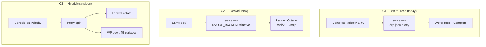

# Proposal 090-B — Laravel Admin Surfaces: Console Reuse and the WP-Parity Ladder

**Status:** Proposal (design) · **Date:** 2026-11-12
**Parent:** Proposal 090 — Laravel Octane Adapter Spike (implemented, PR #7602)
**Related:** Proposal 083 (Complete Console app), Proposal 084 (Admin-Surface Console Migration),
Proposal 085 + Laravel appendix (Funiq standalone), Proposal 143 (Service Exchange)
**Scope:** How the base and Pro admin surfaces reach a Laravel backend without porting ~290 PHP screens.

---

## 1. Executive summary

### 1.1 The finding

Proposal 090 delivered a verified **backend-only** Laravel application. Measured on the merge commit
(`5f92a39bfb`):

| Dimension | Laravel today | WordPress today |
|---|---|---|
| Domain contracts implemented | **9 of 58** (`AuthProvider`, `CacheStore`, `ContentStore`, `ErrorFactory`, `EventDispatcher`, `FileStore`, `HttpClient`, `QueueClient`, `SettingsStore`) | 51 adapter files, ~50 contracts |
| Registered tools | **1** (`color_convert`) | ~358 base / ~1,388 Pro (docs) |
| Admin pages | **0** | 127 base PHP files + 163 Pro files |
| REST controllers | 4 spike routes (`/health`, `/dev/tools/{slug}`, `/chat/stream`, `/mcp`) | 35 base + ~4 Pro `mcp-ai-pro/v1` controllers |
| Admin transport | none | REST + **214 admin-ajax call sites** per side (084 baseline) |

The hexagonal split is intact: the **domain and application layers are shared** (same `nvoos/core`),
so no business logic needs rewriting. The gap is the **edge**: platform ports, tool registration,
and every administrative surface.

### 1.2 The thesis

**Do not port the screens. Port the contract.**

Proposals 083 and 084 already define and ship a React admin surface — the Complete Console
(`examples/nvoos-complete-velocity`) compiling `addons/pro/assets/spa-v2` at build time. The SPA:

- has **31 feature folders** and **39 TypeScript API/util modules**;
- sends `X-WP-Nonce` and `credentials: 'include'` through a small set of request helpers;
- reads its backend from one object, `window.NVOOS_PRO_SPA` (`apiUrl`, `proApi`, `nonce`, `config`);
- uses **no** `wp.media`, `wp.ajax`, or `wp.apiFetch` calls (verified).

That makes the console a **backend-shape adapter**, not a WordPress artifact. If Laravel serves the
same REST contract, the same `dist/` becomes the Laravel admin. This converts an O(screens) project
(~290 files) into an O(endpoints) project, and it keeps one UI codebase across both runtimes.

Pro parity follows the same logic. The Pro admin is **template-driven**, not 163 bespoke screens:

| Pro page family | Base class | Instances |
|---|---|---|
| Toolkit settings | `WP_MCP_AI_Toolkit_Settings_Base` | ~20 |
| Research & Add | `WP_MCP_AI_Research_Add_Base` | ~35 |
| Consolidate & Add | `WP_MCP_AI_Consolidate_Add_Base` | ~6 |
| Command centers / dashboards | per-toolkit, shared patterns | ~10 |
| CPT/CCT settings + metaboxes | `WP_MCP_AI_CPT_Settings_Page_Base` | remainder |

Five generic Laravel screens plus a per-toolkit **manifest** cover the majority of that surface.
The remaining WordPress-native screens stay in WordPress by design (Proposal 084 tier T5).

### 1.3 What this proposal decides

1. The Complete Velocity app is the **single admin chassis** for both runtimes.
2. Laravel implements the `mcp-ai/v1` and `mcp-ai-pro/v1` **contract shapes** (path-rewritten),
   not a new bespoke admin API.
3. Pro parity ships through a **Toolkit Manifest + five generic screens**, not per-page ports.
4. WordPress keeps every T5 surface (Elementor, JetEngine, WooCommerce, WPCode, Rank Math,
   plugin/theme screens, network admin) and remains a peer during the transition.
5. The work is sequenced in five gated phases; "credible admin" is T0–T2, Pro is demand-driven.
6. Runtime profile is **one artifact** selected by `NVOOS_BACKEND`, with a startup contract assertion
   (Q1 resolved, ADR-6).
7. Console auth is **Sanctum SPA cookie mode, same-origin only**; `X-WP-Nonce` remains an alias
   through Phase 4 and is removed in Phase 5 (Q2 resolved, ADR-4).
8. Pro entitlement is a **seam** (`ProEntitlement` + dev `allow` driver), not a build blocker; the
   commercial source is decided before selling, not before building (Q3 resolved, ADR-7).

---

## 2. Baseline

### 2.1 What Proposal 090 delivered

- Octane + FrankenPHP runtime, 30-minute soak, 0 errors.
- `laravel/mcp` v1.2 serving both MCP eras at `/mcp`.
- SSE chat streaming, a queue job with retry/status (`nvoos_jobs`), Sanctum credentials,
  a health probe, and one real tool.
- **No** assistant store, **no** bundle import, **no** transcripts/memory, **no** analytics,
  **no** admin UI.

The spike's own next-step list names "optional admin dashboard" — this proposal supersedes that
with a reusable strategy rather than a one-off Blade page.

### 2.2 What Proposals 083 and 084 built

- **083** — the Complete Console: a Cloudways Velocity app serving the full spa-v2 surface through a
  same-origin cookie BFF (`scripts/serve.mjs` proxies `/wp-json`, `/wp-admin`, `/wp-login.php`,
  `/wp-includes`), a console shell, a dashboard home, and a persistent chat dock.
- **084** — the admin-surface migration: a six-tier difficulty model (T0–T6), per-page feature flags,
  `GET /mcp-ai/v1/features`, a settings schema/values engine, ops/diagnostics/token-manager pages,
  schedule manager, workflow builder, records/dashboards, and a REST contract parity audit that fixed
  nine client/server mismatches.

**090-B is 084's T1–T4 contract, re-hosted on Laravel.** 084 answered "which surfaces can move to the
console?"; 090-B answers "which backend serves them when WordPress is not there?".

### 2.3 Measured inventory (2026-11-12)

| Item | Count | Source |
|---|---|---|
| Base admin | 91 entries in `includes/admin/` (84 top-level PHP + support dirs/readme; 084 counted 127 PHP files incl. `sections/`, `widgets/`, `export/`, `measurement/`) | `ls`, 084 §3.2 |
| Pro admin | 163 entries in `addons/pro/includes/admin/` (084: 159 + 4 pages elsewhere) | `ls`, 084 §3.3 |
| Base REST controllers | 35 | 084 §3.2 |
| Pro REST controllers | ~4 + `nvoos-media-studio/v1` + `jet-engine/v1/mcp` | 084 §3.3 |
| admin-ajax call sites | 214 per side | 084 |
| SPA features | 31 folders | `spa-v2/src/features` |
| SPA API modules | 39 TypeScript files | `spa-v2/src/api` |
| Console shell routes | 11 + chat dock | `examples/nvoos-complete-velocity/README.md` |

### 2.4 The contract gap by console family

| Console family | Laravel contract(s) required | Status |
|---|---|---|
| Chat + dock | `ChatService`, `ChatContinuation`, `StreamingProvider`, `ContextCompression` | Core chat works in the spike; service adapters missing |
| Assistants / teams | `AssistantService`, `AgentOrchestration`, `ProfessionRepository` | **Missing** |
| Tools | `ToolResolver`, `ToolExecution`, `ToolGuard`, `ToolAsyncExecutor`, `ToolLoadBalancer` | Registry exists; execution adapters missing |
| Analytics / cost | `TokenUsage`, `TokenBudgetService`, `CostTrackingService`, `PerformanceMonitor` | **Missing** |
| Approvals / workflows | `OrchestrationControl`, queue + events | **Missing** |
| Transcripts / memory / sessions | `TranscriptStore`, `MemoryStore`, `SessionLogStore` | **Missing** |
| Settings | `SettingsStore`, `SchemaStore` | `SettingsStore` done; schema engine missing |
| Security / tokens | `AuthProvider`, `RateLimiter`, audit log | Auth done; rate limit + audit parity missing |
| Media / documents | `FileStore`, `ImageProcessing`, `OcrService`, `VisionInference`, `FileUploadService` | `FileStore` done; the rest missing |
| Commerce | `ContentStore` + Pro domain services | Content done; Pro services missing |

---

## 3. Research and industry standards

| Area | Standard / evidence | Consequence for 090-B |
|---|---|---|
| Migration strategy | Strangler Fig (Fowler); already the repo doctrine in 084 §2.1 and 085 §5 | Build alongside, route page families one at a time, retire nothing early |
| Admin frontend | SPA shell + BFF same-origin (083 §2.3; OWASP session guidance) | Keep the cookie BFF; do not expose bearer tokens to the browser |
| API contracts | Contract-first with golden fixtures (085 appendix; 084's parity audit) | Capture WP responses, run identical suites against both backends |
| Laravel auth | Sanctum SPA cookie mode (stateful domains + `/sanctum/csrf-cookie` + `X-XSRF-TOKEN`), Policies for authorization | Console uses cookie mode; MCP/API use bearer tokens |
| Laravel runtime | Octane worker lifecycle; no per-request mutable singletons; `octane:reload` on deploy | Adapters and registries must be `scoped`/stateless (090 already fixed `ChatOrchestrator`, `SseHandler`) |
| Laravel validation | Form Requests + API Resources; typed DTOs at the edge | Replace WP `WP_Error` envelopes with a mapped error shape |
| Admin as schema | WP core's React admin migration; Laravel Nova/Filament demonstrate metadata-driven admin | Pro toolkits become manifests, not controllers |
| WordPress REST | `permission_callback` + `args` schema + canonical envelope | The Laravel contract must enforce the same capability and envelope rules |

---

## 4. Architecture decisions

### ADR-1 — Reuse the Complete Velocity chassis (accepted)

**Context.** Two admin UIs would double maintenance and diverge within one release.
**Decision.** `examples/nvoos-complete-velocity` remains the only admin front end. Its `dist/` is
served unchanged for both backends.
**Consequences.** Any admin feature must be expressible as a REST contract. UI-only WP-native flows
cannot migrate and fall to T5.

### ADR-2 — Contract compatibility, path-rewritten (accepted)

**Context.** The SPA calls relative paths under `apiUrl`/`proApi`, plus a handful of absolute
WordPress paths (`/wp-json/wp/v2/users/me`, `/session/nonce`, media).
**Decision.** Laravel serves the same resource shapes under `/api/v1` (core) and `/api/v1/pro`
(Pro). `runtime-config.ts` selects the base URL and the auth mode. WordPress-specific absolute paths
get two small shims: `GET /api/v1/session/nonce` and `GET /api/v1/session/me`.
**Consequences.** No per-feature SPA rewrite. The contract suite is the source of truth. A small
number of WP-shaped fields (e.g. `context=edit`) are accepted and ignored.

### ADR-3 — Manifest-driven Pro screens (accepted)

**Context.** 163 Pro admin files derive from five base classes; porting them individually would take
months and reproduce boilerplate.
**Decision.** Implement five generic Laravel screens (toolkit settings, entity workbench,
research & add, consolidate & add, command center) driven by a `ToolkitManifest`.
**Consequences.** A new toolkit is data + a service class, not a page. Per-toolkit bespoke behaviour
must be expressed as manifest fields or a documented hook.

### ADR-4 — Two auth modes, one capability map (accepted)

**Context.** WordPress uses cookies + `wp_rest` nonce + capabilities; Laravel uses Sanctum + Gates.
**Decision.**

- Console: Sanctum SPA cookie mode, same-origin, CSRF via `X-XSRF-TOKEN`.
- Compatibility: Laravel middleware also accepts `X-WP-Nonce` and validates it against the session
  token, so the SPA's request modules need no edit in Phase 0. The SPA migrates to `X-XSRF-TOKEN` in Phase 5.
- API/MCP: bearer tokens (Sanctum abilities), never cookies.
- Authorization: Laravel Policies + a fixed capability map (§10.1).
- Same-origin only: the console proxies; no cross-site cookie and no credentialed CORS. Fortify/full
  session auth is deferred unless Laravel becomes the identity source.
- Nonce alias lifecycle: `X-WP-Nonce` is accepted in Phases 0–4 and removed in Phase 5, once the SPA
  sends `X-XSRF-TOKEN`.
**Consequences.** One middleware class replaces a client-wide refactor. CSRF semantics stay
server-enforced, and the compatibility shim has an explicit removal release.

### ADR-5 — Strangler, with WordPress as a peer (accepted)

**Context.** Several surfaces are WordPress-native by design (Proposal 084 T5): Elementor, JetEngine,
WooCommerce admin, WPCode, Rank Math, plugin/theme install, network admin.
**Decision.** These never port. The console deep-links to the WordPress peer (or marks them
"not available on this runtime"). Pro toolkits port only when a product requires them.
**Consequences.** "Full parity" is not a goal. Every manifest declares `wp_only` capabilities.

### ADR-6 — One console, two runtime profiles (accepted)

**Decision.** `serve.mjs` gains `NVOOS_BACKEND=wordpress|laravel`; the runtime config gains a
Laravel profile. The Laravel profile performs a **startup contract assertion** against
`GET /api/v1/features`; a missing or mismatched contract fails the page load instead of rendering
empty screens. Deployment, caching, and the mirror release process are unchanged.
**Consequences.** The Service Exchange can deploy the same console artifact for both estate types
(§7.5). The mirror repo owns the env contract and must document `NVOOS_BACKEND` and
`NVOOS_TARGET_SITE`.

### ADR-7 — Pro entitlement is a seam, not a blocker (accepted)

**Context.** The current licence is a WordPress **record**, not a runtime gate:
`WP_MCP_AI_Pro_License::is_pro_active()` defaults to true, the key/status/plan/expires are WP
options activated against a licence server with `get_site_url()`, and the Pro addon loads by plugin
presence. A Laravel port therefore needs a commercial/distribution decision, not a feature check to
boot.

**Decision.**

- Define `ProEntitlement` with `allows(string $feature): bool` and a typed
  `not_supported_on_runtime` result.
- Ship an `allow` driver for dev/CI and a `deny` driver for base-only builds.
- Keep paid surfaces behind the seam; do not invent a licence server for Phase 4.
- Choose the commercial source (the existing licence server with a Laravel instance ID, or the
  gateway/commerce entitlement) before GA/selling, not before Phase 4.
**Consequences.** Phase 4 can ship without a licence decision; commercial launch cannot. Fail-closed
is a configuration choice, not a code fork.

---

## 5. Surface inventory and tiers

Tier definitions are Proposal 084's, unchanged:

| Tier | Meaning | Laravel approach |
|---|---|---|
| T0 | Already a console route | Keep; add Laravel endpoints |
| T1 | REST controller exists | Port the controller on a core service |
| T2 | admin-ajax only, service exists | New REST controller, then T1 |
| T3 | Settings/options page | Settings schema engine + generic form |
| T4 | Entity workflow from a shared base class | One resource controller + manifest per toolkit |
| T5 | WordPress-native / third-party | Deep-link or mark unavailable |
| T6 | WP core / third-party screens | Never migrate |

### 5.1 Base admin families

| Family | Examples | Tier | Laravel owner |
|---|---|---|---|
| Settings | dashboard, providers, auth, tools, integrations, security, advanced, transparency | T3 | `SettingsStore` + new `SchemaStore` |
| Assistants | add/build/test assistant, presets, default assistant | T1/T4 | `AssistantService` (new) |
| Teams & professions | add/test team, profession settings/research | T1/T4 | `ProfessionRepository`, team service |
| Chat & transcripts | chat, conversation import, transcript mining | T1 | `ChatService`, `TranscriptStore` |
| Tools | registry, filter bar, orchestration renderer, capability flags | T1 | `ToolResolver`, `ToolExecution` |
| Operations | cron, DLQ, DAG builder, workflow editor, run timeline, approvals, triggers | T2 | `CronStatus`, `OrchestrationControl`, queue |
| Observability | analytics, performance, telemetry, diagnostics, site health | T1/T2 | `PerformanceMonitor`, `TokenUsage` |
| Tokens & security | token manager, key rotation, Auth0 setup, audit/monitor/training | T1 | `AuthProvider`, `RateLimiter`, audit store |
| Media & content | media columns, datasets, OKF bundles, asset inventory | T1/T2 | `FileStore`, `FileUploadService` |
| Integrations | Elementor, JetEngine, WooCommerce, plugins, Crawl4AI, Gmail | T5 | Keep in WordPress |
| Pro bridge | Pro dashboard shell, license, database, REST | T2 | `ProEntitlement` seam (ADR-7) |
| User profile | chat profile, memory | T1 | `MemoryStore` |

### 5.2 Pro admin families

| Family | Count | Tier | Laravel approach |
|---|---|---|---|
| Toolkit settings | ~20 | T3 | Manifest sections → settings form |
| Research & Add | ~35 | T4 | One generic entity-create/import screen |
| Consolidate & Add | ~6 | T4 | One generic merge screen |
| Command centers / dashboards | ~10 (CRM, Media, PM, Agent, CRE, F&B, ECA, Health, Law, Registration) | T4 | Manifest dashboard blocks |
| CPT/CCT workbenches + metaboxes | remainder | T4/T5 | Generic resource screen; metabox-only WP integrations stay T5 |
| Portal & ops | remote sites, MCP servers, schedule manager, workflow builder, packages, incidents, maintenance, webhooks | T1/T2 | Dedicated controllers on core services |
| Widgets | EzUite, FlowHub, Shopify sync, toolkit enhancement | T2/T5 | Dashboard-widget contract or WP peer |

**Named toolkit families in scope for manifests:** architectural design, calendar booking, comic,
CRE debt, CRM, ECA, ecommerce, events, financial planner, F&B, health & wellness, image production,
law firm, media, project management, regulatory/registration, quiz, place, policy, post, product,
project, schedule, skill, video production, document generation, DJ management, DietPi, ICP,
imaging, password vault, OKF, multilingual, social media, support ticket, Shopify sync, site creator,
EzUite, FlowHub, Cloudways, NV Cloud, addons, packages, remote sites, MCP servers.

---

## 6. The Laravel contract

### 6.1 Core contract families (`/api/v1`)

| Family | Representative routes | Laravel implementation |
|---|---|---|
| Features | `GET /features` | Feature flag store (084's flags) |
| Session | `GET /session/nonce`, `GET /session/me` | XSRF token + `Auth::user()` + ability list |
| Assistants | `GET/POST /assistants`, `GET/PATCH/DELETE /assistants/{id}`, tools, test | `AssistantService` on Eloquent + portability |
| Chat | `POST /chat`, `POST /chat/stream` | Core `ChatOrchestrator` + Octane streamed response |
| Tools | `GET /tools`, `POST /tools/{slug}` | `ToolRegistry` + `ToolExecution` adapter |
| Transcripts | list/get/export | `TranscriptStore` on Eloquent |
| Memory | preferences, facts, search | `MemoryStore` (DB + optional pgvector) |
| Teams | CRUD, members | Team service + policies |
| Settings | schema, values, validate | Settings schema engine (T3) |
| Approvals | pending, approve, reject | `OrchestrationControl` |
| Workflows | CRUD, run, DSL import/export | Core workflow services + queue |
| Triggers | CRUD, test | Core trigger service |
| Analytics / cost | summary, trend, provider breakdown | `TokenUsage`, `CostTrackingService` |
| Tokens | list, issue, revoke | `AuthProvider` (Sanctum) |
| Portability | export, import, preview | Portability engine (shared package) |
| Paper store | list/read/write/delete | Storage + metadata adapter |
| Records | generic entity CRUD | `ContentStore` + manifests |
| Media | upload, list, variants | `FileStore` + `ImageProcessing` |

### 6.2 Pro contract families (`/api/v1/pro`)

`/ops/overview`, `/diagnostics/*`, `/analytics/*`, `/approvals/*`, `/workflows/*`,
`/schedule-manager/*`, `/workflow-builder/*`, `/commerce/*`, `/media-ops/*`, `/dashboards/*`,
`/records/*`, `/remote-sites/*`, `/security-center/*`, `/command-center/*`, `/toolkits/*`.

Each maps to a core service plus a Pro domain service. Where the Pro service is WordPress-bound
(licensing, CPT storage), the endpoint either proxies the WP peer or returns a typed
`not_supported_on_runtime` error that the SPA renders as an unavailable page.

### 6.3 Envelope, errors, pagination

- **Success:** the canonical `{ success: true, data: ... }` envelope the SPA already reads.
- **Errors:** map Laravel validation/policy failures to
  `{ success: false, error: { code, message, data: { status } } }`. `WP_Error` codes are preserved
  as the `code` field so client branches keep working.
- **Pagination:** `{ items, total, page, per_page }`, matching 084's resources.
- **Meta:** `_meta` passthrough for diagnostics and gateway data.
- **Dates:** ISO-8601 UTC strings, not WordPress `date_i18n`.

### 6.4 Golden fixtures

Phase 0 captures request/response pairs from the WordPress implementation for every enabled family
and stores them as JSON fixtures. The same suite runs against Laravel; drift is a CI failure.
This is the 085 appendix's contract-freeze doctrine applied to admin routes.

---

## 7. Complete Velocity: where it fits

### 7.1 What the app is today

A Vite/React host that compiles `addons/pro/assets/spa-v2` through a path alias (no fork), ships a
console shell (sidebar, dashboard, chat dock), and serves `dist/` from a zero-dependency Node host.
The host proxies WordPress same-origin and injects `window.NVOOS_PRO_SPA`.

**The backend seam is one file:** `examples/nvoos-complete-velocity/src/runtime-config.ts`.

```
window.NVOOS_PRO_SPA = {
  apiUrl:  `${origin}/wp-json/mcp-ai/v1`,
  proApi:  `${origin}/wp-json/mcp-ai-pro/v1`,
  nonce:   <wp_rest nonce>,
  config:  { mode: 'admin', ... },
}
```

### 7.2 Deployment topologies



| | **C1 — WP** | **C2 — Laravel** | **C3 — Hybrid** |
|---|---|---|---|
| Console artifact | Current `dist/` | Same `dist/` | Same `dist/` |
| Proxy target | `/wp-json` → WP | `/api`, `/mcp`, `/sanctum` → Laravel | Split by path prefix |
| Auth | Cookie + `wp_rest` nonce | Sanctum SPA cookie + XSRF | Both, per path |
| Backend switch | `NVOOS_BACKEND=wordpress` | `NVOOS_BACKEND=laravel` | `NVOOS_BACKEND=hybrid` |
| Use | Every WP estate | Laravel estates, Funiq T2, Service Exchange Laravel | Migration window |

**Recommendation:** C2 is the target; C3 exists only for migrations where a T5 surface is still
required. C1 remains the default and must not regress.

### 7.3 What changes in the console host

| File | Change |
|---|---|
| `src/runtime-config.ts` | Add a Laravel profile: `apiUrl = /api/v1`, `proApi = /api/v1/pro`, nonce from `/api/v1/session/nonce`, user from `/api/v1/session/me` |
| `scripts/serve.mjs` | `NVOOS_BACKEND` switch; proxy `/api/*`, `/mcp`, `/sanctum/csrf-cookie`; keep the WP proxy intact; per-backend cache rules |
| `src/fetch-wrapper.ts` | No change required (401 signal is backend-neutral) |
| `src/console/ConsoleSidebar.tsx` | Capability-filter the nav from the session payload (fixes the 084 §3.1 gap and is required for both backends) |
| `src/login.ts` | WP login flow stays for C1; C2 uses the Laravel login/session endpoint; magic link is WP-only |
| Build | One build, two runtime profiles; no fork |

### 7.4 Chat and SSE under Octane

The spike already proved SSE through a Laravel `StreamedResponse` with
`SseHandler::markHeadersSent()`, `CancellationToken`, and a persistent 2-worker Octane pool.
The console's `createChatFetch` and SSE adapter are backend-neutral once `apiUrl` points at
`/api/v1`. Requirements carried forward:

- `max_execution_time=0` (or a bounded value above the longest stream) — production hardening item.
- `octane:reload` in the deploy sequence; no route/config cache staleness.
- Rate limits raised in local/testing only (the spike's 60,000/min local override).

### 7.5 Service Exchange integration (Proposal 143)

The Exchange's `console_deployed` step currently assumes the Complete Console proxies WordPress.
With C2 that step becomes **runtime-aware**:

- same console repo, same Velocity deploy;
- per-estate env: `NVOOS_BACKEND`, `NVOOS_TARGET_SITE` (Laravel origin), `NVOOS_CONSOLE_MODE`;
- verification probes the console `/health` plus one authenticated console page;
- a Laravel estate therefore satisfies `console_deployed` **without any PHP admin in Laravel**.

This closes the gap identified for Proposal 143 without a second admin product.

### 7.6 Why not a Blade/Filament admin

Filament or Nova would produce a second UI, a second design system, and a second capability model.
The SPA already has the pages, the design tokens, and 084's parity work. A Blade admin remains a
valid **T0 fallback** only if the console cannot be made backend-neutral (it can).

---

## 8. Phases and gates

| Phase | Scope | Effort | Gate |
|---|---|---|---|
| **0 — Contract freeze** | Capture golden fixtures; capability map; runtime-config profile; `serve.mjs` switch; feature flags; `ProEntitlement` seam + `allow`/`deny` drivers; startup contract assertion | 1 week | Console boots against a stub Laravel backend with no WP; a missing contract fails loudly |
| **1 — T0 ops console** | Health, diagnostics, operations, tools (read-only), settings (read-only), chat | 2 weeks | G1: console renders 5 pages + chat against Laravel; zero WP requests |
| **2 — T1 assistant studio** | `AssistantService`, Eloquent models, portability, assistant CRUD/test, blueprints, teams (basic), tool enable/disable | 4–6 weeks | G2: assistant create → export → import round-trip; bundle imported from the Service Exchange |
| **3 — T2 core operations** | Transcripts, memory, sessions, tokens, cost/usage, approvals, schedules, triggers, analytics, security center, records, paper store (~20 adapters) | 6–8 weeks | G3: contract suite green for every enabled family; auth matrix green |
| **4 — T3 Pro families** | Manifest engine (5 generic screens) + 3 pilot toolkits (commerce, media, documents), all behind `ProEntitlement`, then demand-driven | 4–6 weeks engine + 2–4 per family | G4: pilot toolkit installed from a manifest with zero bespoke PHP pages; paid surfaces return the typed entitlement error under the `deny` driver |
| **5 — GA hardening** | SSO, CSRF header migration (`X-XSRF-TOKEN`), capability-filtered nav, commercial entitlement source wired (if selling), upgrade path, observability, docs | 3–4 weeks | G5: two consecutive releases with no contract drift; nonce alias removed |

**Definition of "credible admin":** Phases 0–3. Everything after that is demand-driven.

---

## 9. The Toolkit Manifest

One JSON document per toolkit, stored with the toolkit service and served read-only to the SPA.

```json
{
  "slug": "commerce",
  "name": "E-Commerce Toolkit",
  "version": 1,
  "capability": "manage_nvoos_commerce",
  "icon": "cart",
  "feature_flag": "enable_woocommerce_toolkit",
  "entities": [
    {
      "name": "product",
      "storage": "woo|native",
      "fields": [
        { "key": "title", "type": "text", "required": true },
        { "key": "price", "type": "money", "currency": "profile" },
        { "key": "status", "type": "enum", "values": ["draft", "publish"] }
      ]
    }
  ],
  "settings_tabs": [
    { "id": "overview", "type": "overview" },
    { "id": "configuration", "type": "schema", "schema": "commerce.settings" },
    { "id": "tools", "type": "tools" },
    { "id": "research", "type": "research" }
  ],
  "tools": ["commerce_list_products", "commerce_update_product"],
  "research": { "enabled": true, "import_formats": ["csv", "xlsx"] },
  "dashboards": [{ "id": "overview", "blocks": ["kpi", "sync-runs", "recent"] }],
  "wp_only": ["woocommerce-admin"]
}
```

Generated by the engine:

1. nav entry + capability gate;
2. settings form (schema-driven);
3. entity workbench (list/edit/delete);
4. research & add flow;
5. consolidate flow where declared;
6. dashboard blocks;
7. REST resource routes under `/api/v1/pro/toolkits/{slug}`;
8. MCP tool binding by slug;
9. contract tests from the manifest's field types.

A toolkit with no manifest cannot appear in the console — the manifest is the migration contract.

---

## 10. Security

### 10.1 Capability map

| WordPress | Laravel ability |
|---|---|
| `manage_options` | `admin` |
| `edit_others_posts`, `publish_posts` | `editor` |
| `edit_posts` | `author` |
| `read` | `viewer` |
| `manage_nvoos_*` (custom) | same name, granted explicitly |

Rules:

- Every route has a policy or ability check; no `__return_true` on state-changing routes.
- Object-level checks (assistant ownership, tenant/estate scope) are mandatory, mirroring the
  repository's REST standards.
- The session payload advertises the ability list; the console filters nav from it
  (fixes the 084 gap).

### 10.2 CSRF and session

- Console: Sanctum SPA cookie mode; `/sanctum/csrf-cookie`; `X-XSRF-TOKEN`.
- Compatibility: `VerifyCsrfToken` alias accepts `X-WP-Nonce` and validates it against the session
  token (constant-time), so no SPA client changes in Phase 0.
- Cookies: `HttpOnly`, `Secure`, `SameSite=Lax`; session driver database or Redis; no tokens in
  `localStorage`.
- Bearer tokens only for MCP/API; never sent by the browser console.

### 10.3 Operational controls

- Rate limiting per ability and per route (`RateLimiterInterface` adapter).
- Read-only profile parity (Proposal 015) for demo/guest surfaces.
- Audit log written for privileged mutations; same event names as WordPress where possible.
- File uploads: MIME allowlist, size cap, storage disk isolation, no executable paths.
- SSRF guard on remote-site and HTTP-client routes (the repository already has a URL guard pattern).
- Secrets: `.env` + encrypted settings; never returned by settings endpoints (masked values only).

---

## 11. Test matrix

| Layer | Suite | Gate |
|---|---|---|
| Contract | Golden fixtures captured from WordPress, replayed against Laravel | Every enabled family; Phase 0 onward |
| Unit | New adapters (assistant, transcript, memory, token usage, rate limiter, schema) | 80% line coverage on new code |
| Feature | Auth matrix: admin / editor / author / viewer / guest / bearer | Every mutating route |
| Policy | Object-level access (other user's assistant, other estate) | Must 403, never 404-leak |
| UI | Playwright: console page smoke against Laravel (login → 5 pages → chat) | Phase 1 gate |
| Chat | SSE frame ordering, abort mid-stream, reconnect, `Last-Event-ID` (deferred) | Phase 1 |
| Queue | Job retry/backoff/timeout, `nvoos_jobs` transitions | Phase 3 |
| Performance | `/health` p95, SSE concurrency, Octane worker memory | Phase 5 |
| Soak | 30-minute stream soak with 0 errors | Phase 5 |
| Drift | Contract fixture diff between WP and Laravel in CI | Every PR touching either backend |

---

## 12. Effort model

Indicative person-weeks; confidence medium until Phase 0 fixtures exist.

| Workstream | Person-weeks |
|---|---|
| Phase 0 — contract freeze, runtime profile, harness | 1 |
| Phase 1 — T0 ops console | 2 |
| Phase 2 — assistant studio + portability | 4–6 |
| Phase 3 — core operations (~20 adapters) | 6–8 |
| Phase 4 — manifest engine | 4–6 |
| Phase 4 — per Pro family (after engine) | 2–4 each |
| Phase 5 — GA hardening | 3–4 |
| **Credible admin (0–3)** | **13–17** |
| **Pro parity** | **Not scheduled; demand-driven** |

Phase 0 includes the `ProEntitlement` seam and the startup assertion; both are multi-day, not
multi-week, and do not change the estimate.

For comparison, a literal 1:1 port of ~290 PHP admin files at 0.5–2 days each is **7–24 months**
before test and design work — and it would produce a second UI to maintain.

---

## 13. Risks, non-goals, open questions

### Risks

| Risk | Likelihood | Mitigation |
|---|---|---|
| Contract drift between WP and Laravel | High | Golden fixtures + CI diff + a single contract owner |
| Two backends double the bug surface | Medium | One UI; parity suite; feature flags per family |
| Auth mismatch (nonce vs CSRF, cookie domains) | Medium | Compatibility middleware; same-origin only; no cross-site cookies |
| Pro licence/entitlement is WordPress-bound | Low (technical) | **Resolved:** the licence is a WP record, not a runtime gate. Build behind `ProEntitlement`; decide the commercial source before selling (ADR-7) |
| Octane state leaks across requests | Medium | `scoped` bindings, no mutable singletons, soak gate |
| Proxy cache serves authenticated pages | Low | Keep the default-deny micro-cache and `Vary: Cookie` rules |
| WP-native integrations silently disappear | High | Manifest `wp_only` + explicit "unavailable on this runtime" UI |
| Scope creep into a "full WP replacement" | High | T5 is a non-goal; each family needs a product owner |

### Non-goals

- 1:1 parity with all 290 admin files.
- Rebuilding or forking the SPA.
- Porting WordPress core or third-party plugin screens (T6).
- Multisite network admin in Laravel.
- A Blade/Filament admin.
- Migrating WP-native integrations (Elementor, JetEngine, WooCommerce admin, WPCode, Rank Math).

### Resolved decisions (2026-11-12)

| ID | Decision | ADR |
|---|---|---|
| Q1 — Runtime profile | One artifact + `NVOOS_BACKEND` + startup contract assertion | ADR-6 |
| Q2 — Session model | Sanctum SPA cookie mode, same-origin only; nonce alias through Phase 4, XSRF from Phase 5 | ADR-4 |
| Q3 — Pro entitlement | `ProEntitlement` seam + dev `allow` driver; commercial source before GA, not before Phase 4 | ADR-7 |

### Open questions

1. **Q4 — Pro toolkits as peers.** Do any Pro toolkits stay WordPress-only indefinitely (federation),
   or is every family ultimately portable?
2. **Q5 — Minimum Laravel admin.** Should the Service Exchange require T0 only for a Laravel estate,
   with T1 as an upsell?
3. **Q6 — SSO.** Does the console share a cookie/domain with the Laravel app, or does it always proxy
   same-origin?

---

## 14. References

- `docs/project/plans/090-laravel-adapter-spike-implementation-plan.md` and `-report.md`
- `docs/project/proposals/083-nvoos-complete-console-app-proposal.md`
- `docs/project/proposals/084-admin-surface-console-migration-gap-analysis.md`
- `docs/project/proposals/085-funiq-laravel-standalone-integration-appendix.md`
- `docs/project/proposals/143-expert-service-exchange-implementation-plan.md`
- `examples/nvoos-complete-velocity/README.md`, `src/runtime-config.ts`, `scripts/serve.mjs`
- `addons/pro/assets/spa-v2/src/features/`, `src/api/`
- `lib/core/src/Domain/Contract/`, `lib/laravel-adapter/src/Adapter/`, `lib/wordpress-adapter/src/Adapter/`
- `includes/admin/class-wp-mcp-ai-pro-license.php`, `addons/pro/mcp-ai-wpoos-pro.php` (licence record vs. runtime gate)
- Laravel: Sanctum SPA authentication, Policies, Octane worker lifecycle, Form Requests
- OWASP: session management, CSRF prevention, file upload security
- Fowler, "Strangler Fig Application"

---

## Appendix A — spa-v2 feature inventory (31)

`analytics`, `approvals`, `assistants`, `blueprints`, `chat`, `chat-channels`, `commerce`,
`dashboards`, `diagnostics`, `docs-hub`, `document-editor`, `embedded`, `knowledge-graph`,
`media-ops`, `media-studio`, `operations`, `orchestration-stats`, `paper-store`, `portability`,
`pro-ops`, `records`, `remote-sites`, `schedule-manager`, `security-center`, `settings`,
`slash-commands`, `teams`, `token-manager`, `tools`, `triggers`, `workflows`.

Console shell routes: `/` dashboard, `/chat`, `/assistants`, `/tools`, `/workflows`, `/analytics`,
`/knowledge-graph`, `/docs`, `/media`, `/documents`, `/settings`.

## Appendix B — Pro admin page families

From Proposal 084 §3.3, re-verified 2026-11-12:

- Toolkit settings (~20) — `WP_MCP_AI_Toolkit_Settings_Base`
- Research & Add (~35) — `WP_MCP_AI_Research_Add_Base`
- Consolidate & Add (~6) — `WP_MCP_AI_Consolidate_Add_Base`
- Command centers — CRM, Media, PM, Pro Agent
- CPT/CCT settings, metaboxes, columns, bulk AI actions
- Portal/ops — remote sites, MCP servers, schedules, workflows, packages, incidents, maintenance,
  webhooks, status
- Dashboard widgets — EzUite, FlowHub, Shopify sync, toolkit enhancement

## Appendix C — SPA API modules (39 files)

Clients: `analytics`, `approvals`, `assistants`, `blueprints`, `chat-channels`, `chatProfile`,
`command-center`, `commerce`, `dashboards`, `diagnostics`, `hitl`, `media`, `media-ops`, `memory`,
`okf`, `operations`, `orchestration-stats`, `paper-store`, `portability`, `pro-ops`, `records`,
`remote-sites`, `schedule-manager`, `security`, `settings`, `slash-commands`, `slashCommands`,
`teams`, `threads`, `token-manager`, `tools`, `toolShortcuts`, `transcripts`, `triggers`,
`workflow-builder`, `workflow-dsl`, `workflow-presets`.

Support modules: `config`, `types`.

These modules are the contract inventory: each one is a page family and a test surface.
