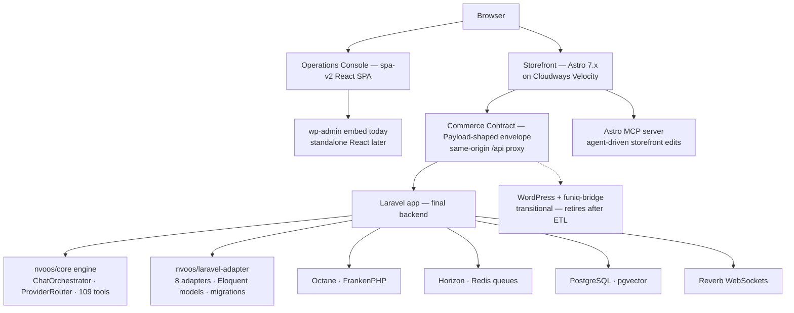

# Proposal 092 — Astro Storefront Layer: The NV-Authored Headless Storefront (`nvoos-astro-velocity`)

**Status:** Proposal (awaiting execution)
**Date:** 2026-10-27
**Relates to:** Proposal 085 (Funiq Velocity storefront) + `085-funiq-laravel-standalone-integration-appendix.md` (T1/T2/T3 topologies) · Proposal 090 (Laravel adapter spike) · 085 §3.5 deferred "Storefront SSR/prerender track" · `PROPOSALS_COMPLETION_STATUS.md` (stale register — per-file headers are ground truth)
**Author:** NV oOS coding agent (Zed)

---

## 1. Problem Statement

Two structural pains sit inside the Funiq storefront track today:

1. **The SEO constraint is structurally unsolved.** Proposal 085 §2.3 accepts a
   client-side-rendered PWA for v1 and defers SSR/prerendering to a
   **private-repo follow-on that modifies licensed code** — the highest-cost
   place to solve it. The bridge REST (`/wp-json/funiq/v1/*`) was explicitly
   named "the canonical data source any future SSR shell would consume", but
   no open, NV-authored SSR shell exists.
2. **The storefront layer is licensed and single-vendor.** Every future
   backend move (085 appendix T1 → T2 → T3, the Proposal 090 Laravel spike)
   preserves the purchased PWA as the only presentation layer. There is no
   open-source, agent-buildable frontend that can survive the
   WordPress → Laravel migration untouched, and no way to productize the
   frontend work for other NV clients.

Astro is a candidate solution to both: an NV-authored, MIT-licensed,
server-rendered storefront that consumes the **Payload-shaped contract**
(which is the backend-invariant already established in the 085 appendix §2)
and is deployable on the same Cloudways Velocity platform the repo already
operates.

## 2. Research & Industry Standards

### 2.1 Astro's positioning and the performance evidence

- Astro (v7.4 current) is a **server-first, content-driven** web framework:
  components render on the server, zero JavaScript ships by default, and
  interactive pieces hydrate selectively ("islands") ([astro.build](https://astro.build/)).
- Real-world Core Web Vitals (HTTP Archive + Chrome UX Report, published on
  astro.build): **71% of Astro sites pass CWV vs 48% for WordPress** — the
  strongest CWV pass rate of the major frameworks (Next.js 35%, Nuxt 28%).
- Built-ins that matter for a storefront: **content collections** (type-safe
  local content), **View Transitions** (SPA-feel navigation without SPA
  weight), **Actions** (type-safe server functions callable from client JS),
  **image optimization** (WebP/AVIF, layout-shift elimination), and
  **server islands** (dynamic pockets rendered separately so the static shell
  stays cacheable) ([server islands guide](https://docs.astro.build/en/guides/server-islands/)).
- Deployment adapters for Node, Cloudflare, Vercel, Netlify, AWS — a Velocity
  Node app is a supported target.

### 2.2 Headless WordPress with Astro is an official, documented pattern

- Astro's own docs ship a [Headless WordPress & Astro guide](https://docs.astro.build/en/guides/cms/wordpress/)
  treating WP REST as the content source — first-party blessing for exactly
  the shape this repo already builds (`/wp-json/.../v1/*` consumers).
- Two accepted rendering modes dominate the industry: **SSR** (fetch fresh on
  every request, no rebuild step — the freeCodeCamp Cloudflare-Pages pattern)
  and **SSG** (fetch at build time, ship static HTML). A storefront wants a
  hybrid: prerendered catalog + on-demand SSR for dynamic pockets.
- WPGraphQL is frequently called "the industry standard" for headless WP
  ([hostwp.io guide](https://hostwp.io/blog/astro-wordpress-integration-headless-guide/)),
  but it is **irrelevant here**: the Funiq surface already speaks the
  Payload-shaped REST contract, which is paginated, typed and stable — REST
  with sensible caching is a documented, production-proven Astro pattern.
- Caveats the research flags consistently: REST has no native cache headers
  (the bridge must add them), preview/draft flows need deliberate design, and
  naive per-route fetching causes N+1 chatter (batch at the Astro fetch layer).

### 2.3 Astro + Payload-shaped APIs

- Payload CMS has first-class Astro support, and more importantly **Astro does
  not care what serves the contract**. The funiq-bridge Payload envelope
  (`{ docs, totalDocs, limit, totalPages, page, hasNextPage, hasPrevPage }`)
  is an ordinary REST JSON contract — an Astro frontend consumes it the same
  way the purchased PWA does, with zero bridge changes.
- This makes the frontend layer **backend-agnostic by construction**: the same
  Astro build runs against WP today (085 v1), against a Laravel funiq service
  tomorrow (085 appendix T1/T2), and against a federated node later (T3).

### 2.4 Astro + Laravel — the frontend/API split

- The Astro + Laravel combination is an established "frontend build pipeline
  separated from the API" pattern: Laravel Breeze's API scaffolding pairs
  with an Astro frontend (see the [breeze-astro](https://github.com/kazuyafaizad/breeze-astro)
  and [Laravel-Astro.js boilerplate](https://codesandbox.io/p/github/himyjan/Laravel-Astro.js-boilerplate)
  references; practitioner retrospective at
  [dev.to](https://dev.to/marshyon/a-2024-retrospective-my-unexpected-astro-laravel-love-affair-40hm)).
- Positioning within this repo: **Astro does not replace Laravel** — Laravel
  is a backend. Astro becomes the presentation layer that unifies the
  WordPress-backed and Laravel-backed phases, so the frontend survives the
  Proposal 090 spike outcome either way (including the F1–F4 flip conditions).

### 2.5 The AI-build loop — Astro's official MCP server

- Astro ships an **official MCP server** and advertises "AI-Ready"
  development ([astro.build](https://astro.build/)). NV oOS assistants (this
  repo's product) can scaffold, edit, and audit Astro projects through MCP —
  the same agent-first philosophy as the repo's existing design-to-build
  pipelines, applied to a real codebase rather than a page builder.

### 2.6 Platform fit

- **Cloudways is an official Astro sponsor** (homepage sponsor list) and the
  Node adapter targets plain Node — the Astro app deploys to Cloudways
  Velocity with the same connected-repo pattern Proposal 085 §3.3 already
  established. No new hosting surface.
- Licensing: every Astro-authored file is NV IP under MIT — the Envato
  Regular-vs-Extended decision (085 §7 Q1) **dissolves for the storefront
  layer** if the PWA is retired.

### 2.7 SEO standards (carried forward from 085 §2.3)

- SSR/SSG first paint, JSON-LD (Product/Offer/Breadcrumb/Organization)
  rendered in the **initial HTML**, real `<a href>` links crawlable with JS
  disabled. These become acceptance criteria, not aspirations.

## 3. Proposed Design

### 3.1 Options considered

| | A — Astro replaces the PWA outright | B — Astro as open parallel variant, gate decides (**chosen**) | C — Generic WP headless starter only | D — Status quo (private SSR track) |
|---|---|---|---|---|
| Envato boundary | Dissolved immediately | Dissolved for the Astro app; PWA stays private while it lives | Untouched for Funiq | Untouched |
| SEO constraint | Solved | Solved on the Astro variant | N/A for Funiq | Solved only by modifying licensed code |
| Backend migration (T1/T2) | Frontend survives unchanged | Frontend survives unchanged | N/A | Frontend survives (contract-based) but stays licensed |
| Risk | High — single cutover, no fallback | Low — A/B by hostname/cookie, PWA is the rollback | Low | Low but slow |
| Effort | Medium | Medium + one routing rule | High (new product surface) | High (licensed-code surgery) |

Option A wins, with B's coexistence kept only as a transitional safety gate:
the PWA stays in the private repos **solely as rollback** until Astro parity
and the Phase 2 SEO criteria are proven, then it is retired (Q1). This is
the same Strangler-Fig discipline the 085 appendix §5 mandates for the
backend — applied to the frontend.

### 3.2 The contract invariant (why this survives T1/T2/T3)

The 085 appendix §2 states the invariant: *whoever serves the Payload-shaped
JSON contract is invisible to the storefront*. The Astro app is therefore
written against **the contract only** — no WP-specific endpoints, no
`wp-admin` awareness, no nonce semantics in the public storefront. The
`/api/*` same-origin proxy (085 §3.2) is retained; when Phase B (T1) flips
the proxy origin from WP to the Laravel funiq service, the Astro app needs
**zero changes**.

```
Browser ──> Velocity app (nvoos-astro-velocity)
              ├── dist/                # Astro build output  ← NV-authored, MIT
              ├── /                    # SSR + prerendered catalog
              ├── /api/*               # proxied → WP today, Laravel at T1
              ├── /wp-json, /wp-admin  # proxied (admin unchanged, 085 §3.2)
              └── /assets/*            # hashed Astro asset chunks
```

**Contract liberation.** The Payload-shaped envelope exists today to serve
a frontend NV does not own. Once the Astro storefront is NV-authored, both
ends of the contract are NV's — re-shaping the envelope into a native NV
commerce contract becomes an internal decision, cheap to make and safe to
defer until after the PWA is retired and the backend has flipped (appendix
T1). The de-funiq posture of this proposal: retire the licensed frontend
and the brand; keep the commerce domain and its working contract as the
migration rail.

### 3.3 Shape of the Astro app

| Surface | Rendering | Astro mechanism |
|---|---|---|
| PLP (category/brand/color filters) | SSR + prerendered first pages | Server components + query-string routes |
| PDP (product detail) | **Prerendered for the full catalog** | `getStaticPaths` over `/api/products` |
| Banner / carousel / promotions | Server island (fresh, cacheable separately) | `server:defer` |
| Cart badge, gallery lightbox, promo-code field | **React islands** — reuse the PWA's existing React components | `client:load` / `client:idle` |
| Marketing content (about, terms, landing pages) | SSG | Content collections (type-safe local MD) |
| JSON-LD + canonical + sitemap | In initial HTML | Per-route `<head>` + `/sitemap.xml.ts` |
| Mutations (promo-code validation, later auth flows) | Type-safe server functions | Astro Actions (deferred per §7 Q5) |

### 3.4 Rendering strategy on Velocity

- **Prerender the catalog** at build time (product data is low-churn); the
  runtime SSR path serves only filters/search and the server islands. This
  keeps Velocity CPU load minimal while giving every crawler fully-rendered
  HTML.
- Add **cache headers** on bridge public GETs (tracked bridge-side
  enhancement: `Cache-Control: s-maxage` on collection/product responses,
  `Last-Modified`/ETag from post modified dates) so both the proxy and the
  Astro fetch layer can serve from cache.
- Astro's built-in **prefetch** + View Transitions give the SPA-like feel the
  PWA had, without the JS weight.

### 3.5 Repository & licensing

| Repo | Visibility | Contents |
|---|---|---|
| `nvdigitalsolutions/mcp-ai-wpoos` (`examples/nvoos-astro-velocity/`) | Public | The complete Astro storefront (NV-authored, MIT) |
| `nvdigitalsolutions/nvoos-astro-velocity` | Private | Assembled app: Astro `dist/` + server shim (same mirror pattern as 085 §3.3) |
| `nvdigitalsolutions/nvoos-funiq-pwa` | Private | PWA retained only as a transitional rollback (Q1) |

Contrast with 085 §3.2: the licensed-bundle injection step disappears from
the **Astro** pipeline — the sync workflow assembles only public bytes. The
PWA injection step remains in place only for the transitional A/B gate.

### 3.6 Relationship to the Laravel track (Proposal 090)

- **No gate dependency.** The Astro spike does not wait for the Laravel spike
  (090 P1–P7) and is unaffected by its flip conditions (090 §8 F1–F4): the
  contract is served by WP until a flip happens, and served by whatever wins
  afterwards.
- The Astro app **preserves the Velocity BFF investment** across the backend
  migration — in T2 (converged Laravel, "no Velocity"), the Astro app is the
  one asset that moves cleanly (static export to the Laravel app's public
  dir, or keeps its own Node host pointed at the Laravel origin).

### 3.7 What this does **not** replace

- The **bridge REST** itself — Astro consumes it; the bridge stays the
  canonical data source.
- The **operations console** (`addons/pro/assets/spa-v2` — the Complete
  Console / Pro SPA) and the **Funiq CMS admin** — Astro is not an SPA
  framework; admin/operator dashboards stay React (§3.8).
- The **Laravel backend track** — Astro is the frontend; the backend
  decision (090) is orthogonal.

### 3.8 Relationship to the spa-v2 operations console

`addons/pro/assets/spa-v2` is the repo's most mature frontend asset — the
React operations console (chat-first conversations, assistants, workflows,
settings, toolkit surfaces). It is a **different product layer** than the
storefront, and this proposal is explicitly designed around that boundary:

| Layer | Surface | Tool | Why |
|---|---|---|---|
| Public storefront | SEO-critical, mostly static, few interactive pockets | **Astro** (this proposal) | SSR/prerender + islands; CSR React is the SEO problem being solved |
| Operations console | Authenticated, dense interactivity, real-time | **spa-v2 (React)** | An admin dashboard is all islands — Astro would add a framework without removing any JS |
| Data contract | One Payload-shaped REST surface | Bridge (WP → Laravel) | Served once, consumed by both layers |

Two concrete synergies, both optional and future-scoped:

- **Console merchandising surfaces.** Proposal 089 set the precedent of
  toolkit surfaces (settings, sync runs, records) in the Complete Console.
  A future "storefront ops" section (catalog health, promo management,
  sync runs) would consume the *same* funiq REST contracts the Astro
  storefront reads — the contract-invariant argument (§3.2) gains a
  second, already-shipped consumer as proof.
- **Storefront chat island.** Proposal 087 established the native-island
  mount with a token bridge (Docs Hub / Media Studio / Document Editor).
  The same technique could mount a small chat surface (the repo's chat-spa
  patterns) as a React island inside the Astro storefront — the
  AI-assistant product meeting the public site. Not v1 scope.

### 3.9 Proposed final stack (end-state)

What the system looks like after the PWA is retired and the backend has
flipped (085 appendix T1 → T2) — the same architecture NV already owns,
with the licensed frontend swapped for NV-authored code:



| Layer | Stack | Notes |
|---|---|---|
| Public storefront | Astro 7.x (SSR + prerendered catalog), React islands for cart/gallery, content collections for marketing pages, View Transitions, Actions | `nvoos-astro-velocity` on Cloudways Velocity (Node adapter). Zero-JS by default; JSON-LD in initial HTML |
| Operations console | spa-v2: React 19, Tailwind v4, `@xyflow/react` v12, esbuild, vitest + jsdom, NDS tokens | Unchanged — admin dashboards stay React. Funiq CMS admin follows it until the standalone-admin track |
| Commerce contract | Payload-shaped REST envelope (`{docs, totalDocs, …}`), same-origin `/api/*` proxy | Served by the bridge today, by Laravel at T1. Liberated later — once both ends are NV-authored, re-shaping into a native NV contract is an internal decision |
| Backend (final) | Laravel + Octane (FrankenPHP), PHP 8.2+, MySQL 8.0 → PostgreSQL + pgvector, Horizon + Redis 7, Reverb | Per the 085 appendix + Proposal 090 spike (P1–P7 gates) |
| AI engine | `nvoos/core` (MIT) — `ChatOrchestrator`, `ProviderRouter`, 109 tools, domain contracts | Runs inside Laravel with zero WordPress symbols (090's P1 asserts no `ABSPATH`) |
| Persistence adapters | `nvoos/laravel-adapter` (MIT) — 8 adapters, Eloquent models, migrations | Same contracts as the WP and Craft adapters |
| Agent tooling | MCP Streamable HTTP (spec 2025-06-18) + Astro's official MCP server | NV oOS assistants can scaffold/edit the storefront itself |
| Transitional (retires) | WordPress 6.9 + `funiq-bridge` addon, purchased Funiq PWA | Strangler Fig: GETs flip first, ETL runs once, bridge and PWA wind down |

Consequences: **JS** — two frontends, two purposes (Astro public/SEO,
spa-v2 operations); they share one contract, not one build. **PHP** —
WordPress stays first-class during the transition, but the final home of the
commerce domain is Laravel running the `nvoos/core` engine; WordPress
becomes optional for this product line at T2. **PWA legacy** — only its
React cart/gallery components survive, reused as Astro islands. Everything
in this stack is shipped (`nvoos/core`, `nvoos/laravel-adapter`, spa-v2,
the bridge), designed (085 appendix, `laravel-scale-deployment-architecture.md`),
or proposed (092, 090) — the Astro layer is the one addition.

## 4. Implementation Plan

| Phase | Scope | Exit criteria |
|---|---|---|
| **0 — Spike** (`examples/nvoos-astro-velocity/`, ~2–3 weeks) | Astro SSR app consuming `/api/products` + `/api/globals/*` through the same-origin proxy; Node adapter; one React island (cart badge) proving the reuse claim | P1 dev + `astro build` clean; P2 PLP server-rendered with real links; P3 PDP + JSON-LD in initial HTML; P4 zero-JS default with one hydrated island; P5 golden-contract smoke against the bridge's existing REST fixtures; P6 build output serves on plain Node (Velocity entry) |
| **1 — Parity** (~3–4 weeks) | Promotions, promocodes (display), category/brand/color filtering, banner/carousel, View Transitions, image optimization | Feature parity with the PWA's public (unauthenticated) surface; same-origin routing in the private mirror |
| **2 — SEO deliverables** (~2 weeks) | Prerendered catalog routes, `/sitemap.xml`, robots, cache headers + revalidation, full JSON-LD suite, real-link crawlability check with JS disabled | 085 §2.3 standards verifiable by inspection + Lighthouse (no-JS audit) |
| **3 — Retire the PWA** | Owner confirms parity + the Phase 2 SEO criteria, then retires the PWA: the private PWA repo winds down, CI injection is deleted, the Envato decision closes (coexist A/B remains available as a transitional gate only) | Decision recorded in this doc's status line, mirroring decision #15's pattern |
| **4 — Generic starter** (optional, v1.5 roadmap — Q3) | `nvoos-astro-starter`: Astro + core WP REST (posts/pages) + WooCommerce via existing Pro REST surfaces; docs + theme | Standalone public example with its own README; zero bridge dependency |

Total through Phase 2: ~7–9 weeks, parallelizable with Proposal 090's
timeline (disjoint scopes, no shared files).

## 5. Risks & Mitigations

| Risk | Impact | Mitigation |
|---|---|---|
| Two storefronts = doubled QA during coexistence | Medium | Shared golden fixtures (085 appendix §5 already mandates them) become the contract suite for **both** frontends; gate at Phase 3 with a recorded decision |
| Velocity SSR load (unbounded runtime rendering) | Medium | Prerender catalog at build; server islands for dynamic pockets; CDN/proxy caching with the new bridge cache headers; worst case, static export + Cloudflare Pages (Q4) |
| REST N+1 / no cache headers today | Medium | Bridge enhancement (tracked): `Cache-Control` + validators on public GETs; Astro fetch layer batches collection calls |
| Astro expertise gap vs the repo's React muscle | Low | Islands accept React components — the PWA's cart/gallery code is reused verbatim; Astro MCP assists agents during build |
| Scope creep into replacing the React admins | High | Explicitly out of scope (§3.7); admin track stays on 085 §3.5's standalone-admin follow-on |
| Payload contract drift during bridge/Laravel work | Medium | Contract freeze already prescribed (085 appendix §5 step 1); the Astro spike's P5 fixture gate makes the frontend an enforcement point |
| Backend flip (T1) surprises the frontend | Low | Contract-only binding (§3.2); the flip is an env/config change in `serve.mjs`, already designed in 085 |
| Toolchain diversity — the repo's JS build matrix grows again (spa-v2 esbuild + Astro Vite) | Low | Isolated to the public-storefront layer; no shared build with spa-v2; Astro islands reuse React components, not React build config |

## 6. References

- [Astro](https://astro.build/) — framework homepage, CWV dataset, sponsors, MCP server
- [Astro docs — Headless WordPress & Astro](https://docs.astro.build/en/guides/cms/wordpress/)
- [Astro docs — Server islands](https://docs.astro.build/en/guides/server-islands/)
- [FreeCodeCamp — Headless WordPress frontend with Astro SSR](https://www.freecodecamp.org/news/how-to-build-a-headless-wordpress-frontend-with-astro-ssr-on-cloudflare-pages/)
- [HostWP — Astro/WordPress integration guide (WPGraphQL vs REST)](https://hostwp.io/blog/astro-wordpress-integration-headless-guide/)
- [breeze-astro — Laravel Breeze API + Astro frontend](https://github.com/kazuyafaizad/breeze-astro) · [dev.to retrospective](https://dev.to/marshyon/a-2024-retrospective-my-unexpected-astro-laravel-love-affair-40hm)
- [patterns.dev — Islands architecture](https://www.patterns.dev/vanilla/islands-architecture/)
- Repo: Proposal 085 (+ §2.3 SEO constraint, §3.5 deferred SSR track, §7 open decisions), `085-funiq-laravel-standalone-integration-appendix.md` (§2 contract invariant, §4 topologies, §5 Strangler Fig), Proposal 090, Proposal 087 (native island mounts), Proposal 089 (toolkit console surfaces), `addons/funiq-bridge/` (README data-model map, REST surface), `addons/pro/assets/spa-v2/` (operations console)

## 7. Open Decisions (owner)

- **Q1 — Phase 3 posture:** retire at parity (Option A — the owner's
  recorded leaning). The PWA is retained only as a transitional A/B
  rollback until the Phase 2 SEO criteria pass, then retired.
- **Q2 — Backend binding:** confirm the Astro app binds **only to the
  Payload envelope** (recommended) and never to WP-specific endpoints.
- **Q3 — Generic starter:** schedule `nvoos-astro-starter` (Phase 4) in the
  v1.5 roadmap, or park it.
- **Q4 — Hosting:** Velocity (default, same connected-repo pattern) vs
  Cloudflare Pages/Netlify static for the prerendered catalog.
- **Q5 — Authenticated flows:** promo-code validation and accounts — the PWA
  was built for Payload's `/api/users` JWT model, which the bridge does not
  emulate (085 §3.5). Astro v1 stays anonymous-public; auth flows follow the
  deferred standalone-admin/auth track.
