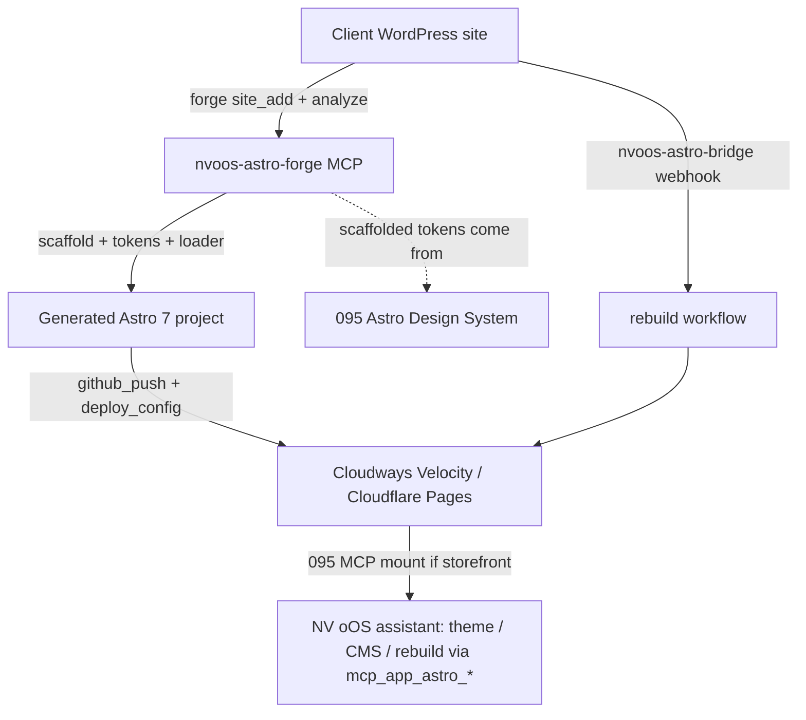

# Proposal 096 — Astro Forge: MCP-Driven Generation of Headless Astro Frontends for Any WordPress Site

**Status:** PENDING
**Date:** 2026-10-30
**Relates to:** Proposal 092 Phase 4 (`nvoos-astro-starter` — superseded by this proposal) · Proposal 095 (design system + runtime MCP — Forge scaffolds projects that ship its token layer; the two compose into one lifecycle) · Proposal 085/090 (contract invariance) · Proposal 054/061 (npx packaging, MCP registry publishing) · `addons/funiq-bridge/` (rebuild-webhook precedent) · `mcp-ai-wpoos-wporg-submission` skill (bridge plugin discipline) · `mcp-ai-wpoos-playground-demos` skill (demo harness)
**Author:** NV oOS coding agent (Zed)

---

## 1. Problem Statement

092 Phase 4 promised a generic starter (`nvoos-astro-starter`: "Astro + core WP REST (posts/pages) + WooCommerce via existing Pro REST surfaces; docs + theme"). That is a **static template** — the 2025 answer. The market moved: `wp-astro-mcp` demonstrated that clients and agencies want the whole journey — connect, discover, scaffold, sync, publish, deploy — driven **conversationally through MCP**, because wiring a headless WP→Astro frontend by hand is ~40 tedious steps (fetching, shortcodes, collections, media URLs, redirects, deploy, ongoing sync).

The repo is positioned to do this better than any existing tool, because every hard part is already shipped and battle-tested:

- The **storefront layer** exists (092: `nvoos-astro-velocity` — Astro 7, React islands, JSON-LD, image pipeline, mirror deploy). Its product cards, layouts, and components are reusable templates, not aspirations.
- The **rebuild/sync loop** exists (funiq-bridge webhook → `repository_dispatch` → mirror workflow). "Your client clicks Publish. Then what?" — the Astro docs' own community question — is already answered in-repo for commerce; the generator generalizes it to posts/pages.
- The **design system** is being built (095: DTCG tokens, themes). Generated sites can ship branded the moment 095 lands.
- The **MCP craft** is codified (095's checklist: SDK v2, tool annotations, registry single-source, structuredContent, router mode).
- The **publishing rails** exist (054 npx packaging, 061 MCP registry entries).

What's missing is the **generation layer itself**: an MCP server that discovers any WordPress site, scaffolds a production-grade Astro 7 frontend from reusable templates, wires content via the Content Layer API (not file copies), publishes it, and keeps it fresh — safely, multi-site, agency-grade. This proposal builds it as `nvoos-astro-forge`, plus its companion WordPress plugin `nvoos-astro-bridge`.

## 2. Research & Industry Standards

Full sources in `096-astro-forge-wp-generator-mcp-research.md`. Load-bearing findings:

### 2.1 The ecosystem: one real competitor, no reusable loader

- **`vapvarun/wp-astro-mcp`** (12★, MIT, 57 tools, 113 tests) is the *only* WordPress+Astro+MCP generator in existence (GitHub search for `wordpress+astro+mcp` returns 5 repos; the rest are read-only content bridges, a landing page, and two 1★ experiments). Its architecture: extract WP REST → 13-step HTML→**Markdown** pipeline → scaffold **Astro 6** project → materialize content files → SQLite state machine for resumable exports and `modified_gmt` change-detection sync → git/GitHub publishing → Vercel/Netlify/Cloudflare configs → optional `wp-astro-bridge` plugin (HMAC webhooks, single-use draft-preview tokens, normalized SEO REST field).
- **`dashless`** (1★, "conversational publishing through local Codex, with an owned Astro frontend and first-class WP Cloud deployment") — a directional signal that "owned Astro frontend + assistant-driven operation" is the emerging product shape.
- **No reusable "WP content loader for Astro" npm package exists** (search: 2 irrelevant results). Any serious tool must build the loader itself — which is fine: Astro's Content Layer loader API is a documented, stable surface, and the Astro docs community list even links "Shattering Headless WordPress Build Times with Astro's Content Layer API."

### 2.2 Astro's official position: REST-first, render HTML, prune fields

The official [Headless WordPress & Astro guide](https://docs.astro.build/en/guides/cms/wordpress/) prescribes exactly what this proposal formalizes:
- WP REST (`/wp-json/wp/v2/`) is the default data layer; GraphQL (WPGraphQL/Gato) is optional — consistent with 092 §2.2's REST decision.
- Use **`_fields`** to prune responses and **`_embed`** for related resources (featured media, authors, terms) — the anti-N+1 discipline the loader must implement.
- Render content with **`set:html`** — i.e. WordPress HTML is the format, not a lossy Markdown conversion. This matters doubly for page-builder sites: wp-astro-mcp's own FAQ concedes its Markdown pipeline *loses layout* for Elementor/WPBakery/Divi content; rendering sanitized HTML preserves it.
- Prerender via `getStaticPaths` (the loader equivalent: build-time fetch with the Content Layer cache); SSR as the freshness option.

### 2.3 The decisive architectural choice: Content Layer loader vs materialized files

| | A — Materialize files (wp-astro-mcp model) | B — Content Layer WP loader (**chosen**) |
|---|---|---|
| Source of truth | Copied Markdown/JSON files | WordPress itself (the CMS stays the CMS) |
| Conversion loss | Layout lost for page builders; 13-step pipeline | None — sanitized HTML rendered via `set:html` |
| Sync engine | SQLite state machine, change detection, resumable exports | **None needed** — freshness = rebuild on webhook (the repo's proven pattern) or SSR |
| Large sites | OOM at 500+ Markdown files (their FAQ) → JSON workaround | Loader + Astro content cache; no file explosion |
| Git diffs | Content churn pollutes repos | Repos contain code + templates only |
| Offline/archival | Inherent | Optional `materialize` mode (opt-in export), kept as a feature not the default |

B removes the entire state-machine complexity class, matches the Astro team's own direction, and makes "living sync" a *deployment concern* (webhook → rebuild), which the repo already operates at production grade. The `materialize` mode stays as an explicit opt-in for archival/large-scale/offline customers.

### 2.4 Security standards (industry + repo discipline)

- **Application passwords, least privilege, revocable per client** (WordPress + Elementor MCP guidance; the repo's own MCP Apps skill).
- **No plaintext credential store**: wp-astro-mcp stores app passwords in plaintext `config/sites.json` and concedes a git-argv token leak during push. Forge stores secrets in an OS-keychain-backed or encrypted-file vault (the repo's Vault discipline), and uses **octokit** for GitHub (no `git` CLI, no argv exposure).
- **SSRF guard**: wp-astro-mcp's own README flags that it fetches any operator-supplied URL with no allowlist. Forge maintains a site allowlist (the repo's `is_url_allowed` pattern) — reject before fetch.
- **XSS at the boundary**: all WP HTML passes `sanitize-html` (already a storefront dependency) before rendering — script/event-handler/`javascript:` stripping.
- **Bridge plugin** follows the wp.org checklist (nonce/cap checks, escaping, no raw secrets — `mcp-ai-wpoos-wporg-submission` skill): HMAC webhooks fail closed, preview tokens single-use + capability-checked (`edit_post`), health endpoint redacts internals for anonymous callers.

### 2.5 MCP craft (carried from 095)

SDK v2 (`@modelcontextprotocol/server`), stdio-first for coding agents (plus Streamable HTTP team mode later), tool annotations (read-only/destructive/open-world), single-source-of-truth Zod registry with a CI coverage test, `structuredContent` alongside text, router-vs-full tool modes — the 095 checklist applies verbatim.

## 3. Proposed Design

### 3.1 Shape

| Piece | Location | Role |
|---|---|---|
| **`nvoos-astro-forge`** (MCP server) | `examples/nvoos-astro-forge/` | Discovery, scaffold, content wiring, publishing, deploy configs — stdio (coding agents, NV oOS npx bridge) + optional HTTP |
| **Template library** | `examples/nvoos-astro-forge/templates/{blog,storefront}/` | Astro 7 templates the scaffolder emits: blog/marketing (posts/pages/CPTs) and storefront (WooCommerce), both with 095's ADS token defaults, JSON-LD, sitemap, RSS, search, redirects |
| **WP content loader** | `examples/nvoos-astro-forge/lib/wp-loader.ts` | Reusable Content-Layer loader: `_fields`/`_embed` pruning, pagination, sanitize-html, digest-based cache, typed Zod schemas |
| **`nvoos-astro-bridge`** (WP plugin) | `plugins/nvoos-astro-bridge/` | Normalized `astro_seo` REST field, HMAC publish webhooks, single-use draft-preview tokens, health endpoint — wp.org-ready, zero deps |

### 3.2 The generated project (what a client gets)

```
generated-site/
  astro.config.mjs          # Astro 7, content layer, image domains from env (092 pattern)
  src/content.config.ts     # wpLoader("https://client.example.com") collections: posts, pages, <cpts>
  src/tokens/               # 095 ADS DTCG tokens (brand-themed at scaffold time)
  src/layouts/ · src/pages/ # template layouts + index/post/page/search/404 + sitemap/robots
  src/components/           # from the template (storefront: 092's product card, cart badge islands)
  .github/workflows/        # rebuild-on-dispatch (the funiq-bridge webhook pattern, generalized)
  nvoos.json                # forge manifest: site URL, collections, deploy target, theme
```

WordPress stays the CMS; Astro is the delivery layer. Draft preview: bridge plugin rewrites the WP Preview button to a tokenized `/preview` SSR route.

### 3.3 Tool catalog (v1 target — ~30 tools)

| Slice | Tools | Notes |
|---|---|---|
| Site mgmt (7) | `site_add`, `site_test`, `site_list`, `site_get`, `site_update`, `site_remove`, `site_set_default` | Per-site profile: URL, app password, allowlist entry, export config; credentials from the vault, never echoed |
| Discovery (3) | `site_analyze` (content counts, CPTs, taxonomies, SEO plugin, Woo), `content_audit` (embeds, shortcodes, complexity), `site_health` | Auto-detection mirrors wp-astro-mcp's strongest feature |
| Scaffold (5) | `scaffold_project` (template, theme, deploy target), `scaffold_status`, `scaffold_package` (zip export), `tokens_apply` (brand theme from 095 DTCG), `ads_generate` (delegate token/theme work to the 095 pipeline) | Templates emit `nvoos.json`; brand themes make every client site a 095 story |
| Content (6) | `collections_generate` (typed loader config per CPT), `content_preview` (fetch + sanitize one post), `content_materialize` (opt-in export), `redirects_generate`, `media_audit`, `media_rewrite` | Loader-first; materialize is the escape hatch |
| Sync & rebuild (4) | `rebuild_config` (bridge webhook → repository_dispatch workflow), `rebuild_trigger`, `preview_token`, `webhook_verify` | Reuses the funiq-bridge debounced-webhook pattern; HMAC fail-closed |
| Publish (5) | `github_init`, `github_create_repo` (private default), `github_commit`, `github_push`, `github_status` | octokit; token in env only |
| Deploy (3) | `deploy_config` (Cloudways Velocity / Cloudflare Pages / adapter-generic), `deploy_status`, `setup_wizard` | Velocity = the mirror-workflow recipe per client; wizard = one-command zero-to-deployed |

### 3.4 Commerce tiering

- **Tier 1 — any WordPress**: `wp/v2` posts/pages/CPTs/media/menus via the loader.
- **Tier 2 — WooCommerce sites**: `wc/v3` REST loader (products/categories/attributes) with consumer-key or application-password auth; if the Complete plugin (funiq-bridge) is present, the loader can instead bind the **`nvoos-commerce/v1` Payload envelope** — the 092 contract — giving generated storefronts an upgrade path to the full velocity BFF/095-MCP world.

### 3.5 Lifecycle composition with 095 (the full story)



Forge **generates**; 095 **operates**. A client sold the full stack gets: assistant-scaffolded site → brand-themed at birth → deployed → continuously operated by the same assistant.

### 3.6 Explicit non-goals

- **Not** a Markdown conversion pipeline or a content-sync state machine (research §2.3 — loader-first by design; `content_materialize` remains opt-in).
- **Not** a WPGraphQL adoption — REST is the 092/guide-consistent choice.
- **Not** a rewrite of the storefront — the storefront template *reuses* 092 components; it does not fork `nvoos-astro-velocity`.
- **Not** an end-user SaaS — this is a developer/agency tool with an MCP surface, not a hosted generator.

## 4. Implementation Plan

| Phase | Scope | Exit criteria |
|---|---|---|
| **0 — Spike** (~1–2 wks) | WP REST client (pagination, `_fields`/`_embed`), capability discovery, `wp-loader.ts` prototype, blog template, scaffold tool | Blog template builds (`astro check` + `astro build`) against a **WordPress Playground** fixture in CI; loader unit tests (pagination, digest cache, sanitize fuzz) green; one-shot `forge scaffold → astro build` in under 2 minutes |
| **1 — Storefront template** (~2 wks) | Woo `wc/v3` loader + Payload-envelope option, reuse 092 product components as islands, SEO suite (JSON-LD/sitemap/canonical/redirects), ADS token defaults | Storefront template builds against a Woo fixture; crawlability e2e (JS-disabled) passes; no-licensed-bytes grep gate (092 rule) on generated output |
| **2 — Bridge plugin** (~2 wks) | `plugins/nvoos-astro-bridge`: `astro_seo` REST field, HMAC webhooks (debounced), single-use preview tokens, health endpoint; `rebuild_config` generates the dispatch workflow | PHPUnit + plugin-check green (wp.org discipline); webhook HMAC fail-closed tests; preview-token expiry/capability tests |
| **3 — Publishing & multi-site** (~2 wks) | octokit GitHub tools, deploy configs (Velocity mirror recipe + Cloudflare Pages), vault-backed credential store, multi-site profiles | GitHub flow e2e against a throwaway repo; secrets never in argv/logs/generated output (grep gate); two-site round-trip demo |
| **4 — Wizard, packaging, docs** (~1–2 wks) | `setup_wizard`, router mode, npx packaging + MCP registry entry (054/061 pattern), Playground demo, skill `mcp-ai-wpoos-astro-forge`, README + proposal statuses | `npx nvoos-astro-forge` boots and lists tools; registry entry active; wizard completes against the Playground fixture end-to-end |

Total ~8–10 weeks, each phase a shippable PR. Phases 0–2 parallelize with 095 Phases 1–3 (disjoint file scopes; Phase 1 depends on 095 Phase 0's token output).

## 5. Risks & Mitigations

| Risk | Impact | Mitigation |
|---|---|---|
| WP REST variance across hosts/plugins/security plugins | Medium | Capability discovery + graceful degradation; `site_test` + fixture matrix (plain WP, Woo, restricted-REST host); Playground fixtures pin behaviors |
| Page-builder content complexity | Medium | Render-as-HTML (no layout loss, unlike Markdown pipelines); `content_audit` flags heavy embeds; sanitize allowlist governs what survives |
| Build-time WP dependency (loader model) | Medium | Webhook rebuild + Astro content cache keep builds fresh; `materialize` mode for offline/archival; SSR option for real-time sites |
| Woo auth variance (consumer keys vs app passwords) | Low | Both supported; documented per-site; fixture covers both |
| Credential handling (the wp-astro-mcp failure class) | High | Vault-backed store (keychain/encrypted file, gitignored 0600 floor), no argv secrets (octokit), allowlist SSRF guard, redaction in every tool response |
| Generated-repo drift from templates | Low | Templates versioned with the Forge release; `nvoos.json` manifest; `scaffold_status` reports template age |
| Scope creep into 095's runtime tools | Medium | Forge never mounts on the generated site; the 095 MCP mount is emitted as opt-in template config only |

## 6. References

- [Astro docs — Headless WordPress & Astro](https://docs.astro.build/en/guides/cms/wordpress/) · [Astro docs — Content collections](https://docs.astro.build/en/guides/content-collections/) · [Content loader reference](https://docs.astro.build/en/reference/content-loader-reference/)
- [vapvarun/wp-astro-mcp](https://github.com/vapvarun/wp-astro-mcp) (full README reviewed 2026-10-30) · [RegionallyFamous/dashless](https://github.com/RegionallyFamous/dashless)
- [MCP TypeScript SDK v2](https://github.com/modelcontextprotocol/typescript-sdk) · [MCP spec — Transports](https://modelcontextprotocol.io/specification/2026-07-28/basic/transports)
- Repo: Proposals 092 (esp. Phase 4 + §2.2), 095 (§3.3 craft checklist), 054, 061; `addons/funiq-bridge/includes/RebuildWebhook.php`; `.agents/skills/mcp-ai-wpoos-wporg-submission/SKILL.md`; `.agents/skills/mcp-ai-wpoos-playground-demos/SKILL.md`; `examples/nvoos-astro-velocity/` (template donor)

## 7. Decisions (owner)

- **Q1 — Loader-first architecture:** adopt Content-Layer-loaders over materialized content files (recommended — research §2.3), keeping `content_materialize` as opt-in.
- **Q2 — Supersede 092 Phase 4:** fold `nvoos-astro-starter` into Forge's blog template (recommended) vs keeping both.
- **Q3 — Woo tier now:** include the WooCommerce storefront template in Phase 1 (recommended — it is the 092 Phase 4 monetization path), vs blog-only v1.
- **Q4 — Bridge plugin track:** standalone wp.org plugin `plugins/nvoos-astro-bridge` (recommended — installable on any client site), vs bundling into funiq-bridge.
- **Q5 — Deploy targets:** Velocity mirror recipe + Cloudflare Pages first (recommended — matches the operated fleet), Vercel/Netlify configs later or never.
- **Q6 — Credential vault:** OS-keychain/encrypted-file vault as the only credential path (recommended), with gitignored-0600 plaintext config as a documented fallback only.
