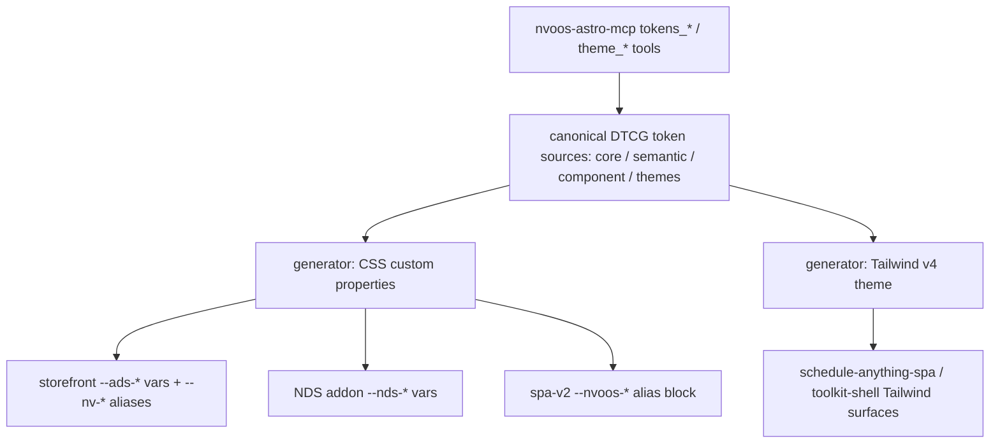

# Cross-Surface Design Token Sharing (097)

- **Status:** Proposal (docs only — PENDING owner review)
- **Date:** 2026-10-30
- **Relates to:** [095-astro-design-system-mcp](./095-astro-design-system-mcp-proposal.md) (ADS, shipped via PR #7301), [092 Astro storefront](nvoos-astro-velocity), [047-nvoos-design-system-addon](./047-nvoos-design-system-addon-proposal.md) (NDS addon, shipped), [060-spa-ui-stack-enhancement](./060-spa-ui-stack-enhancement.md) (toolkit-shell `--nds-*` tokens, Tailwind v4 surfaces)

## 1. Context

The repo now carries **three** separate token vocabularies that describe the
same product's look and feel:

| Surface | Token layer | Format | Theme support |
| --- | --- | --- | --- |
| Astro storefront (`examples/nvoos-astro-velocity`) | `--ads-*` semantic/component vars + `--nv-*` legacy aliases | DTCG 2025.10 JSON → generated CSS/TS (095) | light/dark + brand themes, `ThemeToggle` |
| NDS addon (`addons/nvoos-design-system`) | `--nds-*` vars in `assets/css/admin.css`/`components.css` | hand-written CSS | admin-picked accent only |
| Pro SPA v2 (`addons/pro/assets/spa-v2`) | hardcoded `--nvoos-*` palettes in `src/styles/main.css` (WP-admin-ish: `#f0f0f1` bg, `#2271b1` primary) | hand-written CSS | `[data-theme="dark"]` block only |

The storefront's ADS dark/light theme (ink `#1a1a1a`/`#f5f5f4`, surface
`#ffffff`/`#141414`, accent `#0f6b4f`/`#3d9c7d`, the Zed-style
neutral-plus-accent look) has been flagged as the preferred aesthetic for
**all** surfaces — including the Pro SPA v2.

This proposal defines how the three vocabularies converge on **one token
source** without re-platforming any surface.

## 2. Decision summary

1. **Share the values, not the platforms.** The ADS DTCG JSON (or an extracted
   shared copy of it) becomes the canonical token source. Each surface keeps
   its existing build, its existing CSS variable names, and its existing
   consumers — it only swaps *where the values come from*.
2. **No re-platform of spa-v2.** The Pro SPA v2 keeps its current bundler and
   CSS approach for now; adopting the ADS look does NOT mean adopting Astro,
   Tailwind v4, or a new shell. (Tailwind `@theme` emission is an optional
   Phase 2 add-on for surfaces that already use Tailwind.)
3. **Stable names via aliases.** `--nvoos-*` and `--nds-*` variable names are
   frozen; they become thin aliases over generated ADS semantic values — the
   exact zero-regression pattern 095 used for `--nv-*` on the storefront.
4. **Assistant control rides the same graph.** Because `nvoos-astro-mcp`
   already exposes `tokens_*`/`theme_*` tools over the DTCG graph, a single
   token edit can restyle the storefront *and* the WP admin SPA once both
   surfaces consume the shared source (095 Phase 4 NDS round-trip).

## 3. Architecture

- **Canonical source:** the DTCG JSON shipped in 095
  (`examples/nvoos-astro-velocity/src/tokens/`). Phase 0 decides whether the
  canonical copy stays in the storefront (NDS/spa-v2 consume via a repo-level
  sync script) or moves to a neutral location (e.g. a `tokens/` dir at repo
  root or inside `addons/nvoos-design-system/`) with the storefront consuming
  it. Prefer the neutral location **if** the NDS addon ever ships standalone
  on wp.org; otherwise keep it in the storefront and sync copies.
- **Emission targets:**
  - `--ads-*` CSS + TS (already shipped, unchanged).
  - `--nds-*` CSS block for the NDS addon — a mapping table from the ADS
    semantic layer to NDS names (`§4`), emitted as a committed `tokens.css`
    the addon enqueues before its existing styles.
  - `--nvoos-*` alias block for spa-v2 — `main.css`'s hand-written palettes
    (`:root` + `[data-theme="dark"]`) get replaced by a committed generated
    block; component rules keep referencing `var(--nvoos-*)` unchanged.
  - (Phase 2) Tailwind v4 `@theme` for Tailwind-based surfaces.
- **Drift gate everywhere:** every emitted artifact is committed and checked
  by a CI script mirroring `scripts/check-tokens.mjs` from 095 — a change to
  the DTCG source without regenerating fails CI.

## 4. Cross-surface mapping (semantic layer)

ADS semantic name → value (light / dark) → target variable(s):

| ADS semantic | light | dark | `--nds-*` (NDS addon) | `--nvoos-*` (spa-v2) |
| --- | --- | --- | --- | --- |
| `ink` | `#1a1a1a` | `#f5f5f4` | `--nds-color-text-primary` | `--nvoos-text` |
| `muted` | `#6b6b6b` | `#a3a3a3` | `--nds-color-text-secondary` | `--nvoos-text-secondary`, `--nvoos-muted` |
| `surface` | `#ffffff` | `#141414` | `--nds-color-surface` | `--nvoos-bg-secondary` |
| `surface-alt` | `#f5f5f4` | `#1f1f1f` | `--nds-color-surface-hover` | `--nvoos-bg`, `--nvoos-chip-bg` |
| `line` | `#e4e4e2` | `#2e2e2e` | `--nds-color-border` | `--nvoos-border` |
| `accent` | `#0f6b4f` | `#3d9c7d` | `--nds-color-accent` | `--nvoos-primary` |
| `accent-ink` | `#ffffff` | `#0b0f0d` | (new: `--nds-color-accent-ink`) | (new: `--nvoos-primary-ink`) |
| `danger` | `#b3261e` | `#ff6b5e` | (map from NDS `--nds-color-warning` review) | `--nvoos-danger` |
| `radius` | `8px` | `8px` | `--nds-radius-md` | (new: `--nvoos-radius-md`) |
| `font` | system stack | system stack | `--nds-font-family` | (new: `--nvoos-font-family`) |

Notes:
- `--nvoos-primary-hover` is derived (accent darkened/lightened) — keep the
  derivation in the generator rather than a literal.
- `--nvoos-selected-bg` and `--nvoos-success`/`--nvoos-warning` stay
  hand-written until the ADS gains success/warning semantics (a Phase 1
  addition of two semantic tokens, additive).
- The mapping table itself is versioned DTCG metadata (`$extensions` or a
  `mapping.json` next to the sources) so new surfaces can be added without
  touching generator code.

## 5. Theme switching contract

Adopt one contract across surfaces (storefront already implements it):

- `[data-theme="light" | "dark"]` on the surface root; `dark` block emitted
  alongside the light values (spa-v2 keeps its existing `[data-theme="dark"]`
  selector — the generated block just replaces its values).
- Default follows `prefers-color-scheme` until the user picks; choice
  persisted under a shared `nvoos-theme` localStorage key (per-origin).
- `example-brand` remains storefront-only for now; making brand themes a
  first-class NDS/admin concept is Phase 4 stretch.

## 6. Assistant control symmetry

- Today: `nvoos-astro-mcp` (`tokens_get/set/import_dtcg/rollback`,
  `theme_*`, `contrast_check`) operates the DTCG graph that *only* the
  storefront consumes.
- After 097 Phases 1–2: the same tool calls restyle the WP admin SPA and NDS
  surfaces because they consume the same committed artifacts. An assistant
  can say "switch the console to the dark theme with the green accent" and
  have it apply to storefront + admin SPA in one transaction.
- Phase 3 wires the durable round-trip (095 Phase 4): MCP token edits
  regenerate committed artifacts through a build hook (storefront) or a
  guarded admin write (NDS addon), so changes survive restarts.

## 7. Governance

- **Committed artifacts + drift gates** on every surface (095
  `check-tokens.mjs` pattern; the NDS addon gets a PHP/JS equivalent in its
  CI job).
- **Contrast gates:** reuse 095's `contrast_check` for any palette change;
  NDS keeps its 047 WCAG/EMC audit gates for email templates.
- **Visual regression:** extend the storefront's `tests/e2e/theme.spec.ts`
  pattern with a spa-v2 screenshot sweep (light/dark) before Phase 1 merges.
- **Review rule:** token-source PRs must regenerate artifacts in the same PR
  (CI enforces), and palette changes require the contrast report in the PR
  body.

## 8. Phases

| Phase | Scope | Acceptance criteria |
| --- | --- | --- |
| **0 — Spike** (docs + scripts, no product change) | Decide canonical-source location; write the shared emitter (extract 095's `scripts/lib/dtcg.mjs` resolver into a reusable module); generate draft `--nds-*` + `--nvoos-*` blocks into a scratch dir | Draft blocks diff cleanly against current palettes (name-for-name); owner decision on source location recorded |
| **1 — NDS addon + spa-v2 values swap** | Semantic-layer mapping table; NDS addon enqueues generated token block; spa-v2 `main.css` palettes replaced by generated alias block; light/dark + `prefers-color-scheme` | Zero visual regression (same variable names, screenshot sweep); drift gates green in CI; NDS email templates unaffected (audit gates still pass) |
| **2 — Tailwind + contrast** | `@theme` emission for Tailwind surfaces (schedule-anything-spa, toolkit-shell); add `success`/`warning` semantics; dark-mode contrast audit (095 Phase 1) | Tailwind surfaces consume tokens via `@theme`; `contrast_check` report: AA for text/UI pairs in both themes |
| **3 — Durable assistant round-trip** | MCP token edits → artifact regeneration (storefront build hook; guarded NDS admin write) | `tokens_set` persists across restarts; `/manage` Design tab previews before apply (095 Phase 4) |
| **4 — Stretch: brand themes** | `example-brand` pattern promoted to a theme-pack format; NDS admin theme picker | Brand theme applies across storefront + admin SPA from one bundle |

Effort: Phase 0 ≈ 1 day; Phase 1 ≈ 2–3 days (mostly generator + mapping +
screenshot sweep); Phase 2 ≈ 2 days; Phase 3 rides 095 Phase 4.

## 9. Out of scope

- Re-platforming spa-v2's bundler/CSS framework (no Tailwind swap for spa-v2
  itself; `@theme` only for surfaces already on Tailwind).
- Renaming `--nvoos-*` / `--nds-*` variables or redesigning WP admin screens.
- Full component-layer parity (buttons/cards/inputs) across surfaces —
  semantic layer first; component tokens follow surface-by-surface.
- The 096 generator (Astro Forge) consuming the token graph — noted as a
  future `forge_apply_theme` tool, not part of this proposal.

## 10. Risks

- **Visual regressions in the WP admin** — mitigated by alias preservation
  (no name changes), the screenshot sweep, and staging the palette swap as a
  single revertible commit.
- **Source-location drift** (two copies diverging) — mitigated by committed
  artifacts + drift gates on both sides and a single canonical copy decision
  in Phase 0.
- **Accent contrast on `#f0f0f1`-style surfaces** — the ADS accent is tuned
  for white/dark surfaces; the contrast report in Phase 2 verifies WP-admin
  backgrounds explicitly before the swap ships.
- **Scope creep into a full design-system rewrite** — bounded by the frozen
  variable names and the semantic-layer-first scope.

## 11. Open questions (owner)

- Q1: Canonical source location — storefront `src/tokens/` with sync, or a
  neutral repo-level location?
- Q2: Is the `--nvoos-*` WP-admin-ish look (light `#f0f0f1` chrome) being
  *replaced* by the ADS neutral palette, or should WP-admin chrome colors
  stay and only content/component colors converge? (Recommend: replace —
  the user's preference is the Zed-style look everywhere.)
- Q3: Ship Phase 1 in the 095 tranche or as its own PR?
