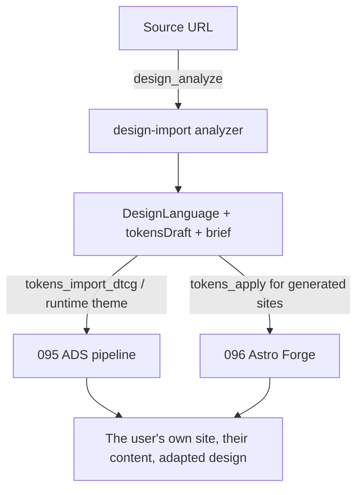

# Proposal 098 — Design Language Import: Recreate Any Site's Design Concept as an Adapted, Content-First Theme

**Status:** PENDING
**Date:** 2026-10-31
**Relates to:** Proposal 095 (ADS token pipeline — the consumer of every import) · Proposal 096 (Astro Forge — its `tokens_apply`/`ads_generate` become downstream consumers) · Proposal 092 (storefront, the template donor) · Proposal 058 (DTCG import precedent) · `mcp-ai-wpoos-astro-storefront` skill (the `/mcp` surface this extends)
**Author:** NV oOS coding agent (Zed)

---

## 1. Problem Statement

Users keep asking for one thing in different words: **"make my site look like that one."** The reference is an Astro theme demo, a WordPress site, or any website. Three failure modes make the naive answer (clone it) wrong:

1. **Legal** — verbatim CSS, copy, images, and distinctive layouts are protectable expression; "inspired by" is not. A clone tool ships liability; a *recreation* tool ships value (CopyWeb 2026: "AI-assisted rewriting on top of capture is what moves a project from 'clone' toward 'inspired by'").
2. **Technical** — the user's content differs from the source's. A pixel copy of someone else's layout breaks the moment the user's catalog, copy, or pages don't fit it. What transfers is not the layout — it is the **design language**: palette roles, type pairing, spacing rhythm, radii/shadows, component vocabulary, and the mood those choices produce.
3. **Repository** — the repo already owns the consumption side: 095's ADS DTCG token pipeline (`tokens_import_dtcg`, runtime themes) and 096's Forge (`tokens_apply`, `ads_generate`) can both consume a token document. What's missing is the **extraction side**: turning any URL into that token document plus an adaptation brief.

This proposal builds the missing half: `design-import` — a capture-and-analyze pipeline that reads a source URL (Astro theme repo, WordPress site, or generic website), extracts its design language as **data (tokens + concept), never as assets or markup**, and emits a DTCG-shaped token draft with fail-loud role assignment, plus an adaptation brief that tells the user (or the assistant) how to make it *theirs*. The default and recommended mode is **inspired-by recreation**; 1:1 fidelity is an explicit non-goal.

## 2. Research & Industry Standards

Full sources in `098-design-language-import-research.md`. Load-bearing findings:

- **The transformative posture is the industry norm** (uiscanner, 2026): "Describe and tokenize the page, rebuild in your own stack from the tokens and structure, and never re-host the original's images or fonts. Use what you pull as a starting system and make the design your own."
- **Token-role discipline** (dev.to/hugonaili, "Extracting design tokens from a site you don't control"): "A wrong role assignment is worse than a missing one." Every reputable extractor keeps an **unassigned pool** and only labels semantic roles when confident — mislabeled tokens get used confidently in a hundred places before anyone checks. This is the single most important extraction rule and the repo's token pipeline (095) is already fail-loud for gaps.
- **Style transfers, content does not** (Koder.ai "Make My Website Like This"): recreate look and feel without copying text, images, or layouts — exactly the adaptation layer this proposal formalizes.
- **Copying boundaries** (Law StackExchange, CJ&CO, askailawyer): taking inspiration is generally acceptable; duplicating CSS/code/copy/images is not; deceptive imitation of a competitor is the real legal risk. Mitigation is structural: never output source CSS verbatim, never re-host source assets, ship an attribution manifest per import, and default to "inspired-by" (license-verified themes may opt into closer parity).
- **Computed styles beat screenshots** (Superdesign 2026): read rendered styles, not pixels; semantic CSS custom properties (`--color-*`) are the highest-quality source (ExportToFigma). Static HTML+CSS analysis is the deterministic v1; rendered (Playwright) capture is the Phase 2 upgrade for JS-heavy sites.
- **Re-extraction is a sync concern** (Element Armory): design systems evolve; token extraction should be re-runnable and diffable — the plan's `design_compare` covers this.
- **Source modes match the source's nature** (astro ecosystem research, 2026-10-31): Astro themes are GitHub repos — clone, don't scrape (licenses intact, zero SSRF surface); WordPress self-describes via `/wp-json` and FSE `theme.json` (a design-token layer already); generic sites need static-or-rendered capture.
- **The differentiator is adaptation, not extraction** — extraction is commoditized (design-extract, dembrandt, Sitegeist, ExportToFigma, uiscanner). None of them feed a first-class DTCG token pipeline with content-first adaptation; this repo's 095/096/092 stack is the unique consumer chain.

## 3. Proposed Design

### 3.1 Shape

| Piece | Location | Role |
|---|---|---|
| Design-language types | `examples/nvoos-astro-velocity/src/lib/design-import/types.ts` | The `DesignLanguage` contract: concept, palette roles, typography, spacing, radii/shadows, component vocabulary, token draft, adaptation brief, provenance |
| SSRF-safe fetcher | `examples/nvoos-astro-velocity/src/lib/design-import/fetcher.ts` | http/https only, private/link-local/reserved-IP rejection (DNS-resolved, every hop), redirect cap, timeout, size caps, `NVOOS_MCP_FETCH_ALLOW_PRIVATE` escape hatch for local dev |
| Static analyzer | `examples/nvoos-astro-velocity/src/lib/design-import/analyzer.ts` | Pure, deterministic HTML+CSS → `DesignLanguage`. Colors (frequency + saturation heuristics), typography scale, spacing rhythm, radii/shadows, component vocabulary, CSS-variable harvesting, concept summary |
| MCP tools | `examples/nvoos-astro-velocity/mcp/tools/design.ts` | `design_analyze` (v1, this proposal) · `design_compare` (re-extract diff, Phase 2) · `design_plan` (adaptation brief, Phase 3) |
| Consumers (already shipped) | 095 `tokens_import_dtcg` / runtime themes · 096 Forge `tokens_apply` | The token draft feeds the existing pipeline unchanged — 098 emits, 095/096 consume |

### 3.2 The `DesignLanguage` output (what a user gets)

```ts
{
  source: { url, mode: 'astro-theme' | 'wordpress' | 'generic', fetchedAt },
  concept: 'warm neutral editorial palette, serif display over humanist sans body, airy 8px rhythm',
  palette: { roles: { accent, 'accent-ink', surface, text, 'field.border' }, roleConfidence, unassigned: [...] },
  typography: { families: [...], scalePx: [14, 16, 20, 28, 40] },
  spacing: { scalePx: [4, 8, 16, 24, 48] },
  radii: { valuesPx: [6] },
  shadows: { count, samples: [...] },
  components: { vocabulary: { button: 14, card: 8, nav: 4 } },
  tokensDraft: { /* DTCG semantic layer, only confident roles; gaps stay missing — fail loudly */ },
  adaptationBrief: { keep, replace, remix, licensingNote, attributionManifest },
  provenance: { origin, licenseNotice }
}
```

Rules baked into the contract:
- **Never output source CSS, HTML, copy, images, or fonts.** The output is token data + prose only.
- **Fail-loud roles.** Only assign `roles.*` when confidence is high; everything else goes to `palette.unassigned`. A missing role is visible; a wrong one is poison.
- **Adaptation brief always present.** Every import ships "keep / replace / remix" guidance so the result is the user's brand, not the source's clone.
- **Attribution for verified-license sources** (MIT Astro themes) lands in `provenance`; the repo's `NOTICE` discipline extends to generated themes.

### 3.3 Source modes

| Mode | Detect | Capture | Notes |
|---|---|---|---|
| `astro-theme` | GitHub URL / repo with `astro.config.mjs` | Git clone (read-only) + parse `src/tokens`, Tailwind `@theme`, CSS | No scraping, licenses intact; highest-quality token source |
| `wordpress` | `/wp-json` answers or HTML markers | REST probe (`/wp/v2/themes`) + `theme.json` + static HTML | `theme.json` presets map to DTCG core/semantic (058 precedent) |
| `generic` | anything else | Static HTML + same-origin stylesheets (v1); Playwright computed styles (Phase 2) | The default; lowest fidelity to *layout*, highest to *language* |

### 3.4 Lifecycle composition



098 **extracts and adapts**; 095 **operates**; 096 **generates sites**. The three compose into "describe a look → import it → theme the user's content with it".

### 3.5 Explicit non-goals

- **Not a clone.** No pixel-matching, no verbatim CSS/markup output, no asset re-hosting (uiscanner's transformative posture is the contract).
- **Not a visual editor** — output is data + prose; there is no canvas.
- **Not content migration** — 096 owns WP content; 098 only reads *styling* signals and never stores source content.
- **Not a hosted SaaS** — an in-repo library + MCP surface, like 095/096.

## 4. Implementation Plan

See `098-design-language-import-implementation-plan.md`. Summary: **Phase 0** (static analyzer + SSRF-safe fetcher + `design_analyze` tool, this proposal's first PR) → **Phase 1** (WordPress mode, Astro-theme mode) → **Phase 2** (rendered capture + re-extraction diff) → **Phase 3** (adaptation engine, AI-assisted role assignment with the fail-loud pool) → **Phase 4** (theme emission into 095/096, attribution manifests, verification gates). Each phase is a shippable PR with hermetic tests.

## 5. Risks & Mitigations

| Risk | Impact | Mitigation |
|---|---|---|
| Licensing (verbatim CSS/copy/assets) | High | Structural: no source output; token re-expression; adaptation brief default; `NOTICE`/attribution manifest; license-verified mode only for MIT/permitting sources |
| Token mislabeling | Medium | Fail-loud pool (research §2); `roleConfidence` per role; human/assistant review step before `tokens_import_dtcg` |
| SSRF (arbitrary-URL fetch from the server) | High | DNS-resolved private/reserved-IP rejection every redirect hop; scheme allowlist; credential-in-URL rejection; timeouts + size caps; `NVOOS_MCP_FETCH_ALLOW_PRIVATE` opt-in only; OWASP SSRF cheat-sheet discipline |
| JS-heavy sources yield empty static reads | Medium | Mode detection degrades gracefully; Phase 2 adds Playwright rendered capture; `confidence` reports the gap |
| Source-site rate/robots | Low | Bounded requests per analysis (page + ≤8 same-origin stylesheets); no crawling in v1; single-document fetch |
| AI drift in concept/adaptation prose | Low | v1 prose is deterministic templates, not LLM; AI only enters in Phase 3 with pinned fixtures |

## 6. References

- [uiscanner — extract design tokens from any website](https://uiscanner.com/blog/extract-design-tokens-from-any-website) · [dev.to/hugonaili — extracting design tokens from a site you don't control](https://dev.to/hugonaili/extracting-design-tokens-from-a-site-you-dont-control-16b8) · [CopyWeb — is website cloning legal](https://copyweb.net/blog/is-website-cloning-legal) · [Koder.ai — copy the style, not the content](https://koder.ai/blog/make-my-website-like-this-clone-style-without-copying-content) · [Law StackExchange — copying a website design](https://law.stackexchange.com/questions/56820/is-it-allowed-to-copy-a-website-design) · [Superdesign — extract a design system from a website](https://superdesign.dev/blog/extract-design-system-from-website) · [ExportToFigma — extract design tokens](https://www.exporttofigma.com/blogs/extract-design-tokens-from-any-website) · [Element Armory — re-run extraction quarterly](https://elementarmory.com/topics/component-reuse-libraries/design-system-extraction/extract-design-tokens-from-ui)
- Repo: Proposals 095 (token pipeline, MCP craft), 096 (Forge consumers), 058 (DTCG import), 092 (storefront); `.agents/skills/mcp-ai-wpoos-astro-storefront/SKILL.md`; `examples/nvoos-astro-velocity/src/lib/tokens/`

## 7. Decisions (owner)

- **Q1 — Inspired-by default:** the tool's default and documented stance is recreation/adaptation, never cloning (recommended — the product framing in this proposal).
- **Q2 — Open-world annotation:** `design_analyze` is the first `/mcp` tool with `openWorldHint: true` (it fetches external URLs) — an explicit deviation from the current all-false pin (recommended, with the handshake test updated).
- **Q3 — Phase 0 now:** ship the static analyzer + fetcher + tool before the WordPress/Astro-theme modes (recommended — deterministic v1 that every later mode reuses).
- **Q4 — Playwright in Phase 2:** rendered computed-style capture for generic mode (recommended) vs static-only forever.
- **Q5 — AI only from Phase 3:** deterministic heuristics first; LLM-assisted semantic role assignment and adaptation prose only after the deterministic pipeline is pinned by tests (recommended).
