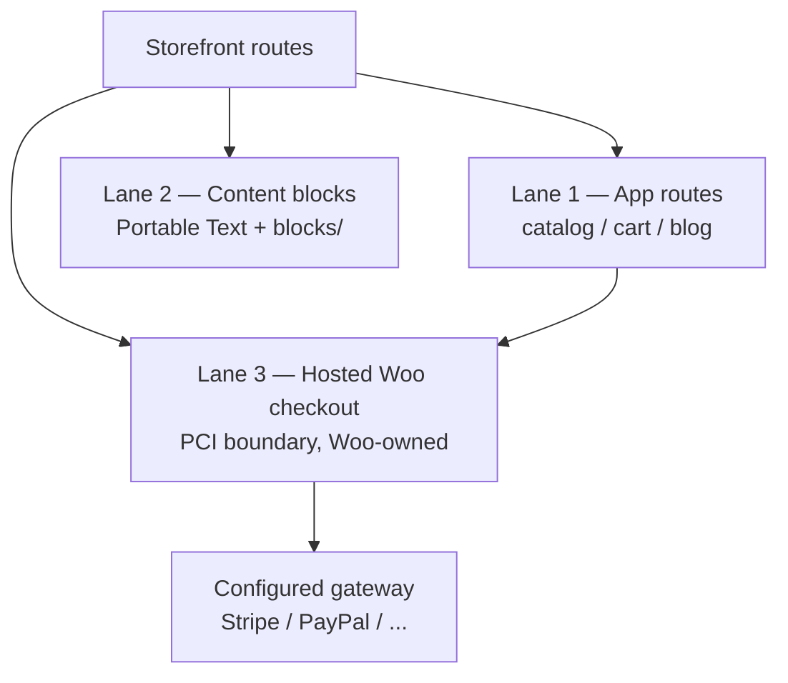

# 108 — WooCommerce Checkout & Cart Enhancement — Gap Analysis

> Grounds the current integration (Proposal 106 §4 handoff) against the
> industry research in `108-woo-checkout-cart-enhancement-research.md`,
> names the gaps, and records the two decisions the owner asked for: the
> **content/page tool slice** and the **render pipeline**. Companion to the
> implementation plan.

## 1. Executive summary

The 106 handoff already matches the industry default (redirect to the hosted
WooCommerce checkout — the Hydrogen/Medusa pattern, and the PCI-SAQ-A-safe
pattern). Eight gaps remain, in three buckets:

- **Security (H1–H2):** `checkoutUrl` accepts arbitrary external URLs
  (open-redirect/phishing surface); the legacy `?add-to-cart` GET is a
  state-changing URL form.
- **Parity (G1, G3, G5, G6):** variant lines excluded; no coupon/error
  surface; no return-to-storefront after payment; no gateway visibility.
- **Continuity & surface (G4, G7):** cross-domain login at checkout; no MCP
  tool slice for shop/checkout configuration.

Decisions: the **content/page tool slice** is a small `shop` slice on the
existing `/mcp` surface (configuration, not page building — checkout stays
Woo-owned); the **render pipeline** is explicitly three lanes: app routes
(cart), hosted Woo (checkout — the PCI boundary), content blocks
(marketing/FAQ, including the new tabs/accordion blocks). Never render
payment UI in the app (INV-1).

## 2. Current state (grounded in code)

| Piece | Location | Behaviour |
|---|---|---|
| Handoff builder | `examples/nvoos-astro-velocity/src/lib/commerce/checkout.ts` | Pure `buildCheckoutUrl()`: `{checkoutUrl}?add-to-cart=1,2` for simple lines; variants excluded + counted; fails closed on empty URL |
| Cart island | `src/islands/CartView.tsx` | Renders the checkout link, clears local cart on handoff |
| Shop globals | `addons/nvoos-astro-bridge/includes/REST/ShopGlobalsController.php` | `GET/PATCH /nvoos-commerce/v1/globals/shop` — `checkoutUrl`, `cartUrl`, `currency`, `currencySymbol`; URL fields validated as "absolute http(s)" only |
| Defaults | `addons/nvoos-astro-bridge/includes/Schema.php` (`shop_defaults()`) | `checkoutUrl = home_url('/checkout/')`, `cartUrl = home_url('/cart/')`; currency from Woo when active |
| Admin surface | `addons/nvoos-astro-bridge/src/components/SettingsView.tsx` | Shop editor fields for the four globals |
| Tests | `tests/unit/checkout.test.ts`, `tests/e2e/checkout.spec.ts`, `tests/phpunit/REST/TestShopGlobalsController.php` | Comma form, variant exclusion, fail-closed, PATCH validation |

What is already right (do not re-litigate): the redirect model, the
fail-closed empty-URL behaviour, ids-only payloads (prices are re-resolved
Woo-side — tamper-proof by construction), the hermetic tests.

## 3. Gap analysis

### G1 — Variant lines cannot hand off (known, honest UX today)
Woo's URL form carries simple product ids only. **Standard:** the Store API
`POST /wc/store/v1/cart/add-item` accepts `{ id, quantity, variation }`
arrays. Fix = bridge cart proxy (implementation Phase 2).

### G2 — `checkoutUrl` is an open-redirect/phishing surface
Only `manage_astro` users can PATCH it, but a compromised manager session or
a misconfiguration silently repoints every storefront checkout at an
attacker-controlled domain. **Standard:** same-site validation + explicit
allowlist (research §5). Fix = H1 in Phase 1.

### G3 — No coupon / cart-error / notice surface
The shopper can't apply coupons before checkout, and a dead product id in
the URL fails with Woo's own notices rather than a storefront-visible
error. **Standard:** Store API cart round-trips return the full cart state
with coupons + notices. Fix = same Phase 2 proxy.

### G4 — Shoppers appear logged-out at hosted checkout
`astro.nvoos.cloud` and `nvoos.pro` are different registrable domains, so
Woo cookies never cross. **Standard:** accept re-login, or a short-lived
signed SSO token exchanged server-side (research §6). Decision: default =
accept re-login; optional Phase 3 token behind an owner toggle.

### G5 — No return-to-storefront after payment
Woo's order-received page leaves the shopper on the WP domain.
**Standard:** `woocommerce_get_return_url` filter + a storefront thanks
route. Fix = Phase 3 globals (`returnUrl`) + bridge filter.

### G6 — No gateway visibility on the storefront
The storefront cannot show which payment methods are available or preselect
one. **Standard:** enumerate enabled gateways server-side (`wc/v3` or Store
API checkout state) and pass a `payment_method` deep link. Fix = Phase 3/4
(read-only gateway list in the shop globals).

### G7 — Legacy state-changing GET for add-to-cart
Low impact (ids only, cart-scoped) but the hardened path is nonce/token
authenticated. **Standard:** Store API requires a cart token/nonce for all
POSTs (research §3). Fix = migrate to the Phase 2 proxy; keep the URL form
as a fallback only.

### G8 — No MCP surface for shop/checkout configuration
Assistants can read/write commerce collections (`cms_*`) and content
(`content_*`) but cannot inspect or adjust the shop globals that drive the
checkout handoff. **Standard:** every operational knob on the mount gets a
read tool + a gated write tool (the 095/107 tool-slice precedent).

## 4. DECISION-1 — the content/page tool slice

**Add a `shop` tool slice to the app's `/mcp` surface (2 tools):**

| Tool | Shape | Gate |
|---|---|---|
| `shop_get` | reads the `/globals/shop` doc (checkout/cart/return URLs, currency, gateway list when enabled) | read-only, open |
| `shop_update` | PATCHes the same fields through the bridge | manager session (backend `manage_astro` enforces — same ladder as `cms_*` writes) |

Explicit **non-goals** (recorded so nobody rebuilds Woo in the app):

- The hosted checkout page is **not** a content document. It is Woo-owned
  (blocks/hooks/templates — research §4) and customized WordPress-side.
- The cart page stays an app route (`src/pages/cart/index.astro` + island),
  not a content document — its layout is commerce logic, not editorial
  content.
- Content blocks may **not** embed payment UI or card fields (INV-1).

This mirrors the 107 decision shape: a thin slice over an existing bridge
surface, fail-closed auth, no new page-builder ambitions.

## 5. DECISION-2 — the render pipeline (three lanes)

- **Lane 1 (app routes, SSR + islands)** — commerce pages. Cart, PDP, PLP.
  Already the 104 pipeline (on-demand SSR + route cache).
- **Lane 2 (content blocks)** — editorial surfaces. The 107 Portable Text
  pipeline; this PR promotes the adopted UI components into it (accordion
  FAQ + tabs) so agent-authored pages get the same a11y-grade components as
  the hand-written pages.
- **Lane 3 (hosted Woo checkout)** — the ONLY lane where payment happens.
  The app's job is the handoff (Lane 1 → Lane 3) and the return (Lane 3 →
  Lane 1, G5).

## 6. Security hardening list (H1–H6)

| Id | Control | Where |
|---|---|---|
| H1 | Same-site + allowlist validation for `checkoutUrl`/`cartUrl`/`returnUrl` (reject off-site domains unless explicitly allowlisted via `funiq_bridge_checkout_url_allowlist`) | bridge `ShopGlobalsController` + `Schema` |
| H2 | `rel="noopener noreferrer"` + explicit `target` on the checkout link | `CartView.tsx` |
| H3 | Keep payloads ids-only (no prices/qty in the URL) — already true; pin with a test comment | app |
| H4 | Store API calls only server-side with a bridge-minted nonce/cart token — never expose `wc/v3` keys to the browser | bridge (Phase 2) |
| H5 | Signed, single-use, short-TTL handoff token if SSO continuity is enabled (HMAC, `exp` claim, single-use nonce) | bridge (Phase 3, opt-in) |
| H6 | INV-1 invariant: no card fields, card data, or payment responses in the app — assert in review + axe/gate tests | app |

## 7. Anything else missing (the "what else" sweep)

- **Analytics on handoff** — fire a `checkout_handoff` event so funnel
  conversion (cart → Woo checkout → order) is measurable. Phase 2.
- **Coupon entry on the cart page** — pairs with G3 (Store API coupons).
- **Shipping/tax preview** — deferred to the Laravel T1 cart resource
  (Proposal 085/090 owns the long-term cart); the bridge proxy must stay a
  thin pass-through so it can be swapped.
- **Order status lookup** ("where is my order") — deferred; requires auth
  and is a T1 candidate.
- **Charts/dashboards** — explicitly NOT part of this track (no chart tools
  exist in the app; dashboards over orders belong to the T1 backend).

## 8. Proposed roadmap (phases)

- **Phase 1 — harden what ships (this PR's scope + docs).** H1 allowlist,
  H2 link attrs, tests. Plus the 107 follow-up: promote tabs + accordion
  into content blocks.
- **Phase 2 — cart parity via Store API proxy.** Bridge `POST /cart/items`
  (nonce/token minting, variations, coupons, notices); app cart island
  switches with the URL handoff as fallback; handoff analytics event.
- **Phase 3 — checkout continuity.** `returnUrl` globals +
  `woocommerce_get_return_url`; gateway list in shop globals; optional SSO
  handoff token (owner toggle).
- **Phase 4 — MCP `shop` slice.** `shop_get`/`shop_update` on `/mcp`,
  quota + audit lines, e2e in the hermetic loop.

## 9. Open questions for the owner

1. **SSO continuity (G4):** ship the signed handoff token (Phase 3) or
   accept "log in at checkout" as the permanent default?
2. **checkoutUrl allowlist policy:** same-site-only by default, with the
   `funiq_bridge_checkout_url_allowlist` filter for external checkout
   domains — acceptable?
3. **Order-received UX:** redirect back to a storefront thanks route
   (recommended) or keep Woo's order-received page?
4. **Phase 2 now or at T1:** the Store API cart proxy is ~1-2 working days;
   worth shipping before the Laravel flip, or hold all cart parity for T1?
