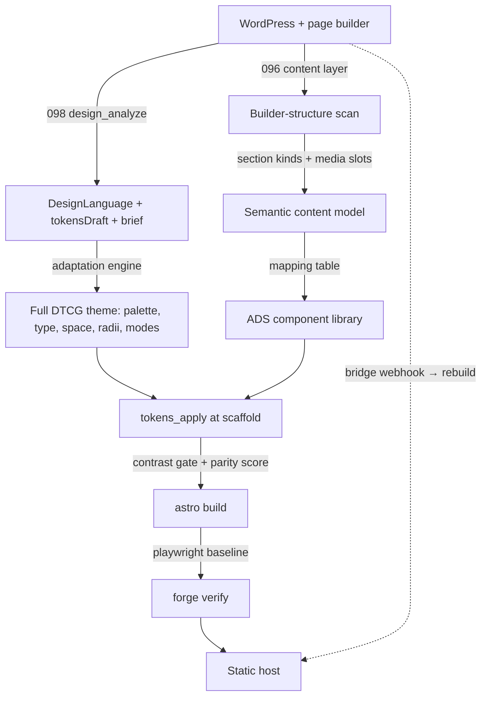

# Proposal 114 — Forge Design Rebuild: Rebuild Customer Sites with the NV oOS Design System, Never Replicate Their Markup

**Status:** PENDING
**Date:** 2026-11-05
**Relates to:** Proposal 096 (Astro Forge — the generator this extends) · Proposal 098 (Design Language Import — the extraction side) · Proposal 095/092 (the ADS token pipeline and the velocity storefront — the design system this rebuilds *with*) · Proposals 104/105 (forge presets, theme runtime, policy) · Proposal 106 (hybrid content) · `plugins/nvoos-forge-bridge` (the rebuild trigger) · `mcp-ai-wpoos-astro-forge` + `mcp-ai-wpoos-astro-storefront` skills
**Author:** NV oOS coding agent (Zed)

---

## 1. Problem Statement

A live forge today (096) sanitizes WordPress HTML and serves it inside the template's
chrome. On a page-builder site the result is what we saw forging **jayainc.com**
(2026-11-05): the *content* survives — hero copy, testimonial, category cards, brand
logos all render — but the *design does not*. The forged front page is a gray
`system-ui` document with the forge's default accent (`#0f6b4f`), while the source site
is a light-blue Elementor design in Rubik with a hero/feature-grid/testimonial
vocabulary. The Elementor markup (`.elementor-section`, widget divs, parallax hooks)
passes through the sanitizer as inert structure and gets styled by generic
`.post-body` element selectors — a worst-of-both outcome:

1. **The original design language is lost** — palette roles, type pairing, spacing
   rhythm, radii/shadows, and component vocabulary are nowhere in the output.
2. **The original markup is *kept* as dead weight** — thousands of builder-specific
   class names and nested wrapper divs ship to the browser, minus the CSS that gave
   them meaning. Semantics are gone, bloat remains.
3. **What the repo *should* be doing is neither**: the stack already owns both halves
   of a design-system rebuild — 098 extracts a source site's design *language* as
   data, and the ADS (095/092) rebuilds presentations from DTCG tokens. The forge sits
   between them and does not connect them.
4. **Forms — JetFormBuilder and Elementor forms — are silently dropped, not integrated.**
   The sanitizer allowlist has no `form`/`input`/`textarea`/`select`/`button` tags
   (`disallowedTagsMode: 'discard'`), so every form a source site renders — verified on
   jayainc.com, whose home ships two `<form>` elements — vanishes from the forged site.
   Even if the markup survived, the submission `action` points back at WordPress
   endpoints (`?jet_fb_handler=`, admin-ajax `elementor_pro_forms`) that do not exist
   on a static host. WooCommerce was integrated the same way this needs to be: content
   at build time, commerce *behavior* proxied through WordPress. Forms need that second
   half — a submission bridge.

The user's requirement is explicit and matches 098's transformative posture: **do not
replicate the Elementor design — rebuild it using our design system.** This proposal
makes that a first-class, standards-based forge pipeline: extract the source's design
language (098) → classify the content into a semantic content model → map each section
to ADS components → apply a full DTCG token theme → verify adaptation parity and WCAG
contrast at build time. Fidelity to the source's *concept* is the goal; pixel parity is
an explicit non-goal (and the legal boundary — see §2). The same pipeline carries the
forms story (§3.9): form *presentation* is rebuilt as a design component, and form
*behavior* (JetFormBuilder / Elementor Pro submissions) rides a WordPress bridge
endpoint — the WooCommerce checkout-proxy pattern applied to forms.

### 1.1 What exists today (baseline, verified 2026-11-05)

| Capability | State | Gap |
|---|---|---|
| `profile.tokens` (098 `tokens_apply` output) | Merged over 6 color defaults into the `--forge-*` span of `global.css` (`scaffold.ts` `DEFAULT_TOKENS` / `rewriteGlobalCss`) | Flat, color-only: no typography, spacing, radii, shadows, dark/light modes, or confidence data |
| WCAG gate | `tokenWarnings()` — warnings only, scaffold-time, color pairs against white | Never blocks, not an audit artifact, single background assumption |
| Template token layer | `--forge-*` custom properties: 8 colors + radius/font/space/measure; `[data-theme='dark']` + `[data-contrast='high']` variants | No type scale, no spacing rhythm, no component-level tokens |
| Content styling | Generic `.post-body` element selectors (h2, blockquote, table, pre, img) | Builder structures (sections, columns, hero, cards) are not classified or rebuilt |
| `content-scan.ts` | htmlparser2 audit — embeds/alt/hosts/shortcode artifacts, unprocessed brackets | No structural classification of builder markup |
| Theme runtime | 104/105 port (`src/lib/theme/`, policy ladder, `ThemeToggle`) | Single `dark` brand theme in the forge registry — brand slugs fail open |
| Verification | e2e exit gate: XSS traps, allowlists, JSON-LD, sitemap | **No design verification of any kind** — the forged site can look nothing like the source and the gate stays green |
| Rebuild loop | bridge plugin → signed webhook → `repository_dispatch` | No design-drift detection between rebuilds |
| Forms | Sanitizer allowlist excludes all form tags — every `<form>` is discarded (`disallowedTagsMode: 'discard'`); no submission surface exists | Form markup is lost; even when kept, `action`s target WP-only endpoints that 404 on a static host |

## 2. Research & Industry Standards

Full citations in `114-forge-design-rebuild-research.md`. Load-bearing findings:

- **DTCG 2025.10 is the interchange standard.** The W3C Design Tokens Community Group
  shipped its first stable specification on 2025-10-28, backed by 40+ organizations
  (Adobe, Figma, Google, Microsoft, Shopify, Salesforce). The `$value`/`$type`/
  `$deprecated`/`{ref}` format is what both the ADS and the forge's token layer already
  speak — the rebuild pipeline should stay inside it, not invent a parallel format.
- **Theming = semantic-layer swap; primitives stay constant.** Style Dictionary v4+ reads
  DTCG natively and the industry pattern (Sujeet, designtokens.substack "Build a token
  pipeline in 5 steps", dev.to) is: extract/author the primitive core once, express every
  brand as semantic overrides, build platform artifacts from a single source of truth,
  and drift-gate the generated output. This is exactly the ADS architecture (095) — the
  forge should consume it, not approximate it.
- **Accessibility is enforced at the token level, in CI.** "Fix it where it lives: in a
  handful of design tokens, checked against their real backgrounds in every theme, then
  gated in CI so it can't creep back" (A11yFlow); figr.design adds: *test token
  combinations*, because a compliant token can become non-compliant on the wrong
  background. Contrast gates therefore belong to the token-apply step and to the build,
  with a structured audit report — not a scaffold-time warning nobody reads.
- **Visual verification during design migration ≠ pixel-matching the source.** The 2026
  toolchain (Playwright `toHaveScreenshot`, Chromatic for component-level baselines,
  Percy for cross-browser) compares against an **approved baseline** to catch
  *regressions* — the migration industry explicitly screenshots "the 20% of UI users
  touch 80% of the time". Translated to a rebuild: the baseline is the operator-approved
  rebuilt design; the source is measured separately with a **design-language similarity
  score** (098's `design_compare` machinery), never with pixel diffs — pixel parity with
  a third-party site is the cloning boundary.
- **Headless migration practice is content-first, URL-preserving, and design-refreshing.**
  Agency playbooks (Robotostudio, Pagepro, focusreactive, gitnation) converge on: export
  content via REST/XML and *map* it to a new content model, rebuild JSON-LD and metadata,
  ship page-level 301s for moved URLs, and re-implement roles/auth in the new layer —
  while treating the redesign as an opportunity, not a copy exercise. The forge already
  does the URL/SEO half (096/098); this proposal supplies the content-model + design half.
- **The transformative posture is the norm (098's research, restated):** uiscanner —
  "describe and tokenize the page, rebuild in your own stack from the tokens and
  structure, and never re-host the original's images or fonts"; Koder.ai — style
  transfers, content does not; CopyWeb — "inspired by" is where value lives, cloning is
  liability. Token-role discipline (dev.to/hugonaili): a wrong role assignment is worse
  than a missing one — keep the unassigned pool and confidence labels from 098.
- **Re-extraction is a sync concern (Element Armory):** design systems evolve; the
  rebuild pipeline must be re-runnable and diffable — `design_compare` over the source at
  rebuild time detects drift, and the 098 adaptation brief guarantees the result stays
  *the customer's brand*, not the source's clone.
- **Headless form submission is a solved, three-layer pattern.** JetFormBuilder ships a
  purpose-built headless surface — the **Formless Actions Endpoints** addon (“submit
  forms from another site via REST API”, Crocoblock) — while Elementor Pro forms bind to
  admin-ajax (`elementor_pro_forms`) and expose behavior through the **Forms API hooks**
  (`elementor_pro/forms/new_record`); Elementor's own maintainers point third-party
  consumers at custom code on those hooks rather than a REST submit route (GitHub
  discussion #24198). The robust design therefore runs the plugin's NATIVE handler
  server-side behind one bridge route — exactly the storefront's checkout-proxy pattern
  (110: the bridge dispatches the Woo Store API in-process instead of reimplementing
  checkout). The static side posts JSON to the bridge; the bridge maps it into the
  handler's expected shape.
- **Static-site form spam defense is a ladder, not a product.** Industry practice
  (Static Forms 2026, 3zero, ivyforms, Bit Form): honeypot + timestamp as the floor;
  score-based reCAPTCHA v3 or Cloudflare Turnstile for lead forms — with the 3zero
  warning applied: a v3 score without verifying `action` + `hostname` is trust theater.
  Cross-origin forms additionally need an origin allowlist (CORS), per-endpoint rate
  limits, and server-side sanitization of every field (never client-side-only
  validation). GDPR: consent checkboxes pass through; submissions stay stored on
  WordPress, the static site stores nothing.

## 3. Proposed Design

### 3.1 Shape — the rebuild pipeline



Four artifacts replace today's single HTML passthrough:

| Artifact | Source | Consumer |
|---|---|---|
| `DesignLanguage` (098) | `design_analyze` of the source site | `tokens_apply` (upgraded), parity scoring |
| Semantic content model | builder-structure scan of sanitized WP HTML | ADS component mapping |
| Full DTCG token theme | `DesignLanguage` + adaptation brief + operator overrides | `--forge-*` span (expanded), generated token artifacts |
| Component mapping | section-kind → component → token-role table | template component library |

### 3.2 The semantic content model (content-first, builder-agnostic)

The forge already sanitizes WP HTML; the new step classifies it. Builder markup is
recognized by stable structural signatures (Elementor `data-element_type`,
`elementor-widget-*`; WPBakery `vc_*`; native blocks `wp-block-*`; Gutenberg
`<!-- wp:… -->` comments when unrendered) and each recognized unit is emitted as a
typed section with text/media slots:

```ts
type SectionKind = 'hero' | 'feature-grid' | 'icon-list' | 'testimonial'
  | 'logo-cloud' | 'cta' | 'gallery' | 'text' | 'table' | 'form' | 'raw';

interface SemanticSection {
  kind: SectionKind;
  slots: { title?: string; body?: string[]; media?: MediaRef[]; items?: SemanticSection[] };
  fallback: 'ads-component' | 'post-body' | 'drop';
}
```

Rules: recognized structures **rebuild** as ADS components; unrecognized rich content
falls back to the sanitized `.post-body` treatment (today's behavior); genuinely inert
builder scaffolding (empty columns, parallax hooks, wrapper divs) is dropped — semantics
without the bloat. The model is emitted as a build-time JSON (`semantic/<page-slug>.json`)
and rendered by the template, so content and presentation stay separable and the e2e
gate can assert on it.

### 3.3 The upgraded token theme (`tokens` v2)

The flat color map becomes a DTCG-shaped design block in the site profile:

```json
{
  "design": {
    "mode": "rebuild",
    "source": { "url": "https://jayainc.com", "analyzedAt": "…" },
    "palette": {
      "roles": { "accent": "#6ec1e4", "text": "#444444", "surface": "#ffffff", … },
      "unassigned": ["#ffcf0e", "#242424", …],
      "confidence": { "accent": "high", "text": "medium" }
    },
    "typography": { "display": "Rubik", "body": "system-ui", "scalePx": [16, 18, 20, 28, 40] },
    "spacing": { "scalePx": [4, 8, 16, 24, 48] },
    "radii": { "valuesPx": [4, 8] },
    "modes": { "dark": "auto", "contrast": "auto" },
    "adaptation": { "keep": [], "replace": [], "remix": [] }
  }
}
```

- **Fail-loud roles** (098 contract): only confident roles land in `palette.roles`;
  everything else stays in `unassigned` and the operator/assistant resolves it before
  apply — with the contrast gate refusing to ship unresolved text/background pairs.
- **Type pairing and scales** map to the template's `--forge-font-*` / `--forge-scale-*`
  tokens; licensed fonts are adopted only when self-hostable (e.g. Rubik is OFL).
- **Generated artifacts, drift-gated**: the template gains `design.generated.ts` +
  expanded CSS emitted from the DTCG block, mirroring the velocity `tokens.generated.ts`
  discipline (`check:tokens` in CI), so the manifest JSON stays the single source of truth.
- **The 098 adaptation brief is mandatory** and its `remix` suggestions (shift the hue,
  pick the customer's own neutrals) are applied *before* tokens land — the result is
  visibly the customer's, never a copy.

### 3.4 ADS component mapping

The velocity storefront's adopted component set (Q6: accessible-astro-components adapted
onto ADS tokens, Zag-powered dialog/combobox) is the component donor. The forge template
gets a `src/components/design/` library rendering each `SectionKind` from the semantic
model with token-role bindings (`surface-alt`, `line`, `accent`, `accent-ink`, type
roles). The mapping table ships as data (`semantic/section-map.json`), so per-site
overrides (e.g. "this site's testimonial blockquote is actually a feature callout") are
operator edits, not template forks. Unknown kinds degrade: component → post-body → drop
(never a build failure).

### 3.5 The contrast gate hardens

`tokenWarnings()` becomes `contrastAudit()`: every rendered token pair (text/surface,
accent/accent-ink, line/surface, muted/surface) across light/dark/high-contrast modes is
checked against WCAG 2.2 (SC 1.4.3 4.5:1 text, SC 1.4.11 3:1 non-text) at apply time and
again in the build, emitting `design-audit.json` in `dist/`. Policy: `--strict-contrast`
fails the scaffold/build (CI option); default remains warn — but the warnings become a
machine-readable artifact with per-pair fixes, including a suggested one-token
substitution from the source's own `unassigned` pool (see the jayainc example in §6).

### 3.6 Language-parity verification (`forge verify`)

Two independent checks, never pixel-matching the source:

1. **Design-language parity** — run 098's analyzer over the built site (or its static
   CSS) and diff against the source's `DesignLanguage` using `design_compare` semantics:
   concept distance, palette-role distance (ΔE on confident roles), typography-family
   and scale overlap, spacing-rhythm fit. Thresholds ship per preset; a pass means "the
   adaptation landed", not "the pixels match".
2. **Regression baselines** — Playwright `toHaveScreenshot` baselines over the
   high-traffic routes (home + top sections, the 20%-of-UI rule) committed per site;
   every rebuild diffs against the *approved* baseline to catch token/component
   regressions. `forge verify` runs both and fails CI when either breaks.

### 3.7 Surfaces

| Surface | Change |
|---|---|
| CLI | `forge analyze` gains `--design` (run 098 extraction inline, write the v2 `design` block); `forge scaffold` consumes it; new `forge verify` command |
| Wizard | design step between analyze and scaffold: extract → adapt (brief) → contrast-fix → confirm → scaffold (TTY-gated prompts, `suggestAdaptation` deterministic fallback) |
| Forge `/mcp` | `design_apply` (extract + write profile design block) and `design_verify` (parity + baselines); both ride the existing rate limit + fail-closed write auth |
| Template | `src/components/design/` component library, semantic renderer, expanded token layer, `design-audit.json`, drift-gated generated artifacts |
| Bridge | no change — the signed rebuild webhook already triggers the loop; design drift surfaces as a verify failure with a diff report |
| Bridge (forms, §3.9) | gains `POST /wp-json/nvoos-forge/v1/forms/submit` — CORS allowlist, honeypot/timestamp, optional score captcha, in-process dispatch to the native JetFormBuilder/Elementor handler |

### 3.8 Explicit non-goals

- **Not replication.** No source CSS, markup, copy, images, or fonts are copied; no
  pixel-matching; the adaptation brief is mandatory (098's legal posture).
- **Not a visual builder** — no canvas; operator edits are JSON (profile, section map).
- **Not a new design system** — the ADS is the system; this pipeline *consumes* it. The
  forge template's component library is a port, not a second system.
- **Not content migration** — 096 owns content; this proposal only re-classifies the
  content HTML it already ships.
- **Not a form-builder reimplementation** — the WP-side plugins (JetFormBuilder,
  Elementor Pro) keep owning validation, storage, actions, and mail; the bridge only
  *dispatches* to their native handlers (§3.9).

### 3.9 Form submission bridge — JetFormBuilder + Elementor Forms

Forms integrate the way WooCommerce did: **content at build time, behavior proxied
through WordPress.** Two halves:

**Render half (the forge).** The sanitizer gains a form allowlist — `form`, `label`,
`input`, `textarea`, `select`, `option`, `button`, `fieldset`, `legend`, plus their
functional attributes (`name`, `type`, `value`, `placeholder`, `required`, `checked`,
`selected`, `rows`, `cols`, `autocomplete`, `for`) — versioned under the existing
`SANITIZE_VERSION` discipline; `action`/`method` are stripped (the static site never
posts to WP directly — that URL is a build artifact, §3.9 config below). The semantic
classifier gains a `form` section kind (Elementor `elementor-widget-form`, JetFormBuilder
shortcode output, `wp-block-*` contact blocks) rendered by a new `Form.astro` design
component on the token layer. Two special cases: forms whose fields are a single search
input map to the site's own `/search/` surface (jayainc's two `method="get"` forms are
exactly this), and forms with no registered WP form ID degrade to a plain link/CTA —
never to a dead endpoint.

**Behavior half (the bridge).** `nvoos-forge-bridge` gains one route:
`POST /wp-json/nvoos-forge/v1/forms/submit` with a JSON body
`{ form: <wp-form-id|form-name>, fields: {…}, honeypot: '', timestamp: <ms> }`.

1. **Origin + rate gates first** — CORS allowlist = the configured static origin(s)
   (`nvoos_forge_forms_origins`); per-endpoint + per-IP rate limits; audit line per
   submission.
2. **Spam ladder** — honeypot non-empty or timestamp outside ±2h → silent discard
   (200, no side effects); optional Cloudflare Turnstile / reCAPTCHA v3 verify with
   `action` + `hostname` pinned (the 3zero rule); every field server-side sanitized.
3. **Native dispatch, not reimplementation** — JetFormBuilder present → invoke its
   submit handler / formless endpoint for the form ID; else Elementor Pro present →
   drive `ElementorPro\Modules\Forms\Classes\Ajax_Handler` + `Form_Record` with the
   mapped payload (the `elementor_pro/forms/new_record` hook is the extension seam);
   else → typed 501 (`nvoos_forge_no_form_handler`). This mirrors 110's checkout proxy:
   the bridge runs the plugin's own code in-process, so validation, storage, mail, and
   post-submit actions behave identically to the WP-rendered form.
4. **Response contract** — the handler's success/error JSON passes through verbatim,
   wrapped in the bridge envelope (`{ ok, message, errors? }`); unknown form → 404;
   disabled handler → 501. The static site renders success/error states from it;
   the no-JS fallback is an ordinary POST + redirect back with `?form=ok` — the
   industry's “just use a standard form” floor for low-risk sites.

**Config.** `nvoos.json` gains `forms: { endpoint: <wp-site>/wp-json/nvoos-forge/v1,
searchForms: ['search', …] }` — scaffolded from the profile; the bridge endpoint and the
allowlisted origin ship in `.env.example`, never hardcoded. Submissions (and consent)
remain stored on WordPress — the static site stores nothing (GDPR-friendly by
construction).

## 4. Implementation Plan

| Phase | Scope | Gate |
|---|---|---|
| **P1 — Extraction at forge time** | `forge analyze --design` runs the 098 analyzer against the profile URL and writes the v2 `design` block; the analyzer is invoked as a library (no new SSRF surface beyond 098's guard) | Unit tests: jayainc fixture → block matches the 2026-11-05 live capture (§6) |
| **P2 — Semantic content model** | Builder-structure classifier in `content-scan.ts` (Elementor v1, `wp-block-*` v1, WPBakery follow-up), `semantic/*.json` emission, template renders sections via a first component set (hero, feature-grid, text) with `post-body`/drop fallbacks | e2e: forged fixture page renders classified sections; XSS gate unchanged; bloat metric (builder-class count in output) drops |
| **P3 — Token theme v2** | Expanded `--forge-*` layer (type roles, scale, spacing, radii, modes), generated `design.generated.ts` + CSS artifacts, drift gate, `contrastAudit()` with `design-audit.json`, strict flag | Token unit suite + contrast gate tests (4.5:1/3:1 pairs, both modes) + generated-artifact drift test |
| **P4 — ADS component library** | Port the velocity adopted component set onto the forge token layer; `section-map.json` data mapping; dark/high-contrast coverage | Component tests (a11y + tokens) + e2e on a section-heavy fixture |
| **P5 — Verification** | `forge verify`: `design_compare`-based parity score + Playwright baselines per site; CI wiring in the generated pipeline (`verify-dispatch.mjs` unchanged — verify runs as a build step) | Parity fixtures with known-good/bad adaptations; baseline regression test |
| **P6 — MCP + wizard** | `design_apply` / `design_verify` tools; wizard design step; docs + skills update | MCP tool contract tests; non-TTY wizard e2e (the `suggestAdaptation` path) |
| **P7 — Form submission bridge** | Sanitizer form allowlist (version bump) + `form` section kind + `Form.astro`; bridge `forms/submit` route with CORS/rate/spam gates + native JetFormBuilder/Elementor dispatch; `nvoos.json` forms config; search-form → `/search/` mapping | Zero-HTTP bridge tests (the checkout-proxy pattern): JFB + Elementor handler seams, spam-ladder cases, origin/rate gates, 404/501 contracts; e2e: a fixture form renders as a design component and its `action` points at the configured bridge URL, never at WP | **Shipped 2026-11-05** — render half (sanitizer v2 allowlist, `form` section kind + search/cta degradation, `Form.astro`, scaffold `forms` block + `.env.example`), behavior half (bridge 0.2.0 `Rest\Forms`: origin/rate/spam/captcha gates, `capture_json` native dispatch via the JFB `process_form()` + Elementor `ajax_send_form()` seams, typed 404/501, no-JS redirect floor), tests (forge: sanitizer/semantic/scaffold/e2e form gates; bridge: `tests/test-forms.php` zero-HTTP suite) |

Each phase is a shippable PR; P1–P3 are order-independent after P1.

## 5. Risks & Mitigations

| Risk | Impact | Mitigation |
|---|---|---|
| Cloning liability | High | Structural: no source output anywhere in the pipeline; adaptation brief mandatory; parity measures *language distance*, never pixels; attribution manifest per import (098 contract) |
| Misclassified builder sections | Medium | Confidence per section; `fallback` ladder (component → post-body → drop) means a wrong classification degrades, never breaks; section-map overrides per site |
| Token mislabeling | Medium | 098 fail-loud roles + unassigned pool carry through; contrast gate refuses unresolved text/surface pairs in strict mode |
| Component port drift from velocity | Low | The mapping table is data; components are pure token consumers; the port follows the Q6 attribution/NOTICE discipline |
| Parity score gaming / false confidence | Medium | Deterministic v1 scoring (ΔE, family/scale overlap) with pinned fixtures; AI-assisted scoring only after the deterministic path is gated (098 Q5 posture) |
| Baselines flake in CI | Low | Playwright `toHaveScreenshot` with the repo's existing fixture-server hermeticity; threshold config; baselines approved per site, not auto-updated |
| Larger `dist/` (semantic JSON + audit) | Low | Both are small JSON; the gitignore gate already excludes built artifacts |
| Form spam / bot abuse on the bridge endpoint | High | Spam ladder mandatory (honeypot + timestamp floor, optional score captcha with `action`/`hostname` pinned); per-endpoint + per-IP rate limits; every field server-side sanitized; silent-discard for caught bots (no enumeration signal) |
| Cross-origin form submissions (CORS/CSRF) | Medium | Origin allowlist = the configured static host(s) only; no cookies/nonces ride the cross-origin path (the guest-checkout pattern, 108/110); state-changing surface is one POST route with an audit line per call |
| Handler drift (JetFormBuilder/Elementor versions change their internal APIs) | Medium | Dispatch goes through the plugins' public seams (JFB formless endpoints / `elementor_pro/forms/*` hooks); the bridge pins handler contracts with zero-HTTP tests and reports a typed 501 on mismatch — never a silent data loss |
| Sanitizer form allowlist opens new XSS surface | Medium | Attribute allowlist is closed (no `style`/`on*`/`formaction`/`javascript:`); `action`/`method` stripped and rebuilt from the profile config; the e2e XSS gate gains form vectors (`<input onfocus=…>`, `javascript:` values) |
| GDPR/consent | Medium | Consent fields pass through to the WP handler and stay stored on WordPress; the static site persists nothing; submission storage/retention follows the source plugin's existing settings |

## 6. Worked example — jayainc.com (live analysis, 2026-11-05)

`design_analyze` on the source site (wordpress mode) extracted:

- **Concept:** cool accent over light neutrals, sans display/sans body, compact rhythm.
- **Roles:** accent `#6ec1e4` (from `--e-global-color-primary`, high confidence), text
  `#7a7a7a` (high), surface `#ffffff` (medium); unassigned pool includes `#444444`,
  `#3d3d3d`, `#242424`, `#ffcf0e`, `#f3f3f3`.
- **Type:** Rubik (29 mentions) over Roboto/system; scale 10–20px observed.
- **Vocabulary:** header, buttons, footer, forms, badges — and the Elementor sections the
  classifier maps to hero / feature-grid / testimonial / logo-cloud.

The contrast gate flags the source's own text color: `#7a7a7a` on `#ffffff` = **4.29:1**
— fails AA (SC 1.4.3). The suggested one-token fix comes from the source's *own* pool:
`#444444` (≈9.7:1, AAA) — the same class of fix as the pilot customer's `#555555` note
(098), and a ready upsell moment during delivery. Rubik is OFL — self-hostable and
adoptable with attribution. Under this proposal the forged jayainc frontend rebuilds the
home page as hero + feature grid + testimonial + logo cloud in Rubik on ADS tokens, ships
`design-audit.json` proving AA compliance, and `forge verify` shows the language-parity
score between source and rebuild — without a single byte of Elementor CSS.

The forms story lands in the same run: jayainc's two home `<form>` elements are
`method="get"` search forms (verified 2026-11-05) — the classifier maps them onto the
site's own `/search/` surface instead of a submission endpoint, while any future
JetFormBuilder/Elementor contact form renders as the `Form.astro` component and posts to
the bridge's `forms/submit` route (§3.9). Today both forms are discarded by the
sanitizer — the strongest single datapoint for P7.

## 7. References

- `114-forge-design-rebuild-research.md` (full citations and quotes)
- W3C DTCG — [Design Tokens specification reaches first stable version (2025.10)](https://www.w3.org/community/design-tokens/2025/10/28/design-tokens-specification-reaches-first-stable-version/) · [designtokens.org](https://www.designtokens.org/) · [codercops explainer](https://blog.codercops.com/blog/design-tokens-2026-w3c-format-guide)
- [Style Dictionary](https://github.com/style-dictionary/style-dictionary) · [Sujeet — Design Tokens and Theming Architecture](https://sujeet.pro/articles/design-tokens-and-theming) · [designtokens.substack — Build a Token Pipeline in 5 Steps](https://designtokens.substack.com/p/build-a-token-pipeline-in-5-steps) · [dev.to — Design Token Architecture for Scalable Theming](https://dev.to/beefedai/design-token-architecture-for-scalable-theming-2o0d)
- [A11yFlow — Color Contrast WCAG 2.2: A Developer's Fix Guide](https://www.a11yflow.dev/blog/color-contrast-wcag-developer-guide) · [figr.design — Design System Accessibility](https://figr.design/blog/design-system-accessibility) · [accessibility-test.org — Color Contrast in WCAG 2.2](https://accessibility-test.org/blog/support/advanced-guides/color-contrast-in-wcag-2-2-testing-and-fixes-that-actually-work/)
- [Wopee — Visual Testing: The Complete Guide (2026)](https://wopee.io/blog/ultimate-guide-to-visual-testing/) · [Bug0 — Best Visual Regression Testing Tools 2026](https://bug0.com/knowledge-base/visual-regression-testing-tools) · [desplega — Chromatic vs Playwright vs Percy](https://www.desplega.ai/blog/deep-dive-7-visual-regression-testing-ui-bugs)
- [Robotostudio — CMS migration](https://robotostudio.com/services/cms-migration) · [Pagepro — Migration from WordPress to Headless CMS](https://pagepro.co/blog/migration-from-wordpress-to-headless-cms/) · [focusreactive — CMS Migration](https://focusreactive.com/blog/cms-migration/) · [gitnation — CMS Migration Agencies 2026](https://gitnation.com/contents/hand-picked-headless-cms-migration-services-2026-best-agencies-reviewed)
- JetFormBuilder — [Formless Actions Endpoints addon](https://jetformbuilder.com/addons/formless-actions-endpoints/) · [endpoint setup](https://jetformbuilder.com/features/how-to-setup-formless-actions-endpoints/) · [Crocoblock AI-builder stack](https://crocoblock.com/blog/wordpress-ai-builders-and-wordpress-crocoblock-combo/)
- Elementor — [Forms API hooks](https://developers.elementor.com/docs/hooks/forms) · [headless submit discussion #24198](https://github.com/orgs/elementor/discussions/24198) · [wphelpforums — new_record sync](https://wphelpforums.com/threads/how-to-sync-elementor-form-submissions-to-a-third-party-api-using-elementor_pro-forms-new_record.7365/)
- Static-form spam + ops — [Static Forms 2026](https://www.staticforms.dev/blog/spam-email-bot) · [3zero — honeypot vs reCAPTCHA vs Turnstile](https://www.3zerodigital.com/blog/how-to-protect-your-forms-from-spam-bots-honeypot-vs-google-recaptcha-vs-cloudflare-turnstile-2025-comparison/) · [ivyforms — WP form security](https://ivyforms.com/blog/wordpress-form-security/) · [Bit Form — spam prevention](https://bit-form.com/blog/prevent-spam-form-submissions-in-wordpress/)
- Repo prior art — the checkout-proxy pattern (110: `plugins/nvoos-forge-bridge`, Store API in-process dispatch) that §3.9 mirrors
- 098 research (uiscanner, hugonaili, CopyWeb, Koder.ai, Element Armory) — `098-design-language-import-research.md`
- Repo: Proposals 096 (Forge), 098 (design language import), 095/092 (ADS + velocity), 104/105 (forge theme/runtime), 106 (hybrid content); `examples/nvoos-astro-forge/lib/{scaffold,content-scan}.ts`; `templates/blog/src/styles/global.css`; `examples/nvoos-astro-velocity/src/lib/design-import/`

## 8. Decisions (owner)

- **Q1 — Rebuild posture:** the pipeline's documented stance is design-system rebuild of
  the customer's content with inspired-by adaptation; replication of source markup/CSS is
  out of scope and structurally impossible (recommended).
- **Q2 — Pixel parity is never a goal:** verification = language-parity score + regression
  baselines against an approved rebuild, never against the source (recommended).
- **Q3 — Contrast strictness:** default warn with a machine-readable `design-audit.json`;
  `--strict-contrast` opt-in for CI/gates (recommended) vs always-fail.
- **Q4 — Component scope:** port the velocity Q6 adopted set (accessible-astro-components
  adapted + Zag dialog/combobox) rather than adopting a new library (recommended).
- **Q5 — Phase 1 now:** P1 (extraction at forge time) + P2 (semantic content model) are
  the first PRs; token v2 and the component library follow (recommended).
- **Q6 — Form backend:** the bridge-owned `forms/submit` route with native
  JetFormBuilder/Elementor dispatch (recommended — mirrors 110's checkout proxy and
  keeps submissions on WordPress) vs a third-party form service (Formspree/Basin/
  Netlify Forms — rejected: splits data ownership, loses the plugins' post-submit
  actions, adds a subscription).
- **Q7 — Spam posture:** honeypot + timestamp mandatory on every submission, with
  Cloudflare Turnstile / reCAPTCHA v3 (action + hostname verified) as the opt-in second
  layer for lead forms (recommended) vs captcha-on-every-form.
- **Q8 — P7 sequencing:** ship the render half (sanitizer allowlist + `form` section kind
  + `Form.astro` + search-form mapping) before the bridge half — forms become visible
  and correctly-targeted even before the submission route lands (recommended).
