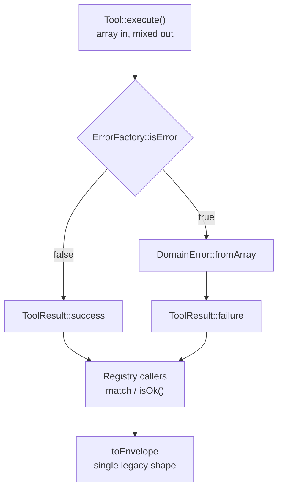
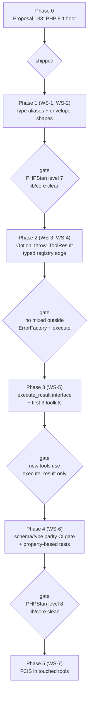

# Proposal 134 — Functional Type Signatures (type-driven design for base + Pro)

- **Date:** 2026-11-08
- **Status:** **Phases 1–2 shipped; WS-6 API shipped.** WS-3 partially applied (helpers added, legacy helpers deprecated rather than removed). WS-5 interface added, first typed tool migrated. WS-7 applied to one pilot tool. See §14 for the implemented/deferred split.
- **Prerequisite:** [Proposal 133](133-php-81-baseline-proposal.md) — **shipped** (single PHP 8.1 floor)
- **Research basis:** *Functional Programming in Scala* (Chiusano & Bjarnason) mapped onto PHP 8.1, plus the 2024–2026 consensus on parse-don't-validate, illegal-states-unrepresentable, and static analysis as PHP's type checker (sources in §11).
- **Owner:** Core
- **Scope:** `lib/core/src/Domain/Contract/`, `lib/core/src/Tool/`, `lib/core/src/Application/Tool/`, `includes/interfaces/`, `includes/tools/`, `addons/pro/includes/tools/`

---

## 1. TL;DR

Our signatures are the weakest part of an otherwise well-layered architecture.
`ToolInterface::execute(array $arguments, array $context): mixed` cannot tell a
caller whether the tool succeeded, what it returned, or whether a required
parameter was missing — and nothing forces the caller to find out. That is not a
style issue; it is the class of bug the `mcp-ai-wpoos-wporg-submission` skill
already documents as invisible to PCP, phpcs, and `php -l`.

This proposal applies **six ideas**, all standard practice outside PHP, to fix it:

| # | Idea | Origin | Landing spot |
|---|---|---|---|
| 1 | Errors as values, not as `mixed` | Red Book ch. 4 | `ToolRegistry` edge |
| 2 | ADTs + exhaustive matching | Red Book ch. 3 | `ToolResult` |
| 3 | Parse at the boundary, don't validate inside | Parse-don't-validate | `$arguments` parsing |
| 4 | Make illegal states unrepresentable | Type-driven design | `requireCapability`, optionals |
| 5 | Name untyped shapes (`@phpstan-type`) | PHPStan practice | all contracts |
| 6 | Effects at the edge (functional core / imperative shell) | Red Book ch. 13 | tool bodies |

**Two of the six are nearly free** (aliases + `Option`/throw: ~2 days) and
retire the level-8 blocker. The rest are staged and additive — **no breaking
change**, because 1,072 Pro files implement `WP_MCP_AI_Tool_Interface` directly.

## 2. The problem, measured

```
lib/core/composer.json     "php": "^8.1"          → full 8.1 vocabulary available
lib/core/phpstan.neon.dist level: 5  (target 8)   → ~251 errors, all "bare array"
```

| Location | Signature | Defect |
|---|---|---|
| `lib/core/…/Contract/ToolInterface.php` | `execute(array $arguments = array(), array $context = array()): mixed` | Untyped in, untyped out |
| `includes/interfaces/interface-wp-mcp-ai-tool.php` | `execute(array $arguments = array(), array $context = array())` | No return type at all |
| `lib/core/src/Application/Tool/ToolRegistry.php:210` | `execute(string $slug, array $arguments, array $context): mixed` | Same at the dispatch edge |
| `lib/core/src/Tool/AbstractTool.php` | `requireParam(array $arguments, string $key): mixed` | **Returns value *or* error** — every caller re-discriminates |
| `lib/core/src/Tool/AbstractTool.php` | `requireCapability(array $context, string $capability): mixed` | **`null` means success** |
| `lib/core/…/Contract/ErrorFactoryInterface.php` | `create(…): mixed`, `isError(mixed): bool` | An `Either` re-invented without the type |
| `AbstractTool::success()` | `@return array{success: true, message: string, data?: mixed}` | The ADT lives in a comment |
| `lib/core/src/**` | **481** × `: array` | The level-8 blocker, quantified |
| `addons/pro/**` | **1,072** files implementing the interface | Blast radius of a breaking change |

Three shapes are missing:

1. **A result type.** Success and failure are distinguishable only by a runtime
   `isError()` probe on a `mixed`.
2. **A request type.** `$arguments` is `array`; the only spec is
   `get_parameters_schema()`, a runtime array of strings. A misspelled key is a
   silent no-op, not an error.
3. **A context type.** `$context` carries `user_id`, `assistant_id`, `request`,
   `assistant_config`, `guest_request`, `agentic_loop` by convention only.

Two things we already do right and should build on:
- `CacheStoreInterface::remember()` uses `@template T` + `callable(): T` + `@return T` — the generics precedent exists in-tree.
- `Domain/Error/*.php` are `final readonly` classes with promoted properties — an ADT seed.
- `WP_MCP_AI_Tool_Schema_Auditor` is pure, static, side-effect-free — the repo's existing functional-style module.

## 3. What the Red Book actually gives us

| Ch. | Concept | Transfers? | Use here |
|---|---|---|---|
| 1–2 | Purity, referential transparency | ✅ | Keep tool bodies pure where possible; push IO to adapters |
| 3 | ADTs, pattern matching | ⚠️ Partial (no `sealed`) | `ToolResult`, `enum` for capability flags |
| **4** | **`Option` / `Either`, no exceptions for control flow** | ✅ **Direct** | `execute()` result, `requireParam`, `requireCapability` |
| 5 | Strictness / laziness | ❌ | Skip |
| 6 | Purely functional state | ⚠️ | Mental model for cost/token accounting only |
| 7 | Purely functional parallelism | ❌ | Action Scheduler owns this |
| 8 | Property-based testing | ✅ | Generate arguments from schema; assert envelope invariants |
| **9** | **Parser combinators** | ✅ | `$arguments` parsing at the boundary |
| 10 | Monoids (associativity + identity) | ✅ | Envelope merging, usage/cost aggregation |
| 11–12 | Monad / Applicative / Traversable | ⚠️ Vocabulary only | **No HKT in PHP** — use the laws as review criteria, not an API |
| **13** | **Functional core / imperative shell** | ✅ **Direct** | `lib/core` pure-ish, `includes/` adapters |
| 14–15 | Local state, streaming | ❌ | Skip |

**The one sentence that matters:** *a signature should make the failure branch
un-ignorable.* `mixed` does the opposite.

## 4. What the industry actually settled on

Narrower and more boring than the book — which is why it fits a WordPress plugin:

1. **Parse, don't validate** — parse raw input once at the boundary into a value valid *by construction*; stop re-checking downstream. Our "two-gate sanitisation" rule is already this, minus the type carrying the guarantee.
2. **Make illegal states unrepresentable** — union/enum types instead of flags + nullables.
3. **Errors as values for expected failures**, exceptions for programmer error.
4. **Static analysis is PHP's type checker** — array shapes and `@phpstan-type` aliases are the sanctioned way to type untyped arrays without rewriting them; typed classes are the destination once a shape is stable.
5. **PHP 8.1 (`readonly`, enums, union types) is the ADT toolkit** — not a monad library. PSL ships `Result`/`Option`, but PSL 6 requires PHP 8.4, so a dependency is a poor fit for a distributed plugin.

## 5. The vocabulary (small, on purpose)

Three new value objects, one alias file, zero new dependencies.

### 5.1 `DomainError` — reuse, don't add

`lib/core/src/Domain/Error/DomainError.php` already exists (`code`, `message`,
`data`). Add one constructor and it becomes the framework-neutral error type for
the whole vocabulary:

```php
public static function fromArray( array $normalized ): self
{
    return new self(
        (string) ( $normalized['code'] ?? 'unknown_error' ),
        (string) ( $normalized['message'] ?? 'Unknown error.' ),
        (array) ( $normalized['data'] ?? array() ),
    );
}
```

### 5.2 `Option` — only where `map`/`getOrElse` chains pay for itself

```php
namespace Nvoos\Core\Domain\ValueObject;

/**
 * @template-covariant T
 */
final class Option {

    /** @param T|null $value */
    private function __construct( private readonly mixed $value, private readonly bool $some ) {}

    /** @template U @param U $value @return self<U> */
    public static function some( mixed $value ): self { return new self( $value, true ); }

    /** @return self<never> */
    public static function none(): self { return new self( null, false ); }

    public function isSome(): bool { return $this->some; }

    /** @template U @param callable(T): U $fn @return self<U> */
    public function map( callable $fn ): self {
        return $this->some ? self::some( $fn( $this->value ) ) : self::none();
    }

    /** @template U @param callable(T): U $fn @return self<U> */
    public function flatMap( callable $fn ): self {
        return $this->some ? $fn( $this->value ) : self::none();
    }

    /** @param T $default @return T */
    public function getOrElse( mixed $default ): mixed {
        return $this->some ? $this->value : $default;
    }

    /** @return T */
    public function orFail( string $message ): mixed {
        if ( ! $this->some ) {
            throw new \LogicException( $message );
        }
        return $this->value;
    }
}
```

Deliberately **not** used everywhere: `?int` stays `?int`. `Option` is for the
handful of places that need to *chain* absence.

### 5.3 `ToolResult` — the ADT

```php
namespace Nvoos\Core\Domain\ValueObject;

/**
 * @template-covariant T
 */
final readonly class ToolResult {

    /** @param T|null $data */
    private function __construct(
        public bool $ok,
        public string $message,
        public mixed $data,
        public ?DomainError $error,
    ) {}

    /** @template U @param U|null $data @return self<U> */
    public static function success( string $message, mixed $data = null ): self {
        return new self( true, $message, $data, null );
    }

    /** @param DomainError $error @return self<never> */
    public static function failure( DomainError $error ): self {
        return new self( false, $error->message, null, $error );
    }

    public function isOk(): bool { return $this->ok; }

    /** @return T */
    public function unwrap(): mixed {
        if ( ! $this->ok ) {
            throw new \LogicException( 'unwrap() on failure: ' . $this->error?->code );
        }
        return $this->data;
    }

    /** @return array{success: bool, message: string, data?: mixed, code?: string} */
    public function toEnvelope(): array {
        return $this->ok
            ? array( 'success' => true, 'message' => $this->message ) + ( null !== $this->data ? array( 'data' => $this->data ) : array() )
            : array( 'success' => false, 'code' => $this->error?->code ?? 'unknown_error', 'message' => $this->message );
    }
}
```

`toEnvelope()` is the **only** place the legacy array shape is produced — which
keeps the `WPMCPAI.Tools.CanonicalReturnEnvelope` sniff meaningful and gives it a
single implementation to check.

### 5.4 The alias file

`lib/core/phpstan.neon`:

```neon
parameters:
    typeAliases:
        ToolContext: 'array{
            user_id?: int,
            assistant_id?: int,
            request?: mixed,
            assistant_config?: array<string, mixed>,
            guest_request?: bool,
            agentic_loop?: array<string, mixed>,
            ...<array-key, mixed>
        }'
        ToolArgs: 'array<string, mixed>'
        ParametersSchema: 'array{
            type: string,
            properties?: array<string, array<string, mixed>>,
            required?: list<string>,
            additionalProperties?: bool,
            ...<array-key, mixed>
        }'
        ProviderResponse: 'array<string, mixed>'
```

Then every contract reads:

```php
/**
 * @param  ToolArgs    $arguments
 * @param  ToolContext $context
 */
public function execute( array $arguments = array(), array $context = array() ): mixed;
```

`...<array-key, mixed>` means "known keys documented, extra keys tolerated" — the
escape hatch PHPStan added for exactly this migration.

## 6. Workstreams (highest leverage first)

### WS-1 · Type the contracts (unblocks PHPStan level 7)

**Effort:** 2–3 days · **Files:** ~40 · **BC break:** none

Apply `ToolArgs` / `ToolContext` / `ParametersSchema` / `ProviderResponse` to
every method in `lib/core/src/Domain/Contract/` and `Application/`. Replace bare
`array` returns with either an alias or `array<string, mixed>`.

**Gate:** `composer run lint` (phpstan level 7) clean in `lib/core`.

> This is the single highest-ROI change in the proposal. The ~251 errors were a
> *vocabulary* deficit, not a correctness deficit; naming the shapes retires most
> of them and leaves only real findings.

### WS-2 · Aliases for the envelope

**Effort:** 0.5 day · **Files:** 1 · **BC break:** none

```php
/** @phpstan-type SuccessEnvelope array{success: true, message: string, data?: mixed} */
/** @phpstan-type ErrorEnvelope array{success: false, code: string, message: string, data?: array<string, mixed>} */

/** @return SuccessEnvelope */
protected function success( string $message, mixed $data = null ): array { … }
```

### WS-3 · Kill `mixed`-or-error helpers

**Effort:** 1 day · **Files:** 1 + 2 call sites · **BC break:** none

`requireParam()` currently has three outcomes in one type. Replace with
`Option`:

```php
/**
 * @param ToolArgs $arguments
 * @return Option<mixed>
 */
protected function optionParam( array $arguments, string $key ): Option
{
    return array_key_exists( $key, $arguments ) && '' !== $arguments[ $key ]
        ? Option::some( $arguments[ $key ] )
        : Option::none();
}
```

`requireCapability()` returns `null` for "authorized" — the canonical illegal
state. Because the functional-core/imperative-shell split already exists, the
cleanest fix is to **throw** and convert at the registry edge:

```php
protected function authorize( array $context, string $capability ): void
{
    if ( (int) ( $context['user_id'] ?? 0 ) <= 0 ) {
        throw new AccessDeniedException(
            'You must be logged in to execute this tool.',
            (int) ( $context['user_id'] ?? 0 ),
            $capability,
        );
    }
}
```

`AccessDeniedException` already carries `$userId`, `$capability`, `$objectId` —
no new class needed.

### WS-4 · One typed edge: `ToolRegistry` returns `ToolResult`

**Effort:** 1–2 days · **Files:** 2 · **BC break:** none (additive method)

```php
public function execute_result( string $slug, array $arguments, array $context ): ToolResult
{
    …
    $raw = $tool->execute( $arguments, $context );

    return $this->errors->isError( $raw )
        ? ToolResult::failure( DomainError::fromArray( $this->errors->normalize( $raw ) ) )
        : ToolResult::success( (string) ( $raw['message'] ?? '' ), $raw['data'] ?? null );
}
```

This is the **only** place `mixed` meets `WP_Error`. Downstream code stops
calling `is_wp_error()` / `isError()` entirely.



### WS-5 · `execute_result()` as an opt-in interface

**Effort:** 3–5 days · **Files:** new interface + registry + first toolkits · **BC break:** none

We cannot change `execute()`'s contract: 1,072 Pro files plus the base tools
implement it directly, and the Pro addon is a separately versioned distribution.
So add a *transitional* interface:

```php
interface Tool_Result_Interface {
    public function execute_result( array $arguments, array $context ): ToolResult;
}
```

The registry prefers the typed path and wraps the legacy path:

```php
$result = $tool instanceof Tool_Result_Interface
    ? $tool->execute_result( $arguments, $context )
    : $this->legacyToResult( $tool->execute( $arguments, $context ) );
```

New tools implement `execute_result()` only; existing tools migrate
toolkit-by-toolkit via the existing `mcp-ai-wpoos-toolkit-audit` loop. When the
Pro addon's floor allows it, `execute()` becomes a deprecated `@deprecated`
bridge and the interface can be inverted.

### WS-6 · Schema ↔ type parity gate

**Effort:** 2 days · **Files:** `class-wp-mcp-ai-tool-schema-auditor.php` + CI

`get_parameters_schema()` is the only spec of a tool's inputs and it is never
cross-checked against anything. Extend the existing (already pure and
side-effect-free) auditor with a second static check:

```php
// new: WP_MCP_AI_Tool_Schema_Auditor::audit_type_parity( $slug, $schema, $tool_class )
//  - every schema `required` key is declared in the tool's ToolArgs alias
//  - every alias key appears in schema.properties
//  - no schema property uses a type the alias cannot express
```

Wire into `composer run ci:all` and Site Health. This turns "tool declared
`bytes` required but its DTO says optional" from a runtime 400 into a CI failure.

Then add the property-based layer (Red Book ch. 8): generate argument objects
from the schema, assert `execute_result()` never returns a malformed envelope.

### WS-7 · Functional core / imperative shell inside tools

**Effort:** opportunistic · **BC break:** none

Today most tools do all four things in one method: read `$arguments`, mutate
WordPress, shape the envelope, and format strings. Target shape:

```php
public function execute( array $arguments = array(), array $context = array() ): mixed {
    $request = FormatBytesRequest::fromArguments( $arguments );   // parse once
    $result  = $this->handle( $request );                          // pure
    return $result->toEnvelope();                                  // one shape
}

private function handle( FormatBytesRequest $request ): ToolResult { … }
```

`FormatBytesTool` is already almost pure — it is the natural pilot. Do this only
where a tool is being touched anyway; it is **not** a mass rewrite.

## 7. Non-goals

Explicitly rejected, because the book is seductive:

- **No `Monad` / `Functor` / `Applicative` type classes.** No higher-kinded types
  in PHP; emulation produces hierarchies no WordPress reviewer will merge.
- **No free monads / `IO[A]` interpreter.** Action Scheduler and the existing
  queue are the effect system.
- **No point-free style, no currying helpers.** WPCS and code review will reject it.
- **No `Option` everywhere.** `?T` is idiomatic; reserve `Option` for chaining.
- **No lazy evaluation work.** Generators where already used; nothing more.
- **No mass rewrite of 1,700 tools.** WS-5 gets the guarantees without the churn.
- **No new Composer dependency** (PSL, `widmogrod/php-functional`, etc.).

## 8. Phases and gates



**Gate discipline:** stop at any gate whose residual backlog cannot be burned
down in one sprint. A permanently red baseline is worse than a lower level.

Prerequisite check for G1: `lib/core` at level 7 requires the `typeAliases` block
to exist in `phpstan.neon` (not just `phpstan.neon.dist`), because the aliases
are referenced from `src/`.

## 9. Files affected

| Phase | Path | Change |
|---|---|---|
| 1 | `lib/core/phpstan.neon` | new `typeAliases` (WS-1) |
| 1 | `lib/core/src/Domain/Contract/*.php` (34 contracts) | aliases applied |
| 1 | `lib/core/src/Tool/AbstractTool.php` | envelope aliases |
| 2 | `lib/core/src/Domain/ValueObject/Option.php` | **new** |
| 2 | `lib/core/src/Domain/ValueObject/ToolResult.php` | **new** |
| 2 | `lib/core/src/Domain/Error/DomainError.php` | `fromArray()` |
| 2 | `lib/core/src/Tool/AbstractTool.php` | `optionParam`, `authorize` |
| 2 | `lib/core/src/Application/Tool/ToolRegistry.php` | `execute_result` |
| 3 | `lib/core/src/Domain/Contract/ToolResultInterface.php` | **new** |
| 3 | `includes/interfaces/interface-wp-mcp-ai-tool.php` | `@return` docblock only (no syntax change needed at 8.1) |
| 3 | `addons/pro/includes/tools/**` | migrated per toolkit |
| 4 | `includes/class-wp-mcp-ai-tool-schema-auditor.php` | `audit_type_parity()` |
| 4 | `.github/workflows/php-linting.yml` | parity job |
| 5 | touched tools | split `execute()` / `handle()` |

## 10. Risks

| Risk | Likelihood | Impact | Mitigation |
|---|---|---|---|
| Alias migration balloons past the ~251 errors | Medium | Medium | Gate at level 7, not 8; `...<array-key, mixed>` escape hatch |
| `ToolResult` diverges from the legacy envelope | Low | High | `toEnvelope()` is the only producer; the existing sniff checks it |
| Pro/base interface drift | Medium | Medium | Additive interface only; Pro stays on `execute()` until its own floor allows |
| `Option` used as ceremony | Medium | Low | Non-goal §7; review rule = "must call `map`/`flatMap` at least once" |
| Perf regression from wrapper objects | Low | Low | `ToolResult`/`Option` are single-allocation; no reflection, no serialization on hot paths |
| PHPStan aliases are global per analysis | Low | Low | Prefix all aliases (`ToolContext`, not `Context`) |

## 11. Validation strategy

1. **Static:** `composer run lint` in `lib/core` at each phase gate; `composer run lint:compat` (now 8.1–8.4) unchanged.
2. **Unit:** PHPUnit for `Option` (identity/law checks), `ToolResult` (`toEnvelope` bijection with the legacy shape), `ToolRegistry::execute_result` (WP_Error → failure; array → success).
3. **Contract:** run the existing `test:basepro` matrix — it pins the gating contracts and is the right place to assert the typed edge does not change behaviour.
4. **Property-based:** generate arguments from `get_parameters_schema()`; assert (a) no malformed envelope, (b) `isOk()` XOR `error !== null`, (c) `toEnvelope()` round-trips.
5. **Regression:** `composer run test` before merge; `php -l` on touched files.
6. **Not sufficient:** PCP/phpcs. They do no type inference — see the wporg skill's note on a typed `: array` return fataling on `WP_Error`.

## 12. Metrics

| Metric | Today | Target (after G4) |
|---|---|---|
| `: array` in `lib/core/src` | 481 | named alias or `array<…>` on 100% of public methods |
| Bare `array $param` in contracts | ~251 PHPStan errors | 0 |
| `: mixed` outside `ErrorFactory` + `execute()` | 6 | 0 |
| Tools returning `mixed`-or-error helpers | 2 call sites | 0 |
| PHPStan level (`lib/core`) | 5 | 8 |
| Schema/type parity | unverified | CI-enforced |

## 13. Sources

**The book**
- Chiusano & Bjarnason, *Functional Programming in Scala* — [MEAP PDF](https://www.kufunda.net/publicdocs/Functional%20Programming%20in%20Scala.pdf)
- Chapter notes (ch. 3–5, incl. the `Option`/`Either` treatment): [Univ. of Mississippi](https://john.cs.olemiss.edu/~hcc/docs/ScalaFP/FPS.pdf), [error handling](https://john.cs.olemiss.edu/~hcc/csci555/notes/FPS04/ErrorHandling.pdf)
- [Scala FP overview](https://docs.scala-lang.org/overviews/scala-book/functional-programming.html) · [Scala guidelines](https://netvl.github.io/scala-guidelines/patterns-and-architecture/functional-programming.html)

**Industry practice**
- Parse, don't validate — [original](https://lexi-lambda.github.io/blog/2019/11/05/parse-don-t-validate/) · [DevIQ](https://deviq.com/principles/parse-dont-validate/)
- Illegal states unrepresentable — [DevIQ](https://deviq.com/principles/make-illegal-states-unrepresentable/) · [Thoughtworks ADTs](https://www.thoughtworks.com/en-th/insights/blog/microservices/domain-modeling-algebraic-data-types-pt2) · [Hillel Wayne](https://buttondown.com/hillelwayne/archive/making-illegal-states-unrepresentable/)
- PHPStan — [PHPDoc types & array shapes](https://phpstan.org/writing-php-code/phpdoc-types) · [type aliases](https://masteringlaravel.io/daily/2025-07-02-use-phpstan-type-aliases-to-clean-up-long-type-signatures) · [shapes vs typed classes](https://www.reddit.com/r/PHP/comments/1odq5rb/phpstan_annotated_array_shapes_vs_typed_classes/) · [typed arrays](https://nerdpress.org/2025/01/04/typed-arrays-with-phpstan-types/)
- PHP FCIS/errors-as-values discussion — [r/PHP](https://www.reddit.com/r/PHP/comments/mpmf8g/which_form_of_typing_is_best_practice_in_php/)

**In-repo**
- [Proposal 133 — PHP 8.1 baseline](133-php-81-baseline-proposal.md)
- `lib/core/phpstan.neon.dist`, `lib/core/src/Domain/Contract/ToolInterface.php`, `lib/core/src/Tool/AbstractTool.php`
- `includes/interfaces/interface-wp-mcp-ai-tool.php`
- `.agents/skills/mcp-ai-wpoos-wporg-submission/SKILL.md` (the "typed return crossing a `WP_Error` API" failure class)
- `.agents/skills/mcp-ai-wpoos-toolkit-audit/SKILL.md` (the migration vehicle for WS-5)

---

## 14. Implementation status (2026-11-08)

### 14.1 Shipped

| WS | Item | Files |
|---|---|---|
| WS-1 | Type aliases + contract docblocks - **complete**: Domain, Application, Infrastructure and Tool all swept (level 6: 354 -> **0**). Aliases: `ToolArgs`, `ToolContext`, `ToolParametersSchema`, `SuccessEnvelope`, `ErrorEnvelope`, `ProviderResponse` | `lib/core/phpstan.neon`, `Domain/*`, `Application/*`, `Infrastructure/*`, `Tool/*` |
| WS-2 | Envelope aliases (`SuccessEnvelope`, `ErrorEnvelope`) | `Tool/AbstractTool.php` |
| WS-3 | `optionParam()`, `authorize()`, `validationFailure()`; `requireParam()` / `requireCapability()` deprecated | `Tool/AbstractTool.php` |
| WS-4 | `ToolRegistry::executeResult()` + `toResult()`; `AccessDeniedException` converted at the edge | `Application/Tool/ToolRegistry.php` |
| WS-5 | `ToolResultInterface` + `AbstractResultTool` bridge | `Domain/Contract/ToolResultInterface.php`, `Tool/AbstractResultTool.php` (both new) |
| WS-6 | `audit_contract()` + `audit_registry_contract()`; finding labels registered; **CI gate live** (`test_registry_schema_contract_is_clean`, 446 tools, 0 violations) | `includes/class-wp-mcp-ai-tool-schema-auditor.php`, `includes/class-wp-mcp-ai-site-health.php`, `tests/test-tool-schema-contract.php` |
| WS-7 | FCIS pilot | `Tool/FormatBytesTool.php`, `Domain/ValueObject/FormatBytesRequest.php` (new) |

New value objects: `Domain/ValueObject/Option.php`, `Domain/ValueObject/ToolResult.php`,
plus `DomainError::fromArray()` / `toArray()`.

### 14.2 Measured results

| Metric | Before | After |
|---|---|---|
| `lib/core` PHPStan (level 5) errors | 32 | **0 — gate green** |
| `lib/core` PHPStan (level 6) | 354 | **0 - gate green** (subsumed by the level-7 gate) |
| `lib/core` PHPStan (level 7) | 399 | **0 - gate green** (subsumed by the level-8 gate) |
| `lib/core` PHPStan (level 8) | - | **0 - gate green** (maximum level; enforced in `phpstan.neon.dist`) |
| Errors in files touched by this work | — | **0** |
| `lib/core` tests | 505 pass | **513 pass** (8 new tests this tranche, 0 regressions) |
| Root WP tests (`Tool_Schema_Auditor`, `Tool_Schema_Contract`) | 19 pass | **30 pass** (11 new) |
| PHPCS on changed `includes/` files | — | 0 errors, 0 warnings |
| Schema-contract CI gate | none | **446 tools audited, 0 violations** |

The 23 original `lib/core` errors are now fixed, not baselined: WordPress
functions/`WP_Error` were removed from `Application/Provider/*` (duck-typed
error detection + a portable transient fallback), 12 dead promoted constructor
properties were de-registered, and a real float-comparison bug was fixed (see
§14.3). One scoped `ignoreErrors` entry covers `constructor.unusedParameter` in
six files whose constructors are published API — no other rule is relaxed.

The final `Tool` tranche (49 findings across 15 files) was entirely
`missingType.iterableValue`. Typing it surfaced one **incorrect existing
annotation**: `Domain/Entity/ContentQuery` declared `metaQuery` /
`taxQuery` as `array<string, mixed>`, but both are WP_Query clause
**lists** - `$query->taxQuery[0]['taxonomy']` is asserted in the unit
tests and the WordPress adapter passes them straight through. Corrected
to `array<int|string, mixed>`.

### 14.2.1 The `string|false` (level-7) tranche

`json_encode()` is typed `string|false`, and 41 level-7 findings all traced
back to bridging that union into a `string` parameter. The fix is one total
function rather than 41 guards: `src/Support/Json.php` (new) exposes

| Helper | Contract | Use |
|---|---|---|
| `Json::encode( mixed $value, int $flags = 0 ): string` | **throws** `RuntimeException` on failure | HTTP request bodies, signed tokens |
| `Json::encodeOr( mixed $value, string $fallback, int $flags = 0 ): string` | returns `$fallback` | LLM-visible text, token estimation, SSE frames |

`AbstractTool::jsonBody()` wraps `Json::encode()`, so the 29 tool call sites
read `$this->jsonBody( $payload )` with no new imports. This removes an
implicit failure mode as well as the type error: previously a `false` body
hit a `?string` parameter under `declare(strict_types=1)` and surfaced as a
bare `TypeError`; now it surfaces as `JSON encoding failed: <reason>`.

The same tranche closed the remaining non-`json_encode` producers:

| Site | Producer | Fix |
|---|---|---|
| `SkillRegistry::loadFromDirectory()` | `scandir()` -> `array|false` | guard: return `0` (previously `foreach( false )` -> TypeError) |
| `AnthropicClient` / `GeminiClient` / `OpenAiCompatibleClient` | `preg_split()` -> `array|false` | `?: array()` |
| `SseHandler::sendEvent()` | fallback encode also `string|false` | fallback routed through `Json::encode()` |
| `UploadFileTool` | `parse_url()` -> `string|false|null` | `(string)` cast before `basename()` |
| `ColorConvertTool::parseToRgb()` | `hexdec()` -> `int|float` | `(int)` casts (keeps `array{int,int,int}` honest) |

Level-7 total: **55 -> 13**. The 13 survivors are a different family (see
the level-7 row in 14.4) and are not `string|false` issues.

### 14.2.2 Typed argument accessors (the `arrayParam()` cluster)

`arrayParam()` is honest: it returns whatever array the caller supplied, i.e.
`array<mixed, mixed>`. Seven level-7 findings were consumers that genuinely
expect a **map** (`array<string, mixed>`) or a **string list**
(`array<int, string>`) receiving that wider type. Widening the published Domain
contracts (`AgentOrchestrationInterface`, `MemoryStoreInterface`,
`CreateContentCommand` / `UpdateContentCommand`) would have been wrong, so
`AbstractTool` gained two narrowing accessors alongside the existing
`optionParam()` / `authorize()`:

| Accessor | Contract | Behaviour |
|---|---|---|
| `objectParam( array $arguments, string $key, array $default = array() ): array<string, mixed>` | string-keyed map | returns `$default` when the value carries integer keys |
| `stringListParam( array $arguments, string $key ): array<int, string>` | list of strings | casts scalars, drops non-scalars |

Six call sites switched to `objectParam()` (`delegateToAgent()`,
`executeWorkflow()`, `MemoryStore::update()` patch, `meta_input`, and
`MemoryStore::search()` filters); one switched to `stringListParam()` (`tags` in
the `MemoryStore::store()` shape). This is also a small validation win - a list
supplied where a map is documented now falls back to the default instead of
being forwarded into a map-typed consumer.

Six new tests cover both accessors in
`tests/Unit/Tool/AbstractToolHelpersTest.php`.

### 14.2.3 Closing the level-7 gate

The last six findings were not annotation gaps but two latent bugs and four
imprecise declarations:

| Site | Finding | Fix |
|---|---|---|
| `ToolRegistry` | `object::userCan()` on the untyped `auth_provider` context key | narrow with `instanceof AuthProviderInterface`; a missing or foreign provider denies access (previously a fatal) |
| `ChatOrchestrator` | `object::$messages` in the waterfall fallback closure | narrow the closure parameter to `AgentPreStep` (the dispatcher always passes it) |
| `CompactionProvider::decodeResult()` | returned any decoded array | now validates a **list of string-keyed maps**, so `compact()` is total and can never replace history with a decoded payload |
| `TokenBudgetManager::validateContextWindow()` | declared `array<string, mixed>` or null | tightened to the actual `array{code, message, data}` shape or null |
| `ProviderHealthTracker` | `str_replace()` on `mixed` produced `string` or `array` | `is_string()` guard on `option_name` |
| `GeminiClient` | read `role` on a shape where it is optional | `?? null` |

Two new tests cover the `decodeResult()` validation (`tests/Unit/Application/Chat/CompactionProviderTest.php`).

**Level 7: 6 -> 0.** Level 7 became the enforced gate in
`phpstan.neon.dist`, superseding level 6 (later superseded by level 8 - see 14.2.4).

### 14.2.4 Closing the level-8 gate

Level 8 (the maximum) is now clean. Thirteen findings, resolved without
weakening any contract:

| Site | Finding | Fix |
|---|---|---|
| `Option` | `T|null` on the constructor value | the class invariant is "a Some always holds a T" (`some()` infers `T` from its argument), so `T|null` was the defect. Tightened to `T`, clearing 5 findings (`map`, `flatMap`, `each`, `getOrElse`, `orFail`) |
| `ToolResult` | same, on the payload | tightened the constructor and `success()` to `T`, clearing 3 (`unwrap`, `getOrElse`, `map`) |
| `GenerateSlugTool`, `StripHtmlTool` | `preg_replace()` returns `string|null` | `?? $input` - keep the pre-replacement value if the regex fails |
| `MathEvalTool` | same | `?? ''` - falls through to the existing "No valid math characters." validation |

The `Option` / `ToolResult` change is a **correction, not a suppression**: declaring
the value `T|null` contradicted the classes' own documented invariant and made
`unwrap()` / `orFail()` return types unsound. **Level 8: 13 -> 0**, and level 8 is
now the enforced gate.

### 14.3 A real bug the typing surfaced

`Tool/ManageContextLifecycleTool.php` used comma-separated match arms:

```php
'update' => ($r = $this->m->update(...)), $this->success( ... ),
```

PHP parses that as a **multi-condition arm** (`cond, cond => body`), so
`$this->success(...)` became a *condition* compared against `$action`, and `$r`
was undefined. Typed envelopes made PHPStan report it
("Match arm comparison … is always false", "Undefined variable: $r"). The tool
was rewritten with extracted `updateMemory()` / `deleteMemory()` helpers; the
intent of the original arms is preserved and the `delete` path now works.

A second bug surfaced at level 7: `GeminiGeospatialQueryTool` compared a float
with `0 !== $lat` (int vs float, always true), so the location suffix was
appended to every query. Fixed to `0.0 !== $lat || 0.0 !== $lng`.

### 14.4 Deliberately deferred

| Item | Why |
|---|---|
| Migrating all 43 core tools to `AbstractResultTool` | Behaviour-preserving but high-churn; do it per-toolkit via the `mcp-ai-wpoos-toolkit-audit` loop |
| Removing `requireParam()` / `requireCapability()` | Deprecated, not removed — Pro and third-party tools still call them |
| `ToolParametersSchema` fully strict (`array<string, array<string,mixed>>`) | Real tools emit `stdClass` for an empty `properties` map (documented by the auditor), so the alias accepts `object` today |
| `audit_contract()` wired into Site Health | The **CI gate** is live (`test_registry_schema_contract_is_clean` — 446 tools, 0 violations). Surfacing findings in the admin panel is still deferred; the API and labels are ready for a deliberate rollout |
| PHPDoc-shape ↔ schema parity (the other half of WS-6) | Needs `ToolArgs` shapes in `includes/tools/`, which is the WS-1 follow-on for the WP adapter |

### 14.5 Packaging and activation decisions

Recorded so a later session does not re-litigate them.

| Decision | State | Rationale |
|---|---|---|
| `lib/` (the `nvoos/core` + `nvoos/wordpress-adapter` packages) ships in the **combined** build | **Implemented** - `bin/build-plugin-zip.sh` scoped its exclusion to the `BUILD_BASE` block only | The engine requires `lib/core/src` + `lib/wordpress-adapter/src` at runtime; without them the bridge in `includes/bootstrap/oos-bridge.php` silently degrades. Two documents already described this as the intent (`docs/features/oos-engine.md` "full/complete build only", and the cross-platform gap analysis "excluded from WordPress.org base builds"); the script simply did not implement it. Shipping it makes those documents true. |
| `enable_oos_engine` stays **default-off** | **Decided** - revisit after the per-toolkit tool migration | ~166 of 194 core tools still extend `AbstractTool` rather than `AbstractResultTool`, and the 314 base + 1,023 Pro tool classes are untyped, so the legacy execution path is still the better-tested one. Present-but-inactive is the safest combination: the engine can be evaluated per-request via `?engine=oos` without changing default behaviour. |

Build exclusions that go with the first row (all root-anchored so they cannot
match inside `addons/`):

- `/lib/laravel-adapter`, `/lib/craft-adapter` - not loaded by WordPress.
- `/lib/core/vendor` - the package requires only `php ^8.1`, so this directory is analyser/test tooling only.
- `/lib/core/tests`, `phpstan.neon`, `phpstan.neon.dist`, `phpunit.xml.dist`, `.phpstan-cache`, `.phpunit.cache`, `composer.lock`, `.gitattributes` - development artefacts.

Verified on the rebuilt artifacts: combined = 13,716 entries with 396 `lib/core` and 73 `lib/wordpress-adapter` entries, zero dev artefacts and zero dev dependencies; base = 3,173 entries with **zero** `lib/` entries.

#### Behavioural delta for sites that already opted in

Before this change the engine could not boot on a packaged install even when
the flag was set - `lib/` was absent, so `class_exists( Nvoos\Core\... )` failed and the
bridge registered nothing. Any site that had already saved `enable_oos_engine`, or
defined `WP_MCP_AI_OOS_ENGINE`, therefore ran the legacy path by accident and will now
actually activate the engine on update. New installs are unaffected (the flag
is still false by default). This is accepted as intended opt-in behaviour and
belongs in the release notes.
