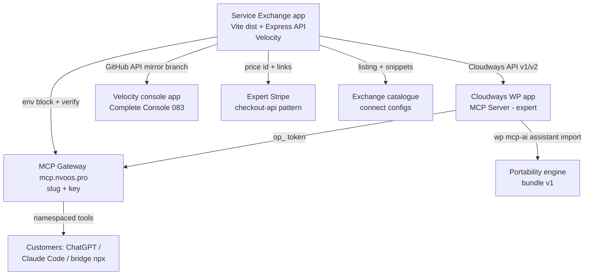

# Proposal 143 — Service Exchange: Comprehensive Implementation Plan

**Date:** 2026-11-12
**Status:** 🔮 PENDING (blocked on the six owner decisions in `143-expert-service-exchange-proposal.md` §7)
**Estimated Effort:** ~12 dev-weeks to GA (Phases 0–8), single engineer
**Priority:** HIGH (new product surface)
**Related:** [143-expert-service-exchange-proposal.md](./143-expert-service-exchange-proposal.md) · Proposal 055 + `addons/mcp-gateway` · `packages/nvoos-mcp-bridge` · Proposal 083 + `examples/nvoos-complete-velocity` · Proposal 092 (`nvoos-astro-velocity`) · Proposal 096 (Astro Forge) · `addons/checkout-api` · `includes/assistants/class-wp-mcp-ai-assistant-portability.php` · `includes/cli/class-wp-mcp-ai-cli-assistant-command.php` · `includes/cli/class-wp-mcp-ai-cli-credential-command.php` · skills: `nv-digital-cloudways-wpcli`, `mcp-ai-wpoos-gateway-ops`, `mcp-ai-wpoos-checkout-integration`, `mcp-ai-wpoos-assistant-portability`, `nvoos-forge-deploy`, `mcp-ai-wpoos-spa-ui`

> **Phase numbering** refines the proposal's table (§4): the proposal's Phase 0
> is split into Phase 0 (blueprint) + Phase 1 (scaffold/wizard), and Phase 8
> (hardening & GA) is added. Scope is otherwise identical.

---

## 1. Executive Summary

Build **`examples/nvoos-service-exchange`** — a single Velocity-deployable
web app (Vite/React frontend + Express control-plane API) that walks an
expert through deploying themselves as an MCP SaaS: Cloudways WordPress app
with the Complete bundle, their assistant bundle imported, toolkits enabled,
operator credential minted, Complete Console deployed, gateway slug bound,
and a commerce + listing presence established.

Everything is reused except three things: **the wizard UI**, **the
provisioning state machine**, and **the Cloudways client**. All design
rationale lives in the proposal; this document is the phase-by-phase build,
test, deploy, and verification plan.

### 1.1 Build map



### 1.2 What exists vs. what is new

| Layer | Status | Source |
|---|---|---|
| Complete bundle (the commodity) | ✅ live | `nvdigital-open-operator-system-oos-complete` |
| Assistant bundle codec | ✅ live | portability engine + `wp mcp-ai assistant export\|import` |
| Credential minting | ✅ live | `wp mcp-ai credential issue\|list\|revoke` |
| Console template (cookie BFF) | ✅ live | `examples/nvoos-complete-velocity` (+ `scripts/serve.mjs`) |
| Gateway (share/sell) | ✅ live | `addons/mcp-gateway` @ mcp.nvoos.pro |
| Bridge (consume) | ✅ live | `packages/nvoos-mcp-bridge` |
| Commerce rail | ✅ live | `addons/checkout-api` (`nvoos-checkout/v1`) |
| Registry entries | ✅ live | bridge 0.1.0-alpha.4, gateway 0.3.1 (verified 2026-11-12) |
| **Wizard UI** | 🆕 new | Phase 1 |
| **Control-plane state machine** | 🆕 new | Phases 2–6 |
| **Cloudways client + paste-block renderer** | 🆕 new | Phase 2 |

---

## 2. Research & Standards Applied

**Provenance:** fetched live on 2026-11-12 — [opengitops.dev](https://opengitops.dev/),
[12factor.net](https://12factor.net/), and the MCP registry API JSON
(`registry.modelcontextprotocol.io/v0.1/servers?search=nvoos`, 4 active NV
entries). Other standards below are cited from the repo's own research
(Proposals 063, 143) and their standard documentation references; no claim
in this section rests on an unfetched source being newly verified.

| Standard | Source | Application in this plan |
|---|---|---|
| **GitOps Principles v1.0.0** — declarative, versioned/immutable, pulled automatically, continuously reconciled | [opengitops.dev](https://opengitops.dev/) | Estate desired-state is declarative (blueprint + manifest); deploys are Git mirror branches; state is **derived and reconciled**, not hand-tracked (§5, ADR-04) |
| **The Twelve-Factor App** — config in env, stateless processes, disposability, dev/prod parity | [12factor.net](https://12factor.net/) | Exchange API is stateless; all config via `EXCHANGE_*` / `CLOUDWAYS_*` env vars; provisioning jobs resumable (fast startup, graceful shutdown) |
| **MCP official registry** — namespace-verified, metadata-only, remote entries may declare secret headers | live API `registry.modelcontextprotocol.io/v0.1/servers` (NV entries active) | Gateway is already listed with an `Authorization` secret header → per-estate listings are possible but deferred (ADR-08) |
| **RFC 9728** — OAuth 2.0 protected-resource metadata | [datatracker.ietf.org/doc/rfc9728](https://datatracker.ietf.org/doc/rfc9728/) | Gateway OAuth flow already served; customers connect per-estate via the gateway's metadata |
| **Marketplace fee benchmarks** — AWS ~3–20%, Shopify 0–15% (<$1M), Apple 15/30 | Proposal 143 §2.2 (AWS Marketplace seller page, Shopify Partners, Apple Small Business) | §3.6 pricing model in the proposal; v1 records price IDs, platform bills expert |
| **Stripe Connect** — platform/connected-account model | [docs.stripe.com/connect](https://docs.stripe.com/connect) | Phase 2 option, not v1; v1 reuses expert-owned Stripe via `nvoos-checkout/v1` |
| **OWASP Secrets Management** — no secrets in code/logs; short-lived; rotation | [OWASP cheat sheet](https://cheatsheetseries.owasp.org/cheatsheets/Secrets_Management_Cheat_Sheet.html) | SSH keys + `op_` tokens encrypted at rest; never logged; rotation pairs (`*_PREVIOUS`) on gateway keys |
| **Repo Unix Theory P0–P6** — canonical envelope, two-gate sanitisation | `CLAUDE.md` §Tool Return Format / §Tool Sanitisation | Every API handler: sanitize at entry, escape at exit; `WP_Error`-style error envelopes in Node (`{ ok:false, code, message }`) |
| **Cloudways** — API v1 (servers/apps/services), API v2 early access (applications/security/billing/integrations incl. Velocity), Velocity GitOps with **dashboard-only env vars**; Velocity filesystem persistence unverified | Proposal 063 §2 + `mcp-ai-wpoos-gateway-ops` (production-verified constraint) | Version-tolerant client; guided dashboard step for env; no reliance on local disk as a ledger (ADR-04) |
| **Portability rules** — credentials never move; export version-pinned, import version-tolerant; MCP app tokens redacted | `mcp-ai-wpoos-assistant-portability` skill | Blueprint contains no secrets; `op_` tokens minted at destination; `connection_ref` pointers only |
| **Gateway ops discipline** — fail-closed env config; key binding to unconfigured slug is a boot error; `/health/full` verification ladder | `mcp-ai-wpoos-gateway-ops` skill | Phase 5 generates a single validated env edit; verification steps are automated |
| **SPA UI conventions** — React 19.1 / Vite 8 / vitest 4 / jsdom; NDS tokens; ≤150 KB gzip entry | `mcp-ai-wpoos-spa-ui` skill; `examples/nvoos-complete-velocity/package.json` (verified) | Phase 1 pins the same dependency tree; entry budget is an exit gate |
| **Forge deploy contract** — mirror branch `site/<name>`, artifact at repo root, force-push, deploy.json tier | `nvoos-forge-deploy` skill | Phase 4 uses per-estate console branches, not per-estate repos |

**Honest limits of this research:** Cloudways' support docs sit behind a
Cloudflare challenge and `developers.cloudways.com` is a client-rendered app,
so the API verbs below are named from the repo's production experience
(Proposal 063, the WP-CLI skill cycles) and must be re-confirmed against the
live API console in the Phase 2 spike before automation is built on them.

---

## 3. Architecture Decisions (ADRs)

**ADR-01 — One deployable: Exchange = static Vite dist + Express API in one
Velocity app.**
The console pattern (`server.js` → `scripts/serve.mjs`, zero-dependency
proxy) and the gateway pattern (Express + helmet + rate-limit, env-only
config, `node --test`) are both proven. Combining them avoids a second
deploy, a second env set, and CORS between wizard and API. The Express layer
serves `dist/` and mounts `/api/v1/*`. *Rejected:* separate API app (double
surface, no benefit at this scale).

**ADR-02 — One Cloudways app per estate (no multisite).**
Matches the fleet topology NV already runs (~55 apps / 4 servers) and the
proposal's §2.3 tenancy analysis. Isolation is the mitigation for tenant
blast radius. Multisite remains rejected.

**ADR-03 — Blueprint = portability bundle + manifest; credentials never
move.**
The bundle is the existing assistant-portability format v1 (denylisted).
The manifest is new (`blueprint_version: 1`). No inline tokens anywhere;
MCP apps travel as `connection_ref` pointers; `op_` credentials are minted
on the destination site and stored encrypted by the control plane.

**ADR-04 — Estate state is derived, never stored as truth.**
Velocity persistent-volume behaviour is unverified (063 open item), so no
SQLite/JSON ledger may be authoritative. `deriveEstateState()` reconciles
from three live sources: Cloudways app lookup, the estate's MCP probe, and
the gateway `/health/full`. Only **job events** (advisory, non-authoritative)
are appended to `data/jobs.jsonl`, clearly documented as lossy. *Rejected:*
SQLite on Velocity; control-plane WP addon in v1 (deferred until a durable
ledger is actually needed — avoids new in-plugin code).

**ADR-05 — Per-estate console branches, one mirror repo.**
Velocity connects a GitHub repo+branch. The Exchange builds the console
artifact once per release and force-pushes `estate/<slug>` branches into a
dedicated mirror repo (forge-deploy contract). No per-estate repo sprawl.

**ADR-06 — Guided automation with paste-block fallback.**
Every provisioning step has three execution tiers: `api` (Cloudways/WP
Manager API), `ssh` (stored key + WP-CLI), `manual` (rendered paste-block
with verification commands, every line terminated with `;` — the known
terminal-merge quirk). The product must be fully usable at the `manual`
tier; automation upgrades are enhancements, not prerequisites.

**ADR-07 — Commerce: platform never touches customer money in v1.**
Experts keep their own Stripe (or use the vendor checkout pattern for the
Complete licence). The Exchange stores price IDs/links and bills the expert
for provisioning + platform subscription through the vendor's own Stripe.
Stripe Connect destination charges become a Phase 2 option at volume.

**ADR-08 — Registry listings: one gateway entry, many estates.**
The gateway is already a registry-listed remote (0.3.1, secret header
auth). Per-estate registry entries are opt-in and deferred — the Exchange
catalogue is the discovery surface in v1; mass-listing estates would be
directory spam and a policy risk.

---

## 4. The Service Blueprint v1 (concrete)

```jsonc
{
  "blueprint_version": 1,
  "name": "Clinic Operations Copilot",          // listing title
  "slug": "clinic-ops",                          // ^[a-z0-9][a-z0-9-]{1,38}[a-z0-9]$; globally unique
  "tagline": "Bookings, stock and compliance for small clinics",
  "industry": "healthcare",                      // enum: see below
  "icon": "icons/clinic-ops.svg",

  "bundle": {                                    // assistant-portability format v1
    "format_version": 1,
    "assistants": [ /* unchanged, credential-denylisted */ ]
  },

  "toolkits": ["crm", "project_management"],     // preset slugs to enable (optional; bundle allowlist wins)
  "mcp_apps": [                                  // pointers only, never inline secrets
    { "connection_ref": "mcp_server:elementor-primary" }
  ],

  "site": {
    "region": "us",                              // Cloudways server selector
    "size_hint": "small",                        // small | medium | large → maps to server/app sizing
    "php": "8.1",
    "domain": null,                              // null = Cloudways temp domain
    "wp_manager": true                           // prefer WP Manager tier; SSH is the fallback
  },

  "console": { "enable": true, "template": "complete-velocity" },
  "storefront": { "enable": false, "template": null },  // "astro-storefront" | "forge" (deferred tiers)

  "gateway": {
    "visibility": "private",                     // public | private (PUBLIC_SITE_SLUGS discipline)
    "tool_allowlist": ["get_environment_status"],// least privilege by default
    "rate_limit_profile": "standard"
  },

  "commerce": {
    "stripe_price_id": null,                     // expert's own product
    "trial_days": 14,
    "metered": false
  },

  "listing": {
    "summary": "…", "use_cases": ["…"], "pricing_note": "…",
    "connect_snippets": true                     // generate bridge/ChatGPT/Claude configs
  },

  "_meta": { "author": "…", "source": "exchange-seed" } // preserved, ≤4 KB
}
```

**Validation rules (enforced by the JSON Schema + validator):**

1. `blueprint_version` must equal `1`; unknown top-level keys rejected
   (`additionalProperties: false`); `_meta` is the only free-form escape.
2. `slug` is globally unique across estates (checked against Cloudways app
   labels, the gateway slug set, and the catalogue index) — collision is a
   hard error.
3. `bundle` is validated by the **portability engine's** own rules (the
   engine remains the single source of truth for bundle semantics; the
   Exchange never re-implements bundle validation).
4. No key named `token`, `secret`, `password`, `api_key`, or
   `oauth_data` may appear anywhere outside `_meta` — a structural test
   greps the serialized manifest.
5. `gateway.visibility: public` requires a non-empty `tool_allowlist`.
6. `site.domain`, when set, must be a valid hostname the expert controls
   (verification step required before the deploy phase runs).

**Seed blueprints (Phase 0):** 5 files under
`examples/nvoos-service-exchange/blueprints/` — F&B operator, CRM agency,
project-management coach, Woo store operator, inventory/jeweller. Each is a
real bundle exported from a staging site via
`wp mcp-ai assistant export <id>` (never hand-authored bundles).

---

## 5. Estate State Machine

```
requested → cloudways_app → wp_installed → bundle_imported
   → credential_minted → console_deployed → gateway_bound
   → commerce_linked → listed → live
```

Rules:

- **Every state is derived.** `GET /api/v1/estates/{slug}` runs the
  reconciler and returns the furthest verified state, with per-step
  evidence (`{ step, ok, verified_at, evidence }`).
- **Every transition is idempotent.** Re-running a step from state *N*
  re-verifies *N* first and no-ops if already true (e.g. Complete already
  active at the expected version → skip install).
- **Failure is a state, not an exception.** A failed step records
  `{ step, tier: api|ssh|manual, error, remediation }` and the API returns
  the paste-block fallback for that step (ADR-06).
- **Destructive steps require confirmation.** Estate teardown (app delete,
  credential revoke) requires an explicit `confirm: true` body flag plus
  the estate slug echoed back — the API equivalent of the destructive-ops
  gate.
- **Reconciliation cadence:** on every API read + a 15-minute cron inside
  the app (stateless, all evidence re-derived).

---

## 6. Phase Plan

### Phase 0 — Blueprint schema + seeds (1 week)

- [ ] `docs/service-blueprint-v1.md` — the spec above, frozen as v1.
- [ ] `examples/nvoos-service-exchange/blueprints/schema.json` — JSON
      Schema draft 2020-12, `additionalProperties: false`, `$defs` for
      site/console/gateway/commerce/listing.
- [ ] Validator module `server/blueprint/validate.js` — composes the JSON
      Schema check **plus** a delegation hook to the portability engine's
      schema rules (documented mirror; the PHP engine stays authoritative).
- [ ] Serialized-manifest secret grep test (`blueprints/*.test.js`).
- [ ] 5 seed blueprints exported from a staging site; one deliberately
      edge-cased (private gateway, console off).
- **Exit gate:** schema + validator reject every malformed fixture and
  accept all 5 seeds; `node --test server/blueprint/` green.

### Phase 1 — Exchange app scaffold + wizard shell (1.5 weeks)

New directory `examples/nvoos-service-exchange/`, mirroring the verified
console app anatomy:

```
examples/nvoos-service-exchange/
├── package.json          # name nvoos-service-exchange, react 19.1 / vite ^8 /
│                         # vitest ^4 / typescript 5.8 / node >=20.19 (console pins)
├── index.html
├── vite.config.ts        # /api proxy → local Express in dev; dist build
├── vitest.config.ts      # jsdom + @testing-library
├── tsconfig.json / eslint.config.js
├── server.js             # Velocity entry shim → scripts/serve.mjs
├── scripts/serve.mjs     # Express static dist + /api mount + cron (ADR-01)
├── scripts/sync-dist.mjs
├── blueprints/           # Phase 0 artifacts
├── server/               # control plane (node --test colocated)
│   ├── config.js         # env-only, fail-closed (gateway pattern)
│   ├── blueprint/validate.js
│   ├── estates/state.js  # state machine + reconciler (Phase 2)
│   ├── clients/cloudways.js  velocity.js  wp.js  gateway.js  github.js  commerce.js
│   └── routes/estates.js blueprints.js health.js
└── src/                  # React wizard
    ├── App.tsx
    ├── steps/{Profile,Blueprint,Assistant,Site,Console,Gateway,Commerce,Publish}.tsx
    ├── state/wizardStore.ts   # zustand, resumable via localStorage + server draft
    └── api/client.ts          # typed fetch wrapper, nonce-free (bearer via HttpOnly cookie)
```

Wizard behaviour:

- Steps 1–3 fully functional against the mock provider
  (`EXCHANGE_MODE=mock`); steps 4–8 render the plan preview (what will be
  created) but do not call providers yet.
- Draft state persists server-side per authenticated expert, so a refresh
  never loses progress (Twelve-Factor dev/prod parity: same code path in
  mock and live).
- Cookie session: the Exchange's own login (Auth0 or WP application
  password against the control-plane site — decide in Phase 1 spike;
  default: Auth0 tenant already used by the gateway).
- Entry chunk ≤ 150 KB gzip (exit gate, measured in CI).

- [ ] Mirror workflow `.github/workflows/sync-nvoos-service-exchange.yml`
      (one-way, version-guarded, no force to `main`; snapshot commits —
      the gateway sync pattern).
- [ ] Vitest: step navigation, draft persistence, mock deploy happy path,
      error rendering for a failed step.
- **Exit gate:** `npm run build` + `vitest run` + `node --test server/`
  green; app boots on Velocity staging with mock mode; ≤150 KB entry.

### Phase 2 — Cloudways client + reconciler (1.5 weeks)

- [ ] `server/clients/cloudways.js`:
  - OAuth token cache (`POST /oauth/access_token`, email + API key from
    env; refresh before expiry).
  - Operations: list servers, create app (WordPress, version, label
    `MCP Server - <expert>`), get app by label, purge cache, list
    deployments. **Verbs/paths re-confirmed against the live API console
    before implementation** (§2 research note).
  - v2 probe: detect availability per account; prefer v2 endpoints when
    present, fall back to v1 (063 §6 pattern).
  - Every call: timeout (AbortSignal), one bounded retry on 5xx, paged
    reads; errors mapped to the canonical `{ ok:false, code, message,
    remediation, tier }` envelope.
- [ ] `server/clients/wp.js`: three-tier executor — WP Manager REST →
      SSH (key in env, app-user `sudo -u {sys_user}`) → render paste-block.
- [ ] `server/estates/state.js`: reconciler per §5; per-estate lock
      (in-memory + conditional on job id) so two clicks cannot race.
- [ ] `data/jobs.jsonl` advisory log (documented lossy, ADR-04).
- [ ] `GET /api/v1/estates`, `GET /api/v1/estates/{slug}`,
      `POST /api/v1/estates`, `POST /api/v1/estates/{slug}/advance`,
      `POST /api/v1/estates/{slug}/teardown` (confirm-gated).
- [ ] Tests: fake Cloudways server (in-process Express, gateway test
      style) covering token refresh, app-create idempotency, 5xx retry,
      paste-block rendering, reconciler transitions, race lock.
- **Exit gate:** staging estate reaches `cloudways_app` via API; when the
  API path is disabled, the manual tier renders a correct paste-block and
  the estate still reaches the same state.

### Phase 3 — WP provisioner (2 weeks)

- [ ] Complete-bundle install automation using the production-proven cycle:
      deactivate → delete → install → activate, preferring
      `sudo -u {sys_user}`; zip upload to `applications/{sys_user}/`
      (never inside `public_html`; both locations checked on failure).
- [ ] Bundle import: upload bundle JSON to the estate, run
      `wp mcp-ai assistant import --file=<path>` (verified command exists),
      then assert the assistant's slug/title and `_wp_mcp_ai_tools`
      allowlist via `wp mcp-ai assistant export <id>` round-trip diff.
- [ ] Toolkit enable decision (spike, 0.5 day): confirm the Pro toolkit
      toggle/preset surface. **Default plan: bundle-first** — the imported
      bundle already carries `_wp_mcp_ai_tools`; toolkit presets are only
      applied when the blueprint lists toolkits *and* the surface is
      confirmed. Record the finding in the phase notes either way.
- [ ] Credential mint: `wp mcp-ai credential issue <assistant_id>` (args
      confirmed in-file), capture full `op_xxxx.SECRET` once, store
      encrypted (AES-256-GCM, key from env); never log, never return in
      API responses — only a masked fingerprint.
- [ ] Post-provision verification: `wp mcp-ai health` + direct MCP probe
      (`initialize` → `tools/list` → one allowlisted `tools/call`).
- [ ] Tests: fake WP-CLI executor asserting command sequences; bundle
      round-trip fixture; secret-never-in-logs test.
- **Exit gate:** a fresh estate passes the gateway skill's Tier-1 smoke
  unattended; no secret appears in any API response or log.

### Phase 4 — Console deployer (1.5 weeks)

- [ ] Build-once artifact: CI builds `examples/nvoos-complete-velocity`
      and publishes the dist + `serve.mjs` + `package.json` to the
      console mirror repo (existing sync workflow extended with a build
      job — no per-estate rebuilds).
- [ ] `server/clients/github.js`: create/force-push `estate/<slug>`
      branch (fine-grained token, single repo scope). Branch content =
      artifact at repo root + `deploy.json` (tier `managed`).
- [ ] Velocity app creation: via API v2 when available; otherwise render
      the guided dashboard steps (repo+branch select, output dir, entry
      `server.js`).
- [ ] Env wiring: `NVOOS_TARGET_SITE=<estate url>` and any site keys.
      Velocity env is dashboard-only (verified constraint) → render a
      copyable env table + restart instruction; verify by polling the
      console `/healthz` (add a trivial health route to the console
      artifact in this phase).
- [ ] Cookie/session verification: console login against the estate,
      SPA boots, one request through the `/wp-json` proxy succeeds.
- [ ] Tests: branch-push payload builder, env-table renderer, health-poll
      verifier with fake console.
- **Exit gate:** expert logs into a branded console on the estate domain
  with zero operator shell access.

### Phase 5 — Gateway registrar (1 week)

- [ ] Slug registration generator: produce the exact env edit —
      `GATEWAY_PUBLIC_KEYS` entry, `NVOOS_SITE_<SLUG>_URL`,
      `NVOOS_SITE_<SLUG>_TOKEN`, optional `PUBLIC_SITE_SLUGS` addition —
      validated against the gateway's own parser rules (one line per
      variable, key charset, fail-closed binding rule).
- [ ] Automation tier: if/when the gateway exposes an admin API, apply
      directly; v1 renders the guided dashboard step (gateway is
      env-only by design — do not add a writable runtime config surface
      just for this product).
- [ ] Verification ladder (automated): `GET /health` version matches the
      gateway release → `/health/full` shows the estate `ok` →
      `tools/list` returns `<slug>.*` → one `tools/call` succeeds.
- [ ] Key rotation support: issue new key, move old to
      `GATEWAY_PUBLIC_KEYS_PREVIOUS`, record rotation in the estate log.
- [ ] Tests: env-block generator fixtures (single key, multi-slug,
      rotation), verification-ladder state assertions with fake gateway.
- **Exit gate:** expert's own key returns their namespaced tools; the
  public `/health` respects `PUBLIC_SITE_SLUGS`.

### Phase 6 — Commerce (1 week)

- [ ] Link expert's product: store `stripe_price_id` + purchase URL in
      the estate record (no card data ever).
- [ ] Platform billing: provisioning fee + monthly subscription billed
      through the vendor Stripe (reuse `addons/checkout-api` patterns;
      no Stripe keys on the Exchange client).
- [ ] Licence/entitlement check: the estate is only advertised as live
      while subscription status is active; downgrade to `suspended`
      state on payment failure (dunning is the vendor's job).
- [ ] Tests: price-link persistence, suspended-state gating, no-secret
      assertions.
- **Exit gate:** test-mode purchase completes end-to-end; suspended
  estate disappears from the public catalogue in one reconcile cycle.

### Phase 7 — Publish + connectors (1 week)

- [ ] Catalogue: listing page driven by the blueprint's `listing` block;
      search/filter by industry; per-estate status badge fed by the
      reconciler.
- [ ] Connect-snippet generator (copy-paste verified):
      - bridge npx block (`MCP_AI_BASE_URL`, `MCP_AI_TOKEN` masked)
      - ChatGPT Connector URL (`https://mcp.nvoos.pro/mcp`)
      - Claude Code plugin install lines
      - direct streamable-HTTP example for developers
- [ ] Registry: **no per-estate entries in v1** (ADR-08); the generator
      links the gateway's existing registry entry. Revisit at pilot exit.
- [ ] Discoverability baseline: listing page metadata, sitemap entry,
      OG tags (no SEO promises beyond that in v1).
- **Exit gate:** a stranger can find the estate in the catalogue and
  connect with the generated snippet without contacting support.

### Phase 8 — Hardening & GA gates (1.5 weeks)

- [ ] Security review: OWASP secrets checklist, token redaction tests,
      CSRF/XSS review of wizard inputs, rate limits on all
      state-changing routes, authorization on every estate read (an
      expert may only see their own estate).
- [ ] Failure drills: kill a provisioning job mid-flight and re-run
      (idempotent recovery); expire the SSH key; rotate the gateway key;
      fake a gateway 401 (the upstream-401 playbook); simulate a
      Cloudways 5xx storm.
- [ ] Load: 50 concurrent estate reads + 5 concurrent provisioning jobs
      against fakes; confirm no lock starvation.
- [ ] A11y: wizard keyboard-only pass; axe gate via vitest where the
      console app's setup already supports it.
- [ ] Docs: operator runbook (`docs/operations/deployment/service-exchange-velocity-setup.md`),
      expert onboarding doc, troubleshooting table (paste-block quirks,
      Cloudflare/Anti-Bot fingerprints, WP Manager permission errors).
- [ ] Two pilot experts onboarded end-to-end with **zero operator shell
      commands** (manual tier counts as acceptable only if documented as
      planned degradation).
- **Exit gate:** GA checklist signed; incidents have a runbook path.

---

## 7. Test Matrix

| Layer | Runner | Must cover |
|---|---|---|
| Blueprint validator | `node --test` | schema accept/reject, secret grep, slug rules, portability delegation |
| Exchange API | `node --test` + in-process fakes | token refresh, idempotent transitions, race lock, confirm-gated teardown, error envelopes, no-secret responses |
| Clients (cloudways/wp/github/gateway) | `node --test` | request shapes, retries, timeout, tier fallback (`api → ssh → manual`) |
| Wizard UI | vitest + jsdom + testing-library | step flow, draft resume, mock deploy, error states, a11y basics |
| Payload smoke | scripted (CI) | built dist boots under `scripts/serve.mjs`; `/api/v1/health` ok |
| Gateway verification | shell/curl script (CI) | `/health` version, `/health/full`, `tools/list`, one `tools/call` |
| PHP (if any plugin change lands) | Docker PHPUnit | portability round-trip only; no new in-plugin code planned for v1 |

Conventions: direct-call controller tests (not HTTP dispatch) for error
fidelity; fixtures alphanumeric-only where validators constrain; zero real
network in tests (fakes only).

---

## 8. Security Checklist (gate on every phase)

- [ ] No secret is ever serialized into a response, log line, or job
      record (structural tests, not reviews).
- [ ] `op_` tokens and SSH keys encrypted at rest; decryption scoped to
      the provisioning worker only.
- [ ] Every state-changing route: authenticated + CSRF-protected (or
      bearer-only) + rate-limited; every estate read: ownership check.
- [ ] Two-gate discipline: sanitize inputs at entry, escape at exit.
- [ ] Fail-closed config boot (missing provider env → startup error, not
      silent degradation) — the gateway precedent.
- [ ] Destructive operations require the explicit confirm flag + slug
      echo.
- [ ] Gateway keys follow rotation discipline; no key reuse across
      estates.
- [ ] Blueprint import cannot smuggle secrets (`connection_ref` only;
      denylist on the bundle path).
- [ ] Paste-block renderer escapes user-supplied values (domains, labels)
      before display — they are shell-adjacent surface.

---

## 9. Deployment & Ops

**Velocity app env (proposed names):**

| Variable | Purpose |
|---|---|
| `EXCHANGE_MODE` | `mock` \| `live` |
| `EXCHANGE_SESSION_SECRET` | HttpOnly cookie signing |
| `EXCHANGE_ENCRYPTION_KEY` | AES-256-GCM for stored credentials |
| `CLOUDWAYS_EMAIL` / `CLOUDWAYS_API_KEY` | Cloudways auth (server-side only) |
| `CLOUDWAYS_DEFAULT_SERVER_ID` | staging estate target |
| `EXCHANGE_SSH_KEY` | optional SSH tier (encrypted env) |
| `EXCHANGE_GITHUB_TOKEN` | console mirror branch pushes (single repo scope) |
| `GATEWAY_BASE_URL` / `GATEWAY_ADMIN_KEY` | verification ladder (admin key only if a future admin API exists) |
| `EXCHANGE_CONTROL_SITE_URL` | control-plane site (Auth0/application-password login) |

**Deploy flow:** monorepo → `sync-nvoos-service-exchange.yml` → mirror
`nvdigitalsolutions/nvoos-service-exchange` → Velocity auto-deploy →
`/api/v1/health` verification → version marker check (gateway ladder
pattern). **Rollback:** redeploy previous mirror commit (Velocity keeps
deployment history); estate operations are additive and fail-soft, so a
rollback never orphans partially provisioned estates — the reconciler
completes them on the restored build.

**Runbook must include:** the upstream-401 diagnosis path, Cloudways
Anti-Bot/Imunify fingerprints, WP Manager permission fixes
(`chown` docs-hub cache), install-cycle recovery after a failed install,
and the "every paste line ends with `;`" terminal quirk.

---

## 10. Estimates & Sequencing

| Phase | Weeks | Depends on |
|---|---|---|
| 0 — Blueprint schema + seeds | 1.0 | owner decisions §7 (name/format) |
| 1 — App scaffold + wizard shell | 1.5 | 0 |
| 2 — Cloudways client + reconciler | 1.5 | 1 |
| 3 — WP provisioner | 2.0 | 2 |
| 4 — Console deployer | 1.5 | 2 (parallel with 3 allowed) |
| 5 — Gateway registrar | 1.0 | 3 + 4 |
| 6 — Commerce | 1.0 | 3 |
| 7 — Publish + connectors | 1.0 | 4 + 5 |
| 8 — Hardening & GA | 1.5 | all |
| **Total** | **12.0** | single engineer |

---

## 11. Risks & Open Questions

| Risk / question | Handling |
|---|---|
| Cloudways API verbs unverified against live docs (JS-only docs) | Phase 2 spike re-confirms before building; manual tier is the safety net |
| Velocity env dashboard-only | Guided env table + health verification (ADR-06) |
| Velocity filesystem persistence unverified | No authoritative local state (ADR-04) |
| WP Manager subscription may be absent on some accounts | SSH tier second, paste-block third; detect and degrade |
| Toolkit toggle surface unconfirmed | Bundle-first default; toolkit presets optional (Phase 3 spike) |
| Registry policy on many auth-gated remotes | One gateway listing, estates inherit (ADR-08) |
| Auth0 vs WP application-password login for the wizard | Decide in Phase 1 spike; default Auth0 (reuses tenant) |
| Marketplace take rate | Owner decision (proposal §7 Q5); no code dependency |

---

## 12. Definition of Done (v1)

1. An expert completes the wizard and their service is reachable through
   `https://mcp.nvoos.pro/mcp` with their own key and namespaced tools.
2. The estate has a branded console, a catalogue listing, and verified
   connect snippets.
3. Re-running provisioning on a half-built estate converges (no duplicate
   apps, no duplicate assistants, no duplicate credentials).
4. No secret exists in any response, log, or job record — proven by
   tests.
5. Every degradation tier (`api → ssh → manual`) is exercised and
   documented.
6. Two pilot experts are live with zero operator shell commands.

**Explicit non-goals (v1):** shared multisite tenancy; Stripe Connect
marketplace payouts; per-estate registry entries; cross-app SSO; storefront
generation (092/096 tiers); per-estate custom domains automation (guided
step only).

---

## 13. Implementation status (2026-11-12)

Phase 0–7 are implemented in `examples/nvoos-service-exchange`; Phase 8 is
partially complete. Verification observed locally:

| Gate | Result |
|---|---|
| `node --test "server/**/*.test.js"` | **99 passed, 0 failed** |
| `npm test` (vitest, jsdom) | **11 passed, 0 failed** |
| `npm run build` | green; entry chunk **64.96 KB gzip** (≤150 KB budget) |
| `npm run smoke` | **green** — health → 5 seeds → create → 9 steps → live → catalogue |
| Seed validation + secret scan | 5 seeds valid, unique slugs, no credential-shaped values |

**Delivered per phase**

- **Phase 0** — `docs/service-blueprint-v1.md`, JSON Schema, hand-rolled
  validator (version pin, slug uniqueness, cross-field rules, secret scan),
  5 seed blueprints, validator/seed tests.
- **Phase 1** — Vite/React wizard (8 steps), zustand store with persistence,
  typed API client, route-level tests, http-server smoke tests, zero-dependency
  `serve.mjs` (static + API + advisory reconcile loop), sync workflow.
- **Phase 2** — Cloudways client (OAuth cache, v1→v2 probe, idempotent
  `ensureApp`, injectable fetch), reconciler + store (derived state, advisory
  JSONL), per-estate locks.
- **Phase 3** — WP command builders (injection-safe), tier resolver
  (`wp_manager → ssh → manual`), paste-block renderer (`;`-terminated lines),
  executor, credential mint + AES-256-GCM storage, step handlers.
- **Phase 4** — GitHub Git-Data branch push (`estate/<slug>`), artifact
  validation, console step (branch + health expectations).
- **Phase 5** — Gateway env-block generator (fail-closed rules), masked/raw
  rendering, verification ladder (health → health/full → tools/list →
  tools/call) with SSE tolerance.
- **Phase 6** — Price linking + entitlement evaluation; catalogue gating.
- **Phase 7** — Catalogue endpoint, connect-snippet generators (bridge,
  ChatGPT, Claude Code, curl), masked by default.

**Known live-only work remaining (Phase 8 + spikes)**

1. ~~Re-confirm Cloudways API verbs~~ — **done 2026-11-12**: route shapes
   verified against live probes + in-repo production clients; see
   `docs/operations/deployment/cloudways-api-verification-spike.md`. The
   authenticated read-only run (`npm run probe:cloudways` with credentials)
   and a staging-server estate run remain pending credentials.
2. Wire the bundle-upload transport so `provider.bundlePath` is populated
   automatically (today it is a required manual input for the live tier).
3. Decide wizard login (Auth0 vs WP application password); v1 ships a single
   `EXCHANGE_ADMIN_TOKEN` bearer and structured ownership fields.
4. Velocity app creation remains dashboard-guided (env is dashboard-only).
5. Stress/a11y gates and the two-pilot-expert GA criterion are not yet run.
6. Per-estate registry listings remain deferred (ADR-08).
7. ~~Resolve `sys_user` automatically~~ — **resolved 2026-11-12**: the app
   record carries `sys_user` (verified via Cloudways MCP `app_get`, and
   cross-validated against the fleet folder map). `getApp()` / the
   `cloudways_app` step read it; the manual remediation remains as a fallback.
8. Confirm the cache-purge payload shape on the authenticated run.
9. Cloudways MCP is available as a supplementary operator surface (66 tools,
   `https://mcp.cloudways.com/mcp/`); the Exchange itself uses the REST client,
   not the MCP, to stay deployable without Zed.

**Operationalised as a skill (2026-11-12):**
`.agents/skills/mcp-ai-wpoos-service-exchange/` now captures the blueprint
rules, the estate state machine, the provisioning tiers, the verified
Cloudways API v2 contract, the read-only API/MCP probes, env/mirror
deployment, testing conventions, and the security invariants. The skill
inventory was updated to **84** in `AGENTS.md`,
`.github/copilot-instructions.md`, `README.md`, and `MAINTAINER_MAP.md`; four
oversized descriptions were trimmed so the combined catalog description
payload sits at ~48.0 KB (Zed's cap is ~50 KB).
