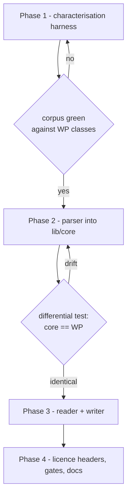

# Proposal 145 — OKF Core Extraction and Licence Boundary

**Status:** Proposal (design) · **Date:** 2026-11-13
**Parent:** `090-f-storage-bridge-plan.md` (Phase 4, deferred)
**Related:** `090-d-selective-tool-port.md`, `090-b` (Laravel admin surfaces), `bin/check-license-boundary.sh`
**Scope:** Move the OKF parser, reader and writer out of the GPL WordPress tree into the MIT
`nvoos/core` package, and settle what "moving" means legally and mechanically.

---

## 1. Executive summary

Phase 4 of the storage-bridge plan says "move the parser/reader to a pure core engine". The
question that stalled it was licensing, and the first answer given — "GPL cannot become MIT" — was
wrong for this repository.

**The code is yours.** `git log` over `includes/okf/` shows a single author identity
(NV Digital Solutions), no third-party contributions, no CLA obligations. A copyright holder is not
bound by the licence they grant others, so relicensing is permitted.

**But three things still bind**, none of them our own grant:

1. **WordPress is upstream.** The WordPress project's stated position is that plugins and themes are
   derivative works and inherit the GPL. The code calls `WP_Error()`, `sanitize_text_field()`,
   `wp_normalize_path()` and `__()`, and refuses to load without `ABSPATH`. Our own repository
   already encodes this rule — `lib/wordpress-adapter` is GPL-3.0-or-later while its three sibling
   packages under `lib/` are MIT.
2. **Already-distributed copies stay GPL** for everyone who received them. Relicensing is
   prospective.
3. **The parser and reader have no automated tests.** Only manual scripts. Extraction without an
   oracle is the single biggest delivery risk, and it is an engineering problem, not a legal one.

**Decision.** Extract, but as a *characterised port*: pin current behaviour with a golden-corpus
test harness first, then re-author the code into `lib/core` against core contracts until the
harness is identical on both implementations, then change the licence. The licence change becomes
an afterthought because by then the MIT copy has no WordPress dependency at all.

Estimated effort: **3 phases, ~1,625 lines of source** (parser 817 + reader 808), plus a writer
port (604) if the console ever needs writes.

---

## 2. Evidence

### 2.1 Provenance — first party

```
$ git log --format='%an <%ae>' -- includes/okf/ | sort -u
NV Digital Solutions <85486977+nvdigitalsolutions@users.noreply.github.com>
```

Two commits, one identity, no `Co-authored-by`, no vendor drop, no provenance note in
`includes/okf/README.md`. The copyright position is clean, which is what makes relicensing
available at all.

### 2.2 Coupling — genuinely WordPress-shaped

| Call | Count in parser + reader |
|---|---|
| `WP_Error()` | 8 |
| `__()` (i18n) | 8 |
| `wp_normalize_path()` | 7 |
| `sanitize_text_field()` | 4 |

All five `includes/okf/*.php` files open with `if ( ! defined( 'ABSPATH' ) ) { exit; }`.

By contrast `lib/core` contains **zero** WordPress calls: `WP_Error` appears there only inside
docblocks that say it replaces `WP_Error`. That is the distinction the boundary script encodes, and
it is the reason the extraction is a rewrite of call sites rather than a `git mv`.

### 2.3 The format is permissively licensed

OKF is a published specification (`GoogleCloudPlatform/open-knowledge-format`, `SPEC.md`, v0.2),
**Apache-2.0**, and deliberately minimal:

> "a directory of markdown files with YAML frontmatter … no schema registry, no central authority,
> and no required tooling."

Implementing a specification does not inherit the reference implementation's licence. The target is
well-defined, permissively licensed, and — importantly — versioned, so the extracted engine can
state which spec revision it implements.

### 2.4 Test coverage — the real gap

| Class | Lines | Automated tests |
|---|---|---|
| `WP_MCP_AI_OKF_Parser` | 817 | **none** (`tests/manual/test-okf-v02-parser.php` only) |
| `WP_MCP_AI_OKF_Reader` | 808 | **none** (`tests/manual/test-okf-v02-reader.php` only) |
| `WP_MCP_AI_OKF_Writer` | 604 | indirect, via tool tests |
| `WP_MCP_AI_OKF_Bundle_Manager` | 1,243 | 21 (`test-okf-bundle-manager*.php`) |
| `WP_MCP_AI_OKF_Skill_Knowledge_Generator` | 475 | covered via tools |

The two classes that most need extraction are the two with no oracle. Any plan that starts with the
move would be re-typing 1,600 lines against nothing but the source itself.

### 2.5 No consumer today

The console builds `endpoints.okf` as `isWordPress ? … : ''` and nulls it when the feature flag is
off; the Laravel runtime has no OKF route or tool. Extraction is therefore an **architecture and
licensing** investment, not a parity fix — which is exactly why it should not be rushed.

---

## 3. Decision

Pursue **characterised extraction**, in this order, with a hard gate between each phase:



**Rejected alternatives.**

| Alternative | Why not |
|---|---|
| `git mv` + change header | Leaves `WP_Error`/`sanitize_text_field` call sites in an MIT package; contradicts the repo's own "depends on WP ⇒ GPL" rule and keeps the derivative-work question alive |
| Full clean-room from the spec | Unnecessarily expensive for first-party code — provenance is already clean, so isolation buys nothing |
| Leave it GPL, do nothing | Defensible, but it keeps the only reusable knowledge engine locked to one runtime and blocks the Laravel bundle browser |

---

## 4. Target design

```
lib/core/src/Domain/Okf/                 # MIT — no WordPress, no Laravel
  OkfDocument.php                        # frontmatter + body value object
  OkfFrontmatter.php                     # parsed, typed frontmatter
  OkfParserInterface.php                 # parse(string): OkfDocument
  OkfParser.php                          # markdown + YAML frontmatter
  OkfReaderInterface.php                 # get / browse / traverse / search
  OkfReader.php                          # operates on a BundleRoot
  OkfWriterInterface.php                 # write / delete (Phase 3)

lib/core/src/Domain/Contract/
  BundleRootInterface.php                # root path + containment + writability

lib/wordpress-adapter/src/Adapter/Okf/   # GPL — thin
  WpBundleRoot.php                       # wp_upload_dir() → BundleRootInterface
  WordPressOkfErrorFactory.php           # WP_Error mapping

includes/okf/                            # GPL — unchanged public surface
  class-wp-mcp-ai-okf-parser.php         # delegates to Nvoos\Core\Domain\Okf\OkfParser
  class-wp-mcp-ai-okf-reader.php         # delegates, adds WP-specific guards
  class-wp-mcp-ai-okf-bundle-manager.php # STAYS — uploads dir, .htaccess, ZIP, admin
```

**What moves and what does not.**

| Concern | Destination | Rationale |
|---|---|---|
| Frontmatter parsing | `lib/core` | Pure string work |
| Concept resolution, browse, traverse, search | `lib/core` | Pure filesystem + data |
| Frontmatter serialisation | `lib/core` | Pure string work |
| Bundle root resolution (`wp_upload_dir`) | `lib/wordpress-adapter` (GPL) | WordPress API |
| `.htaccess` / `index.php` guards | stays WP | Web-server specific |
| ZIP export/import | stays WP (or future core service) | Uses `ZipArchive` + WP paths |
| Admin AJAX, protected bundles, bootstrap generation | stays WP | WordPress lifecycle |

**WP call mapping.** Each site gets an explicit replacement, recorded in the port PR:

| Current | Replacement |
|---|---|
| `new WP_Error( 'code', 'msg' )` | `ErrorFactoryInterface::create( 'code', 'msg' )` |
| `__()` / `esc_html__()` | `OkfMessages` string map supplied by the adapter |
| `wp_normalize_path()` | `str_replace( '\\', '/', $path )` + `realpath` containment check |
| `sanitize_text_field()` | `OkfSanitizer::text()` in core (documented, tested) |
| `ABSPATH` guard | removed — core must load anywhere |

---

## 5. Phases

### Phase 1 — Characterisation harness (the gate)

*No production code changes.*

- Convert `tests/manual/test-okf-v02-parser.php` and `test-okf-v02-reader.php` into PHPUnit cases
  that run **inside WordPress** against the current classes.
- Build a golden corpus: the fixtures already in the repo plus a generated matrix covering
  frontmatter edge cases (empty, BOM, CRLF, nested lists, multi-doc delimiters, malformed YAML,
  unicode, very long values) and directory shapes (nested concepts, missing `index.md`, cycles via
  `sources`, symlinks).
- Every case records an input → expected structure pair as a fixture file, so the same corpus can be
  replayed without WordPress in Phase 2.

**Gate G1:** the harness passes against the current WP classes, and the corpus contains at least
one case per behaviour the parser implements.

#### Phase 1 — shipped (parser)

Gate G1 is satisfied for the **parser** slice. The reader slice is deliberately deferred to Phase 3
(it needs a bundle-tree fixture shape plus `sanitize_text_field` parity, neither of which exists yet).

| File | Purpose |
|---|---|
| `tests/fixtures/okf/parser/*.json` | 19 golden cases, one behaviour each (see table below) |
| `tests/support/okf-corpus.php` | Case inputs, structure normaliser, fixture load/write helpers |
| `tests/manual/run-okf-corpus.php` | Offline runner + `--write` regenerator; stubs `__`, `WP_Error`, `is_wp_error` |
| `tests/test-okf-parser-corpus.php` | PHPUnit twin, `WP_UnitTestCase` + data provider, runs in CI |

Fixture shape — one file per case:

```json
{ "input": "---\ntitle: X\n---\nbody", "expected": { "frontmatter": { "title": "X" }, "body": "body" } }
{ "input": "no frontmatter here",    "expected": { "null": true } }
{ "input": "---\ntitle: X\n",       "expected": { "error": "okf_unclosed_frontmatter" } }
```

Three outcomes are encoded, matching the parser's real contract: a parsed document, a `null` return
(no frontmatter block at all), and a `WP_Error` code. `expected` is normalised through a shared
helper so array ordering and scalar coercion cannot produce spurious diffs.

**Why two runners.** The offline runner is the fast local loop — it needs no database, no WordPress
bootstrap and no vendor autoload, so `php tests/manual/run-okf-corpus.php` answers in under a second.
The PHPUnit twin is the CI gate and proves the same corpus inside a real WordPress bootstrap; it also
runs locally via `docker exec oos-wp vendor/bin/phpunit tests/test-okf-parser-corpus.php`. Both read
the same fixtures, so drift between them is a fixture bug, not a test bug.

Coverage (19 cases): `no-frontmatter`, `unclosed-frontmatter`, `empty-frontmatter`, `scalars`,
`block-list`, `nested-map`, `list-of-objects`, `inline-mapping`, `inline-sequence`, `mixed-nesting`,
`blank-lines`, `crlf-endings`, `bom-prefixed`, `unicode`, `body-preserved`, `value-with-colon`,
`v01-skill`, `v02-provenance`, `long-value`.

**Finding, now fixed — UTF-8 BOM.** A file beginning `EF BB BF ---` used to return `null`: `trim()`
never strips a BOM, so the first-line `strpos( $content, '---' ) === 0` check missed and the document
was silently invisible to the reader, the bundle manager, the writer's round-trip and the skill
generator — every consumer goes through `parse()`.

Decision: **strip the BOM in the parser**, not in core alone. `WP_MCP_AI_OKF_Parser::parse()` now
drops a leading `EF BB BF` before the delimiter check, and `bom-prefixed.json` records the parsed
document instead of `null`. Fixing it at the WordPress source means the Phase 2 port inherits correct
behaviour rather than porting a known defect and diverging in the same commit that is supposed to prove
parity. UTF-16 BOMs remain unsupported — OKF is a UTF-8 format and a UTF-16 file would fail far
earlier.

### Phase 2 — Parser into `lib/core`

- `OkfParser` implements `OkfParserInterface`, depends on nothing but PHP 8.1.
- Replay the corpus as a **pure PHP** test in `lib/core/tests/Unit/Domain/Okf/` — no WordPress
  bootstrap.
- **Differential test:** a WP-side test asserts `WP_MCP_AI_OKF_Parser` and `OkfParser` return
  identical structures for every corpus entry.

**Gate G2:** differential test green; `lib/core` still contains zero WordPress calls (grep gate).

#### Phase 2 — shipped (parser)

Gate G2 is satisfied. The parser now exists twice, on purpose.

| File | Purpose |
|---|---|
| `lib/core/src/Domain/Okf/OkfDocument.php` | Frontmatter + body value object, `toArray()` matches the WP return shape |
| `lib/core/src/Domain/Okf/OkfParseException.php` | Carries the stable `errorCode` the WP side returns through `WP_Error` |
| `lib/core/src/Domain/Okf/OkfParserInterface.php` | `parse(string): ?OkfDocument` |
| `lib/core/src/Domain/Okf/OkfParser.php` | Recursive-descent port; no filesystem, no globals |
| `lib/core/tests/Unit/Domain/Okf/OkfParserCorpusTest.php` | Replays the corpus in plain PHP |
| `tests/test-okf-parser-differential.php` | Asserts core == WordPress on every corpus entry |

**API decision — the interface narrows the proposal's `parse(string): OkfDocument`.** The corpus
encodes three outcomes, and a non-nullable return can only express one of them:

| Corpus shape | Core result |
|---|---|
| `{ "frontmatter": …, "body": … }` | `OkfDocument` |
| `{ "null": true }` | `null` — a body-only concept is legitimate OKF, not an error |
| `{ "error": "okf_unclosed_frontmatter" }` | `OkfParseException` carrying that code |

Throwing on malformed input matches the rest of `lib/core` (which already ships `NotFoundException`,
`AccessDeniedException`, `ValidationException`) and avoids threading a framework error factory
through a pure string function.

**`serialize()` deliberately stayed in WordPress.** It belongs with the writer (Phase 3), and porting
it now would add an untested-by-oracle surface to a PR whose whole value is provable parity.

**The WordPress class still owns its own implementation.** Delegation is deliberately deferred to
Phase 4: the differential test only has teeth while the two sides are independent. Delegating now
would make it compare a class to itself.

Removed in passing: `SCALAR_PATTERNS` is declared in the WordPress parser but never read; the port
does not carry it, and it can be dropped from the original in Phase 4.

Verification: 19 fixtures replayed in core (**20 tests**), differential **20 tests / 40 assertions**,
`lib/core` suite **1058 tests / 3930 assertions**, PHPStan level 8 `[OK] No errors`,
`bin/check-license-boundary.sh` green, and the only `WP_Error` occurrence in the new files is a
docblock that documents the mapping.

### Phase 3 — Reader and writer

- `BundleRootInterface` (`root()`, `pathFor($conceptId)`, `assertContained($path)`).
- `OkfReader` over the port; `WP_MCP_AI_OKF_Reader` becomes a wrapper that supplies a
  `WpBundleRoot` and keeps its public signatures.
- Writer only if a second consumer exists — otherwise defer.

**Gate G3:** WordPress reader tests unchanged and green; corpus parity for browse/traverse/search.

### Phase 4 — Licence, gates, documentation

- `lib/core` files carry `@license MIT` + `SPDX-License-Identifier: MIT`; the WP wrappers stay
  GPL-3.0-or-later.
- Extend `bin/check-license-boundary.sh` with a **grep gate**: `lib/core/src/**` must contain no
  `wp_*` / `WP_Error` / `sanitize_*` / `ABSPATH` tokens (comments excluded).
- Record the transition in a changelog note: date, which tree, that earlier distributions remain
  GPL, and that the core copy is a port rather than a move.
- Update `090-f` Phase 4 status.

**Gate G4:** boundary script green including the new grep gate; `composer run ci:all` green.

### Phase 5 (optional) — Laravel OKF surface

Only if a consumer appears (the console bundle browser is the likely trigger). At that point
`lib/core` already carries the engine, and the Laravel adapter needs only a `LocalBundleRoot`.

---

## 6. Risks

| Risk | Likelihood | Mitigation |
|---|---|---|
| Silent behaviour drift during the port | High | Differential test on a golden corpus; no phase passes without it |
| "Port" degrades into blind copy, dragging GPL semantics across | Medium | WP-call mapping table per file; grep gate in CI; reviewer checklist |
| Frontmatter edge cases the corpus misses | Medium | Generate the matrix from the spec's own conformance rules, not from the implementation |
| Filesystem semantics differ (atomic writes, permissions) | Medium | `BundleRootInterface` owns writes; test temp-dir behaviour on Windows and Linux |
| Reviewer/user confusion over mixed licences | Low | Per-file SPDX is already the convention; add the transition note and a README line in `lib/core/Domain/Okf/` |
| Scope creep into bundle manager / ZIP | Medium | Explicit "stays WP" table above; ZIP gets its own proposal if ever needed |

---

## 7. Licence hygiene standard

Aligned with REUSE/SPDX practice, which the repo already follows:

- **Per-file SPDX** on every source file (`SPDX-License-Identifier:`), which is what REUSE requires
  and what `bin/check-license-boundary.sh` asserts today.
- **Per-artefact licence**, not per-repository: `nvoos/core` (MIT), `nvoos/laravel-adapter` (MIT),
  `nvoos/wordpress-adapter` (GPL-3.0-or-later), the plugin (GPL-3.0-or-later), Pro addons
  (proprietary). The boundary script's own header states this: *"A repo is not a licence unit — a
  distributed artefact is."*
- **One-way compatibility is fine and already relied on**: GPL `includes/` may depend on MIT
  `lib/core`. Nothing about this proposal changes that direction.
- **Transition note** in `docs/` recording that OKF engine code previously shipped under
  GPL-3.0-or-later and is now MIT, without asserting anything about copies already distributed.

---

## 8. Acceptance summary

- [ ] G1 — corpus harness green against current WP classes.
- [ ] G2 — parser in `lib/core`, differential test identical, zero WP tokens.
- [ ] G3 — reader in `lib/core`; WP wrappers keep their public API.
- [ ] G4 — boundary script (existing checks + new grep gate) green; transition note filed.
- [ ] `composer run ci:all` green; `lib/core` suite grows without touching the 5 known
      `ToolRegistryIntegrationTest` errors.

---

## 9. Open questions

1. **Writer in scope?** Only the console's bundle browser needs reads; writes stay WP-side until a
   second runtime wants them. Default: defer.
2. **Spec version to target.** The engine stamps `okf_version: "0.2"` in `index.md` but the README
   calls itself v0.1. Decide before Phase 2 so the corpus matches the intended conformance level.
3. **Do we publish `nvoos/okf` separately?** A standalone MIT package would make the licence story
   obvious and let others consume it, but adds release overhead. Default: keep it inside
   `nvoos/core` until someone asks.

---

## Appendix A — Evidence

| Claim | Source |
|---|---|
| Plugins/themes are derivative works of WordPress | <https://wordpress.org/about/license/> |
| Copyright holder may relicense their own code | <https://opensource.stackexchange.com/questions/7533> · <https://www.gnu.org/licenses/gpl-faq.en.html> |
| Relicensing practice for a formerly derivative work | <https://opensource.stackexchange.com/questions/14869> |
| OKF v0.2 spec, Apache-2.0, minimal format | <https://github.com/GoogleCloudPlatform/open-knowledge-format/blob/main/SPEC.md> |
| Per-file SPDX / artefact-level licensing | <https://reuse.software/spec-3.3/> |
| Core/adapter isolation as the extraction pattern | <https://adhdecode.com/system-design/architectural-patterns/hexagonal-architecture-ports-adapters/> |
