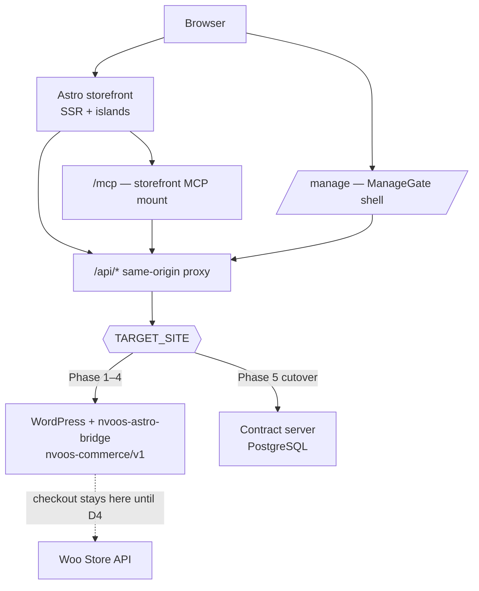

# Proposal 148 — PostgreSQL contract server: replacing the WordPress backend behind `nvoos-commerce/v1`

> Status: **Proposed 2026-11-15**. P0 (extraction) landed. Nothing else implemented.
> Extends 092 (Astro storefront — §2.3 backend-agnosticism, §3.9 end-state stack),
> 095 (storefront MCP surface), 106 (commerce contract document shapes),
> 107 (content governance), 108/110 (cart + embedded checkout), 135 §D4 (`local`
> collection).
> Companion: [`docs/reference/api/nvoos-commerce-v1-contract.md`](../../reference/api/nvoos-commerce-v1-contract.md)
> — the byte-compatibility spec and 19-entry drift register this proposal is
> scoped against.

---

## 1. Executive summary

The question that started this: **can the `/manage` Astro CMS run on a Cloudways
PostgreSQL database instead of WordPress?**

It can, and the cost is lower than it looks — but the work is not in `/manage`.
The CMS is already backend-agnostic: `/manage` is a 55-line shell, the React CMS
bundle binds only to same-origin `/api/*`, and a CI gate (`contract-grep.test.ts`)
fails the build if a WordPress URL ever appears in the storefront source. What
binds the system to WordPress is **the server behind `/api/*`**, not the clients.

Proposal answer, in one line:

> **Add a second implementation of the `nvoos-commerce/v1` contract on
> PostgreSQL, behind the existing `/api/*` proxy. Do not touch the Astro
> storefront or the `/manage` bundle. Land it in five phases, flipping read
> routes first, and keep WordPress serving cart/checkout until payments are
> explicitly in scope.**

This is already the documented end-state — 092 §3.9 names
`Laravel → PostgreSQL · pgvector` with WordPress "transitional — retires after
ETL", and §2.3 states the frontend "runs against WP today … against a Laravel
service tomorrow". Proposal 148 turns that line into a scoped, phased build.

The extraction that had to happen first is done: the contract reference
(companion document) pins every emitted document shape, nullability rule,
default, query parameter, and the 19 places where the PHP output, the two
TypeScript type layers, and the committed fixtures already disagree.

---

## 2. Problem statement

### 2.1 Why the question came up

Operators on Cloudways Velocity already have a managed PostgreSQL instance
available for Node applications — "install natively, access through the built-in
database manager", with backups and the platform's operational surface. When the
frontend is a Node/Astro app and the content backend is a WordPress install that
commands its own server, database, PHP-FPM pool, plugin update cadence and
security posture, the obvious question is whether one of the two is redundant.

For a catalog-and-marketing storefront, it is a fair question: the commerce
domain in this system is roughly **eleven tables' worth of data** (products,
variants, four taxonomies, promotions, promocodes, content, media, managers,
globals) served as flat JSON. Almost none of it exercises WordPress as a CMS.

### 2.2 What "use Postgres instead of WP" must not mean

A tempting but wrong reading is *port `/manage` to SQL*. That would:

- Fork the CMS bundle (`addons/nvoos-astro-bridge/src/`) into two transports.
- Break the one surface the `contract-grep` gate exists to protect.
- Duplicate every collection definition (`src/config/collections.ts`) in SQL
  call sites, then drift.

The correct seam is one level down: **the HTTP contract**. Everything above it
is already independent, and everything below it is replaceable.

### 2.3 The two hard parts, stated up front

1. **`contentRendered`.** The content document's rendered HTML is
   `apply_filters('the_content', $raw)` — shortcodes, embeds, block rendering,
   `wpautop`. A PostgreSQL backend has no `the_content`. There is no SQL
   equivalent; the choice is to freeze rendered HTML at migration (store it) or
   to implement a renderer (§6.4, D5).
2. **Cart and checkout.** Five routes proxy the WooCommerce Store API, carrying
   a `wc_store_api` nonce and a `Cart-Token`, and the place-order route drives a
   payment gateway with rate limits and `expected_total` drift handling. This is
   a payments problem wearing a REST costume. It is the one phase that should be
   *deferred*, not estimated optimistically.

Everything else is a CRUD mapping over rows.

---

## 3. Findings

### 3.1 Repository facts (verified 2026-11-15)

| # | Fact | Evidence |
|---|---|---|
| F1 | `/manage` is a shell; the CMS is a script tag | `examples/nvoos-astro-velocity/src/pages/manage/index.astro` (55 lines) |
| F2 | The CMS binds to `/api/*` only; no backend URL appears in the SPA or the app | `addons/nvoos-astro-bridge/src/hooks/useCollection.ts` (`ROOT` defaults to `/api/`), `tests/unit/contract-grep.test.ts` |
| F3 | `X-WP-Nonce` is a header **name**, not a WP dependency — a replacement can mint its own CSRF token under it | same file; the only WP-specific consumer is the `rest_cookie_invalid_nonce` retry branch |
| F4 | `/api/*` is a straight proxy to `{TARGET_SITE}/wp-json/nvoos-commerce/v1/{rest}`; `/media/*` to `/wp-content/uploads/*` | `examples/nvoos-astro-velocity/scripts/serve.mjs` |
| F5 | The contract has 20 controllers registered under **two** namespaces (`funiq/v1` + `nvoos-commerce/v1`) | `addons/nvoos-astro-bridge/includes/Plugin.php::register_rest_routes` |
| F6 | Only the envelope is validated at runtime — `docs: z.array(z.unknown())` — so a wrong-typed field fails only when a page renders badly | `src/lib/commerce/client.ts` |
| F7 | 092 already targets this stack | `docs/project/proposals/092-astro-storefront-layer-proposal.md` §2.3, §3.9 |
| F8 | `nvoos/laravel-adapter` and a Laravel app skeleton exist, but serve `api/v1/pro/*` — **not** the commerce contract | `docker/laravel/app-skeleton/`, `lib/laravel-adapter/` |
| F9 | Cart/checkout are Woo Store API proxies with bridge-minted nonces, session `Cart-Token`, per-session + per-IP rate limits, and `private, no-store` | `includes/REST/CartController.php`, `CheckoutController.php` |
| F10 | Media is WordPress attachments: `wp_handle_upload` → `wp_insert_attachment` → `_wp_attached_file` → `wp_get_attachment_url` | `includes/REST/MediaController.php` |
| F11 | Session auth is a WP cookie + `wp_create_nonce('wp_rest')`, with a restore shim for WP 6.9's REST cookie behaviour | `includes/REST/AuthSupport.php`, `AuthController.php` |
| F12 | Preview tokens are `HMAC(wp_salt('auth'), post_id.exp)` — cryptographically bound to WordPress | 135 §D6 |
| F13 | The contract already carries drift: 19 documented disagreements between PHP output, both TS type layers, and the committed fixtures | companion reference §10 |

### 3.2 The surface, measured

From the companion reference — this is the whole job:

| Group | Routes | Notes |
|---|---|---|
| Read collections | 10 (`products`, `categories`, `brands`, `colors`, `statuses`, `promotions`, `promocodes`, `content/pages`, `content/posts`, `local`) | 7-key Payload envelope |
| Write surfaces | same 10 (+ `media`, `managers`) | manage capability; content adds `publish_posts` gate |
| Globals | 4 (`banner`, `carousel`, `shop`, `theme`) | singleton rows, no envelope |
| Auth | 5 (`nonce`, `register`, `login`, `logout`, `me`) | |
| Content extras | `revisions`, `restore`, `preview-token` | reduced envelope on revisions |
| Cart/checkout | 5 (`cart/sync`, `checkout`, `/customer`, `/shipping-rate`, `/coupon`) | **deferred** |

### 3.3 What the ecosystem already says

- **092 §2.3** — "Astro does not care what serves the contract … backend-agnostic
  by construction."
- **092 §3.9** — the end-state table already lists Laravel + `PostgreSQL ·
  pgvector` with the bridge "transitional — retires after ETL".
- **Proposal 090 (Laravel runtime)** — the `nvoos/core` engine runs without
  WordPress symbols; the adapter layer is MIT and separate from the plugin.
- **Proposal 145 (OKF core extraction)** — the same "domain logic out of the
  plugin, licence-clean" motion, on a different subsystem.

The direction is established; what was missing was the *precise wire contract*
and the *scope boundary*. P0 delivered the former.

---

## 4. Options considered

| | A — Laravel + Postgres (092 T1) | B — Node contract server (Drizzle/pg) | C — Keep WP, add PG read replica | D — Port `/manage` to SQL |
|---|---|---|---|---|
| Aligns with 092 end-state | ✅ exactly | ⚠️ diverges, then needs a second migration | ❌ | ❌ |
| Reuses existing code | `nvoos/laravel-adapter`, Octane, Horizon | `server.js`/`serve.mjs`, pm2 | none | none |
| Commerce migrations exist | ❌ (adapter targets the MCP domain) | n/a — you write them | n/a | n/a |
| Blast radius | new app + deploy | one repo, one deploy | WP + PG sync complexity | every CMS component |
| Time to first read route | weeks (framework + migrations) | days | days | — |
| Leaves a dead end | no | yes (unless treated as a spike) | no | — |
| Keeps checkout on Woo | ✅ naturally | ✅ until forced | ✅ | ❌ |

**Recommendation: B now, A as the destination if the commerce domain grows.**

Rationale: the contract is 13 read routes and 6 write surfaces of flat JSON.
Standing up Laravel + Octane + Horizon + a migration set to serve eleven tables
is real infrastructure for a problem a few hundred lines of typed SQL solves.
More importantly, **either implementation must pass the same parity gate** — so
build the gate and the cheap implementation first, and let the gate decide
whether A ever earns its cost. If the backend later needs queues, websockets,
Horizon and the `nvoos/core` engine in-process (the 092 §3.9 picture), the Node
server is a contract-compatible stepping stone, not wasted work: the contract is
the asset, the implementation is swappable.

Option C is rejected because it does not remove WordPress — it doubles the
failure modes (replication lag on writes the CMS itself performs).
Option D is rejected in §2.2.

---

## 5. Proposed architecture

### 5.1 The seam



One environment variable (`TARGET_SITE`, or a per-collection router) selects the
implementation. Rollback is a config flip, not a redeploy of the frontend.

### 5.2 Contract server responsibilities

| Concern | Implementation |
|---|---|
| Routing | The exact 13 read routes + 6 write surfaces of the reference §4–6 |
| Envelope | One builder — `limit` = resolved page size, `totalPages` floored at 1 |
| Errors | `{code, message, data:{status}}`, preserving the WP error *codes* (§1.2 of the reference) |
| Auth | Own session cookie + own CSRF token, **accepted under `X-WP-Nonce`** |
| Capabilities | `manage_astro`, `publish_posts` — reproduced as data, not WP roles |
| Caching | `Cache-Control`, `ETag`, `Cache-Tag`/`Surrogate-Key`, and the auth + `preview_token` exclusions |
| Media | `{id, url, path}` table + a `/media/*` route, or absolute URLs with `/wp-content/uploads` preserved |

### 5.3 Schema sketch

```sql
-- Identity as JSON numbers, never strings.
CREATE TABLE product (
  id            bigint GENERATED ALWAYS AS IDENTITY PRIMARY KEY,
  name          text        NOT NULL,
  price         numeric(12,2) NOT NULL DEFAULT 0,
  old_price     numeric(12,2),
  description   text        NOT NULL DEFAULT '',
  width         numeric(10,2) NOT NULL DEFAULT 0,
  height        numeric(10,2) NOT NULL DEFAULT 0,
  depth         numeric(10,2) NOT NULL DEFAULT 0,
  rating        numeric(3,2),
  is_bestseller boolean     NOT NULL DEFAULT false,
  is_featured   boolean     NOT NULL DEFAULT false,
  image_id      bigint      REFERENCES media(id),
  promotion_id  bigint      REFERENCES promotion(id),
  status        text        NOT NULL DEFAULT 'draft',  -- publish | draft
  created_at    timestamptz NOT NULL DEFAULT now(),
  updated_at    timestamptz NOT NULL DEFAULT now()
);

CREATE TABLE product_term (
  product_id bigint NOT NULL REFERENCES product(id) ON DELETE CASCADE,
  kind       text   NOT NULL,   -- category | brand | color | status
  term_id    bigint NOT NULL,
  position   int    NOT NULL,   -- preserves "first term wins" for category/brand
  PRIMARY KEY (product_id, kind, term_id)
);

CREATE INDEX product_name_trgm ON product USING gin (name gin_trgm_ops);
CREATE INDEX product_status_created ON product (status, created_at DESC);

CREATE TABLE content (
  id            bigint GENERATED ALWAYS AS IDENTITY PRIMARY KEY,
  kind          text NOT NULL,             -- page | post | local
  slug          text NOT NULL,
  title         text NOT NULL,
  excerpt       text NOT NULL DEFAULT '',
  content       text NOT NULL DEFAULT '',
  content_rendered text NOT NULL DEFAULT '',  -- frozen at migration (D5)
  featured_image_id bigint REFERENCES media(id),
  seo_title     text NOT NULL DEFAULT '',
  seo_description text NOT NULL DEFAULT '',
  category_id   bigint,
  status        text NOT NULL DEFAULT 'draft',
  publish_at    timestamptz,
  blocks        jsonb NOT NULL DEFAULT '[]'::jsonb,
  submitted_by  text,
  approved_by   text,
  created_at    timestamptz NOT NULL DEFAULT now(),
  updated_at    timestamptz NOT NULL DEFAULT now(),
  UNIQUE (kind, slug)
);

CREATE TABLE content_revision (
  id         bigint GENERATED ALWAYS AS IDENTITY PRIMARY KEY,
  content_id bigint NOT NULL REFERENCES content(id) ON DELETE CASCADE,
  snapshot   jsonb  NOT NULL,
  author     text   NOT NULL,
  created_at timestamptz NOT NULL DEFAULT now()
);

CREATE TABLE global_doc (
  key        text PRIMARY KEY,   -- banner | carousel | shop | theme
  doc        jsonb NOT NULL,
  updated_at timestamptz NOT NULL DEFAULT now()
);
```

`product_term.position` exists because the contract exposes **one** `category`
and **one** `brand` (`term_single()` takes `[0]`) — a naive many-to-many loses
which term the API reports.

### 5.4 Parity traps that are easy to miss

Documented in full in the companion reference; the ones that produce *silent*
wrongness:

| Trap | Why it bites |
|---|---|
| **Sort direction is inverted** (D18) | `price` = high→low, `-price` = low→high. Implementing Payload's convention returns 200 with every PLP reversed |
| **`numeric` → string** | `node-postgres` returns `numeric` as a string; PHP emits a number. Nothing type-checks this |
| **Two timestamp formats** (D12) | Documents `Y-m-d H:i:s` site-local; globals ISO 8601 |
| **`promocode.expiresAt` is display-formatted** (D6) | `"Jun 30, 2027"`, not a date. Not round-trippable |
| **Unknown `where` operators are ignored, not rejected** (D19) | A 400 breaks the SPA's relationship filters |
| **Only the envelope is validated** (F6) | Nothing fails at fetch time; failures surface as bad rendering |
| **`the_content` has no SQL equivalent** (§2.3) | The single largest content-parity risk |
| **`name.like` maps to WP `s`** | WP's search is relevance-ranked across title *and* content; `ILIKE name` is a different operator. Accept the change or reproduce it |

---

## 6. Phased plan

| Phase | Deliverable | Gate |
|---|---|---|
| **P0 — extraction** | ✅ Contract reference + drift register (`docs/reference/api/nvoos-commerce-v1-contract.md`) | Owner review |
| **P1 — parity harness** | Promote `tests/fixtures/*.json` into a zod (or JSON Schema) suite; run it against **both** implementations | Suite green on WP — this is what makes the migration safe |
| **P2 — Postgres reads** | Schema + migrations + seed-from-WP ETL + the 10 read collections + 4 globals behind a per-collection router | Fixture suite green on PG; storefront renders identically |
| **P3 — auth + writes** | Sessions, CSRF-under-`X-WP-Nonce`, capabilities, write surfaces, `media`, preview tokens | CMS CRUD parity; draft-404 gate holds |
| **P4 — content render decision** | Execute D5 — freeze `contentRendered` at ETL, or implement a renderer | Rendered HTML byte-comparison on a sample of pages |
| **P5 — cutover** | `TARGET_SITE` flip per collection → per site; WP demoted to read-only; rollback drill | One-command rollback verified |
| **P6 — deferrable** | Cart/checkout on PG, or keep Woo (D4) | Only if payments leave Woo |

**P6 is deliberately last and may never run.** The storefront needs the
contract, not a new payment stack.

### 6.1 What "flip per collection" buys

`/api/*` is one proxy rule, but the router inside the new server can serve, say,
`products` + `categories` + `brands` from Postgres while `content/posts` stays on
WordPress. That makes P2 shippable in slices and gives a natural emergency
valve per collection rather than all-or-nothing.

---

## 7. Decisions required (owner)

| # | Question | Recommendation |
|---|---|---|
| **D1** | Runtime for the contract server: Node + Drizzle/pg (§4-B) or Laravel + Octane (§4-A)? | **Node now**, gate-verified; Laravel remains the 092 §3.9 destination if the domain grows |
| **D2** | Is the goal *removing WordPress* or *removing the second server*? | Removing the second server. Content keeps a CMS; the storefront keeps a contract |
| **D3** | Does `funiq/v1` (the legacy alias) survive the migration? | Retire it with the licensed PWA. Registering both is nearly free but it is a second public surface |
| **D4** | Cart/checkout on Postgres, or keep Woo? | **Keep Woo** until there is a business reason to own payments. Reimplementing a gateway is a project, not a phase |
| **D5** | `contentRendered`: freeze at ETL, or render at serve time? | **Freeze at ETL** for existing docs; render blocks natively for new `local` content. Cheapest path to parity; a renderer can come later |
| **D6** | Media: keep the `/media/*` proxy, or move to object storage? | Keep the proxy in P2 (zero content-URL churn); object storage is a separate proposal |
| **D7** | Fix drift D7 (`capabilities[]` omits user-level grants) or preserve it? | **Fix it in the new implementation** and docblock the divergence — preserving a latent auth bug across a rewrite is not "compatibility" |
| **D8** | ETL strategy: big-bang or strangler GET-first? | Strangler, read-first (§6). Big-bang has no rollback |
| **D9** | Does `productsSource: both` (merged native + Woo) survive? | Drop it in PG mode. It is the one contract behaviour with no clean relational equivalent (D17) |

---

## 8. Success metrics

| Metric | Target |
|---|---|
| Contract parity | Fixture/zod suite green against both implementations, **100 %** of covered shapes |
| Storefront diff at cutover | Zero rendered-HTML changes on the top 20 URLs (byte-comparison, media URLs normalized) |
| CMS parity | Every collection CRUD operation produces an equivalent stored row and re-read document |
| Read latency (p95) | ≤ WordPress baseline; the goal is parity, not a speed claim |
| Rollback | Config flip, < 1 minute, no frontend deploy |
| WordPress footprint after P5 | No public read traffic; edit surface only |

---

## 9. Effort

Rough, single developer, excluding review and excluding P6:

| Phase | Size |
|---|---|
| P1 parity harness | 2–3 days |
| P2 schema + ETL + reads | 8–12 days |
| P3 auth + writes + media | 5–8 days |
| P4 content render | 2–4 days (freeze) / 8+ days (renderer) |
| P5 cutover + rollback drill | 2–3 days |

**P6 (cart/checkout) is 3–6 weeks and is out of scope** unless D4 overrides.

The estimate is grounded in the measured surface (10 read collections, 6 write
surfaces, 4 globals, 5 auth routes), not in a framework's capability.

---

## 10. Risks

| Risk | Likelihood | Mitigation |
|---|---|---|
| **Silent contract drift** between two live implementations (F6 — nothing validates documents) | High | P1 exists precisely for this; it is a blocking gate, not a nicety |
| **Rendered content diverges** (`the_content`, shortcodes, embeds) | High if not frozen | D5 freeze-at-ETL + sample byte-comparison |
| Reimplementing checkout temptingly early | Medium | D4: keep Woo; P6 gated behind an explicit owner decision |
| SEO regression from a URL/format change in `contentRendered` | Medium | Byte-comparison gate at cutover; canonical/`og:url` untouched (they derive from `ASTRO_SITE`) |
| Auth/cookie semantics change under `X-WP-Nonce` | Low | F3 — the header is a name; P3 tests the retry ladder end-to-end |
| Migration drops relationship ordering (`category`/`brand` "first term wins") | Medium | `product_term.position`; fixture-level assertion |
| Losing draft-existence protection (404-not-403) | Medium | Explicit P3 gate; the rule is documented in the reference §3.2 |
| Two implementations drift *operationally* (one gets a fix, the other doesn't) | Medium | Time-box the dual-run window; per-collection flip keeps it short and attributable |

---

## 11. Out of scope

- Reimplementing cart, checkout, or any payment gateway (D4).
- Moving media off WordPress/`/media/*` (D6).
- Adding a Laravel + Octane + Horizon deployment (D1).
- Native NV contract re-shaping — 092 defers this until both ends are NV-owned;
  the Payload envelope stays for now.
- Multi-tenant or federated nodes (092 T3).
- Any change to the `/manage` bundle, the storefront components, or the MCP
  tool surface. If a phase needs one, the phase is wrong.

---

## 12. Appendix — reference parity

The companion document
([`docs/reference/api/nvoos-commerce-v1-contract.md`](../../reference/api/nvoos-commerce-v1-contract.md))
is normative for this proposal. It specifies, per route: method, auth,
parameters, the exact document shape with nullability and defaults, accepted
write bodies, error codes, cache headers, and the drift register.

Two authorities remain upstream of it and must stay in sync:

- `addons/nvoos-astro-bridge/includes/` — the serving implementation today.
- `addons/nvoos-astro-bridge/tests/golden/` + `examples/nvoos-astro-velocity/tests/fixtures/`
  — the shape snapshots CI already diffs.

If a future change to the bridge alters an emitted shape, the goldens fail
first, the fixtures regenerate second, and this reference becomes stale third.
**That third step has no automated gate** — P1 of this proposal is what closes
it.
