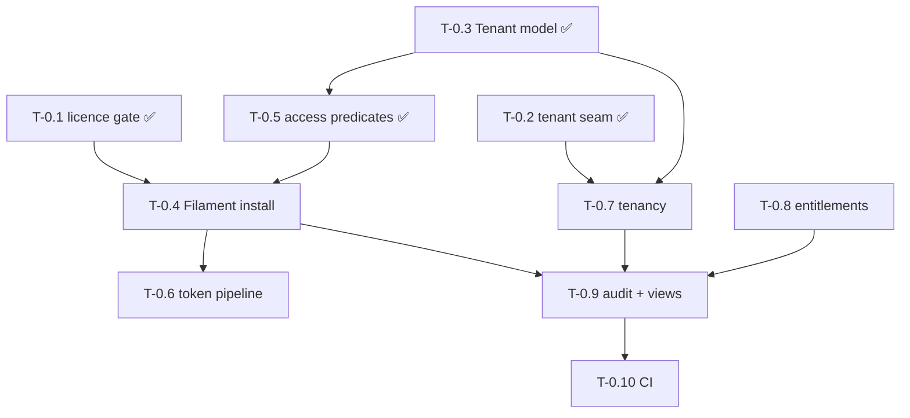

# Proposal 149 — Implementation Plan

**Parent:** [`149-laravel-admin-parity-proposal.md`](./149-laravel-admin-parity-proposal.md)
**Status:** ✅ **WAVE 0 COMPLETE** (2026-11-16) — T-0.1 … T-0.10 done; Q-4 and Q-6 closed, Q-5 open (commercial). ✅ **WAVE 1 CLOSED.** 🟡 **WAVE 2 IN PROGRESS** — **38 numbered slices** (§8–§56) **shipped** and **the Wave 2 exit gate (key rotation + DLQ drain) is met**; §38 is the branding fix rather than a slice, §44–§46 are accounting/planning, **§55 is the admin navigation and table-UX plan — steps 1–6 shipped 2026-11-17, section complete** (six groups; collapsible rail with keyboard-operable disclosure; global search over title/slug/description opening the record's edit action; one shared data table with a caption, sticky header and in-body empty state, now on all fourteen admin data tables; pagination defaults at 25), and **§56 opens Wave 3** with the toolkit manifest renderer (`/admin/toolkits`). The consumer-port run (§48–§54) added **seven surfaces** that were console-only, and each slice opened by asking whether the store behind it was estate data.
**Scoreboard** — re-measured 2026-11-22 with the `bin/audit-surface-ownership.php` rules over `docker/laravel/app-skeleton/contracts/surface-ownership.json`: **50 surfaces · 44 built on a Filament panel** (19 `/ops`, 29 `/admin`; `security`, `budgets`, `settings.platform` and `tokens.personal` are on both) · **29 console-served** · **4 console-only** (`automation-canvas`, `chat`, `connected-apps`, `wordpress-bridge` — each a recorded disposition, not a gap) · **0 planned-only** · **0 inert** · **2 recorded `absent`** (`chat-profiles` on `/admin`, `onboarding` on `/ops`). §14.2 holds the rule this measures against: a console surface is not admin parity.
**Validation** — app suite: **1277 tests / 7243 assertions, 0 failures** from `docker/laravel/app-skeleton`, where the parity providers resolve `tests/fixtures/` five levels up. The dev container mounts the app at `/app`, so that walk lands on `/`; the container-only failures have two separate causes, both measured 2026-11-21: the PM providers returned no rows until `docker-compose.laravel.yml` named the bind-mount path, and four `WifiKpisTest` cases were missing a fixture that **is** committed but predated the `/app` copy — all five pass once it is synced. `PASS Tests\Feature\SurfaceOwnershipTest`. A red run of that gate is a contract break, not a flake.
**Date:** 2026-11-16 · **Header refreshed:** 2026-11-21
**Scope (Wave 0):** ~3–4 weeks, one engineer
**Owner decisions applied:** D-1 (commercial), D-2 (operator + customer), OQ-6 (tenancy in v1), OQ-7 (Pro stays on WP → this is a port), Q-1 (operator = estate flag), Q-2 (licence = per estate)

**What the slices closed.** The cross-tenant settings defect; the "editable
nowhere" gap the settings projection opened; the estate leak in workflow run
history; a cross-tenant revocation path on the live token manager; the console
API's dependency on the `default` estate; and two unscoped stores
(`nvoos_remote_sites` §27, `nvoos_triggers` §29) whose `test` and `fire` actions
reached into other estates. Four rows were also **dispositions** rather than
builds (`chat-profiles`, `onboarding`, `datasets`, `identity-provider`), which is
why the burn-down below is honest rather than merely short.

## Completion log

| Task | State | Evidence |
|---|---|---|
| T-0.1 licence boundary | ✅ done | Gate passes on the clean tree; a planted `extends WP_MCP_AI_Tool_Base` fails it with exit 1; probe removed |
| T-0.2 tenant seam | ✅ done | 7 new tests / 14 assertions green; the wiring test fails when the registrations are removed; full app suite **731 passed / 4,257 assertions (container)**; all three real Octane event objects accepted, tenant cleared for each |
| T-0.3 `Tenant` model | ✅ done | 7 new tests; dev MySQL migrated (default + `nvoos` operator estate, existing user backfilled as `owner`); licence key verified encrypted at rest |
| T-0.5 access predicates | ✅ done | 8 new tests incl. the Q-1 trap (customer estate administrator → `/ops` denied); suite now **746 passed / 4,282 assertions** |
| T-0.4 Filament panels | ✅ done | Filament **5.11**; `/ops` and `/admin` routed (`ops`, `ops/login`, `ops/logout`, `admin`, …); 11 tests; suite now **757 passed / 4,299 assertions** |
| T-0.6 token pipeline | ✅ done | `admin:theme` generator + committed `AdminTheme.php`; drift gate proven to fail on a mutated token; 7 tests incl. WCAG 2.2 contrast; suite now **764 passed / 4,340 assertions** |
| Q-4 status tokens | ✅ closed | `success`/`warning`/`info` added to `core.json` + `semantic.json` + both theme modes; storefront regenerated and green (30/30 token tests); admin palette now fills all six Filament keys |
| T-0.7 panel tenancy | ✅ done | `->tenant(Tenant::class, 'slug', 'tenant')` + `HasTenants` + `SetTenantContext`; guard test replaced by 6 tenancy tests; suite now **771 passed / 4,380 assertions** |
| T-0.8 entitlement | ✅ done | Fixed a **latent outage** (4 in-use feature keys absent from the plan catalogue), `singleton`→`scoped`, `TenantEntitlement` decorator, config seam; suites: app **785 / 4,405**, adapter **286 / 1,534**, core **1,762 / 6,255** |
| T-0.9 audit + views | ✅ done | Append-only `nvoos_admin_audit` (records failures too, redacts credentials at any depth), `nvoos_admin_views` + estate-scoped repository; 15 tests; app suite **800 / 4,449** |
| T-0.10 CI wiring | ✅ done | `admin:theme --check` step + `sync-toolkit-manifests.php --check` step (closes Q-6); both gates proven to fail |

### Wave 0 exit — what is now true

- The commercial admin cannot silently absorb GPL code (licence gate over `docker/**`).
- Tenant state cannot leak across Octane requests or queue jobs.
- An estate is a first-class object with operator status, per-estate licensing and membership.
- Two panels exist with different access predicates, and a customer administrator is provably not an operator.
- The palette is generated from ADS and drift-gated; WCAG 2.2 AA is asserted on every authored pair.
- Entitlement is per estate, `scoped()`, and its vocabulary is gated against the route table and the manifests.
- Every mutating admin action is audited, failures included, with credentials redacted.

Wave 2's first commitment: **no resource ships without a cross-tenant 404 test** — the one T-0.7 exit item that cannot exist until a resource does.

---

## 1. Objective

Stand up a Laravel admin that **cannot** become a legal, security, or
authorization liability later — while building zero business pages.

Wave 0 ships:

1. An enforced licence boundary over `docker/**`.
2. A tenant seam that is safe under Octane.
3. Two panels (`/ops`, `/admin`) with different access predicates.
4. An entitlement service wired into the manifest schema.
5. A design-token pipeline (DTCG → Filament theme) with a drift gate.
6. Two admin tables: audit + saved views.

**Wave 0 delivers no operator value.** It delivers the rails everything else
rides on. If a wave-0 task does not prevent a class of defect, it is out of
scope.

---

## 2. Pre-flight findings

Four things were found while planning that were not visible from the proposal.
**B1 and B2 are blockers** — tenancy must not land before B2 is fixed.

### B1 — The licence boundary does not cover `docker/` 🔴

`bin/check-license-boundary.sh` asserts four trees:

```sh
check_tree "lib/core/src"          "GPL"          "GPL (package is MIT)"
check_tree "includes"              "Proprietary"  "Proprietary (package is GPL)"
check_tree "addons/pro/includes"   "GPL"          "GPL (package is Proprietary)"
check_tree "addons/canvas"         "GPL"          "GPL (package is Proprietary)"
```

`docker/laravel/app-skeleton` is scanned by **nothing**. Decision D-1 makes the
Laravel app commercial, so an import from the GPL `includes/` tree would silently
relicense the whole product. Nothing today prevents it.

**Compounding fact:** `docker/laravel/app-skeleton/composer.json` declares
`"license": "MIT"`. That is the Laravel skeleton default and is now wrong.

### B2 — `TenantContext` is a static with no reset hook 🔴

```php
final class TenantContext
{
    private static ?string $tenantId = null;

    public static function current(): string
    {
        return self::$tenantId ?? Assistant::DEFAULT_TENANT;
    }

    public static function set(?string $tenantId): void { self::$tenantId = $tenantId; }
    public static function forget(): void { self::$tenantId = null; }
}
```

Measured:

| Fact | Evidence |
|---|---|
| `current()` is used at **20+ call sites** | `AssistantController`, `CommandCenterController`, `OrchestrationStatsController`, `BlueprintCatalogue`, `BlueprintInstaller`, `LaravelAssistantService`, `LaravelTeamService` |
| `set()` and `forget()` are **never called** in production code | grep over `app/` returns only `current()` |
| No listener resets it | `config/octane.php` has a `RequestTerminated` block, but nothing touches `TenantContext` |

Today this is harmless: the tenant is always `'default'`. The moment Filament
tenancy (T-0.7) starts calling `set()` per request, the static survives the
request on a long-lived Octane worker and **tenant A's id leaks into tenant B's
queries**. That is a cross-tenant data-leak waiting for a feature to activate it.

This is the same class as the documented Octane gotcha in the
`mcp-ai-wpoos-laravel-runtime` skill ("a bound, not singleton, repository is
rebuilt per request; do not promote stateful readers to singletons or a
long-lived worker serves stale data") — except this one is a static, which
Octane cannot reset for you.

**Fix before any tenancy work.**

### B3 — There is no `Tenant` model 🟡

`app/Models/` holds `Assistant`, `Team`, `TeamMember`, `User`. `tenant_id` is a
plain string column (`Assistant::DEFAULT_TENANT = 'default'`).

Filament's `->tenant()` requires an Eloquent model. Two candidates:

| Option | Fit | Risk |
|---|---|---|
| `Team` as tenant | Model exists | **Wrong domain.** `tenant_id` is estate-level; a customer with two teams would become two tenants, and `team_id` ≠ `tenant_id` in every record |
| New `Tenant` model over the existing `tenant_id` string | Matches `TenantContext` semantics exactly | Needs a table + membership pivot |

**Recommendation: new `Tenant` model.** It is the smallest change that keeps
`tenant_id` meaning what every existing query already assumes.

### B4 — One provider, one panel-less app 🟢

`bootstrap/providers.php` lists only `AppServiceProvider::class`. No Filament,
no Livewire, no admin scaffolding. Clean slate — nothing to unwind.

---

## 3. Task breakdown

Tasks are ordered by dependency. 🔴 = blocker, must land first.

### T-0.1 — Licence boundary over `docker/` 🔴 ✅ DONE

**Landed.** Measured: gate passes on the clean tree,
and a planted `class TmpBoundaryProbe extends WP_MCP_AI_Tool_Base` fails it with
`❌ docker/laravel/app-skeleton couples to the GPL plugin` and exit 1.

**A design correction to this plan:** the first draft of the prefix guard
(`WP_MCP_AI_|includes/admin`) would have failed immediately — the app has 23
files that legitimately mention WordPress in **docblocks** (the port provenance
record, e.g. "Port of `WP_MCP_AI_REST_Okf`") and in **stored meta-key strings**
(`_wp_mcp_ai_team_members`) that must match WordPress for bundle portability.
The gate therefore anchors on keywords that only appear in real code
references (`new`, `extends`, `implements`, `instanceof`, `class_exists`,
`function_exists`, `interface_exists`, `require`/`include … includes/`), which
is clean on today's tree and still catches genuine linkage.

**Files**

- `bin/check-license-boundary.sh` — append after the existing `check_tree` calls:

```sh
# ---------------------------------------------------------------------------
# The Laravel admin is COMMERCIAL (Proposal 149 D-1). It may consume the MIT
# engine (lib/core, lib/laravel-adapter) and nothing else. A single import from
# the GPL includes/ tree would relicense the product.
# ---------------------------------------------------------------------------
check_tree "docker/laravel/app-skeleton/app"         "GPL" "GPL (app is Commercial)"
check_tree "docker/laravel/app-skeleton/config"      "GPL" "GPL (app is Commercial)"
check_tree "docker/laravel/app-skeleton/database"    "GPL" "GPL (app is Commercial)"
check_tree "docker/laravel/app-skeleton/tests"       "GPL" "GPL (app is Commercial)"

# Direction guard: the WordPress-specific prefix must never appear in the app.
check_no_wp_api() {
	local tree="docker/laravel/app-skeleton"
	local offenders
	offenders=$(grep -rlE "WP_MCP_AI_|wp_mcp_ai_|includes/admin" \
		--include="*.php" "$tree/app" "$tree/config" "$tree/database" 2>/dev/null || true)
	if [ -z "$offenders" ]; then
		pass "$tree — no WordPress-prefixed symbols (licence boundary intact)"
	else
		fail "$tree references WordPress symbols — GPL contamination of a commercial tree"
		show_offenders "$offenders"
	fi
}
check_no_wp_api
```

- `docker/laravel/app-skeleton/composer.json` — `"license": "MIT"` → `"proprietary"`.

**Why the prefix guard rather than a blanket `require_tree`:** the tree mixes
Laravel stubs (MIT, no `@license` docblock) with commercial code, so a positive
`require_tree` over the whole tree would fail on the stubs. The prefix guard
tests the thing that actually matters — whether app code reaches into the GPL
plugin.

**Exit gate**

```sh
bash bin/check-license-boundary.sh     # green, and the new lines are exercised
```

Add a deliberate violation locally (paste `WP_MCP_AI_Tool_Base` into a scratch
controller), confirm the gate fails, then revert. A gate never seen to fail is
not a gate.

### T-0.2 — Make the tenant seam Octane-safe 🔴 ✅ DONE

**Landed.** Two reset mechanisms, because they cover disjoint execution modes:

| Mode | Reset | Why it cannot be the other one |
|---|---|---|
| Octane HTTP request | `RequestTerminated` listener | — |
| Octane task / tick worker | `TaskTerminated` / `TickTerminated` listener | These never run HTTP terminating callbacks |
| `queue:work` worker (`oos-laravel-worker`) | `JobProcessed` / `JobExceptionOccurred` in `AppServiceProvider` | A queue worker fires **no** Octane events at all |
| PHPUnit | `Tests\TestCase::setUp()` | Tests run many operations in one process |

**Plan deviation:** this plan originally said "register as `scoped()` in
`AppServiceProvider`". That was written for a hypothetical container service;
the real class is a static facade with 20+ call sites, so converting it would
have touched every consumer for no gain. The static kept its API and gained
lifecycle resets instead — verified by test rather than asserted.

Also added `TenantContext::isPinned()`, because comparing `current()` to
`DEFAULT_TENANT` cannot distinguish "explicitly pinned to default" from "unset"
— and it is the difference the resets care about.

**Verified:**

```
TenantContextIsolationTest      7 tests / 14 assertions   (host PHP)
full app suite (host)         731 tests / 4,255 assertions  ✅
full app suite (container)    731 tests / 4,257 assertions  ✅  (php artisan test)
phpcs phpcs-laravel.xml.dist   818 files, 0 errors 0 warnings ✅
```

Removing the three `config/octane.php` registrations fails
`test_every_octane_termination_event_is_wired` with
"RequestTerminated must reset the tenant context or Octane leaks it across
operations" — the gate was seen to fail.

**Live Octane validation (run in `oos-laravel-app`):** the real event objects
were constructed and handed to the listener. Reflection shows why the handler
is typed `object` and not one event class — the three constructors have
different arities:

| Event | Constructor |
|---|---|
| `RequestTerminated` | `(Application $app, Application $sandbox, Request $request, Response $response)` |
| `TaskTerminated` | `(Application $app, Application $sandbox, $data, $result)` |
| `TickTerminated` | `(Application $app, Application $sandbox)` |

A listener typed to `RequestTerminated` could not be registered against
`TickTerminated`; a typed union would break on the next Octane minor. The
untyped handler accepts all three, and the tinker run confirmed the pin is
cleared for each:

```
RequestTerminated -> pinned=no
TaskTerminated    -> pinned=no
TickTerminated    -> pinned=no
```

Still **not** proven: a live end-to-end pin/unpin through Octane over HTTP.
Nothing calls `set()` yet (that is T-0.7), so the behaviour is verified at the
listener boundary. Re-run an HTTP smoke after T-0.7 lands.

**Files****

- `docker/laravel/app-skeleton/app/Support/TenantContext.php`

Keep the public API (`current` / `set` / `forget`) so the 20+ call sites do not
change. Two mechanisms, **both**:

```php
/**
 * Resolves the active tenant for this request.
 *
 * Octane reuses the worker across requests, so the tenant MUST be reset on
 * request termination. Two layers:
 *   1. scoped() — the container drops the instance between requests.
 *   2. the Octane RequestTerminated listener in config/octane.php — belt and
 *      braces for queue jobs and any code path holding a stale reference.
 */
```

- Register as `scoped()` in `AppServiceProvider` (not `singleton`).
- `config/octane.php` — add to the `RequestTerminated` listener array:

```php
RequestTerminated::class => [
    // ... existing entries ...
    \App\Listeners\ForgetTenantContext::class,
],
```

- New `app/Listeners/ForgetTenantContext.php` calling `TenantContext::forget()`.

- `docker/laravel/app-skeleton/tests/Feature/TenantContextIsolationTest.php`:

```php
public function test_tenant_does_not_leak_between_requests(): void
{
    TenantContext::set('tenant-a');
    $this->get('/api/v1/features')->assertOk();

    // simulate Octane request termination
    event(new RequestTerminated(
        $this->app, $this->app['request'], $this->app['response']
    ));

    TenantContext::set(null);
    $this->assertSame(Assistant::DEFAULT_TENANT, TenantContext::current());
}
```

**Exit gate**

The isolation test fails before the fix and passes after. Verify by commenting
out the listener.

### T-0.3 — `Tenant` model + membership 🟡 ✅ DONE

Carries the Q-1 decision: **operator status is a property of the estate**, so
`is_operator` ships in the first migration rather than as a later `users` column.

**Files**

- `database/migrations/*_create_tenants_table.php` — `id` (string, PK), `name`,
  `slug` (unique), **`is_operator`** (bool, default false, indexed),
  **`licence_key`** (nullable string), **`plan`** (nullable string, validated
  against `ProPlanCatalog`), timestamps. Guarded by `Schema::hasTable`.
- `database/migrations/*_create_tenant_user_table.php` — `tenant_id`, `user_id`,
  `role` (reuses `CapabilityMap::TEAM_ROLES` vocabulary), unique pair.
- `app/Models/Tenant.php` — `users()`, `assistants()`, `isOperator()`,
  `scopeOperators()`.
- Backfill, guarded and idempotent:
  - one `'default'` tenant (`is_operator = false`) so existing `tenant_id`
    values keep resolving;
  - attach every existing user to it as `owner` (otherwise the first deploy
    leaves the existing operator locked out of `/admin`);
  - **exactly one** operator tenant, `slug = 'nvoos'`, created only when the
    environment is not production — production seeds it manually so a deploy
    cannot manufacture an operator estate.

**Exit gate**

Fresh SQLite (CI engine) and the existing dev DB both migrate; every pre-existing
assistant/team still resolves through `TenantContext::current()`; exactly one
tenant has `is_operator = true` in local/testing.

### T-0.4 — Filament + Livewire install 🟢 ✅ DONE

**Landed.** Filament **5.11** (installed in the container — the vendor tree is a
Docker volume — then `composer.json` + `composer.lock` copied back to
`app-skeleton`, which stays the source of truth).

| Panel | id | Path | Routes |
|---|---|---|---|
| Vendor | `operator` | `/ops` | `ops`, `ops/login`, `ops/logout` |
| Customer (default) | `admin` | `/admin` | `admin`, `admin/login`, `admin/logout` |

`User` now implements `FilamentUser`; `canAccessPanel(Panel)` **delegates** to
`AdminAccessPolicy::accessPanel($this, $panel->getId())` — the policy remains the
only definition, and an unregistered panel id fails closed.

**Three decisions made while implementing:**

1. **Resource namespaces are separate** — `App\Filament\Operator\*` vs
   `App\Filament\Admin\*`. A shared discovery path would let an operator
   surface render in the customer panel, which is a privilege leak rather than
   a styling bug.
2. **An operator reaches BOTH panels.** The first test run failed asserting the
   opposite, and the test was wrong, not the policy: an operator is a member of
   the operator estate, and the proposal's rule for `/admin` is "tenant member
   with >= manager". `/ops` is the *extra* privilege on top. Pinned by
   `test_operator_status_is_what_separates_the_two_panels`, which asserts the
   two users differ on the **estate flag alone** with identical `users.role`.
3. **Tenancy is deliberately still off.** `->tenant()` is T-0.7. Until then the
   customer panel must register **no resources**, because an unscoped resource
   reads every estate's rows. `test_the_customer_panel_registers_no_resources_until_tenancy_lands`
   fails the moment one is added — a forcing function, deleted in the same
   commit that enables tenancy.

**Deploy fix:** Filament's CSS/JS are build output published into
`public/` (gitignored), so a fresh checkout renders unstyled panels.
`docker/laravel/entrypoint.sh` now runs `filament:assets` once per checkout,
guarded on the presence of `public/css/filament/filament/app.css`.

**Operational note — adding a panel needs `octane:reload`, not just
`optimize:clear`.** After the providers landed, `/admin/login` returned **404**
while `/ops/login` returned 200, with both routes present in `route:list`. The
running Octane worker held the route table from before the panels existed;
`optimize:clear` clears *file* caches and does not touch a warm worker. After
`octane:reload`, all four routes answered correctly:

```
/ops/login     200
/admin/login   200
/admin   (guest) 302 -> /admin/login
/ops     (guest) 302 -> /ops/login
```

This is the same class as the documented stale-route symptom on Velocity — when
a route exists in `route:list` but 404s over HTTP, suspect the warm process.

**Sync-check caveat:** `diff -rq app-skeleton/bootstrap app/bootstrap` will
always report `bootstrap/cache/{packages,services}.php` as differing — those are
generated caches (only `.gitignore` is tracked there), not source. The
skeleton→runtime copy should take `bootstrap/providers.php` and
`bootstrap/app.php` explicitly rather than the whole directory.

**Exit gate met:** guest → `/ops` redirects to `/ops/login`; customer estate
administrator → `/ops` **403**; operator → `/ops` 200; manager → `/admin` 200;
viewer → `/admin` 403.

**Files**

- `composer.json` — add `filament/filament` (pin the major).
- `app/Providers/Filament/OperatorPanelProvider.php`
- `app/Providers/Filament/AdminPanelProvider.php`
- `bootstrap/providers.php` — add both.

Panel config, both:

```php
->id('operator')                // or 'admin'
->path('ops')                   // or 'admin'
->authGuard('web')
->login()
->colors([...])                 // generated from DTCG — see T-0.6
->middleware([...])             // web + auth + the admin audit middleware
```

`AdminPanelProvider` additionally:

```php
->tenant(Tenant::class)
->tenantMenu(true)
```

**Exit gate**

`php artisan about` lists Filament; `GET /ops` redirects to the Filament login;
`GET /admin` 404s for an unauthenticated user.

### T-0.5 — Access predicates 🟢 ✅ DONE

**Plan deviation:** the plan specified `canAccessPanel(Panel $panel)` on `User`.
`Panel` is a Filament class and Filament is not installed until T-0.4, so this
task implemented the **predicates** in `AdminAccessPolicy` — the part Q-1
decides and the part that must be tested — and left the one-line Filament
adapter for T-0.4. The model method must delegate to the policy rather than
re-implement it, or the two will drift.

Resolved by Q-1: **there is no `users.is_operator`.** Operator access is
membership in the estate whose `tenants.is_operator` is true.

**Files**

- `app/Models/User.php` — `canAccessPanel(Panel $panel): bool`
- `app/Policies/AdminAccessPolicy.php`

```php
public function canAccessPanel(Panel $panel): bool
{
    return match ($panel->getId()) {
        // NV staff. Never tenant-scoped: the operator must see every estate.
        // Operator-ness is a property of the ESTATE (tenants.is_operator), not
        // of the person — a customer's estate administrator is an
        // administrator and must never qualify.
        'operator' => $this->isOperatorMember()
                      && CapabilityMap::has($this, 'manage_options'),

        // Customer estate member with at least manager on an estate they
        // belong to. Viewer is read-only, so the panel is refused entirely.
        'admin'    => $this->tenantMemberships()
                          ->where('role', '!=', 'viewer')
                          ->exists(),

        default    => false,
    };
}

private function isOperatorMember(): bool
{
    return $this->tenants()->where('tenants.is_operator', true)->exists();
}
```

**Four tests, and the fourth is the one that matters:**

| Case | Expect |
|---|---|
| customer estate administrator → `/ops` | **403** (the trap Q-1 exists to prevent) |
| operator-tenant owner → `/ops` | 200 |
| tenant viewer → `/admin` | 403 |
| tenant manager → `/admin` | 200 |

**Exit gate**

The four cases pass, and `isOperatorMember()` is asserted to read the **tenant**
flag — a test that sets `users.role = 'administrator'` on a customer-estate user
must still 403 on `/ops`.

### T-0.6 — Token pipeline: DTCG → Filament theme 🟢 ✅ DONE

**Q-3 answered by the exporter itself:** the NDS document does **not** carry
the semantic layer Filament needs. `examples/nvoos-astro-velocity/mcp/tools/ops.ts`
→ `ADS_UNMAPPED` records that NDS has no on-accent text token, no error/danger
token and no composite shadow token, so `accent-ink`, `danger` and `focus-ring`
are reported as unmapped on every export. All three exist in ADS.

**Therefore the admin reads ADS directly and never round-trips through NDS** —
round-tripping would lose exactly the danger colour and focus ring an admin
cannot do without. That is §10's "fourth consumer, never a fourth definition"
applied literally.

**Landed as PHP, not Node.** The Laravel CI job (`laravel-app.yml`) runs
`php artisan test` on SQLite and has no npm step, so a Node generator would
have needed a new CI job. A pure PHP generator keeps the drift gate inside the
existing suite.

| Piece | File |
|---|---|
| Generator (pure, no container) | `app/Support/AdminThemeGenerator.php` |
| Command (`admin:theme`, `--check`) | `app/Console/Commands/AdminThemeCommand.php` |
| Generated, committed artefact | `app/Support/AdminTheme.php` |
| Drift + WCAG gate | `tests/Feature/AdminThemeDriftTest.php` |
| Token location | `config/oos.php` → `oos.admin_theme.tokens_path` |

**Resolution:** light theme wins, then the semantic layer, with `{core.*}`
references resolved recursively (`focus-ring` resolves both of its references).
`$`-prefixed keys are skipped — treating them as tokens is the leak that cost
the storefront token build a fix (Proposal 095).

**Measured palette:**

```
primary #0f6b4f (accent)   danger #b3261e   gray #6b6b6b (muted)
MISSING: success, warning, info
```

**The gap is reported, never invented.** ADS is an editorial palette — brand,
ink and one error colour; it has no success/warning/info token. The generator
omits them so Filament falls back to its own palette, and reports them at build
time. Closing the gap means adding the tokens to `core.json`/`semantic.json`
(one definition, four consumers), not picking hexes in the generator. Flagged
for the owner as a design decision.

**Bootstrap chicken-and-egg:** the panel providers reference the generated
class, so the app cannot boot to run the command that generates it. The
generator has no dependencies, so the artefact is bootstrapped once by
instantiating it directly (`php -r 'require …; (new AdminThemeGenerator($path))->php()'`).
Anyone regenerating later uses the command.

**Container path gotcha:** `/app` is a bind mount, so `/app/../../../` is `/`,
not the repo — a bind mount does not preserve the host path. The container
mounts the repo at `/workspace/oos`, so `NVOOS_TOKENS_PATH` is set in the
compose file's shared environment anchor. The config default
(`base_path('../../../examples/…')`) stays correct for a normal checkout and
for CI.

**Exit gate met:** with the token file mutated to `#0a5c43`, both
`php artisan admin:theme --check` and the Pest test fail; restored, both pass.
The five authored pairs pass WCAG 2.2 AA (ink/muted/danger on surface 4.5:1,
accent-ink on accent 4.5:1, line-strong on surface 3:1).

**Not done (deliberately):** dark mode. The generator resolves `light` only;
dark is a follow-up that must reuse the same generator rather than fork it.

**Files**

- `bin/build-admin-theme.mjs` (or a PHP artisan command) — read the NDS/ADS
  DTCG document, emit `resources/css/filament/admin/theme.css` with the
  semantic layer as CSS custom properties, mapped onto Filament's palette keys.
- `bin/check-admin-theme.mjs` — fail if the source DTCG changed without
  regeneration (the `check:tokens` precedent from the storefront).
- A Pest test asserting the compiled theme's semantic values equal the DTCG
  source.

**Exit gate**

`npm run build:admin-theme && npm run check:admin-theme` green; changing a DTCG
colour without regenerating fails the check.

### T-0.7 — Enable tenancy on the admin panel 🟡 ✅ DONE

**Landed.** `/admin` is now estate-scoped; `/ops` deliberately is not.

| Piece | Detail |
|---|---|
| Panel | `->tenant(Tenant::class, 'slug', 'tenant')` |
| Tenant resolution | `User implements HasTenants` — `getTenants()` and `canAccessTenant()` |
| Context bridge | `App\Http\Middleware\SetTenantContext` via `->tenantMiddleware([...], isPersistent: true)` |
| Ownership relations | `Assistant::tenant()`, `Team::tenant()` (`belongsTo` on `tenant_id`) |

**Three details that are load-bearing, not stylistic:**

1. **`ownershipRelationship: 'tenant'` is the scoping contract.** Filament
   resolves it to `whereBelongsTo($tenant, 'tenant')` on each resource model.
   The default (plural `tenants`) would look for a belongsToMany and match
   nothing. The `BelongsTo` + `tenant_id` shape is asserted by
   `test_tenant_scoped_models_declare_the_ownership_relationship`.
2. **`SetTenantContext` is the point of the whole task.** Every assistant and
   team query already reads `TenantContext::current()`; nothing had ever called
   `set()`. Filament resolving a tenant is useless until it reaches that seam.
3. **`canAccessTenant()` fails closed on `viewer`.** There is no read-only
   enforcement inside Filament resources yet, so admitting a viewer would hand
   them write actions. Relax to plain membership in the same change that adds
   per-action ability checks.

**Route table after the change:**

```
GET  admin                  filament.admin.tenant       (RedirectToTenantController)
GET  admin/{tenant}         filament.admin.pages.dashboard
GET  admin/login            filament.admin.auth.login
```

**Exit gate — partly deferred by necessity:** the original gate was "a Pest
test per tenant-aware resource: tenant A reading tenant B gets 404". There are
no resources yet, so cross-tenant *record* isolation cannot be tested. What is
pinned: the panel is scoped, the operator panel is not, `/admin/{other-estate}`
returns 404 for a non-member, `getTenants()` omits viewer memberships, and the
middleware pins the resolved estate. **The per-resource 404 tests are the first
item of Wave 2**, and no resource may ship without one.

**Test replaced, not deleted:**
`test_the_customer_panel_registers_no_resources_until_tenancy_lands` existed to
fail when a resource was added before scoping. Scoping now exists, so the guard
became `test_only_the_customer_panel_is_tenant_scoped` +
`test_tenant_scoped_models_declare_the_ownership_relationship`.

### T-0.8 — Entitlement service 🟢 ✅ DONE

**This task was not what the plan predicted.** The plan assumed an
`Entitlements` service had to be built. `LicensedProEntitlement` already
existed and was complete — the real defects were elsewhere, and one of them was
an outage waiting for the first licensed install.

**Defect 1 — a licensed install would deny its own Pro surface (critical).**
Three vocabularies disagreed:

| Vocabulary | Values in use | In `ProPlanCatalog`? |
|---|---|---|
| Route middleware `pro.entitlement:*` | `schedules`, `records` | **no** |
| Toolkit manifest `feature` | `commerce`, `documents` | **no** |
| Plan catalogue | 12 compliance features | — |

Measured before the fix: all four returned `false` for **every** plan,
including `enterprise`. The `allow` dev driver masks it completely; the first
`license` or `config` deployment would have 402'd the entire Pro surface.

*Fix:* the four keys are now in every plan, placed in `compliance` (the base)
because that **preserves pre-fix behaviour** — any other placement would have
silently changed what a customer gets. Re-tiering is a commercial decision,
logged as **Q-5**.

*Durable guard:* `test_every_route_gated_feature_exists_in_the_plan_catalogue`
walks the live router's `pro.entitlement:*` middleware and
`test_every_manifest_feature_exists_in_the_plan_catalogue` walks
`ToolkitManifestLoader::all()`. Both fail if a feature is gated without being
entitled — the exact check that would have caught this at review time. Verified
to fail by deleting `records` from the base plan.

Also added to `ProPlanCatalogTest`:
`testEachPlanContainsEveryFeatureOfTheSmallerPlans` — the plan lists are
cumulative **by repetition**, so a feature added to one list and not the next
silently downgrades the larger plan.

**Defect 2 — `singleton()` pinned the first estate for the worker's life.**
`ProEntitlementInterface` was bound `singleton()`; per-estate resolution on top
of that is impossible. Now `scoped()`, which Octane actually flushes
(`FlushTemporaryContainerInstances` → `forgetScopedInstances()`). Pinned by
`test_the_binding_is_scoped_so_it_is_flushed_between_operations`
(`forgetScopedInstances()` must yield a different instance).

**Defect 3 — nothing resolved a licence per estate.** New
`App\Support\TenantEntitlement` decorator:

| Estate state | Resolution |
|---|---|
| Has `tenants.licence_key` | licence server, **regardless of the install driver** |
| No key | install driver from `oos.pro_entitlement` |

The estate wins because the install driver describes the **host** (a dev box is
`allow`) while the key describes the **customer**. A customer estate must never
inherit a permissive host default. Pinned by
`test_an_estate_licence_overrides_a_permissive_install_driver`: with driver
`allow` + a key + no licence server, `source()` is `license` and `allows()` is
**false** — proving the key took effect by failing closed.

**Defect 4 (found by the suite) — entitlement became a database dependency.**
The decorator added a hard `tenants` lookup, and `/api/v1/features` calls
`plan()` on every request. Two suites (`ConnectedAppsTest`,
`EndpointCapabilitiesTest`) deliberately run without migrations → 9 failures
with "no such table: tenants". Guarded with a memoised `Schema::hasTable()`;
a missing table degrades to the install driver (which still honours `deny`).
`EntitlementWithoutEstateTableTest` runs with no migrations and pins it.

**Config seam (was missing entirely).** `config('oos.pro_entitlement')` had no
home in the shipped config file, so the runtime was permanently on `allow` and
could not be configured without publishing the file by hand. Added to
`lib/laravel-adapter/config/nvoos.php` with `NVOOS_PRO_*` env wiring, and
documented in `.env.example`.

**Shared construction.** `ProEntitlementFactory` (adapter, MIT) is now the one
place a driver is built from config, used by both the package binding and the
app decorator — a second copy would drift the moment an option is added.

**Plan correction:** the planned `RequiresEntitlement` middleware and
`requires`/`requires_tier` manifest fields already existed in another form.
`EnsureProEntitlement` (alias `pro.entitlement`) is applied to the Pro route
groups, and `ToolkitManifest::feature()` is the declared entitlement hook —
it was simply never validated against the catalogue. Building either would have
created a second, competing mechanism.

**Exit gate met:** gated route 402s under `deny` (`error.code:
pro_entitlement_required`, `error.feature: records`) and 200s under `allow`;
both completeness gates pass and were seen to fail when the catalogue was
mutated.

### T-0.9 — Admin audit + saved views tables 🟢 ✅ DONE

| Piece | File |
|---|---|
| Append-only audit | `nvoos_admin_audit` (no `updated_at`, insert-only writer) |
| Saved views | `nvoos_admin_views` + `AdminSavedView` + `SavedViewRepository` |
| Writer + redaction | `App\Support\Admin\AdminAuditLogger` |
| Middleware | `App\Http\Middleware\AuditAdminRequests` on **both** panels |

**Schema corrections from the plan.** The planned `resource` / `record_id` /
`action` / `before` / `after` columns assume record-level diffs, which need
model events — and no resources exist yet. Writing them now would be a column
set that never fills. The shipped shape records what a request-level audit can
honestly capture: `panel`, `method`, `path`, `route`, `status`, `payload`,
`ip`, `created_at`. **Per-record before/after lands with the first resource in
Wave 2**, where model events exist.

**`user_id` is deliberately not a foreign key.** A cascading delete would erase
the record of what a removed user did — the exact case an audit trail exists to
answer.

**Two behaviours worth naming:**

1. **Failures are recorded.** An exception unwinds *past* this middleware
   before Laravel renders it, so the catch branch records the status the
   exception will become and rethrows. Without it, every rejected write would
   be invisible — the half of the trail that matters during an incident.
2. **Livewire transport is excluded.** Filament renders forms as Livewire
   components, so their traffic is POSTs to `/livewire/update`. Auditing them
   would bury the actions in UI mechanics.

**Redaction is structural.** Any payload key containing a credential fragment
(`password`, `secret`, `token`, `credential`, `authorization`, `api_key`,
`licence_key`, `private_key`) is replaced at any nesting depth. Substring
matching over-redacts (`max_tokens` matches `token`) and that is the intended
trade: an over-redacted log is an inconvenience, an under-redacted one is an
incident. Verified by posting a payload containing `SUPER-SECRET-VALUE`,
`hunter2` and `PRO-KEY` and asserting none reaches the row.

**Estate scoping:** a saved view belongs to (estate, user, resource, name); the
same user on another estate starts empty, which is what "views for THIS
customer's table" has to mean. Operator actions record `tenant_id = null`
because the operator panel belongs to no single estate.

**Exit gate met:** exactly one row per mutating request (POST/PUT/PATCH/DELETE),
none for reads, failures recorded with status, and no credential in any row.

### T-0.10 — CI wiring 🟢 ✅ DONE

| Job | Addition |
|---|---|
| Licence boundary (`license-boundary.yml`) | already runs the script — the `docker/**` checks from T-0.1 come free |
| `App suite (SQLite)` (`laravel-app.yml`) | all new tests run automatically |
| New step: **Admin theme is current** | `php artisan admin:theme --check` — names the fix, before the suite |
| New step: **Toolkit manifest mirror is current** | `php bin/sync-toolkit-manifests.php --check` — closes **Q-6** |

**Why a separate step when `AdminThemeDriftTest` already covers it:** the test
reports a failed assertion; the step reports `Admin theme is OUT OF DATE with
the design tokens. Run: php artisan admin:theme`. Same gate, actionable error.

**Q-6 closed with the existing pattern.** `laravel-app.yml` already gates two
other committed mirrors (`sync-blueprints.php`, `sync-schedule-presets.php`),
so `bin/sync-toolkit-manifests.php --check` follows the same contract rather
than inventing one. It also reports **orphaned** manifests — one that left the
addon but stayed in the mirror would otherwise keep serving a toolkit that no
longer exists.

**Both new gates were seen to fail:**

```
# toolkit mirror drift
$ printf '{}' >> resources/pro-toolkits/commerce.json
$ php bin/sync-toolkit-manifests.php --check
sync-toolkit-manifests: stale: commerce.json      # exit 1

# admin theme drift (mutated ADS token)
$ php artisan admin:theme --check
Admin theme is OUT OF DATE with the design tokens. # exit 1
```

**CI path check:** `laravel-app.yml` runs from `docker/laravel/app-skeleton`, so
`base_path('../../../examples/…')` resolves to the repo root — the token default
needs no CI override (only the container needs `NVOOS_TOKENS_PATH`, because a
bind mount does not preserve host paths).

---

## 4. Sequencing



**Done:** T-0.1, T-0.2 (day 1, blockers), then T-0.3 + T-0.5 together once Q-1
settled — the policy predicates are testable without Filament, and T-0.4 now
binds them rather than defining them.

---

## 5. Test plan (Wave 0 baseline)

| Suite | Test | Asserts |
|---|---|---|
| Feature | `TenantContextIsolationTest` | No tenant bleed across simulated requests |
| Feature | `PanelAccessTest` (4 cases) | `/ops` = staff; `/admin` = tenant manager |
| Feature | `TenantIsolationTest` (per resource) | Cross-tenant read → 404 |
| Feature | `EntitlementGateTest` | Unlicensed → 404; licensed → 200 |
| Feature | `AdminAuditTest` | One row per mutation; no secret in the row |
| Unit | `AdminThemeDriftTest` | Compiled theme == DTCG source |
| E2E | `admin-foundation.spec.ts` | Two audiences; theme toggle; audit line visible |

**Baseline discipline:** record the counts you actually saw (the repo rule —
"CI proving 'not broken' is weaker evidence than a count you actually saw").
Current app baseline is 694 passed / 4,070 assertions; Wave 0 should add ~15
tests without changing that number downward.

---

## 6. Rollback

Every task is additive:

| Task | Rollback |
|---|---|
| T-0.1 | revert the script + composer licence field |
| T-0.2 | the listener is inert without `set()`; safe to leave |
| T-0.3 | migrations are additive with a backfill; `down()` drops |
| T-0.4 | remove the two providers from `bootstrap/providers.php` |
| T-0.7 | remove `->tenant()` — panels still work, single-tenant |

No task mutates an existing column, so no data migration is irreversible.

---

## 7. Out of scope (Wave 0)

- Any business page (that is Wave 2+).
- The React canvas bundle (Wave 6).
- Manifests beyond the `requires` schema addition (Wave 3).
- WordPress reading manifests (Wave 3, per OQ-5).
- White-label theming (OQ-8).
- The packaging/capability matrix that OQ-7 needs commercially — **still
  required before Wave 3**, but it does not block Wave 0.

---

## 8. Open items carried forward

| # | Question | State |
|---|---|---|
| Q-1 | How is "NV operator staff" identified today? | ✅ **Resolved** — see below |
| Q-2 | Where does the licence live per estate? | ✅ **Resolved** — see below |
| Q-3 | Does the NDS DTCG export include the semantic layer Filament needs? | ✅ **Resolved** — NDS drops `accent-ink`/`danger`/`focus-ring`; the admin reads ADS directly (T-0.6) |
| Q-4 | Add `success`/`warning`/`info` to the ADS palette? | ✅ **Closed (2026-11-16)** — added to `core.json` + `semantic.json` + both theme modes; storefront regenerated and green; admin fills all six Filament keys |
| Q-5 | Which plan should `schedules`/`records`/`commerce`/`documents` sit in? | Open — placed in **`compliance`** to preserve pre-fix behaviour; re-tiering is a commercial decision |
| Q-6 | Toolkit manifests are duplicated (`resources/pro-toolkits/` ↔ `addons/pro/includes/toolkits/manifests/`) | ✅ **Closed (2026-11-16)** — `bin/sync-toolkit-manifests.php --check` wired into `laravel-app.yml`, proven to fail on drift and on orphans |

### Q-1 — Operator identity ✅ RESOLVED

**The search:** no operator marker exists. `is_operator`, `isOperator`,
`is_staff`, `operator_staff` return **zero hits** across `app/`, `database/`
and `routes/`. The only identity facts in the schema are:

| Fact | Where | Values |
|---|---|---|
| Site role | `users.role` (092-g) | `subscriber`…`administrator`, with legacy `'admin'` normalised at read time |
| Team role | `team_members.role` | `owner`, `admin`, `manager`, `member`, `viewer` |
| Tenant | `TenantContext` (static) | flat string, always `'default'` today |
| Plan | `ProPlanCatalog` | `compliance`, `professional`, `enterprise` |

The dev database holds exactly one user (`spike@example.com`, `role='admin'`),
so "operator" has never needed a marker — the operator was simply the only
human. That is why the question surfaced only now.

**Rejected options:**

| Option | Why not |
|---|---|
| `users.role = 'operator'` (6th site role) | `CapabilityMap::ROLES` is deliberately WordPress's five-role set so the console cannot tell the runtimes apart. A sixth role leaks into `Gate::before`, the nav matrix and the `/features` capability payload |
| `users.is_operator` boolean | It answers a *per-person* question, but the entitlement it gates is *per-estate*. You would still need an operator tenant to hold the platform licence, so the column buys nothing over the tenant flag and adds a second source of truth |
| Derive from `role === 'administrator'` | **The trap.** A customer's estate administrator is an administrator. This is exactly how a customer ends up inside `/ops` |
| Separate `operator_staff` table | Over-engineered for a handful of people |

**Decision: operator status is a property of the estate.**

`tenants.is_operator` (boolean, exactly one row true) + membership in it with
`manage_options` ⇒ `/ops` access. This lands in T-0.3 (the tenant model) so the
column exists from the first migration.

Why it composes where the alternatives do not:

1. **It reuses T-0.3 instead of adding a parallel concept** — one boolean on a
table being created anyway.
2. **`/ops` still needs a tenant.** Entitlement, licence and audit are
   estate-scoped, so even a `users.is_operator` design needs an operator
   estate. The tenant flag *is* that estate.
3. **It fails closed for customers by construction.** A customer estate has
   `is_operator = false`; no predicate on `users.role` can accidentally grant
   `/ops`.
4. **Cross-estate visibility becomes expressible.** An operator needs to read
   every estate; that is a separate `cross_tenant` ability granted by operator
   membership, not a side effect of being an administrator somewhere.

### Q-2 — Licence location ✅ RESOLVED

Per estate, not per install: `tenants.licence_key` + `tenants.plan`, resolved
through the **existing** `ProEntitlementInterface`.

**What already exists (and changes T-0.8):**

- `Nvoos\Laravel\Adapter\LicensedProEntitlement` is a complete licence-server
  client — fail-closed, stale-while-error, cache key hashed over
  (server, instance, product, key), explicit operator overrides.
- `Nvoos\Core\Domain\Service\Entitlement\ProPlanCatalog` is the shared
  plan → feature table, read by both runtimes.
- Config seam: `oos.pro_entitlement.{driver,license_key,server_url,instance_id,product,features,ttl,…}`,
  merged from `lib/laravel-adapter/config/nvoos.php` under the `oos` key.

Measured current state in the dev container: `ProEntitlement`, `plan=compliance`,
`source=allow` — the documented fail-open dev driver, and there are **no
entitlement env vars** in `.env.example`, so the only way to configure it is an
app-level config file.

**So T-0.8 is not "build an Entitlements service"** — that would duplicate
`LicensedProEntitlement`. It is:

1. make resolution tenant-aware (read the tenant's licence, not the install's),
2. add the missing config seam (`nvoos.php` has no `pro_entitlement` block and
   no `env()` wiring, so an install cannot configure it at all), and
3. **fix the singleton.**

> ⚠️ `ProEntitlementInterface` is bound as `$this->app->singleton(...)`
> (`NvoosServiceProvider`, ~line 163). Under Octane that is the *same bug class
> as `TenantContext`*: the first tenant to resolve an entitlement pins the
> instance for the life of the worker, and every later tenant reads another
> estate's plan. Making entitlement tenant-aware **requires** `scoped()`, or the
> fix ships a billing-correct but access-wrong system.

**Consequence for §5:** the `/ops` panel's entitlement is the operator estate's
(vendor) licence; a customer's `/admin` panel reads theirs. The same
`ProPlanCatalog` answers both.

---

## 8. Wave 2 — first slice: estates and licences (`/ops`)

**State:** shipped 2026-11-16, ahead of the rest of Wave 2. It exists to prove
the spine (panel → policy → resource → observer → audit) once, on a surface with
no console equivalent, before twenty more pages copy the pattern.

### 8.1 Why this surface first

Wave 2's `/admin` list (assistants, teams, professions, chat profiles, memory,
media, transcripts, tool catalogue) is **already built** — in the Complete
Console's 39 feature areas. Porting those to Filament first would maintain one
page twice, in two UIs, for no new capability. `/ops` is the opposite: licences,
key rotation, DLQ and device health have no console page, and licences are the
commercial spine (D-1/D-2). Estates won because they already had a store
(`tenants`, T-0.3), an entitlement path (T-0.8) and a policy (T-0.5).

### 8.2 What shipped

| Piece | Path | Note |
|---|---|---|
| Resource + page | `app/Filament/Operator/Resources/Estates/{EstateResource,Pages/ManageEstates}.php` | `/ops/estates`; list + edit modal |
| Policy | `app/Policies/TenantPolicy.php` | Operator-only; `create`/`delete` denied outright |
| Record-level audit | `app/Observers/TenantObserver.php` | The T-0.9 debt, filled the moment a resource existed |
| Audit columns | `database/migrations/2026_11_16_130000_add_record_columns_to_admin_audit.php` | `resource`, `record_id`, `action`, `before`, `after` + composite index |
| Logger | `AdminAuditLogger::recordResource()` | Same structural redaction as request payloads |
| Model hardening | `Tenant::$hidden = ['licence_key']` | The `encrypted` cast protects the DB, not `toArray()` |

### 8.3 Decisions worth keeping

- **Two row kinds in `nvoos_admin_audit`.** `resource IS NULL` is a request row
  (middleware, "who tried"); `resource` set is a record row (observer, "what
  changed"). A resource write produces one of each. A bulk action cannot be
  represented by a single request row, which is why the diffs are not folded
  into it.
- **No actor, no audit row.** Console seeds and queue jobs mutate estates with
  nobody signed in; a row with `user_id = null` would name an action nobody
  took. Those writes are covered by `updated_at`.
- **`is_operator` is not a form field.** Granting `/ops` is a deploy decision; a
  mistyped form must not be able to hand a customer the vendor panel. Pinned by
  a test that posts `is_operator: true` and asserts it is ignored.
- **The licence key is write-only.** A password input hides characters, not the
  value: it is still in the HTML and in Livewire's snapshot. The field is
  blanked via `afterStateHydrated()` and dehydrates only when re-typed, and the
  table column is computed (`Set` / `Not set`) rather than bound to the column.
  Two tests assert neither the list nor the edit modal contains the canary.
- **`plan` is metadata, not authorization.** `TenantEntitlement` resolves from
  `licence_key` (→ the licence driver) and never reads `tenants.plan`, so the UI
  says so in the field's helper text rather than implying the label grants
  features.

### 8.4 Deliberately not done

- **No create / no delete.** An estate is an authorization boundary;
  provisioning also seeds the first membership. Deleting one would orphan every
  assistant and team scoped to its `tenant_id`.
- **No licence verification action.** It needs the licence-server round-trip and
  a cache-busting story; the entitlement path already has its own suites.
- **The cross-tenant 404 commitment is still open.** T-0.7 deferred it because no
  tenant-scoped resource existed; this slice is on the *operator* panel, which
  is not tenant-scoped. It lands with the first `/admin` resource, and no
  `/admin` resource may ship without it.

### 8.5 Validation record (2026-11-16)

- `php artisan test --filter=OperatorEstatesTest`: **12 passed / 44 assertions**
  — operator 200, customer administrator 403, guest redirect to `/ops/login`,
  the key absent from both the list and the mounted edit form, key set and
  encrypted at rest, blank field preserving the stored key, a record-level audit
  row with `[redacted]` licence, no row without an actor, `is_operator`
  ignored, policy denies create/delete and refuses the customer.
- Full app suite: **814 passed / 4,497 assertions** (was 802 / 4,453; +12
  tests), run in a one-off container over `docker/laravel/app` on SQLite
  in-memory with the compose env (`NVOOS_TOKENS_PATH`, PM fixtures) — the shape
  of CI's `App suite (SQLite)` job.
- `phpcs --standard=phpcs-laravel.xml.dist --error-severity=1
  --warning-severity=8` over the skeleton: **264 files, 0 errors**.

### 8.6 Next slice

One `/admin` resource (tenant-scoped) carrying the deferred cross-tenant 404
test, so the commitment in §8.4 is discharged before the surface count grows.
After that, `/ops` continues with key rotation and the DLQ manager — both
already have services (`AuthProvider::issueCredential()`,
`OperationsController`) to reuse rather than reimplement.

---

## 9. Wave 2 — second slice: teams (`/admin`)

**State:** shipped 2026-11-16. This is the slice the T-0.7 commitment was
waiting for.

### 9.1 The commitment, discharged

Wave 0 could not test cross-tenant isolation because no tenant-scoped resource
existed. `/admin/teams` is the first one, so the rule is now enforced twice:

| Layer | Rule | Test |
|---|---|---|
| Tenant route | a member of estate B asking for estate A gets **404** (`canAccessTenant()`) | `test_a_member_of_another_estate_gets_a_404_for_the_tenant` |
| Record query | a **site administrator** in estate A cannot resolve estate B's team by id | `test_a_team_belonging_to_another_estate_is_not_resolvable` |
| Action | the edit action is not even offered for a foreign record | same test (`assertTableActionHidden`) |

The second row is the one that matters: `manage_options` is a *site*
capability, so a predicate built on it alone would cross every estate boundary.
The policy requires estate ownership of the record in addition.

### 9.2 What shipped

| Piece | Path | Note |
|---|---|---|
| Resource + page | `app/Filament/Admin/Resources/Teams/{TeamResource,Pages/ManageTeams}.php` | `/admin/{estate}/teams`; list + create/edit modals |
| Policy | `app/Policies/TeamPolicy.php` | estate membership → record ownership → team role |
| Audit | `app/Observers/TeamObserver.php` + `app/Observers/Concerns/RecordsAdminChanges.php` | one implementation for every administrable model |
| Writes | `TeamResource::create/update/deleteThroughService()` | `TeamServiceInterface` owns tenant, slug and creator-as-owner |

### 9.3 Decisions worth keeping

- **Writes go through the service, not `Model::create()`.** The service already
  derives `tenant_id` from `TenantContext`, keeps the slug unique per estate and
  makes the creator an owner. A form cannot be trusted with any of the three.
- **Reads apply two scopes.** Filament's tenant scope plus the REST contract's
  membership rule: a non-administrator sees only their teams, a site
  administrator sees the estate — matching `TeamController::index()` and
  `TeamAccess::isMember()`.
- **The observer logic is one trait.** `RecordsAdminChanges` holds the
  actor-required, timestamp-excluded, secrets-redacted rules; `TenantObserver`
  and `TeamObserver` only name their resource, so the two cannot drift.
- **No bulk delete.** The last-owner rule needs the record, so deletion is
  per-record only.

### 9.4 Latent Wave 0 defect found by the slice

`AdminAuditLogger::tenantId()` called `Panel::getTenant()` with no argument. In
Filament 5 that method **resolves a tenant by key**
(`getTenant(string $key): Model`), so the call is a fatal — and it never fired
because no tenant-scoped panel had written an audit row before. The correct
accessor is the facade, `Filament::getTenant()`. Fixed, and the teams audit test
now pins it.

### 9.5 Validation record (2026-11-16)

- `php artisan test --filter=AdminTeamsTest`: **12 passed / 58 assertions**.
- Full app suite: **826 passed / 4,555 assertions** (was 814 / 4,497; +12).
- `phpcs --standard=phpcs-laravel.xml.dist`: **270 files, 0 errors**.

### 9.6 Next slice

`/ops` key rotation and the DLQ manager, both reusing existing services. The
`/admin` surface count stays at one until the next resource brings its own
cross-tenant test — the rule is now a pattern with a precedent, not a promise.

---

## 10. Wave 2 — third slice: failed jobs (`/ops/queue`)

**State:** shipped 2026-11-16. This is the other half of the Wave 2 exit gate
("key rotation and DLQ drain").

### 10.1 Why this is not the console's DLQ

The console's operations page reads `nvoos_jobs` — the durable job-status rows
this runtime writes itself. `failed_jobs` is Laravel's own dead-letter table,
written by a worker that exhausted its retries. Different producers, different
questions: the console answers "what did my submitted job do", the panel answers
"what is rotting on the worker". Neither is a duplicate.

### 10.2 What shipped

| Piece | Path | Note |
|---|---|---|
| Page + table | `app/Filament/Operator/Pages/QueueMonitor.php`, `resources/views/filament/operator/queue.blade.php` | `/ops/queue`; row actions + bulk |
| Read model | `app/Models/FailedJob.php` | Read-only mapping of `failed_jobs`; the panel never saves it |

### 10.3 Decisions worth keeping

- **Retry is the real requeue, not a delete.** It pushes the original payload
  back onto the connection that recorded it through `QueueFactory`, then forgets
  the failed row — the same sequence as `queue:retry`, without a subprocess, so
  it is testable against the database queue.
- **Forget and flush never requeue.** Deleting a dead letter must not resurrect
  it; the tests assert `jobs` stays empty.
- **The audit row is written by hand.** `AuditAdminRequests` ignores Livewire
  traffic on purpose, so without an explicit `recordResource()` call an operator
  could drain the queue and leave no trace. One row per retry/forget; one
  summarising row (`record_id = all`, `count`) per bulk action.
- **No payload or stack trace in the audit row.** A failed job's payload can
  contain user data; the row records queue and connection only, and a test
  asserts the exception text and job class never appear.
- **A payload naming a missing class is still retryable.** The panel only pushes
  the payload; it never deserialises or executes it.

### 10.4 Validation record (2026-11-16)

- `php artisan test --filter=OperatorQueueTest`: **11 passed / 42 assertions**.
- Full app suite: **840 passed / 4,609 assertions** (+3 from the expiry suite
  below).
- `phpcs --standard=phpcs-laravel.xml.dist`: **276 files, 0 errors** (skeleton +
  the changed adapter file).

### 10.5 Credential expiry — a defect found while scoping rotation

`AuthProvider::issueCredential()` accepted `expires_in_seconds`, computed an
`expiresAt`, and returned it on the `Credential` entity — but `createToken()`
takes no expiry and the adapter never wrote one to `personal_access_tokens`.
A token that *looks* time-limited and never expires is a credential-hygiene
defect, and it made rotation meaningless: the replacement could not be given a
lifetime.

Fixed in `lib/laravel-adapter`: the expiry is now written onto the token row,
and `CredentialExpiryTest` (**3 passed / 12 assertions**) pins that the row and
the entity agree, that the default stays "no expiry" rather than becoming an
accidental short token, and that the plaintext is never stored.

### 10.6 Next slice

`/ops` key rotation — the one-time-secret display is the design work: the
The plaintext has to be shown once and then be unrecoverable, which means choosing
between a persistent notification and a dedicated post-rotate page rather than
letting Filament prefill a field (the mistake `EstateResource` documents). The
issuance and expiry primitives are now correct, so the slice is presentation and
audit.

---

## 11. Wave 2 — fourth slice: assistant credentials (`/ops/credentials`)

**State:** shipped 2026-11-16. Completes the Wave 2 exit gate ("key rotation and
DLQ drain").

### 11.1 The design problem, and the answer

A rotated credential must be shown exactly once. Filament's default behaviour is
the opposite: it prefills a form field from the record, and a password input
hides characters without removing the value from the HTML or from Livewire's
snapshot — the same mistake `EstateResource` documents for the licence key.

So the new token never enters a form field. It is held in a public Livewire
property and rendered in a panel on the page until the operator dismisses it:

- never written to the database (only Sanctum's hash is stored),
- never written to the audit row (which records the expiry and how many
  credentials were replaced),
- never placed in a notification (which would push it through the cache-backed
  notification mailbox),
- cleared by `dismissIssued()` or by leaving the page. Losing it is not an
  incident — rotate again, which the panel says in as many words.

The plaintext does travel in the Livewire snapshot while the panel is visible.
That is unavoidable for a copy-this-value flow and is bounded to the operator's
own page.

### 11.2 Rotation semantics: issue first, revoke second

The reverse order would strip an assistant's access whenever issuance throws (a
licence problem, a missing `manage_oos`), which is the failure that matters.
Concretely: capture the existing token ids, issue the replacement, then delete
only those captured ids.

`AuthProvider::issueCredential()` is the only issuance path, so the `manage_oos`
gate applies automatically — and the expiry it now persists (§10.5) is what
makes the replacement time-limited.

### 11.3 What shipped

| Piece | Path | Note |
|---|---|---|
| Page + table | `app/Filament/Operator/Pages/Credentials.php`, `resources/views/filament/operator/credentials.blade.php` | `/ops/credentials`; rotate (30/90/180/365 days) and revoke |
| Aggregates | same class, `buildStats()` | One query for the whole table; metadata columns only |

### 11.4 Decisions worth keeping

- **The table lists assistants, not tokens.** An operator rotates a credential
  *for an assistant*; listing tokens would make the unit of work a row that
  disappears when rotated.
- **Only `oos-assistant-*` names are counted.** Another feature's Sanctum token
  is not this page's business — pinned by a test.
- **Revoke is hidden when there is nothing to revoke**, and revoking never mints
  a replacement.
- **The token hash is never selected**, matching `TokenManagerController`.

### 11.5 Validation record (2026-11-16)

- `php artisan test --filter=OperatorCredentialsTest`: **11 passed / 55 assertions**
  — including that the shown value resolves through
  `PersonalAccessToken::findToken()`, carries the requested expiry, is absent
  from the token row and the audit row, and stops working after the next
  rotation.
- Full app suite: **851 passed / 4,664 assertions** (was 840 / 4,609; +11).
- `phpcs --standard=phpcs-laravel.xml.dist`: **278 files, 0 errors**.

### 11.6 Next slice

Wave 2's exit gate is now met. The remaining `/ops` surfaces with no console
equivalent are onboarding, Auth0 setup and asset inventory; on `/admin`, one
tenant-scoped resource at a time, each with its own cross-tenant test (§9.6).

---

## 12. Wave 2 — fifth slice: assistants (`/admin/assistants`)

**State:** shipped 2026-11-16. The second tenant-scoped `/admin` resource, and
the first one that had to **extract** a write path rather than adopt an existing
service.

### 12.1 Why this one first on the `/admin` list

Teams (§9) reused `TeamServiceInterface`. Assistants had no contract to reuse:
the five write invariants lived inline in `AssistantController`, because the
controller was the only writer. A Filament action calling `Model::save()` would
have made the form the second implementation of all five.

So the slice is a **refactor plus a resource**, in that order:

| Piece | Path | Note |
|---|---|---|
| Writer | `app/Services/AssistantWriter.php` | The five invariants, extracted from the controller |
| Policy | `app/Policies/AssistantPolicy.php` | membership → record ownership |
| Estate scope | `app/Support/EstateScope.php` | `TeamPolicy`'s rule 2, shared |
| Audit | `app/Observers/AssistantObserver.php` | through `RecordsAdminChanges` |
| Resource + page | `app/Filament/Admin/Resources/Assistants/{AssistantResource,Pages/ManageAssistants}.php` | `/admin/{estate}/assistants`; list + create/edit modals |
| Model | `app/Models/Assistant.php` | `$appends` the profession selection for form hydration |

### 12.2 The five invariants, now in one place

1. **Estate assignment** — `tenant_id` from `TenantContext`, never the payload;
   not fillable.
2. **Per-estate slug uniqueness** — suffixed `-2`, `-3`, … within the estate
   only, mirroring the `(tenant_id, slug)` unique index.
3. **`primary_role_slugs` → `meta`** — the profession selection is metadata,
   because the catalogue is reference data and the slug is the identity.
4. **`advanced` → flat `meta`** — the 14-key whitelist with per-key coercion;
   absent keys untouched, present-but-empty keys removed.
5. **`is_default` exclusivity** — clearing is scoped to the assistant's estate.

`AssistantController` now validates and delegates; `AssistantResource` delegates
the same way. `AssistantTenancyTest`, `AssistantProfessionTest` and
`AssistantAdvancedFieldsTest` (18 tests) still pin the REST surface through the
shared writer, so the extraction is proven by the existing suite as well as the
new one.

### 12.3 Decisions worth keeping

- **One rule, one implementation.** `TeamPolicy`'s estate-ownership check moved
  into `EstateScope` in the same change that needed it twice. Two copies of a
  cross-tenant predicate is how one of them gets fixed alone.
- **A virtual attribute beats a Filament hook.** The profession selection is in
  `meta`, and `EditAction` hydrates from `$record->attributesToArray()`. Appending
  `primary_role_slugs` to the model makes the form hydrate with no
  `mutateFormDataBeforeFill` hook — and `toRecord()` is explicit, so the console
  wire shape is unchanged.
- **Blank slug is absent.** A form submits every field, so `slug: ''` must derive
  from the title rather than from the `'assistant'` fallback — otherwise every
  assistant created from the panel would land on the same slug.
- **The fourteen `advanced` keys are on the form (§172).** They render in a
  collapsed **Advanced** section with four tabs. `formatStateUsing` /
  `dehydrateStateUsing` carry the one scalar conversion (the comma-joined
  fallback chain); the tool-slug map is converted at the action boundary by
  `prebuiltShortcutsToRows()` / `prebuiltShortcutsToMap()`, because a `Repeater`
  binds a row list and not a map's key. `advanced` joined `$appends` for the same
  reason `primary_role_slugs` did — `EditAction` hydrates from
  `attributesToArray()`, so one virtual attribute beats a fill hook.
- **`provider` and `model` were ported as text, then corrected.** WordPress
  renders both as selects; the original resource rendered both as `TextInput`s.
  §68 built the catalogue on 2026-11-18 and scoped it to settings, so the gap
  fell between two slices. §120 recorded it and shipped the dependent selects on
  2026-11-22. §172 then ported the advanced keys, so the resource's form
  vocabulary is at parity with the console and the REST surface.
- **The table asserts invisibility, not hidden actions.** For a record the
  table cannot resolve, Filament raises `ActionNotResolvableException` instead of
  reporting the action hidden — a weaker and more fragile claim than “this estate
  cannot see that record”. `assertCanNotSeeTableRecords()` states the actual rule.
- **No bulk delete.** Deletion is per-record so the estate check runs per record.

### 12.4 Validation record (2026-11-16)

- `php artisan test --filter=AdminAssistantsTest`: **16 passed / 70 assertions**
  — surface reachable, guest redirected, foreign estate 404 on the tenant route,
  the list scoped to one estate, the foreign record unresolvable by query *and*
  policy *and* table, slug derivation and `-2` suffixing, cross-estate slug
  reuse, `tenant_id` ignored from the payload, `is_default` exclusivity with a
  foreign default surviving, a record-level audit row, no row without an actor,
  `advanced` keys preserved, profession selection hydrated and preserved, delete,
  viewer refused.
- Full app suite: **867 passed / 4,734 assertions** (was 851 / 4,664; +16).
- `phpcs --standard=phpcs-laravel.xml.dist --error-severity=1
  --warning-severity=8`: **285 files, 0 errors, 0 warnings**.
- `bash bin/check-license-boundary.sh`: intact.

### 12.5 Next slice

Remaining `/admin` resources, one at a time, each with its own cross-tenant
test: professions, chat profiles, memory, media, transcripts, tool catalogue.
`EstateScope` and `RecordsAdminChanges` now mean a resource brings only its
policy, its write path and its form.

---

## 13. Wave 2 — sixth slice: scheduler liveness (`/ops/scheduler`)

**State:** shipped 2026-11-16.

### 13.1 The correction that shaped this slice

§11.6 listed "cron" among the `/ops` surfaces with no console equivalent. That
was half wrong, and the correction is the slice:

- The console's Schedule Manager (`Pro/SchedulesController`) already owns
  **definitions** — create, edit, delete, toggle, trigger one named schedule,
  history, results, fleet stats. Rebuilding that in Filament would be one page
  twice, in two UIs, which is the maintenance cost §8.1 exists to avoid.
- **Liveness** has no owner. `nvoos_schedules` is advanced only by
  `nvoos:run-schedules`, which only fires where the `scheduler` container role
  runs `php artisan schedule:work`. Without that role the rows keep their old
  `next_run_at` and every console page still looks healthy — it lists
  definitions, not clocks. The plan's own `admin-cron-manager` entry was asking
  for exactly this question, not for a second CRUD form.

### 13.2 What shipped

| Piece | Path | Note |
|---|---|---|
| Model | `app/Models/Schedule.php` | read-only, like `FailedJob`; owns `healthLabel()` |
| Page | `app/Filament/Operator/Pages/Scheduler.php` | `/ops/scheduler`; no row actions |
| View | `resources/views/filament/operator/scheduler.blade.php` | overdue callout above the table |

Four health states, one column, one definition:

| State | Meaning |
|---|---|
| `paused` | disabled — never due, by intent |
| `untimed` | enabled with no `next_run_at`; nothing will ever advance it |
| `overdue` | enabled, clock in the past; **the tick is not running** |
| `scheduled` | healthy |

Two actions, both existing service methods, neither a per-schedule trigger:

- **Time untimed schedules** → `ScheduleRunner::bootstrap()`. Not firing: the
  first occurrence is always in the future, so a backlog can be timed without
  being run.
- **Run due now** → `ScheduleRunner::due()` + `run()`. This *is* the tick,
  invoked by hand after the scheduler was down. The console's `trigger` fires one
  named schedule regardless of whether it is due; this fires whichever are
  overdue and advances their clocks, so a catch-up cannot leave a row
  permanently due.

Deliberately absent: create/edit/delete/toggle and per-schedule trigger. Those
belong to the console.

### 13.3 Decisions worth keeping

- **A dead tick is diagnosed by a lagging indicator, and that is stated.** A
  schedule whose next run is still in the future looks healthy even if nothing
  will ever run it. Lateness is the honest signal available without a scheduler
  heartbeat, which the runtime does not record — so it is documented as lagging
  rather than dressed up as a health check.
- **A failure does not wedge the catch-up.** `ScheduleRunner::run()` records the
  failure in `nvoos_schedule_runs` and still advances the clock; the page counts
  failures into one audit row (`{count, failed}`) instead of one row per
  schedule, because a fifty-schedule catch-up is one operator decision.
- **Nothing due writes nothing.** No run row, no audit row. Pressing the button
  on an idle platform is not an event, and an audit log full of no-ops stops
  being read.
- **The model exists for the table, not for writes.** Filament needs an Eloquent
  query to paginate and resolve rows; clocks stay owned by `ScheduleRunner`,
  which is what keeps a row from being due forever after one tick.

### 13.4 Validation record (2026-11-16)

- `php artisan test --filter=OperatorSchedulerTest`: **13 passed / 54
  assertions** — operator reaches the page, customer administrator 403, guest
  redirected to `/ops/login`, viewer 403, page predicate false for a non-operator,
  all four health states, an overdue row surfaced in the callout, a disabled
  overdue row neither counted nor run, bootstrap sets a clock without writing a
  run, run-due records a successful run and advances the clock, a failing handler
  counted but not fatal, nothing-due writing no rows, an unparseable cron left
  untimed with no audit row.
- Full app suite: **880 passed / 4,788 assertions** (was 867 / 4,734; +13).
- `phpcs --standard=phpcs-laravel.xml.dist --error-severity=1
  --warning-severity=8`: **289 files, 0 errors, 0 warnings**.
- `bash bin/check-license-boundary.sh`: intact.

### 13.5 Next slice, and one recorded follow-up

**Follow-up (not faked in this slice):** the page cannot say *when* the tick last
ran, only that a clock is late. A scheduler heartbeat — one row written by
`nvoos:run-schedules` on every tick — would turn lateness into "the tick last ran
4 minutes ago", and would also cover the case where there are no schedules at
all. It needs a table, so it is its own small slice; guessing from existing
timestamps would be a heuristic dressed as a diagnosis.

**Next surface:** the remaining `/ops` gaps are onboarding and Auth0 setup, both
of which need decisions outside the app (provisioning steps; an identity-provider
contract). On `/admin`, professions, chat profiles, memory, media, transcripts
and the tool catalogue remain — one at a time, each with its own cross-tenant
test (`EstateScope` + `RecordsAdminChanges` now carry the shared weight).

---

## 14. Surface ownership (2026-11-17)

Wave 2 proved the spine (panel → policy → resource → observer → audit) on six
slices. What it did not have was a recorded answer to the question every
remaining page asks: **who may reach this surface, from which presentation,
through which writer, under which entitlement, and what does a reduced
presentation actually receive?**

That answer is now data, not prose:

| Artifact | Path |
|---|---|
| Rationale, standards basis and decision rules R1–R10 | [`149-laravel-admin-parity-surface-ownership.md`](./149-laravel-admin-parity-surface-ownership.md) |
| Contract — 42 rows, schema v1, closed vocabularies | `docker/laravel/app-skeleton/contracts/surface-ownership.json` |
| CI gate — four tests | `docker/laravel/app-skeleton/tests/Feature/SurfaceOwnershipTest.php` |

**D-6 is applied here:** the admin is the superset of *capability*, the console
is a *plan-scoped product surface*, and both are presentations over one writer
per mutation. "Two versions" means two renderings, not two rulebooks. This
supersedes the earlier "console-owned, no Filament page" default for settings,
tokens and tools; orchestration definitions stay console-owned by the §13.1
ruling, now recorded as a row rather than a paragraph.

### 14.1 The four rulings that change work

- **Settings** — admin-first. The console receives a scope-filtered schema;
  `scope` + `console` fields on `SettingsSchema::fields()`, filtered at the
  controller. Today every field reaches every authenticated caller.
- **Tokens** — two surfaces, not one. Assistant credential rotation stays
  `/ops` (operator); personal access tokens are a `subset` console surface with
  a planned operator cross-estate view. The token hash is never selected.
- **Tools** — read-only everywhere. The console's honest projection is the
  assistant's enabled tools plus presets, not the 223-entry registry.
- **Orchestration** — definitions stay `console: full` (per §13.1); **runs** are
  the one admin-shaped gap (`console: read-only`, `admin: planned`) and are the
  recommended next slice.

### 14.2 What the gate enforces

1. every `route_backed` console key has exactly one row, and no row names an
   undeclared key;
2. rows use the closed vocabularies (`audience`, `state`, `writer`,
   `plan_gate` prefixes);
3. a `subset` or `read-only` surface **must** declare its server-side
   projection — this is the rule that stops a "limited" console from being a
   DOM-only reduction;
4. every Filament surface class has a row, and every declared file exists.

Rule 4 is the Wave 7 "new page without a disposition" gate, applied two waves
early. It matches `app/Filament/*/Resources/*/*Resource.php` and
`app/Filament/*/Pages/*.php`; Filament's derived `Manage*` resource pages are
not rows.

`bin/audit-surface-ownership.php` prints the burn-down from the same contract
(`--json` for tooling). **Re-measured 2026-11-17, after §45: 45
surfaces, 24 built on a Filament panel** (10 `/ops`, 15 `/admin` —
`settings.platform` is on both), **29 served by the console**, **16 console-only**,
**3 planned only** (all `/ops`), **2 recorded `absent`**. That is the real Wave 2
scoreboard — the console covering a surface does not count as admin parity.

The figures this section carried when it was written — 42 / 6 / 29 / 27 / 9 —
were correct that morning and are superseded, not wrong: the contract grew by two
rows and the built set went from six to nineteen. **Re-run the script before
quoting a number.** It reads the same contract file the CI gate reads, so a
disagreement between a doc and the script is a doc defect.

### 14.3 Validation record

- Contract parses; **44 rows**, **45 console keys partitioned**, and every
  declared Filament file is present.
- **The gate is green in CI**, which is what this section previously could not
  claim: `App suite (SQLite)` reports `PASS
  Tests\Feature\SurfaceOwnershipTest` — the full job is **1062 passed / 6018
  assertions** on `1ac9e3a0e7`. Treat a red run of that job as a contract break,
  not a flake.
- The earlier caveat was environmental, not a doubt about the assertions:
  `oos-laravel-app` and `oos-laravel-worker` were unhealthy and the app suite
  needs the container's vendor symlinks, so the first real execution was always
  going to be CI's. A standalone replica of the four assertions still exists for
  a bare host checkout.

### 14.4 Next slices, in leverage order

1. ✅ **Shipped** — `SettingsSchema` scope + console projection (§6.1, §15).
2. ✅ **Shipped** — settings ownership: estate platform split, one writer, storage-key map (§16). This was the blocker: a form over a global store would have let one estate rewrite platform settings.
3. ✅ **Shipped** — `/admin/settings` and `/ops/settings`, generated from the catalogue (§17).
4. ✅ **Shipped** — the read-only workflow run log on `/admin` (§18), including the `tenant_id` the run table was missing.
5. ✅ **Shipped** — the tool catalogue on `/admin` (§22), read-only, reading the same rows as `/api/v1/tools`.
6. ✅ **Shipped** — the profession catalogue on `/admin` (§23), read-only, and
   the first slice to correct a `writer` (`admin` → `none`) rather than only a
   `state`. The category label map is now single-source across three callers.
7. ✅ **Shipped** — estate assistant credentials on `/admin` (§24), `subset`:
   list and revoke, no issue/rotate, because rotation is the operator surface.
   The console and the panel now share one reader and one revoke primitive.
8. ✅ **Shipped** — the admin audit trail on `/ops` (§25), read-only and
   cross-estate by design. The same slice made the credential revoke write a
   record row, which it previously did not: panel traffic goes over
   `/livewire/update`, which the request audit middleware skips.
9. ✅ **Shipped** — personal access tokens on `/admin` (§26) plus
   `GET/POST/DELETE /api/v1/personal-tokens`. User-scoped, so the routes sit
   outside estate resolution; `oos-personal:*` names keep them out of both
   credential surfaces. The `/ops` cross-estate view stays `planned`.
10. PAT manager split from assistant credentials. → Done: §19 untangled the
   contract, and §26 shipped the user-scoped half that was missing. Remaining:
   the operator cross-estate view.

---

## 15. Wave 2 — seventh slice: settings projection (`/settings`)

**State:** shipped 2026-11-17. This is the first slice built from the surface
ownership matrix, and the first where the console is *reduced* rather than
merely absent.

### 15.1 What shipped

| Piece | Path | Note |
|---|---|---|
| Field ownership | `app/Support/SettingsSchema.php` | every field declares `scope` (`operator`/`tenant`/`user`) and `console` (`visible`/`readonly`/`hidden`) |
| Projection | same file | `forSurface('console')` drops hidden fields; `forSurface('admin')` is the full catalogue; `tabsForSurface()` drops an emptied tab |
| Reader | `app/Http/Controllers/SettingsController.php` | `schema`, `index`, `values` and `updateValues` all use the console projection |
| Gate | `tests/Feature/SettingsProjectionTest.php` | 8 tests, including a generated "no operator-scope key reaches the console" rule |

`enable_logging` is the first operator-scope field. The console therefore loses
the `advanced` tab; the SPA builds tabs and fields from the payload, so no
client change was needed.

### 15.2 Decisions worth keeping

- **Omitted, not nulled.** A `null` still tells the client the setting exists,
  and a client rendering `null` offers a write the server will ignore — the R2
  failure in reverse.
- **Filter in the projection, never in `fields()`.** `keys()` and
  `sensitiveKeys()` stay complete because the security snapshot path depends on
  them; shrinking the catalogue would silently drop `openai_api_key` from
  snapshots.
- **Ignore, don't reject, a hidden key in a write payload.** The visible keys in
  the same request still write. A 422 would confirm the field exists.
- **`readonly` is supported but unused.** Nothing needs it yet, and a disabled
  control for a field the server would reject is worse than omission; adding it
  later is a data change, not a code change.
- **Scope is ownership, not enforcement.** The route is already
  `can:manage_options`; `scope` records who a setting belongs to so the admin
  projection can stay complete.

### 15.3 Validation record

- `php -l`: clean on the schema, controller and test.
- Standalone projection check (no framework): catalogue **9** fields, admin
  **9**, console **8**; console tabs `general,providers`; `enable_logging`
  absent from console and present in admin; `keys()`/`sensitiveKeys()`
  unaffected.
- HTTP tests written but **not executed** — `oos-laravel-app` and
  `oos-laravel-worker` are unhealthy. CI's `App suite (SQLite)` is the first run.
- Existing settings tests remain compatible: they only touch fields still in the
  console projection (`openai_api_key`, `default_model`, `temperature`,
  `default_provider`).

### 15.4 Follow-ups recorded

- **WordPress twin divergence.** The plugin's `/settings/schema` still returns
  `enable_logging`, and the Pro SPA bootstrap still exposes it. On WordPress the
  console user is the wp-admin user, so no privilege boundary is crossed — but
  the same page now differs per runtime. Align when the WP settings schema is
  next touched.
- **`ollama_endpoint`** stays tenant-writable although the server fetches it
  (open question S-5). Closing it is a security decision, not a projection one.
- **Temporary product gap — CLOSED 2026-11-17.** With no `/admin` settings page,
  `enable_logging` was editable **nowhere** on this runtime: it left the console
  and had no admin form to land in. §17 shipped the admin and operator forms, so
  the gap lasted one slice. The rule it produced still stands: do not mark a
  field `hidden` without a surface that can still write it.
- **Next slice:** `/admin` settings page reading `forSurface('admin')` through
the same store, so the full form exists before any further field is reduced.
→ Shipped as §17, after the storage split it needed (§16).

---

## 16. Wave 2 — eighth slice: settings ownership (`/settings` storage)

**State:** shipped 2026-11-17. This slice has no page. It closes the blocker
that §15.4 recorded: the admin form could not be built honestly because the
store had no estate dimension.

### 16.1 The defect, stated precisely

`SettingsStore` wrote one table, `nvoos_settings`, keyed on `key` alone. On
WordPress that is correct — one install is one estate. On a multi-tenant Laravel
deployment it means every estate shares `default_model` and `openai_api_key`.
Nothing caught it because the only writer was the console, and nothing pins a
tenant on `/api/v1`: `TenantContext::current()` returns `'default'` for every
console request, so one estate's write and another estate's read both landed on
the same row and looked consistent.

That is an OWASP API1 (BOLA) defect, not a presentation quirk. `/admin/settings`
is what makes it reachable by a customer.

### 16.2 What shipped

| Piece | Path | Note |
|---|---|---|
| Estate layer | `database/migrations/2026_11_17_100000_create_nvoos_tenant_settings_table.php` | `(tenant_id, key)` composite primary; copies pre-split rows to `default` |
| Two-layer reads | `lib/laravel-adapter/src/Adapter/SettingsStore.php` | estate rows over platform rows over config over `DEFAULTS` |
| One writer | `app/Support/Settings/SettingsService.php` | routes by `scope`; maps surface key → storage key; ignores non-writable keys |
| Model catalogue | `app/Support/SettingsSchema.php` | `storage` on every field; `writableFor()`; S-5 applied |
| Console route | `app/Http/Controllers/SettingsController.php` | envelope only; projection and casts come from the service |
| Runtime readers | `DiagnosticsController`, `SecurityController` | ask the key the provider client asks |
| Wiring | `app/Providers/AppServiceProvider.php` | estate store, `nvoos.settings.platform`, `SettingsService` |
| Tests | `tests/Feature/SettingsOwnershipTest.php` | 11 tests |

### 16.3 Decisions worth keeping

- **The tenant is a resolver, not an id.** `ProviderRouter` is a singleton and
  constructs twelve provider clients with one injected store *during boot* —
  before any tenant middleware runs. A fixed id would pin every provider call in
  the process to whichever estate was current at boot. A closure moves the
  decision to each `all()`. This is the difference between "works in a test" and
  "works in Octane".
- **The store stays scope-blind; the service routes.** Teaching the adapter
  which keys are operator-scope would mean a key list in `lib/` that drifts from
  `SettingsSchema`. One store per layer plus one router is smaller and has a
  single source of truth.
- **Copy, don't delete, on migration.** Every deployment that predates this has
  one estate, so the copy is the whole story there; a deployment that already
  holds several keeps resolving through the platform layer until each estate
  writes its own value. Deleting the originals would break an estate that has
  never opened the page. Cleanup is a later, separate decision (§16.5).
- **S-5 is applied, not deferred.** `ollama_endpoint` is operator scope. The
  customer is not blocked from Ollama: `default_provider` and `default_model`
  stay tenant-scope, so they select the provider and the model against the
  operator's endpoint. What closes is the ability to choose an address the
  server fetches — an SSRF primitive — from a tenant form.
- **The surface key and the storage key are different names on purpose.** The
  WordPress twin has always mapped `google_api_key` → `gemini_api_key` and
  `ollama_endpoint` → `ollama_endpoint_url` (`FIELD_MAP`). Renaming either side
  would break one of the two runtimes; recording the map in `SettingsSchema` is
  what makes the form honest.
- **Two wiring defects were fixed because the form would have inherited them.**
  Nothing wrote `gemini_api_key` while the settings surface wrote the *display*
  key, and nothing wrote `ollama_endpoint_url` while the provider client read
  `ollama_base_url`. A full admin form writing keys the runtime does not read is
  worse than no form, because it looks like it worked.

### 16.4 Validation record

- `php -l`: clean on all ten changed PHP files.
- `vendor/bin/phpcs --standard=phpcs-laravel.xml.dist`: clean on all ten.
- Standalone catalogue check (no framework): **9** fields, console **7**
  (`general,providers`), admin **9**, writable admin **7**, writable ops **9**;
  `storageKey('google_api_key') === 'gemini_api_key'`,
  `storageKey('ollama_endpoint') === 'ollama_endpoint_url'`;
  `keys()`/`sensitiveKeys()` complete.
- `bin/audit-surface-ownership.php`: contract parses, **42** rows, burn-down
  unchanged (6 Filament-built, 29 console-served).
- **The PHPUnit run has not happened.** `oos-laravel-app` and
  `oos-laravel-worker` are unhealthy. CI's `App suite (SQLite)` is the first
  execution of `SettingsOwnershipTest` and the revised `SettingsProjectionTest`.

### 16.5 Follow-ups recorded

- **~~The console API still resolves the default estate.~~ CLOSED 2026-11-17 by
  §21.** Nothing pinned a tenant on `/api/v1`, so a multi-estate user's console
  read `default`. The API now resolves the estate from membership, accepts an
  `X-Tenant-Id` selector verified against that membership, and refuses an
  unprovisioned account. The `/admin` panel is unchanged: `SetTenantContext`
  still pins it.
- **Legacy tenant-scope rows remain in `nvoos_settings`.** They are the
  pre-split copy and the deployment default. Drop them one release after every
  estate has written its own provider keys.
- **`user` scope is unbuilt.** No field uses it. A user layer needs a third
  table and a decision about which "user" (console session vs assistant actor);
  routing it silently to the estate layer would be a bug with a long fuse.
- **Next slice:** `/admin/settings`, the full form on `writableFor('admin')`
  with operator-scope fields disabled under the S-1 hint, plus `/ops/settings`
  for the operator layer.

---

## 17. Wave 2 — ninth slice: the settings pages (`/admin` + `/ops`)

**State:** shipped 2026-11-17. This is the first surface where the same writer
feeds two admin presentations and the console, and the first where the
"two versions" question is answered by projection rather than by forking a page.

### 17.1 What shipped

| Piece | Path | Note |
|---|---|---|
| Form builder | `app/Filament/Concerns/BuildsSettingsForm.php` | generated from `SettingsSchema`; not a hand-written form |
| Estate form | `app/Filament/Admin/Pages/Settings.php` | full catalogue; operator fields disabled under the S-1 hint |
| Platform form | `app/Filament/Operator/Pages/Settings.php` | operator scope only; writes the platform layer |
| View | `resources/views/filament/settings-form.blade.php` | shared by both pages |
| Contract | `contracts/surface-ownership.json` | `settings` split into `settings.estate` and `settings.platform` |
| Tests | `tests/Feature/AdminSettingsTest.php` | 8 tests |

### 17.2 Decisions worth keeping

- **S-1 is applied as "hint", not "omit".** An administrator who cannot see
  `enable_logging` cannot tell whether it exists, is broken, or is hidden from
  them. All three are worse than "NV Digital manages this". The field renders
  disabled, with the owner named.
- **The hint is not the control.** The component sets `dehydrated(false)`, and
  `SettingsService::write()` filters by `writableFor('admin')` regardless — a
  crafted Livewire payload never passes through a component. Two guards, because
  the first one is a UI fact and the second is an authorisation fact.
- **`/ops` is operator scope only, and that is a correctness decision.** That
  panel is deliberately not tenant-scoped, so `TenantContext` resolves `default`.
  A `default_model` field there would edit one estate while looking like a
  platform setting — a failure that appears to work, which is the worst kind.
- **"Disabled" is derived from the surface's write projection.** The first
  implementation keyed off `scope === 'operator'`, which disabled the very
  fields `/ops` exists to write; the operator test caught it on the first run.
  `isWritableHere()` asks `writableFor($surface)`, so the two pages cannot
  disagree about who owns a field.
- **The form is generated, never authored.** A hand-written form drifts silently
  the first time a field is added, and the drift looks like "that field just
  isn't editable". Generation makes "add a field" one edit.
- **Secrets are never hydrated.** The masked placeholder never enters the form
  state: `afterStateHydrated` blanks it and `dehydrated(filled)` means an empty
  box is "unchanged", not "clear it".
- **The audit row records keys, not values.** Settings include provider
  credentials, and the audit table is durable. `recordResource('settings', …)`
  stores `['keys' => [...]]`.

### 17.3 Validation record — executed, not inferred

`oos-laravel-app` came up healthy during this slice, so the suite ran locally
against the synced skeleton:

- `AdminSettingsTest` + `SettingsOwnershipTest` + `SettingsProjectionTest` +
  `SurfaceOwnershipTest` + `AdminPanelAccessTest` + `AdminPanelTest`:
  **60 passed, 563 assertions**.
- `php -l` and `phpcs` (CI ruleset) clean on every changed file.
- `bin/audit-surface-ownership.php`: **43 surfaces**, **8 Filament-built**
  (5 `/ops`, 3 `/admin`), 29 console-served, 9 planned only.
- Full local suite: **905 tests, 6 failures**, all traceable to the scratch
  container rather than to this change — four `WifiKpisTest` cases from an
  unbound addon interface, and two "no tests found" classes that exist only as
  stale files in the scratch `/app` (they are not in `app-skeleton`). CI runs the
  clean checkout and is the authority.

### 17.4 Follow-ups recorded

- **No "reset to inherited" action.** Deleting an estate row reveals the
  platform/configured value again, but the UI does not offer it. Add it with the
  first field whose default is expensive to retype.
- **~~The console API still resolves the default estate~~ (§16.5). Closed by
  §21.** The console's header support is a separate change; see §21.6 for the
  deployment constraint that follows.
- **WordPress twin divergence** (§15.4): the plugin still shows
  `enable_logging` and `ollama_endpoint` to the console.
- **Next slice:** workflow runs in `/admin` (read-only) — the one orchestration
  surface the console serves badly (§14.1).

---

## 18. Wave 2 — tenth slice: the workflow run log (`/admin`)

**State:** shipped 2026-11-17. The first slice where the console's *own* read
path had to change, because the data it reads was never estate-scoped.

### 18.1 What shipped

| Piece | Path | Note |
|---|---|---|
| Estate column | `database/migrations/2026_11_17_110000_add_tenant_to_workflow_runs.php` | `tenant_id` default `default`, indexed |
| Writer | `app/Support/WorkflowRunner.php` | records the estate that executed the run |
| Model + scope | `app/Models/WorkflowRun.php` | `tenant` global scope: the single isolation rule |
| Reader | `app/Support/WorkflowRuns.php` | summaries, `find`, titles, JSON decode |
| Console endpoints | `app/Http/Controllers/WorkflowRunController.php` | delegates to the reader; `show()` 404s cross-estate |
| Panel | `app/Filament/Admin/Pages/WorkflowRunLog.php` | read-only table + inspect modal |
| Tests | `tests/Feature/AdminWorkflowRunsTest.php` | 5 tests; `WorkflowRunTest` asserts the writer |

### 18.2 Decisions worth keeping

- **The schema had to change first.** A read-only list over `nvoos_workflow_runs`
  would have listed every estate's runs, and the inspector would have shown
  their per-node `events`. That is API3 on object properties, not a rendering
  bug. Porting the page without the column would have made the leak reachable
  from a customer panel.
- **Isolation lives on the model, not on each query.** `WorkflowRun` applies a
  `tenant` global scope, so the console endpoints and the panel cannot drift.
  The reader exists for the payload shape; the scope exists for the boundary.
- **The console endpoints were scoped too.** They had the same leak. Scoping to
  `TenantContext::current()` meant a multi-estate deployment under-reported on
  the console (`default` only) instead of over-reporting, and a single-estate
  deployment was unchanged. §21 replaced that fallback with real resolution, so
  the reader's scope now follows membership rather than a default.
- **Read-only means no mutating action, not a permission check.** There is no
  re-run, no delete, no graph edit — a surface that can replay a run has a
  different blast radius and deserves its own decision.
- **Only the after-the-fact surface was ported.** Definitions stay console-owned
  (§13.1); rebuilding the workflow editor in Filament would maintain one page
  twice.
- **The run stores `workflow_id`, not the title.** A workflow can be renamed
  after it ran, and the run should still say what it ran. The list resolves
  titles with a memoised per-row lookup rather than a join, which would make
  `id` ambiguous with the content table.

### 18.3 Validation record — executed

- `AdminWorkflowRunsTest` + `WorkflowRunTest` + `WorkflowTriggerTest` +
  `SurfaceOwnershipTest`: **34 passed, 507 assertions**.
- `php -l` and `phpcs` (CI ruleset): clean.
- `bin/audit-surface-ownership.php`: **43 surfaces**, **9 Filament-built**
  (5 `/ops`, 4 `/admin`), 29 console-served, 25 console-only, 9 planned only.

### 18.4 Follow-ups recorded

- **`orchestrationStats` still reads unscoped.** The stats endpoint aggregates
  counts; it should read through the same estate scope. It has no panel
  equivalent yet, so it was left unchanged rather than half-changed.
- **Existing rows are attributed to `default`.** A multi-estate deployment that
  ran workflows before this migration cannot recover the true estate: the row
  records no author. Documented rather than guessed.
- **No run retention.** The table is append-only and grows; a pruning decision
  belongs with the console's DLQ policy, not with this page.

---

## 19. Wave 2 — eleventh slice: the token manager's estate scope

**State:** shipped 2026-11-17. This slice shipped no new page. It fixed a
cross-tenant **write** on a live console surface and corrected the ownership
matrix that had mislabelled it.

### 19.1 The defect

`TokenManagerController` backs the console's `tokenManager` key. It listed every
token named `oos-assistant-%` — the whole table, every estate — and its revoke /
delete path only checked that the URL's assistant id matched the id inside the
token name. No estate check existed anywhere.

So an estate administrator could:

- read another estate's assistant credential ids, assistant titles, issuing user
  ids and timestamps;
- **revoke or delete** them by id.

The second is the serious one: a cross-tenant write reachable from
`can:manage_options`, which every estate administrator holds.

### 19.2 The matrix was wrong too

The contract mapped `tokenManager` to a row called *personal access tokens*,
claiming the console showed a user's own PATs with `revoke / delete / lift`. It
does not: it shows assistant credentials. The rationale document said the same
thing (§6.2), so the error was consistent rather than a typo — which is how it
survived a review.

Corrected:

| Row | Change |
|---|---|
| `credentials.estate` (new) | assistant credentials for the estate's own assistants; `console: subset`, key `tokenManager`; projection names the resolution rule |
| `tokens.personal` (rewritten) | genuinely unbuilt, `console: null`, admin/ops planned |
| `credentials.assistant` | unchanged — the operator's cross-estate rotation surface |

Surface count: 44. `tokenManager` still maps to exactly one row, so the gate's
partition invariant holds.

### 19.3 The fix

- `overview()` resolves the estate's assistant ids first and filters the token
  query by the literal `oos-assistant-{id}` names those ids produce. That is also
  better than the old `like 'oos-assistant-%'` scan: it is index-shaped and does
  not depend on a pattern match.
- `destroy()` refuses any assistant outside the estate before looking at the
  credential, so a foreign id answers the same 404 as an unknown one (R4).
- An estate with no assistants returns an empty payload without querying tokens
  at all.

Why the assistant id, not a join: `personal_access_tokens` has no tenant column,
and its `tokenable` is the *issuing user* — on this runtime that is usually the
operator. The token name is the only reliable link to the assistant's estate.

### 19.4 Validation record — executed

- `TokenManagerTest` + `SurfaceOwnershipTest`: **16 passed, 474 assertions**,
  including the two new cases:
  - `the overview lists only the current estate's credentials` — two estates,
    each sees exactly one;
  - `a credential from another estate cannot be revoked` — 404 and the row
    survives.
- `php -l` and `phpcs` (CI ruleset): clean.
- `bin/audit-surface-ownership.php`: **44 surfaces**, 9 Filament-built,
  29 console-served, 10 planned only.

### 19.5 Follow-ups recorded

- **`/admin` has no credential page yet.** `credentials.estate` declares
  `admin: planned`. The console is the working surface; the panel page is the
  port, not a fix.
- **`tokens.personal` is a real, unbuilt feature.** It needs its own endpoint, a
  user filter and an operator cross-estate view. It now has a row that says so
  instead of borrowing another surface's key.
- **The fixture trap worth remembering:** `Assistant::$fillable` deliberately
  omits `tenant_id`, so `create(['tenant_id' => …])` silently lands in the
  default estate. The first version of the new test did exactly that and passed
  the wrong thing; it now assigns the column explicitly.

---

## 22. Wave 2 — thirteenth slice: the tool catalogue (`/admin/tools`)

**State:** shipped 2026-11-17. The first slice that **corrected the matrix**
rather than implementing it as written.

### 22.1 What the matrix asked for, and why it was wrong

The `tools` row carried this note: *"Read-only on both. The console sees the full
catalogue today; the intended console projection is the assistant's enabled tools
plus presets."*

That is not implementable without breaking the product. `ToolPicker` reads
`/api/v1/tools` **so an administrator can enable a tool the assistant does not
have yet** — reducing the payload to the assistant's current tools would empty
the picker and make it impossible to add one. A tool catalogue is a reference
list, not a tenant-owned record set, so the BOPLA concern behind `projection`
does not apply to it: there is no property a plan holder should not see.

Row corrected to `admin: read-only` with an explicit `projection` saying
*no reduction, and that is the decision* — so the next reader does not "fix" it.

### 22.2 What shipped

| Piece | Path | Note |
|---|---|---|
| Reader | `app/Support/ToolCatalogue.php` | rows, summary, readiness vocabulary, filter |
| Console | `app/Http/Controllers/ToolsController.php` | envelope only; delegates |
| Panel | `app/Filament/Admin/Pages/Tools.php` | search + readiness filter, no actions |
| View | `resources/views/filament/admin/tools.blade.php` | plain table, inline styles |
| Tests | `tests/Feature/AdminToolCatalogueTest.php` | 7 tests |

### 22.3 Decisions worth keeping

- **One reader, two presentations** (R1 in its read form). The console row shape
  is a client contract (`ToolsClient`, `ToolPicker`), so the mapping lives in
  `ToolCatalogue` and both callers delegate rather than each mapping the registry.
- **A payload-shape test for the console.** `test_the_console_payload_keeps_its_shape`
  asserts the six keys, `total`, `servable` and `endpoint_contract_version`. A
  future "projection" attempt now fails a named test instead of a SPA page.
- **Blade rather than a Filament table.** The rows come from the registry as
  arrays; the page's whole job is a search box and a readiness filter over a few
  hundred rows. A plain table is verifiable with `assertSee` and cannot silently
  lose its data source — and this runtime cannot be rendered in a browser from an
  agent session, so unverifiable framework behaviour is a liability.
- **Filtering is server-side**, so the count in the header is the count that is
  actually shown and the page cannot claim a tool is servable when it is not.

### 22.4 Validation record — executed

- `AdminToolCatalogueTest` + `SurfaceOwnershipTest`: **11 passed, 444 assertions**.
- `php -l` and `phpcs` (CI ruleset): clean.
- `bin/audit-surface-ownership.php`: **44 surfaces**, **10 Filament-built**
  (5 `/ops`, 5 `/admin`), 29 console-served, 24 console-only, 9 planned only.

### 22.5 Follow-ups recorded

- **The console still receives the full catalogue with no pagination.** A few
  hundred rows is acceptable today; if the registry grows into the thousands,
  paginate — do not project.
- **`annotations` is passed through untouched.** It is a readiness construct, and
  the page does not render it; a future "tool detail" drawer is the natural home.

---

## 20. Dashboards redundancy review (S-3) — decision, not a slice

**State:** review complete 2026-11-17. **No code changed.**

S-3 asked for the dashboards to ship and then be reviewed for redundancy before
consolidating. The review is
[`149-dashboards-redundancy-review.md`](./149-dashboards-redundancy-review.md);
this section records the outcome so the plan does not need the other file open.

### 20.1 The inventory is 10, not 23

The 23 figure referred to the plugin's admin **pages**. Both runtimes declare the
same ten dashboards: `cre`, `law`, `registration`, `eca`, `health`, `vitals`,
`ezuite`, `shopify`, `flowhub`, `observability`. Only `eca` is served on this
runtime; the rest report `disabled` with their toolkit flag.

### 20.2 Two genuine duplicates

| Pair | Evidence | Verdict |
|---|---|---|
| `ezuite` ≡ `flowhub` | identical five metric keys with identical formats, and the same single list with `name`/`count` columns | **duplicate** — one panel shape, two connectors |
| `health` ≡ `vitals` | identical filter set (`member_id`, `days_back` 7/30/90), identical structure, columns differ only | **duplicate one level up** — split by toolkit flag, which is a visibility rule, not a surface |

`shopify` is a partial duplicate: it shares `cached_items` and the
connector-health framing but adds GraphQL budget metrics, so it joins the same
dashboard with its own metric group rather than standing alone.

`cre`, `law`, `registration` and `eca` are similar in **shape** and different in
every substantive dimension — filters, metrics, audience, toolkit. Collapsing
them removes domains, not duplication.

### 20.3 Recommendation

**10 → 7.** Connector health (`ezuite` + `flowhub` + `shopify`), Member metrics
(`health` + `vitals`), and `cre`, `law`, `registration`, `eca`, `observability`
unchanged.

Three is not reachable without deleting domains. The remaining consolidation is
the **renderer** (the `filters`/`metrics`/`charts`/`lists` contract), which is
already Wave 3's manifest plan — a different kind of merge.

### 20.4 Why it is not implemented here

1. WordPress is the catalogue's source of truth; merging only the Laravel
   catalogue breaks label parity on the first request.
2. `DashboardsTest` pins the disabled set and its toolkit flags; changing the
   set is a deliberate test change.
3. Retired ids need aliases — console URLs and, on WordPress, dashboard-widget
   registration both carry them.

Schedule with Wave 5, with a matching WordPress change. The contract's
`dashboards` row now records the finding so it is not re-derived.

### 20.5 Still open

The other half of S-3 — does an unlicensed toolkit **disappear** from the
console, or render an **upsell**? Deferred to Wave 3: absence is an
authorisation statement and an upsell is a product surface, and that choice
should be made once for the manifest system, not per dashboard.

---

## 23. Wave 2 — fourteenth slice: the profession catalogue (`/admin/professions`)

**State:** shipped 2026-11-17. The first slice that **corrected a `writer`**
rather than only a `state`, and the first to answer the user's framing question
directly.

### 23.1 What the matrix asked for, and why it was wrong

The `professions` row said `admin: planned`, `writer: admin`, with the note
*"save_profession is deliberately not registered on Laravel; the write path
stays WordPress-side."*

Those two statements cannot both hold. `writer` names the layer that owns the
write path; if the write path is WordPress-side and not registered here, no
surface on this runtime owns it, so the honest value is `none` — the same value
`tools` and `audit-log` carry. Leaving `writer: admin` would have invited a page
with a create button that either lies about persistence or, worse, grows a
second writer on a catalogue that is code-owned reference data.

Row corrected to `admin: read-only` with an explicit `projection` and
`writer: none`.

### 23.2 The framing question this settles ("admin full, console limited")

A surface can only be `full` on `/admin` when the Laravel runtime **owns** the
write path. Where the console owns it, `/admin` gets a read-only supervisor view
and does **not** get a duplicate write path: two writers for one record set is
how the two surfaces start disagreeing, and §16's single-writer rule exists for
exactly that.

The admin is the more powerful surface through *reach*, not through duplicated
product writes: operator-scope settings, the `/ops` panel, estate-wide
visibility, and supervision of what the console owns. "The admin has everything
the console has, and more" is therefore true — with "more" meaning breadth of
oversight plus operator settings, not a second copy of every console form.

### 23.3 What shipped

| Piece | Path | Note |
|---|---|---|
| Reader | `app/Support/ProfessionCatalogue.php` | rows, summary, category labels, `categories()`, `filter()`, `totals()` |
| Console | `app/Http/Controllers/ProfessionController.php` | delegates the row mapping; payload unchanged |
| Team catalogue | `app/Http/Controllers/TeamCatalogueController.php` | delegates the category label; duplicate map removed |
| Panel | `app/Filament/Admin/Pages/Professions.php` | search + category filter, no actions, no form |
| View | `resources/views/filament/admin/professions.blade.php` | plain table, inline styles, catalogue version in the header |
| Tests | `tests/Feature/AdminProfessionCatalogueTest.php` | 11 tests |

### 23.4 Decisions worth keeping

- **One reader, three callers.** `GET /api/v1/professions`, the team-catalogue
  member list and the panel all read `ProfessionCatalogue`. The category label
  map existed twice before this slice and would have existed three times.
- **`tools` is a sum, not a distinct count.** The same tool is recommended by
  several professions; collapsing duplicates would understate the catalogue.
  `totals()` says so in the docblock because the next reader will want to
  "fix" it.
- **`categories()` is derived from the rows**, so the filter can never offer a
  category with nothing behind it, and a category added by a licensed catalogue
  renders as itself through the `ucfirst()` fallback.
- **A structural read-only test.** `test_the_page_accepts_no_payload` asserts the
  page does not use `InteractsWithForms` and does not implement `HasForms`.
  Adding a write form now requires changing a named test, which forces the
  contract row to move from `read-only` in the same commit.
- **The catalogue version is rendered.** Professions are versioned reference
  data; "which generation is this runtime serving?" is the first question when a
  definition looks stale, and it was previously only visible over the API.

### 23.5 Validation record — executed

- `AdminProfessionCatalogueTest` + `ProfessionCatalogueTest` +
  `TeamCatalogueTest` + `SurfaceOwnershipTest`: **29 passed, 517 assertions**
  (Docker, `oos-laravel-app`).
- `php -l` clean; `phpcs` (CI ruleset) clean after phpcbf normalised the new
  support class from WordPress spacing to PSR-12.
- Two pre-existing collection-time errors in `ProjectManagementToolParityTest`
  and `ProjectManagementWriteParityTest` appear in this container because their
  data provider returns `[]` when the WordPress corpus file is absent. Not
  caused by this slice and not touched.

### 23.6 Follow-ups recorded

- **No detail view.** The list shows category, description and tool count; the
  recommended-tool slugs are only in `GET /api/v1/professions/{slug}`. Add an
  expandable row when someone needs it — as a read, never as a form.
- **A writable profession overlay is a separate proposal.** It needs storage,
  a merge rule against the code catalogue, and a `catalogueVersion()` that
  actually moves. Do not bolt it onto this page.

---

## 31. Wave 2 — twenty-first slice: runtime health (`/ops/site-health`)

**State:** shipped 2026-11-17. A port of the WordPress Site Health integration,
reduced to what this runtime can honestly observe.

### 31.1 What the matrix asked for

`site-health`: `ops: planned`, `writer: ops`, no note. Research (§32) found the
WordPress source: `WP_MCP_AI_Site_Health` registers **eleven** `site_status_tests`
with core Site Health — API connectivity, model availability, credentials, tool
functionality, MCP schema compliance, database schema, cache backend, queue
storage, cron configuration, security posture, file integrity.

### 31.2 What is ported, and what is not

| WordPress probe | Here | Why |
|---|---|---|
| API connectivity | `providers` | registered provider slugs from the router |
| Model availability | — | per-assistant data, not a runtime probe |
| Credentials validation | — | would need to read secrets to mean anything |
| Tool functionality | `tools` | registry size + servable count |
| MCP schema compliance | — | needs the WordPress auditor; no equivalent |
| Database schema | `database` | connection + the twelve runtime tables |
| Cache backend | `cache` | a real put/get/forget round-trip |
| Queue storage | `queue` | pending + failed depth |
| Cron configuration | `scheduler` | overdue schedules — the only evidence a runner is alive |
| Security posture | `security` | debug flag, app key presence, secure cookie |
| File integrity | — | hashes the WordPress plugin tree; not applicable |

Eight probes. The status vocabulary is WordPress's on purpose — `good`,
`recommended`, `critical` — so an operator who has seen Site Health does not have
to learn a second one.

### 31.3 What shipped

| Piece | Path | Note |
|---|---|---|
| Prob | `app/Support/Health/SiteHealth.php` | eight probes, totals, worst-wins overall |
| Panel | `app/Filament/Operator/Pages/SiteHealthPage.php` | no actions, no state |
| View | `resources/views/filament/operator/site-health.blade.php` | badge table, inline styles |
| Tests | `tests/Feature/AdminSiteHealthTest.php` | 11 tests |

### 31.4 Decisions worth keeping

- **Observables, not configuration.** "The cache is configured" is not a health
check; a put/get round-trip is. The same reasoning makes `scheduler` look at
*overdue* schedules rather than at the schedule list, because configuration
proves nothing about the runner.
- **`database` is `recommended`, not `critical`, when a table is missing.** The
stores guard optional tables, so a missing one is "run migrate", not "the
runtime is down".
- **Config flags only, never values.** `security` reads `app.debug`, whether
`app.key` is empty, and `session.secure` — never a credential.
- **Worst-wins is explicit.** The first draft assigned status inside a loop over
the findings, so a later warning silently downgraded an earlier critical. Caught
by the test that sets both, and fixed before merge.
- **`writer: none`.** Every probe re-runs on load and nothing is stored, so
`writer: ops` (the placeholder) was wrong; `none` is the §23 rule applied again.

### 31.5 Validation record — executed

- `AdminSiteHealthTest`: **11 passed, 30 assertions**.
- `php -l` clean; `phpcs` (CI ruleset) clean.

---

## 35. `datasets` — researched three times, blocked for a better reason

**State:** recorded 2026-11-17. The conclusion moved twice before it settled, and
the final answer is evidence rather than assumption.

### 35.1 The three passes

| Pass | Conclusion | Basis |
|---|---|---|
| §32 | Blocked on an HF client, a quota'd store and a registry | the WordPress page is a browser plus download |
| §35.1 | Looks free — the classes exist | `lib/core/src/Tool/` ships **eleven** HuggingFace dataset tools, including `huggingface_dataset_preview_rows` and `huggingface_recommended_datasets` |
| §35.2 | Still blocked, for a sharper reason | verified in the registry: none of them is registered |

### 35.2 The actual blocker

The eleven tools are listed in `lib/core/resources/tool-readiness.php` as
`readiness: unverified`, with the reason *“Auto-added by the auditor; not
classified yet.”* `ManifestToolRegistrar` registers only `$manifest->servable()`,
so `ToolRegistry::has()` is false for every one of them and no assistant can call
them.

A browser rendered now would list datasets the runtime cannot use — exactly the
objection §32 raised, this time evidenced rather than assumed.

### 35.3 What would unblock it

Classify the eleven tools: give each a `ready` entry and an HTTP client, or mark
them deliberately `unavailable`. That is a **readiness-classification task with
network implications** (the tools would become callable and would make outbound
requests), not a page. It belongs in a proposal about the HuggingFace tool set,
not in a parity slice.

### 35.4 A separate finding worth acting on later

Eleven tools sitting at `unverified` with an auditor's placeholder reason is a
manifest-quality gap that spans more than HuggingFace. `/admin/tools` already
shows the class per tool, so an operator can see it; nothing is hidden. A
classification sweep would move the servable count up and is worth its own pass.

---

## 36. `onboarding` and `identity-provider`

**State:** recorded 2026-11-17. One is not applicable, one is not a port.

### 36.1 `onboarding` → `absent`

`WP_MCP_AI_Onboarding_Wizard` is 2,414 lines of four-step first-run flow (welcome,
provider key, assistant presets, finish), built around
`wp_mcp_ai_activation_redirect` — a plugin-activation transient this runtime has
no equivalent for.

Its two real writes already have homes: provider keys are `/ops/settings`, and
seeding assistants from presets is `/admin/assistants`. Rebuilding the wizard
would be a guided shell over surfaces that exist, and duplicating the writes is
how two settings paths start to disagree.

If a first-run experience is ever wanted, the honest shape is a **derived
checklist** (is a provider key set, does an estate have an assistant) in the
`site-health` / `assets` pattern — named as new work, not called onboarding
parity.

### 36.2 `identity-provider` → stays `planned`

> **Corrected 2026-11-20 — see §100.** The negative below is a false negative: the
> grep searched `identity_provider` / `IdentityProvider` / `saml` / `openid` /
> `oidc`, and the WordPress surface is named **auth0**. It exists in full, and
> all nineteen of its settings were already ported to `/admin/settings` — with
> nothing reading them. The row is now `audience: tenant-admin · admin: inert`.
> The reasoning that survives is item (3) below: provisioning rules are the real
> decision. What does not survive is "nothing to port".

Nothing to port: a grep for `identity_provider` / `IdentityProvider` / `saml` /
`openid` / `oidc` across the WordPress plugin returns only an A2A agent card,
which is unrelated. No identity-provider implementation exists on **either**
runtime.

It stays `planned` rather than `absent` because an operator SSO surface is a
plausible product decision rather than an impossible one. What it needs, in order:

1. a scope decision (OIDC only, or SAML as well),
2. a client that maps a subject to a `User` and an estate membership,
3. provisioning rules for a subject with no membership,
4. only then a page.

---

## 38. The panel brand lockup

**State:** shipped 2026-11-17, revised the same day. Not a parity slice — a branding
fix that surfaced one real constraint, and then corrected a misreading of the
artwork that had shaped the first attempt.

### 38.1 What changed

Both panels (`/ops` and `/admin`) render the NV oOS **lockup** top-left — a colour
molecule mark followed by the wordmark — and the page title reads *"Login — NV oOS"*
instead of *"Login — Laravel"* (`config('app.name')` defaults to `Laravel`, and no
`brandName` was set).

| Piece | Path |
|---|---|
| Lockup definition | `app/Support/Brand/BrandMark.php` |
| Mark | `public/nvoos-mark.svg` (from `assets/images/nvoos-icon-old.svg`) |
| Wordmark, light | `public/nvoos-logo-light.svg` (from `assets/images/nvoos-logo-blk-v2.svg`) |
| Wordmark, dark | `public/nvoos-logo-dark.svg` (same geometry, root `fill="#fff"`) |
| Panels | `AdminPanelProvider`, `OperatorPanelProvider` |
| Tests | `tests/Feature/PanelBrandingTest.php` (12 tests) |

### 38.2 The artwork is a black core, not white artwork

The first revision of this section claimed `nvoos-logo-blk-v2.svg` was *white on
transparent* because five of its six **classified** elements were `#fff`. That was
wrong, and the error drove a wrong decision, so it is recorded here rather than
quietly edited away.

The file is **12 shapes in two stacked layers**: six white fills (`st0`/`st1` plus
one `st0` rect) and **six unclassed copies offset by `+3,+3`** that therefore inherit
`fill: black`. The white `N` starts at `M54.6,202`; the black `N` starts at
`M57.6,205`. They compose into a black wordmark with a white highlight rim.

The consequence is the opposite of what white-on-transparent artwork would do:

| Surface | Bare wordmark | Why |
|---|---|---|
| Light | **Solid black wordmark**, fully legible | the white rim merges with the page, leaving the black core |
| Dark | **Nearly invisible** — a hairline rim only | the black core disappears into the surface |

This was verified by rendering the bare file on both surfaces before changing any
code, rather than reasoning from the fill classes again.

### 38.3 Why two variants instead of a chip

The first revision (same day) anchored the wordmark on a `#0f172a` chip so the white
rim would read against a light sidebar. With §38.2 corrected, that decision was
wrong twice over: the chip compensated in the wrong direction, and in dark mode it
added a navy badge to an already-dark topbar.

Filament already ships the right mechanism. `brandLogo()` and `darkModeBrandLogo()`
are separate slots, and the logo blade renders exactly one per mode (`fi-logo-light`
/ `fi-logo-dark`, gated on the `dark` class). No wrapper colour is needed.

The dark variant is produced mechanically: **one attribute**. Adding `fill="#fff"` to
the root `<svg>` promotes the six unclassed shapes to white, so all 12 render white.
No path data is touched, which is what makes the pair safe to regenerate.

The **mark** needs no variant. `nvoos-icon-old.svg` is a nine-colour molecule with
dark outlines; its saturation holds up on white and on navy alike, so one file serves
both modes. Only the wordmark has a black core.

Composition is two `` elements in a flex row rather than a pre-composited SVG,
so each half keeps the artwork the brand owns and the wordmark can swap per mode
while the mark stays shared.

### 38.4 Decisions worth keeping

- **Root-relative, not `asset()`.** Same reasoning the favicon already documents:
`asset()` bakes in `APP_URL`, so a panel reached on a different host or port (a
second local container, a preview domain) would 404 the images. A test asserts every
path starts with `/` and contains no scheme.
- **One definition, two panels.** `BrandMark` is the single source, so the customer
estate and the vendor panel cannot drift — the same rule the colour palette follows.
- **The mark is decorative.** `alt=""` plus `aria-hidden="true"` on the icon, `alt="NV oOS"`
on the wordmark. Without that the link announces the product twice.
- **Optical sizing, not equal heights.** The mark is full-bleed in a 600×600 canvas;
the wordmark's ink is ~62% of its 249-unit canvas. At `2rem` of wordmark the ink is
~`1.25rem`, so the mark is `1.6rem` — just proud of cap height. Equal heights let the
icon dominate; `1.8rem` and up reads as an icon with a caption.
- **A geometry test pins the pair.** Both wordmark variants must expose identical
`d`/rect attributes and differ *only* by the root fill, so a brand refresh cannot
silently desynchronise them.
- **A test parses every SVG.** A committed asset that is not valid XML would fail at
render time in the browser, not in CI; `simplexml_load_file` catches a broken copy.
- **The wrapper height equals the wordmark height.** There is no chip to absorb a
difference: a taller wrapper leaves dead space, a shorter one crops the mark.

### 38.5 Validation record — executed

- `PanelBrandingTest`: **12 passed, 65 assertions**.
- `php -l` and `phpcs` (CI ruleset) clean on all four PHP files.
- Container restarted (a panel-provider change is not picked up otherwise), then
verified end to end inside it:
  - `GET /nvoos-mark.svg`, `/nvoos-logo-light.svg`, `/nvoos-logo-dark.svg` → **200**
  - `GET /nvoos-logo-white.svg` → **404** (the chip-era asset was removed)
  - light mode: `fi-logo-light` visible, **161×32** (mark 25.6 + wordmark 129)
  - `dark` class applied: `fi-logo-light` hides, `fi-logo-dark` shows the white
    wordmark at the same **161×32**
- Both modes screenshotted and inspected.

### 38.6 The icon split: backend vs frontend

The same-day follow-up. The icon axis is **not** light/dark — it is backend vs
frontend:

| Surface | Icon | Path |
|---|---|---|
| Backend (`/ops`, `/admin`) | the molecule | `docker/laravel/app-skeleton/public/nvoos-mark.svg` |
| Frontend (console, MCP gateway, …) | the two-colour glyph | `assets/images/nvoos-icon.svg` |

- Both panels' `favicon()` now points at `BrandMark::FAVICON_PATH`, which is aliased
to `MARK_PATH`. The tab icon and the in-page mark are therefore **one asset** and
cannot drift, which is the failure mode that produced this section: the two-colour
frontend glyph had been sitting in the backend's `public/` and serving as the panel
favicon, so every backend tab showed frontend artwork the page never displayed.
- The glyph was moved out of `public/` to `assets/images/`, where the frontend brand
assets live.
- At 16px the molecule still reads as a colour burst — verified at 16/32/48px on
both surfaces before it was adopted — which is what a favicon has to do.
- `AdminPanelTest` and `PanelBrandingTest` both assert the panels point at the
backend mark, so re-pointing one at the frontend glyph fails CI.

---

## 37. Wave 2 — twenty-fourth slice: conversation import (`/ops/conversation-import`)

**State:** shipped 2026-11-17, as a `subset`. The last buildable row.

### 37.1 What §32 said, and what was right about it

§32: *“a feature rather than a page: file parsing, a policy map, chunked
idempotent import and a report artifact. Needs its own proposal.”*

That was right about the WordPress subsystem — **fifteen classes**: five adapters
(ChatGPT, Claude, Gemini, OpenAI JSONL, ShareGPT), a zip archive reader, a CCT
writer, a deleter, a media handler, a memory miner, a privacy filter and an async
queue.

It was wrong about the smallest useful slice. Two shapes, synchronous, capped and
upsert-by-session is a genuine import, so it shipped as `subset` with the
reduction declared.

### 37.2 What shipped

| Piece | Path | Note |
|---|---|---|
| Importer | `app/Support/Import/ConversationImport.php` | parse, caps, role map, session keys, truncation |
| Panel | `app/Filament/Operator/Pages/ConversationImportPage.php` | preview, then import |
| View | `resources/views/filament/operator/conversation-import.blade.php` | textarea + report |
| Tests | `tests/Feature/AdminConversationImportTest.php` | 17 tests |

Accepted: ShareGPT (`[{conversations: [{from, value}]}]`) and generic
(`[{session_id, messages: [{role, content}]}]`). Caps: 2,097,152 bytes, 500
conversations, 200 messages per conversation (excess truncated and reported).

### 37.3 Decisions worth keeping

- **Paste, not upload.** An upload path needs a temporary file store, a MIME gate
and a size check before the bytes are readable. A paste is one code path with no
filesystem surface — the right trade for a deliberately narrow first version.
- **Idempotency came free.** `TranscriptStoreInterface::save()` upserts by
`session_id`, so the session key is derived deterministically (the export's own id,
otherwise a hash of the first message and the index). Re-pasting corrects rather
than duplicates, and a test asserts the row count stays at one.
- **Preview is a separate step.** A 500-conversation body imported blind on one
click is not something a user can undo row by row.
- **Excess is truncated *and counted*.** Silently dropping message 201 would make
the import lie about what it stored.
- **Roles come from a closed set**, and an unknown speaker label falls back to
`user` rather than passing through — an import must not be able to invent a role
`ChatOrchestrator` does not understand.
- **A bulk import leaves a record row.** Counts only, never content.

### 37.4 A correction this slice forced on its own test

The first draft asserted that invalid UTF-8 is *scrubbed on write*. It cannot be
reached: JSON must be valid UTF-8, so `json_decode` rejects the whole body before
any message is built — and `json_encode` in the test could not even produce the
fixture. The test now asserts what actually happens (the body is rejected at the
JSON boundary with nothing written), and the scrub stays as defence-in-depth for
the day a byte-level source — the upload path that is not ported — lands.

### 37.5 Validation record — executed

- `AdminConversationImportTest`: **17 passed, 45 assertions**.
- Plus `SurfaceOwnershipTest`, `AdminComplianceReportTest`,
  `AdminAssetInventoryTest`: **46 passed, 765 assertions, 0 failures**.
- `php -l` clean; `phpcs` (CI ruleset) clean on all three files.

### 37.6 The stale-copy trap fired again

Deleting the abandoned `datasets` files from the source tree was not enough:
`cp -a` never deletes, so `SurfaceOwnershipTest` found a **stale**
`app/Filament/Operator/Pages/Datasets.php` in `/app` and failed on an undeclared
Filament surface. Removing the files from both sides fixed it. When a slice
*removes* files, clean the container too — the sync is additive only.

---

## 34. Wave 2 — twenty-third slice: compliance reports (`/ops/reports`)

**State:** shipped 2026-11-17. The last row that was blocked only on an exporter.

### 34.1 What the WordPress generator does

`WP_MCP_AI_Report_Generator` accepts `$type` and `$scope`, gathers six sections
(controls, risks, audit trail, compliance status, evidence, frameworks) and writes
HTML, CSV or JSON to `wp-content/uploads/mcp-ai-reports/`.

Two findings shaped this slice:

1. **PDF/DOCX/Excel are not implemented in WordPress either.** They return
   `WP_Error('… requires additional libraries. HTML/CSV/JSON are available now.')`.
   §33.6 argued against shipping a PDF engine for one table; WordPress had already
   reached the same conclusion.
2. **Its CSV is sectioned**, not a flat table: a `Metadata` block, then a heading
   plus header row per section. That is the artifact shape an auditor recognises,
   so it is mirrored rather than replaced with something tidier.

### 34.2 Two sections, because two can be evidenced

| Section | Source |
|---|---|
| Assets | `AssetRegister` (§33) |
| Audit trail | `AuditTrail` over `nvoos_admin_audit` (newest 1000) |

WordPress's controls, risks, evidence and frameworks come from a Pro compliance
database this runtime does not have. They are **omitted, not emitted empty** — a
“Risks” heading with no rows reads as “no risks”, which is a claim rather than an
absence. The omission is asserted by a test.

### 34.3 What shipped

| Piece | Path | Note |
|---|---|---|
| Report | `app/Support/Reports/ComplianceReport.php` | build, sectioned CSV, JSON, filename, content type |
| Panel | `app/Filament/Operator/Pages/Reports.php` | renders the report; two streamed downloads |
| View | `resources/views/filament/operator/reports.blade.php` | metadata, summary, 25-row preview |
| Reader | `app/Support/Admin/AuditTrail.php` | `rows()` gained an optional `$limit` |
| Tests | `tests/Feature/AdminComplianceReportTest.php` | 11 tests |

### 34.4 Decisions worth keeping

- **The page is the HTML report.** WordPress writes an HTML artifact; here the page
is the renderer and the downloads serialise the same `ComplianceReport`. A third
output would be a second renderer to keep in sync.
- **`writer: ops` with `state: read-only`.** The surface writes no report data —
every file is streamed from memory — but each download records an audit row. That
is the one write, and an export of a security register must leave a trace of who
exported it. This is the distinction between “writes its own data” (`writer`) and
“writes anything at all” (`state`), and it is the only row where the two diverge.
- **`AuditTrail::rows()` gained a limit rather than a second reader.** A report that
silently stopped at the page's 200-row ceiling would look complete. The default
still protects the page; the report passes 1000 and the CSV heading says so.
- **`now()` rather than `time()`** for the filename stamp, so the value respects a
frozen clock and matches every other timestamp this runtime writes.
- **The audit row records counts, never content** — format, asset count, audit-row
count. Pinned by a test that asserts `content` is absent.

### 34.5 Validation record — executed

- `AdminComplianceReportTest`: **11 passed, 45 assertions**.
- Plus `AdminAssetInventoryTest`, `AdminAuditLogTest`, `AdminSiteHealthTest`,
  `SurfaceOwnershipTest`: **52 passed, 785 assertions, 0 failures**.
- `php -l` clean; `phpcs` (CI ruleset) clean on all four files.
- `bin/audit-surface-ownership.php`: **44 surfaces · 18 Filament-built**
  (9 `/ops`, 10 `/admin`) · planned-only **4**.

### 34.6 A CSV trap worth remembering

`fputcsv()` encloses a field that contains **any whitespace**, not just the
delimiter — so a multi-word section heading is written as `"Audit trail (newest
1000)"`. A test that asserts the unquoted heading fails on correct output. Assert
the bytes the writer produces, or assert on parsed rows; do not assume a bare
heading.

---

## 33. Wave 2 — twenty-second slice: the information-asset register (`/ops/assets`)

**State:** shipped 2026-11-17. The one `/ops` row that had no substitute, and the
slice that corrected §32's own research note.

### 33.1 The assumption §32 got wrong

§32 recorded the prerequisite as *“a migration plus a store”*. That was wrong.
Reading `WP_MCP_AI_Asset_Inventory` in full showed the register is
**auto-discovered**, not hand-maintained: it walks code directories, probes option
presence, lists integrations, counts CPTs and documentation, and only then stores
the result in an option refreshed weekly.

It stores because its discovery walks the plugin tree and that is expensive. This
runtime's discovery is a handful of cheap queries, so the register is **computed
per request**. No migration, no table, no store — and no staleness. A stored
snapshot in a compliance register goes stale on the next migration, which is
worse than no register at all.

Correcting the note matters: a future agent reading §32 would have written a
migration for data that should never be stored.

### 33.2 What is registered

| Source | Becomes | Classification rule |
|---|---|---|
| Settings layers | 2 configuration assets | `nvoos_settings` restricted, tenant settings confidential |
| Provider credentials | 1 asset per provider with a key **set** | restricted, presence only |
| Runtime tables | 1 asset per table that exists, with a row count | by content: credential material restricted, conversation/config data confidential, rest internal |
| Provider clients | 1 asset per registered provider | confidential |
| Shipped packages | application code, runtime packages | confidential |
| Machine-read contracts | surface ownership, console endpoints | internal |

33 tables are mapped, so the register names every store the deployment actually
has rather than a curated subset.

### 33.3 What shipped

| Piece | Path | Note |
|---|---|---|
| Register | `app/Support/Assets/AssetRegister.php` | discovery, classification, statistics, filter |
| Panel | `app/Filament/Operator/Pages/AssetInventory.php` | search + classification filter, no actions |
| View | `resources/views/filament/operator/asset-inventory.blade.php` | badge table + per-classification counts |
| Tests | `tests/Feature/AdminAssetInventoryTest.php` | 14 tests |

### 33.4 Decisions worth keeping

- **Vocabulary copied verbatim.** The four ISO classifications and the eight
asset types are the WordPress constants, so an estate migrating between runtimes
keeps one set of report labels — and `reports` (§32) can key off them.
- **Highest classification first.** The register sorts restricted → public
because the first question an auditor asks is “what is in here, and how sensitive
is the worst of it”. A test asserts the sort never descends then climbs again.
- **Presence, never value.** `getApiKey()` returns the value to the caller, so it
is read transiently to reduce to a boolean. The test seeds a real key and asserts
the secret appears in neither the register nor the rendered page.
- **No filesystem walk.** Mtimes over `lib/core` cost more than the page is worth,
and ISO 27001 asks for classification and ownership, not mtimes. Code assets are
recorded by package presence and the description says so.
- **Row counts, capped honestly.** A count is one query per table and is the
volume number an auditor asks for. `-1` becomes “row count unavailable” rather
than a zero that reads like “empty”.
- **`writer: none`.** Nothing is stored, so `writer: ops` (the placeholder) was
wrong — the §23 rule, fourth time.

### 33.5 Validation record — executed

- `AdminAssetInventoryTest`: **14 passed, 246 assertions**.
- Plus `AdminSiteHealthTest`, `SurfaceOwnershipTest`, `AdminAuditLogTest`,
  `OperatorCredentialsTest`, `AdminAutomationDefinitionsTest`: **62 passed, 825
  assertions, 0 failures**.
- `php -l` clean; `phpcs` (CI ruleset) clean on all three files.

### 33.6 What `reports` still needs

The data half is now done: `byClassification()`, `byType()` and `statistics()`
are exactly the shapes a compliance report consumes. What remains is an
**exporter** — format writers and a delivery path. The row records the argument
against starting with PDF/DOCX: ship CSV/JSON over the register first (no new
dependency), and add a format only when a compliance customer names the one they
need.

---

## 32. The `/ops` tail, researched: four blocked, one built

**State:** recorded 2026-11-17. The last four `planned` rows had **no notes at
all**, which is what a placeholder looks like. Each was traced to its WordPress
source before deciding anything.

| Row | WordPress source | Finding |
|---|---|---|
| `assets` | `WP_MCP_AI_Asset_Inventory_Admin` | **ISO 27001 asset register**, not a media library. No table, model or store here. Prerequisite: the register itself. |
| `datasets` | `WP_MCP_AI_Datasets_Admin_Page` | HuggingFace browser + download. Needs an HF client, a quota'd store and a registry. |
| `conversation-import` | `WP_MCP_AI_Conversation_Import_Admin` | Upload → preview → policy → queue → JSON report. Feasible here, but a feature, not a page. |
| `reports` | `WP_MCP_AI_Report_Generator` | Compliance reports **over the asset inventory**, so blocked on `assets`. |
| `site-health` | `WP_MCP_AI_Site_Health` | Eleven probes, eight portable. **Built in §31.** |

### 32.1 Why none of the four is a page

Three of them are blocked on a **data model** rather than a presentation, and one
is a feature with a queue and a file format. Building any of them as a read-only
shell would put a plausible-looking surface in front of nothing:

- an asset register page with no register,
- a dataset browser with no download path — a catalogue of things the user
  cannot have,
- a compliance report over no register — an empty document that looks
  authoritative.

So they stay `planned` with `writer: ops` (the WP side does write, and the port
is intended) and the prerequisite recorded on the row.

### 32.2 The order, if this tail is ever prioritised

1. `assets` — migration + store first; it is the only one with no substitute.
2. `reports` — follows immediately, because it reports over `assets`.
3. `conversation-import` — its own proposal; the queue already exists.
4. `datasets` — last, because it is the only one that needs an external service.

### 32.3 Effect on the burn-down

`planned only` fell from 7 to **6**, all `/ops`: `onboarding` and
`identity-provider` (blocked on decisions outside the app) plus the four above.
`/admin` remains at **0**.

**Addendum, later the same day — the tail is closed.** Three of the four moved.
`assets` shipped as a **derived** register (§33, which corrected this section's
"migration plus a store" prerequisite: the register is computed per request, not
stored), `reports` followed it (§34), and `conversation-import` shipped as a
declared `subset` (§37). `datasets` is the only one still `planned` alongside
`identity-provider`, and §35 replaced the guess with evidence: the eleven
HuggingFace tools exist in `lib/core` but sit at `readiness: unverified`, so
`ManifestToolRegistrar` registers none of them and a browser would list datasets
the runtime cannot use.

---

## 30. Wave 2 — twentieth slice: automation definitions (`/admin/automations`)

**State:** shipped 2026-11-17. The orchestration surface, and the first page
whose reader takes **no** estate parameter.

### 30.1 What the matrix asked for

`automation-definitions`: `admin: planned`, `console: full`, `writer: console`,
note *“Console-owned by ruling (§13.1). Definitions are CRUD; rebuilding them in
Filament would maintain one page twice. The admin candidate is a read-only
view.”*

That note was already the design. It just could not be built honestly until §29 —
the `triggers` half was cross-estate.

### 30.2 Two record sets, one page

| Set | Source | Why it is here |
|---|---|---|
| Workflows | content records (`mcp_ai_workflow`) via `ContentStoreInterface` | a workflow with no trigger runs only when someone fires it |
| Triggers | `nvoos_triggers`, estate-scoped since §29 | a trigger names the workflow it runs |

Showing one without the other leaves "what automations exist here" half-answered.
`scheduleManager` is already `/ops/scheduler` and `workflowPresets` has no
reader, so neither is duplicated here.

### 30.3 What shipped

| Piece | Path | Note |
|---|---|---|
| Reader | `app/Support/Automation/AutomationCatalogue.php` | workflows, triggers, filter, totals |
| Panel | `app/Filament/Admin/Pages/AutomationDefinitions.php` | search only, no actions |
| View | `resources/views/filament/admin/automation-definitions.blade.php` | two tables, inline styles |
| Tests | `tests/Feature/AdminAutomationDefinitionsTest.php` | 10 tests |

### 30.4 Decisions worth keeping

- **A webhook URL is reduced to its host.** Slack and most providers embed the
secret in the path, so a read-only list that echoed the URL would be a
credential dump with a friendly name. The row carries the host and a
`has_webhook` flag; `config` is reduced to its `schedule` value for the same
reason. Pinned by `test_a_webhook_url_is_reduced_to_its_host`.
- **The reader takes no estate parameter.** Both sources read `TenantContext`,
which `SetTenantContext` pins to the panel tenant on every `/admin` request. A
parameter would invite a caller to choose an estate the panel cannot render,
and there is no second consumer to disagree with (unlike `EstateCredentials`,
which is shared with the API).
- **`read-only` declares an action reduction, not a field one**, and the
projection says so — otherwise the next reader assumes something is being
hidden.
- **No fire control.** Firing runs a workflow with the caller's identity; that is
the console's action, and a panel button that redirected to the console would be
a link pretending to be an action.

### 30.5 Validation record — executed

- `AdminAutomationDefinitionsTest`: **10 passed, 32 assertions**.
- Plus `SurfaceOwnershipTest`, the four other new panel suites, `TriggersTenancyTest`,
`WorkflowTriggerTest` and `ApiTenantResolutionTest`: **94 passed, 734
assertions, 0 failures**.
- `php -l` clean; `phpcs` (CI ruleset) clean on all three files.
- `bin/audit-surface-ownership.php`: **44 surfaces · 15 Filament-built**
  (6 `/ops`, 10 `/admin`); console-only down to **21**.

### 30.6 A test-harness trap worth remembering

`Sanctum::actingAs()` changes the **default** guard, and Filament resolves its
tenant against the panel guard. A fixture helper that authenticates with
`Sanctum::actingAs()` leaves a later `/admin` request looking unauthenticated —
the page returns **302** and every `assertSee` fails against a login redirect.
Use `$this->actingAs()` (web) in panel tests, even for the API call that seeds
the fixture.

---

## 29. Wave 2 — nineteenth slice: triggers are estate data

**State:** shipped 2026-11-17. The second instance of the §27 defect class, and
the one that unblocks the orchestration surface.

### 29.1 The defect

`nvoos_triggers` had no tenant column, and `TriggersController` named the table
directly in six places:

| Method | Before |
|---|---|
| `index` | `DB::table('nvoos_triggers')->orderBy('name')` — every estate |
| `store` | insert with no estate |
| `update` / `fire` | `->find($id)` — any estate's row |
| `destroy` | `->where('id', $id)` — any estate's row |

Any tenant user could list, rewrite, delete and **fire** another estate's
triggers. `fire` is the sharp edge: it executes the trigger's workflow with the
caller's user id, so a cross-estate fire ran someone else's automation under the
caller's identity.

### 29.2 The half that only shows up once triggers have estates

`TriggerDispatcher::due()` is deliberately unscoped — the scheduler is a system
job that must see every estate's due triggers — but the **workflow lookup inside
`fire()` goes through the estate-scoped content store**. With no estate context,
every non-default estate's trigger looked its workflow up in the default estate
and skipped as `workflow_not_found`. That bug predates this slice and was
invisible while every trigger was effectively global.

`nvoos:fire-triggers` now pins `TenantContext` to each trigger's estate before
firing and resets it in a `finally`, so a stale estate cannot leak into the next
iteration.

### 29.3 What shipped

| Piece | Path | Note |
|---|---|---|
| Migration | `2026_11_17_130000_add_tenant_to_triggers.php` | `tenant_id` default `default`, `(tenant_id, name)` index, guarded |
| Controller | `app/Http/Controllers/TriggersController.php` | one `query()` helper; six call sites routed through it |
| Command | `app/Console/Commands/FireTriggers.php` | per-trigger estate context, reset in `finally` |
| Tests | `tests/Feature/TriggersTenancyTest.php` | 6 tests |

### 29.4 Decisions worth keeping

- **404, not 403, for a foreign id** — identical to the answer for a
nonexistent id, so the route cannot confirm which ids exist.
- **`due()` stays unscoped.** Scoping it would silently stop every estate's
scheduled automations; the scheduler is the one caller that legitimately spans
estates, and it carries the scope per row instead.
- **The context reset lives in `finally`.** A `continue` in the catch block would
otherwise skip it and let one trigger's estate leak into the next.
- **Existing rows default to `default`**, same reasoning as §27.

### 29.5 Validation record — executed

- `TriggersTenancyTest` + `WorkflowTriggerTest`: **19 passed, 61 assertions**.
- `php -l` clean; `phpcs` (CI ruleset) clean on all four files.
- The command test is the one that matters: a workflow and trigger created in
  `estate-b` fire from `nvoos:fire-triggers` with no request context, and the run
  row lands with `tenant_id = estate-b`.

### 29.6 Unblocked

`automation-definitions` can now get an honest read-only `/admin` view — the
contract row records the unblock. `workflowPresets` still has no reader, and
`scheduleManager` is already served by `/ops/scheduler`, so the page should list
workflows and triggers, not all three keys.

---

## 28. Chat profiles are WordPress-only, so the row is `absent`

**State:** recorded 2026-11-17. A disposition, not a build. This was the last
`/admin` row in `planned`.

### 28.1 Why no page

`chat-profiles` sat at `admin: planned`, `writer: admin` with no note. Checked
against the code, it is not a parity gap that a page can close — Proposal 015 is
WordPress-only by construction, in all three of its parts:

| Part | WordPress | This runtime |
|---|---|---|
| Registry | `WP_MCP_AI_Chat_Profile_Registry` (`write` / `read-only`) | none |
| Preference | user meta + `wp_mcp_ai_settings` | none |
| Enforcement | `wp_mcp_ai_before_tool_execution` gate pipeline | none |

A page over two hard-coded labels with no enforcement would offer a "read-only"
toggle that changes nothing — the UI fiction the ownership contract exists to
prevent, and worse than an absent surface because it advertises a restriction the
server does not apply.

`writer` corrected from `admin` to `none` for the same reason as `professions`
(§23): no class on this runtime persists a profile. State corrected to `absent`,
because this is not a to-do for the parity track.

### 28.2 What a real port would need, in order

1. **An enforcement gate** in the Laravel tool-execution path, covering both the
   REST tool route and the chat agentic loop. Without it there is nothing to
   select. The WordPress implementation reuses a filter pipeline; here it would
   be a decorator over `ToolRegistry` or a check inside `ChatOrchestrator`.
2. **A preference store.** `SettingsService` already supports a `user` scope, so
   the preference itself is a data change rather than a schema change.
3. **A page.** Last, because it is the only part that is safe to defer.

The order matters: a page first has no way to prove it does anything, and a test
that "read-only blocks a write" is the only evidence that the port works.

### 28.3 Effect on the burn-down

`planned only` fell from 8 to **7**, and the `/admin` column to **0**. Every
remaining planned row is `/ops`: `onboarding` and `identity-provider` (both
blocked on decisions outside the app), and `site-health`, `assets`, `datasets`,
`conversation-import`, `reports` (no data source yet).

---

## 27. Wave 2 — eighteenth slice: remote sites were never estate-scoped (`§27`)

**State:** shipped 2026-11-17. A security fix, not a page. Same class as §19.

### 27.1 The defect

`nvoos_remote_sites` shipped with **no tenant column**, and `RemoteSiteStore`
read and wrote it unscoped:

| Method | Before |
|---|---|
| `all()` | `DB::table('nvoos_remote_sites')->orderBy('name')` — every estate |
| `find()` / `row()` | `->find($id)` — any estate's id |
| `update()` / `delete()` / `recordTest()` | `->where('id', $id)` — any estate's row |

The routes already sat inside `ResolveApiTenant`, so an estate **was** resolved on
every request and then ignored. Any estate administrator could list, edit,
delete and **test** every other estate's connections. `test` is the worst of the
four: it performs an outbound request *with that row's sealed credentials*, so a
cross-estate reach both disclosed the endpoint and sent the secret to whatever
URL the row named.

The contract had recorded `console: full` with no `projection`, which is exactly
what a missing scope looks like from the matrix's side: nothing declared a
reduction because nothing had one.

### 27.2 What shipped

| Piece | Path | Note |
|---|---|---|
| Migration | `2026_11_17_120000_add_tenant_to_remote_sites.php` | `tenant_id` default `default`, `(tenant_id, name)` index, guarded |
| Store | `app/Support/RemoteSites/RemoteSiteStore.php` | one `query()` helper every method goes through |
| Binding | `app/Providers/AppServiceProvider.php` | resolver closure, `bind` not `scoped` |
| Tests | `tests/Feature/RemoteSitesApiTest.php` | 5 new, one per verb plus the write direction |

### 27.3 Decisions worth keeping

- **One `query()` helper.** Every method in the store starts there, so a future
method cannot forget the scope. The alternative — adding `->where('tenant_id')`
to six call sites — is a change one forgotten line undoes.
- **The estate is a resolver, not a constructor value.** `RemoteSiteStore` can be
resolved before `ResolveApiTenant` has run, so an id captured at construction
would pin the store to whichever estate was current at boot. Same reasoning as
`SettingsStore` (§16.2), and `bind` rather than `scoped` for the same reason.
- **Existing rows default to `default`.** No signal can attribute them to another
estate; null would either hide real connections or force a nullable branch in
every query, and that branch is where a future scope gets dropped.
- **`down()` does nothing.** Dropping the column would silently re-expose every
estate's rows, and the rows are user data.
- **404, not 403, for a foreign id.** The same answer as a nonexistent id, so the
route cannot confirm which ids exist.

### 27.4 Validation record — executed

- `RemoteSitesApiTest` + `RemoteSiteStoreTest` + `RemoteSiteVerifierTest`:
  **34 passed, 106 assertions**.
- Plus `ApiTenantResolutionTest` and `SurfaceOwnershipTest`: **46 passed, 549
  assertions, 0 failures** — the existing 29 remote-site tests were unaffected,
  which is the point: they all operate in the default estate.
- `php -l` clean; `phpcs` (CI ruleset) clean.

### 27.5 The same defect class, now fixed in §29

`nvoos_triggers` had **no tenant column either**, and `TriggersController` read
it with `DB::table('nvoos_triggers')` in six places — no estate filter. The
console's `triggers` key was cross-estate, and `automation-definitions`
(`console: full`) could not honestly get an `/admin` presentation until the same
migration landed. Fixed in §29, which also unblocked that page.

---

## 26. Wave 2 — seventeenth slice: personal access tokens (`/admin/personal-tokens`)

**State:** shipped 2026-11-17. The third and last token row, and the first
`/admin` surface whose data is **not** estate-scoped.

### 26.1 What the matrix asked for, and what the slice narrowed

The row said `admin: planned`, `ops: planned`, `writer: shared`, with the note
*“A user-scoped PAT surface needs its own endpoint, its own user filter and an
operator cross-estate view.”*

All three halves shipped except the last. `writer` narrowed from `shared` to
`admin`: the operator cross-estate view is still unbuilt, and `shared` would
claim a write path that does not exist (the §23 rule applied again). "Whose
tokens can I see" is the whole question on a cross-estate token surface, so a
half-built one is worse than an honestly-planned one.

### 26.2 Two design constraints that decided the shape

1. **Sanctum abilities are not enforced anywhere.** No `tokenCan()` call and no
   `abilities:` middleware exists in this runtime; authorization comes from the
   user's *current* role through `CapabilityMap`. A token is therefore a way to
   present your own authority over HTTP, not to hold a frozen subset of it — and
   a demotion takes effect on the next request. The stored ability is `['*']`
   because that is the truth; `['edit_posts']` (the assistant-credential default)
   would assert a restriction nothing enforces. No ability selector is offered
   for the same reason: it would be a promise the server does not keep.
2. **A token is not estate data.** It belongs to a person across every estate
   they can reach, so the routes sit **outside** `ResolveApiTenant` — otherwise
   a multi-estate user would 409 out of their own credentials. Added to that
   test's allowlist with the reason.

### 26.3 What shipped

| Piece | Path | Note |
|---|---|---|
| Reader + mint + revoke | `app/Support/PersonalTokens.php` | prefix, sanitisation, expiry bounds, metadata-only reads |
| Endpoint | `app/Http/Controllers/PersonalTokenController.php` | `GET`/`POST`/`DELETE /api/v1/personal-tokens` |
| Routes | `routes/api.php` | `auth:sanctum`, own throttle per verb |
| Panel | `app/Filament/Admin/Pages/PersonalTokensPage.php` | mint, list, two-step revoke |
| View | `resources/views/filament/admin/personal-tokens.blade.php` | plaintext-once block |
| Tests | `tests/Feature/AdminPersonalTokensTest.php` | 13 tests |

### 26.4 Decisions worth keeping

- **The name prefix is the separation.** Personal tokens are
`oos-personal:*`; `credentials.estate` and the console token manager match
`oos-assistant-*` names exactly, so neither surface can list or revoke the
other's rows. One record set per surface, enforced by the name rather than a
shared boolean column — and tested in both directions.
- **An expiry is mandatory and bounded** (1–365 days, default 30). A personal
token with no expiry is a permanent credential pasted into a chat window, so the
surface refuses to create one. Sanctum rejects an expired token, so the status
column reports what the runtime actually does.
- **Labels are sanitised, not rejected.** `[A-Za-z0-9 ._-]`, collapsed
whitespace, 60 chars, `token` fallback. `%` and `*` cannot reach the name, so a
hostile label cannot inject a LIKE wildcard; `_` is kept because `ci_runner` is
a normal label and the prefix pattern is unaffected by it.
- **The plaintext is absent from the audit trail.** `recordResource()` logs the
label, expiry and abilities — never the secret. A record row carrying a live
credential would defeat hashing it.
- **Dismissing the plaintext is not cosmetic.** Revoking the armed token also
clears it: leaving a secret on screen after it stopped working would be
misleading.
- **A viewer may mint but not open the page.** The panel refuses viewers
outright; the API lets them mint a token that carries viewer authority. That is
a deliberate split, and it is tested.

### 26.5 Validation record — executed

- `AdminPersonalTokensTest`: **13 passed, 63 assertions**.
- Plus `ApiTenantResolutionTest`, `SurfaceOwnershipTest`, `TokenManagerTest`,
  `AdminEstateCredentialsTest`, `AdminAuditLogTest`: **58 passed, 634
  assertions, 0 failures**.
- `php -l` clean; `phpcs` (CI ruleset) clean on all six changed files.
- `bin/audit-surface-ownership.php`: **44 surfaces · 14 Filament-built**
  (6 `/ops`, 9 `/admin`); planned-only down to **8**.

### 26.6 Follow-ups recorded

- **`/ops/personal-tokens` is still `planned`.** It needs a cross-estate list
  and an operator revoke for incident response, both of which need an explicit
  decision about whether an operator may revoke another person's token.
- **Assistant credentials default to `['edit_posts']`.** If abilities is ever
  enforced, every existing assistant credential silently loses access. Either
  enforce nothing (status quo) or migrate the default to `['*']` in the same
  slice that starts enforcing.
- **No “last used from” column.** Sanctum records `last_used_at` only. An IP or
  user-agent column would be a migration on a vendor table; do it only if token
  forensics becomes a real requirement.

---

## 25. Wave 2 — sixteenth slice: the admin audit trail (`/ops/audit-log`)

**State:** shipped 2026-11-17. The first `/ops` surface since §17, and the one
that closes a hole §24 opened.

### 25.1 What the matrix asked for

`audit-log`: `ops: planned`, `writer: none`, note *“Read-only view of
nvoos_admin_audit. Append-only by construction; no surface may write it.”* That
was already the whole design; only the page was missing.

### 25.2 The hole this slice found

`AuditAdminRequests` skips `/livewire/update` as UI mechanics, so **panel actions
leave no request row**. `AdminAuditLogger::recordResource()` is the only path
that records them, and §24's credential revoke did not call it — a destructive,
irreversible action with no trace. Fixed in this slice, before the page that
would have made the omission visible.

### 25.3 What shipped

| Piece | Path | Note |
|---|---|---|
| Model | `app/Models/AdminAudit.php` | append-only: `$timestamps = false`, `$guarded = ['*']` |
| Reader | `app/Support/Admin/AuditTrail.php` | rows, totals, panels, estates, resources, filters |
| Page | `app/Filament/Operator/Pages/AuditLog.php` | five filters, no actions |
| View | `resources/views/filament/operator/audit-log.blade.php` | plain table, inline styles |
| Audit call | `app/Filament/Admin/Pages/EstateCredentialsPage.php` | revoke now writes a scoped record row |
| Tests | `tests/Feature/AdminAuditLogTest.php` | 12 tests |

### 25.4 Decisions worth keeping

- **Both row kinds are shown.** Request rows (`resource` null) answer “who tried
and was refused”; record rows (`resource` set) answer “what changed”. A page
that showed only the second would hide every 403/422 — the half of a trail that
matters when something went wrong. The `kind` filter exists so an operator can
still isolate either.
- **`operator` is a filter value, not a wildcard.** Rows with no estate are
operator actions; they are a category, and hiding them would break the trail's
continuity across an estate's own history.
- **Cross-estate on purpose.** This is the one `/ops` surface where reading every
estate is the requirement, not a leak. The projection says so, so the next
reader does not “fix” it into a tenant scope.
- **No re-redaction.** `AdminAuditLogger::redact()` runs on every write path; a
second pass in the reader would give false confidence while changing nothing.
- **`LIMIT` is visible in the header.** The table grows forever, so the page says
“newest 200” rather than implying it shows everything.

### 25.5 Validation record — executed

- `AdminAuditLogTest`: **12 passed, 37 assertions**.
- Plus the seven other panel suites listed in §24.4 and `AdminToolCatalogueTest`
  / `AdminProfessionCatalogueTest` / `AdminSettingsTest` / `AdminTeamsTest` /
  `AdminAssistantsTest`: **106 passed, 756 assertions, 0 failures**.
- `php -l` clean; `phpcs` (CI ruleset) clean.
- `bin/audit-surface-ownership.php`: **44 surfaces · 13 Filament-built**
  (6 `/ops`, 8 `/admin`); planned-only down to 9.

### 25.6 Follow-ups recorded

- **No pagination.** `LIMIT` 200 with filters. If the trail becomes the primary
  tool for a compliance review, paginate by `id` cursor — the `(tenant_id,
  created_at)` and `(user_id, created_at)` indexes already support it.
- **Erase-on-request has no story.** The trail keeps a `user_id` with no FK on
  purpose (a deleted user's actions must survive), so a data-erasure request
  against this table needs a decision before it needs code.
- **`payload` is stored but not rendered.** It is the most sensitive column in
  the table and the least useful in a list. Render it behind an explicit reveal
  when someone needs it, not by default.

---

## 24. Wave 2 — fifteenth slice: estate credentials (`/admin/credentials`)

**State:** shipped 2026-11-17. The first slice that ports a **write** to `/admin`
that was previously console-only, and the first `subset` on the admin side.

### 24.1 What the matrix asked for

`credentials.estate`: `admin: planned`, `console: subset`, `writer: shared`, with
the projection already written (estate-scoped assistant ids, metadata only, 404
across estates). `shared` was the tell — the contract already expected two
writing surfaces, and only one existed.

Shipped as `admin: subset`. The reduction on `/admin` is **actions, not fields**:
list and revoke are offered; issuing is not. Issuing is rotation —
`/ops/credentials` creates the replacement before deleting the old ids — and
rotation is `credentials.assistant`, `writer: ops`. A customer-facing "issue"
button would either duplicate that flow with different semantics or hand a
plaintext credential to a page not built to burn it after one render.

### 24.2 What shipped

| Piece | Path | Note |
|---|---|---|
| Reader + revoke | `app/Support/EstateCredentials.php` | overview, revoke, estate helpers; hash never selected |
| Console | `app/Http/Controllers/TokenManagerController.php` | envelope + error vocabulary only; delegates |
| Panel | `app/Filament/Admin/Pages/EstateCredentialsPage.php` | list + two-step revoke; no issue/rotate |
| View | `resources/views/filament/admin/estate-credentials.blade.php` | armed/confirm pair per row |
| Tests | `tests/Feature/AdminEstateCredentialsTest.php` | 9 tests |

### 24.3 Decisions worth keeping

- **Tenant id is a parameter, not ambient state.** `EstateCredentials` takes an
explicit estate id. The panel resolves tenancy through Filament and does not
populate `TenantContext` on every request; reading ambient state there would
have listed the wrong estate or silently the default one. The page fails closed
with an empty id rather than falling back.
- **Two-step revoke.** First click arms the row and the button becomes "Confirm
revoke"; only the second click deletes. There is no undo because revocation is
deletion: Sanctum re-reads `personal_access_tokens` on every request, so a
soft-revoked row would keep authenticating — a credential that looks revoked but
still works.
- **The estate is re-resolved at revoke time.** The armed state carries the
credential id and the assistant id, but `revoke()` re-checks ownership against
the panel tenant, so a stale page or a tampered Livewire payload cannot reach
across estates. A refused revoke reports "not found in this estate" and leaves
the row.
- **One revoke primitive.** The console and the panel call the same method. A
second implementation would drift on the one rule that matters.
- **`tokens.personal` stays unbuilt.** It is a different record set (user-scoped
PATs, not assistant credentials) and the matrix already says so; this page
deliberately lists only `oos-assistant-*` names.

### 24.4 Validation record — executed

- `AdminEstateCredentialsTest` **9 passed, 28 assertions** (Docker).
- `AdminEstateCredentialsTest` + `TokenManagerTest` + `SurfaceOwnershipTest` +
  `OperatorCredentialsTest` + `CredentialExpiryTest` + `ApiTenantResolutionTest`
  + `AdminPanelAccessTest`: **55 passed, 610 assertions, 0 failures** — so the
  extraction left the console contract and its cross-estate 404 intact.
- `php -l` clean; `phpcs` (CI ruleset) clean.
- `bin/audit-surface-ownership.php` reported this row as **console-only** after
the page shipped, because `$builtStates` omitted `subset`. That is wrong per the
contract's own vocabulary — a subset surface is *rendered* with a reduced field
set or reduced actions, so it is built. Fixed in the same slice; the corrected
script reports **44 surfaces / 12 Filament-built (5 `/ops`, 8 `/admin`)**, and
it also stops under-counting `settings.platform`, whose `/admin` presentation
was already `subset` (the S-1 "rendered disabled" decision).
- Same two pre-existing `ProjectManagement*ParityTest` collection-time errors as
  §23.5 (missing corpus file), unrelated and untouched.

### 24.5 Follow-ups recorded

- **No pagination.** A handful of credentials per estate; if a fleet grows to
  hundreds, paginate — do not project.
- **`last_used_at` is selected but not rendered.** The console does not show it
  either. Adding it to one surface without the other is how the shared row shape
  starts to diverge; add it to both or neither.

---

## 21. Wave 2 — twelfth slice: console estate resolution (`/api/v1`)

**State:** shipped 2026-11-17. This is the gap §16.5 recorded, and the one four
earlier slices had to work around by scoping defensively.

### 21.1 The defect

`TenantContext` was pinned only by the Filament panel's `SetTenantContext`
middleware. Nothing pinned it on `/api/v1`, so every console request resolved the
`default` estate. Two different defects sat behind that one fact:

1. **A cross-tenant leak** for any caller who is not a member of `default` — a
   read *and* write exposure across assistants, teams, settings, transcripts,
   the token manager and workflow runs.
2. **A silently-wrong answer** for a caller who belongs to several estates: the
   console showed `default` with no indication it was the wrong estate.

### 21.2 The standard, and the options it rules out

The [OWASP Multi-Tenant Security Cheat Sheet](https://cheatsheetseries.owasp.org/cheatsheets/Multi_Tenant_Security_Cheat_Sheet.html)
is explicit, and its wording is the design:

> "Treat client-supplied tenant identifiers as **selectors only**. Verify that the
authenticated principal is authorized to act in the selected tenant."

> "establish tenant context early in the request lifecycle (middleware/interceptor)"

> "mount tenant-aware middleware only on routes where tenant context is required"

> "Monitor and alert on denied or unexpected cross-tenant access attempts"

Three alternative designs were considered and rejected on measured grounds, not
taste:

| Option | Why not |
|---|---|
| **Subdomain per estate** (`acme.api.example.com`) | Needs DNS, a wildcard certificate and a per-tenant resolver in front of the app. Correct at scale; disproportionate to a single deployment serving a handful of estates. |
| **Path prefix** (`/api/v1/t/{estate}/...`) | Forks every path from the WordPress twin, which serves the same console client. The matrix's whole premise is one route contract on two runtimes. |
| **Tenant claim in the token** | The console authenticates with Sanctum **cookie sessions**, not a JWT. There is no verified claim to read. A claim would only cover the bearer-token clients. |

So: a header selector verified against membership, resolved in middleware.

### 21.3 The four outcomes

`App\Http\Middleware\ResolveApiTenant`:

| Request | Response |
|---|---|
| `X-Tenant-Id` naming a membership | that estate |
| `X-Tenant-Id` naming anything else | **404** `tenant_not_found` (R4: an estate the caller cannot enter must be indistinguishable from one that does not exist) |
| no header, exactly one membership | that estate — the single-estate case, which is every deployment today |
| no header, no memberships | **403** `tenant_unprovisioned` — never a fallback to `default` |
| no header, several memberships | **409** `tenant_required`, with a message naming the header and `/session/me` |

OWASP's own worked example answers 403 for "tenant access denied". This repo's
R4 says 404 for a cross-tenant object, and the estate **is** an object — so 404
wins here, consistently with `TeamAccess`. The important property is that the
answer does not vary with whether the estate exists.

A refused selection is logged (`api.tenant_selection_refused`, with user id,
requested estate and path) per the cheat sheet's monitoring section. It does not
log the estate's name or any data.

### 21.4 What shipped

| Piece | Path | Note |
|---|---|---|
| Resolver | `app/Http/Middleware/ResolveApiTenant.php` | selector → membership check → `TenantContext::set()`; cleared in `finally` |
| Mounting | `routes/api.php` | on the authenticated console group; `/session/me` deliberately outside it |
| Identity | `app/Http/Controllers/SessionController.php` | `me` returns `tenant` + `estates[]` so a client can learn what to select |
| Role map | `app/Support/CapabilityMap.php` | `estateRoleFor()` — the live copy of the site-role → estate-role map |
| Fixtures | `database/factories/UserFactory.php` | users are provisioned into `default`; `inEstate()`, `withoutEstate()` |
| Gate | `tests/Feature/ApiTenantResolutionTest.php` | 8 tests, including the route-coverage gate |

`finally { TenantContext::forget(); }` is not decoration: the queue worker is a
long-lived process that fires no Octane events, and `dispatchSync` inside a
request would otherwise inherit the request's estate.

### 21.5 The fixture work this forced, and what it caught

First run against strict resolution: **356 failures**. Every one was a fixture
creating a user with no estate — a state production cannot reach, because the
membership migration backfills every existing user into `default`.

The fix was to make fixtures realistic, not to weaken the policy:

- `UserFactory` now provisions the created user into `default`, deriving the
  membership role from the site role via `CapabilityMap::estateRoleFor()`. That
  keeps `AdminPanelAccessTest`'s viewer/manager expectations intact.
- `inEstate($id, $role)` provisions **one** estate (the cross-estate fixture),
  and `withoutEstate()` is the one state that pins the 403.
- 22 call sites used `->attach($id, ['role' => …])`, which now collides with the
  factory's row. They became `->syncWithoutDetaching([$id => ['role' => …]])`.
  The obvious shorthand is wrong: `syncWithoutDetaching($id, $attributes)` takes
  `$detaching` as its second argument, so attributes passed there are silently
  treated as a boolean.
- Three tests drove tenancy by pinning `TenantContext` directly. They now use the
  real mechanism — a second actor whose only membership is the estate under test,
  or the header. One of them, `TeamTest`, had been asserting a global slug
  uniqueness rule through an unscoped seam rather than through resolution.
- `Assistant::$fillable` omits `tenant_id` on purpose ("the tenant is never
  supplied by a request body"), so `create(['tenant_id' => …])` silently lands in
  the default estate. A fixture written that way passed the wrong assertion until
  it was corrected.

### 21.6 Deployment constraint — closed 2026-11-18

The constraint this section carried is gone: the console **does** send
`X-Tenant-Id`, through one shared interceptor rather than per-class headers.

- `spa-v2/src/api/tenant.ts` — selection store (`nvoos-console.tenant`) +
  the boot decision. Zero memberships → proceed (WordPress / unprovisioned);
  one → proceed without a selector; several without a usable stored id →
  pick; a stored id that is no longer a membership → pick, so a removed
  estate cannot become a permanent 404.
- `src/fetch-wrapper.ts` — injects the header **per request** (the picker can
  change it without re-installing), scoped to same-origin `/api/v1/` paths,
  and skips `/api/v1/session/` so the identity endpoints keep reporting the
  server's own resolution. WordPress is never given a selector.
- `EstatePicker` runs before the shell for an ambiguous session; the sidebar
  footer gains a switcher for 2+ estates and **reloads** on change, because
  spa-v2 holds per-estate data in its stores. Sign-out clears the selection.
- `serve.mjs`'s proxy cache key includes `x-tenant-id` — a tenant-scoped GET
  that is publicly cacheable must not be replayable across estates.

The original warning still explains the server contract correctly, so it is
kept below for context; it is no longer a release blocker.

> The console SPA did **not** send `X-Tenant-Id` when this slice shipped; its
> clients built headers per API class and there was no shared interceptor.
> Single-estate users resolved implicitly; a user with two or more
> memberships got 409 on every tenant-scoped call until the SPA selected one.
> `/session/me` returns `estates[]` and `tenant`, so the client had everything
> it needed — which is what this follow-up used.

### 21.7 Validation record — executed

- `ApiTenantResolutionTest`: **8 passed (23 assertions)** — implicit resolution,
  explicit selection, non-member 404, ambiguity 409, unprovisioned 403, the
  identity endpoint, context clearing, and the route-coverage gate.
- Full suite: **920 tests, 5,125 assertions, 6 failures**, all pre-existing
  environment gaps in the scratch container (two stale parity classes, four
  `WifiKpisTest` cases from an unbound addon interface). No new failures.
- `phpcs` (CI ruleset): clean across **267 files**.

### 21.8 Follow-ups recorded

- ~~**SPA header + estate picker**~~ — **closed 2026-11-18** (§21.6).
- **Refusal alerting is a log line.** The cheat sheet asks for alerting on
  repeated denials; there is no metrics pipeline in this runtime yet.
- **`default` is still the implicit single-estate case.** That is a deployment
  convenience, not a security decision: the caller must be a member.
- **`user`-scope settings remain unbuilt** (§16.5) — the third storage layer,
  unrelated to this slice but the same table.

---

## 39. Wave 2 — twenty-fifth slice: transcripts (`/admin/transcripts`)

**State:** shipped 2026-11-17. The first row where the page could not be built
before its data model was fixed, and the first slice to find a **write collision**
rather than a read leak.

### 39.1 The defect, twice over

`nvoos_transcripts` shipped with **no tenant column**, and `TranscriptStore` read
and wrote it unscoped — `list()`, `get()`, `counts()` and `delete()` all named
the table directly, while the routes already sat inside `ResolveApiTenant`. So any
authenticated console user listing `/api/v1/chat-transcripts` saw every estate's
sessions, and `show` returned another estate's **full conversation**.

The second half is worse and only appeared while scoping: `session_id` was
**globally unique**. Two estates that generated the same session key silently
overwrote each other's transcript on the next `save()`, because the upsert
matched on `session_id` alone. Adding `tenant_id` without touching that key would
have converted a silent overwrite into a unique-constraint failure — louder, but
still wrong.

As in §27 and §29, the contract had recorded `console: full` with no `projection`,
which is exactly what a missing scope looks like from the matrix's side.

### 39.2 What shipped

| Piece | Path | Note |
|---|---|---|
| Migration | `lib/laravel-adapter/database/migrations/2026_11_17_140000_add_tenant_to_transcripts.php` | `tenant_id` default `default`; global unique replaced by `(tenant_id, session_id)`; `(tenant_id, updated_at)` index; guarded by `hasColumn` + `getIndexes` |
| Store | `lib/laravel-adapter/src/Adapter/TranscriptStore.php` | optional tenant **resolver**; one `query()` helper every method starts from; `prune()` deliberately unscoped |
| Binding | `app/Providers/AppServiceProvider.php` | rebinds `TranscriptStoreInterface` with `TenantContext::current()`, `bind` not `scoped` |
| Preview rule | `app/Support/Transcripts/TranscriptPreview.php` | the first-user-message rule, now shared by the console and the panel |
| Controller | `app/Http/Controllers/TranscriptsController.php` | uses the shared rule; the inline `(string) $content` cast is gone |
| Model | `app/Models/Transcript.php` | read-only (`$guarded = ['*']`), `tenant` global scope, derived `turn_count`/`preview` |
| Page | `app/Filament/Admin/Pages/Transcripts.php` | read-only table + inspect modal, no mutating action |
| Views | `resources/views/filament/admin/transcripts.blade.php`, `transcript.blade.php` | inline styles; message bodies escaped in `<pre>` |
| Tests | `tests/Feature/AdminTranscriptsTest.php` | 10 tests |

### 39.3 Decisions worth keeping

- **The key, not just the column.** `(tenant_id, session_id)` is the fix. A
  per-estate key is also the correct model: a session id is client-generated, so a
  global unique made one estate's chat able to overwrite another's.
- **`prune()` stays unscoped.** Retention is a server-owned job (the row says so)
  with no request estate; scoping it would silently stop retaining every estate
  but `default`. The §29 `TriggerDispatcher::due()` rule, applied to a second
  system caller.
- **Resolver closure, `bind` not `scoped`.** The store is constructed before
  tenant middleware runs, so a captured id would pin every later request to the
  boot-time estate. Same reasoning as `SettingsStore` (§16) and `RemoteSiteStore`
  (§27).
- **One preview rule, two callers.** The console list and the panel now share
  `TranscriptPreview`. The rule it replaced cast content to `(string)`, which on a
  multimodal turn (content parts) raises "Array to string conversion" and previews
  the session as the word *Array*; parts are reduced to their text, and an
  image-only opening turn is skipped rather than ending the search.
- **Read-only by construction.** The only action is Inspect. Deletion is the
  console's `DELETE` and retention is `prune()`; a panel delete button would be a
  second writer over a rule that is deliberately centralised.
- **Assistant labels resolved once, from an explicit estate filter.** `Assistant`
  has no tenant global scope (the tenant is never request-supplied), so the filter
  options and the row labels come from one bounded query keyed by
  `TenantContext::current()`.
- **Message bodies behind an explicit modal, escaped.** An assistant turn may
  contain markdown or HTML; rendering it would make a stored message an injection
  vector, so it is shown as literal text.

### 39.4 Validation record — executed

- `AdminTranscriptsTest`: **10 passed, 27 assertions** — including the collision
  case (two estates, one session key, two rows, each estate reading its own
  content), the write path's estate, `prune()`'s deliberate span, the preview
  rendering through the table (column → accessor → escaped cell, not just the
  model accessor), and the read-only assertion that the page is not a `HasForms`.
- Contract gate and neighbours — `SurfaceOwnershipTest`,
  `ApiTenantResolutionTest`, `CoreOperationsTest`, `AdminConversationImportTest`:
  **33 passed, 550 assertions**.
- Full app suite (container, `-d memory_limit=2G`, both PM fixture overrides):
  **1084 tests, 6104 assertions, 4 failures** — all four are `WifiKpisTest`, the
  documented pre-existing unbound-addon gap (070 Phase 0). None from this slice.
- Adapter suite (host): **286 passed, 1534 assertions**, OK.
- Console smoke (G1, `npm run test:e2e`): **6 passed** in 1.5 m — sign-in, the
  contract sweep (empty `endpoint_gaps`), the five T0 pages, the chat composer,
  zero WordPress requests, and the allowed nav set.
- `phpcs` (CI ruleset, `--warning-severity=8`), path-scoped to the eight changed
  files: **8/8 clean**.
- `bin/audit-surface-ownership.php`: **44 surfaces · 20 Filament-built**
  (10 `/ops`, 11 `/admin`) · **20 console-only**.

An earlier full-suite attempt was killed at ~48 tests with exit 137 and no OOM
flag; the rerun with `-d memory_limit=2G` completed. Treat a mid-run 137 in this
container as a runner problem, not a code failure, and rerun before investigating.

### 39.5 Follow-ups recorded

- **No export.** A transcript export is a data-egress feature with its own
  decision, and the console has none either.
- **`metadata` is not rendered.** The console's `show` returns it; the panel shows
  messages only. Add it behind the same reveal if a diagnostic question needs it.
- **An operator cross-estate transcript view is not planned.** A conversation is
  the most sensitive row in the runtime; Q-1 gives an operator *estates*, not
  people's chats. It would need its own decision, and probably its own proposal.
- **Bulk retention UX is still absent.** `prune()` is a job, not a surface, on
  purpose — the row's note says retention stays server-owned.
- **`/ops` conversation import has no estate selector** — **closed 2026-11-18.** The
  page now names its target (a `Tenant` selector, default `default`, so an operator
  who ignores it gets the previous behaviour). The import pins `TenantContext` for
  the action only and restores it in `finally`; an unknown or empty estate refuses
  before anything is read or written, and the audit row carries the estate id — the
  operator panel's own tenant is null, so without it the row could not say where the
  write went. `AdminConversationImportTest` gains three cases: selected-estate write
  (+ pin restored), unknown-estate refusal (no rows, no audit), and the default
  target on the pre-existing page-import test.

---

## 40. Wave 2 — twenty-sixth slice: agent memory (`/admin/memory`)

**State:** shipped 2026-11-17. The third store in the §27 defect class, and the
first one where a natural-looking filter turned out not to be a boundary.

### 40.1 The defect

`nvoos_memories` had no tenant column, and `MemoryStore` named the table directly
in **all six** methods — `store`, `get`, `update`, `delete`, `search`,
`listByAgent`. The routes sit inside `ResolveApiTenant`, so every request resolved
an estate and then ignored it: `search()` spanned every estate, and any console
user could read, rewrite or delete any row by id.

`listByAgent( $agentId )` reads like a boundary and is not one: the agent id is a
query parameter, so it narrows a result set rather than authorising access.

### 40.2 What shipped

| Piece | Path | Note |
|---|---|---|
| Migration | `lib/laravel-adapter/database/migrations/2026_11_17_150000_add_tenant_to_memories.php` | `tenant_id` default `default`; `(tenant_id, agent_id)` and `(tenant_id, updated_at)` indexes; guarded |
| Store | `lib/laravel-adapter/src/Adapter/MemoryStore.php` | optional tenant resolver; one `query()` helper every method starts from; `store()` writes the estate |
| Binding | `app/Providers/AppServiceProvider.php` | rebinds `MemoryStoreInterface` with `TenantContext::current()` |
| Model | `app/Models/Memory.php` | read-only, `tenant` global scope, JSON `tags` accessor, derived `is_expired`/`preview` |
| Page | `app/Filament/Admin/Pages/AgentMemory.php` | read-only browser, tier filter, inspect modal |
| Views | `resources/views/filament/admin/agent-memory.blade.php`, `agent-memory-record.blade.php` | inline styles; content escaped in `<pre>` |
| Tests | `tests/Feature/AdminMemoryTest.php` | 8 tests |

### 40.3 Decisions worth keeping

- **Expired rows are listed, and flagged.** Recall filters them out, so a memory
  that "disappeared" is the exact question this page exists to answer. Hiding it
  here would leave an operator inferring expiry from absence.
- **Read-only, no delete.** The tools (`scope_memory`) and the console's `DELETE`
  own removal. A panel delete would be a second writer over rows the recall path
  filters by TTL.
- **`agent_id` is displayed, not trusted.** It is useful for reading (`who
  remembered this`) and useless for isolation — which is why the scope is the
  estate, not the agent.
- **The resolver, not an id.** Same seam and same reason as §16, §27 and §39: the
  store is constructed before tenant middleware runs.

### 40.4 Validation record — executed

- `AdminMemoryTest`: **8 passed, 36 assertions** — table isolation, panel
  reachability, console `recall` and `search` scoping, a foreign
  `get`/`update`/`delete` all refusing and leaving the row untouched, the write
  path's estate, the model scope, read-only, and the expired-row case (listed on
  the page, absent from `search()`).
- With the transcript suite and the contract gate: **31 passed, 513 assertions**.
- Full app suite: **1101 tests, 6160 assertions, 4 failures** — all
  `WifiKpisTest` (pre-existing).
- `phpcs` PSR-12 path-scoped: clean. PHP-compatibility on the changed files,
  including both views: clean.

### 40.5 Follow-ups recorded

- **No create or edit.** Memory is written by the tools; a panel form would have
  to re-implement TTL, tagging and importance rules that already exist there.
- **No per-agent grouping.** The tier filter and the search are enough for the
  first version; a grouped view is a different page shape.
- **`wing`/`room` are hidden by default** — they are a MemPalace-style hierarchy
  most estates never populate.

---

## 41. Wave 2 — twenty-seventh slice: the approval queue (`/admin/approvals`)

**State:** shipped 2026-11-17. The sharpest instance of the defect class: a
cross-estate **write that authorises a destructive action**.

### 41.1 The defect

`nvoos_approvals` had no tenant column, and `ApprovalsController` named the table
in `index`, `store` **and `resolve`**. An approval is the human gate in front of a
destructive tool call, so the escalation is one layer above §29's `fire`: any
estate administrator could list the whole queue and then **approve or deny another
estate's gated action**, writing `resolved_by` as themselves.

### 41.2 What shipped

| Piece | Path | Note |
|---|---|---|
| Migration | `lib/laravel-adapter/database/migrations/2026_11_17_160000_add_tenant_to_approvals.php` | `tenant_id` default `default`; `(tenant_id, status, created_at)` queue index; guarded (the table can be created by either the package or the app migration) |
| Controller | `app/Http/Controllers/ApprovalsController.php` | one `query()` helper for `index`/`store`/`resolve`; `store` writes the estate; a foreign `resolve` answers 404 |
| Model | `app/Models/Approval.php` | read-only, `tenant` global scope, JSON `arguments` accessor, derived `is_expired` |
| Page | `app/Filament/Admin/Pages/Approvals.php` | read-only queue, status filter, inspect modal |
| Views | `resources/views/filament/admin/approvals.blade.php`, `approval-record.blade.php` | inline styles; arguments pretty-printed, values untouched, escaped |
| Tests | `tests/Feature/AdminApprovalsTest.php` | 8 tests |

### 41.3 Decisions worth keeping

- **Read-only on purpose, and the reason is auditability.** Approve/deny on the
  panel is the obvious next step and is *not* here: it would make the page a
  second writer, and panel traffic goes over `/livewire/update`, which
  `AuditAdminRequests` skips (§25). A decision button needs its own
  `recordResource()` call before it is safe; reading the queue has no such
  obligation. Recorded on the contract row as the next step, together with the
  `writer: console` → `shared` change it implies.
- **404 for a foreign id, 404 for a missing one.** The refusal must not disclose
  that a queue entry exists — and the test asserts the foreign row is still
  `pending` afterwards, so a "refused" resolve cannot have half-written.
- **`is_expired` only means anything while pending.** A resolved row is not
  expired; the timestamp stops mattering once the decision is made.
- **Arguments are shown exactly as queued.** Pretty-printing changes formatting,
  never values — the payload is the thing being approved.

### 41.4 Validation record — executed

- `AdminApprovalsTest`: **8 passed, 34 assertions** — including the foreign
  `resolve` 404 (and 999999 producing the identical answer), the row staying
  `pending`, the write path's estate via the `X-Tenant-Id` selector with real
  membership, the model scope, the expired-while-pending case, and read-only.
- With the memory/transcript suites and the contract gate: **31 passed, 513
  assertions**.
- Full app suite: **1101 tests, 6160 assertions, 4 failures** — all
  `WifiKpisTest` (pre-existing).
- Console smoke: **6 passed** — but only after `artisan migrate`. The first run
  failed 4/6 because the dev database was two migrations behind and the scoped
  `where tenant_id` queries 500'd; `/features` stayed green, so it read exactly
  like a code regression. Run the migrations before believing a smoke failure.
- `phpcs` PSR-12 path-scoped: clean. PHP-compatibility on the changed files,
  including both views: clean.

### 41.5 Follow-ups recorded

- **Approve/deny on the panel** — the recorded next step; needs the audit row and
  a `shared` writer.
- **No requester name.** The row stores `requester_id`, and resolving it to a
  user is a join the console does not do either; an id is honest until a name is
  worth a lookup.
- **Expired approvals are not auto-resolved.** Nothing sweeps them; the queue
  shows them past their window so a human can see the gate failed open.

---

## 42. Wave 2 — twenty-eighth slice: remote sites (`/admin/remote-sites`)

**State:** shipped 2026-11-17. The surface §27 explicitly deferred ("the `/admin`
page follows in a later slice"), now built over the store that made it safe.

### 42.1 The decision that shaped it: the console owns authoring

The console's Remote sites wizard renders a **per-type field schema** from
`RemoteSiteTypes`, posts the values flat, and lets `RemoteSitesController` split
them back into `config` + `credentials` using each field's `secret` flag. That
split is the security boundary — get it wrong and a password lands in a JSON bag
that is echoed on every list.

Rebuilding that in Livewire would be the same wizard twice, with a second place
to keep the secret/non-secret split correct. So the panel is a **subset**: it
lists, tests, enables/disables and deletes; the console authors. This is the
§13.1 ruling applied to a second surface — not a missing feature, a recorded
split of ownership.

| Piece | Path | Note |
|---|---|---|
| Page | `app/Filament/Admin/Pages/RemoteSitesPage.php` | list + Test + enable/disable + two-step delete |
| View | `resources/views/filament/admin/remote-sites.blade.php` | inline styles; presence, never a credential |
| Test | `tests/Feature/AdminRemoteSitesTest.php` | 13 tests |
| Contract | `contracts/surface-ownership.json` → `remote-sites` | `admin: planned` → `subset`, `files`, projection extended |

### 42.2 Three properties, each with a test

- **The store is the boundary.** `RemoteSiteStore::query()` filters on
  `tenant_id`, so a foreign id is `null` before any action runs. That matters
  most for `test`, the verb that *acts*: it sends the row's sealed credentials to
  the URL the row names. A refused test must not reach the network, and the test
  asserts `$http->requests === []`.
- **No credential is rendered.** The Credentials column says `stored`/`none`;
  the store's uniform mask is deliberately **not** printed, because a mask beside
  a row invites the "where is show?" question this page answers with "never".
  The endpoint is rendered as **host + path** — query and fragment are dropped,
  because a provider can put a token there (the §30 `webhook_url` rule). A live
  check with `?token=abc123` rendered `smoke.test/path`.
- **Every action is audited.** `AuditAdminRequests` skips `/livewire/update` as
  UI mechanics, so test/enable/disable/delete each call
  `AdminAuditLogger::recordResource()`. The audit diff carries the host and the
  outcome, never the URL's path and never a secret.

Access is `manage_options` **plus** panel membership. `/admin` admits any
non-viewer member, but `RemoteSitesApiTest` already pins `manage_options` on the
REST surface, and a presentation that admits someone the endpoint refuses is the
button-and-endpoint disagreement the contract exists to stop.

### 42.3 Validation record — executed

- `AdminRemoteSitesTest`: **13 passed, 45 assertions** — including the foreign
  test/delete refusals (row intact, `last_tested_at` untouched, no outbound
  request), the two-step delete, the audit rows, and the `manage_options` 403.
- `SurfaceOwnershipTest`: **4 passed, 437 assertions** — the new page is declared,
  and the `subset` state carries its projection.
- Full app suite: **1114 tests / 6207 assertions, 4 failures** — all
  `WifiKpisTest` (the documented pre-existing unbound-addon gap).
- Surface audit: **44 surfaces · 23 panel-built** (10 `/ops`, 14 `/admin`) ·
  **17 console-only**.
- `phpcs` PSR-12: clean on the page and the test. `php artisan view:cache`:
  compiles. Live check on `:8001`: create → row renders (secret absent, query
  stripped) → arm → confirm → deleted, audit row `deleted | tenant=default |
  method=DELETE`.

### 42.4 Follow-ups recorded

- **A panel authoring form, if ever wanted, must be generated from
  `RemoteSiteTypes`** — not hand-written — or the field split drifts from the
  controller.
- **The Test action is synchronous.** An outbound call inside a Livewire request
  holds the page for as long as the endpoint takes; queue it if a slow site
  becomes a real complaint. A per-row timeout would be the second thing to add.
- **No bulk "test all".** One click per row means one outbound request per click;
  a bulk action multiplies that by the estate's connection count.

---

## 43. Wave 2 — twenty-ninth slice: MCP apps (`/admin/mcp-apps`)

**State:** shipped 2026-11-17. A `full` surface: the panel edits the same
per-assistant list the console edits, through the same writer.

### 43.1 Why this one is `full` and the last two were not

Remote sites (§42) and MCP apps look similar — assistant-adjacent, credential
bearing — but the unit of edit differs, and that decides the shape:

- A remote site is **created** from a per-type field schema. Authoring it in the
  panel would duplicate the wizard and its secret/non-secret split.
- An MCP app list is **replaced whole**. `McpAppsClient::save()` sends
  `{apps: [...]}` and `McpAppsStore::replace()` validates, caps and carries
  tokens by identity. A Filament `Repeater` is the same editor in a different
  renderer, and one Save is one writer call.

So the list is the form, not a record.

### 43.2 Two credential defects this slice found (and fixed)

1. **The read projection could be written back as a token.** `read()` projects
   `token` as the uniform mask (`••••••••`). `replace()` only treated *blank* as
   "keep the stored one", so a client that reads the list and writes it straight
   back would seal the mask as the credential — silently replacing a working
   token with eight bullets. The console avoided it by stripping the field
   (`toWritableApp()`), i.e. by convention, not by contract. `CredentialStore`
   now exposes the mask as `CredentialStore::MASK` and `McpAppsStore` treats it
   as absent. `McpAppsTest::test_a_read_projection_cannot_be_saved_back_as_a_token`
   pins the round trip.
2. **A present `null` boolean meant `false`.** `enabled`/`verify_ssl` used
   `array_key_exists()`, so `"verify_ssl": null` — what a partial payload (or a
   panel row whose toggle was never hydrated) actually sends — **disabled TLS
   verification**. Both now use `?? `, so null means "not supplied" and the
   default holds. Pinned by
   `McpAppsTest::test_null_boolean_fields_fall_back_to_defaults`.

### 43.3 What shipped

| Piece | Path | Note |
|---|---|---|
| Page | `app/Filament/Admin/Pages/McpAppsPage.php` | assistant selector + `Repeater` over the list; one Save |
| View | `resources/views/filament/admin/mcp-apps.blade.php` | inline styles; states the identity/token rule |
| Store | `app/Support/McpAppsStore.php` | mask guard + null-safe booleans |
| Store seam | `app/Support/CredentialStore.php` | `MASK` made public (behaviour unchanged) |
| Tests | `tests/Feature/AdminMcpAppsTest.php` (12), `McpAppsTest.php` (+2) | |
| Contract | `contracts/surface-ownership.json` → `mcp-apps` | `admin: planned` → `full`, `files`, projection + notes |

**What the panel adds over the console:** a **write-only token field**. The
console's `toWritableApp()` strips `token`, so a connection created there could
never be given one from that screen. The panel accepts one, seals it through
`CredentialStore`, and never hydrates it back — the field is empty on load and a
blank save keeps the sealed value.

**The disclosed limitation:** identity is `connection_ref`, or `server_url` when
the ref is blank. Changing either makes it a *different* connection, so the
stored token is not carried. The form says so in a warning above the repeater
rather than guessing which row the user meant; the save notification then reports
how many apps hold a stored token, so a loss is visible.

### 43.4 Estate scope and access

`Assistant` has **no global tenant scope**, so the selected id is re-resolved
through `assistants.tenant_id` on mount, on every selector change, and again on
save. A tampered `?assistant=` (the property is `#[Url]`) resolves to null: the
page shows "choose an assistant" and a save is refused, rather than reading or
writing another estate's assistant. `mount()` falls back to the estate's first
assistant **only when nothing was requested**.

Access is `manage_options` **plus** panel membership, matching the
`can:manage_options` group the REST routes sit in
(`McpAppsTest::test_a_subscriber_cannot_read_or_write`).

### 43.5 Validation record — executed

- `AdminMcpAppsTest` + `McpAppsTest`: **25 passed, 97 assertions** — including
  no-token-rendered, the form state carrying no token value, blank-token
  carry-over, mask round-trip, cap refusal, non-http refusal, the foreign
  selector, and the audit projection.
- `SurfaceOwnershipTest`: **4 passed, 438 assertions**.
- Full app suite: **1128 tests / 6258 assertions, 4 failures** — all
  `WifiKpisTest` (pre-existing).
- Surface audit: **44 surfaces · 24 panel-built** (10 `/ops`, 15 `/admin`) ·
  **16 console-only**.
- `phpcs` PSR-12: clean on the page, the two stores and both test files.
  `php artisan view:cache`: compiles.
- Live check on `:8001`: seeded one app with a token → page rendered the label
  and **no mask and no plaintext** → **Save with no changes** → notification
  "1 app(s) assigned; 1 hold a stored token", `token_sealed` **byte-identical**
  and still decryptable, audit row `updated | hosts: [mcp.smoke.test] |
  sealed_count: 1`. The seed was then removed; the two audit rows remain by
  design (append-only).

### 43.6 Follow-ups recorded

- **`oauth_data` is still unsupported.** The console never sends it and the
  store does not whitelist it, so an OAuth-capable app is configured with a
  bearer token here. Supporting the blob means modelling refresh semantics, not
  adding a field.
- **The Repeater edits the list positionally.** There are no stable ids, so a
  row's identity is its `connection_ref`/`server_url` — which is also what the
  token carry-over uses. Adding stable ids is a store change (and a WordPress
  parity question), not a UI tweak.
- **`sealed_count` is deliberately not named `with_token`.** The audit logger
  redacts any key containing `token`, so the original name recorded `[redacted]`
  and nothing else; the test pins the rename.

---

## 44. Coverage accounting: the WordPress admin inventory

**State:** recorded 2026-11-17. **Docs and one script — no runtime surface
shipped.** Tool: `bin/audit-wp-admin-surfaces.php`.

### 44.1 The question

"Are all the wp-admin screens accounted for — Test Provider, etc?" The proposal
dispositions the admin tree in one table, but nothing checked that table
mechanically. The only claim that looked like a gate ("enforced by the CI test
described in §11") pointed at a section that describes migration waves.

### 44.2 What the audit found

| Scope | Files | Named | Unnamed |
|---|---:|---:|---:|
| `includes/admin/*.php` — the inventory unit | 85 | 69 | **16** (8 register a menu) |
| `includes/admin/**` — nested | 42 | — | 1 page: Measurement |
| `includes/**` minus `admin/` | 1,179 | — | 2 pages: Job Queue, Markup Editor |
| `addons/pro/includes/admin/*.php` | 159 | 147 | 12 (grouped by design) |

The headings' counts (85 / 159) are exactly `maxdepth 1`, so there is **no count
drift**, and no disposition token named a file that does not exist.

**`dashboard-diagnostic` — the page that prompted the question — was one of
eleven.** The set is dominated by settings and menu plumbing, and the sharpest
omission is `settings-dashboard`: the file that registers the top-level
"NV oOS" menu was never named, because the table's `admin-settings` token
matched a *different* file (`admin-settings.php`). The three outside-tree pages
were invisible for a simpler reason: the inventory only walked `admin/`, one
level deep.

### 44.3 Dispositions added

Sixteen files across ten rows appended to the core table, three files in a new
"Outside the counted unit" subsection. P = port, N = not-applicable,
R = retired/superseded.

| File | Disposition | Why |
|---|---|---|
| `settings-dashboard` (+ `-init`) | **P** | the tabbed settings interface + menu host; served by `settings.estate` + `settings.platform` |
| `pro-dashboard` | **P (folded)** | ISO 27001 dashboard; served by `assets`, `reports` and the plan rows in `settings.platform` |
| `pro-settings` | **P (folded)** | plan/status in `settings.platform`; the npm version list is a plugin artefact |
| `admin-profession-settings`, `admin-team-settings` | **P** (Wave 3) | provider/model/temperature defaults as settings **sections**, not two pages |
| `admin-transparency-settings` | **P** (Wave 3) | AI disclosure / consent / provenance — a real compliance surface |
| `dashboard-diagnostic`, `pro-dashboard-diagnostic`, `pro-dashboard-chart-settings` | **N** | diagnostics and chart admin for WP screens that do not exist here |
| `analytics-dashboard` | **N** | wp-admin dashboard widgets; the data is already served by `cost` and `reports` |
| `pro-dashboard-helper`, `pro-dashboard-rest` | **R** | helpers for a dashboard this runtime does not have |
| `settings-registry`, `settings-validator`, `simple-settings-saver` | **R** | superseded by `SettingsSchema` + `SettingsService` (the one writer) |
| `admin-measurement-dashboard` | **P** — new surface | Measurement (metrics, eval runs, budgets); needs its own contract row, *not* `platform-operations` |
| `async-job-queue` | **P (partial)** | counts + DLQ drain are `queue`; the pending-job listing is unexposed, now recorded on that row |
| `markup-admin-page` | **N** | hidden MCP URL-mode elicitation fallback; the chat surface serves it |

Two calls are deliberately marked as judgement, not fact:

- **`analytics-dashboard` → N.** A token-usage *widget* on the Laravel dashboard
  would be new work with its own design, not a port of a wp-admin widget.
- **`admin-profession-settings` / `admin-team-settings` → P.** Their content is
  global defaults for entities that do exist here. They are settings sections;
  building them as pages would create two more surfaces to maintain.

### 44.4 What changed

- **Proposal:** 16 core files across 10 rows, the new outside-unit
  subsection, and the stale "CI test described in §11" sentence replaced with
  the real tool.
- **Contract:** the `queue` row's note records the pending-job gap.
  `measurement` was added later the same day as a `planned` row (§45) — proposing
  a surface is not scheduling it, which is why the row carries no slice.

### 44.5 Validation — executed

- `php bin/audit-wp-admin-surfaces.php` → **exit 0** (was 1): core **85/85
  named**, the nested page and both outside pages `[named]`, Pro unchanged at
  147/159 grouped.
- `php -l` clean. `bin/` is excluded from the WPCS ruleset, so no style run
  applies.
- `SurfaceOwnershipTest` re-run after the `queue` note change: **4 passed, 438
  assertions**.
- JSON parses; no console key was added or removed, so the key-partition test is
  untouched.

### 44.6 Follow-ups

1. **Wired 2026-11-17.** The `admin-surface-coverage` job in
   `php-linting.yml` runs the script on every PR and on pushes to `main`. It is a
   separate job on purpose: the WPCS job's `Get changed PHP files` step has
   wedged in the past, and a step placed after it would be decorative.
2. **`measurement` decided (§45).** Contract row added (`ops: planned`,
   `writer: ops`); the slice waits on the data model.
3. **Pending-job listing.** Add `GET /api/v1/operations/jobs`, or leave the
   recording on the `queue` row as the answer.
4. **Pro per-file disposition stays grouped** (12 files) and remains the Wave 7
   deliverable; the script makes the number visible, it does not close it.

---

## 45. `measurement` — a new surface, recorded rather than built

**State:** decided 2026-11-17. Contract row `measurement` added (`ops: planned`,
`writer: ops`); **no page shipped**. This closes §44.6 item 2.

### 45.1 Why a row, and why not `platform-operations`

§44 found the WordPress page outside both counted trees: `includes/admin/measurement/`
attaches "Measurement" to the settings dashboard menu (`wp-mcp-ai-dashboard`,
falling back to Tools when that menu is absent). Two homes were considered:

- **`platform-operations`** (already `planned`, keys `operations` / `diagnostics` /
  `cost`): rejected. That row is runtime probes and cost aggregates, read-only by
  design — "every probe re-runs on page load and nothing is persisted" (§31's
  `site-health` rule).
- **A new row:** accepted. The Measurement page is **product data with a writer**.

### 45.2 What the WordPress surface does

The dashboard lists five catalogues:

- registered **metrics**, with privacy tier and counter-metric pairing;
- registered **verifiers**, with an independence profile;
- registered **reward functions**, with anti-gaming text;
- registered **eval suites**, with case counts;
- the most recent events from the in-memory **collector buffer**.

Its `admin_post` handler offers three actions: **clear the buffer**, **download a
JSON export**, and **reset a persistent budget envelope**. The page's own docblock
calls it read-only ("before PR 4 adds the OTel exporter and writable admin
actions") — the *display* writes nothing, but `reset_budget` persists, which is why
`writer` is `ops` rather than `none`. That is the same distinction `reports`
records (read-only document, audit row on download).

### 45.3 Why `planned`, not `absent`

Nothing here is a WordPress idiom: metrics, eval suites and budget envelopes are
product features a multi-tenant runtime would want. `absent` would claim they
cannot exist here, which is false. But this is also not a *port of a page*: the
prerequisite is the **data model**, and the WordPress page is itself a pre-export
read-only view over in-memory structures. A page built now would be a blank shell
over stores that do not exist — the objection §32 raised for `assets`, `datasets`
and `reports`, applied to the one surface that audit left unresolved.

### 45.4 What the slice needs, when it is prioritised

In order — the same rule §32 applied to the `/ops` tail:

1. **A metric registry + persistence**, or a documented projection over existing
   tables. `nvoos_harness_trace_records` is the nearest neighbour and is not a
   substitute: it stores per-assistant trace policy records, not metric events.
2. **Eval-run records**, if the eval-suite counts are to be real rather than
   registered-case counts.
3. **Budget envelopes + a reset path** — the only write, and therefore the reason
   the row says `writer: ops`.
4. **Only then the page:** five read-only sections, three audited actions, and a
   `LIMIT`-ed buffer view with the ceiling printed in the header (the
   `/ops/audit-log` rule: never a silent truncation).

### 45.5 Validation — executed

- `bin/audit-surface-ownership.php`: **45 surfaces · 24 panel-built** (10 `/ops`,
  15 `/admin`) · **29 console-served** · **16 console-only** · **3 planned-only**
  (`measurement`, `identity-provider`, `datasets`, all `/ops`).
- `SurfaceOwnershipTest`: **4 passed, 444 assertions** — the new row parses, uses
  the closed vocabularies and names no console key. (Six assertions more than the
  §44 run, which is the new row being validated.)
- `bin/audit-wp-admin-surfaces.php`: still **exit 0** — the row does not change
  file matching, because the proposal already named the file.

### 45.6 Follow-ups

- **No writer exists yet.** `writer: ops` records the *intended* write (budget
  reset). When the slice starts, the row is the place to re-check that claim rather
  than trusting this note.
- **Do not fold it into `reports`.** Reports render compliance documents over the
  asset register; measurement is product telemetry. They share a word ("report"),
  not a store.

---

## 46. Parallel tracks (P1–P4)

**State:** opened 2026-11-17. **Docs only — no code, no contract change** (except
where a track records a decision). These are not slices: the numbered order in the
delivery plan stays authoritative, and each track exists so that order does not end
with three empty shells and one unbuilt engine.

Four tracks, because four items cannot be done *as slices* until something else is
decided or designed:

| Track | Doc | Type | Unblocks | Done when |
|---|---|---|---|---|
| **P1** | [`149-datasets-readiness-worksheet.md`](./149-datasets-readiness-worksheet.md) | classification decision | order item **18** (`datasets`) | the eleven HuggingFace slugs carry a hand-written readiness value + reason, and `bin/audit-tool-readiness.php` passes |
| **P2** | [`156-identity-decision.md`](./156-identity-decision.md) | **decision recorded 2026-11-20** | order item **19** (`identity-provider`) | Answered differently than this row expected: the settings surface was never missing, so there is nothing to decide about *building a page*. All nineteen keys are ported and unread; the row is now `admin: inert` and Proposal 156 orders the behaviour as I2–I5. Numbered 156 rather than `149-identity-provider-decision.md` to follow the 154/155 companion-proposal convention. |
| **P3** | [`149-measurement-data-model.md`](./149-measurement-data-model.md) | data-model design | order item **17** (`measurement`) | the five tables, retention rule and API are agreed; the slice can start at migrations |
| **P4** | [`149-toolkit-manifest-renderer.md`](./149-toolkit-manifest-renderer.md) | **renderer shipped 2026-11-18 (§56)** | order item **10** (`toolkits`, `chat-channels`, 45 Pro pages) | **engine extracted 2026-11-17**; **record tenancy scoped 2026-11-17** (§47); **tab schema + renderer + manifest lint 2026-11-18** (§56); **12 manifests 2026-11-18** (§56.7). Next: the 10 toolkits that persist nothing need a WordPress-side fix before they can be authored |

### 46.1 Why these four, and why now

- **P1 and P2 are decisions that cost nothing to make and everything to defer.** Both
  rows are `planned` today; a row that stays planned for a year is the placeholder
  problem §32 fixed for the `/ops` tail.
- **P3 is the only genuinely new data model left.** Everything else in the numbered
  order reuses a shipped store; building its page before its tables would be a shell.
- **P4 is the multiplier and the only item that changes the shape of what follows.**
  Designing it alongside items 1–9 is what stops it being a serial bottleneck before
  Wave 3.

### 46.2 What each track found that the plan did not already say

- **P1:** the eleven tools share one base class and one API, so the classification is
  family-wide — one decision, eleven rows. The blocker was never eleven decisions.
- **P2:** there is **no** OIDC/SAML code or dependency on either runtime, and
  `auth0-setup` is MCP API auth, not panel SSO. This is new product, so the row must
  not be described as parity.
- **P3:** `nvoos_harness_trace_records` and the token/data budget interfaces are **not**
  substitutes for metric events or budget envelopes; the page has five sections, but
  only three need storage (verifiers and reward functions are code registries).
- **P4:** the manifest schema already expresses four of the five screens, but **not the
  7-tab settings page**, and `ToolkitsController` owned its SQL directly. The engine
  extraction shipped 2026-11-17 (`ToolkitEngine` + `ToolkitException`; the controller
  is a thin adapter), and it exposed a **blocker**: `nvoos_toolkit_records` has no
  `tenant_id`, so toolkit records are shared across estates — the sixth store of the
  §19/§27/§39/§40/§41 class. §47 scoped it the next day, before the renderer could
  make the leak visible from a panel table.

### 46.3 Rules these tracks inherit

- A track records a **decision or a design**, never a half-built surface. Nothing here
  adds a contract row except P2's `absent` outcome (if chosen).
- A track's output is one document plus, at most, a contract/proposal edit. If a track
  needs code, it becomes a numbered slice.
- The per-slice invariants (contract row → cross-tenant test → audit row → presence-only
  credentials → `manage_options` parity) apply to the slices these tracks unblock, not
  to the tracks themselves.

### 46.4 Status

All four are **open**. P2 is the only one blocked on a person; P1, P3 and P4 are
blocked on work that can start immediately. Suggested parallel assignment while order
items 1–9 run:

- **P1** — one half-day of classification + fixtures.
- **P2** — one owner conversation; no engineering.
- **P3** — design review first (§8 of its doc has three open questions);
  migrations after.
- **P4** — engine extraction and record tenancy **done 2026-11-17** (§46, §47); the tab
  schema, the renderer, the manifest lint and the first authoring pass **done
  2026-11-18** (§56). **12 manifests** exist; the remaining 13 are blocked on
  WordPress-side persistence, not on manifest volume.

---

## 47. Toolkit-record tenancy — the P4 prerequisite

**State:** shipped 2026-11-17. One migration, one engine scope, six cross-estate
tests. **No page shipped.** Closes the blocker §46.2 recorded and track doc §1a
listed as "the renderer must not ship before this".

### 47.1 The defect

`nvoos_toolkit_records` was created with `toolkit`, `entity`, `external_id`,
`data` and timestamps, a **globally unique** `(toolkit, entity, external_id)` and
an index on `(toolkit, entity)`. Every `/pro/toolkits` route already sat inside
`ResolveApiTenant`, so an estate was resolved on every request and then discarded:
`ToolkitEngine` filtered on toolkit + entity only.

That is both halves of the defect §27 fixed for remote sites:

- **A cross-estate READ.** One estate listed, edited and deleted another's
  records. Nothing failed, so no route test noticed.
- **A cross-estate COLLISION.** The unique key was global, so the second estate
  to create `SKU-1` in `commerce` got `duplicate_record` — an error about a row
  it could not see. The only visible symptom pointed at the wrong record.

Sixth store in the §19/§27/§39/§40/§41 class. It was invisible until the engine
extraction (§46) gave one class to read, because `ToolkitsController` interleaved
the SQL with HTTP concerns.

### 47.2 The migration

`2026_11_17_170000_add_tenant_to_toolkit_records.php`, every step guarded:

1. add `tenant_id` `string(64)` default `'default'`;
2. **backfill nulls explicitly** — a column that grew nullable out of band would
   otherwise keep them, and `where tenant_id = ?` never matches null;
3. drop the global unique, add
   `nvoos_toolkit_records_tenant_toolkit_entity_external_id_unique`;
4. drop `nvoos_toolkit_records_toolkit_entity_index`, add
   `nvoos_toolkit_records_tenant_toolkit_entity_index` (the list read leads with
   the estate).

Default `'default'`, not null: existing rows predate the column and no signal
attributes them elsewhere, so they belong where a single-estate install would
have created them — §27's reasoning.

Steps 1 and 3 must ship together. Adding the column alone converts the silent
cross-estate read into a constraint failure on write, which is a worse bug with a
better error message.

`down()` is a deliberate no-op. Records are user data; dropping `tenant_id` would
re-expose every estate's rows and restore a unique key the data can no longer
satisfy. The column is removed by hand if it ever should be.

### 47.3 The one-helper rule

`ToolkitEngine` gained a single accessor and a resolver:

```php
private function query(): Builder
{
    return DB::table(self::TABLE)->where('tenant_id', $this->tenantId());
}
```

Every record statement now starts there — `listRecords`, `findRecord`,
`createRecord`, `updateRecord`, `deleteRecord`, `duplicates`, `import` (both the
duplicate check and the inserts) and `dashboard`'s per-card query. `findRow()` is
scoped too, which fixes four call sites at once: `findRecord`, the duplicate check
in `createRecord`, the lookup in `updateRecord`, and `import`'s "already exists"
test.

`insert()` ignores the builder's where clause, so writes still carry
`tenant_id` explicitly; the helper is what stops a *new* method from being written
without the scope, not what writes it.

The estate is a `Closure` constructor argument, bound in `AppServiceProvider`
with `bind()` — not `scoped()` — for the reason `RemoteSiteStore` records: the
engine can be resolved before `ResolveApiTenant` has run, and a value captured at
construction would be the default estate forever.

### 47.4 Tests

`ToolkitTenancyTest` (6 tests / 42 assertions) drives the engine with no HTTP,
because the engine is the single writer for both the API and the future panel.
The engine is resolved **once per test** and the estate switched beneath it —
which is the query-time resolver proving itself.

| Test | Pins |
|---|---|
| two estates may hold the same business key | the old global unique is gone; both rows carry their own `tenant_id` |
| a list never includes another estate's records | list isolation + total |
| a foreign record is invisible and immutable | `find` null, `update` `record_not_found`, `delete` false, row unchanged |
| import does not treat a foreign record as a duplicate | created 1 / duplicates 0, then idempotent on re-import |
| the dashboard counts only the current estate | `count` and `sum` over the scoped base |
| duplicate detection never groups across estates | `scanned` and `groups` |

`RuntimeSchemaTest` changed in two ways: `tenant_id` joins the columns assertion,
and `test_the_toolkit_record_identity_is_unique` now asserts the composite name
exists **and** the global name is absent. The absence assertion is the one that
catches a future "add the column, forget the key" edit.

### 47.5 Validation — executed

- `--filter 'Toolkit|RuntimeSchemaTest'`: **38 passed, 265 assertions**. The two
  PHPUnit deprecations reported are pre-existing doc-comment metadata in
  `ConnectedAppsTest` and `SecurityPostureTest`.
- `ToolkitContractTest` + `ToolkitResearchTest`: **18 unchanged** — the console
  contract did not move.
- `phpcs --standard=phpcs-laravel.xml.dist`: clean on the engine, the provider,
  the migration and both test files.
- **Full suite: 1139 tests, 6337 assertions, 4 failures** — all four are the
  pre-existing `WifiKpisTest` group (`Interface_WiFi_Controller_Adapter` is not
  instantiable; neither runtime ships it). Against the §46 run that is **+6 tests
  and +43 assertions** — the tenancy file plus the schema test's new absence
  assertion — with no new failure class.

### 47.6 Follow-ups

- **The package migration still creates the table without `tenant_id`.**
  `lib/laravel-adapter/database/migrations/2026_01_01_000019_...` predates this
  slice; whichever creator runs first, §47's migration adds the column and moves
  the key afterwards. If the package ever adopts the column itself, keep §47's
  guards so the older install path still converges.
- **Item 10 still needs a page-level cross-estate test.** This slice pins the
  store; a Filament table has its own resolution path (`Filament::getTenant()`),
  and §42/§43 showed that panel state is where the second bug lives.
- **Not a tenancy fix:** `AssetRegister` lists `nvoos_toolkit_records` as
  `confidential`. That is a descriptive catalogue, not a query; it needs no
  change and should not be cited as coverage.

---

## 48. `platform-operations` — the probe renderer (`/ops/diagnostics`)

**State:** shipped 2026-11-17. Contract row moved `ops: planned` → `ops:
read-only`, `writer: ops` → `writer: none`, with `files` and a projection. One
page, four probes, one extracted service. **Wave 2 scoreboard: 45 surfaces · 25
built.**

This was order item 1 because it was the only row planned on both panels and
the last place WordPress had screens this runtime did not: Tools → **Provider
Test**, **MCP Server Diagnostic** and **REST Context Diagnostic**. The handoff
that opened the item named the real gap: `GET /api/v1/diagnostics/overview`
reports `has_credentials`, which cannot distinguish a valid key from a revoked
one. §31's own provider probe says so in its detail text — "Presence of a client
is not proof of a valid key."

### 48.1 The defect the provider probe had to avoid

The obvious implementation is `ProviderRouter::get($slug)->listModels()` and a
non-empty check. It would have been wrong twice:

| Client | `listModels()` | Why it cannot prove a key |
|---|---|---|
| `OpenAiCompatibleClient` (10 providers) | real `GET /models` | returns `[]` for a 401 — the HTTP adapter does not throw on 4xx, and the client only looks for a `data` key |
| `GeminiClient` | real `GET /models?key=` | same: non-2xx bodies have no `models` key, so a rejected key reads as "0 models" |
| `AnthropicClient` | **static array** | no network call at all; a wrong key would report five healthy models |

That is the "misleading native-source error" class. So the capability was added
to the provider layer, where the endpoint and auth scheme already live:

- `Nvoos\Core\Domain\ValueObject\ProviderConnectivity` — `attempted`, `ok`,
  `status`, `modelCount`, `detail`. Three factories: `ok()`, `failed()`,
  `notSupported()`.
- `AbstractProviderClient::connectivity()` — **default: not supported.** A
  client that has not opted in can never report a false success.
- Overrides in `OpenAiCompatibleClient`, `GeminiClient` and `AnthropicClient`
  that read the real status code and count models from the provider's own
  shape (`data[].id` / `models[].name`).
- `listModels()` is **unchanged**. Its callers want a list and already treat an
  error object as "no list"; changing it would have moved a silent failure into
  another surface without fixing the probe. `OpenAiClientTest` still pins the
  old behaviour deliberately.

No completion tokens are spent: every path is an authenticated `GET /models`.
The result `detail` names the **host only** — Gemini carries the key in the
query string, so echoing a URL would put it in the panel and the log.

### 48.2 What shipped

| Piece | Path | Note |
|---|---|---|
| Probe runner | `app/Support/Diagnostics/ProbeRunner.php` | four probes, one result shape |
| Result type | `app/Support/Diagnostics/ProbeResult.php` | status + sentence + rows; no field for a payload or a credential |
| Page | `app/Filament/Operator/Pages/DiagnosticsPage.php` | diagnostics, probes and cost |
| View | `resources/views/filament/operator/diagnostics.blade.php` | badge + rows, inline styles |
| Shared plan | `app/Services/AssistantTestPlan.php` | extracted from `AssistantTestController` |
| Tests | `tests/Feature/AdminDiagnosticsTest.php` | 11 |
| Tests | `lib/core/tests/.../ProviderConnectivityTest.php` | 7 |

Four probes, not six:

- **`provider`** — the real connectivity check above, per provider slug.
- **`rest`** — route facts from the router: `/api/v1` count, contract, MCP
  route presence.
- **`mcp`** — the POST `/mcp` route, its auth and limiter, and the tool
  catalogue it serves.
- **`assistant`** — the **dry-run plan** `POST /assistants/{id}/test` returns
  before a turn. Free: it resolves the provider and compares assigned tools to
  the registry without calling one. Extracted so the probe and the endpoint
  cannot disagree.

### 48.3 What was deliberately not built

`test model`, `test profession` and `test team` were proposed as probes (§7.8).
They are **not probes on WordPress** — `WP_MCP_AI_Admin_Test_Model` and its
siblings render the chat shortcode with a selector; the "test" is a
conversation. A panel copy would be a second chat surface whose only difference
is which config it hydrates, which is the "two presentations, two write paths"
problem §46 exists to prevent. The console owns chat, so these stay unbuilt and
are recorded on the row rather than faked with a one-shot turn.

If they are ever wanted, the honest shape is one probe that runs a single
non-streaming turn through `ChatOrchestrator` with a config resolved per target
— a product decision (token spend per click), not a renderer feature.

### 48.4 Two defects found while testing

- **`gatherMiddleware()` returns aliases, not class names.** The MCP probe first
  matched `Illuminate\Auth\Middleware\Authenticate:sanctum` and reported
  `Authentication: missing` on a healthy runtime — a false **critical**. It now
  accepts the alias (`auth:sanctum`, `throttle:mcp`) and the FQCN, because the
  route file and a future refactor may spell either.
- **`getApiKey()`, not `all()[key]`, is the credentials question.** The overview
  first read `SettingsSchema::providerCredentialKey()` out of `all()`, which
  misses `services.*.key` and `oos.api_keys.*`; a deployment configured by env
  would have been reported as having no credentials. It now asks
  `getApiKey()`, the same method the client calls — the same reasoning
  `DiagnosticsController` records.

### 48.5 Validation — executed

- `AdminDiagnosticsTest` + `AssistantTestTest`: **18 passed / 78 assertions**.
  The assistant group is unchanged, which is the proof the extraction did not
  move the endpoint.
- `ProviderConnectivityTest` (core): **7 / 37**.
- `SurfaceOwnershipTest`: **4 / 446** — the new row parses, the page file is
  declared, and the plan-gate vocabulary is intact.
- `bin/audit-surface-ownership.php`: **45 surfaces · 25 built** (11 `/ops`, 15
  `/admin`) · 29 console-served · **15 console-only**.
- `bin/audit-wp-admin-surfaces.php`: exit 0 (no WP file moved).
- `phpcs --standard=phpcs-laravel.xml.dist`: clean on all 12 touched files,
  including the core package's spaced-concatenation rule.
- **Full suite: 1150 tests, 6379 assertions, 4 failures** — all four are the
  pre-existing `WifiKpisTest` group. Against §47 that is **+11 tests and +42
  assertions** (this page's suite), with no new failure class.

### 48.6 Follow-ups

- **The console's `operations` key still serves cron/DLQ/timeline from
  `OperationsController`**, while the panel links those to `/ops/scheduler` and
  `/ops/queue`. That is not a gap: the row's `operations` key here means "run a
  probe", and the two dedicated pages own their stores. Do not merge them.
- **`cost` is read-only by design.** The row has no budget-reset action; that is
  `measurement` (§45), which owns a writer. Keep the split.
- **A provider probe is one call per click.** The page does not probe every
  provider on load — that would make a page view cost twelve network calls and
  would fail slowly in an outage. If a fleet view is wanted later, it belongs in
  `site-health` as a summarized probe, not as twelve silent requests.

---

## 49. `agent-skills` (`/admin/agent-skills`)

**State:** shipped 2026-11-17. `admin: planned` → `admin: read-only`, with a
projection and `files`. **Wave 2 scoreboard: 45 surfaces · 26 built.**

### 49.1 What the row needed

Three console keys, one subject — what an assistant can be told to do without
typing it out:

| Key | Console endpoint | Source here |
|---|---|---|
| `skills` | `GET /api/v1/skills` | `SkillCatalogue` over `config('oos.skills.path')` |
| `shortcuts` | `GET /api/v1/pro/tool-shortcuts` | the assistant's `meta`, normalised in `lib/core` |
| `slashCommands` | `GET /api/v1/pro/slash-commands` | `SlashCommandExecutor::available($user)` |

The WordPress manager (install from raw `SKILL.md` or a remote catalogue,
replace, delete) stays absent, as the row always said. Two of the three lists
are estate data; the third is capability-filtered, which is why the page asks
the executor rather than re-deriving the rule.

### 49.2 The defect building it exposed

`ToolShortcutsController` resolved the assistant twice, both times unscoped:

```php
$assistantId = (int) Assistant::query()->where('is_default', true)->value('id');
$assistant   = Assistant::find($assistantId);
```

- **A cross-estate read.** An `assistant_id` from another estate returned that
  estate's shortcut configuration. A panel row would have turned the leak into
  something an operator could click.
- **A foreign default could win the fallback.** `value('id')` does not care
  whose row it returns, so an estate with no default of its own could be handed
  another estate's — the §27/§39/§40/§47 class with a friendlier failure mode.

Both are fixed at the root: `App\Services\AssistantShortcutCatalogue` owns
resolution (assistants list, default lookup, per-assistant normalisation) and
both callers use it. The controller is now a thin adapter; `ToolShortcutsTest`
passes unchanged, which is the proof the console contract did not move.

### 49.3 What is deliberately not built

- **Install / replace / delete a skill.** File writes driven by HTTP input; the
  row says `writer: console` and WordPress's manager deserves its own security
  pass before it is ported anywhere.
- **Execute a slash command, execute a workflow, clear history.** The WordPress
  dashboard has all three; every one is a write, and the console owns the
  command path. A panel control would be a second executor.
- **Execution history.** Not a scope decision — a **schema** one.
  `nvoos_slash_command_audit` has no `tenant_id`, so a tenant-scoped page could
  only render it by leaking across estates or joining through users. That is the
  same gap §47 fixed for toolkit records. It is recorded here so the next person
  does not "just add a table" and ship the leak.

### 49.4 Validation — executed

- `AdminAgentSkillsTest` + `ToolShortcutsTest` + `SurfaceOwnershipTest`: **24
  passed / 514 assertions**. The shortcut group is unchanged, which is the proof
  the extraction is invisible to the console.
- `bin/audit-surface-ownership.php`: **45 surfaces · 26 built** (11 `/ops`, 16
  `/admin`) · 29 console-served · **14 console-only** · 3 planned-only.
- `phpcs --standard=phpcs-laravel.xml.dist`: clean on the service, the
  controller, the page and the test.
- **Full suite: 1161 tests, 6417 assertions, 4 failures** — all four are the
  pre-existing `WifiKpisTest` group. Against §48 that is **+11 tests and +38
  assertions**, with no new failure class.

### 49.5 Follow-ups

- **`nvoos_slash_command_audit` needs `tenant_id`** before a history view can
  exist. The migration shape is §47's: add the column with the request estate,
  backfill to `default`, and make any unique key composite. Until then the row
  shows no history on purpose.
- **`SkillCatalogue` re-reads the directory on every call.** Fine for a handful
  of skills and for the page's twice-per-render use; if a deployment ever holds
  hundreds, cache by directory mtime rather than by request.
- **The shortcut drawer and this page can disagree about *defaults* only in
  one way:** the console sends `assistant_id=0` to mean "the estate default" and
  so does the page. If a future console change makes 0 mean "none", the
  controller and the page must change together — that is why the resolution
  lives in the service rather than in either caller.

---

## 50. `okf` (`/admin/okf`)

**State:** shipped 2026-11-17. `admin: planned` → `admin: read-only`;
`console: full` → `console: read-only`; `writer: console` → `writer: none`, with
a projection and `files`. **Wave 2 scoreboard: 45 surfaces · 27 built.**

### 50.1 What the row named, and what shipped

The disposition table named `okf-bundle-manager-admin-page` — bundle **CRUD**.
Only the read half is portable:

| Capability | WordPress | Here |
|---|---|---|
| list / describe bundles | yes | yes |
| list / filter concepts | yes | yes |
| concept detail (frontmatter, body, links) | yes | yes |
| cross-bundle search | yes (console) | yes |
| assistant skill grants | yes (bridge) | **no store** — `okf/skills` is honest-empty |
| create / replace / delete a bundle | yes (`WP_MCP_AI_OKF_Writer`) | **not ported** |

So the page is four read-only sections — search, bundles, concepts, detail —
over the same `OkfCatalogue` the controller uses.

### 50.2 `writer` moved, and the console state with it

The row said `writer: console` and `console: full`. Both were aspirational:
all five `/api/v1/pro/okf` routes are `GET`s, there is no OKF writer on this
runtime, and the bundle manager's writes live in the plugin. `full` means
"rendered, writes allowed" in the contract vocabulary, so keeping it would have
been a claim with nothing behind it. Both are now `read-only` / `none`.

That is a **deliberate** edit, not a tidy-up: if an OKF writer is ever added,
the row has to move back and the writer has to be named.

### 50.3 One allowlist, not two

The controller owned a private `FRONTMATTER_ALLOWLIST` and a private
`allowlisted()`. A page that re-declared them would be the second, quieter
allowlist this repository keeps producing. The constant and method moved to
`OkfCatalogue` and the controller delegates. `OkfTest` passes unchanged, which
is the proof the REST payload did not move.

### 50.4 Knowledge is deployment-global, and the page says so

Bundles live in one directory (`config('oos.okf.path')`), not per estate. That
matches the console drawer, which any authenticated reader can use, and it is
the right model for reference knowledge — but a tenant-scoped `/admin` page that
silently rendered global data would invite an operator to read it as the
estate's own. The header states it explicitly.

### 50.5 Two honesty rules applied

- **Truncation is printed.** The concept list caps at 200 and reports the
  pre-cap total; cross-bundle search caps at 50 and says so. The API keeps its
  own post-slice `total` (a published shape `OkfTest` pins), which is why the
  page computes its own totals rather than reusing the payload.
- **A traversing concept id is an error, not a blank.** Opening
  `../../etc/passwd` shows "That concept could not be read." — the reader refuses
  it, and the page does not turn the refusal into an empty panel.

### 50.6 Validation — executed

- `AdminOkfTest` + `OkfTest` + `SurfaceOwnershipTest`: **29 passed / 537
  assertions**. The API group is unchanged.
- `bin/audit-surface-ownership.php`: **45 surfaces · 27 built** (11 `/ops`, 17
  `/admin`) · 29 console-served · **13 console-only** · 3 planned-only.
- `phpcs --standard=phpcs-laravel.xml.dist`: clean on the page, the catalogue,
  the controller and the test.
- **Full suite: 1175 tests, 6456 assertions, 4 failures** — all four the
  pre-existing `WifiKpisTest` group. Against §49 that is **+14 tests and +39
  assertions**, with no new failure class.

### 50.7 Follow-ups

- **`describe()` is O(concepts × links).** It calls `findBrokenLinks()` per
  concept, and the bundles table calls `describe()` for every bundle on every
  render. Fine for a handful of bundles; if a deployment reaches thousands of
  concepts, cache descriptors by bundle mtime.
- **No `tag` filter on the page.** The reader supports it and the controller
  does not expose it; adding one to the page alone would make the two surfaces
  disagree. Add it to both, or neither.
- **Grants.** A skills section can only appear once this runtime has a grant
  store; until then `okf/skills` stays honest-empty and the page stays silent
  about it, rather than rendering a permanently empty table.

---

## 51. `security` (`/admin/security`) — and the snapshot tenancy it needed

**State:** the `/admin` half shipped 2026-11-17 as `/admin/security`; the `/ops`
half stays `planned`. `writer: shared` → `console`. **Wave 2 scoreboard: 45
surfaces · 28 built.**

### 51.1 The defect, which is why this was not a pure consumer slice

`nvoos_security_snapshots` stored an **estate's settings payload** while the
table itself had no estate column. `SecurityController` named the table in four
methods and never filtered:

- `GET /security/snapshots` listed **every estate's** labels and timestamps.
- `POST /security/restore` accepted **any** snapshot id and wrote that payload
  into the caller's settings. An estate administrator could copy another
  estate's configuration — provider, model, endpoints, feature flags — into
their own, then read it back from the settings surface.

Secrets were already masked at write time, so this was configuration disclosure
rather than credential theft. That is mitigation, not a fix: the payload is
the thing an attacker wanted.

### 51.2 The migration

`2026_11_17_180000_add_tenant_to_security_snapshots.php`: add `tenant_id`
(default `default`), backfill nulls explicitly, add
`(tenant_id, created_at)`. There is **no unique key to move** — the primary key
is a UUID — which makes this the simplest of the §19/§27/§39/§40/§41/§47 family,
and the most consequential per line.

### 51.3 The store

`App\Support\Security\SecuritySnapshotStore` owns every statement, with the
estate read through a resolver closure at query time (`bind`, not `scoped`).
**Restore stays in the controller** on purpose: it is a settings write with its
own masking rule ("a masked placeholder is skipped, never written back"), and
moving it here would put a settings writer behind a snapshot store. The
controller asks the store for a **scoped** `find()` and does the rest.

`Phase3bTest` — the pre-existing save/list/restore round trip — passes
unchanged, which is the proof the refactor is invisible to the console.

### 51.4 The page is a projection, not a scan

The row's note said: "Security snapshots are a dedicated store; the admin
read-only view is a projection, never a scan at request time." So the page reads
snapshots and nothing else. It does **not** compute the posture report, preview
headers or run the self-test: those are live checks, the console owns them, and
running them on page load would turn a records view into a slow request that
fails when a dependency is down.

Two safety properties:

- **Scoped reads.** A foreign id renders "Snapshot not found.", the same answer
  the API gives.
- **Masked twice.** The write path masks sensitive keys; the page masks against
  `SettingsSchema::sensitiveKeys()` again on render, so a row that predates the
  write-path mask (or was inserted by hand) still cannot put a stored secret on
  a screen. There is a test that seeds exactly that row.

### 51.5 What is not ported

The row covers four WordPress pages; only the snapshot records are built:

| WordPress page | Here |
|---|---|
| `security-audit-admin` (audit dashboard) | the durable audit trail is already `/ops/audit-log`; a second page over the same rows would be a duplicated surface |
| `security-monitor-admin` (live metrics) | **Wave 6** — canvas bundle, §7.10 |
| `security-training-admin` (course tracking) | no training store on this runtime |
| `supplier-security-admin` (vendor assessments) | no supplier store on this runtime |

The `/ops` half of the row stays `planned`; it would be the same projection with
a cross-estate scope, which is a deliberate operator decision rather than a
by-product of this slice.

### 51.6 Validation — executed

- `AdminSecurityTest` + `SecuritySnapshotTenancyTest` + `Phase3bTest` +
  `SecurityPostureTest` + `RuntimeSchemaTest` + `SurfaceOwnershipTest`: **63
  passed / 942 assertions**. The two pre-existing security suites are unchanged.
- `bin/audit-surface-ownership.php`: **45 surfaces · 28 built** (11 `/ops`, 18
  `/admin`) · 29 console-served · **12 console-only** · 3 planned-only.
- `phpcs --standard=phpcs-laravel.xml.dist`: clean on the store, the controller,
  the provider, the migration, the page and both test files.
- **Full suite: 1191 tests, 6499 assertions, 4 failures** — all four the
  pre-existing `WifiKpisTest` group. Against §50 that is **+16 tests and +43
  assertions**, with no new failure class.

### 51.7 Follow-ups

- **A diff view is the obvious next step.** Today the page shows a snapshot's
  settings; it cannot show what changed since. A comparison against the current
  values is read-only and would make "before upgrade" actually useful. It needs
  a decision about masking in the diff (a masked key must read as "unchanged or
  unknown", never as a difference).
- **Retention is unbounded.** Every save inserts a row and nothing prunes. The
  settings surface's `audit_retention_days` does not apply here; a snapshot cap
  (keep N, or keep 90 days) belongs in the store, not in a controller.
- **The `/ops` half.** If it is built, do not give it a create/restore action
  either: snapshots are written by whoever owns the settings, and that is the
  console today.

---

## 52. `paper-store` (`/admin/paper-store`)

**State:** shipped 2026-11-17. `admin: planned` → `admin: read-only`;
`writer: shared` → `writer: console`, with a projection and `files`. **Wave 2
scoreboard: 45 surfaces · 29 built.**

### 52.1 The decision that shaped it: this one is *not* estate-scoped

Three slices in a row (§47, §49, §51) found estate data with no estate column,
so the first question here was whether the Paper Store is the fourth. It is
not, and the difference is worth writing down because the next reader will ask:

- The store holds **curated shared knowledge** — research records, prompts,
  workflows, brand kits — not records an estate owns.
- `PaperStoreInterface` has no owner concept on **either** runtime, and the
  contract's explicit promise is that "a record written by WordPress is
  readable here and vice versa". Adding `tenant_id` would break that property
  and split one library into N.
- `OKF` (§50) is the same shape and was treated the same way.

So the page states the sharing rather than implying the list is the tenant's
own. If the product ever wants per-estate libraries, that is a schema change to
the contract plus a migration on both runtimes — not a column added quietly in
a panel slice.

### 52.2 What the page renders

Both console keys on the row:

| Key | Section |
|---|---|
| `paperStore` | collections with counts → records filtered by status and tag → one record's description, body, tags and meta; plus cross-collection search |
| `recordsSchema` | the four entities `GET /pro/records/schema` advertises, with post type, REST base and (empty) columns |

The record list caps at 50 and prints the pre-cap total; search caps at 50 and
says so. No create, edit or delete control.

### 52.3 One catalogue for the record schemas

The four-entity map lived as a private constant in `RecordsController`. The page
needs the same list, and a second copy would drift the moment an entity is
added. It moved to `App\Support\RecordsSchema::entities()` and the controller
delegates. `Phase3cTest` and `ProjectManagementAdminTest` pin the payload and
pass unchanged — including key order, which is part of the published shape.

### 52.4 Why the search loop is duplicated (temporarily)

The page mirrors `PaperStoreController`'s per-collection search rather than
extracting a service. That is deliberate: this row is slated for the **manifest
engine** (Wave 3, order item 10), which will render schema-driven records and
replace this glue on both surfaces. Refactoring a tested controller for a
surface that is about to be replaced is churn with a regression risk and no
shelf life. The duplication is named in the class docblock so it cannot be
mistaken for an oversight.

### 52.5 What is not built

- **Record CRUD.** The console owns it; the panel would be a second writer that
  Wave 3 immediately replaces.
- **Remote record browsing, create-from-research.** `RecordsController` answers
  501 for both on this runtime — they are WordPress-to-WordPress and
  Pro-research features, and the page does not pretend otherwise.

### 52.6 Validation — executed

- `AdminPaperStoreTest` + `PaperStoreTest` + `Phase3cTest` +
  `ProjectManagementAdminTest` + `SurfaceOwnershipTest`: **49 passed / 727
  assertions**. The three pre-existing suites are unchanged.
- `bin/audit-surface-ownership.php`: **45 surfaces · 29 built** (11 `/ops`, 19
  `/admin`) · 29 console-served · **11 console-only** · 3 planned-only.
- `phpcs --standard=phpcs-laravel.xml.dist`: clean on the page, the catalogue,
  the controller and the test.
- **Full suite: 1202 tests, 6534 assertions, 4 failures** — all four the
  pre-existing `WifiKpisTest` group. Against §51 that is **+11 tests and +35
  assertions**, with no new failure class.

### 52.7 Follow-ups

- **The manifest engine is the real answer.** When order item 10 lands, this
  page should become a manifest-rendered records view and the duplicated search
  loop should disappear with the controller's.
- **Collection counts cost a full read.** `collections()` calls `query()` per
  collection to get `total`, and a flat-file store has to read the directory.
  Fine for a handful of collections; if a deployment grows many, cache by
  directory mtime.
- **A body is rendered as preformatted text, not markdown.** The console's
  editor owns formatting; the panel shows what is stored. If rendered markdown
  is wanted later, it needs the same sanitizer the Astro forge uses — not a
  second escaping rule.

---

## 53. `blueprints` (`/admin/blueprints`)

**State:** shipped 2026-11-17. `admin: planned` → `admin: full` (no projection),
with `files`. `writer` stays `shared`. **Wave 2 scoreboard: 45 surfaces · 30
built.**

### 53.1 The finding: nothing to fix, and that is itself the finding

§47, §49 and §51 each shipped a tenancy repair, so the first job here was to
find the defect. There isn't one:

- `BlueprintInstaller::install()` resolves the existing assistant with
  `where('tenant_id', …)` and stamps `tenant_id` on create, so "already exists"
  means *in this estate* and a create lands in the caller's estate.
- `BlueprintCatalogue::installedMap()` filters assistants by
  `TenantContext::current()`, so a blueprint installed in estate B neither
  renders as installed here nor supplies an id.
- `BlueprintCatalogue::detail()` and the loader behind it (`raw()` / `load()`)
  read `blueprints/`, which holds reference JSON and no estate data at all.

That is written down because a reader who has just watched three consecutive
slices open with a migration will assume a fourth is due. `AdminBlueprintsTest`
carries the cross-estate case as a **regression guard** rather than a repair:
seed a same-title install in `estate-b`, install here, and assert both rows
exist, each inside its own estate.

### 53.2 Why the row is `full`, not `read-only`

Every consumer slice so far reduced a surface to avoid a second writer. This one
has a write that *is* the same writer:

| Presentation | Path to the write |
|---|---|
| console | `POST /blueprints/{toolkit}/{slug}/install` → `BlueprintController::install()` |
| `/admin` | `Blueprints::install()` |

Both call `BlueprintInstaller`. The page calls the service, never the route
(§46's rule), so there is no loopback HTTP hop, no second conflict rule and no
second `_blueprint_source` writer. `writer` stays `shared` and `projection`
stays null, because nothing is reduced.

Overwrite is a separate, confirmed control rather than a flag on Install, so an
install cannot silently clobber an edited assistant. The installer *merges*
`meta` instead of replacing it, and
`test_reinstall_updates_in_place_and_keeps_operator_keys` pins the promise the
confirm text makes.

### 53.3 Access parity: `manage_options`, not just membership

The console's blueprint routes sit inside its `can:manage_options` group. A page
gated only on non-viewer membership would offer a write the API refuses, so
`canAccess()` requires both, exactly as `RemoteSitesPage` does.
`test_a_member_without_manage_options_is_refused` signs in an editor (estate role
`manager`, so panel-eligible) and expects 403.

### 53.4 One catalogue read per render

`catalogue()`, `toolkits()`, `installedCount()` and `open()` all need the decoded
catalogue. The first draft called `BlueprintCatalogue::listing()` from each —
four directory walks and roughly 70 JSON decodes per render. The listing is now
memoised in a **private** property:

- private, so Livewire never serialises it into the snapshot;
- per request, so an install can never be followed by a stale "not installed"
  render. Livewire rebuilds the component from the snapshot for every action,
  which is what makes a request-scoped memo safe at all.

The row that renders the table also decides the detail panel's control, so the
table cannot offer Install while the detail offers Reinstall.

### 53.5 The 409 has two causes, and the notice names the control that exists

The installer identifies an existing assistant by **title** — as WordPress does
(`WP_Query` on `post_title` in `WP_MCP_AI_Blueprint_Installer`) — while the
catalogue's `installed` flag is **provenance** (`_blueprint_source`, the same
`meta_key` the WordPress catalogue queries). The two disagree in exactly one
case: an assistant an operator created by hand with a blueprint's title. It is a
conflict without being an install, so the row offers Install and no Reinstall.

The API's own 409 text ("Set overwrite=true") is meaningless on a screen with no
such field, and "Use Reinstall" would point at a button that is not rendered.
The page therefore branches on its own catalogue row: an installed blueprint
gets "already installed … use Reinstall"; a title collision without provenance
gets "… was not installed from a blueprint. Rename or delete it in Assistants,
then install again." Both are pinned by tests.

### 53.6 A defect the PHP tests could not see: every row button was dead

Building this page surfaced a defect that had already shipped on three earlier
slices. In a browser, `wire:click` on the row buttons threw
`Missing closing parenthesis for method "open"` and did nothing. The page
returned 200 and rendered perfectly, and every `Livewire::test()->call('open', $id)`
passed — because the test harness invokes the method directly and never parses
the attribute. §51 (`/admin/security`), §52 (`/admin/paper-store`) and §50
(`/admin/okf`) each had the same dead controls.

Two variants of one mistake:

| Placement | What happens |
|---|---|
| `@js()` inside a `<x-filament::…>` attribute | the component tag compiler turns the attribute value into a PHP **string literal** before the directive pass, so `@js($row["id"])` ships verbatim — quoted, never evaluated |
| `@js()` inside a **single-quoted** attribute on a plain element | the directive does compile here, but on this stack `Js::from()` emits a **single-quoted** JS literal, so `wire:click='open(@js($id))'` renders `wire:click='open('abc')'` and the attribute ends at the first inner quote |

One form works in both places: an **echo** inside a **double-quoted** attribute.
An echo is compiled as a bound attribute, and `Js::from()`'s single quotes then
sit safely inside the double quotes.

```blade
wire:click="install({{ \Illuminate\Support\Js::from($toolkit) }}, {{ \Illuminate\Support\Js::from($slug) }})"
```

The fix is applied to all four pages (11 call sites), and
`AdminPanelBladeTest` now fails the build on either variant: no `@js(` anywhere
in `resources/views/filament/**`, and no single-quoted `wire:*` attribute. Both
rules name the rendering defect in the failure message rather than the style
preference, because that is what they are.

**The lesson for the remaining slices is the test one.** A panel test that calls
Livewire methods directly proves the server action and proves nothing about the
control. Every `/admin` page added after this one needs at least one assertion
on the rendered HTML — the paper-store and blueprints suites now assert on
control text and status markers as well as on DB state.

### 53.7 What is not ported

| WordPress behaviour | Here |
|---|---|
| install | **ported** — the one write, through the shared installer |
| toolkit enablement filter | **not applied.** WordPress hides blueprints whose toolkit is disabled in `wp_mcp_ai_settings`; this runtime has no equivalent settings surface, and hiding a blueprint nobody could enable would be worse than showing it |
| authoring / editing | not ported — blueprints are authored beside the Pro toolkits and mirrored by `bin/sync-blueprints.php`; the panel is a catalogue, not an editor |
| delete | not ported — the catalogue is code, not a record; removing a blueprint means removing the JSON from the mirror |

Toolkit labels for `dietpi` and `food-beverage` fall back to `ucfirst()` on both
runtimes (`Dietpi`, `Food-beverage`) because neither is in WordPress's label map.
That is parity, not drift: do not "fix" one side.

### 53.8 Validation — executed

- `AdminBlueprintsTest` + `AdminPaperStoreTest` + `AdminSecurityTest` +
  `AdminOkfTest` + `BlueprintTest` + `SurfaceOwnershipTest` +
  `AdminPanelBladeTest`: **63 passed / 659 assertions**. The five pre-existing
  suites are unchanged, `BlueprintTest` included.
- `bin/audit-surface-ownership.php`: **45 surfaces · 30 built** (11 `/ops`, 20
  `/admin`) · 29 console-served · **10 console-only** · 3 planned-only.
- `bin/audit-wp-admin-surfaces.php`: exit 0, 0 orphans, no count drift.
- `phpcs --standard=phpcs-laravel.xml.dist`: clean on the page and both tests.
- **Browser smoke test** on `:8001`, which is what found §53.6: opened a
  blueprint, installed it (assistant #2 in the dev estate), saw the notice flip
  the control to "Reinstall assistant #2", and exercised paper-store browse →
  record view and the plain search-result button. The dev assistant was deleted
  afterwards. The OKF page has no bundle in this estate and `/admin/security`
  has no snapshot, so those two pages' row controls were verified by the lint
  and by the shared idiom rather than by a click.
- **Full suite: 1218 tests, 6595 assertions, 4 failures** — all four the
  pre-existing `WifiKpisTest` group. Against §52 that is **+16 tests and +61
  assertions** (14 blueprints tests, 2 blade lints), with no new failure class.

### 53.9 Follow-ups

- **No uninstall, deliberately.** Removing an installed assistant belongs to
  `/admin/assistants`, which already owns delete; a second delete on the
  catalogue would be a second path to the same row.
- **The installed map is keyed by title.** Two blueprints sharing a `name`
  would both read as installed. Today's mirror has 69 blueprints and 69 unique
  names, and WordPress's map has the same property, so this is recorded rather
  than changed — but it is the thing to check first if the catalogue ever ships
  a name twice.
- **Adopting a hand-made assistant is a manual step.** The 409 tells the operator
  to rename or delete it in Assistants. A "Reinstall" control on a title
  collision would adopt the row (the installer would stamp
  `_blueprint_source`), but that needs a second status on the page — "name
  taken" — that the console does not have, so it was not invented here.
- **A browser pass belongs in the slice routine.** §53.6 was found in ten
  minutes of clicking and had survived three slices and ~1,100 green tests. A
  rendered-HTML assertion catches the server half; only a click catches the
  client half.

---

## 54. `portability` (`/admin/portability`)

**State:** shipped 2026-11-17. `admin: planned` → `admin: full`, with `files`.
`writer` stays `shared`. **Wave 2 scoreboard: 45 surfaces · 31 built.**

### 54.1 The finding: three cross-estate paths, not one

§47, §49 and §51 each had a store with a missing `where`; this one had three
independent leaks in one controller, and the first was not a scoping bug at all:

| Path | Consequence |
|---|---|
| `export()` — `Assistant::query()` with no filter | a `manage_options` user in one estate received **every** estate's assistants, system prompts and free-form `meta` included. A bulk disclosure, and `ids[]` could name any estate's id. |
| `import()` — `where('slug')` / `where('title')` unscoped | `mode=overwrite` resolved another estate's row and `fill()->save()` wrote to it. |
| `import()` — `Assistant::create($data)` | the model has no `creating` hook, so `tenant_id` came from the column default: an import in estate B wrote into `default`. The `is_default` reset was `update()` over the whole table, un-defaulting every estate. |

### 54.2 Fixed by construction, not clause by clause

Adding three `where()` calls would have left the fourth path for the next
reader. Instead the behaviour moved into `App\Services\AssistantPortability`:

- every read goes through `estate()` — one scoped query builder;
- every write goes through `AssistantWriter`, which already owned estate
  assignment, per-estate slug uniqueness and per-estate default exclusivity;
- the controller's private `uniqueSlug()` copy is deleted. That removes its
  third definition of a rule the writer owns, and changes the `duplicate` suffix
  from `-copy` to `-2` — which is what WordPress's `wp_insert_post()` does, so it
  is a move *toward* parity, not away.

The controller is now transport only: validate, call, map a refusal to its
status. The panel page is the second caller, so the two cannot drift.

### 54.3 Contract decisions

- **A bundle is a document, not authority.** `tenant_id` inside an entry is
  never read; the estate comes from the runtime. Pinned by
  `test_a_bundle_cannot_choose_its_estate`.
- **A foreign or unknown `ids[]` entry is refused (422), not dropped.** A bundle
  that quietly contains fewer assistants than were asked for is how a restore
  lands incomplete. The message says "not in this estate" and deliberately does
  not distinguish absent from foreign — whether the row exists elsewhere is not
  the caller's business.
- **A slug-less entry is identified by its title.** The old expression,
  `Str::slug($entry['slug'] ?? $title)`, fell through to the literal `assistant`
  whenever the key existed but was empty — so every slug-less entry in a bundle
  collided with the previous one. Found by the first run of the new tests.
- **An overwrite of a slug-less entry keeps the stored slug.** Re-deriving it
  from the title would silently re-slug an assistant that had been suffixed at
  creation, breaking saved links — the rule `AssistantWriter::update()` already
  applies to a payload without a slug.

### 54.4 What the page renders

- **Export.** The estate's assistants with checkboxes; tick none to export all.
  The bundle renders into a read-only textarea rather than a download, so the
  operator sees exactly what is leaving, and nothing is stored server-side.
- **Import.** Paste a bundle, pick `skip` / `overwrite` / `duplicate`, and read
  a per-entry report. **Preview only** is ticked by default and disables the
  Import button; the write is behind `wire:confirm`.
- **Audit.** Each import writes a record-level row (`resource: portability`,
  `action: import`) carrying mode and counts — never the bundle. Export is not
  audited; see the follow-ups.

Access requires `manage_options` as well as non-viewer membership, matching the
console's `can:manage_options` group around both routes.

### 54.5 What is not ported

| Console capability | Here |
|---|---|
| `attachment_id` (import a bundle uploaded as media) | not supported — the request validator has never accepted it on this runtime, so an attachment-only import was already a 422. The panel pastes JSON. |
| `include_a2a` on export | ignored; this runtime stores no A2A surface to include |
| `format: 'json'` | ignored; JSON is the only representation here |
| download-as-file | the panel shows the bundle instead of writing a file |

### 54.6 Validation — executed

- `PortabilityTenancyTest` (9) + `AdminPortabilityTest` (11): **20 passed / 65
  assertions** on the first green run after the two fixes above.
- With `AssistantStudioTest` + `AssistantTenancyTest` + `AdminAssistantsTest` +
  `SurfaceOwnershipTest` + `AdminPanelBladeTest` + `AdminBlueprintsTest`: **48
  passed / 633 assertions**. The pre-existing assistant suites are unchanged.
- `bin/audit-surface-ownership.php`: **45 surfaces · 31 built** (11 `/ops`, 21
  `/admin`) · 29 console-served · **9 console-only** · 3 planned-only.
- `bin/audit-wp-admin-surfaces.php`: exit 0, 0 orphans, no count drift.
- `phpcs --standard=phpcs-laravel.xml.dist`: clean on the service, the exception,
  the controller, the page and both test files.
- **Browser smoke test** on `:8001`: exported the estate's single assistant (the
  bundle rendered in the textarea), previewed a pasted bundle (report row,
  Import disabled while "Preview only" was ticked), then imported it — the
  assistant appeared as #3 — and confirmed the audit row
  `import / bundle / default / {"mode":"skip",…,"imported":1}`. The smoke
  assistant was deleted afterwards.
- **Full suite: 1238 tests, 6661 assertions, 4 failures** — all four the
  pre-existing `WifiKpisTest` group. Against §53 that is **+20 tests and +66
  assertions** (the two new portability suites), with no new failure class.

### 54.7 Follow-ups

- **Export is an unaudited read that moves data out.** A bundle contains every
  system prompt in the estate. Auditing it would need a read-row kind in
  `nvoos_admin_audit` (today's rows describe writes); that is a contract change,
  not a line of code, so it was not invented here. Until then the request-level
  audit answers "who loaded the page", not "who took the bundle".
- **Retention and size.** A 69-assistant bundle is fine in a Livewire property;
  a deployment with thousands would need a streaming response and an upload
  limit rather than a textarea. The console has the same property today.
- **`status_override` is not exposed on the page.** The service supports it and
  the route accepts it; the panel keeps the bundle's own status. Adding a select
  is trivial, but it is a third way to change what an import means and nothing
  has asked for it yet.

---

## 55. Admin navigation and table UX (planned, approved 2026-11-17)

**State:** **steps 1–6 shipped 2026-11-17 — §55 complete.** Steps 1–2 changed code
(an enum, `$navigationGroup` on 20 classes, one partial, two tests), step 3
changed the two resources plus one test, step 4 added one Blade component and
migrated eight tables, step 5 added a `Table::configureUsing()` callback, and step
6 migrated nine more pages — but **no contract row**: the scoring surfaces are
unchanged.

**Where it slots in:** after §54 and **before the Wave 3 manifest engine**. The
engine (order item 10) will add tabbed record surfaces to every toolkit page,
which multiplies the nav problem; and steps 1–3 of §55.8 are configuration, not
code, so deferring them buys nothing. It does **not** block item 10 — the two are
independent.

### 55.1 The measurement, not the impression

The `/admin` sidebar renders **21 links in a single unnamed group**, ordered only
by `$navigationSort`:

> Dashboard · Assistants · Teams · Blueprints · Portability · MCP apps ·
> Credentials · Remote sites · Personal tokens · Approvals · Professions ·
> Agent skills · Memory · Knowledge (OKF) · Paper Store · Transcripts ·
> Security · Tools · Automations · Workflow runs · Settings

(`document.querySelectorAll('.fi-sidebar-nav a')` on `/admin/default/blueprints`;
the only group is `data-group-label=""`. `grep -c navigationGroup` over
`app/Filament` is **0**.)

The order encodes *when each page shipped*, not what it is for: `Blueprints`
sits at sort 25 between `Teams` and `MCP apps`, and `Tools` shares sort 70 with
`Security`. Every future slice makes the list longer and the structure weaker.

### 55.2 What the standards say

| Finding | Source |
|---|---|
| Cluster items under small headers; **make headers collapsible once the sidebar runs past one screen height, and remember the collapsed state per user** | [Setproduct, sidebar patterns](https://www.setproduct.com/blog/sidebar-navigation-ui-design) |
| A 35-item flat sidebar "is a maze"; plan for **grouping, collapsible sections, and a search fallback when items exceed ~20** | [Orbix, admin dashboard design](https://www.orbix.studio/blogs/saas-admin-dashboard-design-rebuilds) |
| A disclosure must be a **real button** with `aria-expanded`, optionally `aria-controls`, and Enter/Space activation | [W3C APG — Disclosure](https://www.w3.org/WAI/ARIA/apg/patterns/disclosure/) |
| Progressive disclosure improves learnability, efficiency and error rate, but **beyond two levels usability drops**; get the initial/secondary split right and chunk the advanced set | [NN/g — Progressive Disclosure](https://www.nngroup.com/articles/progressive-disclosure/) |
| Pointer targets **≥ 24×24 CSS px**, or spaced so 24px circles do not intersect | [WCAG 2.2 SC 2.5.8](https://www.w3.org/WAI/WCAG22/Understanding/target-size-minimum.html) |
| Tables want a **sticky header with the control row in the fixed part**, few essential columns by default, visible filter chips, an always-present total, an explicit select-all scope, and a contextual bulk toolbar with destructive actions guarded | [Pencil & Paper](https://www.pencilandpaper.io/articles/ux-pattern-analysis-enterprise-data-tables), [Setproduct](https://www.setproduct.com/blog/data-table-ui-design) |

The 21-link figure is the trigger both practitioner sources name, and it is the
state the panel is in today.

### 55.3 What Filament 5 already gives us — do not rebuild the console

Most of the reference implementation would be a second copy of the framework.
Verified against the installed release and its docs:

| Capability | API |
|---|---|
| Groups, icons, default-collapsed, non-collapsible | `$navigationGroup`; `NavigationGroup::make()->label()->icon()->collapsed()->collapsible(false)` |
| Group order | `->navigationGroups([...])`, or an **enum** implementing `HasLabel`/`HasIcon` so label, icon and order live in one file | [Navigation reference](https://filamentphp.com/docs/5.x/navigation/overview) |
| Collapsible rail on desktop, with a dropdown per group icon | `->sidebarCollapsibleOnDesktop()`, `->collapsedSidebarWidth()` | same |
| **Group collapse already persisted** + active group auto-expands | `localStorage['filament:sidebar:collapsed_groups']` — `vendor/filament/filament/resources/views/livewire/sidebar.blade.php:168-191` | installed source |
| Breadcrumbs that include the group | `->breadcrumbs(hasNavigationHierarchy: true)` | Navigation reference |
| Global search (⌘K) over resources | resource `getGloballySearchableAttributes()` | same |
| Table state persistence, skeleton, filter placement, page sizes, column manager | `->persistInSession()`, `->loadingSkeleton()`, `->filtersLayout(FiltersLayout::AboveContentCollapsible)`, `->paginated([...])->defaultPaginationPageOption(25)`, `toggleable` columns | [Tables reference](https://filamentphp.com/docs/5.x/tables/overview) |
| One place for table defaults | `Table::configureUsing()` in `AppServiceProvider::boot()` | same |

So the work is **configuration and one shared table contract**, not a rewrite of
the shell. The in-repo reference for behaviour parity is
`examples/nvoos-complete-velocity/src/console/ConsoleSidebar.tsx` (collapsible
rail + W3C disclosure groups + `localStorage` persistence + single-item groups
flattening) and `addons/pro/assets/spa-v2/src/components/shared/DataTable.tsx`
(sticky header inside a capped scroll wrapper, hidden caption, `aria-sort`,
empty state, keep-previous-data busy state).

### 55.4 Proposed `/admin` grouping

Six groups by **task**, not by when the page shipped. No group gets fewer than
two items, except `Settings` (below).

| Group (stable id) | Items | Why together |
|---|---|---|
| **Workspace** (`workspace`) | Assistants, Teams, Blueprints, Portability | what an estate runs day to day; every item is create/edit-a-thing |
| **Knowledge** (`knowledge`) | Tools, Knowledge (OKF), Paper Store, Memory, Agent skills, Professions | reference data and recall — read-mostly catalogues |
| **Automation** (`automation`) | Automations, Workflow runs, Approvals | trigger → run → approve is one loop |
| **Connections** (`connections`) | MCP apps, Remote sites, Credentials, Personal tokens | everything that authenticates to somewhere else |
| **Activity** (`activity`) | Transcripts, Security | what happened; read-only or snapshot-only |
| **Settings** (`settings`) | Settings | the one page that configures the rest |

Two exceptions, both deliberate:

- **Dashboard is ungrouped.** It is Filament's own page, and grouping it would
  require an `app/Filament/Admin/Pages/Dashboard.php` subclass — which
  `SurfaceOwnershipTest` demands be declared in `contracts/surface-ownership.json`,
  and the dashboard is not a ported WordPress surface. Filament sorts ungrouped
  items first, so it renders above Workspace, which is where a dashboard belongs.
- **Settings is a group of one.** A label over a single link is normally noise,
  but filing Settings under Activity or Connections would mis-describe it, and
  leaving it ungrouped would move it above the groups. The lint allows exactly
  this one single-item group.

Within a group, sort by task order (Assistants, then Teams, then Blueprints…),
not alphabetically — alphabetical is how a settings page ends up next to a
roster. The operator panel keeps its flat 11-page list for now; the same enum can
be adopted there if it grows, and adopting it early would be structure for its
own sake.

### 55.5 One table contract, not fifteen hand-rolled tables

**Twelve** custom pages hand-roll `<table>` with inline styles — agent-skills,
automations, blueprints, estate credentials, OKF, paper-store, personal tokens,
portability, professions, remote sites, security and tools. Their accessibility
varied for a concrete reason rather than an accident: the markup was copied per
page and then edited, so **none had a `<caption>`** (WCAG 1.3.1 — a data table
with no accessible name), `scope="col"` appeared on some headers and not others,
none had a sticky header, and every cell repeated its own padding.

Step 4 shipped the component and migrated the three longest pages; step 6 migrated
the other **nine** (`agent-skills`, `automations`, estate credentials, personal
tokens, portability, professions, remote sites, security, tools), so all fourteen
admin data tables now render through it. The four `/ops` views that still
hand-roll a header are outside this section's scope.

Two moves, in order:

1. ✅ **Extract `<x-admin.data-table>`** — shipped in step 4 (§55.14). The
   component owns the shell: a visually-hidden `<caption>`, `scope="col"`, a
   sticky header inside a viewport-capped scroll wrapper, and an empty state
   rendered in-body. Inline styles moved into the component so one edit fixes
   every table. Three parts of the SPA `DataTable` contract are deliberately
   **not** in it yet — `aria-sort` header buttons, a footer slot, and numeric
   right-alignment — because no page on this runtime can drive them; §55.14
   records each reason and what would unblock it.
2. **Use Filament's native tables where a resource already owns one**
   (`Assistants`, `Teams`): `persistInSession()`, the column manager via
   `toggleable`, filters above content and collapsible, `loadingSkeleton()`,
   `[10, 25, 50]` page sizes with 25 as the default.

Migration order: blueprints (69 rows), paper-store, OKF concepts — the three
where the current table is longest — **shipped in step 4**; the remaining six
custom pages were all that was left, and converting them is mechanical now.

Migration order: blueprints (69 rows), paper-store, OKF concepts — the three
where the current table is longest — then the remaining nine as they are
touched. The component lands first with those three; converting the rest is
mechanical and should not block anything.

### 55.6 Findability beyond the sidebar

- **Global search on the two resources** (`Assistants`, `Teams`): title, slug and
  description. ⌘K is already bound by the panel, so this is an attribute addition
  rather than a new surface.
- **No command palette, no dock, no second router.** The console has those; the
  panel is the product surface for operators who live in one estate, and a
  palette over 21 items would be a second thing to keep in sync.
- **Badges only where a count is already loaded** (`getNavigationBadge()`). A
  badge that fires a query per render is a self-inflicted N+1.

### 55.7 Accessibility acceptance criteria

- Every group header exposes `role="button"`, `tabindex="0"`, `aria-expanded`
  and a stable `aria-controls` region. **Filament does not render these** — the
  header is a `<div>` with an Alpine click handler (§55.12) — so the panel's
  `SIDEBAR_NAV_END` hook adds them and a test asserts the hook reaches the page.
- Keyboard: Tab reaches each group header and link; Enter/Space toggles; focus
  ring visible on the group header in both themes. ✅ Verified for
  Enter/Space and focus retention; the visible ring still needs a theme check.
- **24×24 CSS px** minimum for every interactive target, including the collapsed
  rail's group icons and row actions (§55.2).
- Collapsed rail keeps **every** surface reachable through the group-icon
  dropdown; the tooltip names the group, and items keep their own labels.
- Group labels are muted today; they must still clear 4.5:1 against the sidebar
  background in light and dark.

### 55.8 Implementation order (each step independently shippable)

1. ✅ **Grouping only — shipped 2026-11-17.** `AdminNavigationGroup` (six cases,
   `HasLabel`, label + item map per case) plus `$navigationGroup` and re-sorted
   `$navigationSort` on **20** classes (18 pages + 2 resources; the dashboard is
   not subclassed). **No `->navigationGroups()` call was needed**: Filament sorts
   enum-backed groups by the case's position in `cases()`, verified against
   `NavigationManager::get()`. No new components, no custom CSS.
2. ✅ **Collapsible rail — shipped 2026-11-17.** `->sidebarCollapsibleOnDesktop()`
   plus `HasIcon` on every enum case. Group icons are what makes the rail work:
   Filament renders a group as an icon that opens a dropdown **only when the
   group has an icon**, otherwise it falls back to listing every item as a rail
   icon (21 of them). `AdminNavigationTest` now enforces one icon per group for
   that reason, not for decoration.

   **Correction to what this section predicted:** Filament does not throw when a
   group and its items both have icons *if the sidebar is collapsible*. The
   exception only fires when it is not — without the rail there is no dropdown to
   hold the item icons. With the rail on, `sidebar/group.blade.php` nulls each
   item's icon in the expanded list (`$hasDropdown ⇒ $itemIcon = null`) and the
   rail's dropdown prints it. Observed, not inferred: expanded groups render
   icon-plus-label with **0** item icons; the Workspace dropdown renders all four
   items **with** their icons. The expanded sidebar therefore reads group icon →
   label → text links, plus a small dot per item in the grouped style.
3. ✅ **Global search — shipped 2026-11-17.** Title, slug and description on both
   resources, and the result now opens the record's **edit** action instead of a
   `view` action that does not exist (§55.13). No contract row changed: no new
   page, no new file under `app/Filament/`.
4. ✅ **`<x-admin.data-table>` + the three longest pages — shipped 2026-11-17.**
   Eight data tables across blueprints, paper-store and OKF now render through
   one component (§55.14). The empty state moved into the table body, the
   sticky header was measured in both themes, and a lint keeps the next table
   from being hand-rolled.
5. ✅ **`Table::configureUsing()` defaults — shipped 2026-11-17.** One callback in
   `AppServiceProvider::boot()`: pagination at `[10, 25, 50]` with **25** as the
   page size, filters above content and collapsible, skeleton on, state persisted
   in the session. Both resources inherit it without opting in (§55.15).
6. ✅ **The remaining custom-page tables — shipped 2026-11-17.** Nine `/admin`
   pages migrated (fourteen tables); the guard now scans **every** admin view
   instead of a hardcoded list (§55.16). The four `/ops` views keep their
   hand-rolled headers, on purpose — that panel's navigation was left flat, so
   its tables follow whenever it next changes.

Steps 1–3 are configuration and can ship as one change — they shipped as three,
because each needed its own browser measurement; 4 is the only one with a real
design surface. Step 4's component is now the reference for step 6: converting a
remaining page is `columns` + a slot, no styling. **§55 is complete.**

### 55.9 Validation

- ✅ `AdminNavigationTest` (3 tests, 13 assertions) fails the build when: the
  rendered sidebar differs from the enum (labels, contents **or group order**);
  anything other than the dashboard is ungrouped; a group has fewer than two
  items (Settings excepted). It asserts on `Panel::getNavigation()` — the array
  the sidebar renders — so a Filament class rename cannot turn it red.
- ✅ Browser pass: expanded at 1400px (seven group nodes, icon-plus-label, no
  loose items); rail at 1400px and 1024px (72px, seven icons); 768px mobile
  drawer closed by default, opens at 320px with all six groups and the active
  item marked. Rail state persists in `localStorage['filament:sidebar:desktop_open']`
  alongside `…:collapsed_groups`, so both are per browser and need no account
  setting.
- ⬜ Still to do: keyboard-only pass (Tab/Enter/Space), and the contrast check on
  group labels and rail icons.
- No assertion on Filament's internal DOM beyond the documented `data-group-label`
  attribute.

### 55.10 Non-goals and risks

- **Not a visual redesign.** The shell, NDS tokens and inline-style discipline
  stay; this is information architecture plus one table component.
- **Clusters are explicitly not adopted.** Filament recommends clusters for a
  second navigation layer, but a cluster **re-prefixes URLs** (`/admin/{tenant}/
  cluster/…`) and the surface URLs are part of the contract the console mirrors.
  Grouping is reversible; clustering is a URL migration. Revisit only if a third
  level becomes necessary.
- **Grouping is a hypothesis until it is used.** The split above is reasoned from
  tasks, not measured from usage; there is no panel analytics on this runtime.
  Because the labels live in one enum, re-grouping after feedback is a one-file
  change — which is the reason to do it as an enum rather than 21 string edits.
- **Collapse state is per browser, not per account.** Filament persists it in
  `localStorage`; the console's reference implementation does the same. Fine for
  an admin tool; do not build a settings row for it.
- **i18n.** Labels are hard-coded English today, like the rest of the panel.
  Keeping them in the enum means the eventual `__()` wrapper touches one file.

### 55.11 Steps 1–2 — shipped 2026-11-17

**Step 1 — grouping.**

| File | Change |
|---|---|
| `app/Filament/Admin/Navigation/AdminNavigationGroup.php` | new — six cases, `HasLabel`, and `items()` holding each group's labels in order |
| 18 pages under `app/Filament/Admin/Pages/` | `$navigationGroup` + re-sorted `$navigationSort` (10/20/30… per group) |
| `AssistantResource`, `TeamResource` | same; neither had any navigation properties before, so both were alphabetical and sort 0 |
| `tests/Feature/AdminNavigationTest.php` | new — the invariants above |

Eight `$navigationSort` comments described the old **global** order (“after the
run log and before settings”, “credentials (50) before personal tokens (55)”) and
became wrong the moment sort turned into a within-group value. They were
rewritten to describe the position inside their group — a stale comment that
contradicts the code is worse than none, and these were the only places that
recorded the old ordering.

Finding: **the dev server needed `php artisan octane:reload`, not just
`optimize:clear`.** The first request after the sync rendered the grouped
sidebar; a second hit the other Octane worker and rendered the old flat one,
because both workers had loaded the page classes before the edit. New *files*
autoload fine; a slice that **modifies existing classes** must reload the
workers before a browser check, or the check lies. (phpunit is unaffected —
each run is a fresh process.) This is the first slice in the run to modify 20
existing classes, which is why it surfaced now.

**Step 2 — collapsible rail.**

| File | Change |
|---|---|
| `AdminNavigationGroup` | implements `HasIcon`; one icon per case, chosen to be distinct from the items inside the group |
| `AdminPanelProvider` | `->sidebarCollapsibleOnDesktop()` + the disclosure render hook (§55.12) |
| `resources/views/filament/admin/sidebar-disclosure.blade.php` | new — see §55.12 |

Observed in the browser, not inferred: the expanded sidebar renders group
icon + label with **zero** item icons and a small dot per item; the rail is
72px with seven icons (Dashboard + six groups) at both 1400px and 1024px; each
rail icon opens a dropdown that renders its items **with** their icons; at 768px
the sidebar is the mobile drawer, closed behind the hamburger and opening at
320px with all six groups. Rail state persists in
`localStorage['filament:sidebar:desktop_open']`, alongside the group list — both
per browser, no account setting.

**Validation — both steps.** `AdminNavigationTest` **5 passed / 21 assertions**;
full suite **1243 tests / 6683 assertions / 4 failures** — all four the
pre-existing `WifiKpisTest` group, i.e. **+5 tests and +22 assertions** against
§54 with no new failure class; phpcs clean on the enum, the provider and the
test. Browser: grouped/expanded at 1400px, rail at 1400px and 1024px, mobile
drawer at 768px, and keyboard toggling verified with Enter and Space.

One decision left open, deliberately: **a collapsed group still hides the
active page.** Filament persists collapse and does not re-expand the group
holding the current route, while the console's `ConsoleSidebar` does. Matching
it means overriding a stored preference, which is a product call rather than a
bug fix — recorded here rather than decided in a rendering patch.

### 55.12 Filament's group header is not a disclosure

Shipping the rail exposed a defect in a feature we had just made reachable:
Filament 5 renders a collapsible group's header as

```html
<div x-on:click="$store.sidebar.toggleCollapsedGroup(label)" class="fi-sidebar-group-btn">
```

— a `<div>` with **no `role`, no `tabindex`, no `aria-expanded` and no
`aria-controls`**. So folding a group was mouse-only, and a screen reader was
never told the group was collapsible at all. That contradicts WCAG 2.1.1
(Keyboard) and the W3C APG disclosure pattern §55.2 cites, and it directly
violates this section's own acceptance criterion in §55.7.

It was not introduced here — groups have always been collapsible — but with one
unnamed group and nothing to fold, it could not be observed. Six groups made it
obvious.

**The fix is additive and delegates state.** `sidebar-disclosure.blade.php` is
rendered through `PanelsRenderHook::SIDEBAR_NAV_END` (inside the `<nav>`) and,
for every header it finds:

- sets `role="button"`, `tabindex="0"` and `aria-controls` to the item list's
existing id;
- handles Enter/Space by calling `header.click()` — **Filament's own handler** —
so the Alpine store and the persisted collapse list stay authoritative; the
script never writes state;
- keeps `aria-expanded` in sync by observing the class Filament toggles, so the
attribute cannot drift from the visible state;
- re-runs when the sidebar re-renders (a `MutationObserver`), and no-ops if a
future Filament renames those hooks.

Verified with the keyboard, not by reading the code: focus a header, Enter
collapses it (`aria-expanded="false"`), Space expands it (`"true"`), focus stays
put. `AdminNavigationTest` asserts the hook's output reaches the page, so a
provider edit cannot silently drop it.

**What this costs.** One small script that patches vendor DOM. That is a
maintenance liability — hence the narrow contract, the no-op failure mode, and
the docblock naming the vendor file and line. The alternative was disabling
collapsible groups (`->collapsibleNavigationGroups(false)`), which removes the
defect and the feature: the rail already solves the space problem, but per-group
folding is what the research in §55.2 recommends past one screen, and the console
has it. Worth revisiting if Filament ships the semantics itself —
search their issue tracker for `aria-expanded` before touching this partial.

### 55.13 Step 3 — global search (shipped 2026-11-17)

Two defects, both reproduced in a browser before anything changed.

**A. Search was title-only.** Filament's default attribute list is
`[$recordTitleAttribute]` (`HasGlobalSearch::getGloballySearchableAttributes()`),
so an assistant could be found by name and nothing else. The operator who
remembers "the one that handles refunds" has the description — which is also the
field the catalogue and the blueprint installer write.

**B. The result link was dead.** Clicking a result navigated to
`/admin/default/assistants?tableAction=view&tableActionRecord=1` and opened
**nothing**. The vendor default is a cascade: a `view` page, then an `edit` page,
then `tableAction=view` when `canView()` is true, then `tableAction=edit` when
`canEdit()` is.

```php
if (static::hasPage('view') && $canView) { return static::getUrl('view', …); }
if (static::hasPage('edit') && $canEdit) { return static::getUrl('edit', …); }
if ($canView) { return static::getUrl(parameters: ['tableAction' => 'view', …]); }
```

`AssistantResource` and `TeamResource` are **index-only** — one `Manage…` page,
no `view` and no `edit` page — but both policies allow `view`, so the third branch
fires and points at a table action that does not exist. The link looked like a
working one, which is why it survived from Wave 2 until now: the tests assert on
the resource list, not on the URL a search result produces.

| File | Change |
|---|---|
| `Resources/Assistants/AssistantResource.php` | searchable `title`, `slug`, `description`; result detail `Status`; result URL → **edit** |
| `Resources/Teams/TeamResource.php` | searchable `name`, `slug`, `description`; result detail `Slug`; result URL → **edit** |
| `tests/Feature/AdminGlobalSearchTest.php` | new — 7 tests / 14 assertions |

The URL is `getUrl(parameters: ['tableAction' => 'edit', 'tableActionRecord' => $key])`,
falling back to the index when `canEdit()` is false. `tableAction` is the name
`EditAction::make()` registers on the table; `tableActionRecord` is the query key
`InteractsWithActions` reads. The fallback is unreachable for these two resources
today (search is already estate-scoped, so a result is always editable) — it is
there for the per-record ACL that a team-derived ownership rule would introduce,
where a findable record may not be editable.

**The tenancy subtlety that would have made the test a lie.** Filament's global
search calls `getEloquentQuery()`, which is tenancy-scoped by a **per-model global
scope registered in `Panel::bootTenancy()`** — not by anything the resource
declares. `Livewire::test()` and a direct provider call never run the middleware
that bootstraps it, so the cross-estate test calls `bootTenancy()` itself;
without it the "does not leak" assertion would pass because *no* scope was
applied, which is the wrong reason.

`bootTenancy()` has a second effect that cost one red run: it registers a
`creating` hook that associates every new tenant-owned record with
`Filament::getTenant()`. That is the right rule for a panel write, and it is
poisonous for a fixture — a row built for estate B while the panel points at
default is silently **re-homed to default**, so the foreign row is never foreign
and the scoping test goes green on nothing. Fixture writes in the test therefore
pin both `TenantContext` and the panel tenant for their duration (`writingAs()`)
and restore afterwards.

**Two smaller findings.**

- The result-group heading is `Resource::getPluralModelLabel()` **verbatim**, so
  it renders lowercase ("assistants", "teams"), matching the rest of the
  panel's copy and the page titles. It is asserted as lowercase, not
  case-insensitively, so a future sentence-case change updates one place.
- A team's search query carries a **second** rule — non-administrators see only
  their own teams (`TeamResource::getEloquentQuery()`). The cross-estate test
  signs in as an administrator, which isolates the estate scope; the membership
  rule already has its own tests in `AdminTeamsTest`.

**Validation.** `AdminGlobalSearchTest` **7 passed / 14 assertions**; the
regression set (`AdminGlobalSearchTest`, `AdminAssistantsTest`, `AdminTeamsTest`,
`SurfaceOwnershipTest`) **39 / 599**; full suite **1250 tests / 6697 assertions /
4 failures** — the same four `WifiKpisTest` addon-binding failures, i.e. **+7
tests and +14 assertions** against §55 steps 1–2 with no new failure class. phpcs
clean on the two resources and the test. Both surface audits exit 0 with the
counts unchanged (**45 surfaces · 31 built**), which is the point: this step
added reachability, not a surface.

Browser, after the change: typed `Gemini` — a word present **only** in the
description of the one seeded assistant — into the topbar field and got a result
under the heading "assistants" with `Status: publish`; the link carried
`?tableAction=edit&tableActionRecord=1`; clicking it opened the **Edit Console
Test Assistant** dialog with the record loaded (title, description, system
prompt, provider). The dead link was measured in the same browser *before* the
change, per paragraph B, so both ends of the defect are observations rather than
readings of the code.

### 55.14 Step 4 — the shared data table (shipped 2026-11-17)

**What was measured first.** The three pages hold **eight** data tables in
source — blueprints 1, paper-store 4, OKF 3 — but at runtime the blueprints page
alone renders **27** of them, one per toolkit group. That ratio is why the
duplication survived review: nobody reads 27 copies, and each copy drifted a
little (a `scope` here, a `white-space: nowrap` there). Measured in the browser
before the change: 27 shared-or-not tables, **0** `<caption>` elements.

**The contract.** Narrow on purpose.

| Prop | Owned by the component |
|---|---|
| `caption` (required) | rendered visually hidden with Filament's own `fi-sr-only` class — a table's accessible name, and the reason the browser now announces "Paper Store collections in this estate" for the table role |
| `columns` | the whole `<thead>`: `scope="col"` per column, `srLabel` for the actions column so its empty heading is still announced |
| `rows` + `empty` | the empty state, **as a body row** with the right `colspan` |
| `maxHeight` (default `70vh`) | the scroll cap; the sticky header lives inside it |
| the slot | the body rows themselves |

| File | Change |
|---|---|
| `resources/views/components/admin/data-table.blade.php` | new — the shell, plus one `@once` style block scoped by `[data-admin-data-table]` |
| `blueprints.blade.php` | 1 table migrated |
| `paper-store.blade.php` | 4 tables migrated |
| `okf.blade.php` | 3 tables migrated |
| `tests/Feature/AdminDataTableTest.php` | new — 11 tests |

**Why the body stays in the page.** A cell here holds `<x-filament::button>`,
`<code>`, nested `<div>`s and interpolated rows. A component that rendered cells
from values would need `{!! !!}` to keep that markup, which hands an escaping
hole to every page at once. So the component owns the *shell* and the page owns
cell content — the same split the SPA's `DataTable` makes with React nodes, just
at Blade's escape boundary.

**Page rhythm did not move into the component.** Three tables had
`margin-bottom: 1.5rem` and the rest relied on the next heading's top margin.
Rather than add a `margin` prop (a component owning page spacing is how spacing
becomes unfixable), the bottom margin moved onto the following `<h3>` — where
the gap belongs to whatever starts the next section. Adjoining margins collapse,
so the rendered spacing is unchanged.

**The empty state moved inside the table, and that is the point.** Filtering to
nothing used to replace the entire table with a sentence — which also removed the
column headings, so the operator lost the answer to "what am I filtering on?" at
exactly the moment they needed it. Now `<td colspan="4">No record matches that
query.</td>` renders under a live header row. Verified in the browser by typing a
nonsense query on both pages: headers still present, `colspan` correct, message
inside `tbody`.

**One defect the browser found that no PHP test could.** The sticky header's
first draft used `background: var(--gray-50)`, on the assumption that Filament's
palette is theme-scoped. It is not: `--gray-50` keeps its light value when
`.dark` is on, so the header was a **white band on a dark page** while `.fi-body`
switched to `--gray-950`. Measured both ways in the browser rather than assumed —
`th` and body were equal in light mode and differed in dark mode. Fixed by
mirroring Filament's own rule, `.fi-body:where(.dark, .dark *) { background-color:
var(--gray-950) }`, which now computes **identically to the body in both themes**.
`AdminDataTableTest` asserts the pair of declarations and their order, because
equal specificity means the later one wins — that is the most CI can check about
a computed style.

**Two test traps worth carrying forward.**

- **`@once` outlives a test.** Its key is stored on the shared view factory, so a
  later test in the same PHP process renders *no* `<style>` block and the count
  assertion becomes order-dependent. `setUp()` calls
  `$this->app['view']->flushState()`; without it the test passes or fails
  depending on which class ran first.
- **The migration guard tests `<thead>`, not `<table>`.** The surviving `<table>`
  elements on these pages are definition lists with no header row, so banning
  `<table>` would need an exception per page. Banning `<thead>` says exactly what
  is meant: every header-bearing table goes through the component. It stays
  green when a page adds a new table *correctly* and red only when one is
  hand-rolled.

**Deferred, with reasons — not forgotten.**

- **`aria-sort` header buttons.** None of the three pages has an ordering input:
  blueprints is a code-shipped array, paper-store is file-backed, OKF is a parsed
  tree. A sortable header here would be a prop nothing passes and a code path
  nothing exercises. The component grows `sort`/`direction`/`sortAction` in the
  slice that gives a page an ordering path — and that slice can test it.
- **A footer slot.** Nothing on these pages paginates; the "Showing N" totals sit
  in the filter block, where they describe the filter rather than the table.
- **Numeric right-alignment.** Every count column is left-aligned today, and
  alignment has to be applied to the body cells too (page-owned), so adding it to
  the header alone would create the drift this component exists to remove.
- **The nine remaining custom pages.** Mechanical now: `columns` plus a slot.
  The four `/ops` views that also hand-roll a header are out of scope here — the
  operator panel kept its flat navigation (§55.4), so its tables can follow
  whenever that panel next changes.

**Validation.** `AdminDataTableTest` **11 passed / 33 assertions**; the four-page
regression set (`AdminDataTableTest`, `AdminBlueprintsTest`, `AdminPaperStoreTest`,
`AdminOkfTest`) **50 / 158**; full suite **1261 tests / 6730 assertions / 4
failures** — the same four `WifiKpisTest` addon-binding failures, i.e. **+11 tests
and +33 assertions** against step 3 with no new failure class. phpcs clean on the
test files. Both surface audits exit 0 with the counts unchanged (**45 surfaces ·
31 built**) — a table is not a surface.

Browser, on the seeded estate: blueprints rendered **27** tables, every one
`data-admin-data-table`, each with its own toolkit caption and four `scope="col"`
headers, and **one** shared `<style>` block for all 27 (`@once`, verified by
counting blocks whose text contains the selector rather than assuming it). The
header computed `position: sticky` and stayed pinned while its wrapper scrolled
40px; the last row's separator computed to `0px`. On paper-store and OKF, a
nonsense query typed into each search box produced the message **inside `tbody`**
at `colspan="4"` with all four headers still visible. Theme: the `th` background
equalled `.fi-body` both in light (`oklch(0.977176 0 89.876)`) and in dark
(`oklch(0.277882 0 89.876)`) — the dark case is the one that failed before the
fix, and it is why the component carries two declarations.

`AdminPanelBladeTest` now scans `views/components` as well as `views/filament`,
so the new component is inside the `@js()` and single-quoted-`wire:*` lint instead
of being the one Blade tree the rule could not see.

### 55.15 Step 5 — one place for the table defaults (shipped 2026-11-17)

**What changed, in numbers.** Filament's out-of-the-box pagination is
`[5, 10, 25, 50]`, and `getDefaultPaginationPageOption()` resolves to **10**
whenever 10 is in the options — so "the default page size" was 10, not 25. The
panel default is now `[10, 25, 50]` at **25**. One callback, at the end of
`AppServiceProvider::boot()`:

```php
Table::configureUsing(
    static fn (Table $table): Table => $table
        ->persistInSession()
        ->loadingSkeleton()
        ->paginated(array(10, 25, 50))
        ->defaultPaginationPageOption(25)
        ->filtersLayout(FiltersLayout::AboveContentCollapsible)
);
```

**Two of those five are deliberately no-ops today**, and saying so is the point:

- `filtersLayout(AboveContentCollapsible)` is already Filament's default. Naming
  it pins the behaviour so a framework default change cannot move the filters
  without a test noticing.
- `loadingSkeleton()` only renders with `deferLoading()`, and no table enables
  deferred loading. It is set now so the first table that does inherits a
  skeleton instead of flashing an empty body.

**Why `configureUsing` and not the two resources.** A resource's `table()` should
be about *its* columns, actions and scope. Three lines of chrome copied into
every future resource is exactly the drift the data table removed in step 4. The
callback runs at construction, so a resource that wants something different still
overrides it in its own `table()` — this sets a default, it does not take the
choice away.

**What the test can and cannot see.** `AdminTableDefaultsTest` resolves the
**real** page tables —
`Livewire::test(ManageAssistants::class, array('tenant' => $tenant))->instance()->getTable()`
— rather than a synthetic table, because the claim is that both resources inherit
the defaults *without opting in*; a hand-built table would prove the callback runs
but not that it reaches them. Pagination, the option list, the default option and
the filters layout all have getters and are asserted. `persistInSession()` and
`loadingSkeleton()` have **no getters**, so asserting them would mean reflecting
on protected properties — that tests the framework's shape, not our behaviour;
their effect is only observable across a navigation, or under `deferLoading()`.

**Validation.** `AdminTableDefaultsTest` **1 passed / 8 assertions** — four per
page, both resources; the resource regression set (`AdminTableDefaultsTest`,
`AdminAssistantsTest`, `AdminTeamsTest`) **29 / 136**; full suite **1262 tests /
6738 assertions / 4 failures** — the same four `WifiKpisTest` addon-binding
failures, i.e. **+1 test and +8 assertions** against step 4 with no new failure
class. phpcs clean on the provider and the test.

Browser: `/admin/default/assistants` now renders a paginator whose per-page select
offers exactly **10 / 25 / 50** with **25** selected. Asserted on the resolved
value rather than on the callback existing, because the framework default would
have shown 10 — a callback that ran and lost would look identical from the code.

### 55.16 Step 6 — the remaining pages (shipped 2026-11-17)

**Fourteen tables across nine pages**, mechanical once the component existed:

| Page | Tables migrated |
|---|---|
| `agent-skills` | 3 — skills, tool shortcuts, slash commands |
| `automation-definitions` | 2 — workflows, triggers |
| `estate-credentials` | 1 |
| `personal-tokens` | 1 |
| `portability` | 2 — export selection, import report |
| `professions` | 1 |
| `remote-sites` | 1 |
| `security` | 2 — snapshots, and a definition table that lost its header row |
| `tools` | 1 |

**One table was corrected rather than migrated.** Security's snapshot detail is a
two-column key/value list. Its header row ("Setting | Value") repeated what every
row already said through its `<th>`, so the row was dropped and the row headers
took `scope="row"`. That makes it a **definition table**, which is what it always
was; the other three definition tables (blueprints' defaults, paper-store's record
detail, OKF's frontmatter) never had a header row and needed no change.

**The empty state moved in-body only where a filter produced it.** One rule across
nine pages: a filter that matches nothing keeps the columns visible, while a state
that explains *why there is no data at all* — "This estate has no assistants
yet.", "No connections in this estate yet. Create one in the console, then return
here to verify it.", "Credentials are issued by NV Digital support" — stays a
page-level paragraph with no table. Rendering those inside a body row would put a
long explanation under a header row that describes nothing, in a table whose only
job is to say there is nothing to list.

So `tools`, `professions`, `agent-skills`, `automation-definitions` and the OKF and
paper-store searches use `rows` + `empty`; `estate-credentials`, `personal-tokens`,
`remote-sites` and `portability` keep their `@if` and pass no `rows` prop.

**The guard became a glob, not a list.** `AdminDataTableTest` now walks every
`views/filament/admin/*.blade.php` and fails on any `<thead>` (Blade comments
stripped first, the precedent `AdminPanelBladeTest` set). A hardcoded three-file
list was right for step 4's scope and wrong here — it would have stayed green
while nine pages stayed hand-rolled, which is the failure mode a migration guard
exists to prevent.

**Validation.** `AdminDataTableTest` **11 passed / 50 assertions** — the same 11
tests, 17 more assertions than step 4 because the guard now asserts on **21**
files instead of three; the nine-page regression set (`AdminDataTableTest` +
the nine page suites + `AdminPanelBladeTest`) **109 / 389**; full suite **1262
tests / 6755 assertions / 4 failures** — the same four `WifiKpisTest`
addon-binding failures. Same test count as step 5, **+17 assertions**, no new
failure class. phpcs clean on the test.

Browser, every migrated page walked and read back: `agent-skills` 3 shared tables
(captions naming skills, shortcuts and slash commands), `automations` 2, plus
`portability`, `professions`, `tools` 1 each — and **0** `<thead>` elements
outside a shared table on any of them. `credentials`, `personal-tokens`,
`remote-sites` and `security` render their explanatory empty states with no table
because the estate has no such data, which is the intended shape rather than a
missing migration. Driving the filter to nothing on `tools` and `professions`
produced `colspan="4"` messages **inside `tbody`** with all four headers still
visible. Every shared header computed `position: sticky`.

---

## 56. Wave 3 — the toolkit manifest renderer (`/admin/toolkits`)

**State:** shipped 2026-11-18. The first slice of order item 10 (P4). `toolkits`
moves `planned → subset`; the engine, the schema and the panel now agree on one
manifest.

### 56.1 Why this slice, and why now

§55 closed before the engine on purpose: the renderer adds a screen per toolkit,
which multiplies a navigation problem if the nav is still flat. With the six
groups in place, a toolkit page files under **Knowledge** without a second
decision, and the shared data table already carries the accessibility contract
the entity workbench needs.

The blocker §47 removed was the real gate. `nvoos_toolkit_records` had no estate
column, so a panel over it would have listed every estate's records. That slice
shipped the composite unique and the one-`query()` rule the renderer now relies
on rather than re-implements.

### 56.2 What ships

| Piece | Path | Rule it encodes |
|---|---|---|
| Tab schema | `lib/core/src/Domain/ValueObject/ToolkitManifest.php` | `tab_labels` + per-setting `tab`, all-or-nothing; `settingTabs()` owns the grouping so both renderers agree |
| Catalogue | `app/Filament/Admin/Pages/ToolkitsPage.php` | entitled manifests only; a console-only manifest renders as text, never a dead link |
| Detail | `app/Filament/Admin/Pages/ToolkitPage.php` | `/admin/{estate}/toolkits/{toolkit}/{screen}`; settings, entities (`?entity=`), dashboard |
| Views | `resources/views/filament/admin/{toolkits,toolkit}.blade.php` | inline styles; shared `<x-admin.data-table>`; no `@js()` (the §51 rule) |
| Lint | `bin/audit-admin-manifests.php` | every source manifest validates, slug matches filename, and every declared screen is served by some surface |
| CI | `.github/workflows/laravel-app.yml` §"Toolkit manifests are servable" | red on an invalid manifest or an unserved screen |

**Three screens, all from data.** Settings fields and their tabs come from the
manifest; entity columns come from the manifest; dashboard cards come from
`ToolkitEngine::dashboard()`. No toolkit name appears in the PHP or the views —
that is the acceptance test for "a new family is a manifest commit".

**`research` and `consolidate` are not routed.** The console serves both; the
panel answers **404** to either, because a link without a renderer is a blank
shell (P4 §7). A manifest may still declare them — `commerce` does — and the
catalogue's `screens` projection narrows to the three the panel serves so the
card never advertises a page this runtime does not have.

### 56.3 Safety properties (and the tests that pin them)

| Property | Test |
|---|---|
| Unlicensed is absent from the catalogue and **404** on direct access — indistinguishable from unknown (R4) | `test_an_unlicensed_toolkit_is_absent_from_the_index_and_404s_on_direct_access` |
| Unrouted and unknown screens 404 | `test_unknown_toolkits_and_unrouted_screens_are_404` |
| `manage_options` is required, matching the REST group | `test_the_catalogue_requires_manage_options` |
| Settings write through the engine, and the audit row carries **keys only** | `test_saving_settings_goes_through_the_engine_and_audits_keys_only` |
| A blank secret keeps the stored value; the value is never rendered | `test_a_blank_secret_keeps_the_stored_value`, `test_the_secret_value_is_never_rendered` |
| Entity list/search/pagination are server-side and estate-scoped | `test_the_entity_screen_lists_searches_and_pages_records` |
| Delete is armed two-step, audited, and refuses a foreign id | `test_deleting_an_own_record_is_armed_and_audited`, `test_a_foreign_record_cannot_be_deleted_through_the_panel` |

Secrets follow the credential-page rule end to end: `ToolkitEngine` masks them
on read, the password field hydrates **empty** (a hidden value is still a value
in the Livewire snapshot), and only a typed value dehydrates. A save that only
sets a secret therefore reports the field **name** as changed and never the
value.

### 56.4 Deliberately a subset

The panel lists, searches and deletes entity records; **create and edit stay in
the console workbench**. The console's editor is generated from the same
manifest, so rebuilding it in Livewire would be the same form twice with a
second place to keep column validation correct — the `RemoteSitesPage`
precedent. The contract row says `subset` and this is the projection it
declares.

### 56.5 Validation — executed

- Core: `ToolkitManifestTest` **30 tests / 52 assertions** (8 new: tab grouping,
  all-or-nothing labels, unused/undeclared tabs, label-key shape).
- App: `AdminToolkitsTest` **12 tests / 52 assertions**; the focused renderer set
  (`SurfaceOwnershipTest`, `AdminNavigationTest`, `Toolkit*Test`,
  `AdminPanelBladeTest`) **52 / 744**.
- **Amended 2026-11-18:** the CRM schema check added `textarea` + `rows`, so
  `ToolkitManifestTest` is **33 / 59** and `AdminToolkitsTest` **13 / 60** (the
  fixture carries a tabbed textarea; a blank text setting saves instead of
  erroring). See
  [`149-toolkit-manifest-schema-check.md`](./149-toolkit-manifest-schema-check.md).
- Full app suite: **1277 tests / 7243 assertions, 0 failures** (baseline was
  1262 / 6755 with four `WifiKpisTest` gaps; those four only fail when the
  `NVOOS_PM_*` fixtures are absent, and this run passed both). **Re-measured
  2026-11-18 after the authoring pass** — the added assertions are the nine new
  manifests round-tripping settings in `ToolkitContractTest`.
- `php bin/audit-surface-ownership.php` → **45 surfaces · 33 built** (11 `/ops`,
  23 `/admin`) · **7 console-only** · 3 planned · 2 absent. **Re-measured after
  `chat-channels` moved `planned → subset`** (it had a manifest but the row was
  never flipped); that row is the burn-down's unit of progress, not a manifest.
- `php bin/audit-admin-manifests.php` → exit 0 on the committed catalogue; exit
  1 with a planted unknown screen.
- `phpcs --standard=phpcs-laravel.xml.dist` clean on every changed PHP file.

### 56.6 Remaining for order item 10

1. ~~**22 manifests.**~~ **Partly closed 2026-11-18 — 12 exist** (`commerce`,
   `documents`, `crm` + nine from the authoring pass). The pass stopped at 8 of
   the 25 `WP_MCP_AI_Toolkit_Settings_Base` subclasses because 10 of them never
   persisted what they rendered and 2 rendered no controls. **The persistence
   half is now fixed** — see §10 of `149-toolkit-manifest-schema-check.md` and
   this plan's §58 — so nine of those pages meet §7b's authoring rule and can be
   authored next (12 → 21). `pro-packages` remains unauthorable because its
   configuration tab has no controls, and `financial-planner`'s three
   `wp_mcp_ai_settings[...]` controls remain inert pending a main-settings fix.
2. **The settings-page ↔ manifest mapping check** in the lint. The authoring pass
   showed the map cannot be derived from filenames (a page can persist nothing,
   render nothing, or hold no controls at all), so it has to be committed from
   §9b/§9c/§10 of the check doc.
3. **Create/edit on the panel**, if operators ask for it — an explicit
   disagreement with §56.4, not an oversight.
4. **`chat-channels`** is now `subset`, not `planned`. The manifest declares the four
   settings the WordPress screen actually persists, so the panel renders them at
   `/admin/{estate}/toolkits/chat-channels/settings` and the row's `projection`
   names the reduction. The contract row's `plan_gate` was also aligned from
   `feature:chat_channels` to `feature:chat-channels` to match the manifest's
   entitlement hook (the underscore form was referenced by no code). The
   per-platform credential panels on the WordPress screen are display-only —
   they are absent from the option's `sanitize_settings()` whitelist — so they
   are not in the manifest and not in the projection.

### 56.7 The authoring pass (2026-11-18)

Nine manifests shipped in two batches, taking the catalogue to **12 manifests /
158 settings**, all settings-only:

| Batch | Manifests | Settings |
|---|---|---|
| 1 | `project-management`, `pro-schedule`, `law-firm`, `comic-creation`, `chat-channels` | 8 / 8 / 7 / 11 / 4 |
| 2 | `shopify-sync`, `ezuite`, `flowhub`, `dietpi` | 7 / 5 / 12 / 26 |

**The rule the pass added to §7b:** before enumerating controls, prove they
persist. A toolkit settings page persists a field only if it is named
`<option_name>[key]` **and** the page's `sanitize_settings()` accepts that key,
*or* the page reads a prefixed key straight from `$_POST`. Ten of the twenty-five
pages failed that test, which is why the manifest count is 12 rather than 25.
**That is no longer true:** the nine pages behind the rule now declare a
`sanitize_settings()` schema and namespace their controls (plan §58), so they
qualify for authoring — and were authored as batch 2 (plan §59), taking the
catalogue to **21 manifests / 218 settings**.

`pro-schedule` reuses the existing `schedules` feature. The other eight added a
kebab-case feature key to `ProPlanCatalog` in all three plans — the validator
requires `feature` to match the slug pattern, so `project-management` rather than
`project_management`. Every plan keeps the pre-existing behaviour, so the Q-5
tiering decision is untouched.

Omissions, all by §7b rule 5 and all recorded in the affected manifest's
`description`: assistant selects, Remote-Sites connection checklists, key/value
field mappings, `shopify-sync.catalog_search_terms` (persisted as a **list**, so a
textarea would change the store's shape), and `flowhub.location_id` (consumed but
rendered by no control).

**Validation:** core `ProPlanCatalogTest` + `ToolkitManifestTest` **43 / 159**;
app `ToolkitContractTest` + `EntitlementTest` **22 / 402**; `audit-admin-manifests`
exit 0 on **12 manifests**; mirror current; surface-ownership exit 0; phpcs clean.

## 57. Wave 4 — research and consolidate on the panel (2026-11-18)

Wave 3 shipped three of the five manifest screens and left `research` and
`consolidate` as console-only, with the audit explicitly allowing them. That
allowance existed only because the panel would have rendered a blank shell.

### 57.1 What shipped

`ToolkitPage::PANEL_SCREENS` now carries all five screens. Both new ones are
**entity-scoped** — they address one record type, so `resolveScreen()` 404s them
for a settings-only manifest rather than render an empty wizard. That is the same
"declared but unservable" rule the settings screen applies when a manifest has no
fields, and it is what lets the 9 settings-only manifests keep declaring nothing.

- **research** — query → `ToolkitResearchService::draft()` → review → save. The
  service already filters the model's answer down to the manifest's columns, so a
  field the model invents never reaches the page.
- **consolidate** — pick a text/enum column → `ToolkitEngine::duplicates()` →
  groups → armed delete. The scan is one `GROUP BY json_extract(...)` with
  `HAVING COUNT(*) > 1`, so the panel never loads the entity to find duplicates;
  a delete re-scans, because the list is a snapshot and a stale group is a lie.

### 57.2 The one decision: research may save

The contract said "create and edit stay in the console workbench". Research's
save is a create, so this looked like a contradiction.

It is not, and the distinction is worth keeping: the console owns the **field
editor** — the form with per-column widgets, partial updates and a second place
to keep the validation correct. The research save is a **one-shot write of an
already schema-conformed draft**, and it goes through the same
`ToolkitEngine::createRecord()` every other write uses, so the manifest's column
validation stays the single gate into the table. Refusing it would have left the
panel with a screen whose only useful action was unavailable.

The `toolkits` contract projection was amended to say exactly that, and
`AdminToolkitsTest` pins both halves: a draft is saved through the engine, and
the invented field is dropped before it can be.

### 57.3 Manifest content

No shipped manifest declared `research`, so the renderer would have been dead
code on both surfaces. `commerce` and `documents` — the two families that own
`nvoos_toolkit_records` rows — now declare it. `commerce` keeps `consolidate`;
`documents` does not declare it, because duplicate-finding has no meaning for a
document set keyed by an id the operator supplies.

### 57.4 The audit is stricter, not looser

`bin/audit-admin-manifests.php`'s `$consoleOnlyScreens` allowance is now **empty**.
Every screen a manifest may declare is servable by at least one surface, so an
unknown screen fails outright instead of being excused as "Wave 4". The variable
stays, with a comment, because a future console-only screen belongs there.

### 57.5 What Wave 4 did not port

The proposal sized Wave 4 as "33 research pages" and "7 consolidate wizards".
Those are WordPress pages whose records live in **CPTs**, not in
`nvoos_toolkit_records`, which is the same structural blocker §9c found in the
settings pass: a manifest screen can only render rows the engine stores. Two
renderers serve **2 entity-bearing families today**, and serve every family that
discovers the `entities` key tomorrow — which is the property Wave 3 bought.
Porting the 31 CPT research pages would mean moving their data model first.

### 57.6 Validation

- Panel: `AdminToolkitsTest` **20 tests / 89 assertions** — both screens render
  for an entity family; both 404 for a settings-only family; both require
  `manage_options`; a draft drops the invented column and saves one record; an
  empty query never reaches the provider; an unavailable provider reports danger
  instead of throwing; a duplicate scan groups three records into one, and
  deleting the second copy re-scans to two with no groups left.
- Focused app set (`AdminToolkits`, `Toolkit*`, `SurfaceOwnership`,
  `AdminPanelBlade`, `Phase4`, `AdminNavigation`) **76 / 1291, 0 failures**.
- `audit-admin-manifests` exit 0 with the console-only allowance empty;
  `audit-surface-ownership` unchanged at **45 · 33 · 7 · 3** (the scoreboard
  moved in the burn-down PR, not here); mirror current; phpcs clean on every
  changed PHP file.

## 58. Toolkit settings persistence — the WordPress-side fix (2026-11-18)

§56.7 stopped the manifest authoring pass at 8 of 25 pages because the rest did
not persist what they rendered. That was accurate but incomplete: there were
**three** defects behind it, and one of them was data loss.

### 58.1 The defects

1. **Raw control names.** Eight pages rendered `name="data_retention"` and
   friends. `options.php` only hands `<option_name>[key]` to the registered
   sanitiser, so no value ever reached it.
2. **No sanitiser schema.** Nine pages — including `media-toolkit`, whose names
   were already correct — relied on the base sanitiser, which whitelists three
   keys. Everything else was dropped, and because the sanitiser returned only
   those three, a save also **erased** anything else stored in the option.
   `media-toolkit` is the one with a reader: the Media Command Center reads
   `sharp_processing_mode`, `sharp_enable_webp`, `ocr_primary_provider` and
   `enable_research` from an option nothing wrote.
3. **Checkbox asymmetry.** The base wrote `enable_remote_sites` and
   `enable_research` only when the key was present in POST. An unchecked box is
   absent, so those tabs could be switched on but never off.

`pro-packages` was never a defect — its configuration tab renders no controls
and says so.

### 58.2 The mechanism, not nine copies of it

Hand-writing `sanitize_settings()` per page would have been nine copies of the
same whitelist, which is the drift bug the manifest engine exists to remove. The
base now offers `setting_schema()`: a page declares `key => type` and everything
else follows.

- Types: `text`, `textarea`, `number`, `boolean`, `select`, `email`, `url`,
  `color`, `key`. A `select` may pass an `options` list to be enforced; without
  one the value is stored as text, because a second copy of the option list would
  be the same drift bug somewhere else.
- `sanitize_settings()` starts from the **stored** option, so a page is never the
  sole authority on an option another surface also reads.
- Booleans write `false` when unchecked.

Eight pages were namespaced; all nine declared a schema. **60 keys.**

### 58.3 The gate

`tests/pro/admin/test-toolkit-settings-persistence.php` reads each page three
ways: every rendered control is namespaced; the declared schema equals the
rendered key set; and a typed payload round-trips through the sanitiser, an
unrendered stored key survives a save, and an unchecked Research toggle writes
`false`. The first two are the ones that matter long-term — a new control with no
schema entry now fails the build instead of dropping data.

### 58.4 What it unblocks, and what it does not

All nine now meet §7b's authoring rule, and the pass that took the manifest
catalogue from **12 to 21** shipped as §59.

Still broken: `financial-planner` renders three `wp_mcp_ai_settings[...]`
controls that are inert twice over — wrong option group, and three keys the main
sanitiser never registers — while `WP_MCP_AI_YFinance_Service` reads all three.
The fix belongs in the main settings form; the gate lists this page as its one
documented exception so the pattern cannot spread.

### 58.5 Validation

The WP test library is only partially installed in this environment, so the new
PHPUnit file was **not** executed here — CI's suite runs it. Everything that
could run did: `php -l` on all eleven changed files, phpcs clean on all of them,
and a stub harness (the same three assertions, without WordPress) passed for all
nine pages and all 60 keys.

## 59. Manifest batch 2 — the nine unblocked toolkits (2026-11-18)

§58 fixed the WordPress persistence defect behind nine toolkit pages and stopped
short of authoring them. This is that pass: **12 → 21 manifests, 158 → 218
settings**, every one of them settings-only.

### 59.1 What shipped

| Manifest | WP settings page | Settings |
|---|---|---|
| `analytics` | Analytics | 3 |
| `architectural-design` | Architectural Design | 9 |
| `ecommerce` | E-commerce | 3 |
| `financial-planner` | Financial Planner | 4 |
| `media` | Media Toolkit | 22 |
| `multilingual` | Multilingual | 3 |
| `regulatory-registration` | Regulatory Registration | 10 |
| `social-media` | Social Media | 3 |
| `video-production` | Video Production | 3 |

### 59.2 Decisions

**All nine are `screens: ["settings"]` with no entities.** None owns
`nvoos_toolkit_records` rows, so the workbench screens would render empty — the
same rationale as `crm` (§56.6). Only `commerce` and `documents` carry entities.

**`media` is one manifest across five tabs.** The PHP class is
`WP_MCP_AI_Media_Toolkit_Settings_Page` but it registers `toolkit_slug = 'media'`,
so the manifest takes the short slug (precedent: `flowhub` vs `flowhub-toolkit`,
`ezuite` vs `ezuite-toolkit`). Its five `<h2>` sections became five tabs and all
22 settings carry a `tab`. The other eight are flat and stay on the single
General tab, because `tab_labels` is all-or-nothing in the validator.

**Nine feature keys were added to all three plans.** `analytics`,
`architectural-design`, `ecommerce`, `financial-planner`, `media`,
`multilingual`, `regulatory-registration`, `social-media`, `video-production`.
The plan lists in `ProPlanCatalog` are hand-repeated and cumulative, so all three
arrays plus `ProPlanCatalogTest::testSurfacesTheRuntimeGatesOnAreEntitledByEveryPlan`
must carry them; a key present in one plan only would let `allows()` deny a
licensed install its own surface, which is the failure mode the Q-5 note in that
class already warns about.

**Defaults were read from the rendered markup, not from the first-pass notes.**
Four disagreed, and the pages were right: `enable_ocr`,
`enable_image_preprocess`, `enable_background_processing` and `auto_cleanup_temp`
all render `checked`, so they default **true**. Authoring `false` would have made
the panel contradict the page it replaces.

**Type mapping for two fields.** `sharp_microservice_api_key` is manifest `secret`
because the page renders `type="password"`; the WP schema calls it `text` because
the sanitiser only needs to know it is a string. `sharp_microservice_url` is
manifest `text` for the same reason — the WP type is `url` and the sanitiser runs
`esc_url_raw`, but the stored value is still a string, so a manifest `text`
round-trips without loss.

**Nothing cross-option was authored.** `financial-planner` renders three
`wp_mcp_ai_settings[...]` controls (`enable_yfinance_service`,
`yfinance_service_url`, `yfinance_cache_ttl`); they belong to the main option and
are inert twice over (§58.4, and §10e of the schema-check doc), so §7b excludes
them. That leaves the manifest at 4 of the page's 7 controls.

### 59.3 Still open — eight of the nine WP tabs are write-only

Only `media-toolkit` calls `get_option( $this->option_name )` and threads the
result into its controls. The other eight render literal defaults
(`value="USD"`, an unconditional `checked`, a `<select>` with no `selected()`),
so the tab persists correctly but never *displays* what is stored. Two
consequences:

1. After saving, reopening the tab shows the defaults again.
2. Worse, the next save re-submits those defaults and overwrites the stored
   value — so a value set once in `ecommerce` survives until someone opens the
   page again and clicks Save.

The Laravel settings screen reads the store properly, so for these eight families
the panel was, at the time of this pass, the only editor that round-tripped. The
WordPress fix turned out to be small — read the option once in
`render_configuration_tab()` and pass it to the controls, exactly as
`media-toolkit` did — and it shipped as **§60**. Until it landed, "the WP tab and
the panel are equivalent editors" was true for `media` and false for the other
eight.

### 59.4 Validation

- App suite (PHP 8.3.36, `oos-laravel-app-parity`): **1284 tests / 7483
  assertions, 0 failures**, exit 0. The test count is unchanged from §58; the 210
  extra assertions are the per-family contract suite driving nine more manifests
  (`ToolkitContractTest` alone went 402 → 713 assertions).
- `ToolkitContractTest` **12 / 713** — catalogue → manifest → settings → dashboard
  for each of the 21 shipped manifests, with
  `assertSame([], $loader->errors())` asserting every one validates.
- `EntitlementTest` + `Phase4Test` **26 / 150**, including the gate that every
  manifest `feature` is entitled by the base plan and the slug-pinned catalogue.
- Core: `ProPlanCatalogTest` **9 / 141**, `ToolkitManifestTest` **34 / 63**.
- `php bin/audit-admin-manifests.php` exit 0 on **21 manifests**;
  `php bin/sync-toolkit-manifests.php --check` current;
  `php bin/audit-surface-ownership.php` unchanged at **45 · 33 · 7 · 3**;
  `php bin/audit-wp-admin-surfaces.php` exit 0 (85 core + 159 Pro, no count
  drift); phpcs **0 errors** on the three changed PHP files (2 pre-existing
  line-length warnings in `Phase4Test`, both outside this diff).

**One environment note worth recording.** The parity container's
`/app/vendor/nvoos/core` is a symlink to the *main* checkout's `lib/core`, not
this worktree's. The first full run therefore exercised the pre-change catalogue
and failed exactly one test — `EntitlementTest`'s
`every_manifest_feature_exists_in_the_plan_catalogue`, on `analytics`. Repointing
the symlink at the worktree made the run green. That is worth keeping: it means
the gate does exactly what it claims, catching a manifest whose feature is
missing from the catalogue. Anyone running these tests from a linked worktree
should check `readlink -f /app/vendor/nvoos/core` first.

## 60. Toolkit settings display — and the three stores it exposed (2026-11-18)

§59.3 recorded the read half of the persistence defect: eight pages printed
literal defaults instead of reading their option, so a saved value was invisible
and the next save overwrote it. This is the fix, plus what looking closely at it
revealed about where toolkit settings actually live.

### 60.1 What shipped

| Change | Files |
|---|---|
| `stored_options()` on the base class — one place to read the page's own option, normalised to an array | `class-wp-mcp-ai-toolkit-settings-base.php` |
| Eight pages now render from it: `checked()`, `selected()` and `value="<?php echo esc_attr( … ) ?>"` against the stored array, with the old literal kept as the fallback | `analytics`, `architectural-design`, `ecommerce`, `financial-planner`, `multilingual`, `regulatory-registration`, `social-media`, `video-production` |
| `media-toolkit` migrated onto the helper — it was already correct, and is the pattern the others now follow | `class-wp-mcp-ai-media-toolkit-settings-page.php` |
| Fourth direction on the persistence gate: **display** | `tests/pro/admin/test-toolkit-settings-persistence.php` |

The helper's type check is not decoration. `get_option()` can return a string if
something else wrote the option, and indexing a string with a string offset is a
`TypeError` on PHP 8 — which would turn a cosmetic bug into a fatal error on the
settings screen.

The literal defaults stay in the markup as the `??` fallback. `setting_schema()`
deliberately carries types and not defaults (§58.2), so a first-ever render has
nothing stored and must fall through to what the control used to print. The
defaults are unchanged, which is why the manifests authored in §59 did not have
to move.

### 60.2 The gate, and proof it is not vacuous

`test_the_configuration_tab_renders_the_stored_values` renders each tab twice:

1. store a legal, **per-key** probe for every declared setting and require the
   markup to carry it — `value="…"` for inputs, `value="…" selected` for selects,
   a checked radio for radio groups;
2. store every boolean `false` and require every checkbox of that page to be
   unchecked, then `true` and require every one checked.

Two details worth keeping:

- The probe is distinct per key. A shared sentinel would let a field that ignores
  the option pass because a sibling field rendered the same string.
- Checkboxes are filtered by option name, not counted globally.
  `financial-planner` also renders a checkbox for `wp_mcp_ai_settings[...]`, which
  is not part of its schema (§58.4), so a naive count would report 4 for 3.

`media-toolkit` renders `sharp_processing_mode` as **radios**, not a `<select>`,
even though its WP schema type is `select`. The gate therefore accepts either
shape, which is the honest model: the schema type says what the value is, not
what widget draws it.

Verified by running the same assertions against the pre-fix files (the `HEAD`
revisions of all ten classes, loaded from an overlay): **38 failures across the
eight broken pages, 0 for `media-toolkit`** — which is exactly right, because
`media` was already reading its option. Against the fixed tree: **0 failures for
all nine**.

### 60.3 What this exposed — toolkit settings live in three disjoint stores

Auditing the readers while wiring the pages produced a finding that matters more
than the display bug:

| Store | Written by | Read by |
|---|---|---|
| `wp_mcp_ai_<toolkit>_toolkit_settings` | the toolkit settings page | **`media` only** (Media Command Center, 2 call sites). The other eight have **zero** readers outside their own page. |
| `wp_mcp_ai_pro_toolkit_settings[<slug>]` | `WP_MCP_AI_Pro_Toolkit_Manifests::save_settings()` | the Pro toolkit REST controller (GET settings) and the records layer. Not the toolkit tools. |
| Laravel `store`, key `toolkit.<slug>.<key>` | `ToolkitEngine::writeSettings()` | `ToolkitEngine` only. |

And the toolkit **tools** read a fourth, ad-hoc set. The clearest case is
`architectural-design`: the page persists to
`wp_mcp_ai_architectural_design_toolkit_settings`, while
`class-wp-mcp-ai-architectural-engine.php` reads
`wp_mcp_ai_arch_design_settings` at lines 149 and 771 — an option **nothing
writes**. The page's own help text even names the engine's option, so the split
is a wiring mistake, not a design.

So the accurate statement of parity after §59 and this section is: **the schema
and the rendering match, and both editors now round-trip into their own store —
but the stores are not connected, and for eight toolkits nothing consumes the
values at all.** Saving a setting is no longer lossy; it is still inert.

### 60.4 Recommendation — not done here

Unifying the stores is a design decision, not a mechanical fix, so this section
records it rather than guessing:

1. **Pick the canonical WP store per toolkit.** The per-toolkit option is the
   natural choice: it is what the pages write, what `media` already consumes, and
   what a third-party filter would expect.
2. **Point the tools at it.** `architectural-design` first, since the intended
   option is documented in the page copy — that shipped as §61, keeping the old
   name as a read-only fallback. Project management has the same defect and is
   surveyed in §61.4 but not fixed: its key sets diverge, so it needs
   reconciliation rather than a rename.
3. **Decide whether the manifest layer reads through or stays separate.** If it
   reads through, the panel and the WP tab become two editors of one value and
   the last write wins; if it stays separate, the manifest store needs its own
   documented owner rather than a single option nothing else reads.

### 60.5 Validation

- The new gate direction was executed against both trees via a stub harness
  (WordPress functions stubbed, real page classes loaded): **38 failures pre-fix,
  0 post-fix**. The WordPress PHPUnit suite itself was not run locally — the test
  library is only partially installed — so CI runs
  `tests/pro/admin/test-toolkit-settings-persistence.php`.
- The gate's existing directions were re-checked structurally: the rendered key
  set of all nine pages is **identical to `HEAD`** (3 / 9 / 3 / 4 / 22 / 3 / 10 /
  3 / 3 = 60 keys), so the markup↔schema test still matches.
- phpcs (`phpcs.xml.dist`): **0 errors** on all eleven files. The 24 warnings on
  the nine pages and 2 on the gate are pre-existing — array-alignment in
  `setting_schema()` and `file_get_contents()` in the earlier tests; the `HEAD`
  revisions produce the same ones.
- `php -l` clean on all eleven files.

## 61. Architectural Design settings wiring (2026-11-18)

§60.4 step 2 named this as the worked example. It is fixed here, and the survey
needed to fix it safely found the same defect in a second toolkit.

### 61.1 The defect

| | Option |
|---|---|
| The settings page writes | `wp_mcp_ai_architectural_design_toolkit_settings` |
| The engine resolved from | `wp_mcp_ai_arch_design_settings` |
| Who wrote the engine's option | **nothing** |

Three tools read `WP_MCP_AI_Architectural_Engine::get_toolkit_settings()` —
`check-building-code-compliance`, `calculate-sustainability-metrics` and
`estimate-construction-cost` — and each takes `default_country` from it. So every
jurisdiction and unit default an operator saved was ignored: compliance dispatch,
wind/seismic tables, BoQ format, currency and cost rates all stayed on the
built-in `LK` / `metric` defaults no matter what the page said.

There was a second split inside the same pair of arrays. The page names the code
pack `building_code_standard`; the engine resolves it as `default_code_pack`. A
pure option rename would have moved the values across without ever applying them.

### 61.2 The fix

- `SETTINGS_OPTION` — the option the page writes — and `LEGACY_SETTINGS_OPTION`,
  the old name, both as class constants.
- `read_stored_settings()` merges the legacy option **underneath** and lets the
  page win per key, translating `building_code_standard` → `default_code_pack`.
  Only the four keys the engine actually resolves are carried across, so the
  `wp_mcp_ai_arch_toolkit_settings` filter contract is unchanged.
- Both call sites (`get_toolkit_settings()`, `get_currency_rates()`) now go
  through that one reader, so `currency_rates` and the UI defaults cannot drift
  apart again.
- The page's help text named the engine's old option; it now names the one the
  page actually stores and points at the method that consumes it.

**Why the legacy option is kept rather than dropped:** `currency_rates` is a
nested map the page does not render (§7b excludes key/value maps), and a site may
already set values under the old name programmatically. Removing the read would
silently empty the rate table for anyone who does.

### 61.3 Validation

- Stub harness against the real class: defaults; page-option resolution including
  the code-pack rename; legacy `currency_rates` survival; page-over-legacy
  precedence; and non-array options falling back to defaults instead of fataling.
  All pass.
- The same probe against the pre-fix engine, with the page option set to `US`,
  resolves `default_country` to `LK` — so the tests fail on the old code and pass
  on the new, which is the whole point.
- Four tests in `addons/pro/tests/test-architectural-engine.php`
  (one hardened, three new). That directory is in the PHPUnit suite, so CI runs
  them; the WP suite itself cannot run on this host.
- phpcs (`phpcs.xml.dist`): **0 errors, 0 warnings** on all three changed files.

### 61.4 The same defect elsewhere — surveyed, not fixed

| Toolkit | Engine resolves from | Page writes | State |
|---|---|---|---|
| CRM | `wp_mcp_ai_crm_toolkit_settings` | same | **correctly wired** — the precedent |
| Architectural Design | the page's option | — | **fixed here** |
| Project management | `wp_mcp_ai_pm_toolkit_settings` | `wp_mcp_ai_project_management_toolkit_settings` | same defect, **not fixed** |
| Healthcare | `wp_mcp_ai_healthcare_settings` | no settings page | n/a — writable programmatically only |

Project management is deliberately out of scope, and it needs more than a rename:

1. **No schema.** Its page predates `setting_schema()` and sanitises through its
   own whitelist, so there is no single declared key set to compare against.
2. **Three divergent key sets.** The page's whitelist, the engine's defaults
   (`default_project_status`, `estimation_method`, `burndown_basis`, …) and the
   keys the tools actually read (`assignee_pool`, `enable_pm_analytics`,
   `enable_project_management`, `estimation_method`, `portfolio_health_weights`,
   `risk_thresholds`) do not line up.

Repointing the PM engine at its page's option would move the problem rather than
fix it, because the keys still would not match. The honest next step there is to
decide which of the three sets is canonical — most likely a `setting_schema()` on
the page plus a mapping in the engine, following §61.2 — and that is a separate
piece of work. Recorded here so it starts from evidence rather than rediscovery.

## 62. Settings-port research — standards adopted (2026-11-18)

The surface audit left one open question: how to port a WordPress settings surface
that is four levels deep into a Laravel panel whose settings page is a flat,
schema-driven form. The WordPress side, measured from the section classes and the
settings registry:

| Level | Count |
|---|---|
| Tabs | 14 (9 core + `ecommerce` with three children via `subtab_of` + `a2a`) |
| Sections | 29 |
| Sub-tabs (`get_subtab_groups`) | 76 |
| Views (`?view=` inside a section) | 21 — 12 in `orchestration`, 9 in `token_manager` |

Laravel's `/admin/settings` renders `SettingsSchema::fields()`: **9 fields, 3 tabs,
3 sections**. The console's `/settings` renders the same schema catalogue. So the
port is essentially "everything", and the shape of the port is the decision that
matters.

### 62.1 Sources consulted

| Area | Source | Finding |
|---|---|---|
| Filament form layout | [richdynamix — Filament Form Layout: Sections, Tabs and Flex in v5](https://richdynamix.com/articles/filament-v5-form-layout-tabs-sections-split) | Reach for tabs as the exception, not the default. Layout components carry no state, and if tabs are used an **error badge** is required — otherwise a validation failure on an inactive tab is invisible. |
| Filament custom pages | [Filament docs — Custom pages](https://filamentphp.com/docs/4.x/navigation/custom-pages) | A custom page accepts a form schema; content width is capped by `getMaxContentWidth()`. |
| Per-tab save | [filament#7644](https://github.com/filamentphp/filament/discussions/7644), [answeroverflow 1249967088756330537](https://www.answeroverflow.com/m/1249967088756330537) | Tabs in the form schema are supported, but a **per-tab submit is not a primitive**. The community workaround is one form that persists only the keys that changed. |
| Write-only secrets | [write-only secret](https://nhimg.org/glossary/write-only-secret), [API secret checklist](https://devtoolshub.net/blog/api-secret-best-practices), [famlin #133](https://github.com/TimVanOnckelen/famlin/issues/133) | A secret should be masked on read with **no retrievable value** — encryption at rest is not the same thing. The famlin issue is the exact failure mode: a settings GET returning SMTP password, OIDC secret and an API key in plaintext. Checklist: masked in the admin UI, rotatable, revocable, never logged. |
| Multi-tenant settings store | [spatie/laravel-settings #39](https://github.com/spatie/laravel-settings/discussions/39), [#176](https://github.com/spatie/laravel-settings/discussions/176) | Per-tenant settings work only with integration effort; the repository/model is configurable. A first-party scoped store is a defensible choice rather than a shortcut. |

### 62.2 Decisions

1. **Two navigation levels, not four.** `tab → section`. The 76 sub-tabs stop being a
   third nav row and become form `Section`s inside their parent tab (or, where a
   sub-tab is genuinely a different mode rather than more fields, a secondary in-page
   rail). Four nav levels is the thing that makes the WP page hard to use; copying it
   would port the problem.
2. **The 21 views are pages, not tabs.** They are dashboards, not settings —
   orchestration `agents` / `teams` / `professions` / `observability`, token
   `analytics` / `anomalies` / `patterns` / `trends` / `model_manager`. They map to
   Filament pages or resources, which is also what the console already does for two of
   them (`/orchestration-stats`, `/token-manager`).
3. **One form, whole-surface save, partial persistence.** Since per-tab submit is not
   supported, the page keeps a single submit; `SettingsService::write()` already writes
   only the keys it is given, so untouched settings keep their `updated_at`. This is
   the same contract the WP sanitiser has used since §10 — and the same one the
   community workaround arrives at.
4. **If tabs are used, ship the error badge.** Filament's layout guidance makes this
   conditional on using tabs; without it a validation error on a tab the operator is
   not looking at is silent. Treat the badge as part of the tab work, not a later polish.
5. **Secrets stay write-only, and a test proves it.** Keep `MASKED_PLACEHOLDER`; blank
   or masked submission means "keep the stored value"; GET never returns plaintext; the
   `sensitive` flag in `SettingsSchema` is the contract, so assert it per field rather
   than relying on the flag being honoured. Reveal-on-demand only if a rotation flow
   needs it — and then through a separate, audited route.
6. **Search and progressive disclosure for the provider surface.** 146 fields under one
   tab is the one place a flat schema genuinely fails. A filter box over `providers`
   plus collapsed per-provider sections is the mitigation; this is also how the nine
   ported fields differ from the 146 on the WordPress side.
7. **No `spatie/laravel-settings` adoption.** The estate already has a schema + scope +
   surface model that the WordPress REST contract mirrors field for field. Adding a
   settings package would create a second source of truth for the same keys — the exact
   class of bug §60.3 and §61.1 were spent fixing on the WordPress side.
8. **Operator/tenant scope is the spine of the port.** Credentials are operator scope,
   defaults are tenant scope; `scope` already encodes this and must survive unchanged.
   A provider API key must not become a tenant-writable field on the way across.

### 62.3 What this changes about sequencing

The earlier order (providers → authentication → external tools → tools & features →
security → advanced → general/chat client) still holds, but **the unit of port is a
tab, not a sub-tab**:

- one Filament page per tab, with that tab's sections inlined;
- its view-siblings landed separately, as pages;
- the provider tab split further by provider *section*, so the credential work is
  reviewable in pieces rather than as a 146-field drop.

That keeps each PR reviewable and avoids both a 76-item mega-PR and the "one god page"
that the WordPress surface became.

## 63. The settings port — the WordPress catalogue into Laravel (2026-11-18)

§62 decided the shape; this is the port. The Laravel settings surface goes from
**9 fields / 3 tabs / 3 sections** to **594 fields / 12 tabs / 79 sections**, with
the console projection deliberately unchanged.

### 63.1 What shipped

| Piece | Detail |
|---|---|
| `resources/settings/catalogue.json` | 585 fields, 12 tabs, 79 sections, generated from the plugin's own `get_fields()` / `get_subtab_groups()` / `get_tab()` |
| `App\Support\Settings\SettingsCatalogue` | Loads and caches it; **fails closed** with a `RuntimeException` if the file is missing or malformed, because a settings page that silently drops to nine fields looks like data loss |
| `SettingsSchema::fields()` | `array_merge(coreFields(), SettingsCatalogue::fields())` — core first, so existing field order and every position-pinning test are unchanged |
| `SettingsSchema::tabs()` | 12 tabs; the three core tabs keep their established labels |
| `BuildsSettingsForm` | Gains `textarea`; selects now carry a stored value the option list no longer offers |
| `SettingsService` | A select accepts a value **already stored** even when the catalogue dropped it; a *change* to an unsupported value is still a 422 |
| `SettingsCatalogueTest` | 14 tests / 8762 assertions |

Sub-tabs became `Section`s, not a third nav row (§62 decision 1): a field's
`section_id` is `<wp-section>__<wp-sub-tab>` and its `section` label is the
sub-tab's label.

### 63.2 What was not ported, and why

| Excluded | Count | Reason |
|---|---|---|
| `html` rows | 23 | Informational markup, not values |
| `hidden` rows | 8 | Nonces and internal form state |
| `custom` rows | 4 | They name a bespoke renderer with no schema behind it |
| `multiselect` rows | 2 | The store holds a list; a single control would change the stored shape (§7b's rule, applied on this side) |
| the `__hidden__` tab | 11 | Its fields mirror `general/custom_filters` |
| the empty-tab section (`plugins_integration`) | 8 | WordPress cannot render it either — the section declares no tab |
| duplicate keys | 22 | Sections mirroring each other: `comments` vs `tools`, `custom_filters` vs `general`; first occurrence wins |
| `gemini_api_key` | 1 | Storage collision: the core `google_api_key` field already stores under it, and two controls for one value is the bug the port must not create |

The nine core fields stay in code because they carry decisions the generator
cannot infer: `scope: operator` on `ollama_endpoint`, and the storage remaps
(`google_api_key` → `gemini_api_key`, `ollama_endpoint` → `ollama_endpoint_url`).

Every ported field is `scope: tenant` and `console: hidden`. Tenant because the
estate administrator is the parity target; hidden because rendering 585 new
controls in a reduced product surface is not a decision this pass gets to make.

### 63.3 A ported enum broke an unrelated save — and the fix

The first full settings run failed:

```
AdminSettingsTest::test_saving_writes_the_estate_layer
  data.default_gemini_model => The selected default Gemini Model is invalid.
```

The deployment held `default_gemini_model = gemini-2.0-flash`, a slug the
plugin's option list no longer offers. Filament validates a select against its
options, so an untouched legacy value made **the whole form unsaveable** — an
operator could not change any setting until they fixed one they had never
touched.

Fixed in both places, because either alone leaves a half-fix:

1. **The control** carries the stored value as an extra option labelled
   "(current value)", so the page shows what is actually stored instead of
   pretending the value is still offered.
2. **The writer** accepts a value that equals the stored one, and still refuses a
   *change* to an unsupported value.

This is the general lesson of the port, worth recording beyond this catalogue:
**adding an enum to a settings surface can break saves of unrelated fields**, and
the failure mode is silent until an operator tries to save.

### 63.4 Validation

- `SettingsCatalogueTest` **14 / 8762** — uniqueness of surface keys *and* storage
  keys, every field in a declared tab, every select default among its options,
  numeric bounds coherent, sensitivity not over-matched (`max_tokens` is not a
  secret), every sensitive field either a password input or a named credential,
  the admin/console projection split, a ported field writing through the one
  writer, a ported secret masked and never echoed, the mask not rewriting, and an
  operator field still refused on `/admin`.
- Settings cluster (`SettingsOwnership`, `SettingsProjection`, `AdminSettings`,
  `AdminSecurity`, `Phase3b`, `SecuritySnapshotTenancy`, `SettingsCatalogue`)
  **76 / 10318**, 0 failures.
- Full app suite: **1298 tests / 17415 assertions, 0 failures**, exit 0. The
  count is +14 over §62 (the new test class); the assertion jump is the
  catalogue's per-field invariants. phpcs **0 errors** on the five changed files
  (one pre-existing line-length warning in `SettingsService`).

### 63.5 Still open

1. **The 21 views are not ported.** They are dashboards (§62 decision 2) and need
   pages or resources, not form fields: orchestration `agents` / `teams` /
   `professions` / `observability`, token `analytics` / `anomalies` / `patterns` /
   `trends` / `model_manager`. The token half now has what it needs to be worth
   building — a writer (§81) and a long-term store (§80). `per_user` shipped in
   §82; `per_tool` turned out to be a limits *configuration* table rather than a
   usage view; `per_site` is blocked on the missing estate scope (§64);
   `analytics` is the next slice. The orchestration half still needs the
   surfaces named above.
2. **Per-field scope review.** All 585 are tenant-scope. Some are plainly
   infrastructure (RabbitMQ host, OpenTelemetry endpoint) and belong in operator
   scope; each is a one-line change in the JSON plus a decision about who owns it.
3. **The generator is scaffolding, not committed.** Regenerating means loading the
   section classes under a WordPress stub harness, filtering by type and tab,
   deduping keys, excluding the nine core keys and their storage keys, mapping
   `slider` → `number`, computing sensitivity by suffix, and emitting
   `{tabs, fields}`. The counts in §63.2 are the assertions to check a
   regeneration against. If the catalogue is to be refreshed with each WordPress
   release, the generator should become a `bin/` script on both sides of the
   boundary.
4. **No visual pass.** 594 controls across 12 tabs render without error under the
   test suite, but nobody has looked at the page. The provider tab alone is 20
   sections; information architecture at that density is a design review, not a
   test.

## 64. Provider tab — scope review and credential split (2026-11-18)

§63 ported 142 provider fields as `tenant`/`console: hidden` and left the scope
re-tiering as follow-up 2. This is the provider tab's review: five fields move to
operator scope, and five over-long provider cards split in two.

### 64.1 The rule, taken from the runtime's own precedents

| Precedent | Scope | Why |
|---|---|---|
| `openai_api_key`, `google_api_key`, `anthropic_api_key` | tenant | the estate brings its own provider credentials |
| `ollama_endpoint` | operator | a local model server is deployment infrastructure |

Generalised: **local / self-hosted endpoints, their bind interfaces, and the keys
that authenticate to them are operator; everything an estate can meaningfully
choose for itself stays tenant.**

Hosted-provider base URLs (`openai_base_url`, `typesafe_base_url`, …) stay tenant
deliberately. A base-URL override is a bring-your-own-gateway choice made with a
credential the estate already owns, and marking it operator would be scope
theatre rather than a security boundary — the key is theirs either way.

### 64.2 What moved to operator (5 fields)

| Field | Why |
|---|---|
| `ollama_network_interface` | bind interface on the host running Ollama |
| `lm_studio_endpoint_url` | a local model server — the peer of `ollama_endpoint` |
| `lm_studio_network_interface` | same |
| `lm_studio_api_key` | authenticates to that local server, so it belongs with the endpoint |
| `embedded_server_model` | which model the server side of Embedded LLM runs |

Left on tenant, and deliberately: `enable_ollama`, `ollama_model`,
`enable_lm_studio`, `lm_studio_model`, `enable_embedded`, `embedded_model`. A model
choice and a feature toggle are estate preferences even when the endpoint behind
them is ours.

**One judgement to confirm rather than assume:** `lm_studio_api_key` is operator
because its endpoint is. If estates are expected to run their own LM Studio and
point the deployment at it, that field and `lm_studio_endpoint_url` should both go
back to tenant. The rule is stated above so the reversal is one line, not a
rethink.

### 64.3 The split

Five sections exceeded 8 fields and divided into **`<Provider> — Connection`** and
**`<Provider> — Models & behaviour`**:

| Section | Before | Connection | Behaviour |
|---|---|---|---|
| OpenAI | 27 | 5 | 22 |
| Google Gemini | 19 | 3 | 16 |
| Cloudflare | 11 | 2 | 9 |
| TypeSafe (Jev) | 11 | 4 | 7 |
| Anthropic | 9 | 3 | 6 |

A provider's **own** master switch (`enable_<provider>`) sits in Connection, next to
the credential it gates. Nothing else that starts with `enable_` does.

That last sentence is a correction worth recording. The first rule was a broad
`enable_.*` match, which put `enable_typesafe_cache` and the five `enable_jev_*`
toggles into TypeSafe's Connection card and produced a **10 fields / 1 field**
split — the exact opposite of the intent. The rule is now: the master switch by
name, plus credential, endpoint, network-interface, organisation/project/account id
and attribution keys.

Sections at or under 8 fields stay whole (Embedded, Kimi, Z.AI, Baseten, DeepSeek,
OpenRouter, NVIDIA, Hugging Face, Google Maps, …). Splitting a four-field card
would add a heading, not clarity.

### 64.4 Counts

| | Before this section | After |
|---|---|---|
| Fields | 585 | **585** (unchanged) |
| Sections | 79 | **84** |
| Provider sections | 21 | **26** |
| tenant / operator | 585 / 0 | **580 / 5** (plus core `ollama_endpoint`) |

### 64.5 Validation

- `SettingsCatalogueTest` **16 / 8841**, including two new tests:
  - every infrastructure field is operator **and** still renders on `/admin`
    (disabled), hosted base URLs stay tenant, and an operator field is absent from
    the admin write projection;
  - the five big provider sections expose both halves, the master switch is in
    Connection, and no provider section exceeds 22 controls.
- Settings cluster **78 / 10397**, 0 failures. Full suite recorded in the PR.
- phpcs **0 errors**.

### 64.6 Still open

1. **The rest of the port is still tenant scope.** The provider tab was the named
   review; `security` (77 fields), `tools` (171) and `orchestration` (99) have not
   been reviewed, and some of them plainly contain infrastructure
   (OpenTelemetry endpoint, RabbitMQ host).
2. **`/ops` now renders six provider fields.** That panel had no provider controls
   before; it has not been looked at, same caveat as §63.5 item 4.
3. **`lm_studio_*` ownership** — see the note in §64.2. Confirm before estates rely
   on it.

## 65. Endpoint wiring — the names the adapters read (2026-11-18)

The settings port (§63) made 585 WordPress fields editable in the panel, and §64
re-tiered the provider tab. Neither asked whether the adapters read the keys the
surface writes. Four did not, and three providers had no entry at all.

### 65.1 The bug

| Provider slug | Adapter read | Surface writes | Effect |
|---|---|---|---|
| `gemini` | `gemini_api_base_url` | `gemini_base_url` | saved endpoint ignored |
| `lm_studio` | `lm_studio_base_url` | `lm_studio_endpoint_url` | saved endpoint ignored |
| `nvidia_nim` | `nvidia_nim_base_url` | `nvidia_endpoint_url` | saved endpoint ignored |
| `ollama` (WP + Craft) | `ollama_base_url` | `ollama_endpoint_url` | saved endpoint ignored |
| `huggingface` | — | `huggingface_endpoint_url` | no override at all |
| `baseten` | — | `baseten_base_url` | no override at all |
| `crawl4ai` | — | `crawl4ai_base_url` | no override, and a tool already asked for it |

“Saved endpoint ignored” is silent: `getApiBaseUrl()` returns `null`, and the
provider client falls back to `getDefaultBaseUrl()` without an error or a log
line. The only symptom is that traffic continues to go to the default host.

The Crawl4AI row had a second edge: `Crawl4AiPriceLookupTool` already called
`getApiBaseUrl('crawl4ai')`, so a domain contract was being asked for a key the
contract did not know.

The Ollama row is the instructive one. The Laravel adapter had already been fixed
to read `ollama_endpoint_url` with a comment explaining the old name “nothing
wrote” — and the same bug was still present in the WordPress and Craft adapters
and in three other providers. Someone fixed one instance and did not sweep the
family.

### 65.2 The surface names are canonical

The tempting fix — rename the catalogue's `storage` keys to match the adapters —
would have been wrong. WordPress-only clients read the surface names directly and
are outside the adapter contract:

- `includes/class-wp-mcp-ai-gemini-client.php` (`gemini_base_url`)
- `includes/class-wp-mcp-ai-lm-studio-client.php` (`lm_studio_endpoint_url`)
- `includes/class-wp-mcp-ai-nvidia-client.php` (`nvidia_endpoint_url`)
- `includes/class-wp-mcp-ai-baseten-client.php` (`baseten_base_url`)
- `includes/class-wp-mcp-ai-huggingface-client.php` (`huggingface_endpoint_url`)
- `includes/class-wp-mcp-ai-typesafe-client.php` and
  `includes/class-wp-mcp-ai-zai-client.php` for their own keys

Renaming the catalogue would have made the Laravel panel agree with the adapters
and broken WordPress. So the settings surface is the source of truth, the
adapters were wrong, and `catalogue.json` is unchanged by this section.

### 65.3 The fix

All three adapters (`lib/laravel-adapter`, `lib/wordpress-adapter`,
`lib/craft-adapter`) now read the surface keys and gained entries for
`huggingface`, `baseten` and `crawl4ai`.

Each keeps a `$legacyMap` fallback: the old name is read only when the surface key
is empty, so rows written before the fix still resolve and a row holding both
prefers the surface key. `cloudflare_base_url` stays in the map even though no
surface field writes it — the client derives its URL from
`cloudflare_account_id`, so the entry is inert rather than wrong.

Provider slugs come from `lib/core/src/Infrastructure/Provider/*Client.php`
(`nvidia_nim`, not `nvidia`). `typesafe` and `zai` have no `nvos/core` client and
therefore no adapter entry; their WordPress clients are the only consumers.

### 65.4 The gates

Two, both cheap enough to run every time:

1. **`bin/check-endpoint-wiring.php`** — holds the catalogue to all three adapters
   in three directions:
   - every provider section's endpoint field is the exact key each adapter reads;
   - every key an adapter reads is a catalogue field or a documented exception
     (`ollama_endpoint_url` from `SettingsSchema`, `cloudflare_base_url`);
   - every non-provider endpoint field names a consumer file that mentions it
     (`filter_default_*`, Gravatar, OpenTelemetry).
   Wired into `composer run ci:all` as `quality:endpoint-wiring` and into the
   `laravel-app` workflow next to the manifest audits.
2. **`SettingsStoreEndpointWiringTest`** — exercises the real `getApiBaseUrl()`
   through a store double: one case per catalogue provider, surface-key
   precedence over the legacy name, the legacy fallback itself, and the
   empty/unknown cases.

Both were run against the **old** mapping as well as the fixed one: the script
reports 2 failures and exits 1, and the test reports 2 failures. A gate that has
only ever seen the fixed tree is not evidence.

### 65.5 Validation

| Run | Result |
|---|---|
| `php bin/check-endpoint-wiring.php` | **52 checks, 0 failures** |
| `SettingsStoreEndpointWiringTest` | **20 tests, 37 assertions, 0 failures** |
| `SettingsStoreContractTest` (neighbour) | **6 / 28**, unchanged |
| phpcs (`phpcs-laravel.xml.dist`, Laravel adapter + new test) | **0 errors** |
| Full app suite (throwaway container, this worktree, SQLite) | **1300 tests, exit 0, 0 failures** |

The app suite ran in a one-off container rather than the shared
`oos-laravel-app`: the live container mounts the main checkout at
`/workspace/oos` read-only, so a run there would test a different branch's
`lib/`. The one-off mounted this worktree at `/workspace/oos`, mounted the
vendor volume read-only, and used a cloned storage volume, leaving the running
stack untouched. `vendor/nvoos/{core,laravel-adapter}` resolve to that worktree,
which is what makes the run evidence.

The WordPress and Craft adapters are outside `phpcs-laravel.xml.dist`'s `<file>`
list because they are WPCS-styled; they are covered by the wiring gate and the
shared test rather than by PSR-12.

### 65.6 Still open

1. **`lm_studio_*` remains operator.** §64.2's note stands and this section does
   not change it. The wiring now works; the scope question is still the product
   call described there.
2. **The catalogue has no committed generator.** `SettingsCatalogue` documents
   that `catalogue.json` is generated from the section classes, but the script
   that produced it is not in `bin/`. Until it is, a WordPress-side rename can
   drift from the catalogue, and this gate holds the adapters to the catalogue
   rather than to WordPress itself.
3. **`cloudflare_base_url` has no writer.** Harmless today; adding a field or
   removing the entry is the follow-up.

## 66. Security tab — scope review and section split (2026-11-18)

§64 reviewed the provider tab and left `security` (77 raw / 74 ported), `tools`
and `orchestration` as follow-up 1. This is the security tab: **29 of its 74
ported fields move to operator scope**, and the dense sections split by concern.
Tenant scope goes from 580 to **551**; operator from 5 to **34**.

### 66.1 The rule, and one fact about this runtime

§64.1's rule applies unchanged: **local / self-hosted endpoints, their bind
interfaces, and the keys that authenticate to them are operator; everything an
estate can meaningfully choose for itself stays tenant.**

What makes this tab different is that, on Laravel, the security posture is
**derived from deployment configuration rather than from these settings**.
`SecurityController` reads `APP_DEBUG`, `session.secure`,
`oos.security.hsts_max_age`, `oos.security.csp_frame_ancestors`,
`cors.allowed_origins` and PHP's `post_max_size`; the route throttles are bound
in `AppServiceProvider`. Most ported fields therefore do not change the runtime
when an estate edits them — they change only the value the estate reports.

That is the case in which operator scope is the honest answer rather than scope
theatre: the value is deployment-owned, and an estate administrator must not be
able to assert a posture the deployment does not have.

### 66.2 What moved to operator (29)

| Group | Fields |
|---|---|
| Infrastructure, root key, SSRF, resource limits | `enable_root_security_key`, `root_security_key`, `enable_loopback_ssl_bypass`, `enable_loopback_private_network_requests`, `mcp_app_allowed_hosts`, `max_sse_connections_per_user`, `max_request_body_size_kb`, `max_json_depth` |
| Transport, headers, CORS, output hardening | `require_https`, `enable_security_headers`, `enable_hsts`, `hsts_max_age`, `csp_frame_ancestors`, `cors_allow_origin`, `cors_allowed_origins`, `api_error_verbosity`, `strip_asset_versions` |
| Throttling | `enable_rate_limiting`, `rate_limit_requests`, `rate_limit_window`, `rate_limit_by`, `enable_auth_rate_limiting`, `auth_rate_limit_threshold`, `auth_rate_limit_window`, `enable_oauth_token_rate_limit` |
| Audit and compliance | `enable_security_audit_log`, `log_successful_auth`, `log_file_access`, `audit_log_retention_days` |

Two deserve a sentence each:

- **`root_security_key`** is a deployment credential for sensitive operations. It
  is write-only on `/ops`, refused on `/admin`, and never returned in plaintext.
- **`mcp_app_allowed_hosts`** is the SSRF allowlist for remote MCP servers. It is
  the same boundary as `ollama_endpoint`: the address the server fetches is
  infrastructure, not an estate preference.

### 66.3 What stayed tenant (45)

| Group | Fields | Why |
|---|---|---|
| Authentication and access | `require_authentication_all`, `allow_guest_access`, `bypass_auth_for_logged_in`, `enable_2fa_requirement`, `minimum_capability`, `guest_token_ttl_hours`, `enable_a2a_jwt_validation`, `require_capability_on_delegate` | Who may reach this estate's API, with which capability |
| Endpoint protection | `require_auth_chat_endpoints`, `require_auth_tool_execution`, `mcp_require_assistant_scope`, `require_auth_assistant_management`, `require_auth_transcripts`, `require_auth_file_operations` | Which of this estate's surfaces require authentication |
| Files and media | `protect_media_urls`, `protect_attachment_pages`, `allow_public_thumbnails`, `protected_file_extensions` | The estate's own content-protection policy |
| Network access | `enable_ip_whitelist`, `ip_whitelist`, `enable_ip_blacklist`, `ip_blacklist`, `tool_rate_limit_max`, `tool_rate_limit_window`, `tool_rate_limit_exempt_tokens` | The estate's inbound IP policy and tool-call budget |
| AI safety | `enable_prompt_injection_detector`, `prompt_injection_sensitivity`, `prompt_injection_mode`, `enable_pii_filter`, `pii_filter_side`, `pii_filter_mode`, `enable_sandbox_mode` | Detector and redaction behaviour for this estate's chats |
| Approval and budgets | `enable_hitl_for_write_tools`, `hitl_write_tool_threshold`, `enable_ai_cost_tracking`, `ai_daily_budget_usd`, `ai_monthly_budget_usd` | This estate's write-tool approval threshold and spend |
| Transparency | `enable_ai_disclosure`, `ai_disclosure_message`, `ai_disclosure_position`, `enable_consent_modal`, `consent_message`, `enable_transparency_headers`, `enable_generation_logging`, `generation_log_retention_days` | The estate's disclosure and consent copy |

The IP lists are application policy rather than a bind interface, and the tool
limits govern the estate's own agents; both stay tenant. The audit writer and
retention are platform-wide, which is why the four audit fields went the other
way.

### 66.4 The split (5 → 11 sections)

| Original | New sections | Fields |
|---|---|---|
| `security__access` (22) | `security__access` (8), `security__endpoints` (6), `security__media` (4), plus 4 into `security__infrastructure` | 22 |
| `security__network` (28) | `security__network` (7), `security__throttling` (8), `security__transport` (9), plus 4 into `security__infrastructure` | 28 |
| `security__ai_safety` (12) | `security__ai_safety` (7), `security__ai_governance` (5) | 12 |
| `security__transparency` (8) | unchanged | 8 |
| `security__audit` (4) | unchanged | 4 |

`security__infrastructure` draws the root/loopback pair from `access` and the
MCP-host/SSE/body/JSON limits from `network`. The largest section is now **9**
controls, down from 28; no section mixes operator infrastructure with estate
policy.

### 66.5 Gates

Five assertions in `SettingsCatalogueTest`:

- **completeness** — every security field is listed as operator or tenant.
  Deliberately an equality, not the file's usual floor: an unclassified field
  would keep the generator's default `tenant`, which is how an estate gains a
  control the deployment should own.
- **projection** — the 29 operator keys are on `/ops`, still render on `/admin`
  (disabled), and are absent from `writableFor('admin')`; the 45 tenant keys are
  writable on `/admin` and absent from `/ops`.
- **sections** — the 11 sections exist with their reviewed sizes, none exceeds 9,
  and none mixes the two scopes.
- **behaviour** — a submitted `root_security_key` is ignored on `/admin` while
  the rest of the payload applies, and the store stays empty.
- **secrets** — the same key is writable on `/ops` and returned masked, never in
  plaintext.
- **render** — `/admin/default/settings` shows "Root Security Key" under the hint,
  while `/ops/settings` has the field and does not have the estate's
  `require_authentication_all`.

### 66.6 Validation

| Run | Result |
|---|---|
| `SettingsCatalogueTest` | **22 tests / 9164 assertions, 0 failures** |
| Settings cluster (8 classes) | **107 tests / 10913 assertions, 0 failures** |
| phpcs (`phpcs-laravel.xml.dist`, changed tests) | **0 errors** |
| `php bin/check-endpoint-wiring.php` | **52 checks, 0 failures** (unaffected) |
| Full app suite | **1306 tests / 17822 assertions, 0 failures** (one-off container, this worktree, SQLite — the §65.5 method) |

### 66.7 Still open

1. **`/ops` now renders 29 security controls** (34 operator fields in total with
   §64's five). The visual pass is recorded in §67: the ownership split and the
   layout are correct; the one defect it found — raw WordPress markup in the
   descriptions — is fixed there.
2. **Most of these fields are not consulted by the Laravel runtime.** They are
   parity surface, and the posture page derives its answers from config. Wiring
   them — or marking the WordPress-only ones as such — is a separate decision;
   operator scope at least stops an estate from asserting a posture it does not
   control.
3. **`tools` (141 ported / 171 raw) and `orchestration` (81 / 99) remain.** The
   RabbitMQ block in `orchestration` is unambiguously operator; the rest needs
   the same pass.
4. **The catalogue generator** is still uncommitted (§65.6), and the scope overlay
   this section creates has to be preserved by it.

## 67. Settings descriptions render as plain text (2026-11-18)

The §66 visual pass found the settings port's first concrete rendering defect:
descriptions printed their WordPress markup. The Files & Media card showed
`<strong>Advanced:</strong>`, the tools tab showed
`<em>(Pro enables multiple connections via Remote Sites)</em>`, the provider cards
showed `<code>OPENROUTER_API_KEY</code>` and a raw `<a href=…>` link, and the CORS
helper showed `&quot;Same Origin&quot;`.

### 67.1 The scope

The catalogue carries the WordPress descriptions verbatim, and those descriptions
are HTML because the WordPress form renders them. Filament renders `label()` and
`helperText()` as text, so **44 fields across seven tabs** were showing markup or
entities: general 1, providers 14, authentication 1, tools 17, orchestration 1,
security 9, a2a 1.

### 67.2 The fix

`App\Support\Settings\SettingsText::fromHtml()` flattens a description:

- strips inline tags (`strong`, `em`, `code`);
- rewrites a link as `Label (URL)`, so the destination survives;
- turns separating tags (`br`, `p`, `li`, …) into spaces;
- decodes entities (`&quot;`, `&amp;`, `&nbsp;`);
- collapses whitespace.

`BuildsSettingsForm` applies it to labels, section headings, helper text and
select option labels. The catalogue is unchanged: it stays the faithful mirror of
the WordPress surface, and the conversion sits at the plain-text presentation
boundary, so a regenerated catalogue cannot reintroduce the defect.

### 67.3 Gates

- `SettingsTextTest` — 5 tests / 11 assertions covering the three exact strings
  the visual pass found, links, entities, separating tags, null and whitespace.
- `AdminSettingsTest` — the rendered page contains `Advanced: Intercepts direct
  media file requests` and `(Pro enables multiple connections via Remote Sites)`
  with no escaped tags, and the OpenRouter link keeps its URL.

### 67.4 Validation

| Run | Result |
|---|---|
| `SettingsTextTest` | **5 tests / 11 assertions, 0 failures** |
| Settings cluster (8 Feature classes + the unit test) | **113 tests / 10930 assertions, 0 failures** |
| phpcs (`phpcs-laravel.xml.dist`, changed files) | **0 errors** |
| Browser (`/admin/default/settings`, viewer container) | the three strings render plain in Security, Tools & Features and Providers; no raw tags; narrow width stacks correctly |
| Full app suite | **1312 tests / 17839 assertions, 0 failures** (one-off container, this worktree, SQLite) |

### 67.5 Still open

1. **The copy is still WordPress-shaped in places.** Descriptions mention
   "WordPress", "plugin REST API" and "THIS WordPress server", and some fields are
   WordPress-only. The plain-text fix makes them readable, not correct for a
   Laravel operator. Rewriting the copy — or marking those fields WordPress-only —
   is a separate pass.
2. **The security tab is long.** 74 controls in 11 sections, the largest at 9; the
   split fixed density per card, but the page is still a long scroll. Collapsing
   sections or a secondary rail is a design follow-up, not a defect.

## 68. The model manager — a text-model catalogue, rates and provider-scoped selects (2026-11-18)

The WordPress Token Manager's **Model Manager** is where an operator edits a
model's TPM/RPM, context window, per-1K cost, fallback and lifecycle status. The
runtime's counterpart is `/ops/models`: a 251-row catalogue behind the same
operator gate as Estates, Credentials and the DLQ, and the source of truth for
the model dropdowns in `/admin/<estate>/settings`.

Two catalogues exist upstream and they are not the same shape. Most of the
decisions below follow from that one fact.

### 68.1 Text and media are two catalogues, not one table

| | Text / chat | Media (image, video, audio) |
|---|---|---|
| Source | `includes/data/model-catalog.json` | `includes/data/media-model-catalog.json` |
| Entries | 251 across 18 providers (250 distinct ids) | 12 |
| Shape | `model_id`, provider, context, TPM/RPM/TPD/RPD, per-1K cost, fallback, status, capability flags | `kind`, `modes`, `aspect_ratios`, `resolutions`, `duration`, `endpoint` |
| Price unit | per token | **per image or per second** (`class-wp-mcp-ai-cost-calculator.php`; one entry is priced per 1M images) |
| Reader | model manager, settings selects, router (later) | image/video/audio tools, cost calculator |
| Ported? | **yes**, this section | **no** |

A row in a per-1M table for `veo-3.1-generate-preview` would have a null price,
a null context window and a meaningless TPM; worse, it would invite a per-1M
figure on a video model. The media catalogue is a separate surface with its own
capability schema, recorded as follow-up (§68.10). A test pins the boundary:
the text catalogue must not contain a `kind` key and must not contain `soul-2`
or `veo-3.1-generate-preview`.

`bin/generate-laravel-model-catalog.php` regenerates
`docker/laravel/app-skeleton/resources/model-catalog.json` from the WordPress
canonical catalogue. The artefact carries a `_license` note: the identifiers,
limits and prices are factual reference data derived from GPL-3.0-or-later
source, used by the MIT runtime.

### 68.2 Per-1M in the table, per-1K in the source

The WordPress catalogue stores cost per 1,000 tokens; the generator multiplies
by 1,000 and the table stores USD per 1,000,000 at `decimal(12,6)`.

This is the unit operators actually compare. It is also the industry convention:
LiteLLM publishes `input_cost_per_token` alongside per-1M displays, and
OpenRouter's model directory shows per-1M input/output. Storing the advertised
unit avoids a conversion on every render and a rounding question at every edit.

The WordPress page shows per-1K; the runtime shows per-1M. That is a deliberate
divergence, not an oversight — a UI that says "$0.0030" invites a decimal-place
mistake that a "$3.00 / 1M" column does not.

### 68.3 Identity is `(provider, model_id)` — the `gpt-4o` finding

The first cut of the migration had `unique(model_id)`. Two tests failed with
"250 of 251": the canonical catalogue publishes **`gpt-4o` twice** — once as an
`azure` deployment (active, limits per region) and once as an `openai` model
(deprecated 2026-10-14, sunset 2027-01-14, replacement `gpt-6-luna`) — and
`insertOrIgnore` silently dropped one.

WordPress's own option store is keyed by model id alone, so upstream collapses
the pair and one row's edits overwrite the other's. That is a lossy behaviour
worth recording rather than porting.

The runtime therefore keys on the pair:

- `unique(['provider', 'model_id'])`, plus a plain index on `model_id` for
  fallback lookups (the composite index leads with `provider`).
- `sync()` compares `provider|model_id` pairs, so both rows insert and the
  reported counts are pair counts.
- `options()` labels a duplicated id with its provider, and prefers the servable
  row when a deprecated one shares the id. One option per value is unavoidable;
  an unnamed choice between two rows would be a coin toss.
- `resolveFallback($provider, $id)` prefers the naming row's own provider, which
  is what "fall back to `gpt-4o`" means on an Azure row. The `fallback()` relation
  stays for the unambiguous case and says so in its docblock.

The visible consequence today is small: the OpenAI `gpt-4o` is deprecated, so the
servable list contains only the Azure row. The schema is right for the day a
provider re-activates an id another provider also publishes.

### 68.4 Sync is additive, never destructive

`sync()` inserts only rows whose `(provider, model_id)` pair is absent, in chunks
of 100 via `insertOrIgnore`. An existing row is **never** updated.

This mirrors the relationship the WordPress layer already has between its CCT
defaults and its stored overrides, made explicit: the JSON is the seed, the table
is the working copy. A sync that overwrote an operator's price edit would be the
settings-port bug in reverse — the data would look refreshed while the deployment
still used the edit.

The same operation is reachable from three places:

| Where | How |
|---|---|
| CLI | `php artisan nvoos:sync-models` |
| `/ops/models` | "Sync catalogue" — header action and empty state, with confirmation |
| Fresh install | `ModelConfigSeeder`, called from `DatabaseSeeder` |

`sync()` also keeps a `seen` set while building rows, so a duplicate pair in the
source cannot make `added` overstate what was written.

### 68.5 Thirteen settings selects now read the catalogue

`resources/settings/catalogue.json` carries `options_source: "model_catalog:<provider>"`
on thirteen text-model fields. `BuildsSettingsForm::selectField()` merges the
catalogue with `+=`, so a curated label wins for an id both lists carry and the
list can only grow:

| Provider | Fields |
|---|---|
| anthropic | `anthropic_model`, `anthropic_fallback_model` |
| gemini | `default_gemini_model`, `gemini_fallback_model` |
| cloudflare | `cloudflare_model` |
| nvidia | `nvidia_model` |
| deepseek | `deepseek_model` |
| openrouter | `openrouter_model` |
| typesafe | `typesafe_model` |
| digitalocean | `digitalocean_model` |
| kimi | `kimi_model` |
| baseten | `baseten_model` |
| zai | `zai_model` |

Deliberately **not** marked, and enforced by a test:

- media selects — `openai_image_model`, `openai_embedding_model`,
  `openai_transcribe_model`, `openai_speech_model`, `gemini_image_model`,
  `gemini_video_model`, `cloudflare_image_model`, `cloudflare_audio_model`;
- local-runtime selects — `ollama_model`, `lm_studio_model`, `embedded_model`,
  `embedded_server_model`;
- composite selects — `deep_research_model` (`provider:model` values).

`anthropic_vision_model` is also left curated: the text catalogue carries
`supports_vision`, but the select does not filter on it yet, so pointing the
vision dropdown at the full Anthropic list would offer non-vision models.
Capability-filtered selects are a follow-up (§68.10).

Options are read from the table on every form build — no static cache. An Octane
worker with a process-lifetime cache would serve a list that predates an
operator's create or edit.

### 68.6 Audit: a model row names `model_id`, a bulk sync names itself

`ModelConfigObserver` uses the shared `RecordsAdminChanges` trait, so a create,
edit or delete through the panel records one row with the before/after diff and
the acting operator.

One addition to the trait: `auditRecordId(Model $model)`, defaulting to
`(string) $model->getKey()`. The model catalogue overrides it to return
`model_id`, because `/ops/models` shows the provider id — "updated 17" would be
unreadable after a reseed, and the surrogate key is not what an operator sees.
Existing observers are unchanged.

A bulk sync bypasses Eloquent events (`insertOrIgnore`), so it records exactly one
row instead of 251:

```
resource=models  record_id=catalogue  action=synced  after={"added":0,"existing":251}
```

Both the audit row and the count come from the Filament action, so the CLI and
the seeder (which have no actor) write no audit rows and are covered by the
table's own timestamps — the rule the trait already applied elsewhere.

### 68.7 The page

`/ops/models` is a `ManageRecords` resource rather than a List/Create/Edit trio:
251 rows are managed in one searchable table, and a page per row would add
navigation without adding an action.

- **Columns:** model id (copyable), name, provider badge, status badge, context,
  in/out per 1M. TPM, RPM, fallback and `updated_at` are toggleable, hidden by
  default. Explicit widths keep the row actions inside the panel without a
  horizontal scrollbar at the default desktop width.
- **Filters:** provider and status.
- **Form:** `model_id` is fixed after creation (settings and fallbacks resolve it,
  so a rename would silently break both); prices use a `$` prefix and a
  `0.000001` step; the fallback select cannot name the row itself and must name a
  catalogue id; `supports_streaming` defaults on to match the schema.
- **Navigation:** directly after Estates, because the catalogue is what an estate
  chooses from.

### 68.8 Gates

`tests/Feature/ModelConfigManagerTest.php` — 10 tests / 56 assertions:

| Test | Pins |
|---|---|
| catalogue completeness | ≥200 entries, the three big providers, no media schema, no media ids, fewer distinct ids than entries (the `gpt-4o` pair) |
| additive sync | 250 added / 1 existing, the edited name survives, a second sync adds 0 |
| two providers, one id | both `gpt-4o` rows survive, provider-scoped lists do not cross, the servable row labels the option, `resolveFallback` prefers its own provider |
| servable options | active + preview only; deprecated and retired excluded |
| reachability | operator reaches `/ops/models`, an estate administrator gets 403 |
| table render | a catalogue row appears in the Livewire table |
| audit | a create writes `resource=models`, `record_id=<model_id>`, `action=created` |
| artisan sync | the command adds the distinct catalogue |
| select marking | 13 marked, 13 media/local fields unmarked |
| provider scoping | a Gemini model appears in the Gemini select and an OpenAI-only model does not |

`SurfaceOwnershipTest` requires the new resource to have a contract row; `models`
was added after `estates` with `audience: operator`, `ops.state: full`, no
`console` key and the resource path in `files`.

### 68.9 Validation

| Run | Result |
|---|---|
| `ModelConfigManagerTest` | **10 tests / 56 assertions, 0 failures** (two PHPUnit test-runner deprecations, both in other test classes and pre-existing) |
| Settings classes (`AdminSettingsTest`, `SettingsCatalogueTest`, `SettingsOwnershipTest`, `SettingsProjectionTest`, `SettingsTextTest`) | **58 tests / 10466 assertions, 0 failures** |
| `php artisan migrate` on MySQL 8 | `2026_11_18_210000_create_nvoos_model_configs_table … DONE` |
| `php artisan nvoos:sync-models` on MySQL 8 | `251 model(s) added; 0 already present.` then `0 model(s) added; 251 already present.` |
| phpcs (`phpcs-laravel.xml.dist`, 12 changed/added files) | **0 errors** |
| Browser (`/ops/models`, viewer container, 251 rows) | table fits the panel; status renders `Active`; create form renders all 18 fields; "Sync catalogue" → one `synced` audit row with `{added:0, existing:251}` |
| Browser (`/admin/default/settings`) | `deepseek_model` lists `deepseek-v4-pro` (catalogue-only), provider selects list only their own provider |
| Full app suite | **1322 tests / 17902 assertions, 0 failures** (one-off container, this worktree, SQLite; 2 pre-existing PHPUnit runner deprecations) |

### 68.10 Still open

1. **The media catalogue is not ported.** `media-model-catalog.json` needs its own
   surface: capability fields, per-image/per-second prices, and the cost
   calculator's unit rules. A per-1M table cannot represent it.
2. **Fallback is one id, not a chain.** The WordPress page also stores a single
   fallback; a chain is a router decision, not a column.
3. **The catalogue feeds selects, not routing.** `ProviderRouter` and the token
   budget still use their own model knowledge. Reading `nvoos_model_configs` for
   limits and fallbacks is a separate change with its own failure modes.
4. **Capability-filtered selects.** `anthropic_vision_model` stays curated until
   the select filters on `supports_vision` the way the WordPress fallback list
   filters on capability flags.
5. **No OpenAI model select to point at.** The settings catalogue has
   `openai_fallback_model` and `high_token_fallback_model`, but no `openai_model`
   field, so the OpenAI rows are served by nothing yet.
6. **Catalogue provenance.** Rows do not record which catalogue version they came
   from, so "is this deployment current?" is answered by re-running sync and
   reading the counts. A `catalogue_version` column would answer it directly.
7. **Two generated artefacts, one pattern.** `bin/generate-laravel-model-catalog.php`
   is committed; the WordPress settings-catalogue generator (§65.6) still is not.
   Making both generators committed and both artefacts regenerated by one command
   is the consistent end state.

## 69. The catalogue becomes live — model-level fallback routing (2026-11-18)

§68 built a fallback column and nothing read it. A rate-limited or withdrawn
model therefore took its whole provider down with it, even when a healthy
sibling sat one row away in the same catalogue.

This section wires it in at the one choke point every chat call passes through:
`ProviderRouter::chat()` / `stream()`. The orchestrator, the cascade router, the
assistant test button and the diagnostics probes all go through it, so a single
hook covers real traffic and the fixtures alike.

### 69.1 Ordering: model first, provider second

On a provider error the router now tries, in order:

1. **the same provider, with the catalogue's fallback model** (§69.2);
2. **the ordered provider chain** (§091, unchanged);
3. **health-based failover** (unchanged) — only when no chain is configured.

A model-level retry is the cheaper and safer of the two: same auth, same
response shape, same billing account, same data-residency story. A provider hop
is reserved for when the *provider* is the problem.

The retry is a real second request with `options['model']` replaced. Everything
else — messages, tools, temperature, tenant context — is passed through
untouched, so the only variable is the model.

### 69.2 The contract: one method, and null means "nothing to say"

`Nvoos\Core\Domain\Contract\ModelFallbackCatalogueInterface` carries a single
method:

```php
public function fallbackFor(string $provider, string $modelId): ?string;
```

It lives in core, so the router keeps its hexagonal boundary: core knows that a
catalogue *can* answer, not that a `nvoos_model_configs` table exists.

Null is the load-bearing answer. The router does nothing when the contract
returns null, which covers — deliberately — the catalogue having **no row** for
the pair. **The catalogue is not a whitelist.** A custom deployment name, a
fine-tune, or a model released after the last sync is still sent exactly as
before; the catalogue can only ever add a retry, never remove a request.

The router also declines to retry when:

- no catalogue is attached (the pre-§69 behaviour, and the state of every
  deployment that never runs the migration);
- the request carries no explicit model — the provider is already using its own
  default, and "switch it" would be a provider decision, not a model one;
- the catalogue names the same id it was asked about (a loop, not a fallback);
- the fallback fails too — then the provider chain gets its turn.

`assistantConfig['model']` is consulted when `options['model']` is absent, which
matches how the orchestrator normalises the two.

### 69.3 The adapter: three rules and one vocabulary

`App\Support\Models\CatalogueModelFallbacks` implements the contract against the
table:

1. **The target must be servable.** `active` and `preview` are routable;
   `deprecated` and `retired` are not. Pointing a failure at a retired model
   would convert one error into another. (The *failing* row may be any status:
   it was already called, and giving it a healthy target is strictly better.)
2. **The naming row's provider wins.** `ModelConfigCatalogue::resolveFallback()`
   already applies the §68 tie-break for ids two providers publish, so a
   `gpt-4o` fallback on an Azure row resolves to the Azure row — and if that
   row is retired, the answer is null rather than borrowing OpenAI's active one.
3. **Fail closed, never throw.** No table, a query error, a dangling id — all
   return null and report the exception. Routing must not fail because the
   catalogue could not be read.

**One vocabulary difference** surfaced while testing the wiring: `NvidiaNimClient`
reports `nvidia_nim`, while the catalogue mirrors the WordPress vocabulary and
stores `nvidia`. Left unhandled, every NVIDIA row's fallback would be silently
dead. The adapter translates (`PROVIDER_ALIASES`) and accepts either spelling,
because both are already persisted in their own stores and neither should be
renamed for the other's convenience.

The adapter is attached to the router singleton in `AppServiceProvider::boot()`,
next to the Spike provider registration. `getModelCatalogue()` exists so the
wiring is observable and testable rather than implicit.

### 69.4 What did not change

- **No catalogue → identical behaviour.** The existing six chain/failover tests
  pass unmodified.
- **No model → no retry.** A request without `model` makes exactly one call.
- **Provider chains are untouched.** The same ordered slugs, the same cooldowns,
  the same Retry-After handling.
- **Health tracking is updated for the retry**, so an operator watching
  diagnostics sees the provider's real state rather than a stale success.

### 69.5 Gates

`lib/core/tests/Unit/Application/Provider/ProviderRouterModelFallbackTest.php` —
7 tests / 20 assertions:

| Test | Pins |
|---|---|
| retry on the same provider | second call carries the fallback id; no other provider is touched |
| fallback fails too | the provider chain still runs, once |
| no explicit model | exactly one call, even with a catalogue attached |
| assistant-config model | used when `options` omits one |
| self-referential fallback | no loop, one call |
| no catalogue | error returned unchanged, one call |
| streaming | the fallback is used on the stream path |

`docker/laravel/app-skeleton/tests/Feature/ModelFallbackRoutingTest.php` — 4 tests
/ 14 assertions:

| Test | Pins |
|---|---|
| end-to-end wiring | the real singleton has the adapter, and a failing model is retried with the catalogue's id |
| refusal matrix | retired target, dangling id, self-reference, unknown pair and empty inputs all return null |
| duplicate id | a shared id resolves within the naming row's provider, and a retired own-provider row refuses |
| vocabulary | `nvidia_nim` and `nvidia` both find the row |

### 69.6 Validation

| Run | Result |
|---|---|
| `ProviderRouterModelFallbackTest` | **7 tests / 20 assertions, 0 failures** |
| `ModelFallbackRoutingTest` | **4 tests / 14 assertions, 0 failures** |
| nvoos/core unit suite (includes the existing chain tests) | **1351 tests / 4280 assertions, 0 failures** (14 pre-existing runner deprecations) |
| phpcs (`phpcs-laravel.xml.dist`, 6 changed/added files) | **0 errors** |
| Full app suite | **1326 tests / 17916 assertions, 0 failures** (baseline 1322 / 17902; 2 pre-existing runner deprecations) |

### 69.7 Still open

1. **The switch is invisible.** Nothing emits a `model_fallback_used` event or
   metric, so "why did this answer come from a different model?" is only
   answerable from the provider's own response. A routing event (and a counter
   on the diagnostics page) is the next observability step. It also affects
   money: token counts flow from the response, but `CostCalculator` bills
   `options['model']`, so a fallback with different pricing is costed at the
   requested model's rates until the router reports the model it actually used.
2. **Cross-provider hops still carry the original model id.** When the chain
   moves to a different provider, `options['model']` is unchanged — so a
   fallback provider can receive an id it does not serve. The Catalogue knows
   which provider owns an id; using that to drop or replace the model on a hop
   is a deliberate behaviour change and was left out of this slice.
3. **Limits are still a hardcoded snapshot.** `TokenBudgetManager::MODEL_LIMITS`
   remains the source for context windows; the catalogue's `context_window`
   column is not read yet. That is the "limits" half of the §68.10 item, with
   its own failure modes (a wrong limit rejects a valid request).
4. **Lifecycle is not enforced on ingress.** A `retired` model explicitly
   requested by a stale assistant is still sent; only fallback *targets* check
   status. Whether to refuse, warn, or transparently upgrade is a product call.
5. **This is ahead of WordPress, not a port.** Upstream, the fallback column
   feeds the token-budget offload (`WP_MCP_AI_Model_Selector::resolve_fallback_model()`),
   not request-time retry. Recorded so nobody later "fixes" the runtime back to
   the WordPress shape.
6. **No per-assistant opt-out.** A deployment can disable the catalogue only by
   removing the table; a settings toggle (`enable_model_fallback_routing`) may
   be wanted before this is on by default everywhere.
7. **A stream that fails mid-flight can duplicate output.** The retry re-sends
   the whole request, exactly as the existing provider-chain failover does, so a
   provider that emits chunks and then errors would be replayed. Guarding on
   "bytes already sent" belongs in the streaming layer, not the router.

## 70. Limits, billing and hop hygiene — the catalogue becomes authoritative (2026-11-18)

§69 made the fallback column live and left three consequences unaddressed. This
section closes them, and turns on a check that had been dead code in the
runtime since the Laravel adapter was written.

### 70.1 Limits: the snapshot becomes the fallback

`TokenBudgetManager` carried a hardcoded `MODEL_LIMITS` / `MAX_OUTPUT_TOKENS`
snapshot. It is right on the day it is written and wrong as soon as a provider
ships a model, and the runtime already keeps a maintained catalogue of exactly
those two numbers.

`ModelLimitCatalogueInterface` (core) answers `contextWindow($model)` and
`maxOutputTokens($model)`. The manager now asks the catalogue first and falls
back to the snapshot:

| Answer | Used |
|---|---|
| a positive integer | **the catalogue value** |
| `null` (unknown model) | the snapshot |
| `0` (a row with no limit recorded) | the snapshot |

Zero is deliberately not an answer: a synced row for a model the catalogue
knows little about must not silently disable the check.

**The tie-break, and why it is "widest".** The budget manager runs inside a
provider client, where the payload is built and where the model — not the
provider — is at hand, so the contract is lookup-by-model. Two providers can
publish the same id. `ModelCatalogueLookup` takes the **widest servable** row,
because the two errors are not symmetric: a limit that is too low rejects
requests the provider would have accepted, while a limit that is too high only
makes the pre-flight less strict — the provider still enforces its own.

### 70.2 Pre-flight validation was dead code

`AbstractProviderClient::setTokenBudgetManager()` existed, `validateContextWindow()`
existed, and **nothing in the runtime ever called the setter**. Every client's
`$tokenBudget` was null, so the pre-flight check returned `null` immediately and
every request went out unvalidated.

Two things change that:

1. `NvoosServiceProvider` binds one `TokenBudgetManager` singleton and attaches
   the platform's `ModelLimitCatalogueInterface` when one is bound (Proposal 149
   §70; the app binds `ModelCatalogueLookup`).
2. `ProviderRegistrar::register()` takes that manager and attaches it to all
   twelve clients, so they share one set of limits.

This is a **behaviour change with teeth**: a payload whose estimated size exceeds
the model's window now returns `context_window_exceeded` instead of being sent.
It mirrors the WordPress layer, which has the same check
(`WP_MCP_AI_Token_Budget_Service::validate_context_window()`), and the error
carries the remediation actions the WordPress one does.

The estimate is still `json_encode($payload) / 4`. That is the part to watch: a
crude estimator can reject a request a provider would have accepted. The
catalogue makes the *limit* accurate; it does not make the estimator accurate
(§70.7).

### 70.3 Billing the model that answered

`CostCalculator` was called with `$options['model']` — the model the caller asked
for. After §69 that is no longer guaranteed to be the model that ran.

The router now annotates a successful result with what actually answered:

```php
$response['_nvoos_routing'] = [ 'provider' => 'openai', 'model' => 'gpt-5-mini' ];
```

and `ChatOrchestrator::billedRoute()` reads it, then the response's own `model`,
then the request:

```
_nvoos_routing.model  >  response.model  >  options.model
_nvoos_routing.provider  >  options.provider
```

`response.model` is a real signal, not a copy of the request: the
OpenAI-compatible client returns the API payload (which echoes the served
model), and Anthropic/Gemini normalise against the model they were called with —
the fallback id, because that is what the router sent.

**The annotation is written only when the router changed the model.** The first
cut annotated every hop, and four existing chain tests failed on the added key —
which is the right signal: mutating a provider payload for every caller, most of
whom have no catalogue, is a shape change nobody asked for. Now a plain provider
hop returns exactly the payload it always did, and the marker appears only where
a caller cannot otherwise see what happened: a retry on a different model.

The consequence is precise and limited: a **model fallback** is now costed at the
fallback's rates, and a **plain provider-chain hop** still bills the requested
provider's rates, exactly as before (§70.7).

### 70.4 Hop hygiene: do not send a model to a provider that does not serve it

A fallback chain is a list of provider slugs, and the chain used to carry the
primary model's id into every hop — so `gpt-5` reached Gemini. Upstream, the
cascade router already dropped the model on a provider switch
(`buildTier1Options`); the failover chain never did.

`ModelRoutingCatalogueInterface::serves($provider, $modelId)` is three-state:

| Answer | Meaning | Router |
|---|---|---|
| `true` | the catalogue holds a servable row for the pair | keep the model |
| `false` | the catalogue knows the id and this provider does not serve it | **drop the model** |
| `null` | no opinion (unlisted id) | keep the model |

Only `false` changes anything, and that is the whole design: an Azure deployment
name, a fine-tune, or a model released after the last sync is unknown to the
catalogue and must keep its override. A known id with no servable row on the
target is the one case where sending it is certainly wrong.

### 70.5 Shape: one reader, two contracts

`ModelFallbackCatalogueInterface` grew `serves()` and was renamed
`ModelRoutingCatalogueInterface`; `ModelLimitCatalogueInterface` is new.
`App\Support\Models\ModelCatalogueLookup` implements both over
`nvoos_model_configs`, with the shared guards: servable rows only, unknown is
`null` rather than an error, query failures report and return `null`, and
`nvidia_nim` translates to `nvidia`.

`TokenBudgetManager::getCatalogue()` and
`AbstractProviderClient::getTokenBudgetManager()` exist so the wiring is
observable rather than implicit — the same reason `ProviderRouter::getModelCatalogue()`
exists.

### 70.6 Gates

| Run | Result |
|---|---|
| `ProviderRouterModelFallbackTest` | **10 tests** — including three new hop cases: drop on `false`, keep on `null`, keep on `true` |
| `TokenBudgetManagerCatalogueTest` | **6 tests** — precedence, unknown, zero, no-catalogue, refusal, unknown-not-validated |
| Provider + Token core dirs | **33 tests / 90 assertions** (the six pre-existing chain tests pass unmodified) |
| `ModelFallbackRoutingTest` (app) | **7 tests / 30 assertions** — adapter `serves`, adapter limits, budget wiring, fallback annotation |
| nvoos/core unit suite | **1360 tests / 4300 assertions, 0 failures** (14 pre-existing runner deprecations) |
| phpcs (`phpcs-laravel.xml.dist`, 13 files) | **0 errors** |
| Full app suite | **1329 tests / 17932 assertions, 0 failures** (baseline 1326 / 17916; 2 pre-existing runner deprecations) |

### 70.7 Still open

1. **A plain provider hop still bills the requested provider.** The annotation is
   model-change-only by design (§70.3). Reporting every hop would mean either
   mutating every payload or moving routing metadata out of the payload into a
   result wrapper — a larger contract change than this slice.
2. **The estimator is still chars/4.** A pre-flight check is now live, so an
   over-estimate can reject a valid request. `TiktokenServiceInterface` exists;
   wiring a real tokenizer is the fix, and it belongs in its own slice with its
   own benchmarks.
3. **`max_output_tokens` is not used by the pre-flight.** `validateContextWindow()`
   reserves the payload's own `max_tokens` (or 4096); the catalogue's output
   budget is used by `calculateBudget()` only.
4. **Retired models are still callable on ingress.** A stale assistant naming a
   retired model is sent; only fallback targets and hop eligibility check status.
5. **No per-assistant opt-out for pre-flight.** The only switches are unbinding
   the catalogue or not passing the manager to the registrar.
6. **The fallback counter is still unbuilt.** `_nvoos_routing` is the seam a
   diagnostics counter would read; nothing consumes it for display yet.

## 71. The tokenizer seam and a fallback counter (2026-11-19)

§70 made two things true at once — pre-flight context-window validation is
live, and a model fallback is silent. This section answers both: the check now
has a real tokenizer to measure with, and the fallback has a number on
`/ops/diagnostics`.

### 71.1 The tokenizer was a contract with no implementation

`TiktokenServiceInterface` has existed since core 1.0. `lib/wordpress-adapter`
implements it; the Laravel runtime never did, and `TokenBudgetManager` could not
use one even if it existed — `estimateTokens()` was `mb_strlen / 4`, full stop.

Two changes:

- `TokenBudgetManager::setTokenizer(TiktokenServiceInterface)` — `estimateTokens()`
  delegates when one is attached and keeps the heuristic when none is. Every
  caller (`validateContextWindow`, `estimateMessageTokens`, `calculateBudget`)
  inherits it.
- `App\Support\Token\TiktokenService` — the runtime implementation, attached by
  `NvoosServiceProvider` when the platform binds the contract (the app does).

### 71.2 The dependency stays optional, and says so

`rahul900day/tiktoken-php` is a **suggested** dependency, not a required one.
That is a deliberate call, not an oversight:

- the library fetches its encoding files over HTTP on first use (verified:
  `hello world` = **2 tokens**, against 3 from chars/4), so a hard dependency
  would add a first-request download — and a hard network requirement — to every
  deployment, including ones that cannot make that call;
- the pre-flight check is a safety net, not billing, so a heuristic answer is
  acceptable when the accurate one is unavailable;
- the adapter reports which mode is live through `isAvailable()`, and the
  diagnostics page shows it: `tokenizer: tiktoken (accurate)` or
  `tokenizer: heuristic (chars/4)`.

Turning it on is one line — `composer require rahul900day/tiktoken-php` — and the
`suggest` entry in `docker/laravel/app-skeleton/composer.json` says so, with the
network caveat.

`countTokensAccurate()` still throws when the library is absent: a caller that
requires precision must not silently receive an estimate.

**What this does not do:** it does not change the fallback estimate. The
heuristic remains chars/4 rather than a hand-tuned structural guess, because
invented constants would only trade a documented error for an undocumented one.

### 71.3 The counter

A fallback succeeds silently: the caller gets an answer and only the
`_nvoos_routing` marker says anything changed. The marker is right for the
caller and useless for an operator.

- `Nvoos\Core\Domain\Contract\RoutingMetricsInterface` — one method,
  `recordModelFallback($provider, $from, $to, $succeeded)`, called once per
  attempt with the outcome.
- `ProviderRouter::setMetrics()` — called from `attemptModelFallback()` **before**
  the caller sees the result and with no return path into routing. The contract
  requires implementations never to throw, and the store honours that.
- `App\Support\Diagnostics\RoutingMetricStore` — one row per attempt in
  `nvoos_routing_metrics` (`provider`, `from_model`, `to_model`, `succeeded`,
  `created_at`). Reads aggregate over a window, so a rule change never needs a
  backfill.
- `/ops/diagnostics` — a **Routing (30d)** group: total, succeeded, failed, last
  fallback, then the top five `from → to` pairs with their counts and failures.
  Empty is reported as `none recorded`, not as a blank section.

The migration and the store both guard on `Schema::hasTable()`, so a deployment
mid-migration records nothing rather than failing a chat.

### 71.4 Gates

| Run | Result |
|---|---|
| `TokenBudgetManagerTokenizerTest` | **3 tests** — delegation, heuristic without one, message estimation |
| `ProviderRouterModelFallbackTest` | **13 tests** — including: a successful fallback is counted, a failed one is counted and the chain still runs, no fallback means no record |
| Core provider + token dirs | **39 tests / 102 assertions** |
| `RoutingMetricsTest` (app) | **4 tests / 20 assertions** — row written, failure recorded, page shows the pair, tokenizer mode reported |
| nvoos/core unit suite | **1366 tests / 4312 assertions, 0 failures** (14 pre-existing runner deprecations) |
| phpcs (`phpcs-laravel.xml.dist`, 12 files) | **0 errors** |
| Full app suite | **1333 tests / 17952 assertions, 0 failures** (baseline 1329 / 17932; 2 pre-existing runner deprecations) |

### 71.5 Still open

1. **The counter is model-fallbacks only.** Provider hops are not counted
   because they are not annotated (§70.7 item 1); when that changes, the same
   store takes a second method.
2. **No retention policy.** Rows are one per fallback, which is rare, but
   nothing prunes them. A monthly prune belongs with the migration that first
   needs it.
3. **The diagnostics group is a page read, not a metric.** There is no export,
   alert or trend line — the same limitation the cost summary has.
4. **`countTokensAccurate()` is unused in the runtime.** The pre-flight path uses
   `countTokens()` so an offline encoder degrades instead of failing; a caller
   that wants to *refuse* on imprecision has the method but no switch.
5. **Encoding selection is family-prefix based.** Models outside the map
   (`claude-*`, `gemini-*`) get `cl100k_base` — an approximation, since those
   providers tokenize differently. A provider-specific encoder is a larger
   project than this slice.

## 72. Every hop is attributed — request, response and the road between (2026-11-19)

§70 annotated a result only when the router changed the *model*, and recorded
that no consumer could see which provider answered a plain hop. §71 counted
model fallbacks only. This section closes both: every deviation is annotated,
cost is billed against the pair that answered, and both kinds of deviation are
counted.

### 72.1 What the standards say

Three references shaped the design rather than an invented vocabulary:

- **OpenTelemetry GenAI conventions** separate `gen_ai.request.model` (what was
  asked) from `gen_ai.response.model` (what answered) and carry
  `gen_ai.provider.name` as the provider discriminator
  ([registry](https://opentelemetry.io/docs/specs/semconv/registry/attributes/gen-ai/)).
  The lesson: request and response are different facts and both belong on the
  record.
- **LiteLLM** exposes fallback activity as response metadata —
  `x-litellm-attempted-retries`, `x-litellm-attempted-fallbacks`, and
  `_hidden_params.model_id` for the deployment that actually served
  ([response headers](https://docs.litellm.ai/docs/proxy/response_headers),
  [OTel integration](https://docs.litellm.ai/docs/observability/opentelemetry_integration)).
  The lesson: a rescued request should say it was rescued, and by which
  deployment.
- **langchain-litellm #370** exists specifically because a fallback answered
  but the metadata still reported the primary alias
  ([PR](https://github.com/langchain-ai/langchain-litellm/pull/370)). The
  lesson: attributing the *answering* deployment is a known bug class, not a
  nicety.

### 72.2 The annotation, now on every hop

```php
$response['_nvoos_routing'] = [
    'provider'           => 'gemini',              // what answered
    'model'              => 'gemini-3.8-flash',    // when the router knows it
    'requested_provider' => 'openai',
    'requested_model'    => 'gpt-5',
    'via'                => 'provider_fallback',   // model_fallback | provider_fallback
                                                   // | health_failover | cascade_tier_1
    'attempt'            => 2,                     // 1-based
];
```

`provider` and `model` keep the names §69/§70 introduced, so a consumer that
only wants the serving pair is unaffected; the extra keys are additive. When a
hop drops the model override (a target that does not serve it, §70.4), `model`
is omitted and the response's own `model` field speaks — which is what the
provider actually ran.

`via` and `attempt` are the LiteLLM-style "was this rescued, and on which try"
facts; `requested_*` is the OTel request/response split.

**Billing follows automatically.** `ChatOrchestrator::billedRoute()` already
preferred `_nvoos_routing.provider` and `.model`, so a plain provider hop is now
costed against the provider that answered — the §70.7 item that was left open
because the marker did not exist on those hops.

### 72.3 The behaviour change, stated plainly

§70 deliberately annotated only model changes, because annotating every hop
mutated the payload of callers that had no catalogue. That constraint is
reversed here by request: an operator cannot distinguish "answered first try"
from "rescued by a provider hop" any other way, and the cost bug on plain hops
was the same missing fact.

The four pre-existing chain tests now compare the answer with
`array_diff_key($result, ['_nvoos_routing' => true])`. That is honest rather
than convenient: those tests exist to pin *chain ordering*, not payload shape,
and the shape change is the point of this slice. Their ordering assertions are
untouched.

### 72.4 Counting both kinds

`RoutingMetricsInterface` gained `recordProviderHop($from, $to, $succeeded)`,
called from the ordered chain and from health-based failover — once per attempt,
before the caller sees the result, exactly like the model counter.

`nvoos_routing_metrics` gained:

| Column | Meaning |
|---|---|
| `kind` | `model_fallback` (default) or `provider_hop` |
| `from_provider` | the provider a hop came from; null for a model fallback |

`from_model`/`to_model` stay non-null and are empty for a hop: no model changed.
One table, because the operator reads one story — "the answer did not come
straight from what was asked" — and the two kinds are fixed by different people.

`/ops/diagnostics` → **Routing (30d)** now reports deviations, model fallbacks,
provider hops, succeeded, failed, last deviation, the top model pairs and the
top hop pairs (`hop openai → gemini`).

### 72.5 Gates

| Run | Result |
|---|---|
| `ProviderRouterModelFallbackTest` | **15 tests** — adds: every hop is counted with its source; a failed hop is counted and the next hop starts from it (`attempt` = 3, `from` = the failed candidate) |
| `ProviderRouterFallbackChainTest` | 6 tests, ordering assertions unchanged, answers compared without the marker |
| `RoutingMetricsTest` (app) | **5 tests** — adds: a plain hop is annotated (`via=provider_fallback`) and written as `kind=provider_hop` with `from_provider` |
| `ModelFallbackRoutingTest` (app) | 7 tests, updated to the additive shape |
| Core provider + token dirs | **41 tests / 110 assertions** |
| nvoos/core unit suite | **1368 tests / 4320 assertions, 0 failures** (14 pre-existing runner deprecations) |
| phpcs (`phpcs-laravel.xml.dist`, 10 files) | **0 errors** |
| Full app suite | **1334 tests / 17963 assertions, 0 failures** (baseline 1333 / 17952; 2 pre-existing runner deprecations) |

### 72.6 Still open

1. **Payload mutation is now universal.** Every successful response that was not
   a first-try primary answer carries `_nvoos_routing`. A result wrapper would be
   cleaner than a reserved key; that is a contract change across every consumer
   and is not worth making for one marker.
2. **No OTel export.** The attribute *meanings* follow the GenAI conventions, but
   nothing emits spans. The marker is the data a span would carry once the
   runtime has a tracer.
3. **`attempt` counts calls, not reasons.** A hop caused by a 429 and one caused
   by a revoked key look identical in the annotation; the error class lives only
   in the health tracker.
4. **Retention.** Two kinds now share the table; still no prune policy (§71.5).
5. **Cascade tier 1 is annotated but not counted.** It is a routing deviation
   with its own statistics (`CascadeRouter::getStats()`), so a third `kind` would
   duplicate them; revisit if the two counters ever disagree.

## 73. Retention and a portable export for routing events (2026-11-19)

§71 left "no retention policy" open and §72 left the diagnostics group as "a
page read, not a metric". Both close here: the table is bounded, and the events
leave the runtime in a shape another tool can ingest.

### 73.1 Retention: a slow leak is still a leak

`nvoos_routing_metrics` holds one row per deviation, so it grows slowly — but
nothing bounded it. Three pieces:

| Piece | Decision |
|---|---|
| `oos.routing.retention_days` | 90 by default; `0` disables pruning **and** the schedule entry |
| `nvoos:prune-routing-metrics` | `--days` overrides the config; `--dry-run` counts without deleting |
| Schedule | daily at 03:20, only when the window is positive, `withoutOverlapping()` |

The cutoff is `now()->subDays($days)->startOfDay()`, so a run at any hour deletes
the same set of days. `--days=0` reports "disabled" and deletes nothing rather
than interpreting 0 as "delete everything" — the one reading that would be
catastrophic if it were wrong.

The command prints what it removed. A deployment that ships events somewhere
else should export first and prune second; nothing enforces that order, and the
`--dry-run` output is the check.

### 73.2 Export: flat JSON for tools, OTLP for a collector

`nvoos:export-routing-metrics --days=30 --format=json|otel [--path=...]`, with
stdout as the default so it works in a pipe.

**`json`** — `{window_days, generated_at, events: [...]}`, one object per
deviation:

```json
{"time":"2026-11-19T09:14:02+00:00","kind":"provider_hop","provider":"gemini",
 "from_provider":"openai","from_model":null,"to_model":null,"succeeded":false}
```

Empty strings become `null`: a provider hop has no model, and `""` in a JSON
export reads as a model named empty.

**`otel`** — OTLP/JSON log records (`resourceLogs → scopeLogs → logRecords`).
A deviation is a **log record, not a span**: it describes a request that already
finished and has no duration of its own to measure.

| Attribute | Source | Why |
|---|---|---|
| `gen_ai.provider.name` | serving provider | the GenAI conventions' provider discriminator |
| `gen_ai.request.model` | `from_model` (model fallback) | `gen_ai.request.model` means "what was asked" |
| `gen_ai.response.model` | `to_model` (model fallback) | `gen_ai.response.model` means "what answered" |
| `nvoos.routing.kind` | `kind` | `model_fallback` / `provider_hop` |
| `nvoos.routing.from_provider` | `from_provider` (hop) | the conventions have no name for a source provider on a hop |
| `nvoos.routing.succeeded` | `succeeded` | boolValue, so a collector can filter failures |

Severity is `INFO` (9) for a successful attempt and `WARN` (13) for a failed one.
Body is a one-line summary (`provider_hop openai -> gemini`), because a log
record without a body is a database row with extra steps.

### 73.3 A float bug the test caught

OTLP wants `timeUnixNano` as a uint64 **string**. Carbon's
`getPreciseTimestamp(9)` returns a **float** at nanosecond precision on this
version, and the JSON came out as `1.795079066E+18` — rejected by any collector.
Fixed with integer arithmetic from seconds + microseconds; a database timestamp
has no sub-microsecond precision to lose.

Recorded because it is the exact class of defect a round-trip test exists for:
the export looked right in a browser and was invalid on the wire.

### 73.4 Gates

| Run | Result |
|---|---|
| `RoutingRetentionExportTest` | **6 tests / 41 assertions** — pruning window, dry run, disabled retention, flat export of both kinds, OTel attribute mapping and severity, unknown-format failure |
| phpcs (`phpcs-laravel.xml.dist`, 6 files) | **0 errors** |
| Full app suite | **1340 tests / 18004 assertions, 0 failures** (baseline 1334 / 17963; 2 pre-existing runner deprecations) |

### 73.5 Still open

1. **No console download.** Export is CLI-only; a signed download link on
   `/ops/diagnostics` would need a route, an auth check and a streamed response.
2. **No push.** The OTLP shape is a file, not an exporter — nothing sends it to
   a collector on a schedule. A `routing.export_schedule` config plus an HTTP
   client is the next step, and it needs a failure policy (retain on failure).
3. **`nvoos_token_usage` is still unbounded.** Same argument as §73.1, different
   table; the cost summary reads 30 days but the rows never expire.
4. **No PII review needed — yet.** These rows carry provider slugs and model ids
   only. If a future annotation adds assistant or user ids, the export becomes a
   data-sharing decision rather than a telemetry one.
5. **Timezone.** `time` is emitted in the app's timezone. OTLP is epoch-based so
   the OTel path is unambiguous; the flat path relies on the ISO offset, which
   is present but easy to overlook in a spreadsheet.

## 74. The scheduled OTLP push, and a cursor that keeps its promises (2026-11-19)

§73 left "no push" open: the OTLP shape was a file, and a scheduled push needs
a failure policy before it is safe to enable. This is that policy.

### 74.1 The cursor is the whole safety story

A scheduled exporter has one dangerous failure: sending a batch, failing to
record that it was sent, and either duplicating or dropping it. Two rules make
the ordinary failures safe:

- **Rows are sent oldest-first, bounded by a watermark.**
  `nvoos_routing_exports.last_metric_id` on a successful run is the highest id a
  collector acknowledged; the next push sends only `id > watermark`.
- **A failed run records the unchanged watermark.** Nothing advances; the next
  run retries exactly the unacknowledged rows.

`nvoos_routing_exports` therefore does double duty: the cursor, and the status
the diagnostics page reads.

**Delivery is at-least-once, not exactly-once.** A crash between the HTTP 2xx
and the insert resends the batch. The rows carry no idempotency key, so the
collector sees the duplicate. Making it exactly-once needs a stable event id in
the OTLP attributes — recorded as open (§74.6), because it changes the exported
schema.

### 74.2 Retention now respects the promise

This is the coupling that makes the whole thing honest. While an export endpoint
is configured, `nvoos:prune-routing-metrics` only deletes rows **at or below the
watermark**:

```
delete where created_at < cutoff  AND  id <= watermark
```

A collector that has been failing since Tuesday therefore causes the table to
**grow**, not shrink. That is the correct direction to be wrong in, and the
diagnostics page shows exactly why it is growing. With no endpoint configured
the old behaviour stands — nothing was promised, so nothing has to wait.

### 74.3 Configuration

| Key (env) | Meaning |
|---|---|
| `oos.routing.export.endpoint` (`NVOOS_ROUTING_EXPORT_ENDPOINT`) | OTLP HTTP target. Empty disables push **and** relaxes retention |
| `oos.routing.export.token` (`NVOOS_ROUTING_EXPORT_TOKEN`) | sent as `Authorization: Bearer …` |
| `oos.routing.export.headers` | extra headers for vendor-specific collectors |
| `oos.routing.export.schedule` (`NVOOS_ROUTING_EXPORT_SCHEDULE`) | cron expression; empty = configured but manual-only |
| `oos.routing.export.timeout` / `batch` | seconds; rows per request (default 500) |

The endpoint is validated as an `http(s)` URL before any request. It comes from
**operator configuration only**, never from a request, so the push adds no SSRF
surface beyond what a config file already grants. The command prints the host
and path, not the query string, and never the token.

`nvoos:push-routing-metrics` exits `FAILURE` on a non-2xx, so a cron wrapper that
watches exit codes notices; `--dry-run` reports the pending count without a
request or a row.

### 74.4 Diagnostics

The **Routing (30d)** group gained an `OTLP export` row:

- `not configured` — no endpoint;
- `configured, never run` — the operator has more work to do;
- `ok · <time> · 12 event(s)`;
- `failed · <time> · 0 event(s) · HTTP 503: collector down`.

That last form is the one that explains a table which is not shrinking.

### 74.5 Gates

| Run | Result |
|---|---|
| `RoutingExportPushTest` | **8 tests** — success advances the watermark and sends once; failure keeps the rows pending and records the error; a second push sends only new rows; no endpoint sends and records nothing; dry run does neither; retention keeps unexported rows while configured; retention prunes by age when not; the page shows the last error |
| `RoutingRetentionExportTest` | 6 tests, unchanged |
| Both, in one run | **14 tests / 74 assertions** |
| phpcs (`phpcs-laravel.xml.dist`, 9 files) | **0 errors** |
| Full app suite | **1348 tests / 18037 assertions, 0 failures** (baseline 1340 / 18004; 2 pre-existing runner deprecations) |

### 74.6 Still open

1. **At-least-once, not exactly-once.** A crash between the 2xx and the insert
   duplicates a batch; there is no stable event id in the attributes yet. Adding
   `nvoos.routing.event_id` (the metric row id) would let a collector dedupe.
2. **No backoff or alerting.** A failing push retries on the next tick at the
   same cadence; nothing escalates and nothing backs off beyond
   `withoutOverlapping()`.
3. **One batch per run.** A backlog larger than `batch` drains one chunk per
   tick; at `*/15 * * * *` and 500 rows that is 48k events/day, which is ample
   for deviations but worth stating.
4. **No compression** — closed by §77.
5. **The error body is stored truncated (2 000 chars) and shown truncated (80).**
   A collector that echoes a token in its error would store it; the command
   itself never logs the token.
6. **`nvoos_token_usage` is still unbounded** (§73.5) — same argument, no export.

## 75. An idempotency key and exponential backoff for the push (2026-11-19)

§74.6 listed two gaps: duplicates were possible on a crash, and a failing
collector was retried on every tick. Both close here, and the second one closes
without a new state table.

### 75.1 The event id is the metric row id

Every exported record now carries `nvoos.routing.event_id` (OTLP `intValue`,
rendered as a string) and every flat event carries `id`.

The id is the identity a retry needs: the row id never changes, so the batch a
crash resends carries the same ids the collector already saw. Delivery remains
**at-least-once** — the runtime still cannot know whether a 2xx preceded a crash
— but at-least-once plus a stable key is *effectively once* for any collector
configured to dedupe on it.

That last clause is the honest part: the id is a key, not a promise by the
collector. §75.5 records what a deployment must do to get the exactly-once
behaviour.

### 75.2 Backoff derived from history, not stored

The run history already knows how many times in a row the push failed: count
`failed` rows after the last `ok` row. From that count:

```
delay = min(base × 2^(failures − 1), max)     base 60s, max 3600s
delay = delay + random(0 … delay × jitter)     jitter 0.2
```

- the **first** failure waits 60s, the second 120s, the third 240s … capped at
  an hour;
- an `ok` row **resets** the count by existing — no separate reset step to
  forget;
- `backoff_base = 0` disables it (every tick tries), for a deployment whose
  collector is local;
- `--force` bypasses the gate for an operator who has fixed the collector and
  does not want to wait.

A run that is inside the window exits **`SUCCESS`**, not failure: nothing is
wrong with the command. A scheduler that alerts on non-zero would otherwise page
someone every tick during a collector outage — the opposite of what backoff is
for.

The gate lives in `RoutingExportStore::backoffUntil()` so the command and the
diagnostics page cannot disagree about when the next attempt is due. The
dashboard reads `… · retry after 2026-11-19 11:03:00`.

The exponent is capped before multiplying (`min($failures - 1, 20)`): at 60 ×
2^60 PHP leaves integer range and the result becomes a float, and the cap of an
hour makes anything past ~2^6 irrelevant anyway.

On top of the window the delay is **jittered additively** — up to
`backoff_jitter` (default `0.2`, i.e. +20%) is added to it. Full jitter (a
uniform delay in `0..delay`) spreads a herd better, but it can turn "retry in an
hour" into "retry now" for the unlucky deployment and it discards the floor the
operator configured. Adding *on top* keeps every deployment at or after its own
exponential window while still breaking lockstep, which is the actual goal: a
fleet that failed together must not retry together. `backoff_jitter = 0`
restores the exact window, and the deterministic backoff tests set it precisely
so that "at +61s it retries" is not a coin toss.

### 75.3 A test bug worth recording

`Http::fake(['url' => …])` **appends** stubs; it does not replace them. The
backoff test re-faked a 200 after a 503 and the push kept getting the 503 — the
test was asserting the wrong thing about the wrong cause, and the failure looked
like a code defect. Replaced with `Http::fakeSequence(...)->push(...)`, which is
also the honest model of "first attempt fails, second succeeds".

Recorded because it is the second time in this series that the *test harness*
was the defect (the first was the float timestamp in §73.3).

### 75.4 Gates

| Run | Result |
|---|---|
| `RoutingExportPushTest` | **14 tests** — adds: the export carries the row id; the first failure waits 60s; the second waits 120s; `--force` bypasses; an `ok` resets the count; `backoff_base = 0` disables the gate; jitter stays within `[delay, delay × 1.2]`; `backoff_jitter = 0` makes the window exact |
| `RoutingExportPushTest` + `RoutingRetentionExportTest` | **20 tests / 103 assertions** |
| phpcs (`phpcs-laravel.xml.dist`, 3 changed files) | **0 errors** |
| Full app suite | **1354 tests / 18066 assertions, 0 failures** (CI `App suite (SQLite)` on the jitter tree; the pre-jitter baseline was 1352 / 18061. Two pre-existing runner deprecations remain) |

### 75.5 Still open

1. **Exactly-once is the collector's job** — the instruction now lives in
   [`docs/operations/routing-export.md`](../../operations/routing-export.md) (§79).
2. **Backoff is per-deployment, not per-endpoint.** One endpoint down means all
   events wait, which is correct today because there is only one endpoint.
3. **No counter for "currently backing off"** — closed by §78.
4. **A backlog larger than one batch drains one chunk per successful tick.** At
   `*/15` and 500 rows that is 48k/day, ample for deviations but not for a
   long outage followed by a large replay.
5. **`nvoos_token_usage` was still unbounded** (§73.5) — closed by §76.

## 76. Token-usage retention (2026-11-19)

§73.5 and §75.5 both ended with the same sentence — `nvoos_token_usage` is still
unbounded — because the table needed a decision rather than a copy of §73's
command. This is that decision.

### 76.1 This table is not that table

Routing metrics are deviations: rare, reconstructible from the request that
caused them, and exported before they are pruned. Token usage is one row per AI
call, and **the rows are the cost history** — there is no export, no rollup, and
no way to re-derive yesterday's spend once a row is gone.

| Piece | Decision |
|---|---|
| `oos.token_usage.retention_days` | 365 by default; `0` disables pruning **and** the schedule entry |
| `nvoos:prune-token-usage` | `--days` overrides the config; `--dry-run` counts the whole window without deleting |
| `oos.token_usage.prune_chunk` | 5 000 rows per delete statement, clamped to 1–50 000 |
| Schedule | daily at 03:30, only when the window is positive, `withoutOverlapping()` |

Three consequences:

- the default window is **365 days**, not 90. Every consumer fits comfortably
  inside it: the command centre's "tokens today" (`startOfDay()`), and
  `TokenUsage::summary()`, `trend()` and `byProvider()`, which all default to 30
  days. The `TokenUsageInterface::getUserUsage()` / `getModelUsage()` contract
  takes arbitrary dates, so retention is the only thing bounding a long
  look-back;
- `0` disables pruning **and** the schedule entry. A deployment that invoices
  from this table must set it, and that instruction belongs here rather than
  being discovered after a year of history disappears;
- there is no "delete only what was exported" rule, because there is nothing to
  export to. That asymmetry with §74 is deliberate: routing retention waits for a
  collector, token retention has no collector to wait for.

A row with a `NULL` `created_at` never matches `< cutoff` and is never deleted.
That is the safe direction for data that cannot be recovered, and it is the
opposite of the direction §73's "unexported rows survive" rule points.

The schedule runs at `03:30`, ten minutes after routing retention, so the two
daily deletes never contend for the same database at `03:20`.

### 76.2 Chunked, id-based deletion

A first run against a long unpruned history would delete a year of rows in one
statement, holding one transaction open for an unbounded time. Rows are
therefore selected by id in bounded batches and deleted by id:

```
ids = SELECT id FROM nvoos_token_usage WHERE created_at < cutoff
      ORDER BY id LIMIT chunk
DELETE FROM nvoos_token_usage WHERE id IN (ids)
repeat until a batch returns no ids
```

`prune_chunk` (default 5000, env `NVOOS_TOKEN_USAGE_PRUNE_CHUNK`, clamped to
1–50 000 so a typo cannot make a batch unbounded) is configuration because the
right batch size depends on the deployment's write rate.

`DELETE … LIMIT` would be shorter, but MySQL supports it, SQLite only when
compiled with `SQLITE_ENABLE_UPDATE_DELETE_LIMIT` — and the suite runs on SQLite
while production runs MySQL. A prune path that only works in production is a
prune path that is never tested.

Two details that are easy to get wrong:

- a batch that selects ids and then deletes **zero** rows breaks the loop. A
  concurrent prune (two schedulers, or a manual run during the scheduled one)
  would otherwise re-select the same ids forever;
- `--dry-run` counts the whole window with one `COUNT`, not one chunk, so the
  number it prints is the number a real run would delete.

The cutoff is `now()->subDays($days)->startOfDay()`, the same boundary as §73:
"365 days" means 365 complete days plus today, and the whole cutoff day is
kept. A row written one second before midnight on the cutoff day survives; a row
one second before that does not.

### 76.3 Gates

| Run | Result |
|---|---|
| `TokenUsageRetentionTest` | **6 tests / 17 assertions** — deletes only outside the window; `--dry-run` counts without deleting; `0` disables; the config window is the default when no option is given; the whole cutoff day is kept; five rows are deleted across batches of two |
| phpcs (`phpcs-laravel.xml.dist`, 4 files) | **0 errors** |
| Full app suite | **1360 tests / 18083 assertions, 0 failures** (CI `App suite (SQLite)`) — exactly +6 tests / +17 assertions over the jitter tree, matching this branch's focused run |

### 76.4 Still open

1. **No rollup** — closed by §80.
2. **Retention is global, not per-tenant.** A multi-tenant estate cannot keep
   one tenant's rows longer than another's. Per-tenant retention needs a
   `tenant_id` on the table, which is the §64 scope decision again and not a
   change to smuggle into a prune command.
3. **A very large first run takes time**, just in bounded statements. The
   command prints only the final total; a progress line per batch would make a
   multi-minute first run less alarming.
4. **`created_at` is nullable**, and a row with a `NULL` timestamp is never
   pruned. `trackUsage()` always writes `now()`, so this is theoretical today —
   but it is the one path by which the table can still grow without bound.
5. **The window is headroom, not a requirement.** Every current consumer looks
   back at most 30 days; the default could be lowered once someone measures the
   table's real growth.

## 77. Compressing the OTLP body (2026-11-19)

§74.6 item 4 was the last transport gap in the push: "No compression. OTLP
accepts gzip and a real backlog would want it." The body is now compressible,
and the choice is configuration rather than a constant.

### 77.1 What the protocol requires

The OTLP specification is unusually direct: every receiving component **MUST**
support two transport compressions — `none` and `gzip` — and the choice travels
in `Content-Encoding`. There is no negotiation and no capability probe, so a
sender that compresses is entitled to assume the receiver can inflate.

| Piece | Decision |
|---|---|
| `oos.routing.export.compression` | `none` (default) or `gzip`; any other value is treated as `none` |
| `oos.routing.export.compression_threshold` | 1 024 bytes of JSON; below it the body is sent plain; `0` compresses every body |
| Header | `Content-Encoding: gzip` **only** when a body was actually compressed |

### 77.2 Why the default stays `none`

Gzip is the right setting for a real collector, and it is one environment
variable away. It is not the default because it changes the **wire format** on
upgrade, and §74's endpoint is deliberately just "an http(s) URL" — a
self-hosted JSON sink that logs request bodies is a legitimate deployment, and
it would silently start receiving bytes it cannot read. Retry timing (§75) and
retention (§73) changed behaviour without changing what an endpoint receives;
this one does, so the operator opts in.

The threshold handles the other end: gzip's header and trailer are tens of
bytes, and a one-event batch is under a kilobyte. Compressing it can make the
request larger and always makes the collector work harder to read it.

Two failure directions are chosen deliberately:

- **a `gzencode()` failure falls back to plain JSON** and drops the header.
  Claiming `gzip` on an uncompressed body would make the collector try to
  inflate plain text and reject a batch that was perfectly valid;
- **an unknown compression name is treated as `none`.** A typo degrades to the
  format every receiver must accept; it never invents an encoding.

The body is encoded in the pusher rather than by `asJson()` so both paths
produce the same bytes — `json_encode` with `JSON_UNESCAPED_SLASHES |
JSON_UNESCAPED_UNICODE`, matching Laravel's JSON body format. Only the transport
wrapper differs, which is exactly what the tests compare.

### 77.3 Gates

| Run | Result |
|---|---|
| `RoutingExportPushTest` | **18 tests / 70 assertions** — adds: a gzipped body carries `Content-Encoding: gzip` and inflates to the same OTLP records; a body below the threshold is sent plain; `compression = none` sends plain even at threshold 0; an unknown value falls back to plain |
| phpcs (`phpcs-laravel.xml.dist`, 3 files) | **0 errors** |
| Full app suite | **1364 tests / 18092 assertions, 0 failures** (CI `App suite (SQLite)`) — exactly +4 tests over §76, matching this section's focused delta |

### 77.4 Still open

1. **The gzip level is fixed at 6.** That is the conventional CPU/ratio
   trade-off; nothing has needed a knob, so there is no knob.
2. **No `zstd`.** OTLP's `zstd` support is experimental and receivers are not
   required to implement it; `gzip` is the mandatory common denominator. A
   second encoding would need a capability probe OTLP does not define.
3. **The threshold is bytes of JSON, not events.** An operator sizing by batch
   count must convert; the config comment says bytes.
4. **Compression is per request.** A batch is one request, so there is no
   cross-batch dictionary to exploit — which matters only for very large
   replays, and those are already split by `batch`.

## 78. A backoff gauge a scraper can read (2026-11-19)

§75.5 item 3 read: "No counter for 'currently backing off'. The page shows the
time; a metric a scraper could read does not exist." It exists now.

### 78.1 The field, and why it lives on the diagnostics payload

`GET /api/v1/diagnostics/overview` gains a `data.routing_export` block:

| Field | Meaning |
|---|---|
| `configured` | an endpoint is set; `false` makes the other fields uninteresting rather than healthy |
| `backing_off` | **the gauge** — true only while the exporter is inside its retry window |
| `retry_after` | ISO-8601 instant, or `null` when `backing_off` is false |
| `consecutive_failures` | derived from history, not stored |

It goes on the existing JSON diagnostics contract rather than a new
Prometheus-style endpoint. The console already ships `mcp-ai/v1` JSON to
anything that can authenticate; a second exposition format for one gauge would
be a new surface to secure, version and test. A scraper can read JSON.

Two deliberate shapes:

- **`retry_after` is `null` whenever `backing_off` is false.** A consumer must
  not have to compare the timestamp against its own clock to decide whether the
  exporter is waiting — especially since the scraper's clock is not necessarily
  the runtime's. A window that has elapsed reports `false`/`null`, not a stale
  time in the past;
- **an unconfigured exporter reports `configured: false` and zeros.** "Not
  backing off" without that flag would look identical to a healthy exporter.

The state comes from `RoutingExportStore::backoffState()`, and the operator page
now renders its sentence from the same method. Before this, the page compared
`backoffUntil()` to `now()` itself — a second copy of the rule that could drift
from the command's gate. There is now one copy.

### 78.2 What the gauge does and does not say

It says the exporter **will not attempt a push before `retry_after`**. It does
not say the collector is down: the count is derived from the run history, so
one `ok` row clears it even if the collector is flaky, and the page still shows
the last error. A dashboard that wants "is the collector healthy" should read
`consecutive_failures` too, and a paging rule should look at both.

### 78.3 Gates

| Run | Result |
|---|---|
| `RoutingExportGaugeTest` | **4 tests** — backing off inside the window with an ISO instant exactly 60s out; cleared once elapsed (`false`/`null`, count still 1); an `ok` run resets count to 0; unconfigured reports `configured: false` |
| `RoutingExportGaugeTest` + `Phase1ConsoleTest` + `RoutingExportPushTest` | **33 tests / 139 assertions** |
| phpcs (`phpcs-laravel.xml.dist`, 5 files) | **0 errors** |
| Full app suite | **1368 tests / 18116 assertions, 0 failures** (CI `App suite (SQLite)`) — +4 tests over §77, matching this section's focused delta |

### 78.4 Still open

1. **No metric name or labels.** This is a JSON field, not a Prometheus series;
   a deployment with a metrics pipeline maps it, the runtime does not guess the
   pipeline.
2. **The gauge is per-deployment**, like the backoff it reports — one endpoint,
   one window. Per-endpoint backoff (§75.5 item 2) would need a list here.
3. **It is computed per request** (three small queries). That is fine at
   diagnostics cadence and would not be at scrape-every-second cadence.
4. **`retry_after` carries the jitter**, so two deployments recovering together
   legitimately report different times. That is the point of §75.2, not a bug.

## 79. The export contract, written for operators (2026-11-19)

§75.5 item 1 ended with a sentence that was really a to-do: the collector's
dedupe obligation "must be written down somewhere more visible than this plan".
It is now — [`docs/operations/routing-export.md`](../../operations/routing-export.md),
linked from the operations index.

### 79.1 What the page says that the plan does not

The plan records decisions; the runbook records what to do. Specifically:

- **at-least-once is a section, not a footnote.** The resend behaviour is
  explained first (a crash between the `2xx` and the watermark write), the
  identifier is named (`nvoos.routing.event_id` as OTLP `intValue`, `id` in the
  flat export), and the collector's obligation is spelled out: dedupe on that
  field or double-count resent batches;
- **every environment variable with its default**, in one table, because an
  operator configuring a deployment needs the knob names, not the reasoning;
- **a failure-mode table** — symptom, likely cause, action — including the two
  that look like bugs and are not: duplicates after a crash, and retention
  deleting nothing because the watermark never advanced;
- **the gauge payload**, since checking `data.routing_export` is the first
  thing to run when export is in doubt.

### 79.2 One inaccuracy caught by writing it

The first draft documented `NVOOS_ROUTING_EXPORT_HEADERS`. There is no such
variable — `oos.routing.export.headers` is a map in the config file. The page now
says so, and says why: a malformed JSON environment value would fail at request
time rather than at boot. The plan never claimed the variable; a runbook is
exactly where such a claim would otherwise have been invented.

### 79.3 Gates

| Run | Result |
|---|---|
| Documentation only | no unit gate; CI runs the repository's standard checks |

### 79.4 Still open

1. **The page lives in the plugin's `docs/operations/`**, because that is where
   operator documentation lives and a console-only deployment reads it from the
   repository. If the console ever ships its own docs site, this page should
   move rather than be duplicated.

## 80. A daily token usage rollup (2026-11-19)

§76.4 item 1: "No rollup. Past the window the spend is gone — there is no
aggregate table to fall back on." This adds the aggregate, and makes retention
depend on it rather than hope.

### 80.1 The table

`nvoos_token_usage_daily` — one row per **day, provider and model**, unique on
those three columns:

| Column | Meaning |
|---|---|
| `day` | the complete day, `YYYY-MM-DD` |
| `provider`, `model_id` | the axes every cost view groups by |
| `events` | AI calls aggregated |
| `prompt_tokens`, `completion_tokens`, `total_tokens` | summed |
| `cost` | summed, six decimal places |
| `updated_at` | when the aggregate was last written |

Per-user and per-tool aggregates are deliberately absent: `top_users` and
`top_tools` are 30-day views over raw rows, and putting them in a daily key
multiplies cardinality for a projection nobody reads over a year.

### 80.2 The rollup

`php artisan nvoos:rollup-token-usage [--date=YYYY-MM-DD] [--days=7] [--dry-run]`

- **idempotent** — `upsert` on the key, so a re-run replaces the day's aggregate
  instead of appending a second copy;
- **additive** — a day with no raw rows (already pruned) produces no upsert at
  all, so a late re-run cannot zero an existing aggregate;
- **never today** — a day is only complete once it is over; rolling a partial day
  would write a figure a later run must correct;
- **seven days by default** — the overlap heals a day a failed or missed run
  skipped, at the cost of a few reads;
- **aggregated in PHP, not SQL** — extracting `metadata.provider` differs between
  MySQL and SQLite, and the suite runs on SQLite while production runs on MySQL.
  Same argument as §76's id-batched delete.

The schedule runs at `03:10`, twenty minutes before §76's prune at `03:30`, and
`oos.token_usage.rollup_days = 0` removes the entry.

### 80.3 Retention now depends on the rollup

`nvoos:prune-token-usage` deletes a raw row only if its day has been rolled up:
the cutoff is clamped to the day after `max(day)` in the daily table. With no
rollup at all, it deletes nothing and says so.

This is the same direction as §74's "never delete unexported rows", and for the
same reason: a deleted raw row is gone, and only the aggregate can speak for it.
The consequence is explicit rather than accidental — **disabling the rollup
disables pruning** — and both the config comment and the command output say so.

### 80.4 The reader

`TokenUsage::trend()` now prefers raw rows for a day that still has them (they
are the source the aggregate was built from) and falls back to the daily total
for a day retention has emptied. A 45-day trend therefore keeps its shape after
a 30-day window has run. `summary()` stays raw-only, because it is a 30-day view
and the raw rows are the right answer there.

### 80.5 Gates

| Run | Result |
|---|---|
| `TokenUsageRollupTest` | **6 tests** — aggregates by provider and model; re-running a day is idempotent; the window rolls up complete days only; `--dry-run` writes nothing; `2026-02-31` is rejected rather than rolled forward; `trend()` falls back to the aggregate for a pruned day |
| `TokenUsageRollupTest` + `TokenUsageRetentionTest` | **14 tests / 48 assertions** |
| phpcs (`phpcs-laravel.xml.dist` 7 app files; `phpcs.xml.dist` 3 lib files) | **0 errors** |
| Full app suite | **1376 tests / 18148 assertions, 0 failures** (CI `App suite (SQLite)`) — +8 tests over §78: the six rollup tests and two new retention guard tests |

### 80.6 Still open

1. **No backfill for history that was pruned before §80 existed.** `--date` can
   be run per day while the raw rows still exist; once gone, they are gone. A
   deployment upgrading with a window shorter than its history should raise
   retention, roll up, then lower it.
2. **Per-user and per-tool aggregates are not rolled up**, by the §80.1
   cardinality decision. Those views remain bounded by raw retention.
3. **The rollup is deployment-wide**, like all token usage today — there is no
   `tenant_id` on either table (§64's scope decision).
4. **Rollup cost is a PHP sum** over the day's rows. A deployment with very high
   volume may eventually want it in SQL, at the price of driver-specific JSON
   extraction.

## 81. Recording chat token usage (2026-11-19)

Started as "port another admin page" and stopped at a prerequisite: the
token-usage table was **read by five surfaces and written by nobody**.

| Reader | What it shows |
|---|---|
| `/ops/diagnostics` | 30-day cost and token total |
| `/api/v1/cost/dashboard-summary`, `/trend`, `/by-provider` | analytics pages |
| `/api/v1/token-manager/overview` | the console's token surface |
| slash commands | "tokens today" |
| the command centre KPI | tokens since midnight |

Why nobody noticed: the tests insert rows directly — `CoreOperationsTest`,
`CommandCenterTest`, `SlashCommandsTest` — so the suite proves the *readers*
work while a real deployment has an empty table. The pages render `0`, which
looks like a quiet estate rather than a missing writer. Porting `per_user` /
`per_tool` / `per_site` before this would have shipped three more pages that are
always empty.

### 81.1 The seam

`App\Listeners\RecordTokenUsage` handles `CostCalculated`, which is the right
event for three reasons:

- it fires from **both** `handleChat()` and `handleChatStreaming()`, so a
  streaming turn is recorded exactly like a blocking one;
- it carries the **accumulated** figures for an agentic turn — the orchestrator
  overwrites `prompt_tokens` / `completion_tokens` with the conversation total,
  so a multi-round turn is billed once at its real size, not at the last
  iteration's slice;
- it is dispatched after cost is computed, so the row carries the same
  `cost_usd` the analytics pages read. One number, not two.

The row records `user_id`, `model_id`, prompt/completion/total tokens, `cost`,
and metadata `{provider, cost, assistant_id, estimated, agentic_iterations}`.
`oos.token_usage.track` (default on) can stop the writes; it does not touch
existing rows or the rollup.

Writes are best-effort: the adapter guards on the table existing, and a
telemetry failure must not fail a chat that already succeeded.

### 81.2 Discovery was already on — and the double-write it caught

The first run wrote **two rows per turn**. The cause was not the adapter: the
app discovers `app/Listeners` automatically and binds `Class@handle` to the
type-hinted event, so the listener was already registered. Adding an explicit
`Event::listen()` registered it a second time.

The fix is the absence of that line, plus two guards against a repeat:

- the test asserts **exactly one** listener on `CostCalculated`;
- the class docblock says so, because the failure looks like a duplicate-row bug
  in the adapter rather than a wiring one.

This is worth recording for the whole app: adding a listener to `app/Listeners`
needs no registration, and manual registration is a bug.

### 81.3 Gates

| Run | Result |
|---|---|
| `TokenUsageTrackingTest` | **4 tests / 22 assertions** — a completed turn writes one row with the operator's id, 10/5 tokens and `provider`/`assistant_id` metadata; the accumulated figures beat the last iteration (300/90, not 100/30); a turn with no tokens writes nothing; tracking can be disabled |
| Tracking + `AssistantTestTest` + `CoreOperationsTest` + `RoutingExportGaugeTest` + `Phase1ConsoleTest` | **30 tests / 180 assertions** |
| phpcs (`phpcs-laravel.xml.dist`, 3 files) | **0 errors** |
| Full app suite | **1380 tests / 18170 assertions, 0 failures** (CI `App suite (SQLite)`) — exactly +4 tests / +22 assertions over §80, matching this section's focused run |

### 81.4 Still open

1. **One row per turn, not per tool call.** The WordPress side tags a `tool` on
   the row; here a turn that called four tools is one row. That is the billing
   unit, but a per-tool view needs either more rows or a metadata list, which is
   a schema decision rather than a listener change.
2. **A turn that fails before a response writes nothing.** The provider's
   tokens for a rejected request are not in the response shape, so they cannot
   be recorded; a cancelled agentic turn that already accumulated usage is
   recorded, because `CostCalculated` still fires with the accumulated figures.
3. **No backfill.** Turns that ran before this listener existed left no rows.
4. **`user_id = 0` for unauthenticated turns.** The per-user views (§63.5 item 1)
   will need to treat 0 as "anonymous" rather than as a user.

## 82. Token usage by user — the first of the 21 views (2026-11-19)

§63.5 item 1 has listed the 21 WordPress views as unported since the settings
port. §81 gave the token half a writer and §80 a long-term store, so the first
one can be built without shipping a page that is always empty.

### 82.1 What the WordPress view has, and what this one keeps

| WordPress column | Here | Why |
|---|---|---|
| User | yes | resolved through `oos.user_model`; `user_id = 0` is **Anonymous**, an unknown id is `User #id` |
| Tier | no | a WordPress plan concept with no equivalent here; inventing one from the entitlement would be a guess |
| Total requests | yes (`events`) | |
| Total / prompt / completion tokens | yes | |
| Cached tokens | no | the provider response shape carries no cached count, so the column would always be zero |
| Est. cost (USD) | yes | the same `cost_usd` the turn recorded (§81) |
| Actions (per-user modal) | no | the WordPress modal edits limits — that is `per_tool`'s surface, not this one |

### 82.2 One page, one period control

`/ops/token-usage` (`App\Filament\Operator\Pages\TokenUsage`), read-only, in the
operator panel:

- **period 7 / 30 / 90 days**, whole days from `startOfDay()` like every
  retention boundary in this series; an out-of-range value is normalised as soon
  as it arrives, so the select can never show a period it does not offer;
- **aggregated in SQL** (`groupBy user_id`, `SUM` of the three token columns and
  `cost`), ordered by spend — the page renders what the database computed, not a
  PHP roll-up that can drift from it;
- **column totals** in the footer, from the same rows;
- **Anonymous for unauthenticated turns**, stated on the page rather than left to
  be inferred. (The "no per-site breakdown" absence this bullet used to record was
  closed by §87.)

The surface inventory keeps this inside `platform-operations` — the row whose
title is literally "Operations, diagnostics and cost" — rather than adding a
46th surface and a console key for one read-only table. No new write path.

### 82.3 Where the other views stand

| View | Status |
|---|---|
| `per_user` | **this section** |
| `per_site` | **shipped in §87** — the estate is the site, so the view is a scope control on `/ops/token-usage` |
| `per_tool` | **not a usage view.** In WordPress it is a limits *configuration* table (preferred model, multiplier, effective limits), so it is a settings surface, not an analytics one; recorded here so it is not mistaken for one |
| `per_models` | already served by `/ops/models` (§68) — the model config table |
| `model_manager` | catalogue sync lives in `/ops/models` too |
| `analytics` (trend / anomalies / patterns) | shipped in §83 |

### 82.4 Gates

| Run | Result |
|---|---|
| `AdminTokenUsageTest` | **6 tests / 21 assertions** — the page renders; usage aggregates per user, highest spend first; the period changes the window; an unknown period falls back to 30; an unauthenticated turn is Anonymous; an estate administrator gets 403 |
| `AdminTokenUsageTest` + `SurfaceOwnershipTest` | **10 tests / 490 assertions** |
| phpcs (`phpcs-laravel.xml.dist`, 3 files) | **0 errors** |
| `bin/audit-surface-ownership.php` | 46 surfaces, 34 Filament-built, 3 planned only — unchanged |
| Full app suite | **1386 tests / 18192 assertions, 0 failures** (CI `App suite (SQLite)`) — +6 tests / +22 assertions over §81, matching this section's focused run |

### 82.5 Still open

1. **No per-user detail view.** The WordPress modal edits limits; the usage part
   of it would be a second page over the same rows, and has not been asked for.
2. **Raw rows only.** Past the retention window the page shows nothing, and the
   rollup has no user dimension (§80.1), so a 90-day view on a deployment with a
   short retention is partial. With the default 365-day window this is theory.
3. **No export.** The WordPress view has none either; CSV belongs with the
   Reports page if it is ever wanted, not with this table.

## 83. Token analytics — trends, patterns and anomalies (2026-11-19)

§82.3 named this as the next slice. The console already served `cost/trend` and
`cost/by-provider`, but there was no page, and the WordPress `analytics` view has
three sub-tabs — `trends`, `patterns`, `anomalies` — that no console surface
answered.

### 83.1 One series, three sections

All three read `TokenAnalyticsReport::series($days)` — the same daily totals,
with empty days present as zeros. Sub-tabs became sections: a sub-tab inside a
sub-tab is the navigation density §62 decision 1 rejected, and three sections of
one page can be read together, which is the point of an analytics screen.

Dropping empty days would make a weekly pattern and a trend line both lie, so a
day with no calls is a real zero in the series rather than a gap.

### 83.2 The maths, stated

| Section | How |
|---|---|
| **Trend** | least-squares line over daily tokens. `direction` is judged by the change the line predicts **across the window**, relative to the mean (inside ±10% is `stable`) — a slope in tokens/day is unreadable without the window length. `confidence` is R² × 100: how much of the day-to-day variation the line explains. `projected_7d` is **mean × 7**, labelled a run rate, not a forecast. |
| **Patterns** | peak hours from a SQL hour extraction; peak weekdays from the already-fetched series; `usage_type` from the coefficient of variation, in the WordPress vocabulary — consistent `< 0.5`, sporadic `< 1.0`, bursty `≥ 1.0`. |
| **Anomalies** | day-level z-score against the window's own mean and σ. Severity: ≥ 3 high, ≥ 2.5 medium, ≥ 2 low. |

Two guards are results rather than failures:

- **a trend needs three active days**; with fewer it returns `insufficient`, not
  `stable`, because "stable" on two data points is a claim the numbers do not
  support;
- **anomalies need at least three days with usage** (the window is always seven
  or more), and a flat window returns "usage is flat across the window" rather
  than dividing by a zero σ.

The hour extraction is the one driver-specific expression in the report: MySQL
has `HOUR()`, SQLite needs `strftime('%H', …)`. Everything else is `DATE()` and
`SUM()`, which both drivers accept.

### 83.3 Where this deliberately differs from WordPress

| WordPress | Here | Why |
|---|---|---|
| per-user anomaly rows | day-level | "did spend spike" is the first question; a per-user series is the same maths over a different group, and belongs after this page proves useful |
| signed z-scores, including quiet days | positive only | a quiet day is not a cost event, and flagging it would page somebody every Sunday |
| canvas charts (Chart.js) | one div per day, height scaled | no chart dependency in the panel, and the output is assertable instead of pixel-inspected |
| analytics as sub-tabs | three sections | §62 decision 1 |

### 83.4 Gates

| Run | Result |
|---|---|
| `AdminTokenAnalyticsTest` | **11 tests / 34 assertions** — the page renders; the series fills empty days with zeros; a ramp reads as rising with 100% confidence; a flat series is stable with 0% confidence; one active day is `insufficient`; a spike is an anomaly and a quiet day is not; anomalies need history; peak hour and weekday resolve; the period changes the window; an estate administrator gets 403 |
| `AdminTokenAnalyticsTest` + `AdminTokenUsageTest` + `SurfaceOwnershipTest` | **21 tests / 525 assertions** |
| phpcs (`phpcs-laravel.xml.dist`, 3 files) | **0 errors** |
| `bin/audit-surface-ownership.php` | 46 surfaces, 34 Filament-built, 3 planned only — unchanged |
| Full app suite | **1397 tests / 18227 assertions, 0 failures** (CI `App suite (SQLite)`) — +11 tests / +35 assertions over §82, matching this section's focused run |

### 83.5 Still open

1. **Per-user anomaly rows** (the WordPress shape) are not built. The estate-level
   answer comes first; per user is the same z-score over `groupBy user_id, day`,
   with a row count that grows with users × days.
2. **No alerting.** The WordPress view is read-only too. A burn-rate or
   budget alert is a notification decision, not a chart.
3. **A third database driver would need a third branch** in the hour extraction
   (`EXTRACT(HOUR …)` on PostgreSQL). Two drivers, two branches, stated rather
   than hidden.
4. **No chart library, so no sparkline of *cost*.** The bars show tokens; a cost
   strip is the same code with a different column, if anyone wants both.

## 84. Observability — the runs the runtime already recorded (2026-11-19)

The WordPress orchestration view called `observability` is a hub: a Run
Timeline, a Measurement Dashboard and the OTLP exporter's status. The console
had the exporter status (on diagnostics) but no run view at all — despite the
runtime writing `nvoos_harness_trace_records` on every traced turn since §40.

### 84.1 The store had a writer and no reader

`TraceCapture` appends `start`, `routing`, `iteration` and `end` records to one
artifact, one row per record, grouped by `run_id`; `DatabaseTraceStore` prunes
per assistant and keeps the newest window. Nothing ever read the table back.

`TraceRuns` reconstructs a run from those rows:

| Field | Source |
|---|---|
| started / ended | `MIN` / `MAX(created_at)` per `run_id` |
| status | `completed`, `aborted` (`cancelled` in the `end` record) or **`incomplete`** (no `end` record at all) |
| provider calls, duration, cost | the `end` payload |

`incomplete` is a status, not a hidden row: a run that died before its `end`
record — or whose records were pruned mid-run — is exactly the thing an
operator wants to see.

The payload is parsed in PHP rather than filtered with
`LIKE '%"type":"end"%'`. Substring matching on a JSON document works until the
encoder changes its spacing, and the query has no way to say so.

### 84.2 What the page shows

`/ops/observability` (`App\Filament\Operator\Pages\Observability`), read-only:

- **the capture switch** — `oos.security.trace_capture` is a master kill switch
  on top of the per-assistant `trace_capture.enabled` profile, and the page says
  which state it is in and why a wired store can still write nothing;
- **the export gauge** — configured / last status / backing off + retry /
  watermark, in the same terms `data.routing_export` uses (§78) rather than a
  second vocabulary;
- **the newest 50 runs**, one row per chat turn, with the assistant title
  resolved through `withoutGlobalScopes` and `Assistant #id` as the fallback.
  This is a platform view: an operator seeing a title from another estate is the
  point, not a leak, and the row itself carries only the id.

It **links** to Diagnostics and Token analytics rather than duplicating them —
the aggregate probes and the spend charts already exist, and a third copy is
the maintenance cost §18.2 warned about.

The Measurement Dashboard equivalent is not built. It needs the metric, eval and
budget stores §45 recorded as its prerequisite; a page over an empty model would
be a screenshot of a decision nobody has made.

### 84.3 Gates

| Run | Result |
|---|---|
| `AdminObservabilityTest` | **7 tests / 24 assertions** — the page renders with capture on; a completed run shows its summary; a run with no `end` is `incomplete`; newest-first ordering and the limit hold; capture disabled hides runs and explains; the export gauge reports a failing collector; an estate administrator gets 403 |
| `AdminObservabilityTest` + `SurfaceOwnershipTest` | **11 tests / 495 assertions** |
| phpcs (`phpcs-laravel.xml.dist`, 3 files) | **0 errors** |
| `bin/audit-surface-ownership.php` | 46 surfaces, 34 Filament-built, 3 planned only — unchanged |

### 84.4 Still open

1. **No run drill-down.** The WordPress timeline opens a per-run view with
   per-step tokens and tool latency; this page shows the summary row only. The
   `routing` and `iteration` records are stored, so the detail is a modal or a
   second page, not a schema change.
2. **No retention view.** `TracePolicy` prunes per assistant; the page cannot
   say how many runs the window keeps for a given assistant.
3. **Measurement stays planned** — §45's stores, not a renderer.
4. **The export gauge is duplicated** between this page and diagnostics by one
   line each. They read the same store and the same `backoffState()`; a third
   consumer would be the point to extract a shared payload, not before.

## 85. Unblocking what can be unblocked (2026-11-19)

Three surfaces sat `planned`: `datasets`, `measurement`, `identity-provider`.
Each was blocked on something other than a renderer. This section resolves the
one that could be resolved and records, in the same place, why the other two
stay where they are — so the next person starts from a decision rather than a
`planned` label.

### 85.1 `datasets` — the classification is now a decision

The surface was blocked on eleven HuggingFace dataset tools sitting `unverified`
with the reason "Auto-added by the auditor; not classified yet." That already
meant **not served** (`ManifestToolRegistrar` serves only `ready`, `pure` and
`delegated`), but the reason was ambiguous: nobody had decided.

All eleven now read `unavailable`, with the reason recorded. They call
`datasets-server.huggingface.co` (`AbstractHuggingFaceTool::API_BASE`), which
caps rows per request and requires a token for gated datasets — the constraint
the [Datasets Server API](https://deepwiki.com/huggingface/notebooks/6.1-datasets-server-api)
documents. Serving them without evidence is the §35 objection, restated.

`ToolReadinessClassificationTest` pins the consequence: the registry must be
populated, and none of the eleven may appear in it. Flipping one to `ready` now
requires tests, not a string edit.

**The browser is still not built, and that is the correct outcome.** A dataset
browser needs a servable catalogue to browse; with the tools deliberately
unavailable it would advertise nothing. The blocker has moved from
*classification* to *evidence* — per-tool tests against a faked client and a
documented token path. That is a different job, and a smaller one.

*(That job is §91: the evidence exists, ten tools flipped to `ready` and one to
`pure`, so the browser is now unblocked rather than blocked.)*

### 85.2 `measurement` — cannot be unblocked by a page

The WordPress page lists registered metrics (privacy tier, counter-metric
pairing), verifiers, reward functions, eval suites and the collector buffer, and
its admin-post handler clears the buffer, exports JSON and resets a budget
envelope. That is product data, not a WordPress idiom, and none of the stores
exist here.

What it would take, in order:

| Piece | Minimum shape |
|---|---|
| `nvoos_metrics` | name, type, unit, privacy tier, counter-metric |
| `nvoos_eval_runs` | suite, metric, value, run at |
| `nvoos_budgets` | scope, window, limit, consumed |

Then the page, then the OTLP/JSON export the WordPress page already has. Left
`planned`; `writer: ops` still describes the WordPress page, not this runtime.

*(Revisited in §92 and [Proposal 154](154-budgets.md): only one of the three
stores was buildable. Budgets became slice A with no new writer at all — the
spend record already existed — while `nvoos_metrics` and `nvoos_eval_runs` stay
unbuilt because nothing would write to them.)*

### 85.3 `identity-provider` — a product decision, not a port

> **Corrected 2026-11-20 — see §100.** "Nothing exists on either runtime" is not
> true: the WordPress surface is named auth0 and lives in
> `includes/admin/class-wp-mcp-ai-auth0-setup.php` plus the Authentication
> settings section. All nineteen keys are already in this runtime's catalogue on
> `/admin/settings`; none is read by any code. The list below remains the right
> order for building the *behaviour*, which is still absent.

Nothing exists on either runtime (§36 verified the grep). The page is the last
piece, not the first:

1. a scope decision — OIDC only, or SAML as well;
2. an OIDC client: authorization code + PKCE, discovery, no implicit flow;
3. a mapping from subject to `User` and to an estate membership;
4. provisioning rules for a subject with no membership (deny by default, or
   invite);
5. only then a page.

Left `planned` with `writer: none`. A half-built SSO surface — a login that maps
some subjects and not others — is worse than none, and the runtime already has
three working authentication paths for the surfaces it serves.

### 85.4 Gates

| Run | Result |
|---|---|
| `ToolReadinessClassificationTest` | **1 test / 12 assertions** — the registry is populated, and none of the eleven slugs is served |
| `php -l lib/core/resources/tool-readiness.php` | clean |
| phpcs (`phpcs.xml.dist` for lib, `phpcs-laravel.xml.dist` for the test) | **0 errors** |
| Registry behaviour | unchanged by construction — `unavailable` and `unverified` are both non-servable |

### 85.5 Still open

1. **The dataset browser** waits on evidence (§85.1), not on a renderer.
2. **Measurement** waits on the three stores (§85.2).
3. **Identity provider** waits on a scope decision (§85.3).

## 86. Token telemetry acquires an estate (2026-11-19)

`nvoos_token_usage` recorded no estate, and `/api/v1/cost/dashboard-summary`,
`/cost/trend` and `/cost/by-provider` sit in the `can:manage_options` group and
read it with no scope. An estate administrator could read every estate's spend.
`summary()` also resolves `top_users` to **names**, so the leak carried people,
not just numbers.

This is §18's workflow-run leak in a worse place: §18's rows were readable by an
operator page, these are readable by a live estate-facing route today. The full
implementation contract — nine decisions, the reader inventory and the test
plan — is [Proposal 152](152-estate-scope-for-telemetry.md); this section records
what shipped.

### 86.1 What the standards say

- **Row-level tenancy** (OWASP Multi-Tenant Security Cheat Sheet, §2) is the
default model for a shared schema: every row carries the tenant, and every query
filters on it. A separate schema per estate is the alternative, and it is not a
fit for a runtime that already shares every other table this way (§18, §47,
§51).
- **OTel models tenancy as a resource attribute**, not a metric label. That
supports the split this section makes: the *cost* rows are estate-owned, the
*routing* metrics (§64) are deployment-wide.
- **Per-tenant metering** bills by an explicit tenant key on the usage record.
Deriving the tenant at read time from the user's current membership would
re-attribute history every time somebody joins or leaves an estate.

### 86.2 Decisions

The eight that shaped the code; the reasoning is in Proposal 152 §3.

| # | Decision |
|---|---|
| D1 | `tenant_id` lands on `nvoos_token_usage` and `nvoos_token_usage_daily` now; `nvoos_harness_trace_records` in a Phase 2 pass, before any estate-facing trace surface |
| D2 | **No** `tenant_id` on `nvoos_routing_metrics`. §64/§66 decided routing is pre-estate; adding a column nobody scopes by is noise, not safety |
| D3 | Existing rows become `default` through the column default. **No backfill** — the record does not say which estate it was, and inventing one is worse than the documented default |
| D4 | The writer puts the estate in `metadata`; the adapter writes the column. `lib/` must not import `App\Support\TenantContext` |
| D5 | Readers take a **required** `?string $tenantId`. `null` is platform-wide, and only an operator surface may ask for it |
| D6 | The rollup key becomes `(tenant_id, day, provider, model_id)` |
| D7 | Retention stays deployment-wide; per-estate windows are a separate policy question (§76.4) |
| D8 | Phase 2 threads the run id onto `nvoos_harness_trace_records` from `TraceCapture`'s meta |

D5 is the load-bearing one. A defaulted parameter would have preserved every
bug: the leak was not a wrong argument, it was **no argument**. Making the
parameter required turned three live call sites into compile-time prompts, and
the two operator pages now say `null` out loud with the reason beside it.

### 86.3 The change

**Schema** — two app-side migrations, shaped like `add_tenant_to_workflow_runs`:
the column carries `default('default')` so existing rows are attributed without
a backfill pass, and the daily table's old `(day, provider, model_id)` unique key
is dropped and replaced. Keeping both keys would have rejected the second
estate's identical day; keeping only the old one would have made the second upsert
**overwrite** the first, which is silent data loss rather than a scoping
preference.

**Writer** — `RecordTokenUsage` already carried the assistant and the cost; it
now carries `TenantContext::current()` as `metadata.tenant_id`, and
`TokenUsage::trackUsage()` writes it as a column. The metadata copy stays: a row
is easier to debug when the estate is readable in the blob it was written with.

**Readers** — `TokenUsage::summary()`, `trend()`, `byProvider()` and
`TokenUsageRollup::dailyCosts()` take the tenant; `rows()` and `countDay()` scope
through `->when(null !== $tenantId, …)`. Every call site now states its mode:

| Call site | Mode |
|---|---|
| `AnalyticsController` (3 routes) | estate — `TenantContext::current()`, pinned by `ResolveApiTenant` from `X-Tenant-Id` |
| `CommandCenterController::tokensToday()` | estate |
| `SlashCommandExecutor::cost()` and `::tokensToday()` | estate |
| `DiagnosticsPage::cost()` | platform — `null` |
| `TokenUsageReport` / `TokenAnalyticsReport` (via their `/ops` pages) | platform — `null` |

The two slash-command reads were the quietest part of the job: they query the
table directly rather than through the adapter, so the adapter's new signature
would not have caught them. Both were unscoped and both are on a chat surface an
estate user can reach.

`lastRolledUpDay()` stays deliberately platform-wide. Retention's guard has to
know whether **every** estate's day was rolled up before it deletes that day's
raw rows; a per-estate answer would let one estate's rollup license deleting
another's unaggregated history.

### 86.4 The honest limitation

Rows written before this change cannot recover their true estate. They are
`default`, which is correct for a single-estate deployment (every deployment
that predates tenancy) and a documented approximation for a multi-estate one. A
node migrating from single to multi-estate should treat pre-migration spend as
belonging to the default estate, because that is where the rows say it went.

### 86.5 Gates

| Run | Result |
|---|---|
| `TokenUsageTenancyTest` | **8 tests / 30 assertions** — the A administrator sees A's totals and no B user name anywhere in the payload; trend and by-provider are scoped; the operator page still sees both estates; the rollup writes two rows for two estates and a re-run rewrites both; the trend falls back to one estate's rollup; an unstamped row is `default`; the listener stamps the pinned estate |
| `TokenUsage*`, `AdminToken*`, `RuntimeSchema`, `CoreOperations`, `CommandCenter`, `SlashCommands`, `AdminObservability` | **97 tests / 384 assertions, 0 failures** |
| `TokenUsageRollupTest` | **6 tests** — idempotency and the pruned-day fallback still hold with the wider key |
| phpcs (`phpcs-laravel.xml.dist`, 15 files; `phpcs.xml.dist`, 2 adapter files) | **0 errors** |
| Full app suite | **1415 tests / 18,298 assertions, 0 failures** (CI `App suite (SQLite)`) — over the 1404 / 18,252 baseline, the delta is the new 8-test tenancy suite plus the two schema guards |

`RuntimeSchemaTest` gained two guards in the §47/§51 style: the token-usage
tenant column and index must exist, and the rollup's unique key must be the
estate-scoped one **and** the unscoped one must be gone. A future migration that
re-adds `tenant_id` without moving the key now fails a test instead of losing an
estate's day.

### 86.6 Still open

1. **The `per_site` view** was unblocked here and built in §87.
2. **Harness traces** (D1, Phase 2) stay estate-blind until the run id is threaded
   through `TraceStoreInterface::append()`. No estate-facing trace surface exists
   yet, so nothing leaks today — but the next one must not ship before that lands.
3. **`getUserUsage()` / `getModelUsage()`** still aggregate across estates. They
   satisfy `TokenUsageInterface` and have no callers outside the adapter, so they
   are not a leak; if either is ever exposed, it needs the same required-tenant
   treatment.
4. **Per-estate retention windows** stay deferred (§76.4 item 2).

## 87. Token usage by estate — the `per_site` view (2026-11-19)

§82.3 left `per_site` blocked on the missing estate scope; §86 gave the table
one. This section records what the WordPress page actually has, which of it this
runtime can evidence, and why the port is a scope control rather than a second
page.

### 87.1 What the WordPress view has, and what this one keeps

The WordPress page is titled **Site-Wide Token Statistics**: summary cards, a
provider/model distribution, then per-provider and per-model tables. In a
multi-estate runtime **the estate is the site**, so "site-wide" means "this
estate's whole", not "the deployment's whole".

| WordPress element | Here | Why |
|---|---|---|
| Active users, requests, tokens, est. cost | **yes** — columns of the estate table | the same four numbers, one row per estate |
| "Tools used" | no | the tool is inside the metadata blob, so a distinct count is a row scan rather than an aggregate; and the WordPress `per_tool` view is a limits configuration table, not a usage one (§82.3) |
| Provider / model distribution charts | no | `/ops/token-analytics` already charts these rows (§83); a second chart of the same data over the same window is decoration |
| Usage by provider table | no | `/api/v1/cost/by-provider` answers it for one estate, and `provider` is a metadata key, so the aggregate would be a row scan |
| Usage by model table | **yes**, when scoped | `model_id` is a column, so it groups in SQL |
| Cached tokens | no | the provider response carries no cached count (§82.1) |
| The site's identity | **yes** — the estate selector | |

### 87.2 The port is a scope control, not a second page

`/ops/token-usage` gains one URL-bound control, `estate`, listing every estate
with usage in the window plus **All estates**. The page then renders two tables
whose first is always *the dimension of the current scope*:

| Scope | First table | Second table |
|---|---|---|
| All estates | **By estate** — one row per estate | **By user** |
| One estate | **By model** — one row per model used | **By user**, scoped |

A second page would duplicate the period control, the window label and the
totals row to say the same thing about a narrower set of rows. The WordPress
views are separate because its admin is tabbed; §83 already collapsed three
analysis sub-tabs into one page for the same reason.

### 87.3 Decisions

| # | Decision | Rationale |
|---|---|---|
| **87.1** | Only estates **with usage in the window** are listed. | The table is a navigator, so an estate that spent nothing is not something to navigate to. A tenant with no rows is also not a row of zeros, which would read as a query that failed. |
| **87.2** | `users` counts distinct **authenticated** users. | An anonymous turn (`user_id = 0`) is spend without a person. Counting it would credit the estate with a user who does not exist. The page states the rule. |
| **87.3** | `share` is the share of **tokens**, not of cost. | A window with no priced model records `0` for every cost, and a column of `0.0%` reads as a broken query rather than as a pricing gap. Tokens are recorded on every turn. |
| **87.4** | The estate table's rows are ordered by token volume, the same quantity `share` is computed from. | Ordering by cost while sharing by tokens made the column non-monotonic on an unpriced deployment. |
| **87.5** | `TokenUsageReport::byEstate()` takes **no** tenant parameter. | Not an exception to Proposal 152 §3 D5: enumerating the estates *is* this reader's only query, so a scope parameter would have exactly one meaningful value. D5 exists to stop a reader being called in the wrong scope by accident, and a parameter-less reader has no wrong scope. It is reachable only from the operator page; the estate-facing cost routes go through `TokenUsage::summary()` with the caller's estate. |
| **87.6** | The `estate` URL parameter is a **filter, not an authorization**. | The page is operator-only and an operator may see every estate, so the value grants nothing. It reaches the query as a bound parameter, so a crafted value can only fail to match — which is why an unknown estate renders an empty table rather than an error. |
| **87.7** | An estate named by the URL that has no usage stays in the selector. | A page that silently reverted to "All estates" would show other estates' numbers under a heading naming one — the failure mode §86 exists to prevent. |

### 87.4 The two fallbacks

The report resolves estate ids through the `tenants` table and falls back to the
**id** when there is no row, which is the same discipline as `User #id` on the
user table: a missing join is not a blank cell. `normaliseEstateId()` coalesces
an empty value to `default`, matching the adapter's own attribution rather than
inventing a second rule.

### 87.5 Gates

| Run | Result |
|---|---|
| `AdminTokenEstatesTest` | **10 tests / 51 assertions** — the estate table groups by estate with hand-checked totals; the selector scopes the user table and the totals; only estates with usage are listed; a URL estate with no usage stays selected and renders empty; an empty query parameter means every estate; both sections render; the estate table is hidden when scoped and the model table appears; an estate with no usage says so instead of showing zeros |
| `TokenUsage*`, `AdminToken*`, `AdminDiagnostics`, `SurfaceOwnership` | **66 tests / 711 assertions, 0 failures** |
| phpcs (`phpcs-laravel.xml.dist`, 3 files) | **0 errors** |
| Full app suite | **1425 tests / 18,349 assertions, 0 failures** (CI `App suite (SQLite)`) — exactly +10 tests / +51 assertions over §86's 1415 / 18,298, which is this section's focused run and nothing else |

### 87.6 Still open

1. **Provider is not a dimension here.** It lives in the metadata blob; the
   scoped answer exists at `/api/v1/cost/by-provider`, and a JSON aggregate that
   works on both MySQL and SQLite is its own piece of work.
2. **`per_tool`** stays a settings surface, not a usage one (§82.3).
3. **No export.** The WordPress view has none either; CSV belongs with the
   Reports page if it is ever wanted.

## 88. Estate scope for harness traces (2026-11-19)

Proposal 152 D1 put `nvoos_harness_trace_records` in Phase 2: the column lands
**before** the estate-facing surface, not after the first estate administrator
asks for one. `/ops/observability` is operator-only today, so nothing leaks — and
that is exactly the window in which the schema change is cheap.

### 88.1 What changed

| Layer | Change |
|---|---|
| Schema | `tenant_id varchar(64) default 'default'` + index, no backfill — the §86 shape |
| Writer | `DatabaseTraceStore::append()` stamps the estate of the assistant the run belongs to |
| Reader | `/ops/observability` names the estate beside the assistant, so the write is visible |

The reader matters as much as the writer: §81's lesson was a table read by five
surfaces and written by nobody. A column written and read by nobody is the same
failure from the other side, and it is unverifiable until a page shows it.

### 88.2 A deliberate departure from D8

D8 proposed threading the estate through `TraceStoreInterface::append()` as an
optional argument, set from `TraceCapture`'s `$meta`. This ships it from the
**assistant** instead, without touching the contract. Three reasons:

1. `assistant_id` is already a required, trusted argument, and the assistant is
   the estate-owned record. Proposal 152 §9.3 said exactly this: the writer
   should read the assistant's estate rather than trust a header.
2. `$meta` derives from `$options`, and `ChatStreamController` passes the
   client's `options` straight through. A caller-supplied estate would be a
   second, forgeable truth — the store would prefer it to the real one.
3. No contract change means no change to `NullTraceStore` or to the two
   anonymous stores in `lib/core`'s tests, so the blast radius is the adapter.

The cost is one primary-key lookup per appended record, and only for a traced
turn (capture is opt-in per assistant). It is **uncached on purpose**: a store
resolved as a singleton in a queue worker or an Octane process would otherwise
hold one request's estate for the next.

### 88.3 The table name is configuration, and the namespace traps

`assistants` is an app-owned table and `lib/laravel-adapter` is a package, so the
name is `oos.assistants_table` (default `assistants`), following the existing
`oos.settings_table` precedent.

The namespace is worth stating because it cost a bug: the package merges
`config/nvoos.php` under the **`oos`** key (`NvoosServiceProvider::register`), so
the obvious `config('nvoos.assistants_table')` is dead and silently falls back to
the hardcoded default. A test now pins the namespace rather than the value.

### 88.4 Gates

| Run | Result |
|---|---|
| `HarnessTraceStoreTest` | **12 tests** — the record is stamped with its assistant's estate; an unknown assistant is `default`; the config namespace resolves; pruning is unchanged |
| `AdminObservabilityTest` | the run list names the estate, and a pre-tenancy row renders as the default estate rather than a blank cell |
| `RuntimeSchemaTest` | the column and its index must exist |
| `HarnessTraceStore`, `AdminObservability`, `RuntimeSchema`, `TraceCaptureWiring`, `TokenUsage*`, `AdminToken*` | **84 tests / 298 assertions, 0 failures** |
| phpcs (`phpcs.xml.dist` 1 file, `phpcs-laravel.xml.dist` 1 file) | **0 errors** |
| Full app suite | **1431 tests / 18,362 assertions, 0 failures** (CI `App suite (SQLite)`) — +6 tests / +13 assertions over §87's 1425 / 18,349, which is the three new or extended trace tests and nothing else |

### 88.5 Still open

1. **No estate-facing trace surface exists**, so nothing scopes on the column
   yet. When one is built it takes a required tenant argument, per §86 D5.
2. **Retention stays per assistant** (§84). An assistant is estate-owned, so a
   per-estate window would be a product decision rather than a schema one.
3. **The trace writer trusted `assistant_id` from the request** on
   `/api/v1/chat/stream`, a pre-existing hole this section did not widen (the
   estate simply followed the assistant) and did not close. **Closed in §89.**

## 89. The chat stream selects an assistant, it does not describe one (2026-11-19)

§88.5 named the hole this track could see. Tracing it turned up a second
instance of the same defect — in a route that **writes**.

Both are one mistake: a route took an identifier from the request and used it
without asking whether the caller may act on the thing it names. `Assistant`
carries no global tenant scope, so `find()` and route-model binding both reach
every estate's rows, and the scoping has to be written at each call site.

### 89.1 What was reachable

`/api/v1/chat/stream` and its console alias `/api/v1/chat-client`:

| Field | What it drove |
|---|---|
| `assistant_id` | any assistant in the deployment — `nvoos_token_usage` and `nvoos_harness_trace_records` rows were written against it |
| `assistant.provider` / `.model` | the provider and model, i.e. whose key is spent |
| `assistant.system_prompt` | the instructions, replacing the assistant's own |
| `assistant.max_agentic_iterations` | clamped to 50 — five times the default of 10, and each iteration is a provider call |

`/api/v1/mcp-apps/{assistant}` (`GET` and `PUT`), inside the `manage_options`
group: route-model binding resolved any id, so an estate administrator could
read — and **overwrite** — another estate's assistant MCP app configuration.
`McpAppsStore::read()` masks the sealed tokens, so this is not a secret leak; it
is a cross-estate read and write of configuration, and the write is worse than
the read.

`AssistantController` was already correct — `ensureInCurrentEstate()` on show,
update and destroy. It was the model that had no scope, not every caller.

### 89.2 The rule

A client-supplied identifier is a **selector**, and the server verifies the
principal may use it (OWASP Multi-Tenant Security Cheat Sheet, §1 — the rule
`ResolveApiTenant` already applies to `X-Tenant-Id`).

- The chat route resolves `assistant_id` server-side, takes the assistant's
  estate from the row, and answers **404** for a missing or foreign assistant.
- The body can no longer describe the turn: `assistant` is not read at all. The
  config comes from `$assistant->toRecord()`.
- The MCP apps routes call the same `ensureInCurrentEstate()` the assistant
  routes use, so there is one implementation of the check rather than two.

404 rather than 403, in both places: an estate the caller cannot enter should be
indistinguishable from one that does not exist, or the response itself becomes
the enumeration oracle.

An assistant-less turn is still accepted. It is the shape the console sends
before an assistant is picked, it carries no tools and no capture, and it is
exactly what `assistant_id = 0` produced before.

### 89.3 What is still caller-controlled

`options.provider` / `options.model` still win over the assistant, because
`ProviderRouter::resolveForChat()` gives `$options` priority. That is the
console's model picker, and it is a *preference inside the caller's own estate*
rather than a claim about identity — so it is not an authorization question. It
is a **spend** question: validating the pair against the estate's configured
models means §68's catalogue and its own slice. Recorded, not done.

**§90 checked this and found the premise wrong:** there is no estate-scoped
model catalogue to validate against. See §90.2.

### 89.4 A note on the model

`Assistant` has no global tenant scope while `Approval`, `Memory`, `Transcript`
and `WorkflowRun` all do. That asymmetry is why these two routes leaked and the
others do not. Adding the scope to `Assistant` is the structural fix, but it
would change every query in the app — including the ones that deliberately cross
estates (`TraceRuns::titles()` uses `withoutGlobalScopes()`). That is a larger
decision than closing two routes, and it is not taken here.

### 89.5 Gates

| Run | Result |
|---|---|
| `SseStreamTest` | **8 tests** — the console transport still frames; an unknown id and a foreign-estate assistant both 404; a body `assistant` blob cannot override the assistant's provider; an assistant-less turn is still accepted |
| `McpAppsTest` (+ `AdminMcpAppsTest`) | **34 tests / 120 assertions** — a foreign estate's assistant is neither readable nor writable |
| phpcs (`phpcs-laravel.xml.dist`, 4 files) | **0 errors** |
| Full app suite | **1436 tests / 18,374 assertions, 0 failures** (CI `App suite (SQLite)`) — +5 tests / +12 assertions over §88's 1431 / 18,362, which is the four new stream tests and the one MCP-apps test |
| CI `Console E2E (Laravel / SQLite)` | **pass** — the console's own transport runs against the server-side resolution, which is the check that matters for this change |

The chat tests now build a real assistant through the API instead of posting an
`assistant` blob — the old fixture was the hole, so it could not survive the fix.

### 89.6 Still open

1. **`options.provider` / `options.model`** are unvalidated beyond the
   catalogue's servability rule — see §90.2, which also records why the
   capability gate this item once implied would break every non-admin chat.
2. **`Assistant` has no tenant scope** (§89.4); each call site checks for itself.
   Scoped as a decision in [Proposal 153](153-assistant-tenant-scope-decision.md)
   and implemented as option A (§8 there).
3. **Any other route that binds an assistant by id** should be audited the same
   way. The two here were found by reading every `Assistant` lookup in
   `app/Http`, which is a manual sweep, not a guard. The global scope adopted in
   Proposal 153 now covers binding generically, so what is left is the sweep.

## 90. The model override, and a premise that did not survive contact (2026-11-19)

§89.3 recorded `options.provider` / `options.model` as a spend question to be
validated "against the estate's configured models". That sentence assumed an
estate-scoped model catalogue. There is not one, and the console's wiring makes
the implied fix actively harmful. This section records the finding and ships the
one rule that is real.

### 90.1 What the investigation found

1. **`nvoos_model_configs` has no `tenant_id`.** The model states it outright:
   "This is reference data, not estate data." So "the estate's configured
   models" is not a set that exists — pricing and rate limits are deployment
   reference data, shared by every estate.
2. **The console sends `options` on every message.** `useModelStore` defaults to
   `{provider: 'openai', model: 'gpt-4o'}`, `ChatSidebar` re-syncs it to the
   selected assistant, and `createChatFetch` attaches `options` whenever both
   fields are truthy. `options` is therefore not an admin signal; it is the
   assistant's own pair, echoed back.
3. **A capability gate would therefore break chat for every non-admin.** The
   console already treats a model override as "an admin concern", but the server
   cannot distinguish "echoed the assistant" from "chose something else"
   without comparing the pair — and the comparison is only meaningful when the
   assistant has one.

Pausing here was the point: the obvious fix ("require `manage_options` when
`options` is present") would have returned 403 to every subscriber on their next
message.

### 90.2 What shipped instead

One rule the catalogue genuinely can enforce: a pair the deployment marked
`deprecated` or `retired` is refused **422**. `ModelCatalogueLookup::serves()`
returns `null` for an id it has never seen, and `null` passes — a deployment
name or a fine-tune must keep working, and inventing a refusal there would break
models that work today.

This is a **correctness** guard, not a spend control, and the section says so
rather than implying the question is closed.

### 90.3 What a real spend control would require

1. A per-estate allowlist — a `tenant_id` on the catalogue, or a join table.
2. A decision about whether an estate may exceed it, and who grants that.
3. A console change so the picker offers only what the API accepts, or the two
   disagree in the direction users notice.

None of those is a bug fix; each is a product decision. Recorded, not done.

### 90.4 Gates

| Run | Result |
|---|---|
| `SseStreamTest` | **10 tests** — a retired pair is refused 422; an unknown pair still passes; the nine earlier properties hold |
| `SseStream`, `EndpointCapabilities`, `CoreOperations` | **31 tests / 176 assertions, 0 failures** |
| phpcs (`phpcs-laravel.xml.dist`, 2 files) | **0 errors** |

### 90.5 Still open

1. **Spend control** waits on the three decisions in §90.3.
2. **`options` is otherwise unvalidated** — by design, and now documented.

## 91. The dataset tools' evidence — ten wrappers and one list (2026-11-19)

§85.1 marked eleven HuggingFace dataset tools `unavailable` and said why:
they call `datasets-server.huggingface.co`, a gated dataset needs a token, and
nothing had probed them. The blocker was **evidence**, not a renderer, so this
section is the evidence.

### 91.1 What the evidence is

`HuggingFaceDatasetToolsTest` constructs each tool with a recording
`HttpClientInterface` and pins four things per tool:

| Pinned | Why |
|---|---|
| the endpoint (`/rows`, `/filter`, `/splits`, …) | the manifest's claim is that these are thin wrappers; a wrong path would still "work" against a fake |
| the `dataset` argument in the query | a tool that dropped it would query the wrong thing and still succeed |
| the `Authorization: Bearer` header | the token path is the reason they were withheld |
| a 200 is not an error envelope | the success shape is what callers branch on |

Two behaviours beyond the happy path: an **unset** token omits the header rather
than sending an empty bearer, and a **500** becomes a reported error rather than
an empty collection that reads as "this dataset has no rows".

### 91.2 One of the eleven was misclassified, not unproven

`huggingface_recommended_datasets` returns a **static curated list** and makes no
request at all. Grouping it with the ten HTTP tools in §85.1 was a
automation artefact of the blanket sweep. It is now `pure` — "no I/O by nature" —
and the test pins that it calls nothing.

The other ten are `ready`, with `probe: call` and `readOnlyHint`/`openWorldHint`
set, so the registry serves them.

### 91.3 A process finding worth recording

The evidence was first written under `lib/core/tests/Unit/Tool/`, where the tools
live — and then moved, because **no CI workflow runs `lib/core/tests`**. The
laravel-app workflow triggers on `lib/core/**` but executes the **app** suite,
whose `phpunit.xml` includes only `docker/laravel/app-skeleton/tests`. A test in
`lib/core/tests` would have been evidence in name only: green locally, invisible
to every PR.

So the test lives in the app suite, where the gate actually is. The gap itself is
worth its own ticket — `lib/core`'s unit suite was decorative until §97 wired it
into CI, which also found that both suites depend on files outside their package.

### 91.4 Gates

| Run | Result |
|---|---|
| `HuggingFaceDatasetToolsTest` | **4 tests** — ten endpoints, ten datasets, ten bearer headers; the no-token case; the 500 path; the static list makes no request |
| `ToolReadinessClassificationTest` | **1 test** — all eleven are served; the registry is populated so "served" is not vacuous |
| `HuggingFaceDatasetTools`, `ToolReadinessClassification`, `ToolRegistry`, `Blueprint` | **28 tests / 188 assertions, 0 failures** |
| phpcs (`phpcs-laravel.xml.dist` 2 files, `phpcs.xml.dist` 1 file) | **0 errors** |
| `Tool readiness manifest` (CI) | **pass** — after §91.5 |
| Full app suite | **1449 tests / 18,469 assertions, 0 failures** (CI `App suite (SQLite)`) — 78 of the +83 assertions are this section's evidence file |

### 91.5 The manifest gate caught a rule the app suite cannot

The first push flipped the eleven rows and the app suite went green, but the
`Tool readiness manifest` workflow failed. The audit enforces something the suite
does not: **a servable slug that also exists in the WordPress plugin must declare
`parity`** (`port` or `equivalent`), or it is an unacknowledged shadow.

`unavailable` had exempted these rows from that check; making them servable
exposed it. All eleven now declare `'parity' => 'port'` — they are the shared
engine's implementation of the WordPress tools of the same slug.

That is a second gate proving its worth in one section: the app suite verifies
behaviour, the audit verifies the catalogue's consistency, and neither covers the
other. Worth remembering before deleting either.

### 91.6 Still open

1. **The dataset browser shipped in §95** — unblocked here rather than blocked: §85.1's
   argument was that a browser needs a servable catalogue to browse, and §91 made
   one.
2. **No live-API test.** The evidence is against a recording fake, which is what
   the section asked for. A single optional integration probe against
   `datasets-server.huggingface.co` would catch an upstream contract change that
   a fake cannot.
3. **`lib/core/tests` runs nowhere** (§91.3).

## 92. Estate budgets — a limit over records that already exist (2026-11-19)

§85.2 recorded `measurement` as needing three stores and left the page `planned`.
That framing hid the fact that the three have very different readiness: one is a
**limit over a record that already exists**, and two are tables with no producer.
[Proposal 154](154-budgets.md) splits the row rather than pretending they are one
surface.

| Piece | Writer | Buildable then? |
|---|---|---|
| Budgets | none — **and none needed**: spend is already in `nvoos_token_usage`, estate-scoped since §86 | **yes** |
| Metric registry | none | no: §81 in reverse |
| Eval runs | none — there is no eval harness | no |

This section implements slice A, the only one of the three that a page could make
true. The `measurement` contract row stays `planned` until slice B gives it a
surface.

### 92.1 A budget stores no counter

The row is `(tenant_id, window, limit_usd, warn_at, enabled)`; consumption is
`SUM(cost)` over `nvoos_token_usage` for the estate and window. That is the same
record the cost pages aggregate, so **a budget and the report beside it cannot
disagree**. A stored counter would be a second truth, and §81 and §86 spent two
slices making the first one trustworthy — the last thing it needs is a rival.

Two windows, `daily` and `monthly`, bounded by `startOfDay()` and
`startOfMonth()`. Deliberately not rolling: "daily" means today, matching the
cost pages, so an operator is never shown two different todays. The unique key on
`(tenant_id, window)` makes a duplicate unrepresentable rather than leaving a
reader to pick one.

`Budget` takes the global tenant scope from Proposal 153, the same rule
`Approval`, `Memory`, `Transcript`, `WorkflowRun` and `Assistant` follow, and sets
`tenant_id` from `TenantContext` in a `creating` hook rather than from a request
body. The guard therefore asks for "this estate's budgets" and never for a budget
by id.

### 92.2 Where it refuses, and what it says

| Entry point | Why it is one |
|---|---|
| `ChatStreamController::__invoke` | serves **both** `/api/v1/chat/stream` and `/api/v1/chat-client` — one guard covers both routes |
| `AssistantTestController` | the "test" probe runs a real turn against a real provider |
| `AgentNodeRunner` | a workflow agent spends the estate's budget like any other turn |

The check runs **before the provider is called and before the stream opens**. Both
halves matter: a limit applied afterwards is a report, and a 429 issued after
`response()->stream()` has committed to 200 would be an error frame inside a
successful response. Refusal is `429` with `code: budget_exceeded` carrying
`window`, `spend` and `limit`, so a client can say which limit it hit.

The workflow node is the one place the exception **propagates** instead of being
rendered: a node that hits the limit should fail as a node, not abort the request
that started the run.

### 92.3 Failing closed, and the zero row

When spend cannot be read the request is refused (`503`,
`code: budget_unverifiable`). LiteLLM's `fail_closed_budget_enforcement` exists for
the same reason: an unreadable counter **under-reports**, and under-reporting is
over-spending — the one error a budget exists to prevent. The 503 is deliberately
not a 429: "you are over" is a working budget doing its job, "we cannot tell" is
a database problem, and an operator should not have to read the message to know
which they have.

A `limit_usd` of `0` is read as **no limit**. A zero row is a misconfiguration,
and refusing every turn over a typo would take an estate offline for a reason
nobody intended. The hard band and the fail-closed rule apply to configured
limits. `warn_at` is a fraction; `0` disables the warning band rather than warning
on every request. The band **allows and records** — a structured `budget.warn`
line, not a table row: a warning is a log event, and a `nvoos_budget_events` store
would be a third table with one reader.

### 92.4 Gates

| Run | Result |
|---|---|
| `BudgetEnforcementTest` | **11 tests / 36 assertions** — no budget allows; at-limit refuses with `window`/`spend`/`limit`; below-limit allows; the warn band warns **and** allows; disabled ignored; zero means no limit; yesterday does not count against daily; the whole month counts against monthly; another estate's budget does not apply; an unreadable store refuses 503; the assistant-test endpoint is guarded too |
| `/(Budget\|SseStream\|Assistant\|Workflow\|RuntimeSchema\|AgentNode)/` | **127 tests / 664 assertions, 0 failures** |
| `RuntimeSchemaTest` | `nvoos_budgets` added to `tables()` — the table is queried through `DB::table` by `BudgetStore`, so it belongs in the schema audit |
| phpcs (`phpcs-laravel.xml.dist`, 8 paths) | **0 errors** |
| Full app suite | **1460 tests / 18,506 assertions, 0 failures** (CI `App suite (SQLite)`) — the delta against §91's 1449 / 18,469 is exactly this slice: 11 tests and 36 assertions of budget behaviour, plus 1 assertion for `nvoos_budgets` in the schema audit |

### 92.5 Still open

1. **The surfaces are §93.** Slice A enforced a limit an operator could not set
   from a UI; slice B gave it two — `/ops/budgets` for the operator and
   `/admin/budgets` read-only for the estate (D8).
2. **Assistant scope** needs `assistant_id` as a column on `nvoos_token_usage`
   (Proposal 154 D1); today spend by assistant exists only inside `metadata`, so
   filtering by it would be a per-request row scan on the hot path.
3. **Entry-only enforcement** means one turn may overshoot by that turn's cost.
   Per-provider-call needs a `lib/core` contract (slice A.2).
4. **The spend query is one indexed `SUM`** over `tenant_id` + `created_at`, the
   same query the cost pages already run. If it ever matters, the rollup (§80) is
   the answer, not a counter.
5. **`nvoos_metrics` and `nvoos_eval_runs` remain unbuilt** — correctly, until
   something produces a metric definition or an eval result. The `measurement`
   row's `planned` state now means "slice B away", not "three stores away".

## 93. Two budget surfaces — one writes, one warns (2026-11-19)

§92 made the runtime refuse a turn when an estate is over its limit and left one
thing open: **the limit was a database row.** A control nobody can operate is a
schema, not a feature. This section gives it two surfaces and, in doing so,
settles the question §92 deferred — who is allowed to move the line.

### 93.1 The operator writes, the estate reads (D8)

A spend limit that **the limited party can raise is a self-throttle, not a
control.** If a 429 can be cleared from the same panel that received it, the
budget stops being a ceiling and becomes a speed bump for the motivated. So:

| Surface | State | Role |
|---|---|---|
| `/ops/budgets` | `full` | the operator sets, edits and deletes any estate's limit |
| `/admin/budgets` (`Spend`) | `read-only` | the estate sees its limits, its spend and its share of the limit |

The **write** is a small upsert: `(tenant_id, window)` is unique, so setting an
existing pair *is* the edit, and the form disables estate and window on edit
because changing either makes a different budget. The store refuses a window it
does not know, so the closed vocabulary is enforced at the writer rather than
only at the form that happens to call it.

The **read** is the half that is unambiguously valuable: the hard band otherwise
reaches an estate only as a 429 on somebody's chat turn — at the exact moment it
is too late to act. A callout fires while there is still room.

What a tenant **write** would need is an operator ceiling plus a tenant limit that
may only lower it — two columns and one `min()`, but a product decision about who
a budget protects (Proposal 154 §8.4), so it is recorded rather than guessed.

### 93.2 One verdict, two surfaces

`BudgetStore::verdict()` returns `state`, `spend`, `limit` and `percent` from the
spend record. `BudgetGuard` now throws and logs from that verdict, and both pages
render from it. Before this section the guard had its own inline comparison —
correct, but a second copy of the rule, and the moment a badge exists the two
would drift into "92%, fine" beside a refusal.

That is the whole reason the extraction is worth a refactor of merged code: the
page cannot overstate or understate enforcement, because it is not computing
anything the guard did not already decide.

### 93.3 Gates

| Run | Result |
|---|---|
| `AdminBudgetsTest` | **11 tests** — every estate's rows render; an exhausted budget is called out with its ratio; a budget under its warning band is not; create writes for the *chosen* estate; an unknown estate is refused; setting an existing pair replaces it; edit keeps identity and changes the number; delete removes; each write leaves `created`/`updated`/`deleted` audit rows; a non-operator gets 403; the page reads the guard's own verdict |
| `EstateBudgetsPageTest` | **6 tests** — renders; lists only the current estate's rows; `Over budget` fires from the verdict; the warning band raises `Approaching a limit`; no write action exists; empty state |
| `/(AdminBudgets\|EstateBudgetsPage\|BudgetEnforcement\|SurfaceOwnership\|AdminNavigation)/` | **37 tests / 616 assertions, 0 failures** |
| `bin/audit-surface-ownership.php` | **47 surfaces · 35 built** (13 `/ops`, 24 `/admin`); `budgets` is one row with both presentations |
| phpcs (`phpcs-laravel.xml.dist`, 7 paths) | **0 errors** |
| Full app suite | **1477 tests / 18,594 assertions, 0 failures** (CI `App suite (SQLite)`) — +17 tests and +88 assertions against §92's 1460 / 18,506, which is this section's two test files and nothing else |

### 93.4 What the contract row had to change

`SurfaceOwnershipTest` fails a Filament page that ships without a row, and
`AdminNavigationTest` fails a page filed into a group that does not list it. Both
caught this section's work in the right order — the row and the grouping were
written before the pages could render, and `budgets` is deliberately **one row
with two `files`**: it is one surface with two presentations, the same shape
`settings.platform` uses, not two surfaces that happen to share a noun.

`measurement`'s note was also trimmed: it claimed three stores, and only the
budget one was real. The row now says metrics and evals, and points here for the
part that shipped.

### 93.5 Still open

1. **A tenant self-limit** needs the ceiling decision above (Proposal 154 §8.4).
2. **`assistant` scope** still needs `assistant_id` as a column (§92.5.2).
3. **Per-provider-call enforcement** is still slice A.2 and still needs a
   `lib/core` contract.
4. **One turn can overshoot** by that turn's cost — unchanged, and stated on both
   pages so an operator does not read a $0.02 overshoot as a broken counter.

## 94. Assistant scope — the limit that names one agent (2026-11-19)

§92's D1 deferred per-assistant budgets for a single, checkable reason: the
assistant existed only inside `metadata`, so a narrowed limit would have meant a
JSON scan of the spend table on the enforcement path — every turn, before the
provider call. This section removes the reason rather than the feature.

### 94.1 The column, in §86's shape

`nvoos_token_usage.assistant_id`, defaulted `0`, indexed, **no backfill pass**.
The writer already had the value: `CostCalculated` has carried `assistantId`
since §81, and the listener was already putting it in `metadata` for debugging.
The adapter now writes the column from the same array, exactly as it writes
`tenant_id` (§152 D4), so `lib/core` needed no change and the interface grew no
parameter.

`0` means **not attributed**, not "some assistant". Rows written before the
column therefore count against the estate limit and against no assistant limit.
An assistant budget starts measuring at its first attributed turn and cannot be
retroactively blown by history it did not cause.

### 94.2 Two scopes, one table, one key

`nvoos_budgets` gains `assistant_id` (`0` = whole estate) and its unique key moves
to `(tenant_id, assistant_id, window)`. The sentinel is not cosmetic: SQL treats
NULLs as distinct in a unique index, so a nullable column would have let two
estate-wide daily rows coexist — the duplicate the original key was added to
prevent. The old key had to go, or an estate could not hold a whole-estate limit
and an assistant limit for the same window, which is the pairing this slice
makes possible.

**The scopes are additive.** An assistant limit narrows a ceiling; it does not
replace it. A turn is judged against at most two configured limits, and the guard
reports the **tighter scope first** — "assistant #12 is over" is actionable on the
assistant, "the estate is over" is actionable on everybody.

### 94.3 What the pages gained

| Surface | Change |
|---|---|
| `/ops/budgets` | an **Applies to** column (`Whole estate` / assistant title) and a dependent assistant select that clears when the estate changes |
| `/admin/budgets` | the same column, so a refusal is attributable rather than anonymous |

An assistant limit can outlive its assistant: there is no foreign key, by the
same convention every estate column follows. The label falls back to
`Assistant #<id>` rather than to `Whole estate`, because mislabelling an orphaned
narrowed limit as an estate limit would explain a refusal with the wrong scope.

`BudgetStore::put()` refuses an assistant that does not belong to the named
estate, and the create form's option set refuses it a layer earlier. Both are
pinned: an option list is a UI rule and a store is a contract, and this repo has
been bitten before by treating one as the other.

### 94.4 Gates

| Run | Result |
|---|---|
| `BudgetEnforcementTest` | **16 tests** — the 11 from §92 plus: an assistant limit refuses only its own assistant; a narrowed limit does not escape the estate ceiling; another assistant's spend does not count; unattributed rows do not count; the assistant scope is reported before the estate's |
| `AdminBudgetsTest` | **16 tests** — the 11 from §93 plus: create writes the scope; an estate and an assistant can both limit one window; the form refuses a foreign assistant; the store refuses the same thing; the scope column names the assistant |
| `EstateBudgetsPageTest` | **7 tests** — the 6 from §93 plus the scope column |
| `TokenUsageTrackingTest` | **4 tests** — the two writer tests now also assert the **column**, because the metadata copy is not what a budget filters |
| `RuntimeSchemaTest` | assistant column + index on the token table; the `(tenant, assistant, window)` key present and the old key gone |
| `/(Budget\|SseStream\|Assistant\|Workflow\|AgentNode\|RuntimeSchema\|TokenUsage\|SurfaceOwnership\|AdminNavigation\|Cost\|ApiTenant)/` | **206 tests / 1443 assertions, 0 failures** |
| phpcs (`phpcs-laravel.xml.dist` 14 paths, `phpcs.xml.dist` 1 path) | **0 errors** |
| Full app suite | **1490 tests / 18,649 assertions, 0 failures** (CI `App suite (SQLite)`) — +13 tests against §93's 1477 / 18,594, which is this slice's five enforcement cases, five page cases, one schema case and two rollup assertions |

### 94.5 Still open

1. **Retention is a budget input.** A monthly window sums the raw table, which is
   pruned at `oos.token_usage.retention_days` — a year by default, so a month is
   safe. A deployment that sets retention below 31 days under-reports monthly
   spend and therefore under-enforces it. The rollup (§80) is the answer if that
   ever needs to hold; it is model-oriented today, so it would need the assistant
   dimension first.
2. **Orphaned assistant limits** are labelled, not cleaned up. A delete cascade
   would be the tidy answer, and it is a decision about history rather than a bug.
3. **Assistant scope is not a product-level quota.** It narrows an estate
   ceiling; it does not partition spend. Two assistants with $5 limits each can
   still spend the whole estate's $8.
4. **Per-provider-call enforcement** remains slice A.2 (`lib/core` contract).

## 95. The dataset browser, derived from the tools (2026-11-19)

§85.1 marked `datasets` `unavailable`-blocked and said why: eleven HuggingFace
tools were not servable, so a browser would have advertised datasets this
runtime could not fetch. §91 produced the evidence — ten `ready`, one `pure` —
and recorded that "the browser is now unblocked rather than blocked". This is the
page, and the only parity surface §85 left in `planned` that a slice could close
without a product decision.

### 95.1 Derived, not copied

The page has two tables and **neither declares its own data**:

| Column | Source |
|---|---|
| endpoint | each tool's `ENDPOINT` constant — the very constant `apiGet()` now receives |
| readiness | `ToolReadiness::classify()` — the same call the registrar uses to decide service |
| starting points | `HuggingFaceRecommendedDatasetsTool::datasets()` — the list the tool itself answers from |
| API base | `AbstractHuggingFaceTool::API_BASE`, made public for this one reader |

Both were extractions of data that already existed rather than new data. The
endpoint was a literal inside `execute()`; it is now a constant that `execute()`
and the page both read, so a route change cannot leave the catalogue describing a
route that no longer exists. The curated list was an array inside `execute()`; it
is now a public method with two callers.

The catalogue takes its rows from the **registry**, filtered by the
`huggingface_` slug prefix rather than a hand-written list of eleven — so a
twelfth tool appears without an edit, and a withdrawn one disappears without one.

### 95.2 What it refuses to be

- **No "run" action.** Argument validation and provider errors belong to chat and
to `POST /api/v1/tools`. A page that both describes a catalogue and executes it
would be two surfaces in one, and the second one would be a worse debugger than
`/ops/observability`.
- **No claim about an estate's token.** `getApiKey('huggingface')` resolves the
*current* estate's key; `/ops` has no estate pinned, so reading it would report
the `default` estate's secret as if it were platform-wide. The page states the one
fact it can know — whether a **deployment** token exists in config/env — and names
where a per-estate token is configured. The value is never read, let alone
rendered; a test plants one and asserts it is absent from the payload.
- **No reduction.** The rows are identical for every estate, which is why the
contract row keeps `writer: none` and `projection` says "no reduction, and that is
the decision" — the same shape §22 used for `tools`.

### 95.3 A Blade trap worth recording

```blade
…built-in list@endif. Endpoints are read…
```

is **not** an `@endif`. Blade's directive regex deliberately skips a directive
preceded by a word character, so that `name@example.com` is not treated as one.
The page compiled with an unterminated `@if` and died with `syntax error,
unexpected end of file, expecting "elseif" or "else" or "endif"` — reported
against the **view**, with no line number. The fix is whitespace before the
directive, and the paragraph now avoids the directive entirely.

### 95.4 Gates

| Run | Result |
|---|---|
| `AdminDatasetsTest` | **8 tests** — the page lists every tool with its endpoint; every API tool's shown endpoint is the one its class declares (and exactly one tool is a built-in list); the starting points are the tool's own list; the category filter narrows them; the search narrows the tools; a deployment token is reported without its value; an unconfigured deployment says where a token goes; a non-operator gets 403 |
| `/(Dataset\|HuggingFace\|ToolReadiness\|ToolRegistry\|ToolCatalogue\|SurfaceOwnership\|AdminNavigation\|Budget)/` | **68 tests / 824 assertions, 0 failures** |
| phpcs (`phpcs-laravel.xml.dist` 3 paths, `phpcs.xml.dist` 12 paths) | **0 errors** |
| `bin/audit-surface-ownership.php` | **47 surfaces · 36 built** (14 `/ops`, 24 `/admin`); planned-only down to **2** |
| Full app suite | **1511 tests / 18,743 assertions, 0 failures** (CI `App suite (SQLite)`, on the merge commit `d39c024f5e`) — the total includes two unrelated merges that landed between §94 and this branch (`Measure the panel slab on every page` and a compiled-assets commit), so §95's own share is the 8 dataset tests; the branch was cut after those merges, not before |

### 95.5 Still open

1. **No live probe.** §91.6 asked for one optional integration call against
   `datasets-server.huggingface.co`; the browser states the endpoints but does not
   prove them reachable from this deployment.
2. **No "try this dataset" link.** Selecting a row and prefilling a tool call is a
   real feature, and it is the point where the page would need argument validation
   — i.e. a different page.
3. **`measurement` and `identity-provider`** are the last two `planned` surfaces,
   and both are blocked on decisions rather than on code (§85.2, §85.3).

## 96. `measurement` decided — metrics without a registry (2026-11-19)

§85.2 assumed the surface needed three stores and left it `planned`. Proposal 154
split the row and built the one that needed no producer (budgets, §92–§94). This
section settles the rest by reading the WordPress side properly, which §85.2 did
not: `includes/measurement/` is a **booted framework** — five registries, four
observers and a metric-event table — that ships **21 metric definitions in four
packs** (chat 7, tool 5, stream 7, eval 2). It has a producer. The question was
never "is this vapour"; it was "which of its producers does this runtime already
have in another form".

### 96.1 What the audit found

| Metric | Here today |
|---|---|
| prompt/completion tokens, cost | **derived** — `nvoos_token_usage` (§81) |
| `chat.turn.count`, `chat.turn.duration_ms`, `chat.agentic.iterations` | **derived** — trace runs and their `end`/`iteration` records (§84) |
| `chat.turn.error.count` | **partial** — aborted/incomplete are recorded; a provider error that still returned text is not |
| `tool.execution.count` | **partial** — `tool_calls` per provider call; per-tool execution is not recorded |
| `tool.execution.*` (4), `stream.*` (7) | **not produced** — no per-tool record, and the SSE path persists nothing |
| `eval.suite.*` (2) | **not produced** — no harness on either runtime |

**Six derived, two partial, thirteen unproduced.** That is the shape the decision
had to be made against, and it is why "no producer" was the wrong label.

### 96.2 The decision

**A derived catalogue** (Proposal 155, Option B), with definitions as **code**
rather than rows: no `nvoos_metrics`, values are queries over the three stores
that already exist, and the page renders the unproduced thirteen **with their
reason** rather than as zeroes. Porting the framework (Option A) was refused for
the reason every slice since §81 has refused a second telemetry path: `CostCalculated`
and `TraceCapture` already run on the chat pipeline, and four observers beside
them would disagree the first time one was disabled.

**Verifiers, rewards and eval suites remain `planned`, by decision.** A verifier
judges an answer, a reward is a training signal, a suite runs both — none exists
on either runtime, and shipping registries without a harness is the empty-list
page §85.2 warned about. That is D5 in the proposal, not an oversight.

### 96.3 Status

No code in this section — it is the decision the `measurement` row was waiting
for. The row stays `planned` until **M1** (the catalogue and `/ops/metrics`) ships;
the scoreboard is unchanged at 47 surfaces · 36 built · 2 planned-only, and the
second of those two now has a decision behind it.

`identity-provider` is the only surface left without one.

## 97. The shared packages get a gate (2026-11-19)

§91.3 recorded the gap and moved on: `lib/core`'s unit suite runs **nowhere**, and
`lib/laravel-adapter`'s with it. Both are shared by the two runtimes — WordPress
through one adapter, Laravel through the other — so the engine everything depends
on had no CI gate at all. `.github/workflows/laravel-app.yml` even *triggers* on
`lib/**`; it just runs the app skeleton's suite when it gets there.

### 97.1 What the audit found before the job was written

Running both suites in a Linux container was the only way to know the job would
be green on arrival, and it surfaced two facts a workflow written from the
READMEs would have got wrong:

| Finding | Consequence for the job |
|---|---|
| **Neither package commits a `composer.lock`.** `lib/core` has no dependencies beyond PHP; `lib/laravel-adapter` resolves illuminate and testbench at install time. | `composer install` has nothing to install from, so the step is `composer update`. A package that later commits a lock switches to `install`. |
| **Both suites read files from outside their package.** The MCP, OAuth, OKF, MJML and tool capture corpora live in `tests/fixtures/` at the repo root, and `SettingsStoreEndpointWiringTest` reads the app skeleton's settings catalogue. | The `paths` filters include `tests/fixtures/**` and that catalogue, so a corpus edit re-runs the suite that replays it. |

The first run of the copy — without those repo-root files — produced 24 core
errors and 2 adapter failures, **all of them artefacts of the copy**. That is the
same failure shape the test-suite skill records for a bare host: a missing
fixture reads as a broken suite. It is also why the job runs on a full checkout
rather than against a package extracted on its own.

### 97.2 The job

`.github/workflows/lib-suites.yml` — one workflow, a two-package matrix, and
nothing else:

| Choice | Why |
|---|---|
| `fail-fast: false` | One red package must not hide the other's result. |
| Per-package cache key | The two resolve different dependency sets; a shared key would restore one tree over the other's. |
| `coverage: none` | Nothing consumes coverage in this repo, and it is the slowest thing a PHP job does. |
| PHP 8.3 for both | core requires `^8.1`, the adapter `^8.2`, and the app job already uses 8.3 — one version keeps the engine identical across both runtimes' jobs. |
| `timeout-minutes: 20` | The slowest package takes about five; a hung run should not sit for the default 360. |

### 97.3 Gates

| Run | Result |
|---|---|
| `lib/core` in a Linux container, full checkout | **1805 tests / 6465 assertions**, 0 failures (14 PHPUnit deprecations, which the suite already carried) |
| `lib/laravel-adapter` in the same | **306 tests / 1582 assertions**, 0 failures, ~5 min |
| `lib/laravel-adapter` with the settings catalogue included | the 2 `SettingsStoreEndpointWiringTest` failures from the incomplete copy disappear (20/20, 37 assertions) |
| workflow YAML | parses; one job, two-package matrix, six steps |
| the workflow's own run on PR #7981 | **`lib/core suite` pass in 1m03s, `lib/laravel-adapter suite` pass in 0m43s** — and the CI logs quote the same figures as the container runs below (1805/6465 and 306/1582), so the job proves both that it works and that it runs the suites it claims to |

### 97.4 Still open

1. **No static analysis.** `lib/core` ships `phpstan.neon` and `phpstan/phpstan` in `require-dev`, and nothing runs it. That is a separate slice: the first run will find things, and the config needs agreeing before it can be a gate.
2. **The adapter suite looked like five minutes** in the container and runs in **43 seconds** in CI. The five minutes is the Windows bind mount, not the suite — file I/O through it dominates a 306-test run that boots testbench repeatedly. Worth remembering before profiling a suite that is already fast where it matters.
3. **`lib/wordpress-adapter` and `lib/craft-adapter` have no suites** — the matrix covers the two packages with tests, not every package under `lib/`.

## 98. Tool execution becomes observable (2026-11-19)

Proposal 155 mapped the WordPress metric vocabulary onto this runtime and found
the tool-execution pack "not produced": nothing recorded per-tool execution. That
was true of the **stores we query** and false of the pipeline — which is the kind
of distinction worth checking before building a producer.

### 98.1 The data was already there

`ChatOrchestrator` has measured per-tool execution since the agentic loop shipped.
At both execution sites — blocking (`handleChat`) and streaming
(`handleChatStreaming`) — it computes:

```php
$toolStartedAt  = microtime(true);
$result         = $this->tools->execute($toolName, $arguments, ...);
$toolDurationMs = max(0.0, (microtime(true) - $toolStartedAt) * 1000.0);
$toolOutcome    = $this->errors->isError($result) ? 'error' : 'success';
```

…and writes all four to `SessionLog::TYPE_TOOL_RESULT`. What was missing was not
the measurement but a **queryable** store: the session log is behind its own
observer, and traces received `start`, `routing`, `iteration` and `end` only.

### 98.2 The record, in the standard's shape

OpenTelemetry's GenAI conventions define an `execute_tool` span carrying
`gen_ai.tool.name`, `gen_ai.tool.call.id`, a duration and a status — and the
reference report lists the frameworks (langchain, llamaindex, openai-agents,
autogen, pydantic-ai, vertexai…) that emit it. The vocabulary for *spans* is
settled in a way the vocabulary for *metrics* is not: GenAI metric names are
still Development status, which is why Proposal 155 built no metric store.

So `TraceCapture::toolExecution()` writes one record per execution:

```json
{ "type": "tool", "tool": "create_post", "tool_call_id": "call_abc",
  "duration_ms": 12.346, "outcome": "success" }
```

**No arguments, no result.** A tool's input is user content; the store's rule is
identifiers and timings, and the session log already holds the body. The call id
is the join between the two, which is why it is kept even when the provider does
not supply one (as an empty string, not a fabricated value).

Both execution sites emit it, so a reader does not have to know whether the turn
was streamed.

### 98.3 What it unblocks

| Metric | Before | After |
|---|---|---|
| `tool.execution.count` | partial | **derived** |
| `tool.execution.success.count` / `.error.count` | not produced | **derived** — from `outcome` |
| `tool.execution.duration_ms` | not produced | **derived** — from `duration_ms` |
| `tool.execution.in_flight` | not produced | **not produced** — a gauge needs a start record, and this record is written when the call is over |

Proposal 155's tally moves from 6 derived / 2 partial / 13 unproduced to
**10 derived / 1 partial / 10 unproduced**.

**The honest limit:** trace retention is a per-assistant run count (`TracePolicy`,
10–200 runs), not a time window. A metric derived from traces therefore means
"the last N runs of this assistant", and a page that says "today" over it would
be lying. M1 has to render the window it actually has.

### 98.4 Gates

| Run | Result |
|---|---|
| `TraceCaptureTest` | **3 new tests** — the record's shape (slug, call id, rounded duration, outcome); no `arguments`/`content`/`result`/`message` key on it; a blank outcome becomes `unknown` and a negative duration clamps to zero |
| `ChatOrchestratorTest` | the existing sequence test now pins `start → routing → iteration → **tool** → iteration → end`, plus the record's slug, outcome and non-negative duration |
| `lib/core` (full) | **1808 tests / 6482 assertions, 0 failures** (+3 tests, +17 assertions) |
| Laravel `/(Trace\|Observability\|Harness\|Routing\|AgentNode\|BudgetEnforcement)/` | **90 tests / 332 assertions, 0 failures** — `TraceRuns` and the routing export read these records and are unaffected by a new type |
| phpcs | run before the push |
| The new `lib/core suite` CI job | runs the same suite this section did; it exists because of §97 |

### 98.5 Still open

1. **`in_flight`** needs a start record, which would double the records per tool
   call for one gauge. Worth deciding only if an operator asks for it.
2. **Derived metrics have a run window, not a time window** (§98.3). A time-series
   tool metric would need its own store — and that is the point where a store
   earns its keep, not before.
3. **The session log and the trace now record the same four facts.** That is
   deliberate duplication across two stores with different audiences (a replay
   log for humans, a queryable record for metrics), and it is worth revisiting if
   a third reader appears.

## 99. `/ops/metrics` — the catalogue, and what it refuses to claim (2026-11-19)

Proposal 155 decided the shape (definitions in code, values derived, no
`nvoos_metrics`); this is M1. The `measurement` row is now `built`, and
**`identity-provider` is the only surface left `planned`.**

### 99.1 Three classes, no new store

| Class | Job |
|---|---|
| `MetricCatalogue` | the 21 definitions, verbatim from the WordPress packs, each with unit, direction, counter-metric, privacy tier, **state** and **note** |
| `TraceMetrics` | decodes the run records §84/§98 write and aggregates the tool and run figures, capped at 20,000 records with `truncated` reported |
| `MetricsReport` | one token aggregate over `nvoos_token_usage` plus the trace aggregate, joined to the definitions |

A definition is a constant, so the page cannot describe a metric the runtime does
not define, and adding one is a code change reviewed like any other.

### 99.2 A dash is not a zero

Two devices, both load-bearing:

- **Unproduced metrics render their reason.** Ten of the 21 have no producer here;
  each says why (`stream.*` — the SSE path persists nothing; `eval.*` — no harness;
  `tool.execution.in_flight` — a gauge needs a start record). A zero would be a
  claim that the metric was measured and came out at nothing.
- **Trace-derived metrics are blank when capture is off.** `trace_capture.enabled`
  is per assistant, and the window may contain no trace records at all. In that
  case the tool and duration rows are `null`, not `0`, and a callout says so —
  "nothing recorded" and "nothing ran" are different facts.

That second rule is the one a reviewer would otherwise have to catch: the first
draft returned `0` whenever the aggregate was empty, which read as "no tool was
ever called" on a deployment where capture was simply switched off.

### 99.3 What it deliberately is not

- **Not a second observability page.** It shows one windowed figure per metric;
  per-run detail stays on `/ops/observability` and the breakdowns stay on the cost
  pages.
- **Not an export.** D7: WordPress exports a collector buffer this runtime does not
  have, and derived values are a different question — `/ops/reports` answers it.
- **Not scoped to an estate.** The row is `audience: operator`; an estate's own
  spend is its Spend page.

### 99.4 Gates

| Run | Result |
|---|---|
| `AdminMetricsTest` | **9 tests** — every definition rendered; the vocabulary is 21 unique ids across the five packs; token figures equal the cost pages' totals; tool figures come from the trace records; **trace rows are null when capture is off** (not zero); the callout explains it; unproduced rows carry no value and a reason; the period select changes the window; an unknown period falls back; a non-operator gets 403 |
| `/(AdminMetrics\|SurfaceOwnership\|AdminNavigation\|AdminTokenUsage)/` | **25 tests / 581 assertions, 0 failures** |
| `bin/audit-surface-ownership.php` | **47 surfaces · 37 built** (15 `/ops`, 24 `/admin`); planned-only **1** |
| phpcs (`phpcs-laravel.xml.dist` 5 paths, `phpcs.xml.dist` 1 path) | **0 errors** |
| Full app suite | **1521 passed / 18,798 assertions** (CI `App suite (SQLite)`, run 44631971789) — baseline was 1511 / 18,743, so this slice adds 10 tests and 55 assertions |

### 99.5 Still open

1. **M2 and M3** are unchanged: stream metrics need a decision about writing
   telemetry on the SSE path, and eval suites need a harness.
2. **The trace read is capped at 20,000 records per page load.** The cap is
   printed when it bites, but a deployment at that volume wants a rollup, not a
   bigger cap.
3. **`chat.turn.count` counts token rows**, not trace runs — a turn that reported
   no tokens writes nothing, so the figure under-counts silent turns. Stated in
   the definition's note rather than fixed, because the alternative (traces) is
   conditional on capture.

---

## 100. Identity: the surface was never missing (2026-11-20)

**State:** decision recorded in [Proposal 156](156-identity-decision.md). One
contract row corrected, one vocabulary state added. **No behaviour ships** — and
that is the finding, not a shortfall.

### 100.1 §36's negative was a false negative

§36 concluded that no identity surface exists on either runtime, on the strength
of a grep for `identity_provider` / `IdentityProvider` / `saml` / `openid` /
`oidc`. The WordPress surface is named **auth0**, which none of those patterns
matches. It exists in full:

| Piece | Path |
|---|---|
| 1-click setup page (`admin.php?page=wp-mcp-ai-auth0-setup`) | `includes/admin/class-wp-mcp-ai-auth0-setup.php` (415 lines) |
| JWKS fetch + `iss`/`aud`/scope verification | `includes/rest/class-wp-mcp-ai-rest-authenticator.php` |
| Auth0 subject → WP user bridge (userinfo, Management API) | `includes/integrations/class-wp-mcp-ai-integration-auth0-github.php` |
| The seven-sub-tab settings section | `includes/admin/sections/class-wp-mcp-ai-section-authentication.php` |

This is §95's lesson repeating: a negative result from a *name-guess* is not
evidence of absence. The row was researched against a plausible name rather than
the actual one.

### 100.2 What the surface actually is

Seven sub-tabs over nineteen keys: Auth0 Configuration (3), GitHub Bridge (3),
WordPress.com/Gravatar (2), Simple JWT Login (1), Guest Access (2), REST API
Capabilities (6), Magic Link Sign-In (2). They are not seven flavours of one
thing — they are an issuer trust list, two identity-resolution bridges, six API
policy toggles, and one login method.

### 100.3 What this runtime already has — and what it does not

All nineteen keys are in the generated catalogue, on the `authentication` tab, in
seven sections that match the sub-tabs one-for-one, at **tenant** scope with
`console: hidden`. They render on `/admin/settings` through
`SettingsSchema::forSurface('admin')` and `BuildsSettingsForm`.

**No runtime code reads any of the nineteen.** A grep for each key across
`app/`, `config/`, `routes/` and `database/` returns **zero files for all
nineteen**. `DiagnosticsController` reports `auth0_configured => false` as a
literal, so diagnostics says "not configured" regardless of what the form holds.

`config/auth.php` defines the session `web` guard plus Sanctum — no Auth0 guard,
no guest token, no magic link. So the form is complete and the behaviour behind
it is entirely absent: a saved value has no reader.

### 100.4 The decision

Row `identity-provider` moves from `audience: operator · ops: planned ·
writer: none` to `audience: tenant-admin · ops: null · admin: inert ·
writer: admin`. It was mis-scoped as well as mis-stated: all nineteen keys are
tenant scope because each is an estate's own trust configuration, and §17 is
explicit that a tenant field must not appear on a panel with no estate selected.

The vocabulary gains one state, because neither existing word was true:

> **`inert`** — rendered and writable, but no runtime code reads the value; the
> form is not yet a behaviour.

`subset` would have been wrong twice: the field set is complete, and the audit
counts `subset` as built — so a documentation correction would have moved the
burn-down from 36 to 37 built without a line of behaviour changing. `planned`
would have been false in the other direction: the form is live and accepts
writes.

### 100.5 Gates

| Run | Result |
|---|---|
| `bin/audit-surface-ownership.php` | **47 surfaces · 37 built** (15 `/ops`, 24 `/admin`) · console-served 29 · console-only 7 · planned-only **0** · **inert 1** (`identity-provider`, `/admin`) |
| `SurfaceOwnershipTest` | **4 tests / 484 assertions, 0 failures** — the new state passes the closed-vocabulary check and its `projection` is mandatory |
| `AdminNavigation` (5 tests) | **5 tests / 22 assertions, 0 failures** — nothing reads `state`, so navigation is unchanged |
| phpcs (`phpcs-laravel.xml.dist`) | **0 errors** (3 pre-existing line-length warnings, untouched lines) |
| `php -l bin/audit-surface-ownership.php` | clean |

§99's merge moved `measurement` to `full`, so the built count here is **37** with
**no planned-only rows** — the first time the board has had none (§99.5's own
"still open" is a different question: it asks for more metrics, not for a
surface). The inert row does not inflate that number, which is the reason the
state exists.

### 100.6 Still open, in order

1. **I2** — mark the nineteen unread keys `inert` in the catalogue, render them
   disabled with a hint (the S-1 pattern), and add a test that fails when a
   marked key gains a reader without the marker being removed. This is the
   anti-fiction gate; until it lands the form still offers toggles that do
   nothing.
2. **I3** — Auth0 bearer verification on the estate API: JWKS, `iss`/`aud`/scope,
   no session, no provisioning. It needs no browser flow and makes three of the
   nineteen keys real.
3. **I4** — magic-link sign-in, if console login without WordPress credentials is
   wanted. Separate decision; the WordPress design (hashed single-use token,
   15-minute TTL, rate-limited, uniform responses) is sound.
4. **I5** — OIDC SSO with deny-by-default JIT provisioning. OIDC only; SAML is a
   separate increment and waits for a customer who requires it.

**Not ported, by decision:** the 1-click wizard (its auto-configure derives
`auth0_domain` from an *unverified* JWT payload — deriving a trust anchor from an
artifact you have not validated), `enable_simple_jwt_login` and
`enable_wordpress_gravatar_bridge` (they configure WordPress software this
runtime does not have).

---

## 101. The nineteen dead toggles are marked (2026-11-20)

**State:** shipped. Slice **I2** of [Proposal 156](156-identity-decision.md);
this closes §100.6 item 1, which found the fields and left them live.

### 101.1 What an administrator saw, and what they see now

Before: seven sections of the Authentication tab, nineteen controls, every one of
them editable and saveable, none of them read by any code. An administrator could
set an Auth0 domain, save successfully, and get no effect and no explanation.

After: the same nineteen controls still render — the capability exists upstream
and hiding it would leave the administrator unable to tell broken from absent
(D8, the S-1 reasoning) — but each is **disabled**, each carries its own reason
as helper text, and the writer refuses the key even when a crafted payload skips
the component.

The reason is per key, because three different situations share one state:

| Situation | Keys | The hint says |
|---|---|---|
| Behaviour is an ordered slice | Auth0 trio, magic link (2) | "slice I3 adds it" / "slice I4 decides it" |
| The upstream software is absent here | Simple JWT Login, WordPress.com/Gravatar (3) | "this runtime does not have / has none (D5)" |
| Intent is re-homed or met elsewhere | six REST/tool policies, two lifetimes | "re-homed by D5" / "not driven by this setting" |

### 101.2 Where the marker lives — and why not in the catalogue

Proposal 156 §6 asked for a `runtime: not-implemented` marker in the catalogue.
That would not have survived: `resources/settings/catalogue.json` is generated
from the plugin's own section classes, the plugin cannot know what this runtime
implements, and a hand-edited marker is erased on the next regeneration.

So the list is code — `app/Support/Settings/UnimplementedSettings.php` — with a
`REASONS` map that doubles as the helper text. Two changes consume it:

- `SettingsSchema::writableFor('admin')` excludes every inert key, so
  `SettingsService::write()` refuses it. Rendering a disabled control is
  presentation; the projection is the control, which is the rule the trait's own
  docblock states.
- `BuildsSettingsForm::component()` gains an inert branch **before** the
  writability branch. Order matters: an inert key is refused on purpose, so it
  would otherwise pick up the S-1 operator hint and blame NV Digital for an
  unimplemented slice.

`forSurface('admin')` is untouched, which is what keeps them visible.

### 101.3 The gate, and proof it has teeth

`tests/Feature/UnimplementedSettingsTest.php` scans every `.php` file under
`app/`, `config/`, `routes/`, `database/` and `resources/views/` for each listed
key and fails naming the file. The list class itself is excluded; the catalogue
is JSON and is data rather than a reader.

The scan was validated by adding a throwaway `app/Support/ZzProbe.php` containing
`"auth0_domain"`: the test failed with
`auth0_domain in app/Support/ZzProbe.php`. Probe removed, suite green. A guard
that has never failed is not known to be a guard — and given §100 is a correction
of a false negative, a scan is exactly the check that has to be demonstrated.

Implementing a key is therefore a two-part act: add the reader, delete the entry.

### 101.4 Gates

| Run | Result |
|---|---|
| `UnimplementedSettingsTest` | **6 tests / 143 assertions** — every key in the catalogue, tenant scope, `console: hidden`; none referenced by runtime source; all still rendered on `/admin`; none writable on `admin`, `ops` or `console`; a crafted payload writes nothing; the page shows the hint and the per-key reasons |
| `--filter "Settings\|SurfaceOwnership\|AdminNavigation"` | **84 tests / 11,632 assertions, 0 failures, 0 errors** — the `writableFor` change broke no projection test |
| `bin/audit-surface-ownership.php` | unchanged by this slice: **47 surfaces · 37 built · 0 planned-only · 1 inert** |
| phpcs (`phpcs-laravel.xml.dist`, 4 changed files) | **0 errors, 0 warnings** |

### 101.5 What this does not fix

1. **Nothing became functional.** Nineteen fields are now honestly dead instead of
   silently dead. The behaviour is still I3–I5.
2. **Values already stored are untouched.** An estate that saved an Auth0 domain
   before this slice still has it in `nvoos_tenant_settings`; it is simply no
   longer writable until I3 reads it. Deliberately not deleted — I3 will want it.
3. **`require_confirm_destructive_ops` is marked inert while its intent is met by
   the approvals queue.** That is the honest reading of the key (nothing reads it)
   but it does read as a gap where there is none. The reason string says so.
4. **The console surface is unaffected** because all nineteen are `console: hidden`
   — the test now pins that, so a key that became console-visible would fail
   rather than ship a dead control on the product surface.

---

## 102. Auth0 tokens become real, and nothing else does (2026-11-20)

**State:** shipped. Slice **I3** of [Proposal 156](156-identity-decision.md).
Three of the nineteen inert keys now have a reader; the rest are unchanged.

### 102.1 What this adds

`auth0_domain`, `auth0_audience` and `auth0_required_scope` were configuration
with no consumer (§100). They now verify Auth0 access tokens on the estate API:

| Piece | Path |
|---|---|
| Verification — RS256, JWKS, `iss`/`aud`/`exp`/`scope` | `app/Support/Auth/Auth0TokenVerifier.php` |
| Trust configuration, normalised per estate | `app/Support/Auth/Auth0Config.php` |
| Claims after verification | `app/Support/Auth/Auth0Claims.php` |
| Typed refusals with status | `app/Support/Auth/Auth0TokenException.php` |
| The guard | `app/Auth/Auth0Guard.php` |
| The operator link | `app/Console/Commands/LinkAuth0Subject.php` |

Mounted as a **second guard** — `auth:sanctum,auth0` — so `Authenticate` asks
Sanctum first and this guard is consulted only when Sanctum cannot resolve a
token. The existing three authentication paths are untouched by construction
rather than by care: a Sanctum bearer, an assistant credential and an SPA session
all win before an Auth0 token is parsed. A guard rather than a middleware,
because middleware would have had to reproduce that ordering by hand and would
have run on requests that already had a principal.

### 102.2 Which estate's configuration verifies the token

This is the one design decision worth recording carefully. Before a principal
exists, the estate cannot be inferred, and the token must be checked against
*some* estate's audience. `X-Tenant-Id` supplies it.

That is safe, and the reason is narrow: the header here is a **selector for
which configuration to verify against**, not an authorisation. A wrong selection
fails verification, because another estate's domain, issuer or audience does not
match the token. The authority check still happens in `ResolveApiTenant`, which
runs immediately after and enforces membership — unchanged, in the one place
that owns it. A token minted for estate A cannot be replayed against estate B
unless B is misconfigured with A's audience, and even then the membership rule
still refuses.

The guard reaches the estate's settings with `TenantContext::runAs()`, a new
helper that pins the context for the read and restores the previous value. The
settings store resolves the estate per read, and no tenant middleware has run
yet.

### 102.3 Why the subject has to be linked, and why not by email

Verification answers "is this token genuine"; it does not answer "who is this".
WordPress answers the second question with its GitHub bridge, which Proposal 156
D5 put out of scope here. So the runtime has a `users.auth0_subject` column and
one operator command:

```
php artisan nvoos:auth0-link alice@example.test 'auth0|64f...'
php artisan nvoos:auth0-link alice@example.test --forget
```

Deny by default (D4): a subject with no link is rejected, and it is **never**
matched by an email claim — an address is mutable and matching on it is an
account takeover. The column is deliberately absent from `User::$fillable` for
the same reason a payload must never choose it.

Not a UI, and stated as such: a subject is estate configuration like a licence
key, the command is auditable in shell history and CI logs, and `--forget` undoes
a mis-link. A management surface belongs with I5 if provisioning gets one.

### 102.4 What it refuses, and why each refusal is a known attack

| Situation | Code | Status |
|---|---|---|
| `alg` is not RS256 | `auth0_token_invalid` | 401 |
| No `kid`, unknown `kid`, bad signature | `auth0_token_invalid` | 401 |
| Expired | `auth0_token_expired` | 401 |
| Issued by a different tenant | `auth0_token_invalid` | 401 |
| Genuine token for another API | `auth0_audience_mismatch` | 403 |
| Missing a required scope | `auth0_scope_missing` (names them) | 403 |
| No `sub` | `auth0_subject_missing` | 401 |
| `sub` with no link | `auth0_subject_unmapped` | 401 |
| JWKS unreachable | `auth0_jwks_unavailable` | 503 |
| No `X-Tenant-Id` | `auth0_tenant_required` | 401 |
| Estate has no Auth0 domain | `auth0_not_configured` | 401 |

`alg` is read only to **reject**: honouring the header's choice is the `alg:
none` and HS256-confusion forgery class, where the public key is used as an HMAC
secret. A malformed, unsigned and wrongly-signed token share one code, because
distinguishing them hands an attacker a signature oracle and the caller's next
step is identical. An unreachable JWKS is a 503 — fail closed, never pass
unverified.

Rejections are **not reported** (`dontReport`): an expired token is normal client
behaviour, and logging it at error level turns a retry into an alert. The JWKS
outage is reported where it happens, inside the verifier, because that one is
ours.

### 102.5 Gates

| Run | Result |
|---|---|
| `Auth0BearerTest` | **17 tests / 56 assertions** — a genuine RS256 token authenticates a linked user; the capability gate still applies and still refuses a subscriber; expired, wrong audience, missing scope, foreign signature, `alg: none`, HS256, unmapped subject, missing selector, unconfigured estate and unreachable JWKS are all refused with their own code; two requests fetch the JWKS once; a non-member of the selected estate is refused by `ResolveApiTenant` (404); a Sanctum token still authenticates |
| `--filter "ApiTenantResolution\|SettingsCatalogue\|SettingsProjection\|SettingsOwnership"` | **52 tests / 10,442 assertions, 0 failures** |
| `--filter "UnimplementedSettingsTest\|EndpointCapabilitiesTest\|Auth0BearerTest"` | **40 tests / 278 assertions, 0 failures** |
| phpcs (`phpcs-laravel.xml.dist`, 16 paths) | **0 errors**; the one new warning was fixed, the rest are pre-existing long lines |
| `bin/audit-surface-ownership.php` | unchanged: **47 surfaces · 37 built · 0 planned-only · 1 inert** |

The tests mint real RS256 tokens against a locally generated keypair and fake
only the JWKS fetch, so the signature path is exercised rather than mocked.

### 102.6 Two findings from this slice

1. **The inert-list scan caught a comment.** The migration's docblock quoted
   `auth0_management_client_id`, and `UnimplementedSettingsTest` flagged it. The
   scan is literal on purpose a comment is still a reference someone will trust
   so the comment was reworded rather than the scan loosened.
2. **`Factory::create($attributes)` silently drops `withoutEstate()`.**
   Passing any attribute array re-enters `state()`, which builds a new factory
   instance and loses a fluent customisation that is a plain property. A fixture
   that looked "unprovisioned" rejoined `default`, and the test asserting the
   404 was green for the wrong reason. The fixture now links the subject *after*
   creation, and the reason is recorded in the test.

### 102.7 What this still does not do

1. **No session, no SSO.** This authenticates an API call; it is not a login for
   the panel. Console SSO stays I5, and magic-link stays I4.
2. **No provisioning.** An unlinked subject is denied, not created. That is D4,
   and the link is the operator's act.
3. **The `/api/v1/tools` group is not covered.** It sits outside the tenant
   group (its own `auth:sanctum` chain), and letting a machine token execute
   tools needs a principal decision — assistant-scoped or estate-scoped — that
   belongs with I5 rather than being assumed here.
4. **Sixteen keys remain inert**, including the whole GitHub-bridge trio and the
   six API/tool policies. §100's finding still stands for them.

---

## 103. Magic-link sign-in, and the endpoint that has to lie (2026-11-20)

**State:** shipped. Slice **I4** of [Proposal 156](156-identity-decision.md).
Two more of the inert keys have readers: fourteen remain.

### 103.1 What it adds

`enable_magic_login` and `magic_login_app_origin` now do something.

| Piece | Path |
|---|---|
| Issue and consume | `app/Support/Auth/MagicLinkService.php` |
| The routes | `POST /api/v1/magic-login/request`, `/confirm` |
| The mail | `app/Mail/MagicLoginLink.php` + `resources/views/emails/magic-login.blade.php` |
| Token rows | `nvoos_magic_login_tokens` |

Confirm returns exactly what `POST /api/v1/session/login` returns, because the
console's session handling is one code path and a passwordless login that lands
in a different shape is a second one to keep in step.

### 103.2 The endpoint that has to lie

Both routes answer the same thing whether or not the account exists, whether or
not the estate enabled it *for that user*, and whether or not the transport
accepted the mail. That is not politeness — a distinguishable answer turns a
login form into an account-enumeration oracle (OWASP A07).

Three consequences that are easy to get wrong:

1. **The uniform answer must not leak through timing either.** The mail is sent
   synchronously *before* responding in both branches, so the two paths do the
   same work. An unknown address still only costs a lookup, but the difference is
   a query rather than a network round trip to a mail server.
2. **A failed send revokes the token.** A live link nobody received is a
   credential the operator cannot see being used. The response stays uniform and
   the failure is logged with its reason.
3. **Confirm returns one error for four causes** — unknown, expired, already
   used, deleted user. The test compares the two response bodies byte for byte
   rather than asserting a status, because a status alone would not catch a
   message that distinguishes them.

### 103.3 Where this deliberately differs from the WordPress controller

The plugin is the reference and its hygiene list is followed item for item
(token entropy, hashed storage, 15-minute expiry, one outstanding link, the app
origin never taken from the request, the same three rate limits). Two things are
not a copy:

- **Storage is a table, not a transient.** Single use has to survive two
  simultaneous confirms, so consumption is `UPDATE ... WHERE consumed_at IS NULL`
  with an affected-row check. A transient's read-then-delete is a race, and on
  this runtime it would also let a cache flush resurrect a used link.
- **Enablement is per estate.** `enable_magic_login` is tenant scope, so a link is
  issued only when one of the caller's estates has it on, and the mail origin
  comes from that same estate — ordered by estate id so two opted-in estates do
  not flip the origin between requests. A single-site plugin has one answer to
  that question; this runtime does not.

### 103.4 What the rate limits are for

`POST /request` is limited on **two** dimensions: 3 per identifier per 15 minutes
and 10 per address per hour. Either alone is bypassable — an address limit lets
one attacker spray a single inbox from many hosts, and an identifier limit lets
one host spray many inboxes. `POST /confirm` is limited per address only: the
token is already a secret, and keying on it would let an attacker fill the cache
with junk keys.

Both are named limiters rather than `throttle:6,1`, because a per-identifier
limit cannot be expressed as route middleware.

### 103.5 Invisibility, and discoverability

When no estate has opted in, both routes `abort(404)`. An off-by-default login
path should be invisible, not apologetic — the plugin answers `rest_no_route` for
the same reason.

`GET /api/v1/features` gains `magic_login`, so the console knows whether to offer
the option. That endpoint is public and carries no estate selector, so the flag
reads the **current** estate — truthful for the single-estate deployment (§21)
and recorded as a limitation rather than papered over. Wiring the console button
is a client change, not part of this slice.

### 103.6 Gates

| Run | Result |
|---|---|
| `MagicLoginTest` | **15 tests / 83 assertions** — invisible when off; unknown account gets the same answer and no mail; a known account gets a hashed link; a second request revokes the first; the link points at configured origin even when the request tries to supply one; confirm starts the session and authenticates; single use; expiry; unknown and expired are byte-identical; per-identifier and per-address limits; a mail failure leaves no live token; the feature flag; the two keys left the inert list |
| `--filter "MagicLogin\|UnimplementedSettings\|EndpointCapabilities\|Phase1Console\|ApiTenantResolution\|Settings\|SurfaceOwnership"` | **129 tests / 11,832 assertions, 0 failures** |
| `ProjectManagementWriteParity` (with its fixture) | **8 tests / 194 assertions** |
| phpcs (`phpcs-laravel.xml.dist`, 10 paths) | **0 errors** (one pre-existing long line) |
| `bin/audit-surface-ownership.php` | unchanged: **47 surfaces · 37 built · 0 planned-only · 1 inert** |

### 103.7 One finding

`ApiTenantResolutionTest` enumerates every `/api/v1` route and requires either
`ResolveApiTenant` or an allowlist entry **with a reason**. The two new routes
failed it, correctly — a login endpoint cannot resolve an estate because there is
no principal yet — and were added to the allowlist with that reason recorded in
the test rather than by loosening the rule.

### 103.8 What this does not do

1. **No pruning command.** Expired rows are swept per user when that user asks for
   a new link, which keeps the table small without a schedule. A deployment with
   many one-time users would want a `nvoos:prune-magic-login` job; it is not
   built and should be if the table grows.
2. **No console button.** The flag exists; the SPA must read it.
3. **No SSO.** I5 is still the remaining slice, and still the only one that needs
   provisioning rules.
4. **Fourteen keys remain inert** — both identity bridges, Simple JWT Login, guest
   tokens, and the six API/tool policies.

---

## 104. Not every WordPress setting belongs on this surface (2026-11-20)

**State:** shipped. The D5 follow-up from [Proposal 156](156-identity-decision.md),
and it changes a rule rather than adding a feature.

### 104.1 The problem with "disabled"

§101 closed the hole where nineteen Authentication keys rendered, were writable,
and were read by nothing. It treated all of them the same way: rendered,
disabled, and explained. That was right for a capability this runtime has not
built. It was wrong for the ten that configure software the runtime does not
have.

A disabled "Simple JWT Login" toggle still says *this exists, and someone could
build it*. The tokens it validates come from a WordPress plugin that is not
installed here and never will be. A disabled "WordPress.com/Gravatar" bridge says
the same thing about identities this runtime has no concept of. That is the
fiction §101 was written to remove, just quieter — the control no longer lies
about working, but it still lies about being possible.

### 104.2 The split

| Where | What | Treatment |
|---|---|---|
| **Real** (5) | Auth0 trio (§102), magic-link pair (§103) | Rendered, editable |
| **Inert** (4) | `rest_enable_assistant_list/create/delete`, `guest_token_lifetime` | Rendered, disabled, explained |
| **Inapplicable** (10) | Auth0 bridge trio, WP.com/Gravatar pair, Simple JWT Login, `sse_enable_post_method`, `oauth_disable_open_registration`, `credential_lifetime_days`, `require_confirm_destructive_ops` | **Not rendered** |

Each inapplicable entry names what is absent, in `InapplicableSettings::REASONS`,
so the reason survives in code even though nothing shows it.

**Why the four stay inert rather than hidden.** The three assistant REST gates
*do* have a counterpart — this runtime serves `/api/v1/assistants` — but honouring
them means telling a first-party console call from a third-party token call on the
same routes. The WordPress plugin gets that for free because its console does not
use its REST API; this one does. That is a design decision, so the fields stay
visible and marked rather than being quietly deleted. `guest_token_lifetime` has
no counterpart yet, but guest access is a capability this runtime could plausibly
have, so it is unbuilt rather than inapplicable.

### 104.3 The rule this amends

§17 said `/admin` is the superset: every catalogue key renders there, so an
administrator is never left wondering whether a setting exists. That rule now
carries an exception, and the test states it precisely rather than being relaxed:

```php
array_values(array_diff(SettingsSchema::keys(), InapplicableSettings::keys()))
    === array_column(SettingsSchema::forSurface('admin'), 'key')
```

`SettingsProjectionTest::test_the_admin_projection_keeps_the_whole_catalogue`
caught the change unprompted, which is the point of writing invariants as
equalities.

### 104.4 Gates

| Run | Result |
|---|---|
| `InapplicableSettingsTest` | **6 tests / 51 assertions** — every key in the catalogue with a reason; the two lists are disjoint; none renders on `/admin`; none is writable on any surface; the page does not print their labels; a crafted write stores nothing; no runtime source references any of them |
| `--filter "Inapplicable\|Unimplemented\|AdminSettings\|SettingsCatalogue\|SettingsProjection\|SettingsOwnership\|Auth0Bearer\|MagicLogin"` | **97 tests / 10,704 assertions, 0 failures** |
| phpcs (`phpcs-laravel.xml.dist`, 6 paths) | **0 errors, 0 warnings** |
| `bin/audit-surface-ownership.php` | unchanged: **47 surfaces · 37 built · 0 planned-only · 1 inert** |

The scan is the same one §101 introduced, applied to the second list, and it
caught this slice's own docblock — `InapplicableSettings` explains in prose why
the three assistant gates are *not* inapplicable, and naming them tripped the
guard. The prose was reworded rather than the guard excluded; a comment that
names a key is still a reference someone will trust.

### 104.5 What is left of identity

Eight keys short of where §100 started: **five real, four inert, ten hidden out of
nineteen.** What remains unbuilt is one design decision (first-party vs token
calls on `/api/v1/assistants`) and one unbuilt capability (guest access). I5 — OIDC
SSO — is untouched by this slice and remains the only piece that needs
provisioning rules.

---

## 105. The console already had a magic-link button; it pointed at WordPress (2026-11-20)

**State:** shipped. Follow-on to §103, and it corrects a contract mismatch that
§103 introduced.

### 105.1 What the audit found

The Complete Console (`examples/nvoos-complete-velocity`) has had a passwordless
sign-in mode for longer than this slice has existed: a `Magic link` tab in
`src/console/LoginScreen.tsx`, a request function, and a `#/magic-login?token=`
handler in `src/main.tsx` that confirms the token before bootstrapping the
session. So "wire the button" was already done — for WordPress.

It was WordPress-only in three ways:

| Piece | Console expected (WordPress) | §103 shipped (this runtime) |
|---|---|---|
| Path | `/wp-json/mcp-ai/v1/magic-login/*` | `/api/v1/magic-login/*` |
| Request field | `identifier` | `email` |
| Response key | `ok` | `success` |

Against a Laravel backend the tab would have POSTed to a WordPress path the proxy
does not serve. And even on the right path `data.ok` would have been undefined, so
a successful confirm would have read as a failure.

This is the failure mode the password flow already avoids: `submitWpLogin`
dispatches to `submitLaravelLogin` when the backend is not WordPress. The
magic-link functions did not, because they were written when only WordPress
existed.

### 105.2 The fix, and which side bends

Two candidates: branch the client by backend, or make the endpoints agree. The
endpoints agree — the client is **one artifact serving two runtimes**, and a
payload that changes shape per backend is a branch in every future caller.

The WordPress shape wins, because it is the reference and the older contract:

- the Laravel endpoint accepts **`identifier`** (and still `email`, as an alias);
- it returns **`ok`** alongside `success`;
- confirm returns `ok: true` plus the same payload `/session/login` returns;
- both failure paths carry a **top-level `message`**, because the shared client
  reads that, not `error.message`.

The client change is then one function — `magicLoginPath(step)` derives the URL
from `backendPaths('', buildTimeBackend()).apiBase`, which already resolves to
`/wp-json/mcp-ai/v1` or `/api/v1`. No shape branching anywhere.

### 105.3 Don't advertise a method that is off

`/api/v1/features` gained `magic_login` in §103 and nothing read it. The login
screen now hides the tab when the backend reports it off — the same reasoning as
the endpoint's 404: a disabled login method should not advertise itself.

The flag is **fail-open**: `null` (probe unsettled) and `undefined` (a backend
whose feature map has no such key — i.e. WordPress) both keep the tab. A failed
probe must not remove a working login method; the endpoint is authoritative and
the worst case is one uniform error.

### 105.4 Gates

| Run | Result |
|---|---|
| `MagicLoginTest` (Laravel) | **16 tests / 92 assertions** — `identifier` accepted, `ok` on both success paths, top-level `message` on both failure paths, plus everything from §103 |
| `magic-link-paths.test.ts` (console) | **5 tests** — WordPress path by default, `/api/v1` on a Laravel runtime, the same body for both, and the backend's message relayed rather than invented |
| `login-screen.test.tsx` | **10 tests** — the tab hides on `magicLinkAvailable={false}` and stays while availability is unknown |
| Full console suite | **240 tests / 18 files, 0 failures** |
| `tsc --noEmit`, eslint (4 files) | clean |
| phpcs (`phpcs-laravel.xml.dist`, 2 paths) | **0 errors** |

### 105.5 What this says about the discipline

§103 shipped an endpoint whose contract had never been exercised by its only
client. Its tests passed because they asserted the shape the endpoint chose, not
the shape the client sends — a general hazard in a repo with two runtimes and one
front end.

**When an endpoint replaces a WordPress one, the client is the contract.** Writing
the request from the client's existing behaviour, rather than from a fresh reading
of the spec, would have found this before review.

## 106. The command centre — the last ported row with nothing in front of it (2026-11-20)

§8 named three remaining `/admin` rows and four that were not gaps. Two of the
four turned out to be decided already — their contract rows record `none`
(`wordpress-bridge`: WordPress-only, Appendix B: N) and `external-product …
never ported` (`connected-apps`) — so the ownership document's "carry no panel
decision yet" was stale prose rather than an open question. Of the three real
rows, `dashboards` waits on the 10 → 7 catalogue change and `media` waits on an
estate on the media tables. `command-centre` was the only one with nothing in
front of it, so it went first.

### 106.1 What was actually missing

Nothing on the API side. `GET /api/v1/pro/command-center/overview` has served
six KPIs, an agent status map and an activity feed since 090-i, and the console
renders them. The gap was the panel: `command-centre` was `planned` on `/admin`
with no page behind it.

The WordPress surface it ports has **seven tabs** — overview, activity, tasks,
approvals, analytics, uptime, strategy. This runtime can source one of them
honestly, so the page is the overview, and it names where the rest lives rather
than growing a second copy of each: `approvals`, `automation-runs`,
`token-analytics`, `site-health` and `diagnostics` are already rows of their
own, and the dashboards review had already recommended removing exactly that
kind of duplication. `strategy` has no producer here at all.

### 106.2 The estate the feed did not have

`nvoos_activity_events` had no `tenant_id`. That was invisible while its only
reader was the console: `/api/v1` pins one estate per deployment, so every
reader already saw a single estate's rows. Putting the same feed on
`/admin/{estate}/command-centre` makes it a leak — and the feed's `context`
column carries workflow run detail, which is the object property API3/BOLA is
about.

So the column came first, in the shape §18 used for `nvoos_workflow_runs` and
§152 used for the token tables:

- `2026_11_20_120000_add_tenant_to_activity_events` adds `tenant_id`
  (`string(64)`, default `'default'`, indexed), guarded per column so it replays
  on SQLite.
- `ActivityRecorder::record()` writes `TenantContext::current()`. The estate is
  never an argument: a second source would be a second truth to keep in step
  (§152 §9.3).
- `ActivityRecorder::recent()` takes `?string $tenantId` **required**. `null`
  means every estate and must be asked for deliberately (§152 §3 D5).
- `prune()` stays platform-wide: retention is a storage policy, not a read, and
  a per-estate prune command would let one estate's silent failure grow the
  table for everyone (§152 §3 D7).

**The honest limitation, stated:** rows written before this migration cannot
recover their true estate and read as `default`.

**A second one, also stated:** three writers run without a pinned context — the
media sweeper, the media optimiser job and the health sampler. Their events land
on `default` rather than on the estate whose media or health they describe,
because `nvoos_files` carries no tenant either and there is nothing to pin
*from*. Fixing that is the `media` row's slice, not this one.

### 106.3 One projection, two readers

The assembly moved out of `CommandCenterController` into
`App\Support\CommandCentre\CommandCentreReport`. The controller keeps the two
things the page does not own: the JSON envelope, and the one shape difference it
implies — `agent_statuses` is cast to an object, because a PHP array of integer
keys encodes as a JSON list and renders empty in the console.

The alternative was a Livewire component calling its own HTTP endpoint, or a
second copy of six definitions. §105 is the argument against the second copy: a
console and a panel that each define the same number will disagree, and a user
will find the disagreement.

`report(string $tenantId)` **drops `Assistant`'s `tenant` global scope** rather
than layering on top of it. That looks wrong and is not: the model's scope ANDs
against ambient `TenantContext`, so `report('acme')` called from a request
pinned to `globex` would return an empty estate rather than acme's. The tenant is
an argument here, so it is the only scope —
`test_the_report_uses_the_estate_it_is_given_not_the_ambient_one` pins it.

### 106.4 Why a page and not a widget

The panel's dashboard is `Filament\Pages\Dashboard` carrying `AccountWidget` and
nothing else — framework furniture, not a ported surface. `SurfaceOwnershipTest`
recognises only `Pages/*.php` and `*Resource.php` as surfaces, so a dashboard
widget would be an undeclarable surface: exactly what §14 exists to prevent. The
page sits first in the Workspace group (`navigationSort` 10, before Assistants'
20), which is where the WordPress menu put it.

Two honesty devices carried over from `/ops/metrics`:

- an unsampled `uptime` renders **—** with the note "no sample recorded yet —
  not zero", because `0%` beside five real tiles reads as an outage;
- an empty feed renders the callout "No activity recorded" and the line
  "Nothing recorded in this estate", because a quiet estate and a silent one
  look identical from this point of view.

The contract row moved `planned → read-only`, gained its `files` entry and a
`projection`, and `writer` moved `shared → none`: neither surface writes, and
`none` is the vocabulary's word for exactly that (`tools`, `audit-log`,
`connected-apps`).

### 106.5 What this does not fix

1. **`media` still has no estate.** `nvoos_files` has no `tenant_id`, so the
   media row's page and the media writers' activity attribution are blocked on
   the same missing column. That is the next console-only row that can actually
   move, and it starts with a migration, not a page.
2. **`dashboards` still waits on the 10 → 7 catalogue change.** Porting ten
   dashboards in order to port seven would be the wrong order.
3. **`uptime` is still platform-wide.** `nvoos_health_samples` has no estate
   either; the probe is the shared cache store. An estate-scoped uptime would be
   a different measurement, not a scoping change.
4. **No tab parity, by decision.** Six of the WordPress tabs are not on this
   page. Three are other rows here, one is a link-out, one has no producer, and
   the analytics tab is `/ops/token-analytics`. A reader wanting the WordPress
   tab strip will not find it, and that is deliberate.

### 106.6 Gates

| Run | Result |
|---|---|
| `AdminCommandCentreTest` | **7 tests / 17 assertions** — the estate's figures render; a foreign estate's agents, events and tokens never appear; an unsampled uptime is a dash with a reason; two samples render `50.0%`; a silent estate says so; the report ignores ambient context; a subscriber is refused |
| `TelemetryTest` | **12 tests / 27 assertions** — two new estate tests, plus the three `recent()` call sites updated to the required argument |
| `CommandCenterTest` + `SurfaceOwnershipTest` + `AdminNavigationTest` | **21 tests / 553 assertions** — the API contract, the contract row and the sidebar all still hold |
| Focused run (5 files) | **40 tests / 598 assertions, 0 failures** |
| Full app suite | **1575 tests / 19,080 assertions, 0 failures** (CI `App suite (SQLite)`) |
| phpcs (`phpcs-laravel.xml.dist`, 8 files) | **0 errors** — one pre-existing 133-char warning in `AdminNavigationGroup`, untouched |
| `PHPCompatibilityWP` (CI, changed files) | **0 errors** — after a file-scoped suppression of one sniff that mis-parses enum bodies (§106.10) |
| `bin/audit-surface-ownership.php` | 47 surfaces, **38** Filament-built (15 `/ops`, 25 `/admin`), **6** console-only, 0 planned-only, 1 inert |
| Live page, `/admin/default/command-centre` | **200**, 168 KB, all six tiles and both honesty strings present |

### 106.7 One fixture trap, worth recording

`Assistant`'s `tenant_id` is deliberately **not** in `$fillable` — the estate is
never supplied by a request body. So a test fixture that passes
`'tenant_id' => 'estate-b'` to `create()` does not fail: the value is silently
dropped, the column default applies, and the row rejoins `default`. The first
run of `test_another_estates_figures_never_appear` failed with the *opposite*
symptom — the foreign agent appearing on the page — which reads like a scope
leak and is actually a fixture that never left home. Set it on the instance.

This is the same class as pitfall 11 in the working notes (`Factory::create()`
re-entering `state()`), and the same lesson: a fixture that is wrong in the
permissive direction makes a green test meaningless.

### 106.8 Four documents were the wrong shape too

The ownership document's status prose had drifted from its own contract:

- §218 said 45 surfaces / 33 built / 7 console-only / 3 planned-only;
- §226 item 7 called `wordpress-bridge` and `connected-apps` undecided when
  their rows record `none` and `external-product`;
- §228 still described three planned-only rows;
- §5 said the row count was 42.

All four now match the measured board. That is worth recording because it is
exactly the failure the contract exists to prevent: the JSON was right and the
prose around it was two slices stale. A reader trusting the narrative would have
started `wordpress-bridge` — a surface whose row has said "no admin equivalent
by design" for weeks.

And §82.4's missing full-suite row needed no repair: it is present, and
`git log -S"18192"` traces it to #7942. The note that it had missed its PR was
itself the stale artefact.

### 106.9 The "full suite" was not the full suite

The first full-suite runs in the dev container reported **1269 tests**, against
§82.4's 1386. That is not a regression and not noise: the container's `tests/`
directory had been synced in an earlier pass that copied `app config database
resources routes bootstrap contracts blueprints fixtures public` and **omitted
`tests`**. So the runtime held 136 test files while the skeleton held 165, and
29 files — including `AdminMetricsTest`, `AdminDatasetsTest`,
`AdminTokenUsageTest`, `AdminToolkitsTest` and `BudgetEnforcementTest` — were
simply not there to fail.

Two lessons, both already half-known elsewhere in this plan:

- **A runtime copy that omits a directory looks healthy.** The suite is green;
  it is just smaller. Nothing in the output says "165 files expected".
- **A count that differs from the last recorded one is evidence, not noise.**
  The right move is to reconcile the tree *before* reporting the number. A
  §82.4-shaped row written from this container would have been confidently
  wrong by 117 tests.

The local run, once the tree was complete, reported **1560 tests over 165
files**; CI reports **1575** on the same commit. The 15-test gap reconciles
exactly: the two `ProjectManagement*ParityTest` classes contribute 15 tests
through a data provider, and the local run had pointed `NVOOS_PM_FIXTURE` at a
path the runtime copy does not have — so both classes reported "No tests found"
and those 15 were silently absent. The same lesson twice in one section: an
empty data provider does not fail, it disappears.

### 106.10 A check that only fails when you touch the file

`PHP Compatibility Check` went red on this PR for code this slice did not write.
`AdminNavigationGroup` is an enum whose three methods (`getLabel`, `getIcon`,
`items`) use `$this`, and `PHPCompatibilityWP` 2.1.8 does not parse PHP 8.1
enum bodies: it treats each method as a plain function and rejects `$this` with
`PHPCompatibility.Variables.ForbiddenThisUseContexts.OutsideObjectContext`.

That is one probe away from being provable, and the probe says no code change
fixes it:

| Subject | The line | Verdict |
|---|---|---|
| A class | `match ($this->v)` | passes |
| An enum | `return 'literal';` | passes |
| An enum | `return $this->value;` | **fails** |
| An enum | `switch ($this)` | **fails** |
| An enum | `match ($this)` | **fails** |

So rewriting `match` into `switch` — the obvious repair — does not help, and no
form satisfies the sniff while the enum implements `HasLabel` and `HasIcon`,
which are instance methods by definition.

The job only inspects **changed** files. That is why a file which has shipped for
many slices fails now: it was touched. The failure is latent for every enum in
the repository, and the next PR to edit one will meet it again.

The response is one file-scoped `phpcs:disable` for that sniff, with the probe
recorded in the comment, rather than a refactor of the navigation model or a
loosened CI step. The rest of the file is still judged by WPCS and by the Laravel
standard. **A follow-up should upgrade `phpcompatibility/phpcompatibility-wp`**
when a release parses enums; until then, suppressing the one wrong sniff is
cheaper than abandoning enums, and the alternative — a plain class with
constants — would cost the `cases()`-driven contract that `AdminNavigationTest`
and `SurfaceOwnershipTest` are built on.

## 107. Where the next session starts (2026-11-20)

A handover, so the next slice does not have to re-derive the board. Measured
2026-11-20 after #8005 (`bin/audit-surface-ownership.php`): **47 surfaces · 38
built on a panel** (15 `/ops`, 25 `/admin`) **· 29 console-served · 6
console-only · 0 planned-only · 1 inert**.

### 107.1 The one row that could move: `media` — shipped in §109

**Status: done.** [§109](#109-the-media-library-acquires-an-estate-2026-11-20)
shipped the column, the writer, the reader scoping and the page. The ordering
below is kept because it was right, and because §109.1 records what it
understated: the column was the smallest part.

`media` was the only console-only row whose work was not waiting on a product
decision. It started with a **migration, not a page**:

1. **`nvoos_files.tenant_id`** — `string(64)`, default `'default'`, indexed,
   guarded per column. Copy `2026_11_20_120000_add_tenant_to_activity_events`
   (§106.2), which is the same shape. Nothing below is possible before this:
   the optimiser and the sweeper both write `nvoos_files`, and today those rows
   have no estate to claim.
2. **Pin the writers.** `OptimizeMediaFile` and `MediaSweeper` call
   `ActivityRecorder::record()` with no pinned `TenantContext`, so their events
   land on `default` (§106.2 records this as a stated limitation). Once the file
   row carries an estate, the job can pin it per file before recording and the
   limitation disappears.
3. **Then the page.** `media` is gated `feature:media`, and its `mediaCc` key is
   `connected-service` — false when no Media Worker is configured. So the page
   has two honest states to design before it has a table, and §104's rule
   decides which of them *hide* rather than *disable*.

A page over un-owned rows is the §41 mistake with a different noun: the reason
that slice touched the schema was that a read surface made an existing gap into
a leak.

### 107.2 The only remaining row, blocked on a decision: `dashboards`

The 10 → 7 catalogue change is still the gate
(`149-dashboards-redundancy-review.md`), but it is no longer an open question:
[158](158-parity-open-decisions.md) D1 accepts the review's §4 as written — two
merges, five unchanged surfaces — with three conditions (alias the retired ids,
ship WordPress first in the same change, keep the number at seven).

**It is still a Wave 5, cross-runtime task and still not in the Laravel lane.**
The row stays `planned`; what is decided is the shape of the future row, not the
row.

### 107.3 Four rows that are not work

`chat` and `automation-canvas` are deliberate `link-out`. `wordpress-bridge` is
`none` — WordPress-only, Appendix B: N. `connected-apps` is `external-product …
never ported`. §106 corrected prose that described the last two as undecided;
**do not reopen any of the four** without a recorded reason, and do not read the
console-only count as a to-do list of six.

### 107.4 Follow-ups this slice created

1. **Upgrade `phpcompatibility/phpcompatibility-wp`.** §106.10 records that 2.1.8
   cannot parse PHP 8.1 enum bodies. Until a release can, **every enum in the
   repository fails `PHP Compatibility Check` the moment it is edited**, because
   the job only inspects changed files. Delete the file-scoped suppression in
   `AdminNavigationGroup` when the upgrade lands.
2. **No backfill for `nvoos_activity_events`.** Rows written before
   `2026_11_20_120000` read as `default` and cannot recover their true estate.
   Recorded, not fixable.
3. **Estate-scoped uptime is undefined, not unbuilt.** `nvoos_health_samples`
   has no estate, and the probe is the shared cache store; an estate's "uptime"
   would measure something different, so scope it only after deciding what that
   is.

### 107.5 Before quoting a suite number

§106.9 records a runtime copy that omitted `tests/` and reported 1269 where CI
reports 1575, green throughout. If a count disagrees with the last recorded one,
reconcile the tree first:
`diff -rq docker/laravel/app-skeleton/tests <runtime>/tests`. `Only in
<skeleton>` is evidence that the suite is smaller than it claims — and never run
two full suites at once in that container, which has no `ps` or `kill`.

## 108. The open decisions closed (2026-11-20)

[158 — the parity open decisions](158-parity-open-decisions.md) answers the six
questions §107 and the ownership document's §9 had parked. §107's ordering does
not change — `media` is still first, because it needed no decision — but nothing
below is waiting on anyone any more.

| Decision | Answer | Effect on the board |
|---|---|---|
| D1 — `dashboards` | accept 10 → 7, plus aliases and a WordPress-first change | row stays `planned`; the *shape* is known, the merge is Wave 5 |
| D2 — JIT default | **off**, per estate, with a named pending state | I5b is buildable |
| D3 — allowlist | `nvoos_estate_domains` companion table | one migration |
| D4 — provisioned role | `viewer`, issuing estate only, no claims mapping | one default |
| D5 — S-1/S-2/S-4 | S-1 closed by §104; no console cross-estate view; never impersonation | the operator model is fixed |
| D6 — inert identity keys | stay inert until I5 | no change — I5 has since shipped without unblocking them (§117) |

Three things are worth reading there rather than here, because they are arguments
and not outcomes:

- **why 10 → 3 was rejected.** Not preference — the review's inventory: `cre`,
  `law`, `registration` and `eca` share a render contract and nothing else, so
  merging them deletes four domains and keeps one navigation menu with a chart
  in it.
- **why a scalar settings store cannot hold a domain list.**
  `nvoos_tenant_settings` is `(tenant_id, key) → TEXT`; a list there is either
  JSON with unenforceable uniqueness or a new type threaded through the catalogue,
  the writer and the renderer — a larger change than a table, buying less.
- **why "no role from IdP claims" is a security position.** Mapping groups to
  roles hands role assignment to whoever administers the mappings, which is
  usually a different team from the one accountable for the estate.

### 108.1 One correction that came out of writing it

The dashboards review's §6 said "the 10 → 8 recommendation" while its own §4 said
10 → 7. Two merges (3 → 1 and 2 → 1) give seven, so §6 was wrong. It is corrected
in place, because a number that exists in two places is how the wrong one gets
implemented — the same failure §106.8 records for stale prose beside a correct
contract.

### 108.2 What this does not change

No slice starts because of this document. `media` remains first (§107.1) and I5b
becomes a normal slice — one migration, one auth-path lookup, one default role,
one visible pending state — rather than a question. The inert identity keys keep
their state and their exit condition: a key leaves the list the moment it gains a
reader.

## 109. The media library acquires an estate (2026-11-20)

§107.1 said `media` "starts with a migration, not a page". That was right about
the order and understated the size. The column was the smallest part:
`nvoos_files` had no tenant **and** `MediaController` had no scope — `index`,
`show` and `update` all read the whole table by id. Adding the column alone would
have closed nothing and opened the panel onto rows it could not correctly filter.

### 109.1 Four layers, because any three leave a hole

1. **The column** — `2026_11_20_160000_add_tenant_to_nvoos_files`, the §18 shape.
   Pre-migration rows read as `default` and **cannot recover their estate**.
2. **The writer** — `FileUploadService::upload()` writes `$context['tenant_id']`,
   supplied by `MediaController::store`. The adapter never reads app context: it
   is constructed outside tenant middleware, which is the same reason
   `TokenUsage` takes its tenant from metadata.
3. **The readers** — `MediaController`'s three methods go through one `find()`
   helper scoped to the estate. A foreign id answers **404, not 403**: telling a
   caller that a file exists but is not theirs discloses the other estate's
   library size. That is §41's rule for approvals, applied to a second table.
4. **The jobs** — `MediaSweeper::sweep()` selects only the current estate's
   files; `OptimizeMediaFile` pins the file's estate around its activity writes
   and restores it in a `finally`.

The restore is not decoration. `QUEUE_CONNECTION=sync` runs a dispatched job
inside the caller's request, so a pin that leaked would move the rest of that
request into another estate's scope — a cross-tenant read from a job that was
only supposed to write a log line. `test_the_optimiser_records_the_files_estate_and_restores_the_context`
pins both halves: the event lands on the file's estate, and the ambient context
is unchanged afterwards.

### 109.2 One projection, two readers

`MediaLibrary` now serves the summary to both `GET /api/v1/pro/media-cc/health`
and the panel. `MediaCcController` lost its private copy of the counts and its
`GENERIC_PREFIXES` list — the §105 lesson, applied before it could bite.

Derivative savings are scoped by **joining to the file** rather than by adding a
column: `nvoos_media_derivatives.file_id` already names an estate's file, and a
`tenant_id` copy on the derivative would be a second truth to keep in step
(§152 §9.3).

### 109.3 What is deliberately not scoped

- **`MediaSweeper::inFlight()` is platform-wide.** `nvoos_jobs` carries no estate
  and the queue is one worker pool, so the honest question is "is a sweep running
  anywhere". The cost is a spurious refusal when two estates sweep at once; the
  alternative — a per-estate count that cannot be computed — would refuse nothing
  and stack two passes over one library.
- **Queue counts are not on the page at all**, for the same reason. `/ops/queue`
  is the operator's surface for them.
- **Compression savings are scoped and available**, but stay on the console
  beside the worker health. Two surfaces showing the same byte count is how they
  drift.

### 109.4 The page

`/admin/{estate}/media`, read-only, in the Knowledge group between Paper Store and
Memory. Upload and alt editing stay on the console: a panel write would need its
own `recordResource()` call first (Livewire traffic is excluded from the request
middleware, §25), and the alt figure is most useful *before* anyone starts
editing.

One honesty device, in the same family as `/ops/metrics`: WordPress reports **100%
alt coverage** for an empty library. That is a true number saying something
false, so the page renders a dash and the callout "No images to measure" instead
of a clean bill of health for a library that has nothing in it.

### 109.5 Gates

| Run | Result |
|---|---|
| `AdminMediaLibraryTest` | **8 tests / 21 assertions** — the panel lists only the estate's files; alt coverage is per estate; an empty library is labelled rather than scored; pagination is scoped; a foreign id 404s on read *and* write and the row is untouched; the sweep queues only this estate's files; the optimiser attributes its event and restores the context |
| `MediaCcTest` + `Phase3dTest` + `SurfaceOwnershipTest` + `AdminNavigationTest` + `AdminDataTableTest` | **52 tests / 723 assertions, 0 failures** — the console API, the media REST surface, the contract row, the sidebar and the one-data-table contract all still hold. `AdminDataTableTest` is the reason the page uses `x-admin.data-table` rather than a hand-rolled `<thead>`: it is a migration guard over every admin view (§55.5) |
| phpcs (`phpcs-laravel.xml.dist`, 10 files) | **0 errors** |
| `bin/audit-surface-ownership.php` | 47 surfaces, **39** Filament-built, **5** console-only, 0 planned-only, 1 inert |
| Live check, `/admin/default/media` | 200 — empty state renders the dash and the callout; with three seeded files it reports 3 files / 2 images / 50% alt / 50% next-gen, `missing` badges on the two without alt |

### 109.6 What this does not fix

1. **`dashboards`** is now the only console-only row with work behind it, and it
   is still Wave 5 and still cross-runtime (158 D1).
2. **`nvoos_media_derivatives` has no estate** and does not need one while the
   join is correct — but a future query that reads it without the join would be
   unscoped, and the join is the only thing preventing that.
3. **The sweep's refusal is platform-wide** (§109.3). Making it per-estate needs
   an estate on `nvoos_jobs`, which is a decision about the job store, not about
   media.

## 110. Just-in-time provisioning — the gate, the list, and the dead end made visible (2026-11-20)

§108 recorded decisions 158 D2–D4. This is the slice that implements them: the
allowlist, the provisioning gate on the `auth0` guard, and the surface where a
refusal becomes something a person can act on. **I5b is no longer blocked.**

### 110.1 Four gates, and the order is the security property

Each gate is passed before the next is consulted, so no outcome is reachable by
satisfying them out of order, and an unverified address cannot be used to probe
whether a domain is allowlisted.

1. **JIT is on for this estate** — `enable_jit_provisioning`, a new tenant-scope
   key in the Authentication tab, **default off** (158 D2).
2. **The IdP asserts a verified address** (110.2).
3. **The address's domain is on the estate's verified allowlist** (110.3).
4. **No account already holds that address.** `users.email` is unique, so the
   choice is between a duplicate (impossible) and attaching an IdP subject to an
   account created by another route — the takeover primitive 156 D4 forbids. The
   answer is neither: record it, and let a person link it with
   `nvoos:auth0-link` or approve it deliberately.

### 110.2 The claim-spelling matrix

Published guidance on `email_verified` handling is about a specific trap: IdPs
spell the claim differently ([eneo][e1], [sure][e2]), and the failure is silent
in both directions. `=== true` rejects a correct IdP that sends `"true"`; a
plain truthiness cast accepts the string `"false"`, because PHP reads any
non-empty string as true — which is the one case that must block.

So the positive list is explicit — `true`, `1`, `"1"`, `"true"` (case and
whitespace tolerant) — and **everything else blocks**, including the absence of
the claim. `JitProvisioner::assertsVerified()` is a pure function precisely so
the matrix is testable without a token.

[e1]: https://github.com/eneo-ai/eneo/pull/1111
[e2]: https://github.com/newmancu/sure/issues/368

### 110.3 The domain rules

`nvoos_estate_domains` is a table rather than a setting, for the reason 158 D3
records: `nvoos_tenant_settings` is `(tenant_id, key) → TEXT`, so a list there is
JSON with unenforceable uniqueness or a new type threaded through the catalogue.
`UNIQUE (tenant_id, domain)` plus `verified_at` and `created_by` are all things a
scalar cannot express.

Four rules, each closing a named bypass:

- **Normalise before storing and before comparing** — lowercase, then IDN to
  A-label where `intl` is present. One domain therefore has one spelling. Unlike
a browser, this layer does not *display* anything, so the homograph risk here is
  the reverse one: a Unicode label stored verbatim compares equal only to the
  same bytes, so it cannot widen access — it can only fail to match.
- **Exact match on the domain after the last `@`** — never a suffix. `notacme.com`
  must not satisfy `acme.com`; that lookalike auto-join is the failure mode the
  JIT-audit literature names first.
- **No subdomain inheritance** — a claim on `acme.com` does not cover
  `eng.acme.com`. Inheriting hands routing authority to anyone who can create a
  subdomain. 158 D3 asks for this as a per-estate flag defaulting off; **the flag
  is not built**, so the default behaviour is the only behaviour.
- **`verified_at` gates.** A newly added domain is unverified and provisions
  nobody. Proposing a domain and authorising it are two separate acts, which is
  what stops the proposer from provisioning themselves.

### 110.4 The dead end, made visible

Deny-by-default has one failure mode: the subject authenticates, gets a 403, and
reads it as *broken*. Support pressure then produces "just turn it on for
everyone", which is the outcome D2 exists to prevent. So every refusal is
recorded — `nvoos_jit_provisioning_requests`, one row per `(tenant, subject)`
regardless of how many times the person tries — and `/admin/{estate}/access-requests`
lists them with the gate that stopped it.

Approving creates the account and a **`viewer`** membership (158 D4). The
membership role is not selectable on the page: a different role is a separate
action taken elsewhere by someone accountable for it.

### 110.5 What it never does

The JIT-audit literature describes three ways this feature goes wrong; each is a
test:

- **No role from claims.** Nothing in the token decides a role. `viewer`, always.
- **No re-elevation on later logins.** Provisioning runs only when no
  `auth0_subject` link exists. A second login resolves through the link and
  touches no membership, so a mutable claim cannot upgrade an existing member.
- **No attaching to an existing account.** Gate 4, above, and
  `test_an_existing_account_is_never_attached_to_a_subject` measures that the
  membership rows are *unchanged* rather than assuming they are.

Every write on the page calls `AdminAuditLogger::recordResource()`: Livewire
traffic is excluded from the request middleware (§25), so a membership granted
from the panel would otherwise leave no trace. Verified live — adding and removing
a domain wrote two `estate-domains` audit rows.

### 110.6 Gates

| Run | Result |
|---|---|
| `JitProvisioningTest` | **15 tests / 64 assertions** — the claim matrix; normalisation; lookalike and subdomain refusal; unverified domain refuses; duplicate add refused in any case; JIT off records and creates nobody; unverified address refused; off-list domain refused; allowlisted verified address provisions a `viewer`; existing account never attached (membership rows compared); repeat attempts collapse to one row; approve creates and closes; the page requires the panel; it lists only this estate's requests; approving from the page writes an audit row |
| `Auth0BearerTest` + `MagicLoginTest` + 6 settings tests + `SurfaceOwnershipTest` + `AdminNavigationTest` + `AdminDataTableTest` + `AdminPanelTest` | **151 tests / 11,403 assertions, 0 failures** |
| phpcs (`phpcs-laravel.xml.dist`, 9 files) | **0 errors** |
| `bin/audit-surface-ownership.php` | **48** surfaces, **40** Filament-built, 5 console-only, 0 planned-only, 1 inert |
| Live check | `/admin/default/access-requests` 200; `ACME.com.` normalised to `acme.com` and stored **unverified**; Remove cleared it; two `estate-domains` audit rows written by the panel actions |

One wiring defect caught by the regression run and worth recording: `Auth0Guard`
is constructed **by hand** in `AppServiceProvider::boot()` rather than resolved,
so a new constructor parameter is a runtime "too few arguments" on every Auth0
request — 15 failures across `Auth0BearerTest` — not a container-resolution
surprise. Adding a dependency to a guard means editing the `Auth::extend` closure.

### 110.7 What this does not do

1. **No domain-ownership proof.** A verified domain is trusted because a person
   in the estate verified it, not because a DNS TXT record proved it. That is a
   reasonable line for an estate's own allowlist and would not be for a
   platform-wide one; if one-click onboarding ever arrives, it needs the proof.
2. **No subdomain-inheritance flag** (110.3).
3. **The pending list is not a notification.** Nothing emails an administrator;
   they see it when they look. A scheduled digest is a separate slice.
4. **Magic link is unaffected** — it is its own decision (156 D7) and its own
   service, and it resolves an estate from existing membership rather than
   provisioning one.
5. **SAML is still not built.** 156 D3: OIDC first, SAML a separate increment.

## 111. The access-request digest — the list nobody looks at (2026-11-20)

§110.7 item 3 named the gap: "the pending list is not a notification". This
closes it. A page is a pull surface, and the people who need it have no reason to
visit it — the person who was refused reads the 403 as *broken*, support hears
about it within the hour, and the outcome is "just turn it on for everyone",
which is exactly what deny-by-default exists to prevent. The refusal was made
visible; it was not made *noticed*.

### 111.1 Three rules, and each is a property of the code

Published guidance on notification digests converges on three rules. None of
them is a style preference here; each is something the command does or refuses
to do.

- **Digests are for useful-but-not-urgent.** A join attempt is exactly that: the
  person is already locked out, nothing degrades while the mail sits, and no
  service-level objective is at risk. Real-time channels are for what cannot
  wait. Spending one on this is how the channel that *can* wait gets muted.
- **A fixed hour builds the habit that gets the mail read.** Config default
  `0 8 * * *`, not "every hour". Cadence is the failure mode: the same content
  delivered too often is filtered, and the filter takes the useful copy with it.
  It is a cron expression so the hour moves per deployment without a code change
  (`oos.access_digest.schedule`).
- **Nothing to report ⇒ send nothing.** An estate with zero pending requests is
  skipped *silently* — no "0 pending" mail. An empty digest teaches the recipient
  that this channel can be ignored, and it is the copy that gets filtered first.

This is the second of the three-channel model for operational mail: a durable
log (the audit trail, §110.5), a collaborative triage surface (this digest plus
the page), and a paging channel (not built, and this is not it).

### 111.2 One mail per estate, to the people who can act

The recipients are resolved per estate, never pooled:

1. `owner` and `admin` memberships — the decision-makers. `owner` is what the
   membership backfill maps WordPress's `administrator` to.
2. If an estate has **neither**, fall back to `manager`/`member`. This is a real
   configuration, not a hypothetical: `editor` maps to `manager`, so an estate
   whose only members are editors exists — and it is precisely the one where
   "nobody was told" would otherwise be silent.
3. `viewer` is never mailed. `AdminAccessPolicy::accessTenantPanel()` refuses a
   viewer the panel outright, so mailing one would describe a decision they
   cannot take part in.

A combined mail to an operator was rejected for the reason §110.4 gives: the
content is one estate's refused addresses, and pooling them discloses one
customer's join attempts to decide something another customer decides. The
`--tenant` flag narrows a run for debugging; nothing broadens it.

### 111.3 What the mail is, and what it deliberately is not

Plain text, like the magic link (§103): no button, nothing that needs a
stylesheet to be legible in a terminal or a screen reader. It carries the count
in the subject ("3 access requests are waiting for Acme"), the addresses, the
gate **in words**, the attempt time, and a deep link to
`/admin/{estate}/access-requests`.

- **Not an alert.** The subject says *waiting*, not *action required*. Urgent
  framing for a low-urgency event is how a channel gets muted.
- **Not a decision surface.** There is no approve link. One-click approval in an
  email would move an estate-boundary decision out of the audited page
  (§110.5) and into whoever holds the mailbox.
- **Not a log.** The preview is bounded by `oos.access_digest.preview_limit`
  (default 10) and summarises the remainder ("…and 4 more"). Ten rows is a
  digest; seventy is a log, and nobody reads a log in an inbox.

The link is built from `config('app.url')` and never from a request — this runs
on a schedule, where there is no request to trust, and a link pointed at an
attacker-chosen host is a phishing mail sent from our own domain.

### 111.4 The gate has an off switch, and it defaults on

`enable_access_digest` is a **tenant**-scope checkbox in the Authentication tab,
sitting directly under `enable_jit_provisioning`, default **on**. The asymmetry
with JIT's default-off is deliberate and worth stating: JIT **grants access**,
so it must be opt-in; the digest **grants nothing** and discloses nothing the
estate's own non-viewer members cannot already read on the page. Defaulting it
off would have rebuilt the exact gap this slice closes.

A second, deployment-wide switch exists for a runtime with no mail transport
(`oos.access_digest.enabled`, env `NVOOS_ACCESS_DIGEST`), which removes the
schedule entry entirely rather than firing a command that cannot deliver.

`schedule` is validated with `CronExpression::isValidExpression()` before
registration, the same shape as the media sweep and the OTLP push: an invalid
expression schedules nothing rather than throwing on every boot.

### 111.5 One shared vocabulary, so the page and the mail cannot drift

`JitProvisioner::reasonLabel()` moved from the panel page to the provisioner.
The page is no longer the only reader — the digest names the same four gates —
and a second copy of those strings would drift the moment a gate was added.
`AccessRequests::reasonLabel()` now delegates, which is a two-line change that
removes the class of bug rather than the instance.

`JitProvisioner::pendingCount()` was added for the same reason the preview is
bounded: the digest names ten and counts all of them, and `count(pendingRows())`
would report the preview limit as the total.

### 111.6 Failure is per estate, not per run

The command's loop is a failure boundary:

- **Uninstalled tables** — `Schema::hasTable()` on both
  `nvoos_jit_provisioning_requests` and `tenant_user`. This runs on a schedule,
  so a deployment that has not run §110's migration must find it inert, not
  failing every morning.
- **A request whose estate no longer exists** — the requests table has no
  foreign key on `tenant_id`, so a request can outlive its estate. There is
  nobody to address and no page to link: skip, and still exit clean.
- **One estate's broken transport** — the loop continues to the next estate and
  the exit code still reports `FAILURE`, so a cron wrapper's alerting still
  fires without the whole fleet losing its reminder.

### 111.7 Gates

| Run | Result |
|---|---|
| `AccessDigestTest` | **17 tests / 66 assertions** — silence on empty and on a fresh install; the per-estate off switch; an orphaned request skipped; recipients are owner+admin and never a viewer; an estate of managers still told; nobody-to-tell does not fail; each estate told only its own requests; `--tenant` narrows; the body names count/address/reason/link; subject pluralises; the preview is bounded while the count is not; an unasserted address is named; a plain-text body is not HTML-escaped (`Smith & Sons <Ltd>` survives verbatim); `--dry-run` sends nothing; the setting is tenant-scope, default on, and off the console surface; the default schedule is a fixed hour |
| Regression: `JitProvisioningTest`, `MagicLoginTest`, `AdminSettingsTest`, `SettingsCatalogueTest`, `SettingsOwnershipTest`, `SettingsProjectionTest`, `InapplicableSettingsTest`, `UnimplementedSettingsTest`, `SurfaceOwnershipTest`, `AdminDataTableTest`, `AdminNavigationTest`, `AdminPanelTest`, `AdminPanelAccessTest`, `AdminPanelBladeTest`, `ScheduleAsyncTest`, `TelemetryTest`, `WorkflowTriggerTest`, `TriggersTenancyTest` | **205 tests / 11,581 assertions, 0 failures** |
| Full suite (`vendor/bin/phpunit`, all 1615 tests) | **1615 tests / 19,274 assertions, 0 failures** (2 pre-existing PHPUnit deprecations, none in the new file). Included because §111 edits `bootstrap/app.php` and `config/oos.php`, which every test boots through |
| phpcs (`phpcs-laravel.xml.dist`) | **0 errors** on the three new files; the only warnings on touched files are the pre-existing long lines in `JitProvisioner` (1) and `AccessRequests` (3), unchanged from `HEAD` |
| `bin/audit-surface-ownership.php` | **48** surfaces, **40** Filament-built, 5 console-only, 0 planned-only, 1 inert — **unchanged**, because a push channel is not a surface |
| Live check | `nvoos:access-digest --dry-run` → "No access request is waiting"; with one seeded pending row, the mail rendered end-to-end with the correct subject, address, gate in words and `http://localhost:8001/admin/default/access-requests`; the row was then deleted |

Four things the run caught, each worth recording:

1. **`Mail::fake()` records a mailable without applying recipients**, so
   `getTo()` is undefined on the recorded instance — `hasTo()` is the assertion
   that works. A test written against `getTo()` fails with
   `BadMethodCallException`, not a wrong assertion.
2. **The seeded default estate is named "Default estate"**, not "Estate default",
   which is what a `firstOrCreate(..., ['name' => 'Estate '.$id])` helper returns
   for every *other* id. The subject-line assertion passed for `acme` and failed
   for `default`.
3. **A contract row's `files` is a strict set equality** against everything under
   `app/Filament/`, asserted by `SurfaceOwnershipTest`. Listing the command, the
   mailable and the view there failed the suite; they belong in the row's `notes`
   as prose, because `files` answers "which surface class is this", not "what
   does this feature touch".
4. **A `{{ }}` interpolation HTML-escapes, and this body is `text/plain`.**
   "Smith & Sons <Ltd>" arrived as "Smith &amp; Sons &lt;Ltd&gt;". Escaping is a
   corruption in a text body rather than a protection — there is no HTML context
   to inject into — so the template interpolates unescaped and a test asserts an
   estate name survives verbatim.

### 111.8 What this does not do

1. **No per-recipient cadence.** One setting, one schedule. A person who wants
   weekly rather than daily has no control, and adding one is a second table
   rather than a second key.
2. **No "already told you" suppression.** An unanswered request is re-sent every
   day until it is resolved. That is the intended behaviour for a reminder and
   the reason the cadence rule (111.1) matters — but it does mean an estate that
   ignores the list gets a daily mail about it, which is the pressure the design
   wants.
3. **No digest for domains.** An unverified domain provisions nobody, but it is a
   lower-urgency state than a person locked out, and it is one click to check.
4. **No queueing.** `Mail::send()` runs inline, like §103: on a scheduler tick
   there is no request to fail, and the per-estate boundary (§111.6) already
   isolates a slow transport.
5. **Nothing is recorded when a digest is sent.** The mail is not audited, on the
   argument that a recurring system message about a *read* is noise in a trail
   whose value is writes. If "was the administrator told" ever becomes a question
   a person must answer, that is a `nvoos_activity_events` row and a decision
   about retention.
6. **The schedule needs a scheduler.** Like every entry in `bootstrap/app.php`'s
   `withSchedule`, this only fires where `php artisan schedule:work` or
   `schedule:run` from cron actually runs. `nvoos:access-digest --dry-run` is the
   way to see what a tick would have done.

## 112. The dashboards merge — ten surfaces become seven, on both runtimes (2026-11-20)

[158](158-parity-open-decisions.md) D1 accepted the
[redundancy review](149-dashboards-redundancy-review.md) §4 in full and attached
three conditions. This is the slice that implements it. The `dashboards` contract
row **stays `planned`**: what shipped is the catalogue on both runtimes, not a
Laravel page. D1's own §2.3 says as much — "what is decided is the shape of the
future row, not the row."

### 112.1 The two merges, and why they are merges rather than deletions

| New surface | Replaces | What was actually duplicated |
|---|---|---|
| `connectors` | `ezuite`, `shopify`, `flowhub` | `ezuite` and `flowhub` published a byte-identical render spec — same five metrics, same two-column list — and differed only in data source and one label. `shopify` shared the framing and added a GraphQL cost budget. |
| `members` | `health`, `vitals` | Identical filter set (`member_id`, `days_back` 7/30/90), identical structure (`metrics: []`, one `history` list), differing only in columns **and in which toolkit toggle revealed them**. |

`cre`, `law`, `registration`, `eca` and `observability` are untouched. The
review's §3.4 reasoning still holds and is worth repeating because it is the
temptation: they share a *render contract*, not a domain. Collapsing them would
remove four domains and produce a navigation menu with a chart in it.

### 112.2 Sections, not a second gate

A merged dashboard declares `sections` instead of `metrics`/`lists`, and each
section carries the flag that already gated its old dashboard:

```php
'members' => array(
    'filters'  => array( /* member_id, days_back — the shared pair */ ),
    'sections' => array(
        'health' => array( 'flag' => 'enable_health_wellness_management', 'default_days' => 30, ... ),
        'vitals' => array( 'flag' => 'enable_medical_vitals',
                           'fallback_flag' => 'enable_health_wellness_management',
                           'default_days' => 90, ... ),
    ),
),
```

`get_schema()` expands the **visible** sections into the flat render contract the
console already reads, and drops `sections` from the payload: how a dashboard is
gated is our business, and publishing the gate invites a client to re-implement
it. This is what D1's "section visibility driven by the two toolkit flags" means
concretely — the gate is preserved exactly, and the second surface is what
disappears.

Three consequences worth stating:

1. **Keys are namespaced by section** (`ezuite_in_stock`, `vitals_history`). Not
   cosmetic: `ezuite` and `flowhub` both publish `in_stock`, and a flat payload
   cannot hold two entries with one key. The `gather()` side prefixes the
   provider's whole payload by the same section key, so schema and data cannot
   disagree.
2. **`group` carries the section's label** on each expanded metric and list. It
   is additive — a renderer that ignores it still gets distinct, labelled entries
   ("EZuite — In Stock"), so the merge does not require a client change to stay
   legible.
3. **Each section keeps its pre-merge `default_days`.** `health` defaulted to 30
   and `vitals` to 90; a merged page with one Date Range control would otherwise
   silently change the window half its readers were used to.

### 112.3 The Medical Vitals BC fallback, preserved rather than simplified

`effective_flag_key('vitals')` had a back-compat rule: the dedicated toggle wins
when it was ever saved, otherwise the dashboard follows Health & Wellness,
mirroring `includes/tools/healthcare/init.php`. Merging could very reasonably
have dropped it — and that would have been a silent behaviour change for every
site that never saved `enable_medical_vitals`.

So the rule survives in two places, in the same direction:

- `section_enabled('members', 'vitals')` — a saved `0` hides the section; an
  absent key defers to Health & Wellness.
- `effective_flag_key_for()` — the same substitution, applied to the *candidate*
  list, so the disabled-state hint names the key that actually decides it.

`array_key_exists`, never `empty`: a saved `0` is a decision, and reading it as
"never configured" would resurrect a section an administrator had switched off.

### 112.4 Aliases: the condition most likely to be dropped

D1 condition 1. Five ids are retired; each resolves to its replacement through
`aliases()`, which is consulted by `get_data()` **and published in the schema
envelope** so a client can migrate its own saved state. A deletion alone turns a
saved id into a 404 with no explanation, which is the part of a merge a user
actually notices.

Two rules make the alias honest rather than convenient:

- **The response reports the resolved id.** A client that asked for `ezuite` is
  told it received `connectors` — the one piece of information it needs to
  update its own state. Echoing the requested id would leave the client pointing
  at a surface that no longer exists.
- **Resolving is not a grant.** The replacement's own availability check still
  applies, so `ezuite` with every connector flag off is a 404, exactly as it was.
  An alias is a rename, not an authorisation.

The retired ids appear in neither `dashboards` nor `disabled`: listing one in the
guidance map would resurrect the surface it was merged away from.

### 112.5 One broken connector is data, not a fatal

`connectors` is the first surface whose sections are *independent systems*, and
the old `gather()` returned provider errors straight through. That was fine when
one dashboard meant one provider. Here it would let a missing EZuite CCT manager
class take the FlowHub and Shopify panels down with it — on a page called
connector *health*.

So `gather_connectors()` treats **status 501 as a health signal**: the section is
omitted, its failure is recorded as `<section>_error`, and the other sections
load. Any other status propagates, because a 500 is a real failure and belongs
upstream. `members` deliberately does **not** do this: a missing member is a 400
asking "which member?", which is a request error, not a degraded section — and
the pre-merge contract promised that 400.

### 112.6 What the console needed: nothing

The picker iterates `dashboards` from the schema, the tabs are keyed by id, and
the metric grid reads `data[metric.key]`. All three are catalogue-driven, so the
merge is transparent: the console shows two fewer tabs and renders the namespaced
keys without a code change. The payload additions (`aliases`, `toolkit_flags`,
`group`) are additive.

The SPA's types gained the optional fields (`group`, `toolkit_flags`, `aliases`)
so the next reader does not have to infer them from the endpoint. That is a
type-only change: `pro-spa.js` is unchanged, because no runtime code changed.

**One known imprecision, deliberately left.** `disabledDashboardHint()` renders
`toolkit_flag`, so a disabled `connectors` says "enable the
`enable_ezuite_toolkit` toolkit" — one of three ways to switch it on. The payload
now carries `toolkit_flags` to fix exactly this, but rendering it would print
three raw flag keys joined by "or", which is worse copy than one. The real fix is
a flag → human toolkit-name map, which is a product-copy decision and not this
slice. Recorded here so it is a known gap rather than a discovery.

### 112.7 WordPress first, in the same change

D1 condition 2, and the reason this is not a Laravel-lane task: the catalogue is
read by both runtimes and the labels must match, so merging one side would break
parity on the first request. The two files now agree on three things —
seven ids, the alias map, and the flag lists — and `DashboardCatalogue::ALIASES`
carries a comment saying so, because a catalogue split across two runtimes cannot
disagree about what an id means.

D1 condition 3 (the 10 → 7 figure) needed no work beyond the review's own
correction: two merges, 3 → 1 and 2 → 1, give seven. The stale "10 → 8" bullet
was fixed in that review when D1 landed.

### 112.8 Gates

| Run | Result |
|---|---|
| Stubbed harness, pure half (catalogue, aliases, gating, section expansion, BC fallback) | **41 checks, all pass** — 7 surfaces; retired ids absent; five aliases; alias idempotence and pass-through; a merged surface hidden until any section is on; one connector flag revealing only its own section; 15 unique namespaced metric keys when all three are on; both member lists under the BC fallback; a saved `0` hiding the vitals section; `effective_flag_key` answering for a retired id; `expand_sections` a no-op without sections |
| Stubbed harness, request paths (`get_schema`, `get_data`) | **27 checks, all pass** — the envelope's seven/one served split, six disabled rows, three-flag metadata, `sections` never leaking, namespaced payload, two connectors not colliding on `in_stock`, a 501 connector degrading with `<section>_error` while the others answer, a 500 propagating, the 400 surviving the member merge, and `resolving is not a grant` |
| `DashboardsTest` (Laravel) | **15 tests / 77 assertions** |
| Laravel regression (`SurfaceOwnershipTest`, `AdminNavigationTest`, `AdminPanelTest`, `AdminDataTableTest`, `AccessDigestTest`, `tests/Unit`) | **76 tests / 768 assertions, 0 failures** |
| Full suite (`vendor/bin/phpunit`) | **1618 tests / 19,299 assertions, 0 failures** (2 pre-existing PHPUnit deprecations). The base of this slice edits both runtimes' catalogues, which every dashboard and surface test boots through |
| phpcs (`phpcs.xml.dist`) — controller | **0 errors, 0 warnings** |
| phpcs — `tests/rest-api/test-rest-dashboards.php` | **0 errors**, 8 alignment warnings that are **pre-existing at `HEAD`** (verified against `git show HEAD:`) |
| PHPCompatibilityWP 8.1–8.4 | **0 issues** on both changed WordPress files |
| `bin/audit-surface-ownership.php` | **48** surfaces, 40 built, 5 console-only, 0 planned-only, 1 inert — unchanged, because the row stays `planned` |
| WordPress PHPUnit suite | **Not run locally** — this worktree has no WP test library and no MySQL client, and the `oos-wp` container has neither. CI's `test` job is the gate; the stubbed harnesses above cover the logic the suite would otherwise carry. |

Two things the work caught, both worth recording:

1. **`\t\t// Proposal 091 Track E` occurs twice** — once in the catalogue, once in
   `gather()`. A slice replacement anchored on it matched the catalogue
   occurrence and duplicated 24 KB of the file. The repair was a second splice
   between the same markers plus structural assertions (one `'observability' =>`,
   one `expand_sections` definition, retired ids at zero). A file with two
   identical comments is a file where anchor-based editing needs a uniqueness
   assertion before the write, not after.
2. **A plugin file's `ABSPATH` guard silently kills a CLI harness.** The first
   harness printed nothing and exited 0, because the controller's
   `if ( ! defined( 'ABSPATH' ) ) { exit; }` ran before a single `echo`. A harness
   that produces no output is not a passing harness.

### 112.9 What this does not do

1. **No Laravel page.** `dashboards` stays `planned`; this runtime still serves
   only `eca`. D1 changed the catalogue's shape, not the port's scope.
2. **No `dashboards` surface on `/admin`.** The console-only list is unchanged at
   five, and `dashboards` is still the one row on it with a decided target rather
   than a deliberate exclusion.
3. **No flag → label map**, so the disabled hint names a raw key (§112.6).
4. **No per-section charts.** Neither merged dashboard declares one; the
   expander handles them (`<section>_<key>`) so a future section can, but nothing
   exercises it yet.
5. **No saved-state migration beyond the alias.** A client that stored
   `ezuite` gets `connectors` back and must key on it; there is no redirect on the
   WordPress admin side because the console's dashboard picker is component
   state, not a URL.

## 113. Dashboards on `/admin` — and why six of them are absent (2026-11-20)

The `dashboards` row was the last surface on the board with a decided target and
no code. §112 gave it a seven-surface catalogue; this gives it a page. **The board
moves for the first time in three slices: 41 Filament-built, 4 console-only, and
all four of those are decided exclusions rather than outstanding work.**

### 113.1 The decision the page is actually made of

The port could have been "render the console's catalogue in Filament". Researching
whether that was right produced the one decision the whole slice turns on.

The console renders a dashboard it cannot serve as a **greyed card naming the
toolkit toggle** that would enable it. Published guidance on inactive controls is
consistent about when that is correct: a disabled control is a promise that the
enabled state exists and is reachable — users read a greyed control as "something
is available in principle but not right now" ([Nielsen][d1],
[UX Tigers][d2]). Where the reader can *never* reach the state, the same guidance
says hide it ([The Usability People][d3], [Smashing][d4]).

Applied here, the two cases are genuinely different:

| Case | Reader can fix it? | Treatment |
|---|---|---|
| `eca`, `enable_eca_management` off | **Yes** — a real tenant setting two clicks away | **Shown**, disabled, naming the toggle |
| `connectors`, `members`, `cre`, `law`, `registration`, `observability` | **No** — no store, no toggle, nothing to install | **Absent** — not rendered at all |

So the page iterates `DashboardCatalogue::servable()` and not `all()`, and the
catalogue now answers that question explicitly. Asking the data endpoint for an
absent dashboard is still an ordinary 404, because hiding is presentation and the
refusal is the boundary (S-3).

This is also the same line §104 drew for inapplicable settings — "a greyed
control still asserts the capability could be built here" — which is why the
established answer was already in the repo and only needed applying to a second
surface.

**The API deliberately keeps the console's shape.** `schema()` still returns all
seven with a `disabled` map, because `DashboardsClient` is shared and on WordPress
those six *are* one switch away. The asymmetry is the point: the same data,
rendered for two different audiences, and only the panel knows what it can serve.

[d1]: https://jakobnielsenphd.substack.com/p/inactive-buttons
[d2]: https://www.uxtigers.com/post/inactive-buttons
[d3]: https://www.theusabilitypeople.com/thought_leadership/disable-hide-or-grey-out
[d4]: https://www.smashingmagazine.com/2024/05/hidden-vs-disabled-ux/

### 113.2 One gatherer, two surfaces

`DashboardsController::gatherEca()` was 90 lines of ECA aggregation living inside
a REST controller. The page needs the same numbers, and a second copy would drift
on the first change — the bug this repo has now removed four times
(`CommandCentreReport`, `RoutingExportStore::backoffState()`,
`JitProvisioner::reasonLabel()`, and the §111 digest's reason labels).

So it moved to `App\Support\Dashboards\DashboardGatherer`, and the controller
became a thin caller. `gather()` returns **null** for a dashboard this runtime
cannot feed, which is a different answer from an empty array: null means "no store
here", `[]` means "a store that holds nothing". The controller turns the first
into a 501; the page leaves the dashboard out entirely.

The controller lost its `ContentStoreInterface` constructor argument in the move —
it is container-resolved, so nothing broke, and the regression run confirms it.

### 113.3 Bars, not a donut — and why that is not laziness

The ECA catalogue declares two charts: `by_day` (`bar`) and `by_type` (`donut`).
Both render as ranked horizontal bars on the panel.

Two reasons, in order:

1. **The panel has no chart library.** A donut built from `conic-gradient` would
   be a shape nobody can read precisely, and there is no shared recipe renderer on
   this side (the console's `chartRecipes` is SPA code).
2. **Bars are the better encoding for the question anyway.** Hill's 2025
   comparison of pie, donut and bar charts found all three equally accurate for
   part-to-whole but bar charts **faster, and more precise for ranking**
   ([Information Visualization][d5]). "Which activity types do we run?" is a
   ranking question, not a part-to-whole one.

Every bar carries its label and its value **as text**, so nothing is encoded by
colour alone (WCAG 1.4.1) — and the bar track itself is `aria-hidden`, because the
adjacent number is the accessible value.

The catalogue's `type` field stays a hint rather than a contract. Recording that
here matters: the next person to see `donut` in the catalogue and bars on the page
should find the reason rather than assume a bug.

[d5]: https://journals.sagepub.com/doi/10.1177/14738716241259432

### 113.4 Three honesty devices in the empty state

- **A metric that was not computed renders an em dash, never `0`.** The console's
  `formatMetric()` coerces `undefined` to `0`; the panel does not, for the reason
  §106 already recorded for the command centre. Number formats otherwise mirror
  the console exactly (thousands separators, `$` with no decimals, percent to two
  places) so one figure does not read differently on the two surfaces.
- **The list always renders, even when empty.** The shared table component puts
  the empty state in the body precisely so the column headings survive a filter
  that matches nothing (§55.5). Hiding the whole section on empty would undo the
  component's reason for existing — verified live: filtering to a day with no
  activities keeps the seven headers and says "No activity matches the current
  filters."
- **A seeded axis stays seeded.** `by_day` always carries seven days, so a quiet
  week is seven zero bars rather than an empty box; `by_type` has no natural axis
  and says "Nothing to plot for the current filters."

### 113.5 Filters without an Apply button

The console posts filters behind an Apply button because it is a REST client. The
panel binds them with `wire:model.live`, so they apply as they change — one fewer
click and no half-applied state.

`wire:model.live` on a property that does not exist is a Livewire error at render
time, so the page declares its two bindable keys and `bound()` is checked before a
control renders. A filter the page has no control for gets a sentence instead of a
control that throws. Adding a dashboard with a new filter is therefore two edits —
a property and its entry in `filters()` — and forgetting the first is visible
rather than fatal.

### 113.6 Gates

| Run | Result |
|---|---|
| `AdminDashboardsTest` | **14 tests / 69 assertions** — access follows the panel (viewer refused); only `eca` is offered and the other six are absent from the markup; a toolkit-off `eca` names its toggle; the toolkit-on `eca` renders metrics, both charts and the list; the page's figures are the gatherer's figures; the day and type filters narrow it; an empty store keeps the axis, says where a chart is empty and keeps the table header; `format()` renders a dash for a missing value; `bars()` ranks, scales and carries text values; a zero distribution still draws bars; the endpoint 404s a non-servable dashboard and 404s its retired alias; the bound-key guard names only declared keys |
| Regression: `DashboardsTest` (API after the gatherer move), `AdminNavigationTest`, `SurfaceOwnershipTest`, `AdminDataTableTest`, `AdminPanelTest`, `AdminPanelAccessTest`, `AdminPanelBladeTest`, `AccessDigestTest`, `SettingsOwnershipTest` | **106 tests / 873 assertions, 0 failures** |
| Full suite (`vendor/bin/phpunit`) | **1632 tests / 19,370 assertions, 0 failures** (2 pre-existing PHPUnit deprecations). The gatherer extraction moves code the dashboard API depends on, and the page adds a navigation item, so the whole suite is the relevant gate |
| phpcs (`phpcs-laravel.xml.dist`) | **0 errors**; the one warning is the pre-existing long `cre` description in the catalogue |
| `bin/audit-surface-ownership.php` | **48** surfaces · **41** Filament-built (was 40) · **4** console-only (was 5) · 0 planned-only · 1 inert |
| Live | `/admin/default/dashboards` renders the off state naming `enable_eca_management`; with the toolkit on and one seeded activity it renders 1 / 2 / 0 / 12.50%, both bar charts and the activity table; changing Day to Monday re-renders live to zeros, an empty type chart and an empty-bodied table with its headers intact; the sidebar shows Dashboards first under Activity |

Two things worth recording:

1. **`AdminNavigationGroup::items()` is a hardcoded ordered list, and
   `AdminNavigationTest` compares the live sidebar against it.** Adding a page
   without adding its label there is a test failure, not a silent omission — which
   is the right direction, and it caught this slice within one run.
2. **Seeding in `setUp()` made the empty state untestable.** The first draft of the
   test seeded the classroom fixture for every case, so the "an empty store" test
   had to dismantle the data it had just created — and `ContentStoreInterface::delete()`
   takes an actor id, which turns a fixture cleanup into an access-control
   question. Moving the seed into the tests that need it made the empty case a
   genuine empty store.

### 113.7 What this does not do

1. **It does not add a second dashboard.** `servable()` is `['eca']` and stays so
   until another store is ported. The page is a host, not a claim.
2. **No member picker.** `members` declares a `member` filter and is not servable
   here; no servable dashboard declares one, so the branch renders a sentence and
   `bound()` returns false for `member_id`.
3. **No `order` hint on chart specs.** `by_day` is an ordinal axis and sorting it by
   value puts Wednesday first, which is the ranking answer; filtering to nothing
   returns it to week order (PHP 8 sorts are stable). A chronological-axis option
   would be a catalogue-level `order` field on both runtimes — noted, not built,
   because the current behaviour is defensible and the field is a cross-runtime
   contract change for a cosmetic preference.
4. **No CSV export, no scheduled snapshot, no comparison period.** Those are
   `reports` (§34) and `measurement` (§96) on `/ops`, which already exist, and a
   second copy on a customer page would be the drift this slice just removed
   elsewhere.
5. **The `donut` in the catalogue still says `donut`.** §113.3 is the reason; if a
   chart library ever lands, the field is already there to act on.

## 114. The operator token inventory — "reaches", not "scope" (2026-11-20)

`tokens.personal` was the last row on `/ops` still marked `planned`. §26 shipped the
owner's view on `/admin` — a user mints, lists and revokes their own tokens. This
ships the operator's, which answers a different question: **who holds a token, how
long it lives, and how wide it reaches.** The board moves from 15 to 16 `/ops`
surfaces; `planned only` is now 0 on both panels.

### 114.1 The one rule that shaped the page: no path may display a token

Published guidance on personal access tokens converges on a single prohibition:
there must be **no code path, for a user or for an administrator**, that can display
a token after creation. GitLab states it plainly — "after you leave or refresh the
page, you cannot view it again" — and the convention that follows is a visible
prefix used as a *handle* and nothing more.

So `PersonalTokens::query()` never names the `token` column, and the page has no
column, action or export that could. That is a claim about the query, not about the
markup, and asserting it turned out to be less obvious than it looks:

1. **Asserting the rendered rows is the weaker claim.** A page can hide a column it
   still selected.
2. **Asserting a substring of the SQL does not work at all.** The grammar quotes
   each segment, so a selected hash appears as `"personal_access_tokens"."token"`
   — and the literal `personal_access_tokens.token` never occurs. Worse, that
   substring *does* occur in `personal_access_tokens.tokenable_type`, so the
   original assertion would have failed for the wrong reason on a query that was
   perfectly safe.

The test now inspects `PersonalTokens::query()->getQuery()->columns`, takes the last
dot-segment of each, and asserts it is neither `*` nor `token`. That is a statement
about the select list in any dialect.

A second, smaller instance of the same class of mistake: the audit payload key was
originally `tokens`, and `AdminAuditLogger` stores `[redacted]` for it — because the
redactor substring-matches `token`, deliberately over-redacting on the stated trade
that "an over-redacted log is an inconvenience, an under-redacted one is an
incident". The logger was right; the key was wrong. It is now `count`.

### 114.2 "Reaches" is the holder's memberships, not the token's scope

A personal token belongs to a *person* and carries their authority in every estate
they belong to; its routes sit outside `ResolveApiTenant` for exactly that reason.
So the estates beside a token are **the holder's memberships**. The column heading,
the page description and the projection all say "reaches", and `acrossEstates()`
returns the estate list under an `estates` key that the page renders as reach.

Presenting memberships as a token's *scope* would describe a narrowing that nothing
in this runtime enforces — the same mistake the `abilities` column avoids by never
being offered as a restriction. One holder in two estates and one token is
therefore one row, not two, and the estate filter still finds it from either side:
the test asserts both.

The role travels with each estate because a long-lived token held by a `viewer` is a
different fact from one held by an `owner`; a token presents whatever the role
grants **at request time**, so a demotion takes effect on the next request.

### 114.3 Why this read is audited when most `/ops` pages are not

OWASP's multi-tenant guidance is that a cross-tenant administrative path must be
"explicit, separately authorized, and auditable". This page is explicit (its own
route), separately authorized (operator estate + `manage_options`, like every `/ops`
page), and audited — **one row per visit**.

Two consequences follow from taking the third leg seriously:

- **The estate filter is a URL parameter** (`?tenant=acme`), not Livewire state. That
  makes "the tokens that can reach Acme" a link an operator can share, and it makes
  every narrowing a page load — so the audit row records *which estate was looked
  at* rather than merely that the page was opened.
- **An unknown slug is ignored, not honoured.** Fail-closed, so a hand-edited URL
  cannot produce an empty table that reads as "this estate holds no tokens".

### 114.4 Eloquent, because Filament's table requires it — and the two traps that cost

`Table::query()` accepts an Eloquent builder and nothing else. The easy way out is
`->records()`, which renders fine and silently turns every `searchable()` and
`sortable()` into a no-op, because both are SQL-level. So the scoping point returns
an Eloquent builder instead, from a new `App\Models\PersonalAccessToken`.

That model is a **read-side projection, not an authentication model**: Sanctum
resolves its own class from `config('sanctum.model')` (no `config/sanctum.php`
exists here), so nothing in the request path touches it. It declares **no casts and
`$timestamps = false`**, deliberately — Sanctum's model casts `abilities` to an
array and the timestamps to Carbon, and `PersonalTokens` deals in the raw stored
strings. Casting would have turned `(string) $row->abilities` into `"Array"` and
silently emptied the ability list.

Then two traps, both found by writing the two SQL-level tests first:

1. **A dotted column name from another table is read as a JSON path.** Filament's
   `getJsonSafeColumnName()` keeps a name that starts with the model's own table
   (`personal_access_tokens.created_at` survives) and rewrites anything else by
   joining segments with `->`. So `searchable(['users.name'])` emitted
   `json_extract("users", '$."name"')` and the page died with
   **`SQLSTATE[HY000]: malformed JSON`**. Joined columns must go through the
   `query:` closure form, which bypasses name resolution entirely.
2. **Wildcards have to be escaped by hand.** Filament's own escaping helpers are
   marked `@internal` — "please do not use this function in your own code" — so the
   rule was ported rather than imported: escape `!`, `[`, `%`, `_`, and use
   `like ? escape '!'`. SQLite has no default `like` escape character, so the
   MySQL backslash convention would not have survived the test suite.

Both tests (`test_search_runs_in_sql_across_the_join`,
`test_sorting_uses_qualified_columns_and_keeps_the_join_valid`) failed on their first
run. They are the proof that the switch to Eloquent bought real search and sort
rather than the *appearance* of it.

One further test bug worth recording: the sort test initially asserted the rendered
order of two **emails** while sorting by `users.name`, and passed only because the
factory's random names happened to order that way. The fixture now names the two
holders (`Adam Acme`, `Zoe Default`) so the sort under test has something to decide.

### 114.5 The visual pass found three things no test could

The suite was green while the page was a **500**.

**The 500.** `sidebar/group.blade.php` throws

> Navigation group [Operations] has an icon but one or more of its items also have
> icons.

unless the group renders as an icon that opens a dropdown — which only happens when
the panel's sidebar is collapsible. `OperatorNavigationGroup` gives every case an
icon (§115), so the panel had to gain `->sidebarCollapsibleOnDesktop()`, mirroring
`/admin`. The guard is `test_the_grouped_sidebar_renders`, which does
`$this->get('/ops')->assertOk()` — an actual HTTP render, because the other
navigation tests read `getNavigation()`, which builds data and renders nothing. The
guard was verified by deleting the provider line and watching it fail with the exact
exception above.

**Seven columns did not fit.** The table scrolled sideways and clipped the Status
badge. `Created` and `Email` became `->toggleable(isToggledHiddenByDefault: true)`,
which is *not* `hidden()`: a hidden-by-default column still contributes its search
constraint, so the address is still findable from the search box and still
sortable — it simply is not in the default six.

**"Reaches" wrapped to four lines.** A comma-joined phrase with a role in
parentheses per estate read as noise and pushed the roles — the actual risk — to the
end of a wrapped line. It is now a bulleted list, one estate per line:
`Default estate · owner`.

### 114.6 Gates

| Gate | Result |
|---|---|
| `OperatorTokenInventoryTest` | **14 tests / 36 assertions** — a tenant administrator is refused; an operator is allowed; the select list names its columns and never `token`; the unscoped view lists every estate; scoping narrows; **reaches is the holder's memberships and both memberships are listed in estate-name order**; a holder without a membership reads "No estate"; `estatesWithHolders()` omits empty estates; an unknown scope is ignored while a known one is honoured and named; "Never used" is spelled out; **search runs in SQL across the join**; **sorting uses qualified columns and keeps the join valid**; the read is audited with the scope in the record id |
| `OperatorNavigationTest` | **7 tests / 43 assertions** — the sidebar is the enum, only `Dashboard` is ungrouped, ≥2 items per group except Settings, every group has an icon, no item in two groups, enum covers every page, **the grouped sidebar renders** |
| `SurfaceOwnershipTest` | **4 tests / 498 assertions** — the new page class is declared in `files` (strict set equality with `app/Filament/`) |
| phpcs (`phpcs-laravel.xml.dist`, CI severity) | **0 errors** across all 451 files in `app/` + `tests/`; line-length stays advisory, which is how CI runs it |
| `PHPCompatibilityWP` (8.1–8.4) | **0 errors** on both navigation enums |
| `bin/audit-surface-ownership.php` | **48** surfaces · **41** Filament-built · `/ops` **15 → 16** · **4** console-only · **0** planned-only · **1** inert |
| Live (`localhost:8001`) | Table fits with no horizontal scroll; Status badges render; "Never used" is amber; `?tenant=default` activates the pill (`aria-current="page"`) and prints "Showing the 2 token(s) held by 1 member(s) of Default estate."; typing in the search box narrows to one row; a no-match search shows the scoped empty state |

A note on the numbers: `filament-built` counts **surfaces**, and it does not move
when a surface that already had one built panel gains another
(`$filamentBuilt = in_array($ops, $builtStates) || in_array($admin, $builtStates)`).
The honest movement is the panel-level one, `/ops` 15 → 16.

### 114.7 What this does not do

1. **No cross-estate revoke.** `writer` on the row stays `admin`. An operator who can
   delete any user's credential is a different decision, and it has not been taken —
   revocation stays the owner's own action under Connections → Personal tokens, so
   the audit trail names the owner as the actor.
2. **No plaintext, ever, on any path.** The mint response on `/admin` remains the only
   place a token exists in a form anyone can use.
3. **No last-used IP or user agent.** Sanctum stores neither, so a "where was this
   used" column would have to be a schema change and a write on every request.
4. **Pre-existing rows are not attributed.** A token minted before this page existed
   has no estate history to recover — the same honest limitation §18 recorded for
   `nvoos_workflow_runs`.

## 115. `/ops` navigation groups — four sort ties (2026-11-20)

`/ops` carried eighteen items in one flat list, ordered by a `navigationSort` integer
— with **four ties**: three pages at 12 (`AssetInventory`, `AuditLog`,
`DiagnosticsPage`), two at 13 (`SiteHealthPage`, `TokenUsage`) and two at 14
(`Reports`, `TokenAnalytics`). `EstateResource` declared **no sort at all**. Where
two items share a sort, the rendered order is registration order, so an unrelated
provider change could silently reorder the vendor panel's sidebar, and nothing
caught it because no test read the sidebar.

The fix is the `AdminNavigationGroup` shape applied to the other panel:
`OperatorNavigationGroup` is an enum whose **case order is group order**, whose
`items()` is the ordered membership contract, and every case of which carries a
distinct Heroicon. Seven groups, nineteen items:

| Group | Items |
|---|---|
| Operations | Queue, Scheduler |
| Health | Site health, Diagnostics, Asset inventory |
| Insight | Reports, Metrics, Observability, Datasets |
| Spend | Budgets, Token usage, Token analytics |
| Access & audit | Credentials, Personal tokens, Audit log |
| Platform | Estates, Models, Conversation import |
| Settings | Settings |

Every page's `$navigationSort` was renumbered 10–27 so the numeric order matches the
enum's declared order, and `EstateResource` gained the sort it was missing.

**The icon is load-bearing, and the trap is that it is not optional.** A group
without an icon degrades the collapsed rail into one icon per item; a group *with*
one, in a panel whose sidebar is not collapsible, throws (§114.5). Icons and the
collapsible rail are therefore a package: `OperatorNavigationGroup` declares icons,
`OperatorPanelProvider` calls `->sidebarCollapsibleOnDesktop()` and adds the same
`SIDEBAR_NAV_END` disclosure hook `/admin` uses (the partial is panel-agnostic — it
works from `document.currentScript.closest('nav')` — so one view serves both panels).

`OperatorNavigationTest` reads the enum and the rendered sidebar and fails when an
item is filed nowhere, a group is empty, a group has no icon, an item appears twice,
or a page renders under a label the enum does not know. `Dashboard` is deliberately
ungrouped: it is Filament's own page, registered by the panel provider, and grouping
it would mean shipping a subclass that `SurfaceOwnershipTest` would demand a contract
row for.

## 116. Subdomain inheritance — the flag 158 D3 decided and §110 did not build (2026-11-20)

This slice begins with a correction. I told the user I5b was "the only unstarted step
in 158 §9"; it is not. **I5b shipped as §110**: the migration, `EstateDomains`, the
four-gate `JitProvisioner`, the `viewer` default and the pending-request surface are
all in the tree and all tested. The claim came from grepping migration *filenames*
for `estate_domains`, which missed `create_jit_provisioning_tables.php` — a reminder
that a negative result from a filename search is not evidence about code.

So the work became the thing actually worth doing: a standards audit of §110, which
found one decided-but-unbuilt item and two documentation defects. This section
closes those three and nothing else.

### 116.1 The audit, against published guidance

The gate was sound. Every property the literature asks for was already there:

| Property | Guidance | §110 |
|---|---|---|
| Lowest possible default role | "safer to have a dev ask for more access than to accidentally give a contractor admin rights" (Security Boulevard) | `viewer`, and nothing else — `JitProvisioner::ROLE` |
| Fail closed when entitlement cannot be established | "empty/unset `allowed_domains` ⇒ deny every domain" (TucanoTime #281), ActiKnow | `allows()` answers false with no rows; every gate returns `pending` rather than a grant |
| `email_verified` spelled several ways | eneo #1111, sure #368 | `assertsVerified()` is an explicit positive list; `"false"` blocks, because PHP reads it as truthy |
| Exact-match allowlist on a verified domain | WorkOS JIT guide | `domainOf()` takes the last `@`; `verified_at` gates |
| Verified domain *and* verified claim | WorkOS treats a verified domain as implying a verified address | **stricter here**: both are required, which is the safer direction |
| Never attach an existing account to a new subject | OWASP account-linking; WorkOS | `REASON_ACCOUNT_EXISTS`, recorded for a person to resolve, never automatic |

What was missing was **158 D3 rule 3**: *"Make it an explicit per-estate flag,
default off"* — recorded as decided, and recorded in §110.3 as *"the flag is not
built"*. A decision that is written down and not implemented is the one thing a
reader of D3 would reasonably expect to find and would not.

### 116.2 Inheritance is a set of exact comparisons, never a suffix match

The obvious implementation is `where('domain', 'like', '%.acme.com')`. It is wrong
twice over:

1. **`notacme.com` satisfies `%.acme.com`.** The suffix pattern re-admits exactly the
   lookalike auto-join the allowlist exists to refuse — the failure mode the JIT
   audit literature names first.
2. **`LIKE` needs `ESCAPE`, and the dialects disagree.** SQLite has no default
   escape character; MySQL's backslash convention does not survive the suite. §114.4
   paid for this lesson once already.

So `EstateDomains::parents()` walks the address's labels and every candidate is
compared with `=` inside one `whereIn`. `eng.acme.com` yields `acme.com`;
`a.b.acme.com` yields `b.acme.com` and then `acme.com`.

The walk **stops at two labels**, which is the part worth keeping: `normalise()`
requires at least two labels to store a domain at all, so a bare TLD can never be a
candidate. A test inserts `com` as a *verified* row and proves it still admits
nobody — the guard does not depend on the table being sane.

### 116.3 `verified_at` gates every candidate, so inheritance cannot launder a proposal

`allows()` keeps its `whereNotNull('verified_at')` and applies it to the whole
candidate set. An unverified `acme.com` therefore inherits nothing to
`eng.acme.com`, which matters because otherwise the flag would be a back door round
the propose-then-verify split that stops a proposer provisioning themselves.

### 116.4 The flag is read through the same pin as `enabled()`

`JitProvisioner::subdomainsEnabled()` mirrors `enabled()` exactly — `TenantContext::runAs`
around the settings read — because this runs on the **auth path**, before any
middleware has pinned an estate. Reading it ambiently would work in a request and
fail under Octane, where the previous request's estate is still set.

`EstateDomains` still takes no settings dependency: the flag is passed in, so the
class stays a pure allowlist reader that tests can call without booting settings.

### 116.5 Two documentation defects, both in the file that explains the rule

1. `EstateDomains::add()` pointed at `{@see self::verify()}` — **there is no such
   method**; the second act is `setVerified()`. A stale `@see` in the one place that
   explains why proposing and authorising are separate is worse than no reference.
2. The class docblock said *"the flag is **not built yet**, so the default behaviour
   is the only behaviour"*. True when written, false after this slice. Both now say
   what the code does.

### 116.6 Gates

| Run | Result |
|---|---|
| `JitProvisioningTest` | **19 tests / 78 assertions** (was 15 / 64) — the four new cases: inheritance is off until an estate turns it on *and* an explicit `false` matches no argument; an unverified parent does not inherit; the walk reaches a stored parent through unstored intermediates and stops before a TLD; a subdomain is provisioned as a `viewer` when the estate allows it |
| `SettingsCatalogueTest` + `SettingsOwnershipTest` + `SettingsProjectionTest` + `InapplicableSettingsTest` + `UnimplementedSettingsTest` + `AdminSettingsTest` + `SurfaceOwnershipTest` | **69 tests / 11,108 assertions, 0 failures** — the new catalogue key is tenant-scoped, defaults off, and declares its tab, section and description |
| phpcs (`phpcs-laravel.xml.dist`, CI severity) | **0 errors** across `app/Support/Auth` and the test |
| Live check, `/admin/default/settings?tab=authentication` | both toggles render adjacent under Auth0 Configuration, each `aria-checked="false"`, and the new one carries its "Off by default" description |
| `resources/settings/catalogue.json` | 14-line insertion; the file's `indent=4` round-trip was **proved before writing** and the trailing newline preserved |

### 116.7 What this does not do

1. **Still no domain-ownership proof.** §110.7 item 1 stands unchanged: a verified
   domain is trusted because a person in the estate verified it, not because a DNS
   TXT record did. Turning the flag on does not make that better or worse.
2. **No public-suffix awareness.** `co.uk` has two labels, so an estate that
   verifies `co.uk` would inherit every `*.co.uk`. That is the same foot-gun as
   verifying `gmail.com` — a domain an estate verifies admits that domain's users,
   which is the entire feature — but the honest fix is a public-suffix list, and
   that is a dependency decision rather than a slice. Recorded so it is a known
   boundary rather than a surprise.
3. **Inheritance is downward only.** A claim on `eng.acme.com` does not cover
   `acme.com`, and nothing here makes it.
4. **The role is unchanged.** A subdomain-provisioned subject is still `viewer` in
   the issuing estate and nothing else.

## 117. I5 shipped; the machine-principal decision did not (2026-11-20)

§108's table recorded D6 as *"stay inert until I5 → no change"*, and 158 §7 said
the scope question *"belongs with I5"*. **I5 has since shipped** (§110 the gate,
§111 the digest, §116 the inheritance flag) and nobody revisited D6. Three
documents still read as though the keys are waiting on a slice that has arrived —
the same defect §116.5 fixed for `EstateDomains`, one document over.

### 117.1 What I5 actually shipped

| Built | What it governs |
|---|---|
| `nvoos_estate_domains` + `EstateDomains` | a verified per-estate email-domain allowlist |
| `JitProvisioner` (four gates) | `enable_jit_provisioning` → `email_verified` → verified domain → no existing account |
| `nvoos_jit_provisioning_requests` | one row per refused subject, approvable, with an audit row |
| `viewer`, issuing estate only | the only role provisioning can confer |
| `enable_jit_subdomain_inheritance` (§116) | 158 D3 rule 3, default off |

Everything there is about **people authenticating**. None of it is about a caller
that is not a person.

### 117.2 The obstacle D6 named is still present

D6's obstacle was "a first-party versus token-call split", and it is unchanged:

- **No principal concept exists.** `first_party`, `machine_principal` and
  `service_account` appear nowhere under `app/`.
- **`/api/v1/tools` is inside the auth group after all.** §102.4 item 3 recorded it as
  "outside the tenant group (its own `auth:sanctum` chain)", and this section
  repeated that; both are wrong. `routes/api.php` puts it inside
  `auth:sanctum,auth0` + `ResolveApiTenant` (the `throttle:console` group), so it
  accepts Auth0 tokens and resolves an estate — and `ToolsController::__invoke()`
  performs no authorization of its own, so any authenticated principal can read the
  catalogue. What it lacks is not a guard but a **scope**; §102.4 is left as the
  dated record and [159](159-machine-principal-decision.md) §2.3 overturns it.
- **`/api/v1/assistants` is still one chain.** The list is readable and
  everything below it is administrative (`routes/api.php`), with no distinction
  between a browser session and a bearer token presenting the same user.
- **There is no guest-token path**, so `guest_token_lifetime` bounds nothing.
- The four keys are still registered in `UnimplementedSettings` with their
  obstacle strings, still rendered disabled, still refused by `writableFor('admin')`.

### 117.3 The decision: leave them, with a correct premise

The four keys stay inert. The exit condition is unchanged and is the only one that
matters: **a key leaves the list the moment it gains a reader.** What is no longer
true is that they are waiting on the SSO work — an estate can now provision a
person end to end without any of these four keys meaning anything.

Both facts now appear where they are read:

- **158 §7.1** carries a dated status: I5 shipped, the decision survives it, the
  obstacle is a decision rather than a dependency.
- **`contracts/surface-ownership.json`**, row `identity-provider`: the
  *"Remaining: I5 … belongs with I5"* tail is replaced in place. A contract row is
  a live document, so it is corrected rather than annotated.
- **§108's table row** now points here, because a summary table is what a reader
  scans. §101's and §102.4's *"belongs with I5"* are left as the dated record of
  what those slices did; this section supersedes them.

### 117.4 What would actually unblock the keys

Not a slice — a decision, and it has to answer four things:

1. **Assistant-scoped or estate-scoped?** A token that may list one assistant's
   data is a different object from one that may list the estate's. §102.4 declined
   to assume either, correctly.
2. **What may a token-call do that a browser may not**, and the reverse. The three
   `rest_enable_assistant_*` keys are only meaningful once that answer exists —
   otherwise enabling one is a switch over nothing.
3. **Does `/api/v1/tools` accept one?** It is the highest-risk surface, because a
   tool call is an action.
4. **Who may mint a machine principal**, and how it is revoked. `viewer` is the
   right answer for a provisioned person; it is not obviously the right answer for
   a service.

`guest_token_lifetime` is the odd one out: it needs a guest path (an anonymous
chat this runtime does not have), not a principal decision. It should stay inert
until a guest surface exists, and its obstacle string already says so.

### 117.5 Gates

| Run | Result |
|---|---|
| No code changed | `app/`, `routes/` and `tests/` are untouched; this is a record correction |
| `SurfaceOwnershipTest` | contract still decodes, every declared file exists, vocabularies hold |
| `UnimplementedSettingsTest` | the four keys still render disabled, each naming its obstacle, and each still refused by `writableFor('admin')` |

## 118. The PHPCompatibility 10 spike — the linter is ready and the style gate is not (2026-11-20)

158 §11 said *"a PHPCompatibility release that parses enums retires §9 item 4 and
the suppression immediately"*. That sentence is incomplete in a way that would cost
the next person an afternoon, so the spike was run rather than the sentence trusted.

### 118.1 What was measured

A scratch install (outside the repo, since deleted): PHP_CodeSniffer **4.0.2** +
`phpcompatibility/php-compatibility` **10.0.0-alpha3** +
`phpcompatibility/phpcompatibility-wp` **3.0.0-alpha3**.

| Question | Answer |
|---|---|
| Does it load? | **Yes** — the three packages coexist and `phpcs -i` registers `PHPCompatibilityWP` |
| Does it parse enums? | **Yes** — on both `NavigationGroup` files with the `phpcs:disable` block **stripped**, 10.x reports **0** findings while the current toolchain reports the **3** known false positives (run as a control on the identical files) |
| Can the repo adopt it? | **No** |

### 118.2 The block is the style gate, not the compatibility standard

```
phpcompatibility/php-compatibility  10.0.0-alpha3  requires  squizlabs/php_codesniffer ^4.0.2
phpcompatibility/phpcompatibility-wp 3.0.0-alpha3  (alpha line; 2.1.8 needs php-compatibility ^9.0)
wp-coding-standards/wpcs            3.4.1          requires  squizlabs/php_codesniffer ^3.13.5
```

There is **no WPCS 4.x** — 3.4.1 is the newest release and PHPCS-4 support exists only
on an unreleased `dev-phpcs-4` branch. Adopting PHPCompatibility 10.x therefore means
dropping `WPCS`, which is this repo's primary style gate over ~2,100 files, in exchange
for deleting one documented suppression. The answer is no, and it is a dependency
graph rather than a preference.

The exit condition is now written down correctly in 158 §9 item 4 and §11: **WPCS
gaining PHPCS 4 support** re-opens this. Nothing about it is a PHPCompatibility
release.

### 118.3 The spike's real finding: the gate is blind to PHP 8.2+ syntax

10.x reported 16 files in `lib/core`, all the same:

> `Readonly classes are not supported in PHP 8.1 or earlier.`

`readonly` **classes** are PHP 8.2; `readonly` **properties** are 8.1. The current
standard (PHPCompatibility 9.3.5, released 2019) predates 8.2 entirely, so this
repository has **no coverage at all** for "8.2+ syntax in code that must run on 8.1" —
and it had 16 instances of exactly that.

They are not a dead corner: each entity is referenced 3–16 times from non-test code,
and `includes/bootstrap/oos-bridge.php` registers a `Nvoos\Core\` PSR-4 autoloader
inside the WordPress plugin, behind a guard that read **`PHP_VERSION_ID < 80100`**.
So on an 8.1 host the autoloader was registered and the first domain DTO it resolved
would have been a **parse error**.

(A first grep found 19 files; three were HTML `<input … readonly class="…">`
attributes, not PHP. The real number is 16, all in `lib/core`.)

### 118.4 The decision: make the floor true rather than move the code

Two ways to resolve a `^8.1` declaration over 8.2-only syntax: rewrite the 16 DTOs as
`final class` plus per-property `readonly` (8.1-safe, keeps immutability), or declare
the 8.2 floor the code actually has. **The second was chosen**, because:

- the rewrite is 16 hand edits in the engine's core entities, and `lib/core`'s suite
  cannot be run in this container (§118.5), so the change would be unverified locally;
- `lib/core` already requires `^8.2` transitively in every consumer — both
  `lib/laravel-adapter` and `docker/laravel/app-skeleton` declare `^8.2` — so no
  consumer is affected by the declaration moving;
- it makes the bridge's failure mode explicit instead of latent.

So `lib/core/composer.json` declares **`^8.2`**, and the bridge guard is
**`PHP_VERSION_ID < 80200`** with the reason written at the guard. The plugin still
declares `Requires PHP: 8.1`: on 8.1 the engine is simply unavailable, which is the
same clean bail-out the bridge already performs when `lib/` is absent — instead of a
fatal mid-request.

**The product consequence, stated rather than buried:** an 8.1 host loses the opt-in
OOS engine. That is a narrowing of support, and it is honest — the code never ran on
8.1 — but if 8.1 + engine is a combination anyone actually depends on, the other
branch of this decision is the 16-file rewrite, not a guard change.

### 118.5 What this does not do

1. **It does not restore PHP 8.2+ coverage to the compatibility gate.** The gate is
   still PHPCompatibility 9.3.5 and still cannot see `readonly class`, enums with
   backed types used 8.2-only, or any other post-2019 syntax. This finding was caught
   by a one-off spike, not by CI. Until WPCS ships PHPCS 4, that blind spot is a
   **known** blind spot rather than a closed one.
2. **`lib/core`'s suite was not run** — the container's PHPUnit is broken (§118.6), so
   the `composer.json` change and the guard are verified by inspection and by the
   plugin's own suites. CI's `lib/core suite` job is the authority.
3. **The three `readonly class` matches outside `lib/core` were false positives** and
   are not changed.

### 118.6 A container note worth recording

The Laravel suite could not be completed in `oos-laravel-app` during this slice: one
run reached 51% and another ~6% before being stopped, at roughly 7 tests/minute, where
a healthy run is an order of magnitude faster. Two `phpunit` processes were left behind
by killed `docker exec` calls and had to be found through `/proc/<pid>/cmdline` (the
container has no `ps` or `pkill`). CI's `App suite (SQLite)` and `lib/core suite` jobs
are the reliable gates for this runtime; do not treat a slow local run as a product
signal.

## 119. Machine-principal scopes — the vocabulary, wired to nothing (159 slice 1)

[159](159-machine-principal-decision.md) decided that a machine principal is a
personal access token with an explicit scope in `abilities`. This is its first
slice, and it deliberately changes **no behaviour**: the middleware exists, is
aliased, and is attached to no route. The point of shipping it alone is that the
compatibility rule can be pinned before a single route depends on it.

### 119.1 The rule that protects production

Every personal token minted before today carries `abilities: ['*']`, and a session
or Auth0 request carries **no Sanctum token at all**. Both are *user* credentials
whose authority is the owner's role. So `PrincipalScope` reads `['*']`, `null` and
`TransientToken` as **unrestricted**, and an unrestricted principal satisfies any
requirement.

If that rule were wrong, slice 2 would lock out every existing caller the moment a
route gained a scope. So it is a test, not a comment:
`test_a_legacy_star_token_passes_every_scoped_route` and
`test_a_session_principal_passes_every_scoped_route` both run real requests.

The inverse matters too: an **empty** ability list is *not* unrestricted. `[]` on a
real token means "this credential was given nothing", and `empty()` would erase the
distinction between that and a missing list.

### 119.2 A class requirement needs a usable scope — found by a failing test

The first draft matched a class requirement by prefix, so `assistant:abc`,
`assistant:0` and `assistant:` all satisfied `scope:assistant`. A test asserted the
opposite and failed, which is the useful outcome: a route that passes that check and
then calls `assistantId()` reads **null**, which it will not expect.

So `scopeSatisfiesClass()` enforces the id grammar for `assistant` (a positive
integer) and only requires a non-empty value for `estate`, because
`estate:assistants.list` is a name rather than a number. An *exact* requirement is
still a string comparison — `assistant:abc` matches `assistant:abc` — because an
exact requirement is the caller naming what it stored.

### 119.3 Fail closed on a blank declaration

`scope:` with no argument is an authoring mistake, and the only safe reading is
deny. A middleware that allowed it would turn a missed parameter into an open
route. `test_a_blank_requirement_denies_a_scoped_token` covers it.

### 119.4 What this slice deliberately does not do

**A scoped token is still admitted by routes that declare no scope.** The middleware
only constrains the routes it is attached to, and none are attached yet. Slice 2
therefore has to answer a question this slice leaves open: whether a scoped
principal should be **default-denied** on unannotated routes. Default-deny is the
safer rule and the expensive one — it needs every route a machine should reach to
carry a declaration, and a route that forgets becomes unusable rather than
over-permissive. That is the right trade for a credential that exists to be narrow.
The question was weighed on 2026-11-21 and answered: **default-deny**, recorded in
[159](159-machine-principal-decision.md) §10. The leaning written here — that the
question "belongs with the route annotation, not before it" — is superseded; the
paragraph above stays as the dated record of why it looked like a later decision.

§10 also records what this slice could not have known: the naive wiring is a **no-op**.
`PrincipalScope::forRequest()` reads `null` as unrestricted, and group middleware runs
before route-level `auth:sanctum`, so attaching the guard at the `api` group without a
priority entry places it before authentication and enforces nothing while appearing
installed. Slice 2 therefore carries an ordering test, not only a scope test.

### 119.5 Gates

| Run | Result |
|---|---|
| `PrincipalScopeTest` | **11 tests / 35 assertions** — `*`/`null`/`TransientToken` unrestricted; `[]` restricted to nothing; an assistant scope binds one id and exact-matches; a class requirement rejects `assistant:abc`/`0`/empty; estate scopes are a class; a real bearer token passes a matching route and is refused a different class with `principal_scope_required` naming required and granted; a blank requirement denies; an unauthenticated request never reaches the check |
| `AuthorizationTest` + `ApiTenantResolutionTest` + `Auth0BearerTest` + `SurfaceOwnershipTest` | **38 tests / 616 assertions, 0 failures** — the alias registration does not disturb boot or any existing auth path |
| phpcs (`phpcs-laravel.xml.dist`, CI severity) | **0 errors** on the two new classes, `bootstrap/app.php` and the test |

---

## 120. Assistant form: provider and model selects (§12 follow-up)

**State:** shipped 2026-11-22. Recorded 2026-11-21; the implementation is in
`AssistantResource` and `AssistantModelSelectTest`.

### 120.1 The gap, stated as a diff

§12 ported the assistant editor with the field *shapes* the console uses. Two of
those shapes are narrower than WordPress:

| Field | WordPress assistant CPT edit page | `/admin/{estate}/assistants` |
|---|---|---|
| `provider` | `<select>`, one option per allowed provider | `TextInput` |
| `model` | `<select>` filled for the selected provider, storing an off-list value as `(custom)` | `TextInput` |

- WordPress provider select: `includes/assistants/metaboxes/class-wp-mcp-ai-metabox-defaults.php:153`
  (`class="wp-mcp-ai-provider-select" data-model-target="#wp-mcp-ai-model"`),
  which `assets/js/admin-model-selector.js` uses to repopulate the model field on
  every provider change.
- WordPress model select: same file, `:169`, filled from
  `WP_MCP_AI_Model_Service::get_models_for_provider()`, with the off-list branch
  at `:178`.
- Runtime: `app/Filament/Admin/Resources/Assistants/AssistantResource.php:93-96`
  — a `TextInput` for each.

**A decoy, recorded so it is not re-discovered as "parity already exists":**
`includes/assistants/class-wp-mcp-ai-assistant-cpt.php:4363` renders Model as a
plain `<input type="text">`. That renderer is not the live metabox — the
`metaboxes/` class above is. Reading the older file first is how this gap gets
argued away.

### 120.2 Why it is recorded here and not in §12

At §12 (2026-11-16) there was no catalogue to populate a select from, so the only
recorded form gap was the fourteen `advanced` keys (§12.3) — a `meta`-shape
problem, not a field-vocabulary one. §68 built the catalogue on 2026-11-18 and
scoped itself explicitly to *"the model dropdowns in `/admin/<estate>/settings`"*;
its "still open" list (§68.10) is about catalogue coverage, not form coverage. So
this is a §68 consequence that fell between two slices: the options now exist, and
one surface still does not read them.

### 120.3 Standards applied

| Source | Rule | Consequence here |
|---|---|---|
| NN/g, [Does Your Form Really Need a Dropdown List?](https://www.nngroup.com/articles/dropdown-list/) | a plain dropdown stops being usable past roughly 15–20 options; a filterable combobox is the pattern beyond that | the catalogue is 251 rows → the model select must be `searchable()`; the provider list (a dozen-odd) does not need it |
| Filament v4/v5 dependent selects ([reference](https://richdynamix.com/articles/filament-v4-dependent-reactive-select-fields-live)) | parent `->live()`; child `->options(fn (Get $get) => …)`; parent `->afterStateUpdated(fn (Set $set) => $set('model', null))`; `Get`/`Set` live under `Filament\Schemas\Components\Utilities` | the exact shape; `afterStateUpdated` fires on a user change, not on mount, so hydration is untouched |
| Filament edit-form hydration | a saved child value resolves only if it is present in the option set | this is the exception the runtime already has a rule for |
| `BuildsSettingsForm::selectField()` (`app/Filament/Concerns/BuildsSettingsForm.php:192-227`) | a stored value absent from `options` is carried as `<value> (current value)`, so the form shows what is stored and stays saveable | reuse verbatim — a bare `Select` would make an existing record unsaveable |
| `AssistantWriter` (`app/Services/AssistantWriter.php:39-42`) | *"Validation is deliberately not here: field rules belong to the transport"* | the form schema is the only allowlist; a select stricter than the writer turns a legacy value into data loss on the next unrelated edit |
| §90.2 of this plan | a `deprecated`/`retired` pair is refused **422** at the chat boundary, while an id the catalogue has never seen **passes** — *"a deployment name or a fine-tune must keep working"* | the select may offer only servable models **and** must keep an unknown stored value; the form and the chat guard have to agree in both directions |

Two catalogue facts the option sets must respect, both already true in
`ModelConfigCatalogue`:

- **`optionsForProvider()` returns servable statuses only** (`:218-235`), so a
  `deprecated` or `retired` model — exactly the pairs §90.2 refuses to serve — is
  never offered. For older records that is *always* an off-list value, which makes
  the `(current value)` branch the normal path rather than an edge case.
- **Identity is `(provider, model_id)`** (§68.3). Filtering by provider is what
  keeps an Azure deployment id from being offered under OpenAI; where two
  providers publish the same id, `options()` already disambiguates the label
  (`:203-205`).

Because `nvoos_model_configs` carries no `tenant_id` (§90.1 — *"This is reference
 data, not estate data"*), the option set is identical in every estate. Nothing
here needs estate scoping, and a later reader should not add it.

The same preservation rule applies to `provider`: `providerOptions()` (`:110`)
lists only providers that have catalogue rows, so a stored provider with none must
also be carried as `(current value)` or the record cannot be saved.

### 120.4 Shape, when it is built

```php
use Filament\Forms\Components\Select;
use Filament\Schemas\Components\Utilities\Get;
use Filament\Schemas\Components\Utilities\Set;

Select::make('provider')
    ->options(function (Get $get): array {
        $options = ModelConfigCatalogue::providerOptions();
        $current = (string) $get('provider');

        if ('' !== $current && ! array_key_exists($current, $options)) {
            $options[ $current ] = $current.' (current value)';
        }

        return $options;
    })
    ->live()
    ->afterStateUpdated(fn (Set $set) => $set('model', null)),

Select::make('model')
    ->options(function (Get $get): array {
        $provider = (string) $get('provider');

        if ('' === $provider) {
            return array();
        }

        $options = ModelConfigCatalogue::optionsForProvider($provider);
        $current = (string) $get('model');

        if ('' !== $current && ! array_key_exists($current, $options)) {
            $options[ $current ] = $current.' (current value)';
        }

        return $options;
    })
    ->searchable()
    ->disabled(fn (Get $get): bool => '' === (string) $get('provider'))
    ->placeholder(fn (Get $get): string => '' === (string) $get('provider')
        ? 'Pick a provider first'
        : 'Select a model'),
```

Deliberate omissions, so a later reader does not "complete" it wrongly:

- **No `Rule::in` on the REST path.** `AssistantController` validates `model` as
  a string today, and §90.2 deliberately lets an unknown id through at the chat
  boundary. Tightening either would reject deployment names, fine-tunes and every
  legacy row — the same data-loss bug in a second transport.
- **No auto-selected default model.** Changing provider clears the model and
  leaves it empty; choosing one on the user's behalf is a guess the catalogue
  cannot justify, and §68.4 keeps sync additive so the catalogue can lag a
  provider by a release.
- **No `relationship()` / `getSearchResultsUsing()`.** The option set is a seeded
  table read once per request, not a paginated relation; `searchable()` over 251
  rows is the right weight (the NN/g threshold above), and a search endpoint
  would be a second read path to keep consistent with §68 and §90.

### 120.5 Tests it must bring

Mirroring `AdminAssistantsTest` (16 tests / 70 assertions):

| Case | Assertion |
|---|---|
| provider change | `model` is nulled; the option set is the new provider's |
| provider scoping | a Gemini-only id is absent from the OpenAI option set |
| legacy value on edit | a `deprecated` model stored on the record appears as `(current value)` and survives saving an unrelated field |
| unknown provider | a stored provider with no catalogue rows is preserved and the form still saves |
| REST unchanged | the wire shape of an assistant is identical before and after (the §12.3 preservation test, extended) |
| create | a catalogue model saves, and a custom model also saves (the `(custom)` contract WordPress has, and the §90.2 rule) |

### 120.6 Ordering

Depends on §68 and on §90.2 (both shipped). Pairs with the `advanced`-keys slice
(§12.3) — both are form vocabulary on the same resource, so one test pass covers
both. It is not a correctness fix: the field is editable and round-trips today.
It is a typo-prevention and ergonomics fix, and a typo'd model is a provider error
at chat time — which is what the catalogue exists to prevent.

### 120.7 Shipped (2026-11-22)

`AssistantResource` now renders the two dependent selects described above:

| Field | Shape |
|---|---|
| `provider` | native `<select>` (18 catalogue providers, under NN/g's threshold), `live()`, `afterStateUpdated()` clears `model` |
| `model` | searchable JavaScript select, options from `ModelConfigCatalogue::optionsForProvider()`, disabled with `Pick a provider first` until a provider is chosen |

Both option closures carry an off-list stored value as `<value> (current value)`,
so a deprecated model or a provider with no catalogue rows stays visible and
saveable. Two additions to the §120.4 sketch, both in the same direction:

- **The model list is preserved even when the provider is empty.** A stored
  model with no provider would otherwise render an empty select, which looks
  like the form dropped a value it is about to save. The select stays disabled;
  the value is displayed and preserved.
- **`getOptionLabelUsing()` returns a label for any non-empty value.** Filament
  validates a selection against the option labels, so a strict callback would
  reject a fine-tune or deployment id the moment someone saved an unrelated
  field. Returning the catalogue label when the id is known and
  `<value> (current value)` otherwise keeps the form an advisor, matching the
  §90.2 boundary rule. No `Rule::in` was added to the REST path.

**Validation.** `AssistantModelSelectTest` **5 tests / 53 assertions** — provider
change clears the model and rebuilds the options; a Gemini-only id is absent
from the OpenAI set; a deprecated model is shown as `(current value)` and
survives an unrelated edit with the wire shape unchanged; a provider with no
catalogue rows survives; a catalogue model and a custom id both create; the
child is disabled and says why until a provider is chosen. The assistants and
catalogue regression set (`AdminAssistantsTest` + `ModelConfigManagerTest` +
the new file) is **31 tests / 179 assertions, 0 failures**; the broader panel
gate (navigation, data-table, surface-ownership and panel-blade) is **53 tests /
778 assertions, 0 failures**; phpcs is clean on both changed files. The fourteen
`advanced` keys were still unported at that point; §172 ported them.

## 121. Machine-principal default-deny, and the three settings that finally read (159 slice 2)

[159](159-machine-principal-decision.md) §10 decided that a scoped credential is
**default-denied** on a route that declares no scope. This slice installs that rule
and gives the three `rest_enable_assistant_*` keys their first reader. Nothing here
constrains a caller that exists today: no minting path writes a scope yet, so the
blast radius is still zero credentials (§121.5 proves that rather than asserting it).

### 120.1 What shipped

| Piece | Detail |
|---|---|
| `EnsurePrincipalScope` | now **reads the route's declarations** from `gatherMiddleware()` and denies when there are none, instead of only enforcing the attach it is given |
| `bootstrap/app.php` | one `appendToGroup('api', …)` plus `appendToPriorityList(Authenticate::class, …)` |
| `PrincipalScope::ANY` | `scope:any`, for routes that only describe the caller; `[]` still fails it |
| `EnsureAssistantRestEnabled` | the `assistant.rest:list|create|delete` gate, honouring the catalogue defaults (list on, create/delete off) |
| `routes/api.php` | `/session/me` declares `scope:any`; the three assistant routes declare both a scope and their setting |
| `UnimplementedSettings` | the three keys retired — the list is down to `guest_token_lifetime` |

### 120.2 Why the naive wiring would have been a no-op

§119.4 recorded that the ordering question "belongs with the route annotation". It
did not, and the reason is mechanical: `PrincipalScope::forRequest()` reads a `null`
user as **unrestricted**, and group middleware runs *before* route-level
`auth:sanctum`. An argless attach on the `api` group would therefore have read no
principal, allowed everything, and enforced nothing — while appearing installed.
`SortedMiddleware` only reorders names present in the priority list, so the order has
to be stated.

The second mechanic shaped the design: middleware is **additive**, so "default-deny
at the group, override at the route" cannot be two attaches — both would run and the
outer one would deny everything. Instead the group instance reads the route's own
declarations. `gatherMiddleware()` merges route and controller middleware and dedupes
by the full string, so `scope` and `scope:assistant` coexist.

The ordering test is written to fail if this regresses: an **authenticated** scoped
token on an unannotated `api` route must be refused. A guard running before auth
would let it through with 200, which is the silent failure §10 warns about. An
unauthenticated request still gets 401, so a missing credential is never disguised
as a 403.

### 120.3 The scope each assistant route declares — and one boundary worth naming

The settings say *whether* an estate allows remote assistant management; they say
nothing about *what* a credential may touch. So each route now carries both:

| Route | Declaration |
|---|---|
| `GET /api/v1/assistants` | `scope:estate:assistants.list` + `assistant.rest:list` |
| `POST /api/v1/assistants` | `scope:estate:assistants.create` + `assistant.rest:create` |
| `DELETE /api/v1/assistants/{assistant}` | `scope:estate:assistants.delete` + `assistant.rest:delete` |

`estate:assistants.list` is matched **exactly**, so a token holding `assistant:42`
does **not** reach the catalogue. That follows 159 §6 rule 7 — an assistant scope
implies its estate, not a permission inside it — and it is the narrower of the two
defensible readings. If slice 3 finds that assistant-bound tokens must list the
catalogue, that is one declaration to widen, not a redesign.

### 120.4 A trap found by a failing test: which surface can write a tenant key

The first version of the gate test wrote `rest_enable_assistant_list` through
`SettingsService::SURFACE_OPS` and then read the catalogue default back. The cause is
that the ops projection is not "everything": `SettingsSchema::forSurface('ops')`
returns **operator-scope fields only**, so a tenant-scope key is not writable there
at all and the write is silently skipped.

`SURFACE_ADMIN` is the layer for tenant keys, and it only accepted these three *after*
they left `UnimplementedSettings` — the retirement and the write are the same change
seen from two sides. The helper now asserts that every written key appears in
`write()`'s returned applied list **and** reads back at the value written, so a
silent skip can never look like a passing gate again.

### 120.5 Gates

| Run | Result |
|---|---|
| `PrincipalScopeTest` + `AssistantRestGateTest` + `UnimplementedSettingsTest` | **38 tests / 110 assertions, 0 failures** — includes the ordering test, the 401-not-403 test, `scope:any` (admits a scoped token, refuses `[]`), the three settings, first-party bypass, and a wiring test that the real routes carry both declarations |
| `AuthorizationTest` + `ApiTenantResolutionTest` + `Auth0BearerTest` + `SurfaceOwnershipTest` + `SettingsCatalogueTest` + `SettingsOwnershipTest` | **72 tests / 9852 assertions, 0 failures** — attaching a middleware to the whole `api` group disturbed no existing auth path |
| phpcs (`phpcs-laravel.xml.dist`) | **0 new errors** across the six touched files. The 24 reported are pre-existing on lines this slice did not touch (`$path.'/{id}'` concatenation, `self::HINT.' '.$reason`) |
| Live probe (`localhost:8001`, scoped tokens minted for `spike@example.com`) | `GET /session/me` **200**; `GET /assistants` **200** with the setting on; **403 `assistant_rest_disabled`** with it off; `GET /tools` **403 `principal_scope_required`** (unannotated); `GET /assistants` with `assistant:1` **403**, `required: ["estate:assistants.list"]` |

The probe needs `X-Tenant-Id`: that account belongs to two estates, so the tenant
middleware answers `409 tenant_required` first. That is the stack working, not a
regression — the scope guard runs after it and after auth.

### 120.6 What this leaves open

- **Slice 3 (minting)** decides which scopes a token is *created* with. This slice
  only makes the vocabulary enforceable; nothing mints `estate:assistants.*` yet, so
  the catalogue remains closed to machines until a token carries it.
- **`/api/v1/tools` is still unannotated**, and therefore default-denied to scoped
  credentials. That is correct until slice 4 decides which tools are safe for a
  machine — 159 §5 rule 4 says the execution route takes `assistant:{id}`.
- **The three settings gate scoped tokens only.** A `['*']` personal token is the
  owner's authority replayed (159 §5 rule 3) and is not gated. If the product wants
  every bearer token gated, that is one predicate in `EnsureAssistantRestEnabled`,
  and it changes behaviour for tokens that exist today — which is why it is not done
  silently here.
- **`guest_token_lifetime` stays inert**; it needs a guest surface, not a principal.
- **Whether an assistant-bound token may list the catalogue** (§121.3) is the one
  declaration slice 3 can revisit without re-litigating the mechanism.

## 122. Minting a machine credential (159 slice 3, console half)

[159](159-machine-principal-decision.md) §8 slice 3 said minting should start as a
console command and earn a panel form afterwards. This is the console half:
`nvoos:machine-token`. The panel form is **not** built, and nothing in the runtime
mints a token implicitly.

### 122.1 What the command enforces

| Rule | How |
|---|---|
| Never unscoped | `--scope` is required; `*` and `any` are rejected outright |
| Vocabulary, not free text | `assistant:{positive int}` or `estate:{name}`, matched with the same grammar `PrincipalScope` enforces |
| Assistant implies its estate (159 §6 rule 7) | `assistant:{id}` must resolve *in the issuing estate*, looked up under that estate's context |
| The owner can actually use it | the owner must hold `manage_options`, because the administrative routes still run `can:manage_options` — minting a token that cannot pass them is a trap dressed as success |
| Audited (159 §6 rule 3) | an `nvoos_admin_audit` row with `resource = machine_token`, the scopes, the owner, the expiry, and `minted_by: console` |
| Expiry by default | 90 days; `--days=0` removes it and prints that it did |

The email convenience is resolved **once, at mint time**. Runtime identity never
consults email (159 §6 rule 6); the token stores its owner id and every later
question goes through that link or through the scope.

### 122.2 Two limits worth stating plainly

- **A console invocation has no authenticated principal**, so the audit row's
  `user_id` is null. The payload says `minted_by: console` instead of inventing an
  actor: the operator is whoever ran the command on the host, which this process
  cannot see.
- **159 §6 rule 5 (a machine principal cannot mint another)** is not enforced here
  because there is no principal to check. It becomes load-bearing the moment minting
  gains an API or panel surface, and that surface must check it.

### 122.3 Gates

| Run | Result |
|---|---|
| `MintMachineTokenTest` | **10 tests / 34 assertions** — a minted token spends successfully on the route its scope names and is refused an unannotated one; the stored row carries the scope and a 90-day expiry; the audit row names the grant; `--days=0` stores null; `*`, an unknown scope, an empty list, a foreign-estate assistant, a non-admin owner and a non-member are all refused with no token written |
| `PrincipalScopeTest` + `AssistantRestGateTest` alongside it | **42 tests / 130 assertions, 0 failures** |
| phpcs (`phpcs-laravel.xml.dist`) | **0 errors** on both new files. Three concatenations in the command and four in the test needed ` . ` spacing — the same PSR-12 rule the older files in this tree still violate |
| Live probe (`localhost:8001`) | minted for `spike@example.com` with a 30-day expiry → `/api/v1/assistants` **200**, `/api/v1/tools` **403** (unannotated), token deleted → **401**, audit row present with `minted_by: console` |

### 122.4 What is left of slice 3 and slice 4

- **The panel form**, if it earns one. The command is deliberately enough for a
  first integration; a form adds a person-shaped surface to an operator act, and
  159's own framing is that minting is an operator act.
- **Rotation.** The industry baseline this follows (narrowest scope, 60–90 day
  lifetime, an inventory label, immediate revocation) assumes rotation is possible.
  Today it is mint-new-then-delete-old by hand; a `rotate` action that does both and
  keeps the audit trail is the obvious next step, not a redesign.
- **Slice 4** — tool execution for `assistant:{id}` — is untouched. `/api/v1/tools`
  remains unannotated and therefore default-denied to machines.

## 123. Rotation, revocation, and machine tool execution (159 slices 3–4)

Two slices in one section because they are the two halves of "what a machine
credential can do after it exists": keep it healthy (§123.1) and let it act
(§123.2). The decision that shaped both came from the guidance rather than from the
code — **rotation and revocation are different operations**, and an execution route
needs more than one gate.

### 123.1 Rotation is not revocation

The rotation guidance converges on overlapping validity: two credentials valid at
once so a client can adopt the new one without downtime. The same literature is
explicit that this makes rotation useless against a leak — a rotation pattern
deliberately keeps the old secret working. So the two are separate commands, and the
help text says which is which:

| Command | Effect | Use |
|---|---|---|
| `nvoos:machine-token:rotate {id}` | mints a replacement with the same owner, name and scopes; sets the old token's `expires_at` to **now + `--grace`** (default 1440 minutes) | a scheduled change |
| `nvoos:machine-token:rotate {id} --grace=0` | mints the replacement and **deletes** the old token | an immediate cutover, when the client can be updated in the same window |
| `nvoos:machine-token:revoke {id}` | deletes it now | a leak |

Rules the command enforces: it refuses a token carrying `*` (that is a user
credential, and rotating it would issue a narrowed replacement for it), refuses
`--days` below 1 (a rotating credential is one that expires), and never changes the
owner or the scope — widening a credential is a mint, not a rotation.

The audit row is written against the **new** token id with `action = rotated`, and
carries the old id, the old expiry and the grace window. The old token's expiry is
snapshotted *before* the save, because after it that column holds the deadline this
rotation imposed.

### 123.2 Machine tool execution — three independent layers

`POST /api/v1/tools/{tool}`. The catalogue (`GET /api/v1/tools`) stays readable to
any member: it is a directory. Executing is an action, so it takes an assistant
scope (159 §5 rule 4) and then passes three gates that each catch what the others
miss:

| Layer | Refusal | Why it is separate |
|---|---|---|
| the caller is a machine | `machine_principal_required` | the console has its own execution paths and its own guards; this route is not a general exec API, so a session or `['*']` token is refused **even though** `EnsurePrincipalScope` lets it through |
| the assistant is assigned the tool | `tool_not_assigned` | the assistant's own `tools` list is estate-curated data |
| an operator allowlisted it | `tool_not_machine_safe` | "the assistant lists it" was a decision about an assistant, not about autonomous execution |

Then `tool_not_registered` (404) and `invalid_arguments` (422, `arguments` must be an
object). Every denial writes `tool.machine_denied` with the reason code and the
assistant id; executions write `tool.machine_executed` / `tool.machine_failed`.

**The flags finding, recorded because it changed the design.** `ReadOnlyToolGuard`
in `lib/core` is the better authority — it gates on declared capability flags
(`write`, `state_changing`, `mutating`, `destructive`, `external_side_effect`) — but
**214 tool classes exist and 0 declare flags**, and with `blockUndeclared` on the
guard blocks everything. Wiring it in would have been a guard that denies all
traffic while reading as protection, which is the failure mode this plan keeps
naming. So `oos.machine_tools` (empty by default) is the interim authority, and the
guard becomes usable as tools start declaring flags.

The route is default-closed: with the shipped config a machine can execute nothing.
That is the intended state until an operator names a tool, and the test that proves
the allowlist is load-bearing is simply the first version of the happy-path test,
which failed 403 until the fixture set it.

### 123.3 Gates

| Run | Result |
|---|---|
| `MintMachineTokenTest` + `MachineTokenLifecycleTest` + `MachineToolExecutionTest` | **26 tests / 79 assertions, 0 failures** |
| lifecycle coverage | rotation keeps **both** tokens working during the grace window; `--grace=0` deletes the old one (401 on the next call); rotation refuses a `['*']` token and `--days=0`; revoke deletes immediately; both actions leave an audit row |
| execution coverage | happy path returns the tool's own payload (`base64` → `aGk=`); session and `['*']` token refused as non-machine; an estate-only scope refused by the scope guard; unassigned / unallowlisted / unregistered / bad-arguments each refused with its own code; every denial recorded |
| phpcs (`phpcs-laravel.xml.dist`) | **0 errors and 0 warnings** on the two commands, the controller, the config and both tests. `routes/api.php` still reports the 6 pre-existing `$triggersPath.'/{id}'` errors on lines this slice did not touch |
| Live probe (`localhost:8001`) | minted `assistant:6` (#14) → `base64` **200** (`aGk=`), `color_convert` **403 `tool_not_assigned`**; rotated #14 → #15 with a 30-minute grace → **old 200 and new 200**; revoked #15 → **new 401, old still 200**; then both revoked, the probe assistant deleted, and the allowlist restored to empty |

The live sequence is the point of the section: revoking the *replacement* did not
touch the *old* credential, which is exactly why rotation cannot be used as
revocation.

### 123.4 What is left

- **Declaring capability flags on tools.** Until some tools implement
  `ToolCapabilityFlagsInterface`, "safe for a machine" is an operator list rather
  than a property of the tool. This is the highest-value follow-up because it turns
  the interim control into a real classification.
- **Write tools for machines.** Even once flags exist, granting `write` or
  `destructive` to an autonomous caller needs a human-in-the-loop decision — the
  OWASP agent guidance is explicit that approvals belong on that path, not on a
  longer allowlist.
- **Rotation cadence.** The commands make rotation possible; nothing schedules it.
  A schedule plus an expiry warning (the same shape as the media sweep) is the
  natural next step, not a redesign.
- **The panel form** for minting remains unbuilt and still may not earn its place:
  minting is an operator act, and the console commands now cover the lifecycle.

## 124. Machine tool approvals — propose, approve, retry (159 slice 4, write half)

§123 shipped machine tool execution that could only **read**: anything not on
`oos.machine_tools` was refused. That is safe and unusable — an integration that
needs one write had no path at all. This section replaces the refusal with the
pattern the agent guidance actually recommends: the machine **proposes**, a person
decides, and the same call executes once it is approved.

### 124.1 What changed

| Call | Before (§123) | Now |
|---|---|---|
| allowlisted, no gated flag | executes | executes |
| allowlisted, declares a gated flag | executes | **queues an approval** |
| assigned but not allowlisted | `403 tool_not_machine_safe` | **queues an approval (202)** |
| not assigned | `403 tool_not_assigned` | unchanged |

The third row is the point. Denying made every write impossible; proposing makes
it possible and still requires a human. The second row is where the capability
flags from §123.4 finally do something: a tool that declares `write`,
`state_changing`, `mutating`, `destructive` or `external_side_effect` is routed
to approval **even if an operator allowlisted it** — an allowlist is a decision
about a tool, and a flag is a property of it. No tool declares flags yet, so the
row is currently inert; it is wired and tested through the flag-free path.

### 124.2 The protocol

1. **First call** — 202 with `status: pending_approval`, an `approval_id` and an
   expiry. A row lands in `nvoos_approvals` with `tool`, `arguments`,
   `arguments_hash`, `assistant_id`, `requester_id` and `expires_at`.
2. **Retries while pending** — return the *same* `approval_id`. A retrying client
   must not fill the queue with duplicates.
3. **Approval** — the existing `/api/v1/approvals/{id}/approve` path, unchanged.
4. **Retry after approval** — the call executes and the approval is **consumed**
   (`status = consumed`, `consumed_at` set). Consumption is a conditional update
   (`where consumed_at is null`), so two racing retries cannot both execute.
5. **Denial** — 403 `approval_denied`, and **no re-queue** for the same call until
   its window lapses. A refusal is a decision about that payload; asking again with
   different arguments is a new hash and a new request.

Three properties make that safe, and each has its own test:

- **single use** — an approved call cannot be replayed on one decision;
- **argument-bound** — `arguments_hash` is a SHA-256 of the canonically
  key-sorted payload, so approving `{color:#fff}` cannot authorise `{color:#000}`;
- **expiring** — a stale approval is not reused; the client is sent back to queue.

### 124.3 The schema gap this uncovered

`nvoos_approvals` has carried `tenant_id` since the approvals panel shipped, and
both `Approval`'s global scope and `ApprovalsController::store()` depend on it —
but **no migration ever created the column**. A fresh `migrate` produced a table
that every tenant-scoped read would fail on. This slice adds a guarded migration
for it, alongside the two columns the protocol needs (`arguments_hash`,
`consumed_at`), so a fresh install now matches the live schema instead of
depending on a manual alteration.

The migration is also the reason the model still has no date casts: adding
`expires_at` as a cast would change the approvals panel's JSON payload. The
controller parses the raw string instead, and says so where it does it.

### 124.4 Gates

| Run | Result |
|---|---|
| `MachineToolApprovalTest` (new) | **7 tests** — a pending call is idempotent (same id, one row); approval executes and consumes; a consumed approval cannot be replayed (a retry queues again); a denial refuses and does not re-queue; an expired approval is not reused; a different payload is not covered; the row carries the estate and the requester |
| `MachineToolExecutionTest` + `MintMachineTokenTest` + `MachineTokenLifecycleTest` | **33 tests / 101 assertions, 0 failures** in total across the four machine-credential suites |
| phpcs (`phpcs-laravel.xml.dist`) | **0 errors, 0 warnings** on the controller, the migration and both tests |
| Schema check | `SHOW COLUMNS FROM nvoos_approvals` on the live database already had `tenant_id`; the new migration is guarded and adds only what is missing, so it is a no-op there and a repair on a fresh install |

### 124.5 What this leaves open

- **Queue flooding.** A machine can propose repeatedly. `throttle:console` bounds
  the rate, and a pending request is deduplicated, but nothing caps how many
  *distinct* calls one credential may propose per day. If that becomes real, the
  cap belongs next to the throttle, not in the controller.
- **Capability flags are still undeclared** (§123.4). Until tools declare them, the
  "declares a gated flag" branch is untested against a real tool; it is exercised
  through the flag-free path only.
- **Approving against a stale assistant.** The approval records the assistant and
  the arguments, not the assistant's *configuration*; an approval granted before a
  tool was removed from the assistant's list would still be consumed on retry only
  if the assignment check passes — which it would not, so the call falls back to
  `tool_not_assigned`. That is the safe ordering, and it is worth keeping in mind
  rather than adding a second snapshot.
- **Expiry reporting** shipped in §125. **Panel-side revocation** is still open:
  the `/ops` inventory is read-only, and a destructive action needs its own
  confirmation and audit decision.

## 125. Credential expiry: a report, not a rotation schedule

The rotation guidance says two things that pull in opposite directions: prefer
short-lived credentials, because they remove the need to schedule rotation at all;
and where a credential must persist, rotate on a schedule. For a **shown-once** PAT
the second half cannot be automated — the replacement is printed once at mint time
and stored hashed, so nothing can deliver it. An automatic rotation would invalidate
the working token and hand the replacement to nobody.

So the deliverable is the part that is honest: a report of what is about to lapse,
early enough for an operator to rotate it.

### 125.1 What shipped

| Piece | Detail |
|---|---|
| `nvoos:machine-token:expiring` | lists machine credentials (scoped, not `*`) whose `expires_at` falls inside `--days` (default 14) |
| exit contract | **1 means "there is something to rotate"**, 0 means the window is clear — a scheduler or health check can flag it without parsing a table |
| `--all` | also states how many machine credentials never expire, which is the other half of an inventory question |
| schedule | `dailyAt('07:00')`, `withoutOverlapping()`, beside the other `nvoos:*` entries |

A credential given `[]` is excluded along with `*`: neither is a machine principal,
and neither is this report's business.

### 125.2 Gates

| Run | Result |
|---|---|
| `MachineTokenExpiryReportTest` | **6 tests** — a token inside the window is listed and exits 1; beyond the window exits 0; a `*` credential and an empty one are ignored; `--all` reports permanent credentials; `--days=0` is refused |
| phpcs | **0 errors** on the command and the test. `bootstrap/app.php` still reports its 8 pre-existing `__DIR__.'/…'` errors on lines 18–25, none of them touched here |

### 125.3 What is left

- **The alert channel.** The exit code is a contract nothing consumes yet: the
  scheduler records the failure, and no person is notified. Wiring it to the same
  channel the command centre uses is the next step, and it is a product choice
  rather than a mechanism.
- **Panel-side revocation** is still open. The `/ops` token inventory is read-only
  by construction, and adding a destructive action to it needs a confirmation UX
  decision — a Filament action with a modal is not the hard part; deciding who may
  click it and what the audit row says is.
- **Capability-flag backfill** (§123.4) remains the highest-value follow-up: it is
  what turns "safe for a machine" from an operator list into a property of a tool.

## 126. Machine safety from the manifest's MCP annotations

§123.4 recorded capability flags as the highest-value follow-up and assumed they
had to be added to 214 tool classes. They did not: the readiness manifest already
carries **MCP annotations** per tool, and the data is largely there.

Measured on 2026-11-21 (`lib/core/resources/tool-readiness.php`): **223 rows, 115
annotated**, and **all 20** state-changing servable tools already declare
`readOnlyHint: false` — five of them also `destructiveHint: true`
(`delete_post`, `delete_project`, `delete_task`, `withdraw_student_eca`,
`manage_eca_waitlist`). So the classification backfill was already done by the
track that added the annotation schema; **the missing piece was a reader**.

### 126.1 The rule: a veto, never a permit

`oos.machine_tools` is the operator saying "a machine may run this tool". A tool's
own declaration can only add "…but not unattended":

| Signal | Effect |
|---|---|
| `destructiveHint: true` | veto — approval required |
| `readOnlyHint: false` | veto — approval required |
| a declared gated capability flag | veto — approval required (no tool declares one; the branch exists for adopters) |
| `openWorldHint: true` alone | **no** veto |
| no annotation | **no** claim — the allowlist decides |

The last two rows are the decision worth recording. Adopting the specification's
defaults literally (`readOnlyHint` false, `destructiveHint` true) for a tool that
declares *nothing* would route every unannotated tool to a human and make the
allowlist meaningless — the tool would be presumed guilty. And `openWorldHint`
describes where data comes from, not whether the call mutates: a read-only dataset
lookup is still a read, and vetoing it would send every lookup to approval.

This is also how the guidance reads the hints: they are advisory, a client should
rely on them only for a trusted server, and a server confirms before anything
declaring itself destructive. A veto uses them for exactly that and nothing more.

### 126.2 What changed

`App\Support\Tools\MachineToolSafety` resolves the veto from `ToolReadiness` plus
the registry. `MachineToolController` asks it instead of reading capability flags
directly, and the reason travels with the escalation:

- the approval row's `reason` now says **why** — "…requested tool [create_post]:
  the tool declares readOnlyHint: false" — so the person approving knows what they
  are approving;
- the 202 body carries the same `reason`.

### 126.3 Gates

| Run | Result |
|---|---|
| `MachineToolAnnotationsTest` (new, 8 tests) | `readOnlyHint: true` does not veto; `false` does; `destructiveHint: true` does; an undeclared tool makes no claim; `openWorldHint` alone does not veto; a declared gated flag does; an **allowlisted** `create_post` returns 202 and queues an approval; an **allowlisted** `base64` still executes |
| the five existing machine suites alongside it | **47 tests / 123 assertions, 0 failures** |
| phpcs | **0 errors, 0 warnings** on the resolver, the controller and the test |
| Manifest | reverted my own annotation batch after measuring: the rows were already annotated, and a second `annotations` key on the same row is silently overwritten by the later one — the measurement is what caught it |

### 126.4 Why the class-level interface was dropped

Adding `getCapabilityFlags()` to 96 classes would have created a second source of
truth for a question the manifest already answers, and the interface is implemented
by no tool today. It is kept as a fallback so a tool that adopts it is honoured,
but the manifest is the catalogue. Nothing from that attempt was committed.

## 127. The machine allowlist becomes editable — and still cannot widen the gate (2026-11-21)

§125.3 left one operator path outside the panel: a machine tool could only be
allowlisted by editing `oos.machine_tools` and redeploying. §123.4 called
capability flags the fix and §126 dropped them in favour of the manifest, so what
remained was not a safety question but a wiring one — the gate read a config
array with no writable surface.

### 127.1 What shipped

- An **operator-scope** settings field, `machine_tools`, on the `/ops` surface
  (Advanced → *Machine access*). It is comma-separated text, `console: hidden`,
  and `writableFor('admin')` excludes it by the existing scope rule — an estate
  administrator cannot reach the gate at all.
- `App\Support\Tools\MachineToolAllowlist`, the single reader. It **unions** the
  deployment's `oos.machine_tools` config with the stored setting, then keeps only
  names that are (a) registered and (b) servable in the readiness manifest.
- `MachineToolController` calls `$allowlist->allows($tool)` in place of the inline
  `in_array(config(...))`.

### 127.2 The three rules the reader encodes

1. **Union, not override.** The setting adds; it cannot remove a config entry. A
   panel write must not quietly narrow a decision made with shell access, and
   neither source can grant what the other denies.
2. **A name that does not resolve is dropped.** Typos, retired tools and
   non-servable packages are ignored, so the failure direction is closed: the
   machine is refused, never permitted by a name that resolves to nothing.
3. **The allowlist is permission, never safety.** The assistant must still assign
   the tool, and the tool's own annotations still veto (`readOnlyHint: false` or
   `destructiveHint: true` → approval). The tests pin that with the setting as the
   only source: `base64` executes, `create_post` still returns 202.

### 127.3 Gates

| Run | Result |
|---|---|
| `MachineToolAllowlistTest` (new, 7 tests) | empty list permits nothing; the setting adds `base64`; `not_a_tool` is ignored; a config entry cannot be removed by the setting; only `/ops` may write the key; a setting-allowlisted `base64` executes (200, `aGk=`); a setting-allowlisted `create_post` still queues an approval (202) |
| machine + settings suites | **63 passed / 10,507 assertions, 0 failures** |
| phpcs (`phpcs-laravel.xml.dist`) | **0 errors, 0 warnings** on all four files |

### 127.4 What is left

- **The picker.** Comma-separated text is honest but not pleasant; the follow-up
  is a `/ops` table over `ToolCatalogue::rows()` with a toggle per servable tool,
  writing the same setting. The field stays as the storage.
- **The audit row names the key, not the value.** `recordAudit()` stores
  `{'keys': ['machine_tools']}` — deliberately, because settings hold credentials.
  For a non-sensitive list that is thin: the row says the gate changed, not which
  tools were added or removed. Widening the audit for allowlisted keys is a
  decision, not a bug.
- **Per-estate allowlisting** is not built and was not implied. The list is global
  (the config it replaces was global); an estate that needs a different surface
  requires the `estate:` scope decision 159 §9 already flags.

## 128. The picker: `/ops/machine-tools` (2026-11-21)

§127 shipped the wiring and admitted the field was honest but unpleasant — it
asks an operator to type slugs into a settings box. This is the page that
replaces the typing.

It is **not a parity surface**: the WordPress admin has no machine-principal
allowlist to match. The contract still needs a row for it — every Filament
surface file must be declared, and `SurfaceOwnershipTest` is what proves it —
so the scoreboard moves 48 → 49 surfaces and 41 → 42 built (16 → 17 on `/ops`)
while console-served, console-only and planned-only do not change.
This is a new operator surface for a capability only the Laravel runtime has.

### 128.1 What shipped

- `App\Filament\Operator\Pages\MachineTools` — an array-backed Filament table
  over `ToolCatalogue::rows()`, filtered to servable tools. Two badges answer the
  two questions an operator actually has: *If a machine ran it* (its annotation)
  and *Allowlisted by* (`config` or `setting`).
- `allowTool()` / `denyTool()` write the same `machine_tools` setting §127
  defined. **Remove appears only for a `setting` row**, so the page cannot narrow
  a config entry.
- The nav entry joins **Access** after *Audit log* (sort 25), because
  `OperatorNavigationTest` compares the rendered sidebar to the enum's ordered
  `items()`: the enum list and the sort integer are two halves of one contract.
- `MachineToolAllowlist::parse()` is public and shared by the reader and the
  page, so "what does this stored value mean" has one answer instead of two
  parsers.
- Every change writes an audit row with `resource=machine_tools`,
  `record_id=<slug>` and `action=allowed|removed`.

### 128.2 Gates

| Run | Result |
|---|---|
| `MachineToolPickerTest` (new, 7 tests) | page renders for an operator; rows carry annotation and source; allow writes and deny removes; a config entry survives a deny; a non-servable slug is refused; every change leaves an audit row; an estate administrator gets 403 |
| `OperatorNavigationTest` | 7 passed — the rendered sidebar matches the enum, including the new item's position |
| machine + settings + navigation suites | **76 passed, 1 failed** on the first run — the failure was the navigation contract, and it was real |
| after the ordering fix | `OperatorNavigationTest` + the new suite: **14 passed** |
| phpcs (`phpcs-laravel.xml.dist`) | 0 errors, 0 warnings on the four PHP files |

The navigation failure is worth recording. Adding the enum item *between*
Credentials and Personal tokens looked right in the list, but the rendered
sidebar sorts by `navigationSort`, where 22, 23 and 24 were already taken. The
fix was to put the item last and give it 25 — not to renumber two existing pages
for the sake of a list's reading order.

### 128.3 What is left

- **Bulk selection** is not built; the page is per-row.
- **Two audit shapes.** This page records the tool and the action; the settings
  form (§127.4) records only `keys: ['machine_tools']`. Unifying them is a
  decision, and the page's shape is the better one.
- **A config entry cannot be edited here** — by design, and the remove
  confirmation says so rather than leaving the operator to discover it.

## 129. Machine credentials get a panel and a name (2026-11-21)

The mint command has printed "Revoke it in /ops -> Token inventory" since §122.
The inventory only lists `oos-personal:` tokens, so that instruction has never
worked: a leaked machine credential could only be revoked with SSH access.

§125.3 recorded the blocker as a product decision — who may click, and what the
audit row says. The answer was already written on the inventory page: a person's
token is revoked by its owner "so that the audit trail names the owner as the
actor". That rule is right, and it means the machine credential does not belong
on that page at all. It belongs to the operator who issued it.

### 129.1 The identity problem, measured

Three token families share `personal_access_tokens`, separated only by name:

| Family | Stored name | Written by |
|---|---|---|
| Personal | `oos-personal:{label}` | the user, `/admin` |
| Assistant | `oos-assistant-{id}` | the console token manager, `/ops/credentials` |
| Machine | **free-form `--name`** | `nvoos:machine-token` |

The third had no prefix, so nothing could list it. The fix is the naming, not a
heuristic over abilities: `nvoos:machine-token` now stores
`oos-machine:{label}`, and rotation copies the stored name forward, so a rotated
credential keeps it. Tokens minted before this change remain unlisted — the page
says so in its empty state rather than pretending they do not exist.

### 129.2 What shipped

- `App\Support\MachineTokens` — the prefix, the listing (joined to the holder),
  and `revoke()`, which deletes only a row whose name carries the prefix. The
  guard is defence in depth: a hand-crafted id cannot delete a person's token
  through this page.
- `App\Filament\Operator\Pages\MachineCredentials` — `/ops` → Access, sort 26,
  listing label, owner, scopes, last used, expiry and status, with a confirming
  revoke action. Every revocation writes `resource=machine_token`,
  `record_id=<id>`, `action=revoked`, with the stored name and owner in `before`.
- `MintMachineToken` uses the shared constant and now points at the page that
  exists.
- The contract gains a `machine-credentials` row, as every Filament surface
  must: the scoreboard moves 49 → 50 surfaces and 42 → 43 built (17 → 18 on
  `/ops`).

### 129.3 Gates

| Run | Result |
|---|---|
| `MachineCredentialsTest` (new, 5 tests) | lists `oos-machine:` and not `oos-personal:`; revoke deletes and audits; revoke refuses a personal id; minting stores the prefix; an estate administrator gets 403 |
| `MintMachineTokenTest` | 10 passed — including the end-to-end case that spends the printed token |
| `OperatorNavigationTest` | 7 passed — the sidebar matches the enum |
| machine + mint + navigation suites | **60 passed / 172 assertions** |
| phpcs (`phpcs-laravel.xml.dist`) | 0 errors, 0 warnings on the five PHP files |

### 129.4 What is left

- **Pre-prefix tokens are invisible.** They can still be revoked with
  `nvoos:machine-token:revoke`, and rotating one adopts the prefix because
  rotation copies the stored name. A backfill that renames them would change
  what old audit rows point at, so it is a decision.
- **The expiry report still has no channel** (§125.3). Its exit code is a
  contract nothing consumes — that is the next slice.
- **No bulk revoke.** One credential at a time, by design.

## 130. The expiry report gets a channel — once, and on the record (2026-11-21)

§125.3 left one item: "The alert channel. The exit code is a contract nothing
consumes yet: the scheduler records the failure, and no person is notified."
The command was already scheduled (`bootstrap/app.php`, daily at 07:00), so the
gap was delivery, not detection.

The guidance for non-human identities points the same way: monitor creation
*and* expiry, keep a timestamped record (rotation and acknowledgement evidence
is what maps to the controls), and do not let the alert become noise — repeated
unactioned alerts erode trust in the alerting process itself. Personal
credentials are the opposite case (no arbitrary periodic rotation); this slice
is only about machine credentials.

### 130.1 What shipped

- **Delivery, config-only.** `oos.machine_alerts.email`
  (`NVOOS_MACHINE_ALERT_EMAIL`). Deliberately not a stored setting: an alert
  channel a request can edit is a channel an attacker can silence.
- **`App\Mail\MachineTokensExpiring`** — plain text, one row per credential with
  id, owner, scopes, expiry and days left. Plain because it may be read on a
  phone and must survive a client that strips HTML.
- **The finding is recorded** in `nvoos_activity_events` as
  `machine_token.expiring`, with a signature and the affected ids — a lost mail
  is recoverable, a delivered one has a timestamp.
- **Deduplicated for 24 hours on the same set.** The signature is a hash of the
  sorted ids; a changed set alerts immediately, an unchanged one waits a day.
  The command still prints the table and still exits 1 either way: the exit code
  is the contract, mail is delivery.
- **A delivery failure cannot hide the finding.** `Mail::send` is wrapped; a
  failure warns and leaves the exit code alone.

### 130.2 Why not a database notification

`User` is `Notifiable`, but there is no `notifications` table in this app, and
Filament's mailbox would need one plus a retention policy. Mail plus an
activity-event record answers both requirements — delivery and evidence —
without adding a store that would then need pruning. A panel inbox is a
reasonable later addition *in front of* the same event, not instead of it.

### 130.3 Gates

| Run | Result |
|---|---|
| `MachineTokenExpiryAlertTest` (new, 7 tests) | mails when configured; does not email without an address (exit 1 still); records the activity event; no repeat within 24h; re-alerts when the set changes; re-alerts after 25h; an empty window sends nothing |
| machine-token suites | **30 passed / 85 assertions** |
| phpcs (`phpcs-laravel.xml.dist`) | 0 errors, 0 warnings on the four files |

The surface contract is unchanged: a Mailable is not a Filament surface, which
is the rule the contract row's `files` list already encodes.

### 130.4 What is left

- **The selector is still an abilities heuristic.** `machineTokens()` means
  "scoped and not `*`", so a narrowly scoped personal token can appear in this
  report. Now that machine tokens carry `oos-machine:`, the selector can be
  exact (prefix ∪ legacy non-personal scoped) — one line, but it changes who
  gets nagged, so it is a decision.
- **The activity event is attributed to `default`.** The command runs without a
  pinned `TenantContext`, and a machine token carries no estate (its `--estate`
  scoped the assistant at mint time). The row is honest about being
  deployment-wide; per-estate attribution needs the token to record its estate
  first.
- **No acknowledgement workflow.** The event is a record, not a task; the dedupe
  window is the only thing that stops it repeating.

## 131. The expiry report stops nagging about people, and the identity surface stops calling itself inert (2026-11-21)

### 131.1 The selector

`machineTokens()` meant "scoped and not `*`", a filter written before machine
credentials had a name (§129). It therefore included a narrowly scoped *personal*
token, so the alert could email the operator about a credential the inventory
deliberately leaves to its owner.

The rule is now explicit: `oos-machine:` is a machine credential; `oos-personal:`
is not, whatever its abilities; anything else predates the prefix and keeps the
old heuristic, so a legacy machine token still appears in the report. The report
and the alert share the selector, so §130's dedupe signature changes with it — a
set that drops a personal token is a different set and alerts once more. That is
correct: the finding changed.

### 131.2 The state that described a field

`identity-provider` was the last `inert` row, and the state was wrong. Its own
projection enumerates **eight working keys** (the Auth0 trio, magic-link, three
assistant REST gates); exactly one field — `guest_token_lifetime` — renders
disabled and names its obstacle. `inert`, in the audit's own reading, means a
surface that renders and does nothing.

The row is now `subset`: a reduced field set, which is what `subset` means and
what the audit counts as built. The disabled key is unchanged — it still renders
disabled and still says why (`UnimplementedSettings`); hiding it would assert
that the capability could not exist here, which is a stronger claim than
"nothing reads this value".

Scoreboard: **50 surfaces · 44 built** (was 43) · 18 `/ops` · 29 `/admin` ·
**0 inert**.

### 131.3 Gates

| Run | Result |
|---|---|
| `MachineTokenExpiryAlertTest` (now 8 tests) | the new case: an `oos-personal:` token expiring in 5 days is not reported and not mailed |
| expiry + surface + settings-projection suites | **34 passed / 1,789 assertions** |
| phpcs (`phpcs-laravel.xml.dist`) | 0 errors, 0 warnings on the command and the test |

**Local runner note.** That combination peaks at ~137 MB, just over the CLI's
128 MB default, so `artisan test` on these four filters dies with "Allowed memory
size exhausted" while `php -d memory_limit=768M vendor/bin/phpunit` passes. It is
a runner limit, not a failing assertion, and the full suite on CI is unaffected.

### 131.4 What is left

- **The 24-hour dedupe is still the only acknowledgement mechanism** (§130.4).
  An operator who has read the alert and is handling it has no way to say so,
  and the alert returns tomorrow.
- **The activity event is still attributed to `default`** — unchanged from §130.4.
- **Legacy tokens keep the heuristic**, by design; a backfill that renames them
  is the same decision §129.4 left open.

## 132. An acknowledgement, so the alert can be answered (2026-11-21)

§131.4 left the gap: an operator who has read the alert and is rotating the
credentials had no way to say so, and the mail returned the next morning.

### 132.1 The rule

An acknowledgement is a **new activity event**, not an update: activity rows are
append-only, so the feed records *who said "handled", and when*, rather than
mutating the finding. It silences that exact signature for **7 days**, but never
past the **soonest expiry** in the set — a credential about to lapse must still
be shouted about. A changed set is a different signature and alerts immediately.

The action lives on `/ops/machine-credentials`, and writes
`machine_token.expiry_acknowledged` to the feed plus an `acknowledged` row to
the admin audit.

### 132.2 One selector

`MachineTokens::reportable()` / `expiring($days)` now own the selection §131
fixed, and both the command and the page call them. Until this slice the page
and the command each had their own idea of "machine credentials"; the
acknowledgement made that a real risk, because silencing a set the mail does not
use would be a silent no-op.

### 132.3 Gates

| Run | Result |
|---|---|
| `MachineTokenExpiryAlertTest` (now 10 tests) | an ack silences the same set; an ack ends at the soonest expiry, so a credential past its date re-alerts |
| expiry + credentials suites | **20 passed / 43 assertions** |
| phpcs (`phpcs-laravel.xml.dist`) | 0 errors, 0 warnings on the four files |

### 132.4 What is left

- **The ack is global, not per-estate.** The event is attributed to `default` for
  the same reason the finding is (§130.4); per-estate acks need the token to
  record its estate first.
- **7 days is a number, not a measurement.** It is half the default report
  window, so an overlooked ack still produces an alert before the deadline; the
  clamp to the soonest expiry is what makes that safe.
- **No free-text note.** The ack records the actor and the ids; "rotating on
  Thursday" has nowhere to go yet.

## 133. Credential evidence: the migration, the note, and ack-to-resolution (2026-11-21)

Three recorded decisions from §130–§132, taken together because they answer one
question: can an operator prove what happened to a machine credential?

### 133.1 Rotation is the migration point

§129.4 claimed a rotated legacy token "adopts the prefix". It did not: rotation
copied the stored name, so a legacy name stayed legacy — the sentence was a wish,
not a description. Normalising in `RotateMachineToken` makes it true without a
rename backfill: an old audit row keeps pointing at the name it recorded, and the
next rotation is what adopts the prefix. A token that is never rotated stays
legacy and stays visible to the report through the heuristic; the panel lists it
once it has been rotated.

### 133.2 The ack carries a note, and the set can resolve

- The acknowledgement takes an optional 280-character note, stored in the event
  context. "Rotating Thursday" is the difference between a timestamp and evidence.
- `machine_token.expiry_resolved` is written when an acknowledged set no longer
  appears — every acked id has gone. This is the metric the incident-response
  guidance asks for: measuring only time-to-acknowledge "trains people to ack
  fast and do nothing", so ack-to-resolution needs a resolution event.
- It runs **before** the empty-window return, so a run with nothing left to
  report still records the resolution.

### 133.3 Secret age (OWASP NHI7)

`/ops/machine-credentials` gains an **Age** column, warning past 90 days — the
target OWASP's NHI7 *Long-Lived Secrets* risk names. The mint date was already
stored; it simply was not shown.

### 133.4 Per-estate attribution: deferred, with the model recorded

**Not built now.** The alert goes to one operator address, so per-estate
attribution changes no routing today, and the token genuinely carries no estate —
`--estate` scoped the assistant at mint. When per-estate routing is needed, the
model is a `nvoos_machine_tokens` companion table (`token_id`, `tenant_id`,
`created_by`) written at mint, with a nullable column and a `default` backfill —
the `nvoos_approvals` shape (§124). Recording it here stops the next slice
inventing a different one.

### 133.5 Gates

| Run | Result |
|---|---|
| machine-token + credentials suites | **41 passed / 108 assertions** |
| phpcs (`phpcs-laravel.xml.dist`) | 0 errors, 0 warnings on the six files |

### 133.6 What is left

- **No escalation tier.** An acked, still-expiring set re-alerts at the soonest
  expiry, but nothing escalates beyond the same address. The incident guidance
  calls that the failure mode after "acknowledged but unactioned".
- **Resolution is inferred from disappearance**, not asserted by a person; a
  revoked-for-the-wrong-reason credential looks identical to a rotated one.
- **Age is shown, not enforced.** NHI7's 90-day target is a colour, not a policy.

## 134. Escalation: ack pauses the noise, it does not disable the net (2026-11-21)

§133.6 left the one failure mode the incident-response guidance names explicitly:
an acknowledged set whose condition persists. Its three rules are now all true in
code, not just in prose:

| Guidance | Implementation |
|---|---|
| Ack pauses the noise | 7 days, clamped at the soonest expiry (§132) |
| Ack never auto-resolves | the finding and exit 1 survive the acknowledgement |
| Acked + persisting must escalate | **new:** the critical band ignores the ack |

### 134.1 The critical band

A credential within `oos.machine_alerts.critical_days` (default **3**, clamped to
the report window) is escalated **regardless of whether the set was
acknowledged**. The escalation:

- writes `machine_token.expiring_critical` — a separate event, so the feed shows
  that escalation happened rather than a repeat of the same finding;
- goes to `oos.machine_alerts.escalation_email`, falling back to the primary
  address when unset, so a deployment with one address still escalates;
- is deduplicated for 24 hours on its own signature, so escalation is daily, not
  per-run;
- is not silenced by a later ack: the band ignores acknowledgements entirely.

The table still prints every expiring credential; the mail carries the critical
set, because those are the ones someone must act on today.

### 134.2 Gates

| Run | Result |
|---|---|
| `MachineTokenExpiryAlertTest` (now 15 tests) | escalates despite an ack; falls back to the primary address; a non-critical set does not escalate; deduped within a day; the critical finding is its own event |
| expiry + credentials suites | **28 passed / 55 assertions** |
| phpcs (`phpcs-laravel.xml.dist`) | 0 errors, 0 warnings on the four files |

### 134.3 What is left

- **Still one address.** Escalation changes the subject and the recipient key, not
  the paging model; there is no on-call rotation or second tier.
- **The band is time-only.** A destructive-scoped credential at ten days is a
  notice, not a critical, whatever its scopes can do.
- **One escalation per day at most.** The daily dedupe applies inside the band;
  a credential one hour from expiry is not re-sent hourly.

## 135. The Laravel dispatcher now offers the waterfall capability (2026-11-21)

`ChatOrchestrator` and `ToolRegistry` gate every waterfall hook on
`$events instanceof WaterfallEventDispatcherInterface`. That is deliberate
feature detection: a dispatcher without the capability degrades to emit-only
rather than failing. The consequence was invisible — the WordPress adapter
declares both interfaces, the Laravel one declared only the base, so **every
waterfall filter was skipped in Laravel and nothing reported it**.

Found while auditing every core contract for a non-WordPress implementation
(§137). Seven call sites were affected in principle: four in `ChatOrchestrator`
(three `waterfall()` decisions plus the `serial()` gate) and three in
`ToolRegistry` (pre/post decision and result).

### 135.1 What changed

`Nvoos\Laravel\Adapter\EventDispatcher` now implements
`WaterfallEventDispatcherInterface` alongside the base contract:

- `listenWaterfall()` / `listenSerial()` store listeners by priority;
- `waterfall()` delegates to `Nvoos\Core\Domain\Event\WaterfallChain` — the same
  helper the WordPress adapter uses, so the two runtimes cannot drift;
- `serial()` runs every listener in priority order;
- `removeListener()` also forgets waterfall and serial registrations, matching
  WordPress.

### 135.2 Impact today is neutral, and that is the point

Nothing in the app registers a waterfall listener yet, so every chain currently
falls straight through to its fallback and behaviour is unchanged. The fix
matters because the *next* listener registered — an approval gate, a redaction
pass, a refusal hook — would previously have been accepted and silently ignored.
The capability is now real before it is used, which is the only order that works
for an `instanceof` gate.

### 135.3 Gates

| Suite | Result |
|---|---|
| `WaterfallDispatchTest` (app, bound dispatcher) | 6 tests, 15 assertions, pass |
| `EventDispatcherWaterfallTest` (package suite, CI) | 5 tests, capability / delegation / short-circuit / serial order / removal |
| phpcs (`phpcs-laravel.xml.dist`) | clean on the adapter |

## 136. Recorded, not implemented: the marker interfaces WordPress enforces (2026-11-21)

The same contract audit found a second class of gap that readiness cannot catch.
WordPress reads these marker interfaces across its tool corpus; core declares
four of them and consults **none**, and two have no core contract at all:

| WordPress interface | Consumers (`includes/` + Pro) | Core reader |
|---|---|---|
| `WP_MCP_AI_Tool_Data_Contract_Interface` | 78 | contract exists, 0 readers |
| `WP_MCP_AI_Tool_LLM_Sanitizer_Interface` | 30 | contract exists, 0 readers |
| `WP_MCP_AI_Tool_Model_Requirements_Interface` | 30 | **no core contract** |
| `WP_MCP_AI_Tool_Rules_Interface` | 22 | contract exists, 0 readers |
| `WP_MCP_AI_Tool_Safety_Profile_Interface` | 17 | **no core contract** |
| `WP_MCP_AI_Tool_Flow_Stage_Interface` | 1 | contract exists, 0 readers |

A ported tool that declares an LLM sanitizer, a data contract, a rule set, a
model requirement or a safety profile constructs fine and **runs with fewer
guards**; no readiness value reflects that. This is deliberately not implemented
here: enforcing them changes tool behaviour for every servable row at once and
needs its own decision on how each seam maps to the Laravel runtime. It is
recorded so a green readiness batch is never mistaken for behavioural
equivalence.

## 137. Contract audit: 75 contracts, 38 without a non-WordPress implementation (2026-11-21)

Method: enumerate `lib/core/src/Domain/Contract/`; collect every `implements`,
`bind`, `singleton` and `scoped` in `lib/core/src`, `lib/laravel-adapter`,
`lib/craft-adapter` and the app; subtract. **37 of 75** are implemented or bound
outside WordPress. The remaining 38 split into:

| Group | Count | Consequence |
|---|---|---|
| Mandatory tool constructor dependencies | 4 contracts / 11 rows | `unavailable`; `ManifestToolRegistrar` skips them silently |
| Live but unwired seams (chat/routing) | 5 | graceful degradation; `WaterfallEventDispatcherInterface` fixed in §135 |
| Inert declarations (nothing references them) | 28 | none — no readiness value invented for them |
| Optional tool dependencies | 1 (`MjmlCompilerInterface`) | none — the row is `pure` because the argument is optional |

The 11 rows live in Proposal 160 §12 with the reason per row. Full detail, and
the four unblocking adapters, are recorded there rather than duplicated here.

## 138. `send_group_email` constructs: the email contract gets an adapter (2026-11-21)

The contract audit (§137) found `EmailServiceInterface` with no implementation
and no binding, so `ManifestToolRegistrar` skipped `send_group_email` and
`send_group_email_validated` at boot — a `ready` row would have registered
nothing. Both rows were `unavailable`.

### 138.1 Where the adapter lives, and why the first answer was wrong

The first attempt put `EmailService` in the host app: mail transport is
deployment configuration, and the package does not require `illuminate/mail`.
CI rejected it within minutes — `ToolReadinessRegistrationTest` builds every
servable row from the **package** container and reported:

```
Manifest rows marked servable that the container could not construct:
{"send_group_email":"service not bound: …EmailServiceInterface", …}
```

That gate is right, and it settles where the contract belongs: the manifest is
shared with the WordPress runtime, so "servable" cannot depend on one host's
provider list. `Nvoos\Laravel\Adapter\EmailService` now binds in
`NvoosServiceProvider`, `Nvoos\Laravel\Mail\OutboundMessage` carries the
tool-authored body, and `illuminate/mail` joins the package's requires. A host
may still bind its own implementation over it for a different transport.

Semantics match the WordPress adapter where it matters: `validateRecipient()`
uses the same `FILTER_VALIDATE_EMAIL` rule, `isAvailable()` reports whether a
mailer is configured, and `send()` returns `success`. One deliberate difference:
exceptions are left to propagate. The tool counts a recipient as sent unless
`send()` throws, and the WordPress adapter swallows transport failures — so
WordPress reports a failed delivery as sent. Throwing is the only way this
runtime can report it honestly through the tool's own contract.

### 138.2 A limitation worth pinning: `is_html` cannot carry markup

`AbstractTool::stringParam()` runs `trim(strip_tags())` at the entry gate, so an
HTML body reaches the mailer with its tags already removed. `is_html` still tells
the mailable to render HTML; there is simply no markup left to render. This is
the **core tool**, shared with WordPress, so it is not a Laravel divergence and
not fixed here — the test pins the behaviour so a future change to the shared
sanitiser is deliberate.

### 138.3 Rows and gates

| Row | Before | After |
|---|---|---|
| `send_group_email` | `unavailable` | `ready`, `parity: port`, `openWorldHint: true` |
| `send_group_email_validated` | `unavailable` | `ready`, `parity: port` (inherits the send path) |

Servable moves **96 → 98**; the auditor exits 0.

| Suite | Result |
|---|---|
| `SendGroupEmailToolTest` (adapter + tool end-to-end, `Mail::fake()`) | 7 tests, 21 assertions, pass |
| `MachineToolAnnotationsTest` / `MachineToolPickerTest` / `AdminToolCatalogueTest` | 29 tests, 80 assertions, pass |
| `artisan nvoos:doctor` | both slugs registered at boot |
| `EmailServiceTest` (package suite) | 5 tests — added; `ToolReadinessRegistrationTest` is the gate that caught the first placement |

Both are annotated `readOnlyHint: false, destructiveHint: false, openWorldHint:
true` — a send writes nothing locally and is not repeat-safe, so it queues for
approval under §126 rather than running unattended.

## 139. Batch 1 closes: 20 rows triaged, 18 with evidence (2026-11-21)

The twenty remaining image/file/vector-store rows split three ways once their
constructors were read: two pure prompt builders, eighteen tools that reach a
provider through `HttpClientInterface`, and none that needed a new contract.

### 139.1 What made the provider fake possible

The plan asked for "a provider fake" before a generator could be `ready`. The
audit that followed found the requirement was already satisfiable: every one of
these tools calls `HttpClientInterface`, and the Laravel adapter is built on the
`Http` facade, so `Http::fake()` is the boundary fake — it pins the request
(method, URL, auth header, query) and supplies the response, with no network and
no credential. `getApiKey()` reads `services.{provider}.key` first, so the tests
set that config key rather than a stub.

The two prompt builders are `pure`: `GenerateImageAltText(!_validated)` and
`GenerateImageCaption(!_validated)` compose a prompt string and touch nothing.
The test asserts `Http::assertNothingSent()`, which is what separates `pure`
from merely constructible.

### 139.2 Annotations, per the MCP vocabulary

The published guidance treats the four hints as a risk vocabulary rather than
enforcement — clients use them to decide retries and parallel calls, so being
inaccurate is worse than omitting them. Applied here:

| Behaviour | Rows | Annotations |
|---|---|---|
| Reads a provider resource | `list_vector_stores`, `get_vector_store`, `list_openai_files`, `get_openai_file_details` | `readOnlyHint: true`, `destructiveHint: false`, `idempotentHint: true`, `openWorldHint: true` |
| Generates or edits an image | 10 generator/editor rows | `readOnlyHint: false`, `destructiveHint: false`, `openWorldHint: true` — no `idempotentHint`, because a repeat call bills again |
| Adds a resource | `create_vector_store`, `upload_file` | same as generators |
| Deletes | `delete_file` | `readOnlyHint: false`, `destructiveHint: true`, `openWorldHint: false` — the store is local |
| Prompt assembly | the two `pure` rows | `readOnlyHint: true`, `idempotentHint: true`, `openWorldHint: false` |

`idempotentHint` is only declared where repeat-call behaviour was actually
exercised, which is the standard's own condition for the hint being meaningful.

### 139.3 Deferred, with the reason on the row

Two rows stay `unverified` and now say why, so the next pass does not rediscover
it:

- `generate_higgsfield_image` — submits an async job and needs a
  request-then-poll fixture.
- `manage_vector_store_files` — drives a file batch and polls it; a
  single-response fake cannot express the poll sequence.

### 139.4 Counts and gates

| Measure | Before | After |
|---|---|---|
| servable | 98 | **116** |
| ready | 70 | 86 |
| pure | 22 | 24 |
| unverified | 97 | **79** |
| unavailable | 9 | 9 (unchanged — deliberate) |

| Gate | Result |
|---|---|
| `ImageAndFileToolsTest` | 15 tests, 73 assertions, pass |
| annotations / picker / admin catalogue / classification | 38 tests, 144 assertions, pass |
| auditor | `OK — no violations` |

Two rows needed a `parity: port` claim the auditor caught immediately (the two
`pure` validators shadow WordPress slugs); no row was classified from a heuristic.

## 140. Batch 2 closes: video and audio (2026-11-21)

### 140.1 Scope was 14 rows, not the estimated 10

The plan estimated ten. The manifest holds sixteen matching slugs: fourteen
`unverified` and two already `quarantined` (`analyze_video_prompt`,
`generate_video_caption_prompt`). Quarantine is a decision, not a backlog item, so
the batch is fourteen rows — and the last two stay untouched.

### 140.2 The batch-1 finding held, with two measured surprises

Nine of the fourteen are provider tools calling `HttpClientInterface`, so
`Http::fake()` is the boundary fake again. The tenth, `check_video_status`, reads
the job queue rather than a provider and is exercised against a fake
`QueueClientInterface` returning a completed `JobStatus`.

Two behaviours only the test could reveal, and both are now pinned:

- **`generate_omni_video` reports `queued` only when `async` is true.** The
  default path reports `processing`. The test passes `async: true`, because the
  queued path is the one the annotation describes.
- **Higgsfield credentials are `KEY_ID:KEY_SECRET`**, sent as
  `Authorization: Key …` rather than a bearer token. The first run failed with the
  tool's own validation message, which is the right way to learn it.

### 140.3 A batch-1 reason was wrong, and is corrected here

`generate_higgsfield_image` was deferred in §139.2 with the reason "needs a
request-then-poll fixture". Reading it for this batch showed it does **not** poll:
it submits and returns `request_id` and `status_url`, exactly like the video tool.
It is now `ready`, with its own test in the batch-1 evidence file, and the
incorrect reason is deleted.

The lesson is worth stating plainly: that deferral was written from the tool's
**family** rather than from its **code**. A row left unclassified for the wrong
reason is as misleading as a row marked ready without evidence.

`manage_vector_store_files` remains the only batch-1 deferral, and its reason does
hold — it drives a batch and polls it.

### 140.4 Annotations applied

| Behaviour | Rows | Hints |
|---|---|---|
| Submits a generation or edit job | 11 video/speech/music rows | `readOnly: false`, `destructive: false`, `openWorld: true` |
| Transcribes audio | `transcribe_openai_audio` (+ validated) | `readOnly: true`, `idempotent: true`, `openWorld: true` |
| Reads a job record | `check_video_status` | `readOnly: true`, `idempotent: true`, `openWorld: false` |

The `_validated` subclasses carry the base tool's evidence and say so in the row,
as with batch 1.

### 140.5 Counts and gates

| Measure | Before | After |
|---|---|---|
| servable | 116 | **131** |
| ready | 86 | 101 |
| unverified | 79 | **64** |
| pure | 24 | 24 |
| unavailable | 9 | 9 |
| quarantined | 19 | 19 |

| Gate | Result |
|---|---|
| `VideoAndAudioToolsTest` | 9 tests, 43 assertions, pass |
| video/audio + image/file + annotations + picker + classification | 41 tests, 160 assertions, pass |
| auditor | `OK — no violations` |

## 141. Batch 3 closes: cache, cron, jobs and batches (2026-11-21)

### 141.1 Scope was 18 rows

The plan estimated ~30 for this batch. The manifest holds 28 matching slugs; six
were already decided (`check_workflow_health` and `execute_workflow` are
`unavailable` on `AgentOrchestrationInterface`, `validate_workflow` is `pure`,
two prompt builders are `quarantined`, `get_cache`/`get_job_status`/`list_*` were
already `ready`). That leaves **18 `unverified` rows**, all now classified.

### 141.2 A missing binding, not a missing service

`erlang_c_queue_health` failed to construct: the container reported
`Target [ErlangCInterface] is not instantiable`. The service it wants already
ships in `nvoos/core`
(`Nvoos\Core\Domain\Service\Optimization\ErlangC`) — nothing had bound the
contract. Binding it in `NvoosServiceProvider` is the whole fix, and it belongs
in the package for the same reason the email adapter does: the readiness manifest
is shared, so a servable row must be constructible from the package container.

This is the third instance of the same pattern (§12, §138.1, here). The rule is
worth stating once: **a core contract with a shipped implementation still needs a
binding, and if a tool depends on it the binding belongs in the package.**

### 141.3 Two behaviours the tests had to respect

- **Cron tools require a caller.** `create_cron_job`, `get_cron_job` and
  `delete_cron_job` return a forbidden error unless `context['user_id'] > 0`.
  That is deliberate; the tests pass a user rather than bypassing the check.
- **A logged exception can swallow the diagnosis.** Before the fixes above, the
  run died with `Allowed memory size exhausted … in ThrowableToStringMapper.php`.
  The cause was not the tool: PHPUnit renders exception traces *with arguments*,
  and one frame held a large object graph, so the renderer allocated ~170 MB and
  hid the real message. Running the same test with
  `-d zend.exception_ignore_args=1` printed it immediately. Recorded because it
  will happen again to whoever sees a memory fatal instead of an assertion.

### 141.4 Annotations applied

| Behaviour | Rows | Hints |
|---|---|---|
| Reads a job, batch or cache entry | `get_cron_job`, `get_batch_status`, `monitor_batch`, `erlang_c_queue_health` | `readOnly: true`, `idempotent: true`; `openWorld` true only where the tool calls a provider |
| Adds a job, schedule or cache entry | `enqueue_job`, `schedule_job`, `create_cron_job` (+ validated), `create_batch`, `increment_cache` | `readOnly: false`, `destructive: false` |
| Sets a value | `set_cache` | `readOnly: false`, `destructive: false`, `idempotent: true` |
| Cancels or removes | `cancel_job`, `delete_cron_job`, `delete_cache`, `unschedule_job` | `readOnly: false`, `destructive: true`, `idempotent: true` |
| Purges cached content | `purge_cache`, `purge_cloudflare_cache`, `purge_varnish_cache` | `readOnly: false`, `destructive: true`, `idempotent: true`, `openWorld: true` |

The purges are the only `destructive` rows in this batch that a machine should
never run unattended: they discard cached content even though it is recoverable.

`purge_varnish_cache` is `ready` rather than `unavailable`. The runtime bundles no
Varnish, but the tool's target is a configured `varnish_host`; whether a Varnish
exists is deployment, not a missing service. `purge_cache` without any layer
configured reports `no_cache_layers` instead of pretending to purge.

### 141.5 Counts and gates

| Measure | Before | After |
|---|---|---|
| servable | 131 | **149** |
| ready | 101 | 119 |
| unverified | 64 | **46** |
| pure | 24 | 24 |
| unavailable | 9 | 9 |
| quarantined | 19 | 19 |

| Gate | Result |
|---|---|
| `CacheQueueAndBatchToolsTest` | 17 tests, 74 assertions, pass |
| batch 1–3 evidence + annotations + classification | 65 tests, 255 assertions, pass (two runs) |
| `artisan nvoos:doctor` | `erlang_c_queue_health`, `purge_cache`, `set_cache`, `create_batch` all registered |
| auditor | `OK — no violations` |

## 142. Batch 4 closes: charts, search, research and agents (2026-11-21)

### 142.1 Scope was 46 rows; 45 took a decision

The plan estimated ~47 rows for this batch. The manifest held exactly **46
`unverified`** rows in the domain. Of those, ten are `pure` — the chart and
mermaid builders, the three Erlang-C helpers, `deep_research`,
`generate_simple_jwt_token` and `wait_for_user` — because their correctness is
self-evident or unit-testable with no transport. Thirty-five became `ready`, and
one is left `unverified` with a reason (§142.4).

`load_skill` belongs with the pure group thematically but is not pure: it reads
the skills directory, so it took a `ready` row with evidence instead.

### 142.2 Four annotations were corrected against the code

The working table recorded `crawl4ai_price_lookup`, `gemini_geospatial_query`,
`moderate_content` and `create_text_embeddings` as `readOnlyHint: false`. Each
of the four makes one outbound POST and nothing else — the verb had been read as
the signal, but the verb is not what the hint means. The manifest's own
precedent agrees: `web_search`, `geocode_address`, `search_places` and
`transcribe_openai_audio` are all paid outbound calls declared
`readOnlyHint: true`.

This is not cosmetic. `MachineToolSafety` vetoes a probe on
`readOnlyHint: false` (`MachineToolAnnotationsTest::test_read_only_false_vetoes`),
so declaring four read-only tools state-changing would have quietly removed them
from machine probing. They now read `true` with `idempotentHint: true`. The
mutations in the batch — `cancel_higgsfield_request`, `generate_auth0_token`,
`run_crawl4ai_job` — stay `false`.

The *validated* wrappers needed a similar correction below the surface. Only
`WebSearchValidatedTool` extends its base tool; `create_post_validated`,
`get_recent_posts_validated`, `save_post_validated` and
`search_content_validated` each extend `AbstractTool` with their own strict
schema. Their reasons say that, rather than claiming an inheritance that does
not exist — the §137.3 rule again: read the reason from the class.

### 142.3 Annotations applied

| Behaviour | Rows | Hints |
|---|---|---|
| Outbound read or query | `web_search` (+ validated), `search_drive`, `search_gmail`, `search_places`, `geocode_address`, `reliefweb_reports`, `get_gdacs_events`, `get_open_meteo_forecast`, `get_nhc_active_storms`, `gemini_geospatial_query`, `crawl4ai_price_lookup`, `moderate_content`, `create_text_embeddings`, `open_openai_logs`, `check_higgsfield_request`, `probe_remote_mcp`, `query_remote_site` | `readOnly: true`, `idempotent: true`, `openWorld: true` |
| Local read | `get_recent_posts_validated`, `search_content_validated`, `semantic_content_search`, `semantic_context_search`, `mine_agent_memory`, `retrieve_agent_memory`, `load_skill` | `readOnly: true`, `idempotent: true`, `openWorld: false` |
| Local write | `create_post_validated`, `save_post_validated`, `store_agent_context`, `dispatch_event` | `readOnly: false`, `openWorld: false` |
| Local write, repeatable | `update_setting` | `readOnly: false`, `idempotent: true` |
| Local destructive | `delete_setting`, `manage_context_lifecycle` | `readOnly: false`, `destructive: true`, `idempotent: true` |
| Remote mutation | `cancel_higgsfield_request`, `generate_auth0_token`, `run_crawl4ai_job` | `readOnly: false`, `openWorld: true` |

`store_agent_context` and `dispatch_event` are deliberately not idempotent:
storing the same context twice appends twice, and dispatching an event twice
delivers twice. `update_setting` is idempotent because it assigns a value rather
than accumulating one.

### 142.4 The one row left unverified

`manage_vector_store_files` drives a file batch and polls it. A single-response
HTTP fake cannot express the poll sequence, so the row stays `unverified` with a
reason naming the missing fixture rather than being promoted on an untested
path. Its fixture is the outstanding follow-up for this domain.

### 142.5 A measured gap this batch did not create

Sixty-five pre-existing `ready` rows carry no `evidence` path. They predate the
batches — the ECA/student/project tools, the HuggingFace dataset readers and the
core content readers among them. Proposal 160 §7 calls a `ready` row without
evidence a batch failure; it has not been applied retroactively. Every row in
this batch carries evidence, so the gap did not widen here. Recorded as a
follow-up rather than repaired in this PR, because locating credible evidence for
65 rows is its own pass.

All 194 servable rows do carry annotations — measured, not assumed.

### 142.6 Counts and gates

| Measure | Before | After |
|---|---|---|
| servable | 149 | **194** |
| ready | 119 | 154 |
| pure | 24 | 34 |
| unverified | 46 | **1** |
| unavailable | 9 | 9 |
| quarantined | 19 | 19 |

| Gate | Result |
|---|---|
| `ChartAndPlanningToolsTest` + `ContentAndCrawlerToolsTest` + `MemorySettingsAndEventToolsTest` | 26 tests, 86 assertions, pass |
| `ProviderConnectorToolsTest` + `SearchAndProviderToolsTest` | 20 tests, 61 assertions, pass |
| `MachineToolAnnotationsTest` + `MachineToolPickerTest` | 15 tests, 27 assertions, pass |
| `ToolReadinessClassificationTest` | 1 test, 12 assertions, pass |
| `nvoos/core` `ToolReadinessTest` | 9 tests, 36 assertions, pass |
| `nvoos/laravel-adapter` full suite | 316 tests, 1699 assertions, pass |
| auditor | `OK — no violations` |
| phpcs | clean |

`ToolReadinessRegistrationTest` passing in full is the useful signal here: it
builds every servable row from the package container, so all 35 new tools are
constructible from `nvoos/core` alone, with no unbound contract — the §141.2
failure mode did not recur.

Proposal 160's definition of done is now met: one `unverified` row, and it
carries a reason it cannot be classified today.

## 143. Batch 4's deferred row lands: the vector-store batch fixture (2026-11-21)

### 143.1 The obstacle was narrower than the note said

§142.4 deferred `manage_vector_store_files` because "a single-response HTTP fake
cannot express the poll sequence". Reading the code, the create and poll
endpoints are different URLs — so a per-URL fake map already separates them. What
a single response genuinely could not express was *re-polling*, and the loop's
second exit, the time cap.

The fixture therefore uses `Http::sequence()` on the batch-status URL
(`in_progress` → `completed`), the mechanism the framework documents for exactly
this case, and asserts four requests: create, two polls, per-file statuses. Two
assertions carry the weight — `batch_status: completed` and
`assertSentCount(4)`, since a fixture that never re-polled would return
`in_progress` and fail both.

A second test nails the other exit: a plain response that keeps reporting
`in_progress` with `poll_max_seconds: 1`, so the loop must give up on time rather
than on state. It asserts the queued report and the "still processing" message,
not a request count, because the iteration count depends on wall-clock timing.

Three more cover the remaining branches: the 404 fallback to headerless
single-file adds, `remove`, and `list`.

### 143.2 One tool, three actions, so one honest annotation

`manage_vector_store_files` is compound: `add` (batch create and poll), `remove`
(DELETE), `list` (GET). Annotations are per tool, not per action, so they
describe the worst action: `readOnly: false`, `destructive: true`,
`openWorld: true`. The safety engine will therefore veto a machine probe and
route an allowlisted call to approval — the right outcome for a tool that can
delete store files. Worth stating because the `list` action alone would have
justified `readOnly: true`, and that is the annotation error §142.2 corrected
elsewhere.

`idempotentHint` is omitted: listing and removing are repeatable, but adding the
same file twice is not something the code guarantees.

### 143.3 Counts and gates

| Measure | Before | After |
|---|---|---|
| servable | 194 | **195** |
| ready | 154 | 155 |
| unverified | 1 | **0** |

| Gate | Result |
|---|---|
| `VectorStoreFilesToolTest` | 5 tests, 33 assertions, pass |
| `ToolReadinessClassificationTest` + `MachineToolAnnotationsTest` + `MachineToolPickerTest` | 16 tests, 39 assertions, pass |
| adapter `ToolReadinessRegistrationTest` | 5 tests, 224 assertions, pass |
| auditor | `OK — no violations` |
| phpcs | clean |

Proposal 160 is complete: **zero `unverified` rows**, every servable row annotated
and evidenced. The 65 pre-existing `ready` rows without an `evidence` path
(§142.5) are the one remaining gap, and it is a backfill rather than a triage.

## 144. The evidence gap narrows: 22 rows had a test all along (2026-11-21)

### 144.1 Measured split

§142.5 recorded 65 `ready` rows without evidence. Measured against the app
suite, **22 already have a dedicated test** that constructs the tool and calls it
through `ToolRegistry`; **43 have none**. This section closes the 22. The 43 need
tests written, so they are their own batches.

The method matters: matching by **class short name** over the suite finds the
dedicated tests; matching by **slug string** over-counts, because a slug also
appears in allowlists, pickers and admin pages. The first pass read those as
coverage and had to be discarded — an allowlist entry is not evidence that the
tool runs.

### 144.2 What changed

- **12 classroom and cache rows** (`bulk_enroll_students`, `create_eca`,
  `enroll_student_eca`, `get_cache`, `get_eca`, `get_student`, `list_ecas`,
  `list_students`, `manage_eca_waitlist`, `mark_eca_attendance`, `update_eca`,
  `withdraw_student_eca`) gained an `evidence` path.
- **10 HuggingFace rows** carried their evidence inside `reason` ("Evidence:
  HuggingFaceDatasetToolsTest pins …") because the field did not exist when §91
  was written. The field exists now, so the prose moved into `evidence` and the
  reason states only the behaviour.

No readiness, parity or annotation changed — this PR is bibliographic.

### 144.3 Counts and gates

| Measure | Before | After |
|---|---|---|
| ready without evidence | 65 | **43** |
| servable | 195 | 195 |
| servable without annotations | 0 | 0 |
| declared evidence paths that do not exist | — | 0 |

| Gate | Result |
|---|---|
| `ToolReadinessClassificationTest` + `MachineToolAnnotationsTest` + `MachineToolPickerTest` | 16 tests, 39 assertions, pass |
| auditor | `OK — no violations` |
| phpcs | clean |

The remaining 43 are the core content readers and writers, the project/task set,
the settings and profession reads, the job and batch lists, and three singletons
(`bulk_import`, `recall_memory`, `validate_tool_schema`). Their tests are the next
batches; Proposal 160 §8's 15–25 rows per PR rule splits them two ways.

## 145. The marker-interface gap gets a decision (2026-11-21)

§136 recorded six marker interfaces that WordPress reads and core does not, and
deferred how each maps to the Laravel runtime. Proposal 161 answers it.

Two measured facts changed the shape of the answer. First, core implements
**none** of the six — a grep of `lib/core/src`, `lib/laravel-adapter/src` and
`app/` for any of the method names returns zero files — so the gap is inert, and
porting the contracts alone would change nothing. Second, three of the six have a
live WordPress consumer with a visible effect: LLM context hygiene
(`rest.php:4428`), model selection at irreversibility ≥ 0.5
(`model-selector.php:627`), and the necessity gate (`necessity-gate.php:373`).

The decision is **one reader per seam, not six ports**: the LLM sanitizer becomes
an opt-in declaration read by the orchestrator (phase 1); the safety profile is
expressed through the annotations already reviewed per row; the data contract,
model requirements, rules and flow stage stay recorded until a core consumer
exists. Proposal 161 §3 carries the standing caveat: a green readiness batch is
not behavioural equivalence.

No code ships with this section.

## 146. Batch 5: the ContentStore tools and the gate that needs a signed-in user (2026-11-21)

### 146.1 Scope

Twenty-two rows — the largest single batch: posts, projects, tasks, students and
the batch importer. One test each, all dispatched through `ToolRegistry`.

### 146.2 The finding: the content gates need an authenticated user, not just a context id

`ContentStore::find( $id, $userId )` delegates to `userCanAccess()`, which calls
`Gate::allows( 'read_content', array( $id, $userId ) )`. Two things follow, and the
second is the trap:

1. The id must belong to a real row — `contentUser()` resolves
   `User::query()->find( $userId )`, so a bare `user_id => 1` with no user record
   is denied.
2. **Laravel's Gate short-circuits to false when nothing is authenticated**,
   before the callback runs. A tool executed with `context['user_id']` alone is
   denied every read, edit and delete, even with a correct row and correct
   capabilities.

Measured with a throwaway probe: the admin's capability list contained `read`,
`edit_posts` and `delete_others_posts`, and the gate still returned false; adding
`actingAs` flipped it to true with nothing else changed.

This is a test concern, not a runtime defect — `MachineToolController` builds its
context from `$request->user()`, so a machine principal arrives authenticated. It
is a standing trap for the next execution path (console action, queue worker,
scheduled job) that dispatches a tool without authenticating first. Recorded
rather than fixed: the fix is a policy question — authenticate the principal, or
let the store accept an explicit user independent of the session.

### 146.3 Three expectations the code corrected

- `count_posts` defaults to `status: publish`, not "everything". The test now
  pins the default and the explicit `draft` filter instead of assuming a total.
- Content types are `mcp_ai_project`, `mcp_ai_task` and `mcp_ai_student`, not the
  bare nouns.
- `save_post` is a create-or-update; one test exercises both branches and asserts
  the message each returns.

### 146.4 State over interaction

The batch asserts the row, not the call: every test round-trips through
`ContentStoreInterface` after invoking the tool. The research note is the usual
one — assert observable outcomes rather than interaction counts — and it earns
its place here because these tools are thin enough that a correct envelope over a
wrong write would pass an interaction assertion.

### 146.5 Counts and gates

| Measure | Before | After |
|---|---|---|
| ready without evidence | 43 | **21** |
| declared evidence paths that do not exist | 0 | 0 |
| servable | 195 | 195 |

| Gate | Result |
|---|---|
| `ContentAndProjectToolsTest` | 22 tests, 154 assertions, pass |
| `ToolReadinessClassificationTest` + `MachineToolAnnotationsTest` + `MachineToolPickerTest` | 16 tests, 39 assertions, pass |
| auditor | `OK — no violations` |
| phpcs | clean |

The remaining 21 are the settings and profession reads, the queue and job lists,
the file store, the model catalogue, and five near-pure tools
(`content_freshness_checker`, `get_current_user`, `validate_tool_schema`,
`verify_information`, `get_post_type_schema`). That is the last batch.

## 147. Batch 6 closes the evidence backfill (2026-11-21)

### 147.1 Result

The last 21 `ready` rows: the settings and profession reads, the queue and job
lists, the file store, the model catalogue, and five near-pure tools. One test
each. **Every `ready` row now cites evidence**, and every declared path exists.

### 147.2 Two mechanisms worth writing down

1. **The registry builds its tools at boot.** A fake bound inside a test never
   reaches a tool the registrar already constructed, so this batch resolves tools
   by class from the container — `$this->app->make( FooTool::class )` — which is
   the pattern batches 1–4 used for the same reason. `Http::fake()` is unaffected:
   the HTTP client is read at call time, so the provider tests behave the same on
   either path.
2. **`validationFailed()` and `notFound()` return the exception object** rather
   than throwing it. A test that expects an error must assert the returned value;
   `expectException` will never see it. This is the second time the distinction
   has caused a red test (§141.3 recorded the memory-fatal variant).

### 147.3 Four shapes the code corrected

- `UserInfo` serialises `id`, not `user_id`; only the anonymous branch of
  `get_current_user` returns `user_id: 0`.
- The schema message names the *label* — "Schema retrieved for post type:
  Students" — so the slug does not appear in it.
- `list_available_models` sorts the ids, so the test asserts the set, not the
  order.
- `validate_tool_schema` refuses a bare `tool_file` because file extraction is not
  implemented here. The WordPress extractor is a stub too, so the observable
  result matches rather than diverges.

### 147.4 Counts and gates

| Measure | Before | After |
|---|---|---|
| ready without evidence | 21 | **0** |
| servable | 195 | 195 |
| servable without annotations | 0 | 0 |
| declared evidence paths that do not exist | 0 | 0 |

| Gate | Result |
|---|---|
| `AdminReadAndProviderToolsTest` | 21 tests, 127 assertions, pass |
| `ToolReadinessClassificationTest` + `MachineToolAnnotationsTest` + `MachineToolPickerTest` | 16 tests, 39 assertions, pass |
| auditor | `OK — no violations` |
| phpcs | clean |

### 147.5 The backfill is closed

§142.5 recorded 65 unevidenced rows. §144 closed 22 by citation, §146 closed 22
with tests, and this section closes the last 21. Proposal 160's evidence rule now
holds for every `ready` row: the manifest claims nothing it cannot point at.

## 148. Proposal 161 phase 1: the LLM sanitizer gets one reader (2026-11-21)

### 148.1 What shipped

| Piece | What it does |
|---|---|
| `Nvoos\Core\Domain\Contract\LlmSanitizerInterface` | opt-in `sanitizeForLlm( mixed $result ): mixed`; a tool that implements it owns the model-facing shape of its own result |
| `Nvoos\Core\Application\Chat\ToolResultSanitizer` | the single reader: the declaration first, the runtime backstop second |
| `ChatOrchestrator` | both loops call it; the private `sanitizeToolResult()` is gone |

Neither the orchestrator's constructor nor any tool's constructor changed, so no
runtime has to be rewired.

### 148.2 The bug the change exposed

The two loops disagreed. The non-streaming path sanitised; the streaming path
encoded the raw result, so an encoded payload reached the model on SSE and not on
the buffered path. Both produce valid JSON, which is why it survived.

The old sanitizer was also **top-level only**. `b64_json` nested under
`images[0]` survived — and that nesting is exactly what the image tools return
(`$images[] = array( 'url' => …, 'b64_json' => … )`).

One measured caveat, so the fix is not over-read: a result that carries a
`message` key is reduced to that string *before* the sanitizer runs, so most
base64 never reaches the model today. The sanitizer matters for results **without**
a message, and for any tool that later chooses to return data.

### 148.3 The two layers, and why both

| Layer | Owner | Covers |
|---|---|---|
| Declaration | the tool | shape: which fields the model needs to reason with |
| Backstop | the runtime | unambiguous encoded keys at **any depth**; oversized strings on the generic path |

A declaration cannot waive the backstop: "no encoded payload reaches the model"
is a runtime guarantee (161 §10.2). Otherwise a declared copy is respected
verbatim, including long strings — the tool owns its size budget.

### 148.4 Not changed, deliberately

- **Transcript preservation.** 161 §6 says the full result is preserved in the
  transcript. Here the session event records the *model-visible* copy, and the raw
  result is dropped after the loop (except for vision extraction). Preserving it
  means storing base64 in the database — a storage decision, not a sanitizer one.
- **The auditor warning** naming the seven binary-returning tools (§10.2 step 2).
  With the backstop in place they are already safe; the warning is a nudge and it
  changes the auditor's output contract, so it gets its own pass.

### 148.5 Gates

| Gate | Result |
|---|---|
| `ToolResultSanitizerTest` | 7 tests, 10 assertions, pass |
| `ChatOrchestratorTest` (including the three added) | 53 tests, 142 assertions, pass |
| `nvoos/core` full suite | 1818 tests, 6498 assertions, pass |
| app: `SseStreamTest`, `Phase4Test`, `WaterfallDispatchTest`, `ToolExecutionTest`, `MachineToolExecutionTest` | 43 tests, 177 assertions, pass |
| phpcs | clean |

The streaming assertion reads the messages **sent to the provider**, not stdout:
`SseHandler::sendHeaders()` drains every output buffer by design, which PHPUnit
reports as risky. The test restores the buffer level around the call rather than
suppressing the check. Noting it because the next streaming test will hit the same
thing.

## 149. Scheduled runs could not touch content (2026-11-21)

### 149.1 The defect

`ContentStore::userCanAccess()` authorised with the ambient `Gate::allows()`.
Laravel's Gate returns false **before** invoking the callback when nothing is
authenticated, whatever user id the caller passed in. `ScheduleRunner` resolves an
actor and passes it only as context (`'user_id' => $userId`), so on every timed run
`get_post`, `update_post` and `delete_post` were denied — while the same calls
passed in any test that happened to authenticate first.

Measured, not inferred: `ScheduledToolIdentityTest` fails **2 of 2** without the
fix and passes 2 of 2 with it. The check was repeated after the implementation was
revised, so the test is known to catch the bug rather than merely accompany it.
The existing `ScheduleRunnerTest` had been hiding it: its `setUp` calls
`Sanctum::actingAs()`, so the schedule it exercises was authorised against a
session its own harness created.

### 149.2 The fix

`userCanAccess()` resolves the acting user and authorises **as that user** with
`Gate::forUser()`, so the store no longer depends on the ambient session. That is
what the store's contract already claimed — a tool may act for a different user
than the request.

Two details, each of which cost a run, recorded so the next person does not repeat
them:

- **`Sanctum::actingAs()` rewrites `auth.defaults.guard`.** It calls
  `shouldUse( 'sanctum' )`, which sets the config default to a token guard that
  declares **no provider**; `Auth::createUserProvider( '' )` then returns null and
  every access check denies. The adapter normalises an empty provider to `users`
  and fails closed if that is absent too.
- **`Auth::guard()->getProvider()` is not safe here** for the same reason: the
  request guard has no provider, and the call throws — which surfaced as a 500 on
  the workflow update route rather than as a denial.

### 149.3 Which dispatchers this covers

| Path | Identity today | Result |
|---|---|---|
| `MachineToolController` | `$request->user()` (authenticated) | unchanged |
| `ScheduleRunner` | context id from `oos.schedules.user_id`, else the first administrator | **works** |
| `WorkflowRunner` | context id | **works** |
| `artisan nvoos:tool` | `user_id => 0`, no session | **still denied** — recorded |
| `SlashCommandExecutor`, `ProbeRunner` | do not dispatch tools | n/a |

The CLI case is a product decision rather than a bug: `nvoos:tool` needs an actor
rule (`--as`, or the rule schedules already use) before a content tool can run
from it. Recorded here, not guessed at.

### 149.4 Gates

| Gate | Result |
|---|---|
| `ScheduledToolIdentityTest` | 2 tests, 7 assertions — **fails without the fix**, verified by stashing the adapter change |
| regression set (`ScheduleRunner`, `ScheduleAsync`, `ContentAndProjectTools`, `Workflow`, `WorkflowRun`, `MachineToolExecution`, `MachineToolAllowlist`) | 84 tests, 368 assertions, pass |
| phpcs (`phpcs-laravel.xml.dist`) | clean |

No constructor changed, so no runtime needs rewiring; the change is confined to
one private method and the call it feeds.

## 150. CLI identity, the sanitizer ratchet, and what the necessity gate would do today (2026-11-21)

### 150.1 `nvoos:tool --as`

The command ran with `user_id => 0` and no auth provider. That is the WP-CLI
convention — `wp` executes unauthenticated unless `--user` is given — so the
default is kept and an explicit flag is added rather than an implicit admin. The
flag validates its value, so a typo fails as a usage error instead of a
permission error from whichever tool happened to run.

Two things surfaced while wiring it:

- **`auth_provider` was missing too.** The registry only enforces a tool's
  required capability when the caller supplies a checker (`ToolRegistry` line
  ~250), and `AuthProvider::userCan()` already authorises with `Gate::forUser()`.
  Without the provider in context a `--as` call passed the store's gate and was
  still refused by the registry — a second instance of §149's seam.
- **An error object printed as `{}`.** `notFound()` and friends return exception
  objects, so the command's `json_encode` produced an empty object and exited 0.
  It now prints the message and returns `FAILURE` on any failure. That is a
  deliberate CLI correction: a dev command that exits 0 after a failed tool is a
  foot-gun.

### 150.2 The sanitizer ratchet

The auditor grew one context-contract check: a `ready` row whose class source
carries an encoded payload (`b64_json`, `audio_base64`, `image_base64`,
`inline_data`) and which does not implement `LlmSanitizerInterface`.

Seven rows are **baselined** — they rely on the runtime backstop, and the
baseline is the seven §10.2 measured. Anything outside the baseline is reported
under `G6` as a **warning**, and the gate still exits 0. The list can only shrink:
remove an entry when that tool declares its own copy.

Verified in both directions: with the baseline intact the report reads `7 row(s) …
rely on the runtime backstop` and no `G6` block; removing one entry makes `G6`
name that row and the exit code stay 0.

This is the ratchet pattern rather than a standing list of warnings — freeze the
count, refuse new entries, clear at leisure. A permanent seven-warning list is the
kind of output that gets ignored.

### 150.3 What the necessity gate would do today

Measured, not assumed. Every servable row was resolved from the app container and
run through `NecessityGate::decide( $flags, $slug, array() )`:

| Measure | Result |
|---|---|
| servable rows | 195 |
| resolved and registered | 195 |
| **rows declaring capability flags** | **0** |
| verdicts | `approval_required` 194, `skip` 1 |

**No production tool implements `ToolCapabilityFlagsInterface`** — only test
doubles do (`NecessityGuardTest`, `ReadOnlyGuardFlaggedTool`, and friends). With no
flags, `deriveIrreversibilityFromFlags()` returns the unknown default 0.5, and with
no arguments the necessity classifier returns `optional`; the pair lands on
`optional_needs_approval` for almost everything — `strip_html`, `time_ago`,
`validate_json` and `web_search` included.

So the answer to §10.1's open question is sharper than "keep the gate off": the
score is derived from a declaration **no tool makes**. Enabling the gate today
would route 194 of 195 tools to approval. `ReadOnlyToolGuard` shares the
dependency through its `block_undeclared` default, so read-only mode would block
the same set.

Caveat on the measurement: empty arguments make `optional` the conservative
default, so this bounds the *worst case*. A real call with arguments may classify
higher. The bound is close to total, which is enough to decide.

**Recommendation, recorded rather than implemented:** port the flags the
WordPress twins already declare (§150.4), normalise the two vocabularies, and
re-measure. That is cheaper than inventing flags and richer than deriving them
from the readiness annotations, which carry only the four MCP hints.

### 150.4 Where the flags already exist — and why the port dropped them

A first pass concluded "no tool declares flags" and stopped there. That was a
statement about `lib/core`, not about the product:

| Source | What it holds |
|---|---|
| `includes/interfaces/interface-wp-mcp-ai-tool.php` | `get_capability_flags()` is **required** of every tool |
| `includes/tools/*.php` | **1,488** implementations, one per tool |
| `includes/abilities/*` | three readers: the ability bridge, its registrar, and the security bridge |
| admin AJAX | flags are editable per tool (`update_capability_flags`) |

So the declaration was not missing from the product — it was dropped when the
tools were ported. The WordPress vocabulary, counted across the corpus:

```
202 requires-capability   150 read-only      119 local-only        99 external-api
 71 write                 57 state-changing  55 cacheable          42 network-dependent
 38 requires-credentials   27 consumes-tokens 21 rate-limited       21 idempotent
```

The readiness manifest is **not** a substitute: it carries the four MCP hints
(`readOnlyHint`, `destructiveHint`, `idempotentHint`, `openWorldHint`), which
cannot express `async`, `cacheable`, `rate-limited` or `local-only`.

And the vocabularies do not line up yet. `ReadOnlyToolGuard::DEFAULT_GATED_FLAGS`
gates on `state_changing` (underscore) while WordPress declares
`state-changing` (hyphen); `deriveIrreversibilityFromFlags()` looks for
`external-communication` while the corpus declares `external-api` and
`network-dependent`. A verbatim port would still miss those. `read-only`
(150 tools) and `write` (71) do match, which is most of the value — but a
normalisation step belongs in the port, not in a follow-up surprise.

The measured worst case in §150.3 is therefore an artefact of the port, not a
property of the design: with flags carried over, the ~150 `read-only` tools would
resolve to irreversibility 0 and be allowed rather than routed to approval.

### 150.5 Gates

| Gate | Result |
|---|---|
| `NvoosToolCommandTest` | 3 tests, 7 assertions, pass |
| `NvoosToolCommandTest` + `MachineToolAnnotationsTest` + `MachineToolPickerTest` + `DoctorTest` + `ScheduledToolIdentityTest` | 23 tests, 48 assertions, pass |
| auditor | `OK — no violations`, `context contract : 7 row(s) … runtime backstop` |
| phpcs (`phpcs-laravel.xml.dist` for the command, root standard for the auditor) | clean |

## 151. Capability flags: one vocabulary, and the hole it was hiding (2026-11-21)

### 151.1 The census

Before porting any flags, measure the corpus they come from. Across `includes`
and `addons` there are **1,560** `get_capability_flags()` implementations. The
counts below are files containing the literal, so they are an upper bound per
flag:

| flag | files | | flag | files |
|---|---|---|---|---|
| `requires-capability` | 772 | | `reversible` | 75 |
| `read-only` | 637 | | `rate-limited` | 66 |
| `write` | 446 | | `destructive` | 54 |
| `external-api` | 387 | | `long-running` | 32 |
| `cacheable` | 309 | | `irreversible` | 24 |
| `local-only` | 283 | | `data-destruction` | 22 |
| `state-changing` | 275 | | `access-control-change` | 15 |
| `network-dependent` | 208 | | `external-communication` | 15 |
| `idempotent` | 115 | | `financial-impact` | 13 |
| `async` | 93 | | `state_changing` | 6 |
| | | | `external_side_effect` | 0 |
| | | | `mutating` | 0 |

Align that with the two consumers the runtime already had:

| Consumer | Reads | Backing | |
|---|---|---|---|
| `NecessityGate` | `read-only`, `write`, `state-changing`, `reversible`, `irreversible`, `data-destruction`, `access-control-change`, `financial-impact` | 13–637 each | ✅ |
| | `external-communication` | 15, against 595 for `external-api` + `network-dependent` | ❌ |
| `ReadOnlyToolGuard` | `write`, `destructive` | 446, 54 | ✅ |
| | `state_changing` | 6 against 275 | ❌ |
| | `mutating`, `external_side_effect` | 0, 0 | ❌ dead |

### 151.2 The guard gated on spellings nothing writes

The port's `DEFAULT_GATED_FLAGS` was five flags; WordPress's
`WP_MCP_AI_Chat_Profile::READ_ONLY_GATED_FLAGS` is eight. The port had kept two
working ones and dropped five (`data-destruction`, `irreversible`,
`financial-impact`, `access-control-change`, `mass-email`), while the
replacement spellings it invented matched nothing.

Measured exposure — files declaring a gated concept but **not** `write`, so the
guard's `write` rule could not catch them by proxy:

| concept | exposed files |
|---|---|
| `state-changing` (guard writes `state_changing`) | **246** |
| `irreversible` | 20 |
| `data-destruction` | 19 |
| `access-control-change` | 12 |
| `financial-impact` | 9 |
| `mass-email` | 2 |

**It was latent, not live.** Zero classes in `lib/core` implement
`ToolCapabilityFlagsInterface`, so with `block_undeclared` on (the default) the
guard denies everything before a flag is ever read. The hole opens the moment
the flags are ported — which is why this lands before the port, not after it.

### 151.3 Outbound is not automatically irreversible

The obvious fix — alias `external-api` and `network-dependent` onto the gate's
`external-communication` — would have been wrong. 186 corpus files declare
`external-api` **with** `read-only`: a lookup against a remote system. Treating
those as dangerous drops them off the tier-1 fast path and sends every dataset
query to a human.

`CapabilityFlagVocabulary::hasOutboundMutation()` asks the narrower question: an
explicit `external-communication`, or an outbound transport paired with `write`
or `state-changing`. A remote read stays safe; a remote write does not.

### 151.4 One vocabulary

`lib/core/src/Domain/Service/Safety/CapabilityFlagVocabulary.php` is now the
single definition. It owns the read-only gate list, the alias map
(`state_changing`, `external_side_effect`, `external_api`, `network_dependent`)
and the outbound-mutation rule. `ReadOnlyToolGuard`, `NecessityGate` and
`ActionSafetyProfile` all normalise through it, and `DEFAULT_GATED_FLAGS` is now
the constant rather than a copy of it.

`lib/laravel-adapter/config/nvoos.php` no longer restates the list — it was a
third copy that took precedence over the constant, so fixing the constant alone
would have changed nothing in the app. It now references it, and the resolved
runtime value was confirmed with `config('oos.read_only')`.
`MachineToolSafety::declaredGatedFlags()` normalises both sides too.

### 151.5 Two self-contradictions stopped being "safe"

The existing providers had already pinned the important direction (`read-only` +
`external-api` is safe), but two contradictions slipped through:

- `read-only` + `state-changing` was tier-1 **safe**, because `state-changing`
  was not on the dangerous list. A tool claiming both is contradicting itself.
- `read-only` + `write` scored **0.0** irreversibility, for the same reason.

Both now refuse: a mutating flag disqualifies tier 1, and the read-only branch
of the derivation only returns `NONE` when no mutating flag is present.
`mass-email` was added to the gate's dangerous list and to the derivation — the
guard already gated it, and an unsent email cannot be recalled.

### 151.6 Gates

| Gate | Result |
|---|---|
| `CapabilityFlagVocabularyTest` (new) | 9 normalise / 10 outbound-mutation / 2 list cases, pass |
| `ReadOnlyToolGuardTest` + `NecessityGateTest` + `ActionSafetyProfileTest` + `NecessityGuardTest` | 129 tests, 229 assertions, pass |
| full `lib/core` suite | 1,864 tests, 6,550 assertions, pass |
| `MachineToolAnnotationsTest` + `MachineToolAllowlistTest` + machine/read-only features | 38 tests, 83 assertions, pass |
| `lib/laravel-adapter` suite | 316 tests — 13 pre-existing errors (`no such table: users` on sqlite `:memory:`), reproduced on a clean stash |
| `config('oos.read_only.gated_flags')` at runtime | resolves to the eight-flag list |
| phpcs (root standard for `lib/core`, Laravel standard for the app + config) | clean |

### 151.7 What this unblocks, and the order it forces

The flags port is now safe to do in the order §150.5 proposed — normalise
first, then port — and for a sharper reason than "the vocabularies differ": the
port is what *activates* the guard. Porting 246 `state-changing` tools before
this landed would have shipped a read-only profile that admits every one of
them.

## 152. The capability-flag port: 1,466 tools, 75% of what matters (2026-11-21)

### 152.1 Measuring before designing — twice wrong

`lib/core` cannot load `includes/tools/*`: those classes extend a base that
needs `ABSPATH`, `__()` and the admin bootstrap. So the flags are extracted
statically, and the first two attempts at measuring the corpus were wrong in
instructive ways:

| attempt | result | why it was wrong |
|---|---|---|
| `glob('*.php')` + regex | 52% coverage | scanned only the top level — the corpus is 348 + 1,470 files across 40 subdirectories |
| recursive + regex over the array body | 63%, polluted | balanced-paren scan drifted into neighbouring code; "flags" included `message`, `success`, `edit_posts` |
| recursive + `token_get_all()` | **63%, clean** | correct |

The measurement is recorded because the first number (`52%`) would have
justified abandoning the port, and it was an artefact of one `glob()`.

### 152.2 What the extractor has to understand

Three declaration shapes actually occur:

1. `return array( 'read-only', 'cacheable' );` — literal list, 1,447 tools.
2. `return self::FLAGS;` — array constant. **Not read.** Left absent rather
   than half-populated.
3. `return $this->original_tool->get_capability_flags();` — a `*_validated`
   wrapper delegating to the tool it wraps. Resolved **by convention only, and
   only when the base slug was itself extracted**; 19 recovered.

`bin/generate-tool-capability-flags.php` emits
`lib/core/src/Domain/Service/Safety/ToolCapabilityFlagCatalogue.php`, and
`--check` is a drift gate.

### 152.3 Coverage

| measure | value |
|---|---|
| files scanned | 348 core + 1,470 pro |
| tools with flags | **1,466** (19 via delegation) |
| manifest rows covered | 155 / 223 (70%) |
| servable rows covered | **146 / 195 (75%)** |

The 49 uncovered servable rows are split by readiness, and the split is the
plan for the next batch:

- **19 `pure`** utility tools — `base64`, `format_date`, `generate_uuid`,
  `hash_string`, `math_eval`, `merge_arrays`, `parse_csv`, `strip_html`,
  `truncate_text`, `validate_json`, `time_ago`, … Their flags are self-evident
  (`read-only`, `cacheable`, `idempotent`, `local-only`).
- **30 `ready`** — the cache/job/settings family (`get_cache`, `set_cache`,
  `schedule_job`, `list_settings`, …) plus `count_posts`, `update_post`,
  `delete_file`, `upload_file`, `get_post_meta`, `get_current_user`. These have
  no WordPress counterpart with that slug, so they need a decision, not a port.

### 152.4 Absence means unknown, not safe

`ToolCapabilityFlagCatalogue::for()` returns an **empty list** for an unknown
slug. `ReadOnlyToolGuard` keeps its `block_undeclared` rule, so an unknown tool
is still denied. Nothing in this slice can make a tool *more* permitted than the
guard would have allowed yesterday — the catalogue only replaces "no flags, so
deny" with "these flags, so decide".

The three consumers now resolve in the same order — the tool's own declaration
first, empty meaning "not declared", then the catalogue:

| consumer | wired |
|---|---|
| `ReadOnlyToolGuard` | `declaredFlags()` |
| `NecessityGuard` | inline fallback before `NecessityGate::decide()` |
| `MachineToolSafety` | `declaredGatedFlags()` |

A tool that *does* declare its own flags still wins; the catalogue is a floor,
not an override.

### 152.5 What it changes under a read-only profile

Of the 146 covered servable tools: **32 denied, 114 admitted** on their real
declarations. Before this slice every one of the 195 was denied by
`block_undeclared`, so the guard had no vocabulary at all.

The denials are the ones that should be there —
`delete_post (data-destruction, destructive, irreversible, state-changing,
write)`, `delete_cron_job`, `create_cron_job`, `create_post`, `edit_gemini_image`,
`generate_gemini_image`. The admissions are the read-only corpus:
`analyze_image`, `web_search`, `semantic_content_search`, …

### 152.6 Gates

| Gate | Result |
|---|---|
| `ToolCapabilityFlagCatalogueTest` (new) | 5 cases — known slug, writer, unknown, delegation, every-entry shape |
| `ReadOnlyToolGuardTest` + catalogue/vocabulary/gate/profile + `NecessityGuardTest` | 136 tests, 9,036 assertions |
| full `lib/core` suite | 1,871 tests, 15,357 assertions |
| app: machine-tool, guard, registry, necessity | 53 tests, 131 assertions |
| `php bin/generate-tool-capability-flags.php --check` | in step — 1,466 tools |
| phpcs (root + Laravel) | clean |

### 152.7 Next

Two batches, in this order: the 19 `pure` tools (trivial, self-evident flags),
then the 30 `ready` cache/job/settings tools, which need a decision about
whether a Laravel-native cache write is `state-changing` at all. After that the
measurement in §150.5 can be re-run and `oos.necessity_gate` reconsidered.

## 153. The 19 pure tools declare their own flags (2026-11-21)

### 153.1 Why they were uncovered

§152 left 49 servable rows without flags. Nineteen of them are `pure` utility
tools that **have no WordPress counterpart with that slug** — they are
Laravel-native, so there was nothing to extract. Those need a decision, and this
is the decision.

They also cannot go in the generated catalogue: it is regenerated from the
corpus, so a hand-added row would be overwritten the next time the generator
runs. The right home is the tool class, which is what
`ToolCapabilityFlagsInterface` exists for.

### 153.2 The audit, not the assumption

Calling them "self-evident" would have been an assumption. Each of the nineteen
was checked for file, network, database, sleep, attachment and entropy markers;
two needed reading in full:

| tool | finding |
|---|---|
| `parse_csv` | takes `csv` **content** as a string, never a path — no file access |
| `wait_for_user` | returns `status: awaiting_user`; it does not sleep or block |

`generate_uuid` and `generate_mermaid` call `random_bytes()`, so their output is
not stable across calls. Everything else is a deterministic transform.

### 153.3 The three groups

| group | count | flags |
|---|---|---|
| deterministic transform | 16 | `cacheable`, `idempotent`, `local-only`, `read-only` |
| non-deterministic local | 2 — `generate_uuid`, `generate_mermaid` | `local-only`, `non-deterministic`, `read-only` |
| interactive status | 1 — `wait_for_user` | `local-only`, `read-only` |

The first two groups are constants on `CapabilityFlagVocabulary`
(`PURE_LOCAL`, `PURE_LOCAL_NON_DETERMINISTIC`) so the four words cannot drift
apart across sixteen classes. `wait_for_user` declares its pair inline because
it is the only member of its group.

The distinction that matters is `cacheable`. A UUID and a diagram handle differ
on every call, so caching or reusing them is wrong; the other seventeen are
functions.

### 153.4 The property the test asserts

`PureToolCapabilityFlagsTest` pins each decision, but its most useful case is
the last one: **no pure tool carries a flag the read-only profile gates on, and
none declares an outbound mutation.** That is what makes these declarations safe
to add — if someone later marks `math_eval` as `state-changing`, the test names
the class.

### 153.5 Coverage after the batch

| measure | before | after |
|---|---|---|
| manifest rows covered | 155 / 223 (70%) | **174 / 223 (78%)** |
| servable rows covered | 146 / 195 (75%) | **165 / 195 (85%)** |
| read-only profile | 32 denied, 114 admitted | **32 denied, 133 admitted, 30 undeclared** |

The 30 remaining are all `ready`, and all need a decision rather than a port:
the cache/job/settings family, plus `count_posts`, `update_post`,
`delete_file`, `upload_file`, `get_post_meta`, `get_current_user`.

### 153.6 Also fixed

`ToolCapabilityFlagsInterface`'s docblock pointed at
`Nvoos\Core\Domain\Entity\ToolCapabilityFlag`, a class that does not exist. It
now points at `CapabilityFlagVocabulary`.

### 153.7 Gates

| Gate | Result |
|---|---|
| `PureToolCapabilityFlagsTest` (new) | 20 cases |
| full `lib/core` suite | 1,891 tests, 15,460 assertions |
| `php -l` across `lib/core/src/Tool/` | clean |
| phpcs (root standard) | clean |
| `bin/generate-tool-capability-flags.php --check` | unaffected — the catalogue is still in step |
## 154. The last 30: native tools declare their flags (2026-11-22)

### 154.1 Why these needed deciding

§153 left 30 servable rows without a flag source. All are `ready`, all
Laravel-native, and none has a WordPress counterpart with that slug — so there
was nothing to extract and nothing to inherit from the corpus. Each one had to
be read and classified.

The marker scan was almost useless here, which is itself the finding: **none of
the thirty touches a file, socket or database directly.** They inject a store
interface — `CacheStoreInterface`, `SettingsStoreInterface`,
`QueueClientInterface`, `ContentStoreInterface`, `FileStoreInterface`,
`AuthProviderInterface`, `EventDispatcherInterface` — and call one method on it.
So the flags follow from the injected interface and the method, not from any
syntax in the class.

### 154.2 The decision table

| group | n | flags |
|---|---|---|
| `PURE_LOCAL` | 2 — `list_skills`, `verify_information` | `cacheable`, `idempotent`, `local-only`, `read-only` |
| `LOCAL_READ` | 12 — cache/settings/job/content/auth reads | `idempotent`, `local-only`, `read-only` |
| `LOCAL_WRITE_REVERSIBLE` | 7 — cache set/delete/increment, queue enqueue/cancel/schedule/unschedule | `local-only`, `reversible`, `state-changing`, `write` |
| `LOCAL_WRITE` | 6 — `bulk_import`, `update_post`, `update_setting`, `delete_setting`, `upload_file`, `dispatch_event` | `local-only`, `state-changing`, `write` |
| `LOCAL_DESTRUCTIVE` | 1 — `delete_file` | `data-destruction`, `irreversible`, `local-only`, `state-changing`, `write` |
| `REMOTE_CREDENTIALED` | 1 — `generate_cloudflareai_image` | `external-api`, `network-dependent`, `requires-credentials` |
| inherited | 1 — `generate_sora_video_validated` | whatever `generate_sora_video` declares |

### 154.3 The two judgement calls

**A store read is not `cacheable`.** `get_setting` and `get_cache` are
idempotent and side-effect free, but the store can change between two identical
calls, so caching the answer serves a stale one. `cacheable` is reserved for the
pure group, where the input fully determines the output.

**Cache and queue writes are `reversible`; content and settings writes are
not.** A cache entry is derived — evict it and it regenerates. A queue entry can
be cancelled. But an overwritten post body, a replaced setting or a consumed
upload loses the previous value, so those stay at moderate irreversibility rather
than dropping to low. That distinction is exactly what
`deriveIrreversibilityFromFlags()` reads.

### 154.4 Three edge cases found by reading

- **`verify_information` is a pure scorer.** It takes `claim` and `sources` as
  arguments and measures word overlap; no model call, no I/O. Its manifest
  readiness is `ready`, but its *behaviour* is read-only, and flags describe
  behaviour.
- **`generate_sora_video_validated` is a subclass, not a wrapper.** It
  `extends GenerateSoraVideoTool`, so it has no `get_capability_flags()` of its
  own to extract and the generator's delegation rule (§152.2 shape 3) does not
  apply. It reads the parent's catalogue entry instead, which cannot drift.
- **`dispatch_event` is a local write.** The dispatcher is in-process, so
  `local-only` is honest, but listeners are unknown and their effects are not
  undoable — hence no `reversible`.

### 154.5 Coverage

| measure | §152–153 | now |
|---|---|---|
| servable rows with a flag source | 165 / 195 (85%) | **195 / 195 (100%)** |
| manifest rows with a flag source | 174 / 223 (78%) | **204 / 223 (91%)** |

The 19 manifest rows still without a flag source are all `quarantined` or
`unavailable` — none is servable, so none reaches the guard.

### 154.6 Gates

| Gate | Result |
|---|---|
| `NativeToolCapabilityFlagsTest` (new) | 32 tests, 152 assertions — pins each group, plus "no read tool carries a gated or outbound flag" and "every write tool is denied by a read-only profile" |
| full `lib/core` suite | 1,923 tests, 15,612 assertions |
| phpcs PSR-12 (no path arguments, exit code captured) | exit 0, 1,168 files |
| `php -l` across `lib/core/src/Tool/` | clean |
## 155. The necessity gate, measured with real flags (2026-11-22)

### 155.1 Method

§150.5 measured the gate when **zero** tools declared flags, so every row fell
through to `approval_required` and the number said nothing about the gate. Now
that all 195 servable rows have a flag source (§152–§154), the same measurement
is meaningful.

Each row is resolved from the app container through `ToolRegistry`, flags taken
from the tool's own declaration and falling back to the catalogue exactly as
`NecessityGuard` does, then `NecessityGate::decide()` is called with two
argument shapes:

- **schema args** — every required parameter filled with a type-appropriate
  value from the tool's own `getParametersSchema()`. This is what a real,
  well-formed call looks like.
- **empty args** — §150.5's input, kept only for comparability.

Servable rows: **195**. Rows without a flag source: **0**. Rows the registry
could not resolve: **0**.

The measurement is checked in as `bin/measure-necessity-gate.php`, because it
needs a booted application to resolve the tools and cannot run on plain PHP:

```bash
php artisan tinker --execute="require '/path/to/bin/measure-necessity-gate.php';"
```

### 155.2 Results

| input | allow | skip | warn | approval | block |
|---|---|---|---|---|---|
| schema args | 124 | 0 | 48 | **17** | **6** |
| empty args | 112 | 0 | 13 | 50 | 20 |
| *§150.5, no flags* | *0* | *1* | *0* | *194* | *0* |

Tier-1 fast path (`isSafeTool`, flags only, no arguments): **112 / 195 (57%)**.

Reason codes under schema args: `safe_tool` 112, `helpful_within_bounds` 59,
`helpful_needs_approval` 14, `helpful_permanent` 5, `optional_needs_approval` 3,
`optional_high_risk` 1, `optional_low_risk` 1.

The headline is that approval drops from **194 to 17** on well-formed calls.
The flags did their job.

### 155.3 The six blocks are a defect, not a policy

| tool | flags of note | reason |
|---|---|---|
| `delete_post` | data-destruction, irreversibility | `helpful_permanent` |
| `delete_file` | data-destruction, irreversibility | `helpful_permanent` |
| `delete_cron_job` | irreversible | `helpful_permanent` |
| `send_group_email` | external-communication, irreversible | `helpful_permanent` |
| `send_group_email_validated` | same | `helpful_permanent` |
| `erlang_c_queue_health` | external-api, state-changing, write | `optional_high_risk` |

`ActionSafetyProfile::determineVerdict()` maps **helpful × permanent → BLOCK**
with the message "helpful but permanently irreversible — blocked". The docblock
says the tier exists to stop *overeager* calls, but an overeager call is
`unnecessary`, and that case already blocks. A **well-formed delete or email the
task actually asked for** is not overeager — it is exactly the thing a human
should be asked about, not silently refused.

The distinction is currently invisible at runtime: `NecessityGuard` returns a
denial for both `block` and `approval_required`, and no approval channel is
wired. So changing the cell to `approval_required` alters nothing today, but it
is the correct verdict the day one exists.

`erlang_c_queue_health` is a different shape: a *health check* that declares
`state-changing` and `write`. That is almost certainly over-declared in the
corpus, and worth a look before the flags are trusted.

### 155.4 The seventeen approvals

**Eleven are paid media generation** — `generate_gemini_image`,
`edit_gemini_image`, `generate_higgsfield_image/video`, `generate_sora_video`,
`generate_veo_video` and their `_validated` twins, plus
`cancel_higgsfield_request`. They declare `write` **and** `external-api`, so
`hasOutboundMutation()` is true, irreversibility is high, and a well-formed call
needs approval.

That is defensible as cost control and terrible as a media workflow: an approval
prompt on every generated image. It is a policy choice, not a bug — the operator
either allowlists generation or accepts the prompt.

**Three are ordinary writes** — `mine_agent_memory`, `monitor_batch`,
`store_agent_context`. Plausible, though approval on every memory store is
heavy.

**Three are flag drift** — `list_professions`, `list_students`, `upload_file`.
The first two are read-only tools that never reach tier 1; see §155.5.
`upload_file` came out `optional` because the schema filler did not satisfy its
required parameters, so its real verdict is `helpful_needs_approval`.

### 155.5 Eight tools spell "read" a different way

| flags | tools |
|---|---|
| `read` | `check_higgsfield_request`, `check_video_status`, `generate_email_template`, `get_profession`, `list_professions` |
| `database-read` | `get_eca`, `get_task_dependencies`, `list_students` |

None declares `read-only`, so none can reach tier 1 — even though all eight only
read. `list_professions` (`local-only, read, safe`) and `list_students`
(`database-read, pro`) are consequently **approval-required reads**, which is
plainly wrong.

This is the §151 spelling problem in its last form: alias `read` and
`database-read` onto `read-only` in `CapabilityFlagVocabulary`. Both are
monotone-safe — a tool that also declares `write` still fails `isSafeTool`.

### 155.6 Verdict on enabling `oos.necessity_gate`

**Not yet.** Two reasons, in order:

1. **The `helpful × permanent` cell blocks legitimate work.** `send_group_email`
   and `delete_post` are refused outright on a well-formed request. Fix the cell
   to `approval_required` first — a correctness change with no runtime effect
   today.
2. **Two read-only tools are wrongly blocked for approval** because they spell
   the flag `read`. Alias the spellings.

After those two, working the arithmetic through: the five `helpful_permanent`
blocks become approvals (`block` 6 → 1, the `optional_high_risk` one stays), the
eight read-ish tools reach tier 1 (six from `warn`, two from `approval`), giving
roughly **allow 132, warn 42, approval 20, block 1**. That is a gate an operator
could switch on, with the single remaining block being a flag-quality outlier.

The unresolved product question is the eleven paid generation tools. Everything
else is now mechanical.
## 156. The gate's two blockers, fixed (2026-11-22)

§155 measured the necessity gate and named two reasons not to enable it. Both
are fixed here, and the measurement was re-run against the fix.

### 156.1 `helpful × permanent` no longer blocks

`classifyNecessity()` returns `unnecessary`, `optional` or `helpful` — it can
only return `essential` when a caller supplies a classifier override. So in
practice **`helpful` is the ceiling**, and the matrix cell `helpful × permanent →
BLOCK` was a hard block on *every* permanent action:

| tool | why it blocked |
|---|---|
| `send_group_email`, `send_group_email_validated` | declares `irreversible` |
| `delete_post`, `delete_file` | declares `data-destruction` |
| `delete_cron_job` | declares `irreversible` |

The tier exists to stop *overeager* calls — and an overeager call is
`unnecessary`, which already blocks in its own branch. A well-formed delete or
send the task actually asked for is not overeager; it is the case a human should
be asked about.

The suite already said so. `test_a_needed_external_send_requires_approval` has
the comment *"Sending mail is externally irreversible, so a needed send still
needs a human"* — and it passed only because its fixture declared
`external-communication` **without** `irreversible`, which scores high rather
than permanent. The corpus tool declares both, so the same concept reached the
other branch and was refused.

**WordPress delegates to this matrix** — `WP_MCP_AI_Action_Safety_Profile` calls
`ActionSafetyProfile::determineVerdict()` under a comment reading "The matrix
lives in lib/core: one source of truth for both runtimes". So the cell changes
once, for both. The translated sentence keyed on `helpful_permanent` had to move
with it, from "— blocked." to "— requires human approval."

`optional × permanent` still blocks. That cell fires when arguments are missing,
and refusing an under-specified permanent action is defensible; §155 measured
exactly one tool there.

### 156.2 `read` and `database-read` now mean `read-only`

| spelling | servable tools |
|---|---|
| `read` | `check_higgsfield_request`, `check_video_status`, `generate_email_template`, `get_profession`, `list_professions` |
| `database-read` | `get_eca`, `get_task_dependencies`, `list_students` |

Neither reached tier 1, so eight read-only tools were treated as unspecified —
and two of them, `list_professions` and `list_students`, were
**approval-required reads**. Both spellings now alias to `read-only` in
`CapabilityFlagVocabulary`.

The alias is monotone-safe: a tool that also declares `write` or
`state-changing` still fails `isSafeTool`, and the read-only profile still gates
it. `safe` is deliberately **not** aliased — it is a vague endorsement, not a
read declaration, and every tool carrying it also carries `read`.

### 156.3 Re-measured

| measure | §155 | now |
|---|---|---|
| tier-1 fast path | 112 / 195 (57%) | **120 / 195 (62%)** |
| allow (schema args) | 124 | **132** |
| warn | 48 | **42** |
| approval | 17 | **20** |
| block | 6 | **1** |
| `read`-ish flags not `read-only` | 8 | **0** |

§155.6 projected allow ≈132, warn ≈42, approval ≈20, block 1 before either fix
existed; the re-run landed on those numbers exactly.

The five former blocks are now approvals (approval 17 → 20 after the two read
tools left for `allow`, plus five arriving from `block`). The single remaining
block is `erlang_c_queue_health`, a *health check* that declares
`state-changing` and `write` — a flag-quality outlier, not a gate defect.

### 156.4 What this means for `oos.necessity_gate`

The gate is now in the shape §155 said would be switchable: **132 allow, 42
warn, 20 approval, 1 block** on well-formed calls, with the fast path covering
62% of the corpus. `NecessityGuard` still denies `block` and
`approval_required`, so turning the option on would refuse the 20 approvals
until an approval channel exists — which makes the remaining work an approval
queue, not a matrix change.

The eleven paid media generation tools are still in that 20. That is the last
product decision: allowlist them or accept the prompt.

### 156.5 Gates

| Gate | Result |
|---|---|
| full `lib/core` suite | 1,926 tests, 15,617 assertions |
| `NecessityGateTest` — new `test_a_needed_permanent_send_requires_approval` | pins the `send_group_email` shape |
| `CapabilityFlagVocabularyTest` — two new alias cases | `read`, `database-read` |
| `ActionSafetyProfileTest` matrix | one cell updated, with the reason inline |
| phpcs PSR-12 (no path arguments) | exit 0 |
| phpcs WPCS on the changed `includes/` file | exit 0 |
| re-run of `bin/measure-necessity-gate.php` | 132 / 42 / 20 / 1 |

## 157. Approval tickets for the necessity gate (2026-11-22)

§156 left `oos.necessity_gate` in the shape it said would be switchable, with one
thing still missing: `approval_required` had no way to *be* approved. The guard
denied the call and told the model so, which is correct fail-closed behaviour but
not a channel. This adds the channel — a ticket a human approves and the same call
then spends — so the gate can be turned on without refusing the 20 approvals for
ever.

### 157.1 The standard

Five properties recur across every approval design worth copying. They were taken
from the OpenAI Agents SDK's human-in-the-loop approvals, MCP's `elicitation`
(the server asks, the client's human answers, the answer is scoped to the request),
LangGraph's `interrupt()`/`Command(resume=…)` pattern, and the general security
literature on confirmation prompts:

| property | why |
|---|---|
| **bound to the exact parameters** | "yes" to a call must not authorise a different payload |
| **single-use** | an approved call must not be replayable indefinitely |
| **expiring** | a stale decision must not be acted on days later |
| **requester ≠ approver** | the person who asked cannot be the person who allows |
| **fail-closed** | no store, no valid ticket, no proof → deny |

The first four are implemented here. The fourth — requester ≠ approver — is
**not** enforced yet: `ApprovalsController::resolve` still lets a requester approve
their own ticket. It is recorded as an open item in §157.7 rather than quietly
claimed.

### 157.2 What a ticket binds

| property | mechanism |
|---|---|
| the tool | `nvoos_approvals.tool` column |
| the payload | `arguments_hash`, `sha256` of canonicalised JSON |
| the requester | `requester_id` column |
| the estate | `tenant_id` column + `Approval`'s global tenant scope |
| single use | `consumed_at`, set by a conditional `UPDATE … WHERE consumed_at IS NULL` |
| expiry | `expires_at` (default 86,400 s) |

The session is **recorded** (`session_id`) but is **not** part of the match: a retry
after a worker restart legitimately arrives from a new session, and the payload
plus the requester are what the human actually approved.

### 157.3 The fingerprint is copied, not improved

`ApprovalRequest::argumentsFingerprint()` is `MachineToolController::argumentsHash()`
moved into a value object: `sha256(json_encode(canonical($arguments)))`, where
canonical `ksort`s keys recursively. Two hashes for one payload would be worse than
one imperfect scheme, because a machine approval and a necessity approval for the
same call must agree.

`ksort` sorts **keys**; a list's keys are already in order, so list order is
preserved. `['a','b']` and `['b','a']` hash differently — the safe direction for an
ordered argument.

### 157.4 Where the code lives

| file | role |
|---|---|
| `lib/core/src/Domain/ValueObject/ApprovalRequest.php` | the call being approved; owns the fingerprint |
| `lib/core/src/Domain/Contract/ApprovalTicketInterface.php` | `request()` / `consume()` |
| `lib/core/src/Application/Tool/NecessityGuard.php` | consumes, then requests; denies in between |
| `docker/laravel/app-skeleton/app/Support/Approvals/DatabaseApprovalTicket.php` | the DB implementation |
| `AppServiceProvider` | binds the interface to the implementation |
| `NvoosServiceProvider` | passes the bound ticket to the guard |

The implementation lives in the **app**, not the package, because it needs
`TenantContext` and the `Approval` model's estate scope. The package binding is
optional, so a bare adapter still constructs — the guard then fails closed with a
reason that says no store is bound.

**No migration was needed.** `2026_11_21_120000_add_machine_approval_columns_to_nvoos_approvals.php`
already added `tenant_id`, `arguments_hash` and `consumed_at` for the machine path;
this reuses all three.

### 157.5 Two behaviours worth naming

**A retry reuses the pending ticket.** `request()` looks for a matching pending row
and returns its id rather than inserting a second one. A model retrying after a
refusal is the normal case; queueing twice would ask the human twice for one
decision.

**Consumption is a claim, not a read.** `consume()` selects the approved row and
then updates it with `whereNull('consumed_at')`, returning true only when exactly
one row was claimed. Two retries racing cannot both execute the tool.

### 157.6 Tests

| case | property |
|---|---|
| a request queues a pending ticket | row exists, estate recorded, hash stored, expiry set |
| a retry reuses the pending ticket | same id, one row, key order canonicalised |
| an approved ticket is consumed once | pending ≠ permission; first consume true, second false |
| a different payload does not consume | hash binding |
| a different requester does not consume | requester binding |
| an expired ticket does not consume | expiry |
| a ticket in another estate is invisible | estate scope on both read and spend |

### 157.7 What `oos.necessity_gate` does now

With `ApprovalTicketInterface` bound, `approval_required` **issues a real ticket**
and the same call runs once a human approves it. Without a binding it denies exactly
as before. The option remains off by default — but turning it on is now a product
call about whether the 20 approvals are acceptable prompts (the eleven paid media
generation tools are the bulk of them), not a missing mechanism.

Open items, all product or follow-up decisions:

| item | state |
|---|---|
| requester ≠ approver | standard, **not yet enforced** in `ApprovalsController::resolve` |
| the eleven paid media tools | allowlist them or accept the prompt |
| `erlang_c_queue_health` | the single `block`; a health check over-declaring `write`, a flag-quality outlier |

### 157.8 Gates

| Gate | Result |
|---|---|
| targeted `ApprovalTicketGuardTest` + `ApprovalRequestTest` | 10 tests, 19 assertions |
| full `lib/core` suite | 1,936 tests, 15,636 assertions |
| `lib/laravel-adapter` suite | 316 tests, 1,700 assertions (baseline held) |
| `DatabaseApprovalTicketTest` (app) | 7 tests, 23 assertions |
| adjacent approvals (`AdminApprovalsTest`, `MachineToolApprovalTest`, guard tests) | 15 tests, 46 assertions |
| container binding | `ApprovalTicketInterface` bound |
| phpcs PSR-12 (no path arguments) | exit 0 |

## 158. Approval policy and the paid-media allowlist (2026-11-22)

§157 built the ticket channel. This closes the three things that stood between
it and a defensible gate: the four-eyes rule, the media-tool prompts, and the
re-measurement.

### 158.1 What the research says

Two findings shaped the decisions, and one of them overturned the earlier
recommendation.

**Self-approval must be blocked by the system, not by convention.** The
segregation-of-duties literature is consistent: "can the agent that did the work
approve its own work? If the honest answer is 'we tell it not to' … the control
is advisory, and advisory controls fail under segregation-of-duties scrutiny."
Blocking self-approval "closes a subtle gap … a privileged user could satisfy the
letter of an approval requirement while violating its intent."

**But the actor matters.** In maker-checker the maker and checker are both
*people with their own interests*. In agent HITL the requester is the human's
session and the approver is that human — the OpenAI Agents SDK, MCP
`elicitation` and LangGraph `interrupt()` all model it that way. The model cannot
approve its own work; the same human clearing their own request is the design,
not a bypass. A second person is a stronger control where an estate has two
operators and an impossibility where it has one.

**Prompting for routine spend is a known failure mode.** Approval fatigue is the
standard objection to confirmation prompts, and the maker-checker guidance is
explicit that rules should be data ("each tenant decides … without a deploy")
and that controls should sit where the decision actually is. Spend is better
held by a budget than by a prompt that will be rubber-stamped.

### 158.2 Requester ≠ approver — enforced, opt-in

`ApprovalsController::resolve` now rejects a self-approval with `403
self_approval_forbidden` when `oos.approvals.require_separate_approver` is on.
The row is left untouched.

**Off by default**, for the reason above. An estate that turns it on needs two
operators; a single-member estate would deadlock, and a deadlocked gate is worse
than an advisory one because it stops work rather than merely weakening a
control. This is the research's own answer — make the rule data, not code.

| state | behaviour |
|---|---|
| policy off (default) | requester may resolve their own ticket — today's behaviour |
| policy on, requester = approver | `403 self_approval_forbidden`, ticket stays pending |
| policy on, requester ≠ approver | resolves; `resolved_by` records the approver |
| policy on, no requester | resolves — no person to be conflicted with |

The machine path is unaffected: it records the token's owner as the requester,
so an operator resolving a machine ticket from a different account is allowed,
and a solo operator is not locked out while the policy is off.

### 158.3 The paid-media allowlist

§156 called this "eleven paid media generation tools". The corpus says ten
generation/edit tools plus `cancel_higgsfield_request`. The ten are pre-approved;
the cancellation is not.

| why the ten | why not the eleventh |
|---|---|
| `consumes-tokens` + `external-api` + `write` is a **cost** profile | `cancel_higgsfield_request` declares `destructive` |
| generating does not publish or delete anything | "destructive still asks a human" is a rule worth keeping simple |
| the estate already has a cost tracker and a token budget | its flag is arguably over-declared — a corpus decision, not an allowlist one |

The list lives in `Nvoos\Core\Domain\Service\Safety\PreApprovedTools` so both
runtimes read one source: Laravel through `oos.necessity_gate.pre_approved`,
WordPress through `wp_mcp_ai_necessity_gate_pre_approved`.

**The override distinguishes unset from none.** `null` keeps the corpus default;
`array()` restores the prompt for every tool; a list replaces the default. That
is the difference that lets an operator opt back into prompts without naming
every slug.

**Pre-approval waives the human, not the validity check.** It is applied only to
`approval_required`. A malformed call still blocks — `generate_gemini_image`
with no prompt is `optional × permanent → block`, and the empty-args row of the
measurement is unchanged at 42 approvals / 20 blocks.

### 158.4 Re-measured

| measure | §156 | now |
|---|---|---|
| allow (schema args) | 132 | **142** |
| warn | 42 | 42 |
| approval | 20 | **10** |
| block | 1 | 1 |
| `pre_approved_tool` | — | **10** |
| empty args (allow/warn/approval/block) | 120/13/42/20 | 120/13/42/20 |

Exactly ten rows moved, all from `approval` to `allow`. The empty-args row is
the proof that the allowlist does not waive blocks.

### 158.5 The bound-vs-unbound finding

Binding `ApprovalTicketInterface` **does not change a single verdict**. The ten
remaining approvals deny whether or not a store is bound; what changes is that
the denial becomes actionable — a ticket exists to approve.

| guard state | verdict |
|---|---|
| no store bound | deny: "no approval store is bound" |
| store bound, no ticket | deny, and a ticket is queued |
| store bound, approved ticket | **allow**, ticket consumed once |

So the gate's numbers are the same either way. The ticket's value is that the
ten are recoverable, not that they are fewer. `ApprovalTicketGuardTest` pins all
three states.

### 158.6 What remains

| item | state |
|---|---|
| `oos.necessity_gate` | still off; enabling it now exposes **10** prompts, all recoverable |
| `erlang_c_queue_health` | the single `block`; a health check over-declaring `write` |
| `cancel_higgsfield_request` | gated by its own `destructive` flag; a corpus review candidate |
| four-eyes default | off; turned on per deploy by an operator with two members |

### 158.7 Gates

| Gate | Result |
|---|---|
| targeted core (`PreApprovedTools`, `NecessityGate`, `ApprovalTicketGuard`, `ApprovalRequest`) | 60 tests, 98 assertions |
| full `lib/core` suite | 1,948 tests, 15,660 assertions |
| `lib/laravel-adapter` suite | 316 tests, 1,700 assertions (baseline held) |
| app approvals (`SeparateApproverPolicy`, `DatabaseApprovalTicket`, `AdminApprovals`, `MachineToolApproval`) | 26 tests, 81 assertions |
| WordPress surface smoke (stub filters) | 6 checks pass |
| phpcs WPCS on `includes/` + `tests/` | exit 0 |
| phpcs PSR-12 (no path arguments) | exit 0 |
| re-run of `bin/measure-necessity-gate.php` | 142 / 42 / 10 / 1 |
## 159. The last block, and the gate switched on (2026-11-22)

§156 left one `block` and one switch. Both are closed here.

### 159.1 The block was a schema defect, not a gate defect

`erlang_c_queue_health` was the lone `block`: `optional_high_risk`. The review
asked whether it over-declared `state-changing`/`write`. It does not — the
**WordPress** tool persists a rolling snapshot (last 100 entries) in an option.

But that flag described the wrong class. The portable port
(`Nvoos\Core\Tool\ErlangCQueueHealthTool`) persists nothing: it computes and
returns. It declared no flags of its own, so it inherited WordPress's — and the
gate dutifully refused it as an outbound mutation of a tool that never writes.

The second half of the defect was the schema: `execute()` rejects an empty call
with `validationFailed('arrival_rate_per_hour, avg_handle_time, and current_agents
are required when not fetching from endpoint')`, but the schema declared **no
`required`** at all. So the only call the measurement could construct was the one
the code refuses.

Both are fixed:

| fix | why |
|---|---|
| the port implements `ToolCapabilityFlagsInterface` with `external-api`, `idempotent`, `read-only`, `requires-capability` | it is a read; the endpoint fetch is a GET; nothing is persisted |
| the schema declares `anyOf` — `fetch_from_endpoint: true`, or the three inline metrics | the two shapes `execute()` actually accepts |

The WordPress tool keeps its `write` flags, because there it is a write. That is
a documented divergence in behaviour, not a drift in vocabulary.

`bin/measure-necessity-gate.php` still fills arguments from a top-level
`required`, so it does not read the `anyOf`. It does not need to: the port is now
tier-1 safe and never reaches the necessity classifier.

### 159.2 The gate is on

`oos.necessity_gate.enabled` now defaults to **true**
(`OOS_NECESSITY_GATE=false` turns it off). The remaining preconditions were
already in place — the ticket channel (§157) and the pre-approved list (§158).

Proven end to end through the real registry, not just the unit tests:

| call | result |
|---|---|
| `send_group_email` (well-formed) | denied: `requires human approval — ticket 1697 is pending`; one pending row queued |
| `erlang_c_queue_health` (empty) | reached the tool body and returned its own login guard; no gate denial |

The first line is the whole feature: a risky call is refused, a ticket exists, and
the same call runs once approved. The second is the block fix: the port is no
longer mistaken for a write.

### 159.3 Re-measured

| measure | §158 | now |
|---|---|---|
| allow (schema args) | 142 | **143** |
| warn | 42 | 42 |
| approval | 10 | 10 |
| block | 1 | **0** |
| tier-1 fast path | 120 / 195 (62%) | 121 / 195 (62%) |
| empty args (allow/warn/approval/block) | 120/13/42/20 | **121/13/42/19** |

The gate refuses nothing on a well-formed call. Ten calls ask a human, and every
one of them is recoverable: `cancel_higgsfield_request`, `delete_cron_job`,
`delete_file`, `delete_post`, `mine_agent_memory`, `monitor_batch`,
`send_group_email`, `send_group_email_validated`, `store_agent_context`,
`upload_file`.

The empty-args row moved by exactly one block, the erlang tool — which is the
proof that the flag fix, not a classifier change, did the work: every other
under-specified permanent call still blocks.

### 159.4 Rollout

| surface | state |
|---|---|
| Laravel app | gate on by default; per-deploy off with `OOS_NECESSITY_GATE=false` |
| WordPress | unchanged — per-assistant harness profile, still off by default |
| pre-approved list | shared; `pre_approved => array()` restores every prompt |
| four-eyes | unchanged, off by default (§158) |

The WordPress gate keeps its own switch because it is already a product surface
(assistant-level). The *vocabulary* and the *allowlist* are shared, so the two
runtimes cannot disagree about what a flag means or which tools are pre-approved.

### 159.5 Gates

| Gate | Result |
|---|---|
| `ErlangCQueueHealthToolTest` (new) | 3 tests: flags, schema shapes, empty call is a validation error |
| full `lib/core` suite | 1,951 tests, 15,671 assertions |
| full Laravel app suite | **1,938 tests, 20,609 assertions** |
| `lib/laravel-adapter` suite | 316 tests, 1,700 assertions (baseline held) |
| end-to-end registry smoke | ticket queued for `send_group_email`; erlang not gated |
| phpcs PSR-12 (no path arguments) | exit 0 |
| phpcs WPCS (unchanged WP tool, sanity) | exit 0 |
| re-run of `bin/measure-necessity-gate.php` | 143 / 42 / 10 / 0 |

## 160. The image adapter: four dead rows become servable (2026-11-22)

Proposal 160 left four rows `unavailable` on `ImageProcessingInterface` and named
the media worker as the intended backend. This builds it.

### 160.1 The standard, and where it does not apply

The secure-image-pipeline literature converges on: validate the source host and
reject internal addresses (SSRF), cap bytes while streaming, limit decoded pixels
and frames, bound output dimensions, and run the work in a resource-limited
process. Two of those do not apply here, and saying so is the design:

- **There is no URL fetch.** Bytes arrive up the multipart body from the port's
  own runtime, so the SSRF surface of a remote-image pipeline does not exist.
  (`resize_image`'s schema says "URL or path"; both runtimes treat it as a path —
  WordPress's `wp_get_image_editor()` does the same — so a URL fails identically
  rather than changing meaning here.)
- **The resource-limited process is the sidecar.** Sharp is the pipeline the
  platform already runs; the adapter does not add a PHP one.

The rest are enforced explicitly rather than inherited:

| control | value |
|---|---|
| decoded pixels | `limitInputPixels: 100,000,000` (~10,000 × 10,000) |
| corrupt input | `failOn: 'error'` — reject, do not guess |
| output dimension | 1–8192 per axis |
| crop offset | 0–1,000,000 |
| operations per call | 8 |
| output format | allowlist `png, jpeg, webp, gif` |
| upload bytes | multer's existing 50 MB cap |

### 160.2 One endpoint, not four

The sidecar's style is one route per operation (`optimize`, `enhance`, `upscale`,
`edit`). Four new routes would each repeat the same bounds and encoder, so the
adapter's needs are served by **one** `POST /api/image/transform` that takes an
ordered operation list (`resize` / `crop` / `rotate`) plus one encoder, and
`POST /api/image/info` for metadata. One pipeline, one set of bounds, one place
to audit.

`jpg` is accepted as an alias for `jpeg`; an unknown format is refused rather
than defaulted, because a silent default would hide a caller bug.

### 160.3 The adapter belongs to the package, not the app

The first cut bound `ImageProcessingInterface` in `AppServiceProvider`, which
passes the app but **fails the manifest's own promise**: `ToolReadinessRegistrationTest`
boots the package alone, and a `ready` row it cannot construct is exactly the
lie that gate exists to catch. So the client and adapter moved into
`lib/laravel-adapter` (`Nvoos\Laravel\Adapter\MediaWorkerClient`,
`MediaWorkerImageProcessing`), bound in `NvoosServiceProvider`. The app's two
consumers of the client (`MediaCcController`, `OptimizeMediaFile`) now import the
package class; `MediaCcTest` still passes.

`isAvailable()` is **"configured", not "healthy"**: it is asked before every call,
and a health probe there would add a network round-trip to a capability check. A
worker that is down surfaces as an exception from the call, which the tool
reports as `resize_failed` &c. — the same shape WordPress has without GD/Imagick.

Output is published beside a deterministic name in
`oos.media_worker.output_dir` (default `storage/app/media-worker`) and written
with `rename()`, so a reader never sees a partial file and repeating a transform
rewrites rather than accumulates.

### 160.4 The test caught a real bug

The worker's rotate branch computed its background as
`HEX.test(String(op.background ?? '#ffffff')) ? op.background : '#ffffff'` — when
the field was **absent** the default was tested but the *undefined value* was
returned. Sharp would then have received `background: undefined`. The Node test
caught it on first run; the default is now the tested string.

### 160.5 Measured

| measure | §159 | now |
|---|---|---|
| servable rows | 195 | **199** |
| allow (schema args) | 143 | 143 |
| warn | 42 | **46** (the four image writes arrive here) |
| approval | 10 | 10 |
| block | 0 | 0 |
| rows with no flags | 0 | 0 |
| tier-1 fast path | 121 / 195 (62%) | 121 / 199 (61%) |

The four arrive as `warn`, not `approval`: `write` without `state-changing`
scores moderate, and a local file transform is worth a log line rather than a
human decision. The allowlist is unchanged.

### 160.6 What remains in the tool backlog

| item | state |
|---|---|
| `AgentOrchestrationInterface` — 4 rows | open: adapter (needs workflow tables) or a WordPress-only decision |
| `save_profession` | closed by decision (code-owned reference data) |
| 19 `*_prompt` rows | closed by decision (WordPress slug is canonical) |
| `generate-tool-capability-flags.php --check` in CI | open — the gate exists, nothing runs it |
| `readiness_by_runtime` schema | open — 090-m's "one genuine limitation" |

### 160.7 Gates

| Gate | Result |
|---|---|
| media-worker `image.transform.test.js` (new) | 10 tests — bounds, normalisation, real Sharp geometry |
| `ImageProcessingAdapterTest` (new) | 14 tests, 42 assertions — mapping, publication, errors, four tools end-to-end |
| `lib/laravel-adapter` suite | 316 tests, 1,704 assertions (readiness gate now sees 199) |
| full `lib/core` suite | 1,951 tests, 15,671 assertions |
| full Laravel app suite | **1,952 tests, 20,655 assertions** |
| phpcs PSR-12 (no path arguments) | exit 0 |
| re-run of `bin/measure-necessity-gate.php` | 143 / 46 / 10 / 0 |

## 161. The capability-flag drift gate runs (2026-11-22)

§152 shipped `bin/generate-tool-capability-flags.php --check` as "a drift gate",
but nothing executed it. A gate that only runs when a person remembers is a
script; this wires it into CI.

### 161.1 Why it blocks

The catalogue is the necessity gate's **only** vocabulary for a core tool that
declares no flags of its own — `/workspace/oos/lib/core/src/Domain/Service/Safety/ToolCapabilityFlagCatalogue.php`.
If a WordPress tool adds `irreversible` and the catalogue is not regenerated, the
Laravel runtime keeps the old verdict and nothing says so. That is a silent
policy change, so the check is a **hard gate**.

It is a separate job (`capability-flags`) rather than a step in the existing
`readiness` job on purpose: that job is deliberately `continue-on-error` while it
soaks, and a step inside it would inherit the exemption — a gate that cannot fail
the build.

### 161.2 Proven to fail

| step | result |
|---|---|
| baseline | `Capability-flag catalogue is in step with the WordPress corpus (1466 tools).` — exit 0 |
| add `performance-impact` to `erlang_c_queue_health`'s declared flags | `ToolCapabilityFlagCatalogue.php is stale. Run: php bin/generate-tool-capability-flags.php` — **exit 1** |
| revert the probe | exit 0 |

The failing message names the file and the fix, which is the difference between a
gate someone can act on and a red cross.

### 161.3 The gate's first run found a generator defect

The first CI run went red while the local run was green. That is the gate doing
its job: the comparison is byte-for-byte, and the generator was not
platform-independent.

Rendering the catalogue on Linux reproduced it — exactly one row differed:

| platform | `when_to_use` |
|---|---|
| Windows | `cacheable, idempotent, local-only, pro, read-only` |
| Linux | `cacheable, external-api, idempotent, pro, read-only` |

Two causes, both fixed:

1. **Filesystem order decided a duplicate.** `RecursiveDirectoryIterator` order is
   not stable across platforms, and the scan rule is "first declaration wins".
   The file list is now sorted per directory, so the winner is the same
   everywhere.
2. **An abstract method swallowed the next method's body.** Two Pro base classes
   declare `abstract public function get_slug();` — no body. The extractor walked
   forward to the next `{`, which belonged to the *following* method, and read
   the first string in it: `'when_to_use'`, a **metadata key**, not a slug. The
   scan now stops at `;` as well as `{`.

After both fixes Windows and Linux render byte-identical files, and the
catalogue drops the bogus row (**1,466 → 1,465**). The key was harmless at
lookup time — no tool has that slug — but it made the artefact non-deterministic
and represented a metadata key as a tool.

### 161.4 What is deliberately not changed

- **The readiness audit stays report-only.** Its `continue-on-error` is a
  documented soak decision, not an oversight; promoting it is its own call with
  its own evidence.
- **The media worker's Node tests are not in CI.** `node --test` passes locally
  (10 tests, §160), but `npm ci` on a Sharp/`@neplex/vectorizer` dependency tree
  has never run on the runner, and a first-time blocking job that fails for
  installation reasons blocks every merge. Left as the next CI item rather than
  guessed at.

### 161.5 Gates

| Gate | Result |
|---|---|
| `php bin/generate-tool-capability-flags.php --check` | exit 0 — **1,465 tools** in step |
| drift probe | exit 1, then exit 0 after revert |
| Windows vs Linux render | byte-identical after the fix |
| workflow YAML parse | two jobs: `readiness`, `capability-flags` |
| full `lib/core` suite | 1,951 tests, 15,664 assertions |
| phpcs PSR-12 | exit 0 |

## 162. The four orchestration rows stay WordPress-only (2026-11-22)

§160 left four rows `unavailable` on `AgentOrchestrationInterface` and called it
"adapter or decision". This is the decision.

### 162.1 What the four tools need

All four are **team**-centric, not graph-centric:

| tool | inputs |
|---|---|
| `create_agent_team` | `task_description`, `roles[]`, `priority` |
| `execute_workflow` | `team_id`, `workflow` |
| `delegate_to_agent` | `team_id`, `agent_id`, `task` |
| `check_workflow_health` | `team_id` |

### 162.2 What the port has — and why it is not this

The Laravel runtime does have orchestration surfaces: `Team`/`TeamMember`
models, `WorkflowRunner` (a DAG executor) and `TriggerDispatcher` (cron and
explicit triggers). That is a runtime over **recorded workflow graphs** — the
graph is data, and the run is recorded in `nvoos_workflow_runs`.

`AgentOrchestrationInterface` is a different capability: compose a team from
task requirements, delegate a subtask to a named agent, report team health. There
is no agent executor in this port, and a `team_id` passed to `WorkflowRunner`
would have no referent. Sharing the word "workflow" does not make them the same
thing.

### 162.3 Why not a hollow adapter

The manifest's own rule is *a tool may be absent; it may not lie*. A stub
returning `success: false` would make four rows servable while doing nothing —
and `check_workflow_health` would answer `found: false` for every team, which
reads as data rather than as absence. `unavailable` is the honest value, and it
is what the vocabulary reserves for "this runtime does not bind the service".

### 162.4 The decision

The four rows stay `unavailable`, and their reason now says **"WordPress-only by
decision"** and names the revisit trigger: an agent runtime landing in this port.
Recorded here so the next reader does not mistake it for missing work.

That closes the readiness triage: `unavailable` is **5** (these four plus
`save_profession`, which is code-owned reference data), and `quarantined` is
**19** (prompt-builder stand-ins, WordPress canonical).

### 162.5 What is left in the tool backlog

| item | state |
|---|---|
| `readiness_by_runtime` schema | open — 090-m's "one genuine limitation" |
| the media worker's Node tests in CI | open — `npm ci` has never run on the runner |
| every row's readiness, flags and annotations | **closed** — 199 servable, 0 unverified, 0 without flags, 0 blocked verdicts |

### 162.6 Gates

| Gate | Result |
|---|---|
| `bin/audit-tool-readiness.php` | 223 rows · 199 servable · 5 unavailable · **no violations** |
| full `lib/core` suite | 1,951 tests, 15,664 assertions |
| `bin/generate-tool-capability-flags.php --check` | exit 0 — 1,465 tools in step |
| phpcs PSR-12 (no path arguments) | exit 0 |

## 163. The orchestration tools run on this runtime (2026-11-22)

§162 recorded the four orchestration rows as WordPress-only and named the
revisit trigger: *"an agent runtime landing in this port"*. That trigger had
already fired. `AgentNodeRunner` **is** an agent runtime — it has backed the
workflow `agent` node since that node shipped, and it runs one bounded assistant
turn with the assistant's provider, model and tool set, the caller's identity
and the estate budget. §162 looked for a *second* executor and missed the one
already underneath the workflow node.

Two one-method seams were all that separated it from the contract:

- **`AgentRunnerInterface`** — one bounded assistant turn, run as a caller, in
  the domain. The workflow `agent` node already performed exactly this
  operation; sharing one runner is what stops the two guard-rail sets drifting.
- **`TenantResolverInterface`** — the estate, for package code. `TenantContext`
  is an app class, and the orchestration adapter's team cache must be
  estate-scoped.

With those bound, `Nvoos\Laravel\Adapter\AgentOrchestration` satisfies the
contract the four tools already declare. **No tool changed.** The port is an
adapter, not a fifth implementation of orchestration.

### 163.1 What was built

| Piece | Where | Why |
|---|---|---|
| `AgentRunnerInterface` | `lib/core/src/Domain/Contract` | The chat-pipeline seam. Takes the caller id as a parameter, not constructor state, so a delegated run is capability-checked as the person who asked. |
| `TenantResolverInterface` | `lib/core/src/Domain/Contract` | Lets package code key estate-scoped data without importing an app class. |
| `AgentOrchestration` | `lib/laravel-adapter/src/Adapter` | Implements all four methods: compose, execute, status, delegate. |
| Binding | `NvoosServiceProvider` | Binds the adapter with **optional** dependencies; an unconfigured host still constructs and answers `success: false`. |
| `AssistantAgentRunner` | `app/Support/Orchestration` | Delegates to `AgentNodeRunner`, so a subtask and a workflow node are one operation. |
| `TenantContextResolver` | `app/Support/Orchestration` | One-line seam onto `TenantContext::current()`. |
| Bindings | `AppServiceProvider` | Binds both host seams. |

The package binding is deliberately a closure with `$app->bound(...)` guards.
The readiness registrar promises every servable tool is **constructible**; a
hard dependency on assistants would make that promise false in a bare package
test. The trade-off is explicit: a host without the seams gets an honest
failure, never a hollow success.

### 163.2 Composition is deterministic

Anthropic's orchestrator-workers pattern is for subtasks you cannot predict.
Agent-team composition is not that: the caller names roles, so an explicit rule
is cheaper, auditable and reproducible. Roles resolve in this order, and every
member records which rule fired in `matched_by`:

| Order | Rule | `matched_by` |
|---|---|---|
| 1 | Explicit `agents[role] = assistant_id` map | `explicit` |
| 2 | Assistant slug | `slug` |
| 3 | Assistant `primary_role_slugs` (`meta`) | `primary_role` |
| 4 | Assistant title (case-insensitive) | `title` |
| 5 | The estate's default assistant | `default` |

`matched_by` is the mitigation for the one surprising outcome this design can
produce: when nothing matches, the default assistant joins the team. A caller
who expected three specialists can see *why* they got the general assistant
instead of guessing.

The tool sends `task`, the WordPress service expects `task_type`, and the
adapter accepts `task`, `task_description`, `instruction`, `instructions`,
`task_type` and `description`. That breadth is not sloppiness — see §163.5.

### 163.3 Guard rails

Three are load-bearing and each has a test:

- **Depth 1.** `AgentRunnerInterface::run()` takes an assistant id, a prompt,
  a caller id and a context array. There is no orchestrator handle, so a
  delegated agent cannot compose a team or delegate again. The host test
  asserts the runner receives the caller's context **unchanged** — nothing is
  injected that would widen it.
- **Caller identity.** `context['user_id']` is passed to the runner, which
  builds `AgentNodeRunner($userId)`. Registry guards (necessity, read-only,
  approvals) therefore apply to a sub-agent exactly as they do to the caller.
  Orchestration is not a privilege-escalation path.
- **Bounded.** Five members per team, ten steps per workflow, one turn per
  step, 200 assistants scanned, 4,000 characters of threaded context. Exceeding
  a bound fails closed; nothing is silently truncated.

Teams are cache entries under `agent_team:{tenant}:{teamId}` with a 24-hour
TTL — the same shape as the WordPress transient, including its limitation.
Execution produces activities only; there is no `nvoos_agent_runs` table.

### 163.4 Honest limitations

- **`readiness_by_runtime` was not built.** It was the planned first step, and
  it turned out not to be a precondition: the package provider boots in this
  host through Composer discovery (`bootstrap/providers.php` lists only app
  providers), so a package-level binding makes the tools constructible in both
  suites. A per-runtime readiness flag is still open in 090-m; it is no longer
  blocking anything.
- **The WordPress `create_agent_team` tool is not broken.** An earlier draft of
  this section said it was. §164 corrects that: the WordPress schema, tool and
  service all use `task_type`. What was wrong was the **core** tool's rejection
  of the canonical `task_type` payload, and §164 fixes it.
- **A team does not survive a cache flush**, and its 24-hour expiry is absolute.
  There is no audit trail of a composition beyond the response the caller got.
- **Composition never plans.** There is no LLM step choosing roles, so a vague
  request produces a default-heavy team. That is a deliberate trade: the
  alternative is a second model call whose output is harder to audit than a
  rule table.
- **Two tools call a model**, so their `openWorldHint` is `true` while the
  capability-flag catalogue says `local-only`. The flag describes the tool's
  own I/O (no external API); the hint describes the model turn. The annotations
  test deliberately does not constrain `openWorldHint` for this reason.

### 163.5 Measurement

Manifest: **223 rows, servable 199 → 203**, `unavailable` 5 → 1
(`save_profession`, still code-owned reference data). Readiness audit: no
violations.

Necessity gate over the 203 servable rows: 0 unresolved, 0 rows without flags,
tier-1 safe 122 (60%).

| Input | allow | warn | approval | block |
|---|---|---|---|---|
| schema args | 144 | 49 | 10 | 0 |
| empty args | 122 | 13 | 49 | 19 |

The four new rows, measured with well-formed arguments:

| Tool | Verdict | Reason code |
|---|---|---|
| `check_workflow_health` | allow | `safe_tool` |
| `create_agent_team` | warn | `helpful_within_bounds` |
| `delegate_to_agent` | warn | `helpful_within_bounds` |
| `execute_workflow` | warn | `helpful_within_bounds` |

`warn` is the correct tier for the three state-changing tools: the gate asks
the model to be sure, and does not require an approval ticket for a bounded
turn.

### 163.6 Gates

| Gate | Result |
|---|---|
| `lib/core` suite | 1,951 tests, 15,664 assertions (unchanged) |
| `lib/laravel-adapter` suite | 316 → **336** tests, 1,704 → **1,791** assertions |
| app suite (SQLite) | 1,952 → **1,959** tests, 20,655 → **20,694** assertions |
| `bin/audit-tool-readiness.php` | 223 rows, servable 203, `unavailable` 1 — no violations |
| `bin/generate-tool-capability-flags.php --check` | exit 0 — 1,465 tools in step |
| phpcs PSR-12 (`phpcs-laravel.xml.dist`) | exit 0 |
| phpcs WPCS on changed files | exit 0 |
| necessity gate | 203 measured; four tools allow/warn, none approval or block |

### 163.7 Reverses §162

§162 kept these rows `unavailable` on two premises: that this port has no agent
runtime, and that a servable row would therefore have to be a hollow adapter.
Both are now known to be wrong. `AgentNodeRunner` is the agent runtime — it
predates the decision — and this adapter is not a stub: it composes from the
real assistant catalogue, runs the real chat pipeline, and is covered by 20
package tests and 7 host tests. §162's own rule, *a tool may be absent; it may
not lie*, is satisfied in the other direction: the rows now tell the truth about
a capability that exists.

## 164. The orchestration contract is not the same on both runtimes (2026-11-22)

§163.4 recorded a WordPress bug: that `create_agent_team` sends `task` while
`WP_MCP_AI_Agent_Team_Orchestrator::compose_team()` requires `task_type`, so the
WordPress path failed on every call. That was wrong. This section records the
correction and fixes the defect that *is* real.

### 164.1 What the WordPress tool actually does

`includes/tools/class-wp-mcp-ai-tool-create-agent-team.php` declares
`task_type` as required, validates `task_type` in `execute()`, and passes
`task_type` to `compose_team()`. Schema, tool and service agree. **The
WordPress path is not broken.**

The claim came from the *core* tool, `lib/core/src/Tool/CreateAgentTeamTool.php`,
which sent `task`/`roles`/`priority` because it targets
`AgentOrchestrationInterface`, not the WordPress service. Two implementations of
one slug were read as one implementation failing. The lesson is the one §162 was
already making about the word "workflow": a shared slug is not a shared code
path.

### 164.2 The defect that is real

The WordPress tool **requires** `task_type` and has no description field. The
core tool **required** `task_description` and rejected anything else. So the
canonical WordPress payload — the one an assistant trained on the WordPress
schema sends — failed validation on this runtime before it ever reached the
adapter, which already accepted `task_type`.

Fixed in the tool:

- `task_description` and `task_type` are both optional, and `execute()` requires
  at least one. Rejecting both still prevents composing a team out of nothing.
- `task_type` uses WordPress's enum and is recorded on the team, so a caller can
  see that the type was understood.
- The **`agents` map** was implemented in the adapter and tested, but
  unreachable through the tool because the schema did not declare it and
  `execute()` did not pass it. It is now declared and passed through.

The adapter's error message and `taskText()` docblock were corrected to match:
`task_type` is an accepted spelling because WordPress requires it, not because
the WordPress service asked for something else.

Composition stays role-driven. `task_type` names the team's category; it does
**not** select a role template, because this runtime has no team templates and
inventing them would be a different feature. The schema says so.

### 164.3 What was deliberately not aligned

The other three tools diverge structurally. Adding WordPress's fields as
optional parameters would let a WordPress-shaped call succeed while doing
something different, which is the failure mode the manifest's "a tool may be
absent; it may not lie" rule exists to prevent.

| slug | WordPress | this runtime |
|---|---|---|
| `execute_workflow` | `description` + `task_type` — composes a team, then runs it | `team_id` + `workflow` — runs a team that was already composed |
| `delegate_to_agent` | `agent_id` + `task` (string); no team | `team_id` + `agent_id` + `task` (object); membership is checked |
| `check_workflow_health` | optional `workflow_id`; reports on all active workflows | required `team_id`; reports on one composed team |

`parity: port` promises the same **capability**, not the same signature. The
`team_id` requirement on `delegate_to_agent` is a guard rail — a subtask cannot
be delegated to an assistant that is not in the team — not a format difference
to be smoothed over. These stay as they are, recorded here so the next reader
does not mistake the difference for unfinished work.

### 164.4 Gates

| Gate | Result |
|---|---|
| `lib/core` suite | 1,951 tests, 15,664 assertions |
| `lib/laravel-adapter` suite | 336 → **337** tests, 1,791 → **1,795** assertions |
| app suite (targeted) | 32 tests, 112 assertions (orchestration + catalogue + annotations) |
| `bin/audit-tool-readiness.php` | 223 rows, servable 203, `unavailable` 1 — no violations |
| `bin/generate-tool-capability-flags.php --check` | exit 0 — 1,465 tools in step |
| phpcs PSR-12 | exit 0 |
| phpcs WPCS on changed files | exit 0 |

## 165. The host reports the tool registration it actually achieved (2026-11-22)

§164 closed the last unavailable row. This section closes the *other* end of the
readiness question: the manifest says what a host should serve, and the host now
states what it could actually build.

### 165.1 The gap

`ManifestToolRegistrar` skips a row the manifest marked servable when the
container cannot build it, and `NvoosServiceProvider` records the list:

```php
$this->app->instance( 'nvoos.tools.skipped', $result['skipped'] );
```

`ToolReadinessRegistrationTest` asserts that list is empty — but only for the
**package** host, using the package's bindings. The app overrides several of
them (`AssistantServiceInterface`, `EmailServiceInterface`, …), and nothing
asserted the result or showed it to an operator. A servable row the app could
not build would simply not exist, with the registrar's reason visible to nobody.

### 165.2 What was built

- **`tests/Feature/ToolRegistrationTest.php`** asserts the app's boot produced
  no skipped servable row. It is deliberately database-free: the question is
  container construction, not data.
- **`/ops/diagnostics` gains a Tool registration group**: servable-row count,
  `Skipped at boot: none` or a count, and one row per skip carrying the
  registrar's own reason. The group needed no view change — the blade already
  renders any group as a label/value table.
- The page reads the **boot-time binding** rather than re-probing. That keeps
  the page cheap and means it cannot disagree with what the registrar actually
  did; a re-probe would answer a different question (would it build *now*) and
  hide a failure that only occurs during boot.

A clean host renders `Skipped at boot: none`, which is the answer an operator
needs: every advertised tool is actually constructible here.

### 165.3 Why not `readiness_by_runtime`

090-m proposed `{laravel: ready, wordpress: unavailable}` and called it "the one
genuine limitation" of the design. Checked against the code, the premise does
not hold today:

- **WordPress never reads this manifest.** There is no `ToolReadiness` or
  `tool-readiness.php` reference anywhere in `includes/` or
  `addons/pro/includes`; WordPress has its own registry. A `wordpress:` column
  would be a hand-maintained field for a reader that does not exist.
- **The per-host truth already exists, derived.** `nvoos.tools.skipped` reflects
  the real container, including app overrides. A declared map would be a second,
  weaker claim — and 090-m's own lesson is that static inference produced both
  false negatives and false positives.

So the schema change stays closed. The condition to reopen it is concrete: when
WordPress starts consuming this manifest, derive the per-host value by probing
each host rather than declaring it.

### 165.4 What this does not prove

A constructible tool can still misbehave. This closes **construction**, not
behaviour; that remains the `probe` and `evidence` fields' job. The two are
different axes, and §165.3 is the reason not to collapse them into a single
per-runtime verdict.

### 165.5 Gates

| Gate | Result |
|---|---|
| app suite (targeted: diagnostics, registration, surface ownership, site health) | 29 tests, 592 assertions |
| phpcs PSR-12 | exit 0 |
| phpcs WPCS on changed files | exit 0 |
| `lib/core` / manifest | unchanged — no manifest or core edit in this section |
## 166. The media worker's install is finally proven on Linux (2026-11-22)

§161.4 left one item open on purpose: `node --test` passed locally, but
`npm ci` had never run on a runner. The install — not the tests — was the
unproven step, and a first-time blocking job that fails for an installation
reason blocks every merge.

### 166.1 What was measured before the job was written

The suite is dependency-free: `src/queue.test.js` imports `./queue.js`, which
imports only `node:events`. A green test run therefore proves nothing about the
803-package dependency tree.

Verified once, faithfully, in `node:22-slim` — a bare image with **no build
tools**, stricter than `ubuntu-latest`:

| Step | Result |
|---|---|
| `npm ci --ignore-engines --no-audit --no-fund` | exit 0 — 803 packages, 5 min |
| `import('sharp')` | loads, reports 0.35.5 |
| `npm test` | 214 tests — 213 pass, 1 skipped, 0 fail |

No `apt-get` step is needed: the native modules the install touches resolve from
prebuilt binaries, and the two that might not (`canvas`, `chartjs-node-canvas`)
are optional and degrade on their own.

### 166.2 The job

`.github/workflows/media-worker-tests.yml`:

- Node **22.x** (the manifest requires `>= 22.12.0`), npm cache keyed on
  `addons/media-worker/package-lock.json`.
- `PUPPETEER_SKIP_DOWNLOAD` — no test imports puppeteer, and the worker needs a
  browser only for crawl jobs at runtime; downloading Chromium would add
  ~150 MB per run for nothing.
- **A `sharp` load assertion after install.** This is what makes the job a gate
  rather than a formality: the dependency-free tests would pass with a broken
  install.
- `npm test`.

Path filters keep it off unrelated pull requests; `concurrency` cancels a
superseded run on the same ref.

### 166.3 Non-blocking by decision

`continue-on-error: true`, with the promotion condition written in the file:
**ten consecutive green pull requests, then remove it**. This is §161.4's rule
applied, not a new policy. A 25-minute timeout bounds a hung install.

### 166.4 What this does not cover

The queue suite and the module load are the whole surface. The HTTP routes, the
workflow engine and the provider clients still have no Node-level tests. This
closes the **install** question, not the coverage question, and the plan should
not be read as saying the worker is tested.

### 166.5 The gate's first run found a real failure

The workflow ran on its own pull request and failed:

```
not ok 207 - siteDirFor returns group subdirs in multi-tenant mode
  error: "EACCES: permission denied, mkdir '/srv/worker-tmp/sites/site-a/video'"
```

`siteDirFor()` creates the directory it returns, and the test pointed it at
`/srv/worker-tmp`, which is writable only by root. It passed in the
`node:22-slim` probe because that container runs as root, and it was skipped on
the earlier `node --test` run, so nothing had ever exercised it unprivileged.

Fixed by pointing the test at `fs.mkdtempSync( os.tmpdir() )` and removing the
directory in a `finally`: the assertion is about the path shape, not about
`/srv`. Verified by running the whole suite as **uid 1000** in `node:22-slim` —
0 failures.

That is the argument for the job in one line: a dependency-free suite can stay
green for months and still be environment-dependent.

## 167. Every declared admin surface is accounted for (2026-11-22)

§162.5 recorded two open backlog items. §165 closed the first and §166 closed
the second. This section answers the question that follows: **is anything else
declared but unbuilt?**

### 167.1 The inventory, read from the contracts

**`surface-ownership.json` — 50 surfaces.**

- No surface is `inert`.
- Two are `absent`: `onboarding` and `chat-profiles`. Both carry a recorded
  decision explaining why a page here would be a fiction rather than parity —
  onboarding duplicates two writes that already have homes, and chat profiles
  has no registry, no preference and no enforcement gate to read.
- Seven rows carry zero Filament files, and each is deliberate:
  console-only (`automation-canvas`), settings-shaped (`chat-channels`,
  `identity-provider`), WordPress-only (`wordpress-bridge`, `chat-profiles`),
  external-product (`connected-apps`), not applicable (`onboarding`).

**`console-endpoints.json` — six non-route keys, all with reason codes:**

| key | reason |
|---|---|
| `chatChannels` | `toolkit-shaped` |
| `mediaCc` | `connected-service` |
| `contentGraph`, `docsHub`, `documentEditor`, `mediaStudio` | `external-product` |

No key carries an unexplained reason.

**Readiness manifest** — 203 servable, one `unavailable` (`save_profession`,
code-owned reference data).

**Conclusion: no declared surface or console key is unaccounted for.**

### 167.2 The hole this exposed

`SurfaceOwnershipTest` required a `projection` for `subset` / `read-only` /
`inert`, but **not a rationale for an explicit `absent`**. A new row could say
`absent` and nothing else, and the gate would pass — turning a decision into an
omission the next reader has to re-derive. That is the same failure the contract
exists to prevent, one level up: an unexplained absence looks identical to
missing work.

The rule added is deliberately narrow:

- `null` still means "this panel is not part of the product" and needs nothing.
- `absent` and `inert` now require a non-empty `notes`.

Both current absences already carry notes, so the contract needed no edit — the
gate now enforces what the data already did.

### 167.3 What this does not prove

It proves the declared inventory is internally consistent and every declaration
is explained. It does **not** re-derive the WordPress admin menu, so a screen
that never made it into the contract would still be invisible here. That
reconciliation lives on the WordPress side (`WP_MCP_AI_REST_Console_Endpoints_Test`
asserts the shared reason map) and is outside this runtime's suite.

It also says nothing about *depth*: a `subset` row with a projection can still
omit a WordPress control the projection does not mention. Those gaps are named
individually in their rows (§104, §107, §117) rather than summarised.

### 167.4 Gates

| Gate | Result |
|---|---|
| `SurfaceOwnershipTest` | 4 tests, 514 assertions |
| workflow YAML parse | one job, `on: pull_request, push` |
| media worker install + suite | `node:22-slim` — 803 packages, 214 tests, 0 fail |
| phpcs PSR-12 / WPCS | exit 0 / exit 0 |

## 168. The app serves the WordPress profession catalogue (2026-11-22)

§167 closed the surface inventory. This section closes the last *content* gap
it named: the profession catalogue was a nine-row starter while WordPress has
311 professions.

### 168.1 The drift was in size and in identity

| | WordPress | this runtime (before) |
|---|---|---|
| Files | 18 | 3 data + manifest |
| Professions | **311** | **9** |
| Base set (no `pro-*`) | **260** | — |
| `business-finance.json` | 24 rows | 3 rows, different bytes |

The adapter's manifest called it a "starter catalogue", so the nine were honest
— but the app ran on it, which made `/api/v1/professions`, `/admin/professions`
and the team catalogue advertise 3% of the base catalogue.

The drift was worse than a subset: two starter slugs **do not exist upstream**.

- `ux_designer` → WordPress has `ui_ux_designer` (UI/UX Designer, 8 tools).
- `contract_lawyer` → no WordPress profession has "contract" in its slug or
  title; the closest is `lawyer`.

So a consumer who saved `ux_designer` was referencing a role WordPress never
had. Those references are corrected in this section.

### 168.2 The snapshot, not a sync

`bin/sync-professions.php` writes a base-only snapshot into
**`docker/laravel/app-skeleton/resources/professions/`** and the app points
`oos.professions.path` at it.

Three decisions define the shape:

- **Generated, not live.** Professions are read-only reference data; a live
  sync would need a writer and a second source of truth. The snapshot is a build
  artefact.
- **App skeleton, not the package.** `lib/laravel-adapter` is MIT and keeps its
  starter; the profession data lives in the GPL tree. The app is the GPL side,
  and a deployment can still point `OOS_PROFESSIONS_PATH` at a fuller,
  licensed catalogue.
- **Base only.** The six `pro-*` packs (51 professions) are tier data supplied
  by a licensed deployment. They are excluded by name and the exclusion is
  recorded in the manifest.

Documents are copied **byte-for-byte**, so a regeneration diff is the actual
data change, and `catalogue_version` is a content hash
(`sha256:` + 16 hex over filename + document hash, sorted). Regenerating an
unchanged source produces identical bytes — which is what makes `--check` a
gate rather than a suggestion.

### 168.3 The gate

`tool-readiness.yml` gains a third job, `Profession catalogue` (G5):

```
php bin/sync-professions.php --check
```

Editing a WordPress profession document, or the generator, fails the build
until the snapshot is regenerated. The failure names each stale file and prints
the command that fixes it. Unlike the media-worker job there is no soak: the
generator is pure PHP, so there is no install risk to de-risk.

### 168.4 Tests derive; they do not pin

Four tests pinned `9` and `1.0.0`. Those numbers now live in `manifest.json`,
so the tests read it:

- `ProfessionCatalogueTest` asserts the response's `total` and
  `catalogue_version` against the manifest, asserts the list is sorted by
  `strcasecmp` (the repository's comparator, not an approximation), and asserts
  `ui_ux_designer` is present — which also proves the app is not on the starter.
- `AdminProfessionCatalogueTest` does the same for `/admin/professions` and adds
  an explicit `assertGreaterThan(9, …)` so a silent fallback to the starter
  fails loudly.

A pinned literal would need editing on every data change; the manifest is the
contract.

### 168.5 Honest limitations

- **The snapshot is data, not enforcement.** The Pro SPA's profession
  placeholder still reads `ux_designer` (`addons/pro/assets/spa-v2`); that is a
  separate product surface with its own dist bundle, not rebuilt here.
- **Playbooks and documents are not in this snapshot.** The WordPress
  `profession-playbooks` corpus is a different tree. The adapter's
  `loadKnowledgeBase()` remains empty by design (the legacy loader exposes no
  per-profession entry point); the inline `knowledge_base` field *is* served on
  `getBySlug()`.
- **Regeneration is manual.** The gate tells you when the snapshot is stale; it
  does not regenerate on merge. That is deliberate — a data change should be
  reviewable in the diff.
- **`save_profession` stays `unavailable`.** Serving the catalogue does not
  create a write path.

### 168.6 Gates

| Gate | Result |
|---|---|
| `php bin/sync-professions.php --check` | in step — 12 files, **260** professions, `sha256:d8ac05d02a1e4c04` |
| app suite (targeted: professions, assistants, teams, stats) | 97 tests, 475 assertions |
| `lib/laravel-adapter` suite | 337 tests, 1,795 assertions (package starter unchanged) |
| phpcs PSR-12 / WPCS on changed files | exit 0 / exit 0 |
| `bin/check-license-boundary.sh` | intact |
| workflow YAML parse | three jobs: `readiness`, `capability-flags`, `professions` |

## 169. The catalogue carries its licence (2026-11-22)

§168 moved the catalogue into the app. The app is sold under a **proprietary**
licence, and the data had no terms of its own — which left the same content
under three different implied licences at once.

### 169.1 The three ambiguities

| Copy | Implied licence | Problem |
|---|---|---|
| `docker/laravel/app-skeleton/resources/professions` | none | Content copied from the GPL plugin tree into a proprietary app. Lawful only because NV Digital owns the copyright — and nothing said so. |
| `lib/laravel-adapter/resources/professions` (9 rows) | MIT, by proximity | Authored product data inside an MIT package is a real, if small, grant. |
| the six `pro-*` packs | none | Excluded by the generator, with no recorded entitlement. |

### 169.2 What was added

- **`resources/professions/LICENCE.md`** — `LicenseRef-Proprietary`, the
  identifier the repo already uses for commercial code. It states: part of the
  app; licensed by the copyright holder; the same content is GPL-3.0-or-later
  in the WordPress plugin; no standalone redistribution; do not edit by hand;
  the Pro packs are a separate entitlement.
- **`lib/laravel-adapter/resources/professions/LICENCE.md`** — `MIT`. It states
  that the nine-row starter is a reduced sample, not the catalogue, and how a
  deployment replaces it.
- **The generator emits the terms**: `catalogue_licence` and `licence_file` in
  the manifest, so the licence is machine-readable beside the data. The package
  starter's manifest carries the same two keys with `MIT`.
- **The generator refuses to write or bless a snapshot without its licence
  file.** The CI gate (`--check`) therefore covers the terms, not only the
  bytes: deleting `LICENCE.md` fails the build.

The manifest hash is unchanged (`sha256:d8ac05d02a1e4c04`). It fingerprints the
profession documents, not the metadata, so adding a licence does not read as a
data change.

### 169.3 Licensing confirmed the placement; it did not move it

The earlier recommendation — "relicense the catalogue and ship the full set in
the MIT package" — was conditional on a permissive relicensing. With a
proprietary app it is the wrong move: it would grant 260 authored professions
under MIT. So the split stays:

- **Package (MIT):** nine-row starter, explicitly MIT, explicitly a sample.
- **App (proprietary):** the 260-row base catalogue under
  `LicenseRef-Proprietary`, regenerated from the WordPress source.

A public consumer of `nvoos/laravel` therefore gets nine professions. That is
the honest shape of the product, not a limitation to paper over.

### 169.4 Recorded decision: the starter is MIT

The nine rows are a deliberate sample licensed with the package. If that grant
is not wanted, the sample should be **replaced with synthetic rows** rather than
left ambiguous — recorded here so the next reader does not have to re-derive
the intent.

### 169.5 What is still missing for WordPress parity

`save_profession`. Licensing is distribution; writability is a store. The
overlay design (`nvoos_professions` tenant table + `ProfessionWriteInterface`,
reads merging base + overlay with the overlay winning) is the next loop and is
unaffected by these terms: the **base stays read-only and licensed**, and the
overlay is tenant-owned.

That is also why a live sync from WordPress remains the wrong answer — it would
need a WordPress instance and would overwrite the tenant data the overlay
exists to protect.

### 169.6 Gates

| Gate | Result |
|---|---|
| `php bin/sync-professions.php --check` | in step — 12 files, 260 professions, licence declared |
| app suite (targeted: catalogue, professions, teams) | 27 tests, 130 assertions |
| phpcs PSR-12 / WPCS on changed files | exit 0 |
| licence boundary | unchanged — no PHP tree moved |

## 170. The profession overlay — `save_profession` reaches `ready` (2026-11-22)

§168 served the catalogue. §169 licensed it. §169.5 named what was still
missing and why it was a store problem rather than a licensing one:
`save_profession` was the **one** `unavailable` row left in the manifest, and its
recorded reason said the only writable path was the WordPress CPT.

That reason was half right. The *base* is code-owned reference data and must stay
read-only. But the WordPress design was never one tier: a seeded profession CPT
plus whatever an administrator added is already a base and an overlay. Only the
second tier was missing here.

### 170.1 The decision: two tiers, overlay wins per slug

| Tier | Owner | Written by | Changes on deploy |
|---|---|---|---|
| **base** | the product | nobody at runtime | yes — it ships |
| **overlay** | the estate | `save_profession` | no — it is tenant data |

Reads merge the two with the overlay winning per slug. That is the industry
default for reference data with tenant edits (a global tier authoritative for
static data, a tenant tier authoritative for overrides), and it has three
consequences worth stating because each is a test:

- an estate that edited a profession sees its edit on **every** surface, not only
  where it wrote it;
- a base row no estate touched keeps receiving catalogue updates;
- a slug in neither tier is still absent — the merge cannot invent a row, so
  `getBySlug()['found']` stays meaningful.

### 170.2 What shipped

| Layer | File | Why there |
|---|---|---|
| contract | `lib/core/.../ProfessionOverlayInterface.php` | The merge lives in the MIT package, the storage lives with the host; the seam has to be a contract, or the decorator would have to know about a table. |
| merge | `lib/laravel-adapter/src/Profession/OverlayProfessionRepository.php` | `ProfessionRepositoryInterface` only. A repository that was also a writer would be two writers for one catalogue. |
| default store | `lib/laravel-adapter/src/Profession/JsonProfessionOverlay.php` | The MIT fallback: one JSON document per estate, tenant-scoped. |
| app store | `app/Support/Professions/ProfessionOverlayStore.php` | `nvoos_professions`: unique `(tenant_id, slug)`, global tenant scope, one aggregate query for the version. |
| model | `app/Models/Profession.php` | Carries the tenant invariant, and supplies `tenant_id` on create so no writer can orphan a row. |
| migration | `2026_11_22_120000_create_nvoos_professions.php` | Replay-guarded; the composite unique key makes `slug` an upsert per estate. |

The read binding is unchanged in shape — `CachedProfessionRepository` still wraps
the catalogue — but it now wraps the merge decorator, and the decorator resolves
the overlay lazily, so pointing `ProfessionOverlayInterface` at the table changed
the whole read chain without touching the package binding again.

### 170.3 Why a package-side store instead of a softer manifest

The obvious alternative was a readiness model that tolerates "servable, but only
where `X` is bound". It would have been smaller. It was rejected because
`testTheContainerBuildsEveryServableTool` is the gate that makes a hollow tool
impossible to ship: `ready` means *this host can honour it*. A conditional
readiness class turns that into "usually", and the next optional dependency
would take the same exemption.

So the package carries a real store. It writes one JSON document per estate under
`storage/`, using a plain filesystem rather than a Laravel disk, because local
Flysystem constructs a `finfo` mime detector and a minimal PHP build may not have
that extension — a store that cannot be constructed is a boot-time skip, which is
exactly the failure a `ready` row must not have. Write-then-rename keeps a
concurrent reader from seeing half a document.

### 170.4 Copy-on-write, and what it costs

A save for a slug with no overlay row is **seeded from the base record** before
the caller's fields are applied. That is what makes the WordPress rule work:
omitted is not cleared, so a title-only update keeps the description, the
category and the recommended tools.

The cost is real and is recorded rather than hidden: **the estate takes ownership
of that row at the first edit**, and stops receiving base catalogue updates for
it. That is the honest trade — the alternative is silently discarding the
tenant's edit on the next deploy — and it is what WordPress does too, because
there the CPT row *is* the whole record.

### 170.5 The cache epoch had to grow with the tier

`CachedProfessionRepository` invalidates generationally: the key embeds
`catalogueVersion()`. With two tiers, the version has to cover both, so the merge
decorator returns `{base}|{overlay}` — a content hash of the overlay document in
the JSON store, `COUNT(*) | MAX(updated_at)` in the app store. Any write changes
the key, so the previous generation is unreachable in one constant-time step with
no purge.

The app store memoises that fingerprint because it is read on every catalogue
access, and the binding is **request-scoped** so the memo dies with the request
rather than with the Octane worker (the T-0.8 rule). `save()` clears it.

### 170.6 Contract, not just code

`professions.writer` moved `none` → `shared`. `shared` here means *the tool
writes and no panel does*, which the note now spells out — the earlier note had
predicted exactly this overlay, so the change is a fulfilled prediction rather
than a reversal.

The panel deliberately stays read-only. Promoting the tool ends the objection
that create/edit controls would lie about persistence; it does not license a
second writer.

### 170.7 Gates

| Gate | Result |
|---|---|
| `php bin/audit-tool-readiness.php` | **204** servable (ready 164, pure 34, delegated 6), quarantined 19, **unavailable 0**, no violations |
| `php bin/generate-tool-capability-flags.php --check` | in step — 1,465 tools |
| `php bin/sync-professions.php --check` | in step — 12 files, 260 professions |
| `lib/laravel-adapter` suite | **348** tests, 1,825 assertions |
| `lib/core` suite | 1,951 tests, 15,664 assertions |
| app suite (targeted: profession, security, surface, navigation) | 63 tests, 776 assertions |
| app suite (full) | **1,979** tests, 20,783 assertions, exit 0 |
| phpcs PSR-12 / WPCS on changed files | exit 0 / exit 0 |
| `bin/check-license-boundary.sh` | intact |

## 171. `/ops/security` — the last `planned` surface (2026-11-22)

§167's inventory left exactly one `planned` row: the operator half of the
security surface. Its admin half shipped in §51, and the contract's `projection`
already described a **chart-free** summary of saved snapshots with masked keys.
So this was never a question of *what* to build — only of scope.

### 171.1 What shipped, and what did not

Shipped: per-estate counts, the newest snapshots with estate / label / recorded
at / key count, and a detail panel whose settings are masked at render.

Not shipped, each for a recorded reason:

| Absent | Why |
|---|---|
| posture scan | a live console check, not a stored record |
| header preview | same |
| self-test | same |
| posture chart | Wave 6 canvas bundle (§7.10) |

The first three matter because running them on page load would turn a records
view into a slow, surprising request — the reasoning §51 already recorded.

### 171.2 A second reader, not a loosened scope

`SecuritySnapshotStore` is estate-filtered **by design**: its payload is one
estate's configuration, and the missing filter was the §51 defect. It must not
grow an unfiltered query.

`/ops` has no estate selected (§17), so the operator page cannot be estate-scoped
and should not pretend to be. The answer is a second reader with a second
audience — `SecuritySnapshotOverview`, unfiltered, operator-only — the same shape
`/ops/audit-log` already uses for the same reason. The estate is a **column**, not
a filter.

### 171.3 One masking rule

Masking was inline in the admin page. Two copies is how the panels start
disagreeing about which keys are sensitive, so it moved to
`SecuritySnapshotStore::maskedRows()` — static, payload-only — and the admin page
now calls it too. Masking is a property of the settings catalogue, not of an
estate's snapshot, which is why the helper is static and sits beside the scoped
reader.

The test asserts the **rendered output** does not contain the secret, not the
array: a page can hold a value it never prints.

### 171.4 The identity-provider note needed no code

§167's summary carried a stale claim that the `identity-provider` row still had
four inert keys. It did not: `UnimplementedSettings::REASONS` contains **one**
(`guest_token_lifetime`), and the three assistant REST gates gained a reader in
Proposal 159 slice 2 (`EnsureAssistantRestEnabled`). The row was corrected in an
earlier pass; this loop verified it against the class rather than against the
summary. **No change was needed** — recorded so the next inventory does not
re-reconcile it.

### 171.5 Gates

| Gate | Result |
|---|---|
| `SurfaceOwnershipTest` | every Filament file declared; `security.ops` now `subset` with a chart-free projection |
| `OperatorNavigationTest` | `Security` filed in `Access` at sort 28; group order and labels intact |
| `/ops/security` behaviour | 6 tests — access predicate, cross-estate list, masking, not-found, no writes |
| phpcs PSR-12 / WPCS on changed files | exit 0 / exit 0 |

## 172. Assistant form: the fourteen `advanced` keys (§12.3 follow-up, 2026-11-22)

§12.3 recorded the resource's last form gap: the `advanced` object the console
and the REST surface already carried had no editor in `/admin/assistants`. The
stored shapes were the constraint — `list`, `map`, `int_list`, `enum` — and a
Filament `Repeater` binds a *list of rows*, not a slug-keyed map.

### 172.1 The four tabs

| Tab | Key(s) | Control |
|---|---|---|
| Behaviour | `fallback_chain` | `TextInput`, comma-joined (format on hydrate, explode on dehydrate) |
| Behaviour | `adaptive_tool_cap` | `Select` (on/off); blank inherits the site setting |
| Behaviour | `prompt_caching`, `disable_tool_shortcuts` | `Toggle` |
| Knowledge | `memory_files` | `TagsInput` + `nestedRecursiveRules(['integer', 'min:1'])` |
| Knowledge | `vector_store_id`, `corpus_name` | `TextInput` |
| Knowledge | `preferred_datasets` | `Repeater`, max 10, `dataset` required |
| Shortcuts | `tool_shortcuts` | `Repeater` of `{label, payload, tool, description, hidden}` |
| Shortcuts | `tool_prebuilt_shortcuts` | `Repeater` of `{tool, shortcuts[]}`, converted at the action boundary |
| Shortcuts | `tool_role_rules` | `Repeater` + `TagsInput`s; `groups` coerced to `int` |
| Action & access | `external_action_id`, `required_capability` | `TextInput` |
| Action & access | `external_action_type` | `Select` (workflow / assistant) |

The section is collapsible and collapsed by default: fourteen optional keys above
the required ones is how an operator stops reading the required ones. It also
carries `columnSpanFull()`: the form grid is two columns, and a half-width
section pushed "Action & access" behind a horizontal scrollbar (measured in a
browser: 412 px section against four tabs needing ~410 px, overflow 1 px+;
after the fix the section is 848 px and the overflow is 0).

### 172.2 The map is converted at the boundary, not by the field

`tool_prebuilt_shortcuts` is stored as
`tool => {mode: custom, shortcuts: […]}`. A `Repeater` can only bind
`{tool, shortcuts}` rows, so `EditAction` gets
`mutateRecordDataUsing(prebuiltShortcutsToRows)` and
`mutateDataUsing(prebuiltShortcutsToMap)`, and `CreateAction` gets the inverse
alone. This is the same seam §120 used for the dependent selects, and it keeps
the conversion out of the field: a `formatStateUsing` that returned rows would be
re-applied on every hydrate, and the writer would then see rows where it expects
a map.

Empty tool rows and overrides with no shortcuts are dropped in
`prebuiltShortcutsToMap()`, matching the WordPress sanitizer. `mode` is always
`custom`; `inherit` / `default` are not representable in the editor and the
server refuses them.

### 172.3 Validation asserts shape, not vocabulary

The structured editors validate their own shape — an integer memory-file list, a
`alpha_dash` tool slug, a non-empty dataset id — and nothing more. They do not
assert that the slug exists in a catalogue. That is deliberate, and it is the
same rule as §90.2 for model ids and §120.3 for providers: the form is an
advisor, and a form stricter than the writer turns a working configuration into
data the panel refuses to save. `required_capability` stays free text because
WordPress accepts any capability string.

### 172.4 The trap: a flat fixture is silently ignored

The first two tests built the record with the advanced keys at the **top level**
(`array('title' => …) + $this->advancedFixture()`). `AssistantWriter` reads only
`$data['advanced']`, so every key was silently dropped — and the resulting
failure looked like a Filament hydration defect (`getState()` returned `null` for
`advanced.fallback_chain`) rather than a fixture defect. The tell was that
`assertSchemaStateSet()` finds the component and reads its state; it does not
re-fill the form.

Recorded because `withAdvancedFields()` is deliberately tolerant of an absent
`advanced` key — that tolerance is what lets a partial REST payload leave `meta`
untouched — and tolerance reads exactly like a bug from the outside. The two
fixtures are now nested, and the clear-value test asserts against a record that
actually holds the values it clears.

### 172.5 Gates

| Gate | Result |
|---|---|
| `AssistantAdvancedFormTest` (new) | **6 tests / 77 assertions** — hydrate all 14, round-trip, create, clear, unknown-meta preservation, shape validation |
| panel regression, all eight files in one run | **54 tests / 837 assertions** |
| phpcs PSR-12 on the six changed files | exit 0 |
| browser pass (Filament 5.11, seeded sqlite instance) | all four tabs render; each Repeater expands (dataset, custom shortcut, nested override, role rule); create → list → edit round-trips `fallback_chain` as `openai, anthropic`; 0 console errors |

The full 14-key shape is exposed by appending `advanced` to the model, and
`AssistantWriter` is unchanged: the form's dehydrated `advanced` object arrives
where the writer already expected it, so the coercion rules (absent key untouched,
present-but-empty clears, unknown `meta` keys preserved) are the same ones the
REST surface exercises.

## Parity closure

Every axis the proposal tracks now has a number rather than a plan:

| Axis | Before this loop | After |
|---|---|---|
| Tools | 223 rows, 203 servable, **1 unavailable** | 223 rows, **204 servable**, **0 unavailable** |
| Surfaces | 50 rows, **1 planned**, 2 absent | 50 rows, **0 planned**, 2 absent (`chat-profiles`, `onboarding`) |
| Console keys | 6 non-route, all with reason codes | unchanged |
| Flags | 0 rows without flags, 0 violations | unchanged |

The remaining deliberate gaps are the recorded ones, not backlog: `onboarding`
and `chat-profiles` are `absent` with reasons, `identity-provider` hides ten keys
that configure absent software, and the posture chart is Wave 6. What is left is
work that was *decided against*, which is the state a parity plan should reach.

## 173. Closure re-verified (2026-11-22)

The closure above is a measurement, and two of its numbers predated §131 and
§171. Re-running every axis on the merged tree gives:

| Axis | Closure said | Measured 2026-11-22 | Verdict |
|---|---|---|---|
| Surfaces | 50 rows, 0 planned, **1 absent** | 50 rows, 0 planned, **2 absent** (`chat-profiles` on `/admin`, `onboarding` on `/ops`) | table corrected |
| Filament-built | 44 (18 `/ops`, 29 `/admin`) | 44 (19 `/ops`, 29 `/admin`) | scoreboard corrected |
| Inert | 1 (`identity-provider`) | **0** | scoreboard corrected |
| Console-only | 4 | 4 | unchanged |
| Tools | 223 rows, 204 servable, 0 unavailable | 223 / 204 / 0 violations | unchanged |
| Console keys | 6 non-route, all reasoned | 45 keys: 39 `route`, 6 reasoned | unchanged |
| Flags | 0 rows without flags, 0 violations | catalogue in step (1,465 tools) | unchanged |

### 173.1 Why the numbers moved, and why only the numbers did

Nothing was unbuilt. `identity-provider` became `subset` in §131 — eight keys
work and one disabled field is explained rather than hidden — and §171 added the
`/ops` half of `security`, which made it the fourth dual-panel surface. That is
why `/ops` rose by one while the surface total did not: 19 + 29 − 4 = 44.

The `absent` count was never 1. §167.1 lists **two** absences with reasons, the
contract has always carried both, and the closure table dropped one when it was
written. `chat-profiles` is the one that was lost.

### 173.2 The audit now reports absences

`bin/audit-surface-ownership.php` printed surfaces, built-by-panel,
console-only, planned and inert — every state a burn-down needs except `absent`,
which could only be recovered by grepping the contract. It now prints:

```
absent (declined, reasoned): 2
  /ops              : 1  (onboarding)
  /admin            : 1  (chat-profiles)
```

### 173.3 Nothing in the record is buildable, and this is why

Each remaining entry is a decision, not a backlog item:

- **`onboarding`** duplicates two writes that already have homes.
- **`chat-profiles`** — the enforcement port shipped in §174. The panel page is
  still absent, now for a narrower reason: the profile is a *per-user
  preference*, so an admin page that set someone else's would be an authority
  grant rather than a preference, and the record has not decided to build one.
- **posture scan / header preview / self-test** are live checks the console
  already owns. Re-running them on page load is the slow request §171 declined,
  and a second panel copy is the duplication §8.1 exists to prevent.
- **posture chart** is the Wave 6 canvas bundle (§7.10).

So the plan's status is unchanged: every axis has a number, and the only work
left is work that was decided against.

## 174. Chat profiles: the enforcement port (2026-11-22)

§167 left `chat-profiles` as one of two recorded absences with a specific
prerequisite: *"an enforcement port covering both the API and the panel; a page
without it is worse than no page, because it would advertise a restriction the
server does not apply."* This is that port. **The page is still absent**, which
is now a product decision rather than a missing prerequisite.

### 174.1 What already existed, and what did not

`lib/core` already shipped `ReadOnlyToolGuard`: deny-only, registered as a
monotonic guard, blocking gated flags and (by default) anything that declares
no flags. What it could not do was vary by principal — it is a **deployment**
switch (`oos.read_only.enabled`, off by default), so the runtime could be
read-only, or not, but a *user* could not be.

WordPress resolves a profile per user (`wp_mcp_ai_chat_profile` → site default
→ `write`, guests read-only) and enforces it at the tool boundary. That gap is
what §167 recorded.

### 174.2 The industry position: this is a runtime control

Three independent sources shaped the design, and they agree on the part that
matters:

- **MCP tool annotations are hints, not contracts.** The specification requires
  clients to treat them as untrusted, and *"the spec assumes the worst until
  told otherwise"* — an unannotated tool is non-read-only and potentially
  destructive. *"If a proposal's value depends on the annotation being true,
  it's asking for a contract, and the right place for that is the authorization
  layer … or the runtime."* (Model Context Protocol, *Tool Annotations as Risk
  Vocabulary*, 2026-03.)
- **OWASP LLM06:2025 (Excessive Agency)** asks for least privilege enforced in
  the downstream system, with actions *"executed in the user's security
  context"*. Instructing the model is explicitly not a control.
- **Claude Code's permission model** is deny → ask → allow with **deny never
  overridable**, and its documentation draws the line this port follows:
  *"Instructions in your prompt or CLAUDE.md shape what Claude tries to do;
  only rules, modes, and hooks change what it's allowed to do."*

Two consequences are load-bearing here, and both are pinned by tests:

1. The profile is resolved from the **server-built context** (`user_id`), and a
   `chat_profile` a caller drops into that context is ignored.
2. A blocked write is **denied**, never downgraded to a confirmation prompt.

### 174.3 What shipped

| Layer | Piece |
|---|---|
| core | `ChatProfile` — `write` / `read-only`, gated flags taken from `CapabilityFlagVocabulary::READ_ONLY_GATED` so it cannot drift from `ReadOnlyToolGuard` |
| core | `ChatProfileGuard` — monotonic `ToolGuardInterface`; delegates the flag decision to `ReadOnlyToolGuard` rather than reimplementing it |
| core | `ChatProfileResolverInterface` — the trust boundary as a port |
| adapter | `ChatProfileResolver` — `users.chat_profile` → site default → `write`; no per-instance cache, because Octane workers would outlive the request that changed the value |
| app | migration `users.chat_profile` (nullable = inherit; no backfill, so the deploy changes no behaviour) |
| app | `GET` / `PUT /api/v1/chat-profile` — catalogue + resolved profile, and the preference writer |
| config | `oos.chat_profiles.{enabled,default,block_undeclared}`, enabled by default because a user with no selection resolves to `write` |
| core | `ChatProfile::promptHint()` and its composition in `ChatOrchestrator` — the advisory half, kept independent of the control (§175) |

Two readers, and the difference is the security property:

- `ChatProfile::fromSlug()` is **total** and falls back to `write` — the
  fail-safe floor, so a bad stored value cannot lock every chat out of tools.
- `ChatProfile::tryFromSlug()` returns **null** and is what the setter uses. A
  typo must not become the widest grant.

Selection is asymmetric, mirroring WordPress's `can_user_select()`: entering a
restrictive profile is a downgrade any signed-in user may make; leaving one is
an upgrade and needs `manage_options`. Without that, the endpoint that
restricted a user would be the endpoint they used to un-restrict themselves.

### 174.4 Deliberate omissions

| Not shipped | Why |
|---|---|
| panel page | the profile is a per-user preference; a tenant-admin page setting someone else's is an authority grant, not a preference |
| guest profile | there is no anonymous chat surface here (`guest_token_lifetime` is inert for that reason); a context with no `user_id` is a machine credential or a queued job, governed by the machine allowlist and approval gate |
| Pro profile registration | there is no Pro profile catalogue on this runtime to extend |

A fourth omission, the system-prompt hint, closed in §175.

### 174.5 Gates

| Gate | Result |
|---|---|
| `ChatProfileTest` + `ChatProfileGuardTest` (core) | **15 tests / 32 assertions** |
| `ChatProfileApiTest` + `ChatProfileEnforcementTest` | **14 tests / 48 assertions** — including the ignored client-supplied slug and the no-self-elevation case |
| tool + security regression (`ToolExecutionTest`, `MachineToolExecutionTest`, `MachineToolApprovalTest`, `MachineToolAllowlistTest`, `AdminToolCatalogueTest`, `SecurityPostureTest`, `ScheduledToolIdentityTest`, `ToolRegistrationTest`, `ToolsReadinessTest`) | **61 tests / 519 assertions** |
| phpcs PSR-12 on 14 changed files | exit 0 |
| `bin/check-license-boundary.sh` | intact |

The contract row changed with it: `chat-profiles` stays `admin: absent`, gains
`writer: console` (the API is the only writer; the SPA still has no key for it),
and its note now records enforcement as shipped.

## 175. Chat profiles: the advisory hint (2026-11-22)

§174 shipped the control and recorded the hint as a deliberate omission:
*"advisory only — every source above says the prompt is not the control. Worth
adding so the model stops retrying blocked calls, but it changes no
guarantee."* This closes that omission and keeps the same framing: the guard
decides, the hint only saves iterations.

### 175.1 Why it is worth having at all

Enforcement alone leaves the model to discover the boundary by walking into it.
A read-only turn asked to "clear the cache" calls the tool, is refused, and
spends its remaining iterations on variants of the same call — each one a full
provider round-trip, none of them able to succeed. Telling the model where the
boundary is before it starts converts that loop into an answer.

The distinction matters at review: this changes **latency and answer quality**,
never the security property. Deleting the hint would leave every guarantee in
§174 intact. That is also why it is not a setting — there is no trade-off to
weigh.

### 175.2 Positive framing, three ways

The obvious wording is a negation, and WordPress's own implementation uses one:
`WP_MCP_AI_Chat_Profile_Prompt_Hint::append_hint` appends *"Tools that modify
data are blocked at the execution layer; **do not attempt them**. Prefer
read-only tools and answer without side effects."* on
`wp_mcp_ai_resolved_system_prompt` at priority 20.

Ours deliberately does not, for a documented reason:

- **Anthropic's and OpenAI's prompting guidance** both say to state the desired
  behaviour positively. A negation names the forbidden action, which keeps it
  salient; the positive form says what to do instead and gives the model
  somewhere to go.
- The same guidance says to describe the **alternative**, not just the limit. A
  model told only "no writes" tends to stall or narrate the refusal; a model
  told "gather with read-only tools, then answer" finishes the turn.

So the hint names the mode, states the boundary as a fact about the runtime
rather than an instruction the model could weigh against the user's request,
describes what to do instead, and closes the loop on retries.
`ChatProfileTest` pins the absence of `Do not`, so a later edit cannot quietly
restore the negation.

The full text:

> System: this conversation runs in {label} mode. Tools that change data are
> blocked at the execution layer. Gather what you need with read-only tools and
> answer from what you retrieved. If the task needs a change, describe the
> change, its target and its effect instead of performing it. A blocked call is
> final; carry on with the information you already have.

Two smaller divergences from the WordPress version follow from the runtime
rather than from taste:

- **No `__()`.** `lib/core` is framework-agnostic and MIT-licensed; it has no
  translation layer, and the hint is composed there. Localising it would mean
  pushing the string back into the host, which buys less than it costs for a
  one-paragraph prompt rail.
- **Resolved from the turn's `user_id`**, not `get_current_user_id()`. The
  orchestrator has no globals; the id it already receives is the server-built
  one, so the trust boundary is the same one §174 pins — a client-supplied
  `chat_profile` still cannot reach it.

### 175.3 Composition and de-duplication

`applySystemPrompt()` now takes the caller's id and composes in this order:

1. the guardrail block,
2. the assistant's instructions,
3. **the chat-profile hint**,
4. whatever system text the conversation already carried.

The hint sits before client text so a client-supplied system block cannot bury
it. It is added only when the existing text does not already contain it —
`str_contains`, the same test the other rails use — because a resumed turn may
carry the hint from an earlier request, and a second copy would double its
weight in the prompt.

Both entry points pass the id: `handleChat()` and `handleChatStreaming()`. The
streaming path is pinned separately, because it builds its own message array.

The resolver is optional — `setChatProfileResolver(null)` is valid, and the
default is null. A runtime that never wires it is still enforced, just
chattier, which keeps the guard and the hint independent as they should be. The
adapter binds the real resolver in `NvoosServiceProvider`, next to the output
guard and the harness provider.

### 175.4 Gates

| Gate | Result |
|---|---|
| `ChatProfileTest` (core) | **10 tests / 28 assertions** — +2 for the hint, including the `Do not` absence |
| `ChatProfileGuardTest` (core) | 7 tests / 10 assertions |
| `ChatOrchestratorTest` (core) | **57 tests / 149 assertions** — +4: hint present, absent for `write`, not duplicated, carried on the streaming path |
| core, the three files together | **74 tests / 187 assertions** |
| `ChatProfileApiTest` + `ChatProfileEnforcementTest` | 14 tests / 48 assertions, unchanged |
| tool-execution blast radius (`ToolExecutionTest`, `MachineToolExecutionTest`) | 11 tests / 26 assertions |
| phpcs PSR-12 on the 5 changed files | exit 0 |
| `bin/check-license-boundary.sh` | intact |

§174.4's table loses its `system-prompt hint` row; the other three omissions
stand.

## 176. The orchestration and token-manager views (2026-11-23)

§167 concluded that *"no declared surface … is unaccounted for"*, and §167.3
recorded exactly why that was a narrower claim than it sounded:

> It does **not** re-derive the WordPress admin menu, so a screen that never
> made it into the contract would still be invisible here.

This section is the re-derivation for the two tabs that were never inventoried:
`wp-mcp-ai-dashboard&tab=orchestration` (12 `?view=` values) and
`&tab=token_manager` (9). Both of the pages that prompted the audit — the
per-tool orchestration table and the per-tool token limits — were missing from
`surface-ownership.json` entirely. They did not appear in the `absent` tally, so
the burn-down could not count them.

### 176.1 The inventory

Read from the section classes (`get_view_groups()` for orchestration, the
`switch` in `render()` for the token manager), then mapped onto what this runtime
actually serves.

| Tab | View | WordPress | Here |
|---|---|---|---|
| orchestration | `overview` | health, preset cards, run stats | partial — `/ops/observability` + `/admin/command-centre`, not as one dashboard |
| orchestration | `settings` | 35 toggles | **planned** — most configure absent software |
| orchestration | `presets` | named bundles over `settings`/`thresholds` | **planned** — dependent |
| orchestration | `thresholds` | 24 bands and caps | **planned** — needs a core contract |
| orchestration | `memory_health` | read-only health summary | **planned** — `/admin/memory` is the store browser |
| orchestration | `tools` | per-tool flags + force-sync | **planned** — `tools` here is the read-only catalogue |
| orchestration | `observability` | run timeline hub | shipped (§84) |
| orchestration | `rabbitmq` | broker | **absent** — no broker; `/ops/queue` |
| orchestration | `agents` | agent roles | WordPress-only (§162) |
| orchestration | `professions` | catalogue | shipped (§23) |
| orchestration | `teams` | teams | shipped |
| orchestration | `dspark` | DSPy artifacts | **planned** — new surface, not a port |
| token | `per_user` | per-user usage | shipped — `/ops/token-usage` |
| token | `per_tool` | per-tool limits | **shipped here (§176.3)** |
| token | `per_site` | multisite roll-up | **absent** — the unit is the estate |
| token | `per_models` | per-model usage | shipped — `/ops/token-analytics` + `/ops/models` |
| token | `model_manager` | model catalogue | shipped — `/ops/models` |
| token | `analytics` | analytics hub | shipped — `/ops/token-analytics` |
| token | `patterns` | recurring shapes | shipped — a section of the same page |
| token | `anomalies` | outliers | shipped — a section of the same page |
| token | `trends` | change over time | shipped — a section of the same page |

Eight views therefore move from invisible to recorded: six `planned`, two
`absent` with a reason. The contract goes from 50 rows to 59, and
`bin/audit-surface-ownership.php` now prints `planned only: 6` where it printed
`0` — which is the honest figure, not a regression.

### 176.2 What the research settled

Four sources shaped the per-tool quota, and they agree on the shape rather than
the details:

- **Rate and volume are different controls.** *"Combine a token bucket for rate
  with a fixed window for volume: the bucket stops bursts, the daily quota stops
  slow leaks."* A single limiter cannot do both, and the WordPress page is the
  fan-out half — a daily window.
- **Meter before the call where you can; accept the overshoot you cannot
  remove.** Exact usage is only known after the response, so *"concurrent
  requests can briefly overshoot"*. A quota that claimed preciseness would be
  lying about the one number it publishes.
- **Multiple dimensions, not one bucket.** Requests-per-minute, input tokens,
  output tokens, concurrency, spend and run budget protect different resources;
  a serious limiter keeps them separable.
- **A spike is a symptom.** *"A sudden jump in token spend from one tenant is
  often a misconfigured agent loop or retry bug rather than organic growth"* —
  which is why the recorder counts a refused call as zero. Charging refusals
  would let a looping model exhaust a quota without doing any work.
- **Tool annotations are hints, not contracts** (MCP, *Tool Annotations as Risk
  Vocabulary*). That is the position §174.2 already recorded, and it is why
  `orchestration.tool-overrides` is scoped **narrow-only** in §176.5: a stored
  override that could remove `destructive` from a flag set would be exactly the
  "asking for a contract" failure that source names.
- **`execute_tool` is a first-class span.** OpenTelemetry's GenAI conventions put
  `invoke_agent` at the root with child `chat` and `execute_tool` spans, and
  treat content capture as opt-in. The `tool` harness trace record (§98) is this
  runtime's version of that span, and it stays opt-in per assistant for the same
  reason.

### 176.3 What shipped: `/admin/tool-quotas`

The `token_manager` → `per_tool` view, as two tables and one page.

| Layer | Piece |
|---|---|
| schema | `nvoos_tool_quotas` — one limit per estate per tool, unique `(tenant_id, tool_slug)` |
| schema | `nvoos_tool_quota_usage` — one counter per estate, user, tool and UTC day |
| model | `ToolQuota`, `ToolQuotaUsage` — tenant scope + `creating` hook, the rule `Budget` follows (Proposal 153) |
| store | `ToolQuotaStore` — limits, per-user usage, estate totals, the verdict, `put`/`remove`/`record`/`prune` |
| guard | `ToolQuotaGuard` — refuses at the ceiling, warns at 80 %, fails closed on an unreadable counter |
| recorder | `ToolQuotaRecorder` — `strlen / 4` over the result, the ratio WordPress's `estimate_tokens()` uses |
| wiring | `tools/pre_execute` waterfall (deny) + `AfterToolExecution` (record) |
| page | `/admin/tool-quotas`, writable, in `Knowledge` beside the catalogue |
| command | `nvoos:prune-tool-quota-usage`, scheduled 03:30, deleting across **every** estate |
| config | `oos.tool_quotas.{enabled,retention_days}` |

Six decisions are load-bearing:

1. **The limit is a policy over a proxy, and the page says so.** A tool body
   makes no provider call, so there is no invoice line to attribute to it. What
   a tool costs the loop is the payload it puts back into the context on the
   next turn, which is why the counter is the result's size. Both the page and
   the refusal say "estimated".
2. **Opt-in, with three ways to be unmetered.** No row, `enabled = false` and
   `daily_tokens = 0` all refuse nothing. A quota nobody configured must not
   break an install, and the same convention already exists for a zero budget
   (`BudgetStore::STATE_UNLIMITED`).
3. **Per user, not per estate.** The budget is an estate ceiling; a quota is a
   per-caller ceiling over one tool, so the badge is computed against the
   busiest user and the estate total is a separate column. Folding them together
   would badge an estate "exhausted" because twenty people each used a twentieth.
4. **A refusal is not recorded**, because a refused call costs nothing and
   charging it would let a loop exhaust the quota by retrying. This falls out of
   using `AfterToolExecution`: the waterfall returns before the body runs.
5. **A dedicated counter, not a query over the trace.** Trace capture is opt-in
   per assistant, so a quota derived from traces would silently stop applying
   when an operator turned capture off — a fail-open in a control.
6. **The listener is a monotonic guard**, registered by the host through
   `afterResolving(ToolRegistry::class)`. The first attempt was a
   `tools/pre_execute` waterfall entry, which reads better on paper — the
   refusal would surface as `tool_denied` carrying the quota's own message — but
   a waterfall listener has to be registered on the **exact** `EventDispatcher`
   instance the registry captured. When that race is lost the listener never
   fires and the quota silently never refuses, which is what happened here: the
   unit suite passed because it constructed the orchestrator directly, and the
   app suite failed because its container resolved the registry first. A guard is
   held by the registry itself, so there is no instance to match and no ordering
   to get wrong. The denial surfaces as `tool_guarded` with the same message.

Two wiring traps were found and are now recorded in the code:

- **`EventDispatcherInterface` had to become a singleton.** It was bound with
  `bind`, so every `make()` built a fresh dispatcher while `ToolRegistry`
  captured whichever instance it was constructed with. A listener registered
  anywhere else landed on an object nobody dispatched through. Sharing the hub
  is the fix; one-instance-per-resolution made listener registration a lottery.
- **The recorder is registered on Laravel's dispatcher, not the adapter's.**
  `EventDispatcher::listen()` writes the callable into its own PSR-14 map *and*
  with Laravel, and `dispatch()` fires both — every tool would have been charged
  twice. Laravel's dispatcher alone is reached exactly once.

### 176.4 Deliberate omissions

| Not ported | Why |
|---|---|
| multipliers | WordPress multiplies a per-user tier base (`low`/`medium`/`high` max tokens). This runtime has no claim tiers, so a multiplier would render and change nothing — `inert`, which this contract refuses to count as parity |
| per-site roll-up | the unit here is the estate; an estate is not a site, and the estate breakdown already exists |
| RabbitMQ | this runtime queues through the database/Redis driver; `/ops/queue` is the surface with that job |

### 176.5 The remaining six, in dependency order

| Order | Surface | Prerequisite |
|---|---|---|
| 1 | `orchestration.tool-overrides` | a **narrow-only** decorator over `ToolResolverInterface` — guards already read flags through it, so this is a seam rather than a page. Widen must never be expressible |
| 2 | `orchestration.thresholds` | a core contract for per-call and per-session ceilings; the orchestrator's `tokenBudget` is one deployment value today |
| 3 | `orchestration.presets` | a projection over 1 + 2, the same dependency the WordPress page has |
| 4 | `orchestration.memory-health` | read-only over the memory store and 2's bands |
| 5 | `orchestration.settings` | a toggle-by-toggle map to a reader; the ones that configure absent software are hidden, not disabled (§104's rule) |
| 6 | `orchestration.dspark` | a decision, not a build: the WordPress page configures a Python pipeline that is absent here |

`rabbitmq` and `per-site` are recorded `absent`, not planned — declining them is
the decision, and the contract now says so where a reader will look.

### 176.6 Gates

| Gate | Result |
|---|---|
| `ToolQuotaTest` | **14 tests / 39 assertions** — floor, ceiling, per-user, cross-estate, recording, refusal-not-recorded, ratio, master switch, cross-estate prune, page, viewer refusal |
| `SurfaceOwnershipTest` + `AdminNavigationTest` | 9 tests / 545 assertions |
| the three together | 22 tests / 631 assertions |
| tool/chat/machine/security/budget blast radius | **583 tests / 3,473 assertions** |
| phpcs PSR-12 on the 12 gated files | exit 0 |
| `bin/check-license-boundary.sh` | intact |
| `bin/audit-surface-ownership.php` | 59 rows, 45 filament-built, 6 planned, 4 absent, 0 inert |

## 177. Tool capability-flag overrides, addition-only (2026-11-23)

§176.5 ordered six remaining views and named this one first, with the seam it
needed: *"a narrow-only decorator over `ToolResolverInterface` — guards already
read flags through it."* Implementing it changed the seam, and the reason is the
one thing worth reading in this section.

### 177.1 The decorator would not have worked

Only the tools ported *late* implement `ToolCapabilityFlagsInterface`. The bulk
of the corpus declares nothing on the object, and both flag-reading guards fall
back to the code-owned `ToolCapabilityFlagCatalogue`:

```php
$declared = $tool instanceof ToolCapabilityFlagsInterface
    ? CapabilityFlagVocabulary::normalise( $tool->getCapabilityFlags() )
    : array();

if ( array() === $declared ) {
    $declared = CapabilityFlagVocabulary::normalise( ToolCapabilityFlagCatalogue::for( $slug ) );
}
```

A decorator around the resolved tool is therefore seen only by the minority of
tools that would never need an override. Worse, it would *look* correct: the
wrapped object answers flags, the guard asks the wrapped object, the tests over a
modern tool pass. The gap would show up only on the ported classes — which is
where the under-declarations actually are.

Three readers had this same three-step lookup: `ReadOnlyToolGuard`,
`NecessityGuard` and (via the `ReadOnlyToolGuard` it builds) `ChatProfileGuard`.
Adding overrides to three copies would have been three chances to disagree about
the order, which is the bug class `CapabilityFlagVocabulary` exists to end.

So the override landed as:

| Layer | Piece |
|---|---|
| core port | `CapabilityFlagOverridesInterface::addedFlags(string $slug): array` |
| core resolver | `CapabilityFlagResolution::resolve($slug, $tool, $overrides)` — one lookup, `null` when nothing declares |
| core guards | `ReadOnlyToolGuard`, `NecessityGuard` and `ChatProfileGuard` take the port as an optional fifth/fourth argument |
| adapter | `NvoosServiceProvider::flagOverrides()` — resolves the port when a host binds it, `null` otherwise |
| app | `ToolFlagOverrideStore` implements the port over `nvoos_tool_flag_overrides` |
| app | `/admin/tool-overrides`, writable, in `Knowledge` beside the catalogue and the quotas |

`ToolRouterHarness` is deliberately **not** wired to the port. Its `flagsOf()`
reads only the tool object and never consults the catalogue, so it is a routing
heuristic rather than a safety control; adding an override there would change the
order tools are offered in, which is not what the estate asked for.

### 177.2 Addition-only is a type, not a validation

The contract has `addedFlags()` and no `removedFlags()`. There is no column, no
form control and no store method for removal either.

This is stronger than validating input at the door. A stored removal of
`destructive` or `write` would let an estate clear the exact flag its own
read-only profile refuses on — an authority grant wearing a settings page's
clothes. MCP's position is that annotations are untrusted hints and the contract
belongs in the authorization layer, *"or the runtime"*; leaving removal
unrepresentable keeps the runtime the authority and lets it only become
stricter.

Two supporting rules make the guarantee total:

1. **Only the gate set may be added.** `allowedFlags()` is
   `CapabilityFlagVocabulary::READ_ONLY_GATED` — the eight flags the runtime
   already refuses on. A flag outside it (`cacheable`, `read-only`, …) could
   relax a verdict if added, so it is not offerable at all.
2. **Undeclared stays undeclared.** `CapabilityFlagResolution` returns `null`
   before it looks at overrides, because adding a non-gated flag to a tool that
   declares nothing would flip it from "unknown" to "known and safe" — a widen
   dressed as a narrowing. The page refuses the save and says why.

The page also computes its "effective" column through the same resolver the
guards call, so the page cannot claim an override applies where the guard would
ignore it.

### 177.3 `force_sync` is not ported

The WordPress view writes a second thing: `wp_mcp_ai_tool_force_sync`, which
pins a tool to synchronous execution. This runtime has no asynchronous tool path
— `ToolRegistry::execute()` runs the body inline and the `async`,
`background-only` and `deferred-result` flags are declarations that nothing in
the execution path reads. A `force_sync` toggle here would render, save, and
change no behaviour: `inert`, which this contract refuses to count as parity.

It is recorded in the row's notes rather than built. If an asynchronous executor
ever lands, the toggle becomes meaningful at that moment and not before.

### 177.4 Gates

| Gate | Result |
|---|---|
| core guards (`ReadOnlyToolGuardTest`, `ChatProfileGuardTest`, `NecessityGuardTest`) | 35 tests / 47 assertions |
| `ToolFlagOverrideTest` | **10 tests / 24 assertions** — restrict, no-profile, write-user, non-gated filtered, mixed save, undeclared, union, estate scoping, page, viewer refusal |
| with `SurfaceOwnershipTest` + `AdminNavigationTest` + `ToolQuotaTest` | 33 tests / 659 assertions |
| tool/chat/machine/security blast radius | **561 tests / 3,358 assertions** |
| phpcs PSR-12 on 13 changed files | exit 0 |
| `bin/check-license-boundary.sh` | intact |
| `bin/audit-surface-ownership.php` | 59 rows · 46 filament-built · 5 planned · 4 absent · 0 inert |

The contract row `orchestration.tool-overrides` moved from `planned` to `full`,
and its note now records why the seam is a port and why `force_sync` is absent.

## 178. The rest of the two tabs, and the multiplier question (2026-11-23)

Four surfaces remain from §176.5, one is a decision rather than a build, and the
multiplier that §176.4 declined now has a condition under which it earns its
place.

### 178.1 Order and prerequisites

| Order | Surface | Prerequisite | Why it is ordered here |
|---|---|---|---|
| 1 | `orchestration.thresholds` | a `lib/core` contract for per-call and per-session ceilings | the only remaining **loop bound**: `tokenBudget` is one deployment value, so a page over it would be a second truth or a no-op |
| 2 | `orchestration.presets` | 1 + §177 | a preset is a projection over the threshold group and the flag overrides; before those exist it is a button that writes nothing |
| 3 | `orchestration.memory-health` | 1 (for its bands) | read-only summary over the memory store; it renders the warn/critical bands that surface 1 owns |
| 4 | `orchestration.dspark` | a decision, not code | the WordPress page configures a Python DSPy pipeline that is absent here; a page would describe software this runtime does not run |
| — | `orchestration.settings` | a toggle-by-toggle reader map | 35 toggles, most configuring absent software (RabbitMQ, SSE duration, cron orchestration). §104's rule applies: hide the ones with no reader rather than disable them |

`orchestration.settings` is last on purpose. Building it first would produce the
largest page with the smallest honest content — the failure §104 already spent a
slice undoing on the authentication tab.

### 178.2 The multiplier: what it is in WordPress, and when it is needed here

WordPress resolves a limit as **`tier_base × tool_multiplier`**:

```php
$base_limit = self::$tier_limits[ $tier ];          // free 50k / pro 200k / enterprise 1M
$multiplier = self::get_tool_multiplier( $tool );   // run_crawl4ai_job 2.0, web_browser 2.5
$limit      = (int) ( $base_limit * $multiplier );
```

The multiplier is **> 1 for verbose tools**, not for dangerous ones: a crawler
gets *more* allowance because its result is large. It is a **normaliser** for
output size, not a risk weight.

Two facts decide whether it earns a place here:

- **§176 metered the actual size.** The counter is `strlen(result) / 4`, so the
  verbosity the multiplier compensates for is already in the number. With a
  per-tool limit set explicitly, an operator can simply give a crawler a bigger
  number. A multiplier over an explicit limit would be arithmetic the operator
  already did.
- **There is no tier base.** This runtime has no claim tiers, so there is
  nothing to multiply. That is why §176.4 declined it — correctly, at the time.

So the multiplier becomes meaningful **only when there is one number to
configure all tools**. That is a real product need once an estate has more than a
handful of quotas: setting 200 rows by hand is how a control gets abandoned.

**Recommended design — the estate default replaces the tier:**

| Piece | Value |
|---|---|
| config | `oos.tool_quotas.default_daily_tokens` (0 = no default, today's behaviour) |
| column | `nvoos_tool_quotas.multiplier` decimal(6,3), default 1.000 |
| column | `nvoos_tool_quotas.daily_tokens` becomes **nullable** |
| resolve | `daily_tokens IS NOT NULL` → explicit; `NULL` → `round(default × multiplier)`; both null/0 → unlimited |

`NULL` for "inherit" and `0` for "unlimited" keeps the two states
distinguishable. Reusing `0` for both would give one value two meanings
depending on configuration, which is the footgun §176.3 decision 2 was written
to avoid.

**Effort:** one alter migration, one store method, one column on the page, and a
handful of tests — small, because the counter and the guard do not change. The
guard already asks `limitFor($slug)`; only that function learns a fallback.

**Recommendation:** build it **after** `orchestration.thresholds`, and only if
the estate-default is wanted. Without a default, a multiplier is inert by the
same argument §176.4 used, and this section would be re-litigating its own
decision.

### 178.3 What is deliberately not in this plan

- **Per-site token reporting.** The unit is the estate; a "per site" page would
  be the estate rows under a misleading label (§176.4).
- **RabbitMQ.** Queues run on the database/Redis driver; `/ops/queue` is that
  surface.
- **A preset that writes a page's fields without those fields existing.** The
  ordering in §178.1 exists to prevent exactly that.

## 179. The turn's token ceilings (2026-11-23)

§178.1 put `orchestration.thresholds` first among the remaining surfaces, for
one reason: it is the **only remaining loop bound**. Iterations were capped
(`max_agentic_iterations`), spend was capped per estate (`budgets`) and per tool
(`tool-quotas`), but nothing capped what one *turn* could cost. A model that
keeps calling tools was bounded only by `maxIterations × prompt size`.

### 179.1 What the WordPress view is, and what of it is portable

Twenty-four fields. Three of them are a loop bound; the rest configure things
this runtime does not have.

| WordPress field | Here |
|---|---|
| `per_call_token_limit` + `enable_per_call_limits` | **ported** — `turn_max_call_tokens` |
| `per_session_token_limit` + `enable_per_session_limits` | **ported as per turn** — `turn_max_turn_tokens` |
| (no equivalent) | **added** — `turn_warn_at` |
| `memory_warning_threshold`, `memory_critical_threshold`, `error_rate_*` | not ported — they describe a health-monitoring loop that does not exist |
| `high/medium/low_priority_budget`, `critical/warning_health_reduction` | not ported — `budgets` already enforces USD pre-flight |
| `low/medium/high_tier_max_tokens` | not ported — needs per-user claim tiers (the multiplier reason, §176.4) |
| `depth_capacity_*`, `speculative_block_size`, `prediction_confidence_threshold` | not ported — a DSPy/predictive pipeline that is absent (§178.1) |
| `enable_restriction_admin_notices` | not ported — a WordPress admin-notice idiom |
| semantic-compression trio | already enforced by `lib/core` config, not by a stored setting |

**"Per session" became "per turn", deliberately.** WordPress's session spans
requests, and it can because it has a session store bound to a user. Here the
unit the loop owns is the **turn** — one `handleChat` invocation including every
iteration and tool round-trip — and cross-request spend already has two homes:
`budgets` (estate, USD) and `tool-quotas` (per tool, per day). Adding a third
cross-request counter would be a third truth about the same money.

### 179.2 What the research settled

The five-layer model that recurs across gateway vendors is *per-request
ceilings, per-session budgets, per-key monthly caps, model-tier routing, and a
circuit breaker on spend rate*. Two of those are this surface; two already exist
(`budgets`, the model catalogue); the breaker needs a velocity window and is not
here.

Three specifics shaped the implementation:

- **A budget is not a rate limit.** *"A token budget is the maximum number of
  input plus output tokens an agent is allowed to consume across a session or
  time window; it is distinct from a rate limit, which caps requests per
  minute."* So this is `TurnBudget`, not a `RateLimiter` setting.
- **Enforce before the request goes out.** *"token counters, cost ceilings and
  loop detectors that terminate or pause an agent when it reaches a defined
  threshold, **before the next API call goes out**."* A ceiling applied
  afterwards is a report, and the call that overspent is already billed.
- **The step limit is a separate gate.** *"orchestration loop iteration limits
  (e.g. max 5–10 steps)"* — already present as `max_agentic_iterations`, which
  is why this surface adds tokens and not steps.

### 179.3 What shipped

| Layer | Piece |
|---|---|
| core | `Domain\ValueObject\TurnBudget` — `assess(spent, prompt, output)` returns `ok` / `warn` / `exhausted` with the deciding dimension |
| core | `ChatOrchestrator::setTurnBudget()` + `turnBudgetVerdict()` / `turnBudgetError()` / `estimatePromptTokens()` |
| core | `SessionLog::TYPE_BUDGET_WARNING` — the warn band's reader |
| adapter | resolves `TurnBudget` when the host binds it; both dimensions off otherwise |
| app | three `SettingsSchema` keys under a **Turn budget** section, tenant scope |
| app | `TurnBudget` bound **scoped**, read from `SettingsService` |
| app | `ToolQuotaGuard` is now a monotonic guard (§179.4) |

**Two dimensions, because they fail differently.** Per-call names the specific
cause — a single oversized prompt means too much history or too many tools — and
per-turn is the runaway bound. The call cap is reported first, the same ordering
`BudgetGuard` uses for an assistant limit before an estate one.

**Zero means off in both dimensions**, so an estate that never opens the section
behaves exactly as it did before. That is the same floor `tool-quotas` and
`budgets` use.

**Four enforcement points**, two per entry point: before the first provider call
and before each continuation call, on both `handleChat` and
`handleChatStreaming`. The check is `spent + estimate(prompt) + max_tokens`
against each ceiling, so a loop that has spent its allowance stops rather than
buying one more round-trip.

**The warn band is not decoration.** Crossing it records
`SessionLog::TYPE_BUDGET_WARNING` with the dimension, the limit and the
percentage, so an operator reading a transcript can see a turn that came close
before the one that was stopped. A band with no reader would be an inert field.

The turn's exit reason is `budget_limit` on `SessionLog::TYPE_TURN_ENDED`, and
the streaming path emits a `budget_limit` status event so the client can say why
it stopped.

### 179.4 The wiring bug this surfaced

The per-tool quota check shipped in §176 as a **`tools/pre_execute` waterfall
listener**. It passed its own suite and its CI job. Running the app suite against
this branch, four of its assertions failed: the refused call was going through.

The cause: a waterfall listener must be registered on the **exact**
`EventDispatcher` instance the registry captured. This host binds that interface
as a singleton (§176), which is enough for the registry and the listener to agree
*when the registry is resolved after the binding* — but not guaranteed. When the
registry is resolved first, the listener lands on an instance nobody dispatches
through, `waterfall()` finds no listeners and returns the fallthrough `allow`,
and the quota silently never refuses.

The unit suite could not catch it: it constructs the orchestrator directly. The
app suite caught it because its container resolves the registry on its own
schedule.

The fix is the registry's own mechanism — **`addGuard()`**, which is held by the
registry object and therefore has no instance to match and no ordering to get
wrong. The denial now surfaces as `tool_guarded` instead of `tool_denied`; the
message is unchanged.

This is the general lesson, and it is worth stating once: **a listener that must
be correct is a guard, and a listener that must merely observe is an event
listener.** The dispatcher's identity is not part of its contract.

### 179.5 Gates

| Gate | Result |
|---|---|
| `TurnBudgetTest` (core) | 11 tests — off, both dimensions, ordering, spend counts, warn band, tighter dimension, band fallbacks |
| `ChatOrchestratorTest` (core) | 59 tests / 181 assertions — including "the refused call never reaches the provider" and "the loop stops before the second call" |
| `TurnBudgetSettingsTest` | 4 tests — defaults off, round-trip through the settings surface, warn band reaches the verdict, the section renders |
| `ToolQuotaTest` + `ToolRegistrationTest` + `TurnBudgetSettingsTest` | 19 tests / 52 assertions |
| tool/chat/machine/security/budget/settings/surface blast radius | **678 tests / 14,724 assertions** |
| `lib/laravel-adapter` package suite | **348 tests / 1,825 assertions** (§179.6) |
| phpcs PSR-12 on 10 changed files | exit 0 |
| `bin/audit-surface-ownership.php` | 59 rows · 47 built · 4 planned · 4 absent · 0 inert |

`orchestration.thresholds` moved `planned` → `subset`: the loop-bound half is a
`SettingsSchema` section with one reader and one writer, and the other twenty-one
fields are recorded in the row's notes rather than rendered as controls that
change nothing.

With that, the only surfaces left from §176.5 are `presets` (a projection over
this and §177), `memory-health` (read-only over the memory store), `settings`
(a toggle-by-toggle map) and `dspark` (a decision, not a build) — plus the
multiplier plan in §178.2, whose only prerequisite was a shared base and is now
unblocked.
### 179.6 The lost import, and two more of the same shape

The package suite failed on this branch with a shape that looked like ordering
and was not: `dispatch_event` was reported unconstructible, and every tool after
it alphabetically was missing from the registry.

The provider gained the turn-budget block and lost its `EventDispatcherInterface`
import in the same edit. PHP resolves an unimported `Foo::class` to
`<current namespace>\Foo` without an error, so the binding landed on
`Nvoos\Laravel\ServiceProvider\EventDispatcherInterface` — a name no tool asks
for. `ToolRegistry` was still built, because its own `make()` went through the
same wrong name; registration then proceeded until the first tool whose
constructor *declares* the real contract, which is `dispatch_event`. Everything
after it never registered, which is why the missing list ran from `d` to `w`.

The app suite could not catch it: the app binds the contract itself under the
real name, so the package's broken binding was shadowed. A shadowed binding is
how a broken default survives a green host suite, and it is worth naming.

Reproducing it needs the package suite, which has no `vendor` in the repo.
`composer update` in a scratch copy of `lib/{core,laravel-adapter}` restores
Testbench, and the run then fails exactly as CI reported — `dispatch_event`
alone in `nvoos.tools.skipped`, 47 of the servable set registered.

**Two more instances of the same defect**, found by sweeping the three source
trees for class names that resolve to nothing:

| Site | Resolved to | Effect |
|---|---|---|
| `TenantResolverInterface` in the provider | `Nvoos\Laravel\ServiceProvider\TenantResolverInterface` | `bound()` was always false, so `AgentOrchestration` always used the `default` tenant namespace — every estate shared one cache key |
| `Domain\Exception\AccessDeniedException` / `NotFoundException` in the workflow controller and the records helper | names that do not exist (`Domain\Error\*` is the real one) | a refused write answered 500 instead of 403 |

The dispatcher is now a **singleton in the package as well as the app**. The
app's binding is kept, and restated rather than inherited, so a change to the
package default cannot silently reintroduce §179.4.

## 180. The media library becomes writeable (2026-11-23)

`/admin/{estate}/media` shipped read-only in §109 because a Livewire write
carries an audit obligation the page did not meet, and the console was said to
own CRUD. On this profile that reason expired: the console's Media Studio is a
**WordPress product** — `EndpointCapabilities` classifies `mediaStudio` as
`EXTERNAL_PRODUCT` and `runtime-config.ts` blanks the endpoint unless the backend
is WordPress — so an estate admin had no way to add or correct an image here at
all.

### 180.1 What the research settled

- **One writer, and it is the service.** OWASP's file-upload guidance is an
  allow-list, content sniffing and a size ceiling — with re-encoding where a
  decoder exists. `FileUploadService` already does the first three and derives
  the stored extension from the sniff, so the panel calls it instead of touching
  `Storage`. Re-encoding is **not** done: this runtime has no GD/Imagick (§160's
  media worker is the image pipeline), and pretending otherwise would be worse
  than the honest gap.
- **SVG stays out of the allow-list.** An SVG is an XML document with script and
  external-entity surface; the service never allowed it, and this does not
  change that.
- **The shape WordPress users expect**: search, type filter, pagination, a
  per-row detail action, and bulk operations. This slice ships the first four
  plus per-row delete. Bulk edit is not here: one alt field at a time is what the
  coverage metric is about, and a bulk action without an undo is how a library
  loses images.
- **Alt text is not an optional detail.** WCAG wants a description for
  informative images and an empty string for decorative ones. The panel keeps
  WordPress's "missing" badge, and says beside the field that empty is a
  statement, not a gap. A separate `decorative` column was declined: it would be
  a second truth for a value that is already representable.

### 180.2 What shipped

| Layer | Piece |
|---|---|
| `MediaLibrary` | `find($tenant, $id)` — the scoped read every write resolves through |
| `MediaLibraryPage` | `upload()` (multi-file, per-file refusal), `startEdit()` / `saveAlt()` / `cancelEdit()`, `confirmDelete()` / `delete()` / `cancelDelete()` |
| view | upload card, per-row Edit/Delete, inline alt editor with a 500-character counter and guidance, inline delete confirmation |
| contract | `media.admin.state` `read-only` → `full`; projection and notes rewritten |

**Every mutating action audits itself.** `AdminAuditLogger::recordResource()`
runs inside the action, because Livewire traffic never passes the request
middleware that audits the API (plan §25). The upload records the client's
filename, the stored path and the size; the alt edit records both values; the
delete records the row before it goes.

**Delete order is the object first**, then the row. An orphaned object is a
storage leak; an orphaned row is a broken entry the library keeps offering. If
the disk refuses, the row stays and the notification says so, so the action can
be retried rather than a failure being recorded as success.

**Tenant isolation by absence.** `MediaLibrary::find()` returns `null` for a
foreign id, and the action notifies and returns — the same reading the REST
controller takes (§109): a foreign file is absent, not forbidden, because its
existence is not this estate's business.

**A refusal names the file.** A batch with one bad file stores the rest and
lists the refused name with the reason; one bad file does not discard four good
ones.

### 180.3 What is deliberately not here

- **Thumbnails.** `media_details.sizes` is empty by design (`MediaController`),
  so the table links each file instead of rendering twenty-five full-size images.
  A thumbnail pipeline belongs with the media worker, not with a page that would
  have to invent one.
- **Bulk delete / bulk alt.** Confirmation and audit are per record; batching
  them would make one audit row stand for N deletions.
- **A decorative flag.** See §180.1.
- **Re-encoding and EXIF stripping.** Needs a decoder this runtime does not
  have; the worker's compression sweep is where that already lives.

### 180.4 Why not a Filament `FileUpload` component

The panel's other write pages use `InteractsWithForms`, and a `FileUpload` field
would bring drag-and-drop and previews for free. It also writes the file itself,
under the client's name, on its own disk — which would bypass the sniff, the
allow-list and the naming rule, and make this page a second, weaker gate. The
page uses Livewire's `WithFileUploads` and hands each temporary file to the
service, so there is exactly one code path that decides what is stored.

### 180.5 Gates

| Gate | Result |
|---|---|
| `AdminMediaLibraryTest` | **14 tests / 54 assertions** — upload lands in the estate and audits; a refused type is named and stores nothing; alt edits audit before/after; a foreign id cannot be edited or deleted; delete removes row + object + derivatives; a contributor without `upload_files` is refused |
| media / surface / command-centre / blade filter | **47 tests / 736 assertions** |
| phpcs PSR-12 on the three changed PHP files | exit 0 |
| `bin/audit-surface-ownership.php` | 59 rows · 47 built · 4 planned · 4 absent · 0 inert |

The page needed no new migration: the row, the estate column, the alt field and
the derivative table already existed for the read-only version.

## 181. Orchestration presets, as a turn-budget macro (2026-11-23)

The WordPress `orchestration` → `presets` view ships eleven named bundles over a
bag of orchestrator flags: agent teams, reasoning mode, load balancing, PSO,
speculative execution. This runtime reads none of those fields. Three keys in the
whole bag have a reader — the turn-budget trio §179 added. So the port is a
projection over those three, and the page says so: §178.1's rule, applied to the
surface where it bites hardest.

### 181.1 What the research settled

- **Confirm before overwriting.** Preset UIs converge on an explicit confirmation
  when applying would replace values somebody tuned, and several settings editors
  keep a "modified" indicator. Both are here: the row expands into a from → to
  sentence before anything is written, and the `Now` card names the active
  posture or `Custom`.
- **Do not store an active preset.** WordPress keeps `wp_mcp_ai_active_preset`
  beside the values; the two drift on the first manual edit. The posture is
  derived from the stored values instead — exact match, else `Custom`.
- **A preset should show its numbers.** Every row prints the three values it
  writes, so applying one is never a surprise.

### 181.2 What shipped

| Layer | Piece |
|---|---|
| `App\Support\Orchestration\TurnBudgetPresets` | four postures (`frugal`, `balanced`, `generous`, `off`), typed current values, exact-match detection, one `apply()` through `SettingsService` |
| `OrchestrationPresets` page | `/admin/presets`, Settings group: a Now card, a table of postures with values and rationale, inline confirmation |
| audit | `orchestration-presets` / `<preset>` / `applied`, with the before and after sets |
| navigation | Settings gains its second item, so `AdminNavigationTest`'s "single-item exception" is retired rather than kept for ever |

The postures are quarters and halves of a 128k provider window multiplied by the
number of calls a turn of that shape makes (16k/64k, 32k/160k, 64k/512k), plus
`Off` — 0/0, the behaviour every estate had before §179.

**The audit redacts both token ceilings.** `AdminAuditLogger` replaces any key
containing `token` before writing the row, so `turn_max_call_tokens` and
`turn_max_turn_tokens` read as `[redacted]` while `turn_warn_at` keeps its value.
That is the logger's deliberate trade ("an over-redacted log is an inconvenience,
an under-redacted one is an incident") and it is not overridden here. The preset
key is the durable record anyway: the values it writes are code-owned, so
"frugal applied" identifies them exactly.

### 181.3 What is deliberately not here

- **The tool-override half of §178.1's note.** It does not survive §177's type:
  `CapabilityFlagOverridesInterface` is addition-only, so a preset could tighten
  restrictions but never loosen them — "apply Balanced" would silently leave a
  previous preset's `read_only` flags in place. And `read_only` is meaningful
  only for tools that can already write, so mapping WordPress's
  `tool_preferences` (a routing hint) onto it would invent semantics.
- **Custom presets.** WordPress stores them in an option. Here the settings page
  is the custom editor for the same three fields; a saved table of integer
  triples would be a second place to maintain.
- **Model defaults as preset fields.** `default_model`, `temperature` and
  `max_tokens` exist in `SettingsSchema` but no runtime path reads them — the
  chat pipeline reads the assistant's own values — so a preset writing them would
  be the inert button §178.1 warned about. Recorded rather than fixed: that is a
  settings-surface question, not a preset one.
- **The remaining WordPress bundles** (research, code generation, multi-agent,
  supervisor, pipeline, swarm, PSO, DSpark): every field they set is unread here.

### 181.4 Gates

| Gate | Result |
|---|---|
| `AdminOrchestrationPresetsTest` | **8 tests / 618 assertions** — an unconfigured estate reads as Off; unmatched values read as Custom; apply writes all three keys and audits; the values reach `TurnBudget`; other settings are untouched; an unknown key writes and audits nothing; apply with no pending preset does nothing; the page requires the tenant panel |
| surface / navigation / blade filter | **23 tests / 1,233 assertions** |
| phpcs PSR-12 on five changed PHP files | exit 0 |
| `bin/audit-surface-ownership.php` | 59 rows · **48 built** · 3 planned · 4 absent · 0 inert |

`orchestration.presets` moved `planned` → `subset`: the page is rendered and
writes, but over three fields rather than the WordPress bag, which is exactly
what `subset` means in this contract.

## 182. Memory health, and the page that would have measured itself (2026-11-23)

§176 recorded this surface as "count, growth, dormancy against
`memory_dormancy_days`", ordered after `thresholds` because it "renders the
warn/critical bands that surface 1 owns". Reading the WordPress source dissolved
both halves of that note:

- The **rendered** view reports **PHP process memory**: `memory_get_usage()` as a
  percentage of `memory_limit`, banded by `memory_warning_threshold` (70) and
  `memory_critical_threshold` (85). On a request that loads a plugin stack on
  every hit that is a real number. Here an FPM request would be measuring the page
  that reports it — nothing in this app calls `memory_get_usage()` — and Octane,
  the one deployment shape where it would mean something, is not the shape this
  runtime ships.
- The note's figures come from **Pro**:
  `WP_MCP_AI_Memory_Retention::get_memory_health_stats()` returns total, active,
  dormant, oldest, `retention_days`, `dormancy_days` and `per_user_max`. A service
  API, not the view.

So the port is the Pro half, and the page says which half it is.
`memory_dormancy_days` was already in the §62 catalogue (tab `orchestration`,
default 30, range 7–90); this slice gives it its first reader rather than adding a
setting.

### 182.1 What the store can answer

- **Live vs expired.** `MemoryStore::applyExpiry()` hides `expires_at <= now()`
  from every read path, so an expired row is invisible garbage — and nothing
  sweeps it. The count is therefore hygiene, not noise.
- **Dormant.** Live rows whose `updated_at` is older than the window. WordPress's
  CCT carries a `status` column; `nvoos_memories` does not, so dormancy is
  derived from the timestamp rather than read from a field nobody maintains.
- **Growth.** Created in the last 30 days against the 30 before.
- **Content bytes, oldest memory, and the five busiest agents.**

### 182.2 The bands are judgements, not SLOs

| Condition | Verdict |
|---|---|
| no rows | `empty` — its own verdict, **not** `ok` |
| any expired row | `warn` |
| expired share ≥ 50% | `critical` |
| dormant share ≥ 50% | `warn` |
| dormant share ≥ 75% | `critical` |

The percentages are constants in `MemoryHealth`; the window is the setting above.
That split is deliberate: the window is policy ("how long is long enough"), while
a band an operator can widen until it is green is not a band. The research on
health dashboards is blunt about the same rule — thresholds belong to observed
behaviour or an SLO, and "no data" is flying blind rather than healthy.

### 182.3 What shipped

| Layer | Piece |
|---|---|
| `App\Support\Memory\MemoryHealth` | `summary()` and `verdict()`; every figure scoped by `tenant_id` |
| `MemoryHealthPage` | `/admin/memory-health`, Knowledge group, read-only |
| navigation | Knowledge gains "Memory health", beside Memory |
| contract | `orchestration.memory-health`: `planned` → `read-only`, with its projection |

### 182.4 What is deliberately not here

- **PHP process memory.** The paragraph above is the reason, recorded rather than
  quietly dropped: a faithful port would render a number that measures itself.
- **A retention sweep.** The page names expired rows; deleting them is a job, not
  a report, and `memory_retention_days` is the window it would use. Hand-off, not
  scope.
- **The other two memory settings render without a reader.**
  `memory_retention_days` and `memory_per_user_max` are in the catalogue, writable,
  and nothing in this runtime sweeps or caps. Their description — "dormant
  memories are deleted first when per-user caps are exceeded" — describes
  behaviour that does not exist here. That is precisely the defect
  `orchestration.settings` exists to sweep, so it is named there rather than
  silently changed in this slice.

### 182.5 Gates

| Gate | Result |
|---|---|
| `AdminMemoryHealthTest` | **8 tests / 24 assertions** — estate scoping; expired counted apart from live; dormant counts live rows only and follows the window; the window comes from the setting; an empty store reads "No data", never "Healthy"; growth compares the two 30-day windows; the five band transitions; the page requires the tenant panel |
| memory / surface / navigation / blade / settings filter | **111 tests / 11,309 assertions** |
| phpcs PSR-12 on four changed PHP files | exit 0 |
| `bin/audit-surface-ownership.php` | 59 rows · **49 built** · 2 planned · 4 absent · 0 inert |

---

## 183. Settings coverage: the sweep, and the store boundary it found (2026-11-23)

§176 recorded `orchestration.settings` as `planned` with an instruction: map each
toggle to a reader first, and hide the ones with no reader. This is that sweep,
and its first finding is that the planned page was the wrong shape.

### 183.1 The 601 controls are two stores, not one surface

`SettingsCatalogue` is **generated from the WordPress plugin's own section
classes** — 585 fields across 12 tabs and 79 sections, plus nine core fields this
runtime shipped with. So `/admin/settings` renders the WordPress settings
surface, nearly whole.

That is not the same as rendering WordPress's settings. The two runtimes write
different tables:

| Runtime | Store | Written by |
|---|---|---|
| WordPress | `wp_options` via `lib/wordpress-adapter/.../SettingsStore.php` | the plugin's section forms |
| This runtime | `nvoos_tenant_settings` (+ `nvoos_settings` for operator scope) via `lib/laravel-adapter/.../SettingsStore.php` | `/admin/settings`, `/ops/settings` |

Nothing reads both. A Laravel write of `chat_enable_copy_button` lands in
`nvoos_tenant_settings`, and the WordPress plugin — which does read that key, from
`wp_options` — never sees it. The control is therefore inert **in this admin**,
and the reason is not a missing reader in the abstract: it is that the reader
belongs to the other runtime and reads somewhere else.

That distinction changes the remedy. Deleting 489 rows would delete the parity
map, not a defect. §178.1's rule — never a rendered control with no reader — is
satisfied here by *stating* the coverage, not by shrinking the form.

### 183.2 What the sweep counts

Generated from source by `bin/settings-coverage` (§183.5). The counts below are
**after** the follow-up in §183.9; §183.2's first sweep produced four
admin-writable unenforced security controls, which is what prompted it. 601 rows:

| Bucket | Count | What it means |
|---|---:|---|
| `enforced` | 59 | Read by runtime code that changes behaviour |
| `wordpress` | 488 | Prepared by the plugin from `wp_options`; this admin cannot affect it |
| `wordpress-dynamic` | 12 | Same, for keys the plugin builds (`$slug . '_safety_buffer'`) |
| `unenforced-operator` | 22 | Operator-scope security controls no enforcement point reads |
| `inapplicable` | 10 | Declared: configures absent software (§104) |
| `reported` | 7 | Read only by the security posture report: graded, not enforced |
| `inert` | 3 | Declared: real upstream, not built here |
| `unenforced` | 0 | **Admin-writable** security controls no enforcement point reads |
| `stale` | 0 | Named by no source in the repository at all |
| `unclassified` | 0 | Named somewhere, but no reader found — suspect, not dead |

The last three are retained as buckets rather than deleted: a future slice can
legitimately put a row in any of them, and the page and the test both read the
artefact rather than a fixed list.

Four read idioms had to be found before the numbers meant anything, and the
earlier sweeps were wrong because they missed some:

1. `SettingsService::value('key')` — the admin/service accessor.
2. `SettingsStore::get('key')` — what `lib/core` tools and providers use. This is
   why `default_model`, `temperature` and `max_tokens` are **not** the dead keys
   §181 guessed: `getDefaultModel()` reads `default_model` through this path.
3. **Map-valued reads** — `getApiBaseUrl()` resolves a provider to a key through
   `$urlMap`, and `getApiKey()` through a key map, so 18 provider endpoints are
   read without their names appearing in a call.
4. **Array-index reads** — `inputGuardFromSettings()` reads `$stored['enable_pii_filter']`
   and passes keys to a resolver helper. Without modelling that idiom the two
   controls §183.9 wired read as unread.

A fifth, negative result mattered as much: the plugin builds twelve commerce keys
by interpolation (`$slug . '_safety_buffer'`), so a literal scan cannot see them.
They were briefly reported as "defined by no source" — a false statement about
code that plainly exists. `wordpress-dynamic` records the derivation instead.

The first instrument also counted a key as read when it appeared only in a
comment; `google_api_key` was one, and the honest treatment is the storage alias:
the admin writes `google_api_key`, the adapter reads `gemini_api_key`, and the
alias is what makes it enforced.

`unclassified` is deliberately distinct from `stale`. `stale` means no source
mentions the key — proof it is generator output with no field behind it.
`unclassified` means the key appears but no reader was found, and a reader that
resolves a key through a variable would leave no literal trace. Absence of
evidence is not proof of death, and a bucket that conflated the two would repeat
the error the sweep exists to remove.

### 183.3 The finding that matters: four writable security controls do nothing

`unenforced` is not a bookkeeping category. These four render on `/admin/settings`,
save to the estate table, and are read by no middleware, policy or service:

`allow_guest_access`, `enable_2fa_requirement`, `enable_prompt_injection_detector`,
`enable_pii_filter`.

The last two had a defect that was quiet rather than loud.
`NvoosServiceProvider::inputGuardFromConfig()` built an `InputGuard` from
`config('oos.security.prompt_injection_detector')` and
`config('oos.security.pii_filter')` — **config** keys — while the admin writes
`enable_prompt_injection_detector` and `enable_pii_filter` to the **database**,
which the config is never overlaid from.

The package config ships both controls **on** (`lib/laravel-adapter/config/nvoos.php`,
`NVOOS_PROMPT_INJECTION_DETECTOR` / `NVOOS_PII_FILTER` default `true`), so the
effect was not "no filter". It was that the four controls were inert in **both**
directions: an operator who disabled the PII filter for a privacy reason still got
redaction, and one who set the mode to `block` still got `log`. A control that
saves and is ignored is the same false assurance as a control that saves and does
nothing — it just fails safe, which is why nobody noticed.

This is the same class of defect the adapter's own comment documents for the
provider base URLs (`gemini_api_base_url` was read under a name nothing wrote).
It is recorded in this section and fixed in §183.9, where the guard reads the
stored row first and falls back to config.

`prompt_injection_mode`, `prompt_injection_sensitivity` and `mesh_inbound_api_key`
*are* enforced — the guard is constructed with them, and `RemoteSiteStore`
authenticates inbound mesh calls with the key — so they are classified `enforced`
despite sitting in the same WordPress section. The first two were config-only
before §183.9 for the same reason as the enable flags.

The 7 `reported` keys are a different problem, one level softer: the security
posture report grades them, so they visibly change a score while changing no
behaviour. `SecurityController` says so itself about CSP — the detail string
reads "the console proxy does not enforce a CSP yet". A graded-but-unenforced
control is quieter than a writable one, and it is still an assurance the runtime
has not earned.

### 183.4 The page reports; it does not edit

`/admin/settings-coverage` is read-only. A second settings editor would have
duplicated `/admin/settings` and carried the same fiction with a nicer layout.
The page answers the question the form cannot — *which of these controls do
anything?* — and leads with the four writable-unenforced controls, because
burying them under 489 neutral rows would repeat the silent false assurance one
level up.

The summary cards count every bucket; the tables list only the buckets whose
relationship to behaviour is unclear (`unenforced`, `unenforced-operator`,
`unclassified`, `stale`, `reported`), key by key, each with its reason. The
`wordpress` bucket is described in the footer rather than enumerated: 489 rows
of a known, benign explanation is not a report, it is noise.

### 183.5 Generated, never authored

`resources/settings/coverage.json` is produced by `bin/settings-coverage/`:

| File | Role |
|---|---|
| `dump-settings.php` | Boots the app and dumps `SettingsSchema::fields()` with the surface flags that decide writability |
| `generate.py` | The three reader scans, the enforcement scan, and the bucket assignment |
| `README.md` | The run order and the scan's stated limits |

`AdminSettingsCoverageTest` pins four properties: the artefact classifies every
catalogue key exactly once; every `enforced` claim can name a reader (or its
storage alias) in the runtime source; the `unenforced` bucket stays admin-writable
and its operator sibling stays out of the admin surface; and the page renders.
The completeness assertion is the ratchet — a schema change without a
regeneration fails the build at the one moment someone is looking at both files.

### 183.6 DSpark: decided, not deferred

`orchestration.dspark` moves `planned` → `absent`. Its §176 note already reached
the conclusion and stopped short of recording it: the WordPress page configures a
Python compile pipeline (`use_ts_build`, speculative block size, acceptance
threshold) that this runtime does not run, so a port would render fields for
absent software — the §104 judgement, not a backlog item. An efficiency view over
`nvoos_routing_metrics` and the harness trace store would be a **new** proposal;
keeping this row `planned` implied a port that will never be meaningful.

### 183.7 Gates at the first commit

Superseded by §183.9.4 once the four controls were closed; kept because a record
that rewrites its own gate numbers is not a record. These are the numbers the page
shipped with, when `unenforced` still had four rows.

| Gate | Result |
|---|---|
| `AdminSettingsCoverageTest` | **6 tests / 44 assertions** — completeness, per-bucket reasons, enforced-claim verification, writability split, page render, count consistency |
| neighbours (`AdminNavigationTest`, `UnimplementedSettingsTest`, `SettingsCatalogueTest`, `InapplicableSettingsTest`) | **39 tests / 9,325 assertions** |
| phpcs PSR-12 on the three changed PHP files | exit 0 |
| `bin/audit-surface-ownership.php` | 59 rows · **50 built** · **0 planned** · 5 absent · **0 inert** |

### 183.8 Left open, deliberately

- **`memory_retention_days` and `memory_per_user_max`**, handed over by §182, are
  `wordpress` in this map — a reader exists, in the other runtime. The honest fix
  is a Laravel sweep of the memory store, not a hide.
- **The 22 `unenforced-operator` controls.** They are writable from `/ops` and
  read by no enforcement point. Reporting them is not fixing them; each needs the
  same decision §183.9 took for the four admin ones, and several of them (CORS,
  HSTS, body-size limits) are genuine middleware that should be built rather than
  declared.

---

## 183.9 The follow-up: wire, declare, and stop trusting a literal scan (2026-11-23)

§183.3 named four admin-writable controls that enforced nothing. This closes them,
and fixes two instrument defects the closing exposed.

### 183.9.1 The guard reads the estate first

`inputGuardFromSettings()` replaces `inputGuardFromConfig()` in `NvoosServiceProvider`.
It reads `SettingsStoreInterface::all()` — not `get()`, because `get()` cannot tell
"unset" from "set to the default" and `false` is a meaningful answer — and falls
back to `config('oos.security')` so an existing deployment keeps working.

| Control | Before | After |
|---|---|---|
| `enable_pii_filter` | config only; admin write ignored | stored row wins, else config |
| `enable_prompt_injection_detector` | config only | stored row wins, else config |
| `prompt_injection_mode` | config only | stored row wins, else config |
| `prompt_injection_sensitivity` | config only | stored row wins, else config |

Two details are load-bearing:

- **`filter_var(…, FILTER_VALIDATE_BOOLEAN)`, not a cast.** The store holds `"0"`
  and `"1"`; `(bool) 'false'` is `true`, so a cast would read a disabled control
  as enabled in any deployment that stored the word.
- **The mode is validated against the three the guard understands.**
  `InputGuard::inspect()` treats anything that is not `log` as blocking-capable,
  so a typo would silently escalate enforcement. Unknown means `log`. The settings
  writer already rejects an invalid select (verified: writing `panic` throws
  "Action on Detection is not a supported value"), but a row can arrive by import,
  migration or direct write, so the guard normalises on its own.

`ChatOrchestrator` is bound `scoped`, so reading the store at construction is safe:
this runs per request and the tenant resolver is current. A `singleton` would have
pinned the guard to whichever estate booted first.

`InputGuardSettingsTest` — **5 tests / 9 assertions**: the config defaults still
build a guard; a stored `false` beats a config `true`; a stored `true` beats a
config `false`; a stored mode beats the config default; an unrecognised mode
degrades to `log`.

### 183.9.2 Two declared, not built

The other two are real capabilities this runtime does not have, so they belong in
`UnimplementedSettings` — visible, disabled, explained — not silently hidden:

| Key | Reason |
|---|---|
| `allow_guest_access` | No guest surface exists; the console and its API are authenticated |
| `enable_2fa_requirement` | No second factor is enrolled or verified; with Auth0, MFA is that provider's policy |

2FA is the one worth a citation rather than a judgement call. OWASP ASVS 5.0
(V6.3.3) makes MFA — or an equivalent mechanism — a requirement at L2, so a toggle
that reports compliance while enforcing nothing is worse than no toggle. Declaring
it unimplemented states the gap; a working toggle would have hidden it.

### 183.9.3 The scan was wrong twice, in opposite directions

Closing the finding exposed two flaws in the reader scan, both of which had
produced confidently wrong rows:

1. **False negative — unmodelled idioms.** `inputGuardFromSettings()` reads
   `$stored['enable_pii_filter']` and passes keys to `self::flag()`. Neither is a
   `->value()` call or a map entry, so both keys still classified as WordPress
   settings after they had been wired. The scan now models four idioms: accessor
   calls, map values, array-index reads, and resolver-helper arguments.
2. **False positive — self-reference.** The residue scan looked for key names
   across the repository and found them in `resources/settings/coverage.json`,
   the artefact it was generating. Any key present in the previous artefact could
   therefore never be reported `stale`. The scan now skips the catalogue and the
   coverage map.
3. **A genuinely invisible class.** Twelve commerce keys are built by the plugin
   as `$slug . '_safety_buffer'`, so no literal scan can see them. They were
   reported as "defined by no source" — false. The scan now collects the suffixes
   the plugin actually interpolates and classifies such keys `wordpress-dynamic`.

The lesson is the section's own thesis: a negative result from the wrong search is
not evidence. Every bucket now states which idiom found it, and the reasons say
what the scan cannot see.

### 183.9.4 Gates

| Gate | Result |
|---|---|
| `AdminSettingsCoverageTest` | **7 tests** — completeness, reasons, enforced-claim verification, writability split, the four controls stay accounted for, counts, page render |
| `InputGuardSettingsTest` | **5 tests / 9 assertions** |
| `UnimplementedSettingsTest`, `SurfaceOwnershipTest`, `SettingsCatalogueTest`, `InapplicableSettingsTest`, `AdminNavigationTest` | pass |
| phpcs PSR-12 | exit 0 |
| `bin/audit-surface-ownership.php` | 59 rows · 50 built · 0 planned · 5 absent · 0 inert |
| `bin/settings-coverage/generate.py` | 601 rows · 59 enforced · 0 admin-writable unenforced |

---

## 184. Edge policy: CORS and request limits from the operator's settings (2026-11-23)

§183 left 22 operator-scope security controls writable from `/ops` and read by no
enforcement point. This is the first four, chosen because they are the ones with
a real enforcement point already in the stack that simply read the wrong source.

| Key | Was read from | Now read from |
|---|---|---|
| `cors_allow_origin` | nothing | the settings store |
| `cors_allowed_origins` | nothing | the settings store |
| `max_request_body_size_kb` | nothing | the settings store |
| `max_json_depth` | nothing | the settings store |

`config/cors.php` read `NVOOS_CORS_ORIGINS` all along, so CORS *was* enforced —
just never from the control an operator would use. That is §183.9's defect class
again: a control that saves and is ignored reports a policy the runtime does not
have.

### 184.1 CORS: precedence is "stored wins only when it has content"

`ApplyCorsPolicy` is prepended to the global middleware stack so it runs before
the framework's `HandleCors`, which reads `config('cors')` while handling the
request. Two decisions carry it:

**A boot-time config write would have been wrong.** CORS is read per request, and
under Octane a boot-time write freezes the first request's value for the life of
the worker. A middleware scopes it to the request.

**An empty stored list must not win.** `cors_allowed_origins` defaults to the
empty string. Treating that as authoritative would wipe an existing
`NVOOS_CORS_ORIGINS` on every request — an operator who never opened the admin
would silently lose their cross-origin clients. So:

| Stored value | Effective policy |
|---|---|
| mode `star` | `['*']`, credentials off |
| mode `site`, list non-empty | the site's own origin + the listed origins |
| mode `site`, list empty | `config/cors.php` — unchanged |

Two smaller rules, both from a real failure mode:

- **The wildcard cannot carry credentials.** The Fetch standard makes
  `Access-Control-Allow-Origin: *` invalid on a credentialed request, and
  `config/cors.php` sets `supports_credentials` true. Leaving both would hand an
  operator CORS that browsers reject — a silent outage rather than a policy.
  Selecting `star` therefore also turns credentials off, which is the only
  combination that works and what "any domain may call the API" can safely mean.
  The posture report still flags the wildcard as `cors_restricted: fail`.
- **A bare `*` in the textarea is dropped.** The wildcard is what the select is
  for; honouring it in a free-text list would let a textarea quietly open the API
  to every site. Entries are normalised to `scheme://host[:port]` with no trailing
  slash, because `HandleCors` compares the `Origin` header literally.

A useful side effect: `SecurityController` grades `cors_restricted` by reading
`config('cors.allowed_origins')`. Because the middleware sets the effective
policy before the controller runs, the posture card now reports what is applied
rather than the environment default.

### 184.2 Request limits: JSON only, and measured twice

`EnforceRequestLimits` is prepended to the `api` group. OWASP ASVS 5.0 states the
reason in V2.2 — a number that "controls how many times a loop will take place…
could lead to excessive processing and a potential denial of service condition" —
and V2.4.1 asks for anti-automation controls. Depth is the same argument one
level down, because `json_decode` recurses.

**JSON only, deliberately.** The field describes "chat and tool endpoints", and
those are JSON. Media uploads are multipart and already bounded by PHP's
`upload_max_filesize` and `post_max_size`; applying a kilobyte-derived cap to
uploads would break images to protect a JSON parser.

**Size is declared *and* measured.** `Content-Length` gives a cheap rejection
before the body is touched, but it is not the authority: a chunked body declares
none, and a lying client declares the wrong one. The authoritative check runs on
the bytes actually read, which costs nothing extra because the depth check has
already materialised the body. A request is refused if *either* measurement
exceeds the limit.

**`0` means no limit**, which is the field's own contract.

### 184.3 The ordering trap the test found

`$middleware->statefulApi()` prepends Sanctum's `EnsureFrontendRequestsAreStateful`
to the `api` group, and that middleware brings CSRF validation with it. Registering
`EnforceRequestLimits` *before* `statefulApi()` looked right in the source and was
wrong at runtime: CSRF sat ahead of the limit, so an oversized body was answered
with `419` without ever being measured. The registration now sits after that call,
with the reason written beside it. The failing assertion was `413` expected,
`419` received — a wrong-status test is worth more than a comment.

### 184.4 Failure behaviour, stated rather than assumed

If the settings store cannot be read, both middlewares let the request through
with the configured policy unchanged. These controls protect availability; making
every request fail because the database holding the limit is unavailable would be
the outage they exist to prevent. For CORS the fallback is the deployment's own
baseline, never "allow all".

### 184.5 Gates

| Gate | Result |
|---|---|
| `EdgePolicyTest` | **9 tests / 20 assertions** — wildcard without credentials; listed origins echoed; trailing slash normalised; bare wildcard ignored; empty list leaves env alone; oversize → 413; `0` disables; deep → 400; a normal body passes |
| `AdminSettingsCoverageTest`, `Security*`, `SurfaceOwnershipTest`, `InputGuard*` | pass — 81 tests / 1,222 assertions in the combined run |
| phpcs PSR-12 on four changed files | exit 0 |
| `bin/settings-coverage/generate.py` | 601 rows · **63 enforced** · **18 operator-unenforced** |

### 184.6 The remaining 18

`enforced` moved 59 → 63; `unenforced-operator` 22 → 18. What is left falls into
three groups, and the next slice should take them in that order:

1. **Buildable now, same shape as this slice** — `enable_auth_rate_limiting`,
   `auth_rate_limit_threshold`, `auth_rate_limit_window` (Laravel's `RateLimiter`
   already exists; the settings need to feed the limiter), and
   `max_sse_connections_per_user` (`SseHandler` exists and needs a counter).
2. **Audit logging** — `enable_security_audit_log`, `log_successful_auth`,
   `log_file_access`, `audit_log_retention_days`. `AdminAuditLogger` already
   records admin actions; this is the security-event stream beside it, plus the
   retention sweep the fourth key names.
3. **Proxy- or feature-owned, likely to be declared rather than built** —
   `enable_hsts` and `enable_security_headers` (the package config says the console
   proxy owns the headers and ships its own HSTS ramp), `mcp_app_allowed_hosts`,
   `enable_root_security_key`/`root_security_key`, `enable_loopback_ssl_bypass`,
   `enable_loopback_private_network_requests`, `enable_oauth_token_rate_limit`,
   `api_error_verbosity` (`APP_DEBUG` is the real control; the posture already
   grades it), `strip_asset_versions` (no `?ver=` URLs exist in this runtime).

Declaring is the honest answer for group 3 only when the enforcement genuinely
belongs elsewhere — the same judgement §183.9 applied to guest access and 2FA, and
the opposite of what it applied to the PII filter.
