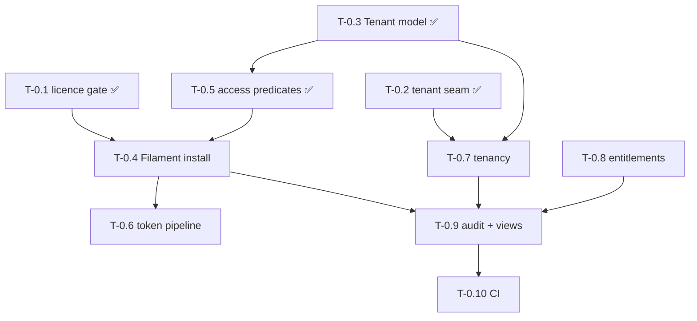

# Proposal 149 — Implementation Plan

**Parent:** [`149-laravel-admin-parity-proposal.md`](./149-laravel-admin-parity-proposal.md)
**Status:** ✅ **WAVE 0 COMPLETE** (2026-11-16) — T-0.1 … T-0.10 done; Q-4 and Q-6 closed, Q-5 open (commercial). ✅ **WAVE 1 CLOSED.** 🟡 **WAVE 2 IN PROGRESS** — **38 numbered slices** (§8–§56) **shipped** and **the Wave 2 exit gate (key rotation + DLQ drain) is met**; §38 is the branding fix rather than a slice, §44–§46 are accounting/planning, **§55 is the admin navigation and table-UX plan — steps 1–6 shipped 2026-11-17, section complete** (six groups; collapsible rail with keyboard-operable disclosure; global search over title/slug/description opening the record's edit action; one shared data table with a caption, sticky header and in-body empty state, now on all fourteen admin data tables; pagination defaults at 25), and **§56 opens Wave 3** with the toolkit manifest renderer (`/admin/toolkits`). The consumer-port run (§48–§54) added **seven surfaces** that were console-only, and each slice opened by asking whether the store behind it was estate data.
**Scoreboard** — re-measured 2026-11-18 with `bin/audit-surface-ownership.php`: **45 surfaces · 33 built on a Filament panel** (11 `/ops`, 23 `/admin`; `settings.platform` is on both) · **29 console-served** · **7 console-only** · **3 planned-only** (`measurement`, `identity-provider`, `datasets`, all `/ops`) · **2 recorded `absent`** (`chat-profiles`, `onboarding`). §14.2 holds the rule this measures against: a console surface is not admin parity.
**Validation** — app suite: **1277 tests / 7243 assertions, 0 failures** (with the `NVOOS_PM_*` fixtures present; four `WifiKpisTest` cases fail without them, a documented environment gap). `PASS Tests\Feature\SurfaceOwnershipTest`. A red run of that gate is a contract break, not a flake.
**Date:** 2026-11-16 · **Header refreshed:** 2026-11-18
**Scope (Wave 0):** ~3–4 weeks, one engineer
**Owner decisions applied:** D-1 (commercial), D-2 (operator + customer), OQ-6 (tenancy in v1), OQ-7 (Pro stays on WP → this is a port), Q-1 (operator = estate flag), Q-2 (licence = per estate)

**What the slices closed.** The cross-tenant settings defect; the "editable
nowhere" gap the settings projection opened; the estate leak in workflow run
history; a cross-tenant revocation path on the live token manager; the console
API's dependency on the `default` estate; and two unscoped stores
(`nvoos_remote_sites` §27, `nvoos_triggers` §29) whose `test` and `fire` actions
reached into other estates. Four rows were also **dispositions** rather than
builds (`chat-profiles`, `onboarding`, `datasets`, `identity-provider`), which is
why the burn-down below is honest rather than merely short.

## Completion log

| Task | State | Evidence |
|---|---|---|
| T-0.1 licence boundary | ✅ done | Gate passes on the clean tree; a planted `extends WP_MCP_AI_Tool_Base` fails it with exit 1; probe removed |
| T-0.2 tenant seam | ✅ done | 7 new tests / 14 assertions green; the wiring test fails when the registrations are removed; full app suite **731 passed / 4,257 assertions (container)**; all three real Octane event objects accepted, tenant cleared for each |
| T-0.3 `Tenant` model | ✅ done | 7 new tests; dev MySQL migrated (default + `nvoos` operator estate, existing user backfilled as `owner`); licence key verified encrypted at rest |
| T-0.5 access predicates | ✅ done | 8 new tests incl. the Q-1 trap (customer estate administrator → `/ops` denied); suite now **746 passed / 4,282 assertions** |
| T-0.4 Filament panels | ✅ done | Filament **5.11**; `/ops` and `/admin` routed (`ops`, `ops/login`, `ops/logout`, `admin`, …); 11 tests; suite now **757 passed / 4,299 assertions** |
| T-0.6 token pipeline | ✅ done | `admin:theme` generator + committed `AdminTheme.php`; drift gate proven to fail on a mutated token; 7 tests incl. WCAG 2.2 contrast; suite now **764 passed / 4,340 assertions** |
| Q-4 status tokens | ✅ closed | `success`/`warning`/`info` added to `core.json` + `semantic.json` + both theme modes; storefront regenerated and green (30/30 token tests); admin palette now fills all six Filament keys |
| T-0.7 panel tenancy | ✅ done | `->tenant(Tenant::class, 'slug', 'tenant')` + `HasTenants` + `SetTenantContext`; guard test replaced by 6 tenancy tests; suite now **771 passed / 4,380 assertions** |
| T-0.8 entitlement | ✅ done | Fixed a **latent outage** (4 in-use feature keys absent from the plan catalogue), `singleton`→`scoped`, `TenantEntitlement` decorator, config seam; suites: app **785 / 4,405**, adapter **286 / 1,534**, core **1,762 / 6,255** |
| T-0.9 audit + views | ✅ done | Append-only `nvoos_admin_audit` (records failures too, redacts credentials at any depth), `nvoos_admin_views` + estate-scoped repository; 15 tests; app suite **800 / 4,449** |
| T-0.10 CI wiring | ✅ done | `admin:theme --check` step + `sync-toolkit-manifests.php --check` step (closes Q-6); both gates proven to fail |

### Wave 0 exit — what is now true

- The commercial admin cannot silently absorb GPL code (licence gate over `docker/**`).
- Tenant state cannot leak across Octane requests or queue jobs.
- An estate is a first-class object with operator status, per-estate licensing and membership.
- Two panels exist with different access predicates, and a customer administrator is provably not an operator.
- The palette is generated from ADS and drift-gated; WCAG 2.2 AA is asserted on every authored pair.
- Entitlement is per estate, `scoped()`, and its vocabulary is gated against the route table and the manifests.
- Every mutating admin action is audited, failures included, with credentials redacted.

Wave 2's first commitment: **no resource ships without a cross-tenant 404 test** — the one T-0.7 exit item that cannot exist until a resource does.

---

## 1. Objective

Stand up a Laravel admin that **cannot** become a legal, security, or
authorization liability later — while building zero business pages.

Wave 0 ships:

1. An enforced licence boundary over `docker/**`.
2. A tenant seam that is safe under Octane.
3. Two panels (`/ops`, `/admin`) with different access predicates.
4. An entitlement service wired into the manifest schema.
5. A design-token pipeline (DTCG → Filament theme) with a drift gate.
6. Two admin tables: audit + saved views.

**Wave 0 delivers no operator value.** It delivers the rails everything else
rides on. If a wave-0 task does not prevent a class of defect, it is out of
scope.

---

## 2. Pre-flight findings

Four things were found while planning that were not visible from the proposal.
**B1 and B2 are blockers** — tenancy must not land before B2 is fixed.

### B1 — The licence boundary does not cover `docker/` 🔴

`bin/check-license-boundary.sh` asserts four trees:

```sh
check_tree "lib/core/src"          "GPL"          "GPL (package is MIT)"
check_tree "includes"              "Proprietary"  "Proprietary (package is GPL)"
check_tree "addons/pro/includes"   "GPL"          "GPL (package is Proprietary)"
check_tree "addons/canvas"         "GPL"          "GPL (package is Proprietary)"
```

`docker/laravel/app-skeleton` is scanned by **nothing**. Decision D-1 makes the
Laravel app commercial, so an import from the GPL `includes/` tree would silently
relicense the whole product. Nothing today prevents it.

**Compounding fact:** `docker/laravel/app-skeleton/composer.json` declares
`"license": "MIT"`. That is the Laravel skeleton default and is now wrong.

### B2 — `TenantContext` is a static with no reset hook 🔴

```php
final class TenantContext
{
    private static ?string $tenantId = null;

    public static function current(): string
    {
        return self::$tenantId ?? Assistant::DEFAULT_TENANT;
    }

    public static function set(?string $tenantId): void { self::$tenantId = $tenantId; }
    public static function forget(): void { self::$tenantId = null; }
}
```

Measured:

| Fact | Evidence |
|---|---|
| `current()` is used at **20+ call sites** | `AssistantController`, `CommandCenterController`, `OrchestrationStatsController`, `BlueprintCatalogue`, `BlueprintInstaller`, `LaravelAssistantService`, `LaravelTeamService` |
| `set()` and `forget()` are **never called** in production code | grep over `app/` returns only `current()` |
| No listener resets it | `config/octane.php` has a `RequestTerminated` block, but nothing touches `TenantContext` |

Today this is harmless: the tenant is always `'default'`. The moment Filament
tenancy (T-0.7) starts calling `set()` per request, the static survives the
request on a long-lived Octane worker and **tenant A's id leaks into tenant B's
queries**. That is a cross-tenant data-leak waiting for a feature to activate it.

This is the same class as the documented Octane gotcha in the
`mcp-ai-wpoos-laravel-runtime` skill ("a bound, not singleton, repository is
rebuilt per request; do not promote stateful readers to singletons or a
long-lived worker serves stale data") — except this one is a static, which
Octane cannot reset for you.

**Fix before any tenancy work.**

### B3 — There is no `Tenant` model 🟡

`app/Models/` holds `Assistant`, `Team`, `TeamMember`, `User`. `tenant_id` is a
plain string column (`Assistant::DEFAULT_TENANT = 'default'`).

Filament's `->tenant()` requires an Eloquent model. Two candidates:

| Option | Fit | Risk |
|---|---|---|
| `Team` as tenant | Model exists | **Wrong domain.** `tenant_id` is estate-level; a customer with two teams would become two tenants, and `team_id` ≠ `tenant_id` in every record |
| New `Tenant` model over the existing `tenant_id` string | Matches `TenantContext` semantics exactly | Needs a table + membership pivot |

**Recommendation: new `Tenant` model.** It is the smallest change that keeps
`tenant_id` meaning what every existing query already assumes.

### B4 — One provider, one panel-less app 🟢

`bootstrap/providers.php` lists only `AppServiceProvider::class`. No Filament,
no Livewire, no admin scaffolding. Clean slate — nothing to unwind.

---

## 3. Task breakdown

Tasks are ordered by dependency. 🔴 = blocker, must land first.

### T-0.1 — Licence boundary over `docker/` 🔴 ✅ DONE

**Landed.** Measured: gate passes on the clean tree,
and a planted `class TmpBoundaryProbe extends WP_MCP_AI_Tool_Base` fails it with
`❌ docker/laravel/app-skeleton couples to the GPL plugin` and exit 1.

**A design correction to this plan:** the first draft of the prefix guard
(`WP_MCP_AI_|includes/admin`) would have failed immediately — the app has 23
files that legitimately mention WordPress in **docblocks** (the port provenance
record, e.g. "Port of `WP_MCP_AI_REST_Okf`") and in **stored meta-key strings**
(`_wp_mcp_ai_team_members`) that must match WordPress for bundle portability.
The gate therefore anchors on keywords that only appear in real code
references (`new`, `extends`, `implements`, `instanceof`, `class_exists`,
`function_exists`, `interface_exists`, `require`/`include … includes/`), which
is clean on today's tree and still catches genuine linkage.

**Files**

- `bin/check-license-boundary.sh` — append after the existing `check_tree` calls:

```sh
# ---------------------------------------------------------------------------
# The Laravel admin is COMMERCIAL (Proposal 149 D-1). It may consume the MIT
# engine (lib/core, lib/laravel-adapter) and nothing else. A single import from
# the GPL includes/ tree would relicense the product.
# ---------------------------------------------------------------------------
check_tree "docker/laravel/app-skeleton/app"         "GPL" "GPL (app is Commercial)"
check_tree "docker/laravel/app-skeleton/config"      "GPL" "GPL (app is Commercial)"
check_tree "docker/laravel/app-skeleton/database"    "GPL" "GPL (app is Commercial)"
check_tree "docker/laravel/app-skeleton/tests"       "GPL" "GPL (app is Commercial)"

# Direction guard: the WordPress-specific prefix must never appear in the app.
check_no_wp_api() {
	local tree="docker/laravel/app-skeleton"
	local offenders
	offenders=$(grep -rlE "WP_MCP_AI_|wp_mcp_ai_|includes/admin" \
		--include="*.php" "$tree/app" "$tree/config" "$tree/database" 2>/dev/null || true)
	if [ -z "$offenders" ]; then
		pass "$tree — no WordPress-prefixed symbols (licence boundary intact)"
	else
		fail "$tree references WordPress symbols — GPL contamination of a commercial tree"
		show_offenders "$offenders"
	fi
}
check_no_wp_api
```

- `docker/laravel/app-skeleton/composer.json` — `"license": "MIT"` → `"proprietary"`.

**Why the prefix guard rather than a blanket `require_tree`:** the tree mixes
Laravel stubs (MIT, no `@license` docblock) with commercial code, so a positive
`require_tree` over the whole tree would fail on the stubs. The prefix guard
tests the thing that actually matters — whether app code reaches into the GPL
plugin.

**Exit gate**

```sh
bash bin/check-license-boundary.sh     # green, and the new lines are exercised
```

Add a deliberate violation locally (paste `WP_MCP_AI_Tool_Base` into a scratch
controller), confirm the gate fails, then revert. A gate never seen to fail is
not a gate.

### T-0.2 — Make the tenant seam Octane-safe 🔴 ✅ DONE

**Landed.** Two reset mechanisms, because they cover disjoint execution modes:

| Mode | Reset | Why it cannot be the other one |
|---|---|---|
| Octane HTTP request | `RequestTerminated` listener | — |
| Octane task / tick worker | `TaskTerminated` / `TickTerminated` listener | These never run HTTP terminating callbacks |
| `queue:work` worker (`oos-laravel-worker`) | `JobProcessed` / `JobExceptionOccurred` in `AppServiceProvider` | A queue worker fires **no** Octane events at all |
| PHPUnit | `Tests\TestCase::setUp()` | Tests run many operations in one process |

**Plan deviation:** this plan originally said "register as `scoped()` in
`AppServiceProvider`". That was written for a hypothetical container service;
the real class is a static facade with 20+ call sites, so converting it would
have touched every consumer for no gain. The static kept its API and gained
lifecycle resets instead — verified by test rather than asserted.

Also added `TenantContext::isPinned()`, because comparing `current()` to
`DEFAULT_TENANT` cannot distinguish "explicitly pinned to default" from "unset"
— and it is the difference the resets care about.

**Verified:**

```
TenantContextIsolationTest      7 tests / 14 assertions   (host PHP)
full app suite (host)         731 tests / 4,255 assertions  ✅
full app suite (container)    731 tests / 4,257 assertions  ✅  (php artisan test)
phpcs phpcs-laravel.xml.dist   818 files, 0 errors 0 warnings ✅
```

Removing the three `config/octane.php` registrations fails
`test_every_octane_termination_event_is_wired` with
"RequestTerminated must reset the tenant context or Octane leaks it across
operations" — the gate was seen to fail.

**Live Octane validation (run in `oos-laravel-app`):** the real event objects
were constructed and handed to the listener. Reflection shows why the handler
is typed `object` and not one event class — the three constructors have
different arities:

| Event | Constructor |
|---|---|
| `RequestTerminated` | `(Application $app, Application $sandbox, Request $request, Response $response)` |
| `TaskTerminated` | `(Application $app, Application $sandbox, $data, $result)` |
| `TickTerminated` | `(Application $app, Application $sandbox)` |

A listener typed to `RequestTerminated` could not be registered against
`TickTerminated`; a typed union would break on the next Octane minor. The
untyped handler accepts all three, and the tinker run confirmed the pin is
cleared for each:

```
RequestTerminated -> pinned=no
TaskTerminated    -> pinned=no
TickTerminated    -> pinned=no
```

Still **not** proven: a live end-to-end pin/unpin through Octane over HTTP.
Nothing calls `set()` yet (that is T-0.7), so the behaviour is verified at the
listener boundary. Re-run an HTTP smoke after T-0.7 lands.

**Files****

- `docker/laravel/app-skeleton/app/Support/TenantContext.php`

Keep the public API (`current` / `set` / `forget`) so the 20+ call sites do not
change. Two mechanisms, **both**:

```php
/**
 * Resolves the active tenant for this request.
 *
 * Octane reuses the worker across requests, so the tenant MUST be reset on
 * request termination. Two layers:
 *   1. scoped() — the container drops the instance between requests.
 *   2. the Octane RequestTerminated listener in config/octane.php — belt and
 *      braces for queue jobs and any code path holding a stale reference.
 */
```

- Register as `scoped()` in `AppServiceProvider` (not `singleton`).
- `config/octane.php` — add to the `RequestTerminated` listener array:

```php
RequestTerminated::class => [
    // ... existing entries ...
    \App\Listeners\ForgetTenantContext::class,
],
```

- New `app/Listeners/ForgetTenantContext.php` calling `TenantContext::forget()`.

- `docker/laravel/app-skeleton/tests/Feature/TenantContextIsolationTest.php`:

```php
public function test_tenant_does_not_leak_between_requests(): void
{
    TenantContext::set('tenant-a');
    $this->get('/api/v1/features')->assertOk();

    // simulate Octane request termination
    event(new RequestTerminated(
        $this->app, $this->app['request'], $this->app['response']
    ));

    TenantContext::set(null);
    $this->assertSame(Assistant::DEFAULT_TENANT, TenantContext::current());
}
```

**Exit gate**

The isolation test fails before the fix and passes after. Verify by commenting
out the listener.

### T-0.3 — `Tenant` model + membership 🟡 ✅ DONE

Carries the Q-1 decision: **operator status is a property of the estate**, so
`is_operator` ships in the first migration rather than as a later `users` column.

**Files**

- `database/migrations/*_create_tenants_table.php` — `id` (string, PK), `name`,
  `slug` (unique), **`is_operator`** (bool, default false, indexed),
  **`licence_key`** (nullable string), **`plan`** (nullable string, validated
  against `ProPlanCatalog`), timestamps. Guarded by `Schema::hasTable`.
- `database/migrations/*_create_tenant_user_table.php` — `tenant_id`, `user_id`,
  `role` (reuses `CapabilityMap::TEAM_ROLES` vocabulary), unique pair.
- `app/Models/Tenant.php` — `users()`, `assistants()`, `isOperator()`,
  `scopeOperators()`.
- Backfill, guarded and idempotent:
  - one `'default'` tenant (`is_operator = false`) so existing `tenant_id`
    values keep resolving;
  - attach every existing user to it as `owner` (otherwise the first deploy
    leaves the existing operator locked out of `/admin`);
  - **exactly one** operator tenant, `slug = 'nvoos'`, created only when the
    environment is not production — production seeds it manually so a deploy
    cannot manufacture an operator estate.

**Exit gate**

Fresh SQLite (CI engine) and the existing dev DB both migrate; every pre-existing
assistant/team still resolves through `TenantContext::current()`; exactly one
tenant has `is_operator = true` in local/testing.

### T-0.4 — Filament + Livewire install 🟢 ✅ DONE

**Landed.** Filament **5.11** (installed in the container — the vendor tree is a
Docker volume — then `composer.json` + `composer.lock` copied back to
`app-skeleton`, which stays the source of truth).

| Panel | id | Path | Routes |
|---|---|---|---|
| Vendor | `operator` | `/ops` | `ops`, `ops/login`, `ops/logout` |
| Customer (default) | `admin` | `/admin` | `admin`, `admin/login`, `admin/logout` |

`User` now implements `FilamentUser`; `canAccessPanel(Panel)` **delegates** to
`AdminAccessPolicy::accessPanel($this, $panel->getId())` — the policy remains the
only definition, and an unregistered panel id fails closed.

**Three decisions made while implementing:**

1. **Resource namespaces are separate** — `App\Filament\Operator\*` vs
   `App\Filament\Admin\*`. A shared discovery path would let an operator
   surface render in the customer panel, which is a privilege leak rather than
   a styling bug.
2. **An operator reaches BOTH panels.** The first test run failed asserting the
   opposite, and the test was wrong, not the policy: an operator is a member of
   the operator estate, and the proposal's rule for `/admin` is "tenant member
   with >= manager". `/ops` is the *extra* privilege on top. Pinned by
   `test_operator_status_is_what_separates_the_two_panels`, which asserts the
   two users differ on the **estate flag alone** with identical `users.role`.
3. **Tenancy is deliberately still off.** `->tenant()` is T-0.7. Until then the
   customer panel must register **no resources**, because an unscoped resource
   reads every estate's rows. `test_the_customer_panel_registers_no_resources_until_tenancy_lands`
   fails the moment one is added — a forcing function, deleted in the same
   commit that enables tenancy.

**Deploy fix:** Filament's CSS/JS are build output published into
`public/` (gitignored), so a fresh checkout renders unstyled panels.
`docker/laravel/entrypoint.sh` now runs `filament:assets` once per checkout,
guarded on the presence of `public/css/filament/filament/app.css`.

**Operational note — adding a panel needs `octane:reload`, not just
`optimize:clear`.** After the providers landed, `/admin/login` returned **404**
while `/ops/login` returned 200, with both routes present in `route:list`. The
running Octane worker held the route table from before the panels existed;
`optimize:clear` clears *file* caches and does not touch a warm worker. After
`octane:reload`, all four routes answered correctly:

```
/ops/login     200
/admin/login   200
/admin   (guest) 302 -> /admin/login
/ops     (guest) 302 -> /ops/login
```

This is the same class as the documented stale-route symptom on Velocity — when
a route exists in `route:list` but 404s over HTTP, suspect the warm process.

**Sync-check caveat:** `diff -rq app-skeleton/bootstrap app/bootstrap` will
always report `bootstrap/cache/{packages,services}.php` as differing — those are
generated caches (only `.gitignore` is tracked there), not source. The
skeleton→runtime copy should take `bootstrap/providers.php` and
`bootstrap/app.php` explicitly rather than the whole directory.

**Exit gate met:** guest → `/ops` redirects to `/ops/login`; customer estate
administrator → `/ops` **403**; operator → `/ops` 200; manager → `/admin` 200;
viewer → `/admin` 403.

**Files**

- `composer.json` — add `filament/filament` (pin the major).
- `app/Providers/Filament/OperatorPanelProvider.php`
- `app/Providers/Filament/AdminPanelProvider.php`
- `bootstrap/providers.php` — add both.

Panel config, both:

```php
->id('operator')                // or 'admin'
->path('ops')                   // or 'admin'
->authGuard('web')
->login()
->colors([...])                 // generated from DTCG — see T-0.6
->middleware([...])             // web + auth + the admin audit middleware
```

`AdminPanelProvider` additionally:

```php
->tenant(Tenant::class)
->tenantMenu(true)
```

**Exit gate**

`php artisan about` lists Filament; `GET /ops` redirects to the Filament login;
`GET /admin` 404s for an unauthenticated user.

### T-0.5 — Access predicates 🟢 ✅ DONE

**Plan deviation:** the plan specified `canAccessPanel(Panel $panel)` on `User`.
`Panel` is a Filament class and Filament is not installed until T-0.4, so this
task implemented the **predicates** in `AdminAccessPolicy` — the part Q-1
decides and the part that must be tested — and left the one-line Filament
adapter for T-0.4. The model method must delegate to the policy rather than
re-implement it, or the two will drift.

Resolved by Q-1: **there is no `users.is_operator`.** Operator access is
membership in the estate whose `tenants.is_operator` is true.

**Files**

- `app/Models/User.php` — `canAccessPanel(Panel $panel): bool`
- `app/Policies/AdminAccessPolicy.php`

```php
public function canAccessPanel(Panel $panel): bool
{
    return match ($panel->getId()) {
        // NV staff. Never tenant-scoped: the operator must see every estate.
        // Operator-ness is a property of the ESTATE (tenants.is_operator), not
        // of the person — a customer's estate administrator is an
        // administrator and must never qualify.
        'operator' => $this->isOperatorMember()
                      && CapabilityMap::has($this, 'manage_options'),

        // Customer estate member with at least manager on an estate they
        // belong to. Viewer is read-only, so the panel is refused entirely.
        'admin'    => $this->tenantMemberships()
                          ->where('role', '!=', 'viewer')
                          ->exists(),

        default    => false,
    };
}

private function isOperatorMember(): bool
{
    return $this->tenants()->where('tenants.is_operator', true)->exists();
}
```

**Four tests, and the fourth is the one that matters:**

| Case | Expect |
|---|---|
| customer estate administrator → `/ops` | **403** (the trap Q-1 exists to prevent) |
| operator-tenant owner → `/ops` | 200 |
| tenant viewer → `/admin` | 403 |
| tenant manager → `/admin` | 200 |

**Exit gate**

The four cases pass, and `isOperatorMember()` is asserted to read the **tenant**
flag — a test that sets `users.role = 'administrator'` on a customer-estate user
must still 403 on `/ops`.

### T-0.6 — Token pipeline: DTCG → Filament theme 🟢 ✅ DONE

**Q-3 answered by the exporter itself:** the NDS document does **not** carry
the semantic layer Filament needs. `examples/nvoos-astro-velocity/mcp/tools/ops.ts`
→ `ADS_UNMAPPED` records that NDS has no on-accent text token, no error/danger
token and no composite shadow token, so `accent-ink`, `danger` and `focus-ring`
are reported as unmapped on every export. All three exist in ADS.

**Therefore the admin reads ADS directly and never round-trips through NDS** —
round-tripping would lose exactly the danger colour and focus ring an admin
cannot do without. That is §10's "fourth consumer, never a fourth definition"
applied literally.

**Landed as PHP, not Node.** The Laravel CI job (`laravel-app.yml`) runs
`php artisan test` on SQLite and has no npm step, so a Node generator would
have needed a new CI job. A pure PHP generator keeps the drift gate inside the
existing suite.

| Piece | File |
|---|---|
| Generator (pure, no container) | `app/Support/AdminThemeGenerator.php` |
| Command (`admin:theme`, `--check`) | `app/Console/Commands/AdminThemeCommand.php` |
| Generated, committed artefact | `app/Support/AdminTheme.php` |
| Drift + WCAG gate | `tests/Feature/AdminThemeDriftTest.php` |
| Token location | `config/oos.php` → `oos.admin_theme.tokens_path` |

**Resolution:** light theme wins, then the semantic layer, with `{core.*}`
references resolved recursively (`focus-ring` resolves both of its references).
`$`-prefixed keys are skipped — treating them as tokens is the leak that cost
the storefront token build a fix (Proposal 095).

**Measured palette:**

```
primary #0f6b4f (accent)   danger #b3261e   gray #6b6b6b (muted)
MISSING: success, warning, info
```

**The gap is reported, never invented.** ADS is an editorial palette — brand,
ink and one error colour; it has no success/warning/info token. The generator
omits them so Filament falls back to its own palette, and reports them at build
time. Closing the gap means adding the tokens to `core.json`/`semantic.json`
(one definition, four consumers), not picking hexes in the generator. Flagged
for the owner as a design decision.

**Bootstrap chicken-and-egg:** the panel providers reference the generated
class, so the app cannot boot to run the command that generates it. The
generator has no dependencies, so the artefact is bootstrapped once by
instantiating it directly (`php -r 'require …; (new AdminThemeGenerator($path))->php()'`).
Anyone regenerating later uses the command.

**Container path gotcha:** `/app` is a bind mount, so `/app/../../../` is `/`,
not the repo — a bind mount does not preserve the host path. The container
mounts the repo at `/workspace/oos`, so `NVOOS_TOKENS_PATH` is set in the
compose file's shared environment anchor. The config default
(`base_path('../../../examples/…')`) stays correct for a normal checkout and
for CI.

**Exit gate met:** with the token file mutated to `#0a5c43`, both
`php artisan admin:theme --check` and the Pest test fail; restored, both pass.
The five authored pairs pass WCAG 2.2 AA (ink/muted/danger on surface 4.5:1,
accent-ink on accent 4.5:1, line-strong on surface 3:1).

**Not done (deliberately):** dark mode. The generator resolves `light` only;
dark is a follow-up that must reuse the same generator rather than fork it.

**Files**

- `bin/build-admin-theme.mjs` (or a PHP artisan command) — read the NDS/ADS
  DTCG document, emit `resources/css/filament/admin/theme.css` with the
  semantic layer as CSS custom properties, mapped onto Filament's palette keys.
- `bin/check-admin-theme.mjs` — fail if the source DTCG changed without
  regeneration (the `check:tokens` precedent from the storefront).
- A Pest test asserting the compiled theme's semantic values equal the DTCG
  source.

**Exit gate**

`npm run build:admin-theme && npm run check:admin-theme` green; changing a DTCG
colour without regenerating fails the check.

### T-0.7 — Enable tenancy on the admin panel 🟡 ✅ DONE

**Landed.** `/admin` is now estate-scoped; `/ops` deliberately is not.

| Piece | Detail |
|---|---|
| Panel | `->tenant(Tenant::class, 'slug', 'tenant')` |
| Tenant resolution | `User implements HasTenants` — `getTenants()` and `canAccessTenant()` |
| Context bridge | `App\Http\Middleware\SetTenantContext` via `->tenantMiddleware([...], isPersistent: true)` |
| Ownership relations | `Assistant::tenant()`, `Team::tenant()` (`belongsTo` on `tenant_id`) |

**Three details that are load-bearing, not stylistic:**

1. **`ownershipRelationship: 'tenant'` is the scoping contract.** Filament
   resolves it to `whereBelongsTo($tenant, 'tenant')` on each resource model.
   The default (plural `tenants`) would look for a belongsToMany and match
   nothing. The `BelongsTo` + `tenant_id` shape is asserted by
   `test_tenant_scoped_models_declare_the_ownership_relationship`.
2. **`SetTenantContext` is the point of the whole task.** Every assistant and
   team query already reads `TenantContext::current()`; nothing had ever called
   `set()`. Filament resolving a tenant is useless until it reaches that seam.
3. **`canAccessTenant()` fails closed on `viewer`.** There is no read-only
   enforcement inside Filament resources yet, so admitting a viewer would hand
   them write actions. Relax to plain membership in the same change that adds
   per-action ability checks.

**Route table after the change:**

```
GET  admin                  filament.admin.tenant       (RedirectToTenantController)
GET  admin/{tenant}         filament.admin.pages.dashboard
GET  admin/login            filament.admin.auth.login
```

**Exit gate — partly deferred by necessity:** the original gate was "a Pest
test per tenant-aware resource: tenant A reading tenant B gets 404". There are
no resources yet, so cross-tenant *record* isolation cannot be tested. What is
pinned: the panel is scoped, the operator panel is not, `/admin/{other-estate}`
returns 404 for a non-member, `getTenants()` omits viewer memberships, and the
middleware pins the resolved estate. **The per-resource 404 tests are the first
item of Wave 2**, and no resource may ship without one.

**Test replaced, not deleted:**
`test_the_customer_panel_registers_no_resources_until_tenancy_lands` existed to
fail when a resource was added before scoping. Scoping now exists, so the guard
became `test_only_the_customer_panel_is_tenant_scoped` +
`test_tenant_scoped_models_declare_the_ownership_relationship`.

### T-0.8 — Entitlement service 🟢 ✅ DONE

**This task was not what the plan predicted.** The plan assumed an
`Entitlements` service had to be built. `LicensedProEntitlement` already
existed and was complete — the real defects were elsewhere, and one of them was
an outage waiting for the first licensed install.

**Defect 1 — a licensed install would deny its own Pro surface (critical).**
Three vocabularies disagreed:

| Vocabulary | Values in use | In `ProPlanCatalog`? |
|---|---|---|
| Route middleware `pro.entitlement:*` | `schedules`, `records` | **no** |
| Toolkit manifest `feature` | `commerce`, `documents` | **no** |
| Plan catalogue | 12 compliance features | — |

Measured before the fix: all four returned `false` for **every** plan,
including `enterprise`. The `allow` dev driver masks it completely; the first
`license` or `config` deployment would have 402'd the entire Pro surface.

*Fix:* the four keys are now in every plan, placed in `compliance` (the base)
because that **preserves pre-fix behaviour** — any other placement would have
silently changed what a customer gets. Re-tiering is a commercial decision,
logged as **Q-5**.

*Durable guard:* `test_every_route_gated_feature_exists_in_the_plan_catalogue`
walks the live router's `pro.entitlement:*` middleware and
`test_every_manifest_feature_exists_in_the_plan_catalogue` walks
`ToolkitManifestLoader::all()`. Both fail if a feature is gated without being
entitled — the exact check that would have caught this at review time. Verified
to fail by deleting `records` from the base plan.

Also added to `ProPlanCatalogTest`:
`testEachPlanContainsEveryFeatureOfTheSmallerPlans` — the plan lists are
cumulative **by repetition**, so a feature added to one list and not the next
silently downgrades the larger plan.

**Defect 2 — `singleton()` pinned the first estate for the worker's life.**
`ProEntitlementInterface` was bound `singleton()`; per-estate resolution on top
of that is impossible. Now `scoped()`, which Octane actually flushes
(`FlushTemporaryContainerInstances` → `forgetScopedInstances()`). Pinned by
`test_the_binding_is_scoped_so_it_is_flushed_between_operations`
(`forgetScopedInstances()` must yield a different instance).

**Defect 3 — nothing resolved a licence per estate.** New
`App\Support\TenantEntitlement` decorator:

| Estate state | Resolution |
|---|---|
| Has `tenants.licence_key` | licence server, **regardless of the install driver** |
| No key | install driver from `oos.pro_entitlement` |

The estate wins because the install driver describes the **host** (a dev box is
`allow`) while the key describes the **customer**. A customer estate must never
inherit a permissive host default. Pinned by
`test_an_estate_licence_overrides_a_permissive_install_driver`: with driver
`allow` + a key + no licence server, `source()` is `license` and `allows()` is
**false** — proving the key took effect by failing closed.

**Defect 4 (found by the suite) — entitlement became a database dependency.**
The decorator added a hard `tenants` lookup, and `/api/v1/features` calls
`plan()` on every request. Two suites (`ConnectedAppsTest`,
`EndpointCapabilitiesTest`) deliberately run without migrations → 9 failures
with "no such table: tenants". Guarded with a memoised `Schema::hasTable()`;
a missing table degrades to the install driver (which still honours `deny`).
`EntitlementWithoutEstateTableTest` runs with no migrations and pins it.

**Config seam (was missing entirely).** `config('oos.pro_entitlement')` had no
home in the shipped config file, so the runtime was permanently on `allow` and
could not be configured without publishing the file by hand. Added to
`lib/laravel-adapter/config/nvoos.php` with `NVOOS_PRO_*` env wiring, and
documented in `.env.example`.

**Shared construction.** `ProEntitlementFactory` (adapter, MIT) is now the one
place a driver is built from config, used by both the package binding and the
app decorator — a second copy would drift the moment an option is added.

**Plan correction:** the planned `RequiresEntitlement` middleware and
`requires`/`requires_tier` manifest fields already existed in another form.
`EnsureProEntitlement` (alias `pro.entitlement`) is applied to the Pro route
groups, and `ToolkitManifest::feature()` is the declared entitlement hook —
it was simply never validated against the catalogue. Building either would have
created a second, competing mechanism.

**Exit gate met:** gated route 402s under `deny` (`error.code:
pro_entitlement_required`, `error.feature: records`) and 200s under `allow`;
both completeness gates pass and were seen to fail when the catalogue was
mutated.

### T-0.9 — Admin audit + saved views tables 🟢 ✅ DONE

| Piece | File |
|---|---|
| Append-only audit | `nvoos_admin_audit` (no `updated_at`, insert-only writer) |
| Saved views | `nvoos_admin_views` + `AdminSavedView` + `SavedViewRepository` |
| Writer + redaction | `App\Support\Admin\AdminAuditLogger` |
| Middleware | `App\Http\Middleware\AuditAdminRequests` on **both** panels |

**Schema corrections from the plan.** The planned `resource` / `record_id` /
`action` / `before` / `after` columns assume record-level diffs, which need
model events — and no resources exist yet. Writing them now would be a column
set that never fills. The shipped shape records what a request-level audit can
honestly capture: `panel`, `method`, `path`, `route`, `status`, `payload`,
`ip`, `created_at`. **Per-record before/after lands with the first resource in
Wave 2**, where model events exist.

**`user_id` is deliberately not a foreign key.** A cascading delete would erase
the record of what a removed user did — the exact case an audit trail exists to
answer.

**Two behaviours worth naming:**

1. **Failures are recorded.** An exception unwinds *past* this middleware
   before Laravel renders it, so the catch branch records the status the
   exception will become and rethrows. Without it, every rejected write would
   be invisible — the half of the trail that matters during an incident.
2. **Livewire transport is excluded.** Filament renders forms as Livewire
   components, so their traffic is POSTs to `/livewire/update`. Auditing them
   would bury the actions in UI mechanics.

**Redaction is structural.** Any payload key containing a credential fragment
(`password`, `secret`, `token`, `credential`, `authorization`, `api_key`,
`licence_key`, `private_key`) is replaced at any nesting depth. Substring
matching over-redacts (`max_tokens` matches `token`) and that is the intended
trade: an over-redacted log is an inconvenience, an under-redacted one is an
incident. Verified by posting a payload containing `SUPER-SECRET-VALUE`,
`hunter2` and `PRO-KEY` and asserting none reaches the row.

**Estate scoping:** a saved view belongs to (estate, user, resource, name); the
same user on another estate starts empty, which is what "views for THIS
customer's table" has to mean. Operator actions record `tenant_id = null`
because the operator panel belongs to no single estate.

**Exit gate met:** exactly one row per mutating request (POST/PUT/PATCH/DELETE),
none for reads, failures recorded with status, and no credential in any row.

### T-0.10 — CI wiring 🟢 ✅ DONE

| Job | Addition |
|---|---|
| Licence boundary (`license-boundary.yml`) | already runs the script — the `docker/**` checks from T-0.1 come free |
| `App suite (SQLite)` (`laravel-app.yml`) | all new tests run automatically |
| New step: **Admin theme is current** | `php artisan admin:theme --check` — names the fix, before the suite |
| New step: **Toolkit manifest mirror is current** | `php bin/sync-toolkit-manifests.php --check` — closes **Q-6** |

**Why a separate step when `AdminThemeDriftTest` already covers it:** the test
reports a failed assertion; the step reports `Admin theme is OUT OF DATE with
the design tokens. Run: php artisan admin:theme`. Same gate, actionable error.

**Q-6 closed with the existing pattern.** `laravel-app.yml` already gates two
other committed mirrors (`sync-blueprints.php`, `sync-schedule-presets.php`),
so `bin/sync-toolkit-manifests.php --check` follows the same contract rather
than inventing one. It also reports **orphaned** manifests — one that left the
addon but stayed in the mirror would otherwise keep serving a toolkit that no
longer exists.

**Both new gates were seen to fail:**

```
# toolkit mirror drift
$ printf '{}' >> resources/pro-toolkits/commerce.json
$ php bin/sync-toolkit-manifests.php --check
sync-toolkit-manifests: stale: commerce.json      # exit 1

# admin theme drift (mutated ADS token)
$ php artisan admin:theme --check
Admin theme is OUT OF DATE with the design tokens. # exit 1
```

**CI path check:** `laravel-app.yml` runs from `docker/laravel/app-skeleton`, so
`base_path('../../../examples/…')` resolves to the repo root — the token default
needs no CI override (only the container needs `NVOOS_TOKENS_PATH`, because a
bind mount does not preserve host paths).

---

## 4. Sequencing



**Done:** T-0.1, T-0.2 (day 1, blockers), then T-0.3 + T-0.5 together once Q-1
settled — the policy predicates are testable without Filament, and T-0.4 now
binds them rather than defining them.

---

## 5. Test plan (Wave 0 baseline)

| Suite | Test | Asserts |
|---|---|---|
| Feature | `TenantContextIsolationTest` | No tenant bleed across simulated requests |
| Feature | `PanelAccessTest` (4 cases) | `/ops` = staff; `/admin` = tenant manager |
| Feature | `TenantIsolationTest` (per resource) | Cross-tenant read → 404 |
| Feature | `EntitlementGateTest` | Unlicensed → 404; licensed → 200 |
| Feature | `AdminAuditTest` | One row per mutation; no secret in the row |
| Unit | `AdminThemeDriftTest` | Compiled theme == DTCG source |
| E2E | `admin-foundation.spec.ts` | Two audiences; theme toggle; audit line visible |

**Baseline discipline:** record the counts you actually saw (the repo rule —
"CI proving 'not broken' is weaker evidence than a count you actually saw").
Current app baseline is 694 passed / 4,070 assertions; Wave 0 should add ~15
tests without changing that number downward.

---

## 6. Rollback

Every task is additive:

| Task | Rollback |
|---|---|
| T-0.1 | revert the script + composer licence field |
| T-0.2 | the listener is inert without `set()`; safe to leave |
| T-0.3 | migrations are additive with a backfill; `down()` drops |
| T-0.4 | remove the two providers from `bootstrap/providers.php` |
| T-0.7 | remove `->tenant()` — panels still work, single-tenant |

No task mutates an existing column, so no data migration is irreversible.

---

## 7. Out of scope (Wave 0)

- Any business page (that is Wave 2+).
- The React canvas bundle (Wave 6).
- Manifests beyond the `requires` schema addition (Wave 3).
- WordPress reading manifests (Wave 3, per OQ-5).
- White-label theming (OQ-8).
- The packaging/capability matrix that OQ-7 needs commercially — **still
  required before Wave 3**, but it does not block Wave 0.

---

## 8. Open items carried forward

| # | Question | State |
|---|---|---|
| Q-1 | How is "NV operator staff" identified today? | ✅ **Resolved** — see below |
| Q-2 | Where does the licence live per estate? | ✅ **Resolved** — see below |
| Q-3 | Does the NDS DTCG export include the semantic layer Filament needs? | ✅ **Resolved** — NDS drops `accent-ink`/`danger`/`focus-ring`; the admin reads ADS directly (T-0.6) |
| Q-4 | Add `success`/`warning`/`info` to the ADS palette? | ✅ **Closed (2026-11-16)** — added to `core.json` + `semantic.json` + both theme modes; storefront regenerated and green; admin fills all six Filament keys |
| Q-5 | Which plan should `schedules`/`records`/`commerce`/`documents` sit in? | Open — placed in **`compliance`** to preserve pre-fix behaviour; re-tiering is a commercial decision |
| Q-6 | Toolkit manifests are duplicated (`resources/pro-toolkits/` ↔ `addons/pro/includes/toolkits/manifests/`) | ✅ **Closed (2026-11-16)** — `bin/sync-toolkit-manifests.php --check` wired into `laravel-app.yml`, proven to fail on drift and on orphans |

### Q-1 — Operator identity ✅ RESOLVED

**The search:** no operator marker exists. `is_operator`, `isOperator`,
`is_staff`, `operator_staff` return **zero hits** across `app/`, `database/`
and `routes/`. The only identity facts in the schema are:

| Fact | Where | Values |
|---|---|---|
| Site role | `users.role` (092-g) | `subscriber`…`administrator`, with legacy `'admin'` normalised at read time |
| Team role | `team_members.role` | `owner`, `admin`, `manager`, `member`, `viewer` |
| Tenant | `TenantContext` (static) | flat string, always `'default'` today |
| Plan | `ProPlanCatalog` | `compliance`, `professional`, `enterprise` |

The dev database holds exactly one user (`spike@example.com`, `role='admin'`),
so "operator" has never needed a marker — the operator was simply the only
human. That is why the question surfaced only now.

**Rejected options:**

| Option | Why not |
|---|---|
| `users.role = 'operator'` (6th site role) | `CapabilityMap::ROLES` is deliberately WordPress's five-role set so the console cannot tell the runtimes apart. A sixth role leaks into `Gate::before`, the nav matrix and the `/features` capability payload |
| `users.is_operator` boolean | It answers a *per-person* question, but the entitlement it gates is *per-estate*. You would still need an operator tenant to hold the platform licence, so the column buys nothing over the tenant flag and adds a second source of truth |
| Derive from `role === 'administrator'` | **The trap.** A customer's estate administrator is an administrator. This is exactly how a customer ends up inside `/ops` |
| Separate `operator_staff` table | Over-engineered for a handful of people |

**Decision: operator status is a property of the estate.**

`tenants.is_operator` (boolean, exactly one row true) + membership in it with
`manage_options` ⇒ `/ops` access. This lands in T-0.3 (the tenant model) so the
column exists from the first migration.

Why it composes where the alternatives do not:

1. **It reuses T-0.3 instead of adding a parallel concept** — one boolean on a
table being created anyway.
2. **`/ops` still needs a tenant.** Entitlement, licence and audit are
   estate-scoped, so even a `users.is_operator` design needs an operator
   estate. The tenant flag *is* that estate.
3. **It fails closed for customers by construction.** A customer estate has
   `is_operator = false`; no predicate on `users.role` can accidentally grant
   `/ops`.
4. **Cross-estate visibility becomes expressible.** An operator needs to read
   every estate; that is a separate `cross_tenant` ability granted by operator
   membership, not a side effect of being an administrator somewhere.

### Q-2 — Licence location ✅ RESOLVED

Per estate, not per install: `tenants.licence_key` + `tenants.plan`, resolved
through the **existing** `ProEntitlementInterface`.

**What already exists (and changes T-0.8):**

- `Nvoos\Laravel\Adapter\LicensedProEntitlement` is a complete licence-server
  client — fail-closed, stale-while-error, cache key hashed over
  (server, instance, product, key), explicit operator overrides.
- `Nvoos\Core\Domain\Service\Entitlement\ProPlanCatalog` is the shared
  plan → feature table, read by both runtimes.
- Config seam: `oos.pro_entitlement.{driver,license_key,server_url,instance_id,product,features,ttl,…}`,
  merged from `lib/laravel-adapter/config/nvoos.php` under the `oos` key.

Measured current state in the dev container: `ProEntitlement`, `plan=compliance`,
`source=allow` — the documented fail-open dev driver, and there are **no
entitlement env vars** in `.env.example`, so the only way to configure it is an
app-level config file.

**So T-0.8 is not "build an Entitlements service"** — that would duplicate
`LicensedProEntitlement`. It is:

1. make resolution tenant-aware (read the tenant's licence, not the install's),
2. add the missing config seam (`nvoos.php` has no `pro_entitlement` block and
   no `env()` wiring, so an install cannot configure it at all), and
3. **fix the singleton.**

> ⚠️ `ProEntitlementInterface` is bound as `$this->app->singleton(...)`
> (`NvoosServiceProvider`, ~line 163). Under Octane that is the *same bug class
> as `TenantContext`*: the first tenant to resolve an entitlement pins the
> instance for the life of the worker, and every later tenant reads another
> estate's plan. Making entitlement tenant-aware **requires** `scoped()`, or the
> fix ships a billing-correct but access-wrong system.

**Consequence for §5:** the `/ops` panel's entitlement is the operator estate's
(vendor) licence; a customer's `/admin` panel reads theirs. The same
`ProPlanCatalog` answers both.

---

## 8. Wave 2 — first slice: estates and licences (`/ops`)

**State:** shipped 2026-11-16, ahead of the rest of Wave 2. It exists to prove
the spine (panel → policy → resource → observer → audit) once, on a surface with
no console equivalent, before twenty more pages copy the pattern.

### 8.1 Why this surface first

Wave 2's `/admin` list (assistants, teams, professions, chat profiles, memory,
media, transcripts, tool catalogue) is **already built** — in the Complete
Console's 39 feature areas. Porting those to Filament first would maintain one
page twice, in two UIs, for no new capability. `/ops` is the opposite: licences,
key rotation, DLQ and device health have no console page, and licences are the
commercial spine (D-1/D-2). Estates won because they already had a store
(`tenants`, T-0.3), an entitlement path (T-0.8) and a policy (T-0.5).

### 8.2 What shipped

| Piece | Path | Note |
|---|---|---|
| Resource + page | `app/Filament/Operator/Resources/Estates/{EstateResource,Pages/ManageEstates}.php` | `/ops/estates`; list + edit modal |
| Policy | `app/Policies/TenantPolicy.php` | Operator-only; `create`/`delete` denied outright |
| Record-level audit | `app/Observers/TenantObserver.php` | The T-0.9 debt, filled the moment a resource existed |
| Audit columns | `database/migrations/2026_11_16_130000_add_record_columns_to_admin_audit.php` | `resource`, `record_id`, `action`, `before`, `after` + composite index |
| Logger | `AdminAuditLogger::recordResource()` | Same structural redaction as request payloads |
| Model hardening | `Tenant::$hidden = ['licence_key']` | The `encrypted` cast protects the DB, not `toArray()` |

### 8.3 Decisions worth keeping

- **Two row kinds in `nvoos_admin_audit`.** `resource IS NULL` is a request row
  (middleware, "who tried"); `resource` set is a record row (observer, "what
  changed"). A resource write produces one of each. A bulk action cannot be
  represented by a single request row, which is why the diffs are not folded
  into it.
- **No actor, no audit row.** Console seeds and queue jobs mutate estates with
  nobody signed in; a row with `user_id = null` would name an action nobody
  took. Those writes are covered by `updated_at`.
- **`is_operator` is not a form field.** Granting `/ops` is a deploy decision; a
  mistyped form must not be able to hand a customer the vendor panel. Pinned by
  a test that posts `is_operator: true` and asserts it is ignored.
- **The licence key is write-only.** A password input hides characters, not the
  value: it is still in the HTML and in Livewire's snapshot. The field is
  blanked via `afterStateHydrated()` and dehydrates only when re-typed, and the
  table column is computed (`Set` / `Not set`) rather than bound to the column.
  Two tests assert neither the list nor the edit modal contains the canary.
- **`plan` is metadata, not authorization.** `TenantEntitlement` resolves from
  `licence_key` (→ the licence driver) and never reads `tenants.plan`, so the UI
  says so in the field's helper text rather than implying the label grants
  features.

### 8.4 Deliberately not done

- **No create / no delete.** An estate is an authorization boundary;
  provisioning also seeds the first membership. Deleting one would orphan every
  assistant and team scoped to its `tenant_id`.
- **No licence verification action.** It needs the licence-server round-trip and
  a cache-busting story; the entitlement path already has its own suites.
- **The cross-tenant 404 commitment is still open.** T-0.7 deferred it because no
  tenant-scoped resource existed; this slice is on the *operator* panel, which
  is not tenant-scoped. It lands with the first `/admin` resource, and no
  `/admin` resource may ship without it.

### 8.5 Validation record (2026-11-16)

- `php artisan test --filter=OperatorEstatesTest`: **12 passed / 44 assertions**
  — operator 200, customer administrator 403, guest redirect to `/ops/login`,
  the key absent from both the list and the mounted edit form, key set and
  encrypted at rest, blank field preserving the stored key, a record-level audit
  row with `[redacted]` licence, no row without an actor, `is_operator`
  ignored, policy denies create/delete and refuses the customer.
- Full app suite: **814 passed / 4,497 assertions** (was 802 / 4,453; +12
  tests), run in a one-off container over `docker/laravel/app` on SQLite
  in-memory with the compose env (`NVOOS_TOKENS_PATH`, PM fixtures) — the shape
  of CI's `App suite (SQLite)` job.
- `phpcs --standard=phpcs-laravel.xml.dist --error-severity=1
  --warning-severity=8` over the skeleton: **264 files, 0 errors**.

### 8.6 Next slice

One `/admin` resource (tenant-scoped) carrying the deferred cross-tenant 404
test, so the commitment in §8.4 is discharged before the surface count grows.
After that, `/ops` continues with key rotation and the DLQ manager — both
already have services (`AuthProvider::issueCredential()`,
`OperationsController`) to reuse rather than reimplement.

---

## 9. Wave 2 — second slice: teams (`/admin`)

**State:** shipped 2026-11-16. This is the slice the T-0.7 commitment was
waiting for.

### 9.1 The commitment, discharged

Wave 0 could not test cross-tenant isolation because no tenant-scoped resource
existed. `/admin/teams` is the first one, so the rule is now enforced twice:

| Layer | Rule | Test |
|---|---|---|
| Tenant route | a member of estate B asking for estate A gets **404** (`canAccessTenant()`) | `test_a_member_of_another_estate_gets_a_404_for_the_tenant` |
| Record query | a **site administrator** in estate A cannot resolve estate B's team by id | `test_a_team_belonging_to_another_estate_is_not_resolvable` |
| Action | the edit action is not even offered for a foreign record | same test (`assertTableActionHidden`) |

The second row is the one that matters: `manage_options` is a *site*
capability, so a predicate built on it alone would cross every estate boundary.
The policy requires estate ownership of the record in addition.

### 9.2 What shipped

| Piece | Path | Note |
|---|---|---|
| Resource + page | `app/Filament/Admin/Resources/Teams/{TeamResource,Pages/ManageTeams}.php` | `/admin/{estate}/teams`; list + create/edit modals |
| Policy | `app/Policies/TeamPolicy.php` | estate membership → record ownership → team role |
| Audit | `app/Observers/TeamObserver.php` + `app/Observers/Concerns/RecordsAdminChanges.php` | one implementation for every administrable model |
| Writes | `TeamResource::create/update/deleteThroughService()` | `TeamServiceInterface` owns tenant, slug and creator-as-owner |

### 9.3 Decisions worth keeping

- **Writes go through the service, not `Model::create()`.** The service already
  derives `tenant_id` from `TenantContext`, keeps the slug unique per estate and
  makes the creator an owner. A form cannot be trusted with any of the three.
- **Reads apply two scopes.** Filament's tenant scope plus the REST contract's
  membership rule: a non-administrator sees only their teams, a site
  administrator sees the estate — matching `TeamController::index()` and
  `TeamAccess::isMember()`.
- **The observer logic is one trait.** `RecordsAdminChanges` holds the
  actor-required, timestamp-excluded, secrets-redacted rules; `TenantObserver`
  and `TeamObserver` only name their resource, so the two cannot drift.
- **No bulk delete.** The last-owner rule needs the record, so deletion is
  per-record only.

### 9.4 Latent Wave 0 defect found by the slice

`AdminAuditLogger::tenantId()` called `Panel::getTenant()` with no argument. In
Filament 5 that method **resolves a tenant by key**
(`getTenant(string $key): Model`), so the call is a fatal — and it never fired
because no tenant-scoped panel had written an audit row before. The correct
accessor is the facade, `Filament::getTenant()`. Fixed, and the teams audit test
now pins it.

### 9.5 Validation record (2026-11-16)

- `php artisan test --filter=AdminTeamsTest`: **12 passed / 58 assertions**.
- Full app suite: **826 passed / 4,555 assertions** (was 814 / 4,497; +12).
- `phpcs --standard=phpcs-laravel.xml.dist`: **270 files, 0 errors**.

### 9.6 Next slice

`/ops` key rotation and the DLQ manager, both reusing existing services. The
`/admin` surface count stays at one until the next resource brings its own
cross-tenant test — the rule is now a pattern with a precedent, not a promise.

---

## 10. Wave 2 — third slice: failed jobs (`/ops/queue`)

**State:** shipped 2026-11-16. This is the other half of the Wave 2 exit gate
("key rotation and DLQ drain").

### 10.1 Why this is not the console's DLQ

The console's operations page reads `nvoos_jobs` — the durable job-status rows
this runtime writes itself. `failed_jobs` is Laravel's own dead-letter table,
written by a worker that exhausted its retries. Different producers, different
questions: the console answers "what did my submitted job do", the panel answers
"what is rotting on the worker". Neither is a duplicate.

### 10.2 What shipped

| Piece | Path | Note |
|---|---|---|
| Page + table | `app/Filament/Operator/Pages/QueueMonitor.php`, `resources/views/filament/operator/queue.blade.php` | `/ops/queue`; row actions + bulk |
| Read model | `app/Models/FailedJob.php` | Read-only mapping of `failed_jobs`; the panel never saves it |

### 10.3 Decisions worth keeping

- **Retry is the real requeue, not a delete.** It pushes the original payload
  back onto the connection that recorded it through `QueueFactory`, then forgets
  the failed row — the same sequence as `queue:retry`, without a subprocess, so
  it is testable against the database queue.
- **Forget and flush never requeue.** Deleting a dead letter must not resurrect
  it; the tests assert `jobs` stays empty.
- **The audit row is written by hand.** `AuditAdminRequests` ignores Livewire
  traffic on purpose, so without an explicit `recordResource()` call an operator
  could drain the queue and leave no trace. One row per retry/forget; one
  summarising row (`record_id = all`, `count`) per bulk action.
- **No payload or stack trace in the audit row.** A failed job's payload can
  contain user data; the row records queue and connection only, and a test
  asserts the exception text and job class never appear.
- **A payload naming a missing class is still retryable.** The panel only pushes
  the payload; it never deserialises or executes it.

### 10.4 Validation record (2026-11-16)

- `php artisan test --filter=OperatorQueueTest`: **11 passed / 42 assertions**.
- Full app suite: **840 passed / 4,609 assertions** (+3 from the expiry suite
  below).
- `phpcs --standard=phpcs-laravel.xml.dist`: **276 files, 0 errors** (skeleton +
  the changed adapter file).

### 10.5 Credential expiry — a defect found while scoping rotation

`AuthProvider::issueCredential()` accepted `expires_in_seconds`, computed an
`expiresAt`, and returned it on the `Credential` entity — but `createToken()`
takes no expiry and the adapter never wrote one to `personal_access_tokens`.
A token that *looks* time-limited and never expires is a credential-hygiene
defect, and it made rotation meaningless: the replacement could not be given a
lifetime.

Fixed in `lib/laravel-adapter`: the expiry is now written onto the token row,
and `CredentialExpiryTest` (**3 passed / 12 assertions**) pins that the row and
the entity agree, that the default stays "no expiry" rather than becoming an
accidental short token, and that the plaintext is never stored.

### 10.6 Next slice

`/ops` key rotation — the one-time-secret display is the design work: the
The plaintext has to be shown once and then be unrecoverable, which means choosing
between a persistent notification and a dedicated post-rotate page rather than
letting Filament prefill a field (the mistake `EstateResource` documents). The
issuance and expiry primitives are now correct, so the slice is presentation and
audit.

---

## 11. Wave 2 — fourth slice: assistant credentials (`/ops/credentials`)

**State:** shipped 2026-11-16. Completes the Wave 2 exit gate ("key rotation and
DLQ drain").

### 11.1 The design problem, and the answer

A rotated credential must be shown exactly once. Filament's default behaviour is
the opposite: it prefills a form field from the record, and a password input
hides characters without removing the value from the HTML or from Livewire's
snapshot — the same mistake `EstateResource` documents for the licence key.

So the new token never enters a form field. It is held in a public Livewire
property and rendered in a panel on the page until the operator dismisses it:

- never written to the database (only Sanctum's hash is stored),
- never written to the audit row (which records the expiry and how many
  credentials were replaced),
- never placed in a notification (which would push it through the cache-backed
  notification mailbox),
- cleared by `dismissIssued()` or by leaving the page. Losing it is not an
  incident — rotate again, which the panel says in as many words.

The plaintext does travel in the Livewire snapshot while the panel is visible.
That is unavoidable for a copy-this-value flow and is bounded to the operator's
own page.

### 11.2 Rotation semantics: issue first, revoke second

The reverse order would strip an assistant's access whenever issuance throws (a
licence problem, a missing `manage_oos`), which is the failure that matters.
Concretely: capture the existing token ids, issue the replacement, then delete
only those captured ids.

`AuthProvider::issueCredential()` is the only issuance path, so the `manage_oos`
gate applies automatically — and the expiry it now persists (§10.5) is what
makes the replacement time-limited.

### 11.3 What shipped

| Piece | Path | Note |
|---|---|---|
| Page + table | `app/Filament/Operator/Pages/Credentials.php`, `resources/views/filament/operator/credentials.blade.php` | `/ops/credentials`; rotate (30/90/180/365 days) and revoke |
| Aggregates | same class, `buildStats()` | One query for the whole table; metadata columns only |

### 11.4 Decisions worth keeping

- **The table lists assistants, not tokens.** An operator rotates a credential
  *for an assistant*; listing tokens would make the unit of work a row that
  disappears when rotated.
- **Only `oos-assistant-*` names are counted.** Another feature's Sanctum token
  is not this page's business — pinned by a test.
- **Revoke is hidden when there is nothing to revoke**, and revoking never mints
  a replacement.
- **The token hash is never selected**, matching `TokenManagerController`.

### 11.5 Validation record (2026-11-16)

- `php artisan test --filter=OperatorCredentialsTest`: **11 passed / 55 assertions**
  — including that the shown value resolves through
  `PersonalAccessToken::findToken()`, carries the requested expiry, is absent
  from the token row and the audit row, and stops working after the next
  rotation.
- Full app suite: **851 passed / 4,664 assertions** (was 840 / 4,609; +11).
- `phpcs --standard=phpcs-laravel.xml.dist`: **278 files, 0 errors**.

### 11.6 Next slice

Wave 2's exit gate is now met. The remaining `/ops` surfaces with no console
equivalent are onboarding, Auth0 setup and asset inventory; on `/admin`, one
tenant-scoped resource at a time, each with its own cross-tenant test (§9.6).

---

## 12. Wave 2 — fifth slice: assistants (`/admin/assistants`)

**State:** shipped 2026-11-16. The second tenant-scoped `/admin` resource, and
the first one that had to **extract** a write path rather than adopt an existing
service.

### 12.1 Why this one first on the `/admin` list

Teams (§9) reused `TeamServiceInterface`. Assistants had no contract to reuse:
the five write invariants lived inline in `AssistantController`, because the
controller was the only writer. A Filament action calling `Model::save()` would
have made the form the second implementation of all five.

So the slice is a **refactor plus a resource**, in that order:

| Piece | Path | Note |
|---|---|---|
| Writer | `app/Services/AssistantWriter.php` | The five invariants, extracted from the controller |
| Policy | `app/Policies/AssistantPolicy.php` | membership → record ownership |
| Estate scope | `app/Support/EstateScope.php` | `TeamPolicy`'s rule 2, shared |
| Audit | `app/Observers/AssistantObserver.php` | through `RecordsAdminChanges` |
| Resource + page | `app/Filament/Admin/Resources/Assistants/{AssistantResource,Pages/ManageAssistants}.php` | `/admin/{estate}/assistants`; list + create/edit modals |
| Model | `app/Models/Assistant.php` | `$appends` the profession selection for form hydration |

### 12.2 The five invariants, now in one place

1. **Estate assignment** — `tenant_id` from `TenantContext`, never the payload;
   not fillable.
2. **Per-estate slug uniqueness** — suffixed `-2`, `-3`, … within the estate
   only, mirroring the `(tenant_id, slug)` unique index.
3. **`primary_role_slugs` → `meta`** — the profession selection is metadata,
   because the catalogue is reference data and the slug is the identity.
4. **`advanced` → flat `meta`** — the 14-key whitelist with per-key coercion;
   absent keys untouched, present-but-empty keys removed.
5. **`is_default` exclusivity** — clearing is scoped to the assistant's estate.

`AssistantController` now validates and delegates; `AssistantResource` delegates
the same way. `AssistantTenancyTest`, `AssistantProfessionTest` and
`AssistantAdvancedFieldsTest` (18 tests) still pin the REST surface through the
shared writer, so the extraction is proven by the existing suite as well as the
new one.

### 12.3 Decisions worth keeping

- **One rule, one implementation.** `TeamPolicy`'s estate-ownership check moved
  into `EstateScope` in the same change that needed it twice. Two copies of a
  cross-tenant predicate is how one of them gets fixed alone.
- **A virtual attribute beats a Filament hook.** The profession selection is in
  `meta`, and `EditAction` hydrates from `$record->attributesToArray()`. Appending
  `primary_role_slugs` to the model makes the form hydrate with no
  `mutateFormDataBeforeFill` hook — and `toRecord()` is explicit, so the console
  wire shape is unchanged.
- **Blank slug is absent.** A form submits every field, so `slug: ''` must derive
  from the title rather than from the `'assistant'` fallback — otherwise every
  assistant created from the panel would land on the same slug.
- **The fourteen `advanced` keys are not on the form yet.** They survive a panel
  edit (the writer only touches `meta` when `advanced` is present) and stay
  editable in the console and the REST surface. Rendering `list`/`map` shapes in
  a Filament form is its own slice; a test pins the preservation.
- **The table asserts invisibility, not hidden actions.** For a record the
  table cannot resolve, Filament raises `ActionNotResolvableException` instead of
  reporting the action hidden — a weaker and more fragile claim than “this estate
  cannot see that record”. `assertCanNotSeeTableRecords()` states the actual rule.
- **No bulk delete.** Deletion is per-record so the estate check runs per record.

### 12.4 Validation record (2026-11-16)

- `php artisan test --filter=AdminAssistantsTest`: **16 passed / 70 assertions**
  — surface reachable, guest redirected, foreign estate 404 on the tenant route,
  the list scoped to one estate, the foreign record unresolvable by query *and*
  policy *and* table, slug derivation and `-2` suffixing, cross-estate slug
  reuse, `tenant_id` ignored from the payload, `is_default` exclusivity with a
  foreign default surviving, a record-level audit row, no row without an actor,
  `advanced` keys preserved, profession selection hydrated and preserved, delete,
  viewer refused.
- Full app suite: **867 passed / 4,734 assertions** (was 851 / 4,664; +16).
- `phpcs --standard=phpcs-laravel.xml.dist --error-severity=1
  --warning-severity=8`: **285 files, 0 errors, 0 warnings**.
- `bash bin/check-license-boundary.sh`: intact.

### 12.5 Next slice

Remaining `/admin` resources, one at a time, each with its own cross-tenant
test: professions, chat profiles, memory, media, transcripts, tool catalogue.
`EstateScope` and `RecordsAdminChanges` now mean a resource brings only its
policy, its write path and its form.

---

## 13. Wave 2 — sixth slice: scheduler liveness (`/ops/scheduler`)

**State:** shipped 2026-11-16.

### 13.1 The correction that shaped this slice

§11.6 listed "cron" among the `/ops` surfaces with no console equivalent. That
was half wrong, and the correction is the slice:

- The console's Schedule Manager (`Pro/SchedulesController`) already owns
  **definitions** — create, edit, delete, toggle, trigger one named schedule,
  history, results, fleet stats. Rebuilding that in Filament would be one page
  twice, in two UIs, which is the maintenance cost §8.1 exists to avoid.
- **Liveness** has no owner. `nvoos_schedules` is advanced only by
  `nvoos:run-schedules`, which only fires where the `scheduler` container role
  runs `php artisan schedule:work`. Without that role the rows keep their old
  `next_run_at` and every console page still looks healthy — it lists
  definitions, not clocks. The plan's own `admin-cron-manager` entry was asking
  for exactly this question, not for a second CRUD form.

### 13.2 What shipped

| Piece | Path | Note |
|---|---|---|
| Model | `app/Models/Schedule.php` | read-only, like `FailedJob`; owns `healthLabel()` |
| Page | `app/Filament/Operator/Pages/Scheduler.php` | `/ops/scheduler`; no row actions |
| View | `resources/views/filament/operator/scheduler.blade.php` | overdue callout above the table |

Four health states, one column, one definition:

| State | Meaning |
|---|---|
| `paused` | disabled — never due, by intent |
| `untimed` | enabled with no `next_run_at`; nothing will ever advance it |
| `overdue` | enabled, clock in the past; **the tick is not running** |
| `scheduled` | healthy |

Two actions, both existing service methods, neither a per-schedule trigger:

- **Time untimed schedules** → `ScheduleRunner::bootstrap()`. Not firing: the
  first occurrence is always in the future, so a backlog can be timed without
  being run.
- **Run due now** → `ScheduleRunner::due()` + `run()`. This *is* the tick,
  invoked by hand after the scheduler was down. The console's `trigger` fires one
  named schedule regardless of whether it is due; this fires whichever are
  overdue and advances their clocks, so a catch-up cannot leave a row
  permanently due.

Deliberately absent: create/edit/delete/toggle and per-schedule trigger. Those
belong to the console.

### 13.3 Decisions worth keeping

- **A dead tick is diagnosed by a lagging indicator, and that is stated.** A
  schedule whose next run is still in the future looks healthy even if nothing
  will ever run it. Lateness is the honest signal available without a scheduler
  heartbeat, which the runtime does not record — so it is documented as lagging
  rather than dressed up as a health check.
- **A failure does not wedge the catch-up.** `ScheduleRunner::run()` records the
  failure in `nvoos_schedule_runs` and still advances the clock; the page counts
  failures into one audit row (`{count, failed}`) instead of one row per
  schedule, because a fifty-schedule catch-up is one operator decision.
- **Nothing due writes nothing.** No run row, no audit row. Pressing the button
  on an idle platform is not an event, and an audit log full of no-ops stops
  being read.
- **The model exists for the table, not for writes.** Filament needs an Eloquent
  query to paginate and resolve rows; clocks stay owned by `ScheduleRunner`,
  which is what keeps a row from being due forever after one tick.

### 13.4 Validation record (2026-11-16)

- `php artisan test --filter=OperatorSchedulerTest`: **13 passed / 54
  assertions** — operator reaches the page, customer administrator 403, guest
  redirected to `/ops/login`, viewer 403, page predicate false for a non-operator,
  all four health states, an overdue row surfaced in the callout, a disabled
  overdue row neither counted nor run, bootstrap sets a clock without writing a
  run, run-due records a successful run and advances the clock, a failing handler
  counted but not fatal, nothing-due writing no rows, an unparseable cron left
  untimed with no audit row.
- Full app suite: **880 passed / 4,788 assertions** (was 867 / 4,734; +13).
- `phpcs --standard=phpcs-laravel.xml.dist --error-severity=1
  --warning-severity=8`: **289 files, 0 errors, 0 warnings**.
- `bash bin/check-license-boundary.sh`: intact.

### 13.5 Next slice, and one recorded follow-up

**Follow-up (not faked in this slice):** the page cannot say *when* the tick last
ran, only that a clock is late. A scheduler heartbeat — one row written by
`nvoos:run-schedules` on every tick — would turn lateness into "the tick last ran
4 minutes ago", and would also cover the case where there are no schedules at
all. It needs a table, so it is its own small slice; guessing from existing
timestamps would be a heuristic dressed as a diagnosis.

**Next surface:** the remaining `/ops` gaps are onboarding and Auth0 setup, both
of which need decisions outside the app (provisioning steps; an identity-provider
contract). On `/admin`, professions, chat profiles, memory, media, transcripts
and the tool catalogue remain — one at a time, each with its own cross-tenant
test (`EstateScope` + `RecordsAdminChanges` now carry the shared weight).

---

## 14. Surface ownership (2026-11-17)

Wave 2 proved the spine (panel → policy → resource → observer → audit) on six
slices. What it did not have was a recorded answer to the question every
remaining page asks: **who may reach this surface, from which presentation,
through which writer, under which entitlement, and what does a reduced
presentation actually receive?**

That answer is now data, not prose:

| Artifact | Path |
|---|---|
| Rationale, standards basis and decision rules R1–R10 | [`149-laravel-admin-parity-surface-ownership.md`](./149-laravel-admin-parity-surface-ownership.md) |
| Contract — 42 rows, schema v1, closed vocabularies | `docker/laravel/app-skeleton/contracts/surface-ownership.json` |
| CI gate — four tests | `docker/laravel/app-skeleton/tests/Feature/SurfaceOwnershipTest.php` |

**D-6 is applied here:** the admin is the superset of *capability*, the console
is a *plan-scoped product surface*, and both are presentations over one writer
per mutation. "Two versions" means two renderings, not two rulebooks. This
supersedes the earlier "console-owned, no Filament page" default for settings,
tokens and tools; orchestration definitions stay console-owned by the §13.1
ruling, now recorded as a row rather than a paragraph.

### 14.1 The four rulings that change work

- **Settings** — admin-first. The console receives a scope-filtered schema;
  `scope` + `console` fields on `SettingsSchema::fields()`, filtered at the
  controller. Today every field reaches every authenticated caller.
- **Tokens** — two surfaces, not one. Assistant credential rotation stays
  `/ops` (operator); personal access tokens are a `subset` console surface with
  a planned operator cross-estate view. The token hash is never selected.
- **Tools** — read-only everywhere. The console's honest projection is the
  assistant's enabled tools plus presets, not the 223-entry registry.
- **Orchestration** — definitions stay `console: full` (per §13.1); **runs** are
  the one admin-shaped gap (`console: read-only`, `admin: planned`) and are the
  recommended next slice.

### 14.2 What the gate enforces

1. every `route_backed` console key has exactly one row, and no row names an
   undeclared key;
2. rows use the closed vocabularies (`audience`, `state`, `writer`,
   `plan_gate` prefixes);
3. a `subset` or `read-only` surface **must** declare its server-side
   projection — this is the rule that stops a "limited" console from being a
   DOM-only reduction;
4. every Filament surface class has a row, and every declared file exists.

Rule 4 is the Wave 7 "new page without a disposition" gate, applied two waves
early. It matches `app/Filament/*/Resources/*/*Resource.php` and
`app/Filament/*/Pages/*.php`; Filament's derived `Manage*` resource pages are
not rows.

`bin/audit-surface-ownership.php` prints the burn-down from the same contract
(`--json` for tooling). **Re-measured 2026-11-17, after §45: 45
surfaces, 24 built on a Filament panel** (10 `/ops`, 15 `/admin` —
`settings.platform` is on both), **29 served by the console**, **16 console-only**,
**3 planned only** (all `/ops`), **2 recorded `absent`**. That is the real Wave 2
scoreboard — the console covering a surface does not count as admin parity.

The figures this section carried when it was written — 42 / 6 / 29 / 27 / 9 —
were correct that morning and are superseded, not wrong: the contract grew by two
rows and the built set went from six to nineteen. **Re-run the script before
quoting a number.** It reads the same contract file the CI gate reads, so a
disagreement between a doc and the script is a doc defect.

### 14.3 Validation record

- Contract parses; **44 rows**, **45 console keys partitioned**, and every
  declared Filament file is present.
- **The gate is green in CI**, which is what this section previously could not
  claim: `App suite (SQLite)` reports `PASS
  Tests\Feature\SurfaceOwnershipTest` — the full job is **1062 passed / 6018
  assertions** on `1ac9e3a0e7`. Treat a red run of that job as a contract break,
  not a flake.
- The earlier caveat was environmental, not a doubt about the assertions:
  `oos-laravel-app` and `oos-laravel-worker` were unhealthy and the app suite
  needs the container's vendor symlinks, so the first real execution was always
  going to be CI's. A standalone replica of the four assertions still exists for
  a bare host checkout.

### 14.4 Next slices, in leverage order

1. ✅ **Shipped** — `SettingsSchema` scope + console projection (§6.1, §15).
2. ✅ **Shipped** — settings ownership: estate platform split, one writer, storage-key map (§16). This was the blocker: a form over a global store would have let one estate rewrite platform settings.
3. ✅ **Shipped** — `/admin/settings` and `/ops/settings`, generated from the catalogue (§17).
4. ✅ **Shipped** — the read-only workflow run log on `/admin` (§18), including the `tenant_id` the run table was missing.
5. ✅ **Shipped** — the tool catalogue on `/admin` (§22), read-only, reading the same rows as `/api/v1/tools`.
6. ✅ **Shipped** — the profession catalogue on `/admin` (§23), read-only, and
   the first slice to correct a `writer` (`admin` → `none`) rather than only a
   `state`. The category label map is now single-source across three callers.
7. ✅ **Shipped** — estate assistant credentials on `/admin` (§24), `subset`:
   list and revoke, no issue/rotate, because rotation is the operator surface.
   The console and the panel now share one reader and one revoke primitive.
8. ✅ **Shipped** — the admin audit trail on `/ops` (§25), read-only and
   cross-estate by design. The same slice made the credential revoke write a
   record row, which it previously did not: panel traffic goes over
   `/livewire/update`, which the request audit middleware skips.
9. ✅ **Shipped** — personal access tokens on `/admin` (§26) plus
   `GET/POST/DELETE /api/v1/personal-tokens`. User-scoped, so the routes sit
   outside estate resolution; `oos-personal:*` names keep them out of both
   credential surfaces. The `/ops` cross-estate view stays `planned`.
10. PAT manager split from assistant credentials. → Done: §19 untangled the
   contract, and §26 shipped the user-scoped half that was missing. Remaining:
   the operator cross-estate view.

---

## 15. Wave 2 — seventh slice: settings projection (`/settings`)

**State:** shipped 2026-11-17. This is the first slice built from the surface
ownership matrix, and the first where the console is *reduced* rather than
merely absent.

### 15.1 What shipped

| Piece | Path | Note |
|---|---|---|
| Field ownership | `app/Support/SettingsSchema.php` | every field declares `scope` (`operator`/`tenant`/`user`) and `console` (`visible`/`readonly`/`hidden`) |
| Projection | same file | `forSurface('console')` drops hidden fields; `forSurface('admin')` is the full catalogue; `tabsForSurface()` drops an emptied tab |
| Reader | `app/Http/Controllers/SettingsController.php` | `schema`, `index`, `values` and `updateValues` all use the console projection |
| Gate | `tests/Feature/SettingsProjectionTest.php` | 8 tests, including a generated "no operator-scope key reaches the console" rule |

`enable_logging` is the first operator-scope field. The console therefore loses
the `advanced` tab; the SPA builds tabs and fields from the payload, so no
client change was needed.

### 15.2 Decisions worth keeping

- **Omitted, not nulled.** A `null` still tells the client the setting exists,
  and a client rendering `null` offers a write the server will ignore — the R2
  failure in reverse.
- **Filter in the projection, never in `fields()`.** `keys()` and
  `sensitiveKeys()` stay complete because the security snapshot path depends on
  them; shrinking the catalogue would silently drop `openai_api_key` from
  snapshots.
- **Ignore, don't reject, a hidden key in a write payload.** The visible keys in
  the same request still write. A 422 would confirm the field exists.
- **`readonly` is supported but unused.** Nothing needs it yet, and a disabled
  control for a field the server would reject is worse than omission; adding it
  later is a data change, not a code change.
- **Scope is ownership, not enforcement.** The route is already
  `can:manage_options`; `scope` records who a setting belongs to so the admin
  projection can stay complete.

### 15.3 Validation record

- `php -l`: clean on the schema, controller and test.
- Standalone projection check (no framework): catalogue **9** fields, admin
  **9**, console **8**; console tabs `general,providers`; `enable_logging`
  absent from console and present in admin; `keys()`/`sensitiveKeys()`
  unaffected.
- HTTP tests written but **not executed** — `oos-laravel-app` and
  `oos-laravel-worker` are unhealthy. CI's `App suite (SQLite)` is the first run.
- Existing settings tests remain compatible: they only touch fields still in the
  console projection (`openai_api_key`, `default_model`, `temperature`,
  `default_provider`).

### 15.4 Follow-ups recorded

- **WordPress twin divergence.** The plugin's `/settings/schema` still returns
  `enable_logging`, and the Pro SPA bootstrap still exposes it. On WordPress the
  console user is the wp-admin user, so no privilege boundary is crossed — but
  the same page now differs per runtime. Align when the WP settings schema is
  next touched.
- **`ollama_endpoint`** stays tenant-writable although the server fetches it
  (open question S-5). Closing it is a security decision, not a projection one.
- **Temporary product gap — CLOSED 2026-11-17.** With no `/admin` settings page,
  `enable_logging` was editable **nowhere** on this runtime: it left the console
  and had no admin form to land in. §17 shipped the admin and operator forms, so
  the gap lasted one slice. The rule it produced still stands: do not mark a
  field `hidden` without a surface that can still write it.
- **Next slice:** `/admin` settings page reading `forSurface('admin')` through
the same store, so the full form exists before any further field is reduced.
→ Shipped as §17, after the storage split it needed (§16).

---

## 16. Wave 2 — eighth slice: settings ownership (`/settings` storage)

**State:** shipped 2026-11-17. This slice has no page. It closes the blocker
that §15.4 recorded: the admin form could not be built honestly because the
store had no estate dimension.

### 16.1 The defect, stated precisely

`SettingsStore` wrote one table, `nvoos_settings`, keyed on `key` alone. On
WordPress that is correct — one install is one estate. On a multi-tenant Laravel
deployment it means every estate shares `default_model` and `openai_api_key`.
Nothing caught it because the only writer was the console, and nothing pins a
tenant on `/api/v1`: `TenantContext::current()` returns `'default'` for every
console request, so one estate's write and another estate's read both landed on
the same row and looked consistent.

That is an OWASP API1 (BOLA) defect, not a presentation quirk. `/admin/settings`
is what makes it reachable by a customer.

### 16.2 What shipped

| Piece | Path | Note |
|---|---|---|
| Estate layer | `database/migrations/2026_11_17_100000_create_nvoos_tenant_settings_table.php` | `(tenant_id, key)` composite primary; copies pre-split rows to `default` |
| Two-layer reads | `lib/laravel-adapter/src/Adapter/SettingsStore.php` | estate rows over platform rows over config over `DEFAULTS` |
| One writer | `app/Support/Settings/SettingsService.php` | routes by `scope`; maps surface key → storage key; ignores non-writable keys |
| Model catalogue | `app/Support/SettingsSchema.php` | `storage` on every field; `writableFor()`; S-5 applied |
| Console route | `app/Http/Controllers/SettingsController.php` | envelope only; projection and casts come from the service |
| Runtime readers | `DiagnosticsController`, `SecurityController` | ask the key the provider client asks |
| Wiring | `app/Providers/AppServiceProvider.php` | estate store, `nvoos.settings.platform`, `SettingsService` |
| Tests | `tests/Feature/SettingsOwnershipTest.php` | 11 tests |

### 16.3 Decisions worth keeping

- **The tenant is a resolver, not an id.** `ProviderRouter` is a singleton and
  constructs twelve provider clients with one injected store *during boot* —
  before any tenant middleware runs. A fixed id would pin every provider call in
  the process to whichever estate was current at boot. A closure moves the
  decision to each `all()`. This is the difference between "works in a test" and
  "works in Octane".
- **The store stays scope-blind; the service routes.** Teaching the adapter
  which keys are operator-scope would mean a key list in `lib/` that drifts from
  `SettingsSchema`. One store per layer plus one router is smaller and has a
  single source of truth.
- **Copy, don't delete, on migration.** Every deployment that predates this has
  one estate, so the copy is the whole story there; a deployment that already
  holds several keeps resolving through the platform layer until each estate
  writes its own value. Deleting the originals would break an estate that has
  never opened the page. Cleanup is a later, separate decision (§16.5).
- **S-5 is applied, not deferred.** `ollama_endpoint` is operator scope. The
  customer is not blocked from Ollama: `default_provider` and `default_model`
  stay tenant-scope, so they select the provider and the model against the
  operator's endpoint. What closes is the ability to choose an address the
  server fetches — an SSRF primitive — from a tenant form.
- **The surface key and the storage key are different names on purpose.** The
  WordPress twin has always mapped `google_api_key` → `gemini_api_key` and
  `ollama_endpoint` → `ollama_endpoint_url` (`FIELD_MAP`). Renaming either side
  would break one of the two runtimes; recording the map in `SettingsSchema` is
  what makes the form honest.
- **Two wiring defects were fixed because the form would have inherited them.**
  Nothing wrote `gemini_api_key` while the settings surface wrote the *display*
  key, and nothing wrote `ollama_endpoint_url` while the provider client read
  `ollama_base_url`. A full admin form writing keys the runtime does not read is
  worse than no form, because it looks like it worked.

### 16.4 Validation record

- `php -l`: clean on all ten changed PHP files.
- `vendor/bin/phpcs --standard=phpcs-laravel.xml.dist`: clean on all ten.
- Standalone catalogue check (no framework): **9** fields, console **7**
  (`general,providers`), admin **9**, writable admin **7**, writable ops **9**;
  `storageKey('google_api_key') === 'gemini_api_key'`,
  `storageKey('ollama_endpoint') === 'ollama_endpoint_url'`;
  `keys()`/`sensitiveKeys()` complete.
- `bin/audit-surface-ownership.php`: contract parses, **42** rows, burn-down
  unchanged (6 Filament-built, 29 console-served).
- **The PHPUnit run has not happened.** `oos-laravel-app` and
  `oos-laravel-worker` are unhealthy. CI's `App suite (SQLite)` is the first
  execution of `SettingsOwnershipTest` and the revised `SettingsProjectionTest`.

### 16.5 Follow-ups recorded

- **~~The console API still resolves the default estate.~~ CLOSED 2026-11-17 by
  §21.** Nothing pinned a tenant on `/api/v1`, so a multi-estate user's console
  read `default`. The API now resolves the estate from membership, accepts an
  `X-Tenant-Id` selector verified against that membership, and refuses an
  unprovisioned account. The `/admin` panel is unchanged: `SetTenantContext`
  still pins it.
- **Legacy tenant-scope rows remain in `nvoos_settings`.** They are the
  pre-split copy and the deployment default. Drop them one release after every
  estate has written its own provider keys.
- **`user` scope is unbuilt.** No field uses it. A user layer needs a third
  table and a decision about which "user" (console session vs assistant actor);
  routing it silently to the estate layer would be a bug with a long fuse.
- **Next slice:** `/admin/settings`, the full form on `writableFor('admin')`
  with operator-scope fields disabled under the S-1 hint, plus `/ops/settings`
  for the operator layer.

---

## 17. Wave 2 — ninth slice: the settings pages (`/admin` + `/ops`)

**State:** shipped 2026-11-17. This is the first surface where the same writer
feeds two admin presentations and the console, and the first where the
"two versions" question is answered by projection rather than by forking a page.

### 17.1 What shipped

| Piece | Path | Note |
|---|---|---|
| Form builder | `app/Filament/Concerns/BuildsSettingsForm.php` | generated from `SettingsSchema`; not a hand-written form |
| Estate form | `app/Filament/Admin/Pages/Settings.php` | full catalogue; operator fields disabled under the S-1 hint |
| Platform form | `app/Filament/Operator/Pages/Settings.php` | operator scope only; writes the platform layer |
| View | `resources/views/filament/settings-form.blade.php` | shared by both pages |
| Contract | `contracts/surface-ownership.json` | `settings` split into `settings.estate` and `settings.platform` |
| Tests | `tests/Feature/AdminSettingsTest.php` | 8 tests |

### 17.2 Decisions worth keeping

- **S-1 is applied as "hint", not "omit".** An administrator who cannot see
  `enable_logging` cannot tell whether it exists, is broken, or is hidden from
  them. All three are worse than "NV Digital manages this". The field renders
  disabled, with the owner named.
- **The hint is not the control.** The component sets `dehydrated(false)`, and
  `SettingsService::write()` filters by `writableFor('admin')` regardless — a
  crafted Livewire payload never passes through a component. Two guards, because
  the first one is a UI fact and the second is an authorisation fact.
- **`/ops` is operator scope only, and that is a correctness decision.** That
  panel is deliberately not tenant-scoped, so `TenantContext` resolves `default`.
  A `default_model` field there would edit one estate while looking like a
  platform setting — a failure that appears to work, which is the worst kind.
- **"Disabled" is derived from the surface's write projection.** The first
  implementation keyed off `scope === 'operator'`, which disabled the very
  fields `/ops` exists to write; the operator test caught it on the first run.
  `isWritableHere()` asks `writableFor($surface)`, so the two pages cannot
  disagree about who owns a field.
- **The form is generated, never authored.** A hand-written form drifts silently
  the first time a field is added, and the drift looks like "that field just
  isn't editable". Generation makes "add a field" one edit.
- **Secrets are never hydrated.** The masked placeholder never enters the form
  state: `afterStateHydrated` blanks it and `dehydrated(filled)` means an empty
  box is "unchanged", not "clear it".
- **The audit row records keys, not values.** Settings include provider
  credentials, and the audit table is durable. `recordResource('settings', …)`
  stores `['keys' => [...]]`.

### 17.3 Validation record — executed, not inferred

`oos-laravel-app` came up healthy during this slice, so the suite ran locally
against the synced skeleton:

- `AdminSettingsTest` + `SettingsOwnershipTest` + `SettingsProjectionTest` +
  `SurfaceOwnershipTest` + `AdminPanelAccessTest` + `AdminPanelTest`:
  **60 passed, 563 assertions**.
- `php -l` and `phpcs` (CI ruleset) clean on every changed file.
- `bin/audit-surface-ownership.php`: **43 surfaces**, **8 Filament-built**
  (5 `/ops`, 3 `/admin`), 29 console-served, 9 planned only.
- Full local suite: **905 tests, 6 failures**, all traceable to the scratch
  container rather than to this change — four `WifiKpisTest` cases from an
  unbound addon interface, and two "no tests found" classes that exist only as
  stale files in the scratch `/app` (they are not in `app-skeleton`). CI runs the
  clean checkout and is the authority.

### 17.4 Follow-ups recorded

- **No "reset to inherited" action.** Deleting an estate row reveals the
  platform/configured value again, but the UI does not offer it. Add it with the
  first field whose default is expensive to retype.
- **~~The console API still resolves the default estate~~ (§16.5). Closed by
  §21.** The console's header support is a separate change; see §21.6 for the
  deployment constraint that follows.
- **WordPress twin divergence** (§15.4): the plugin still shows
  `enable_logging` and `ollama_endpoint` to the console.
- **Next slice:** workflow runs in `/admin` (read-only) — the one orchestration
  surface the console serves badly (§14.1).

---

## 18. Wave 2 — tenth slice: the workflow run log (`/admin`)

**State:** shipped 2026-11-17. The first slice where the console's *own* read
path had to change, because the data it reads was never estate-scoped.

### 18.1 What shipped

| Piece | Path | Note |
|---|---|---|
| Estate column | `database/migrations/2026_11_17_110000_add_tenant_to_workflow_runs.php` | `tenant_id` default `default`, indexed |
| Writer | `app/Support/WorkflowRunner.php` | records the estate that executed the run |
| Model + scope | `app/Models/WorkflowRun.php` | `tenant` global scope: the single isolation rule |
| Reader | `app/Support/WorkflowRuns.php` | summaries, `find`, titles, JSON decode |
| Console endpoints | `app/Http/Controllers/WorkflowRunController.php` | delegates to the reader; `show()` 404s cross-estate |
| Panel | `app/Filament/Admin/Pages/WorkflowRunLog.php` | read-only table + inspect modal |
| Tests | `tests/Feature/AdminWorkflowRunsTest.php` | 5 tests; `WorkflowRunTest` asserts the writer |

### 18.2 Decisions worth keeping

- **The schema had to change first.** A read-only list over `nvoos_workflow_runs`
  would have listed every estate's runs, and the inspector would have shown
  their per-node `events`. That is API3 on object properties, not a rendering
  bug. Porting the page without the column would have made the leak reachable
  from a customer panel.
- **Isolation lives on the model, not on each query.** `WorkflowRun` applies a
  `tenant` global scope, so the console endpoints and the panel cannot drift.
  The reader exists for the payload shape; the scope exists for the boundary.
- **The console endpoints were scoped too.** They had the same leak. Scoping to
  `TenantContext::current()` meant a multi-estate deployment under-reported on
  the console (`default` only) instead of over-reporting, and a single-estate
  deployment was unchanged. §21 replaced that fallback with real resolution, so
  the reader's scope now follows membership rather than a default.
- **Read-only means no mutating action, not a permission check.** There is no
  re-run, no delete, no graph edit — a surface that can replay a run has a
  different blast radius and deserves its own decision.
- **Only the after-the-fact surface was ported.** Definitions stay console-owned
  (§13.1); rebuilding the workflow editor in Filament would maintain one page
  twice.
- **The run stores `workflow_id`, not the title.** A workflow can be renamed
  after it ran, and the run should still say what it ran. The list resolves
  titles with a memoised per-row lookup rather than a join, which would make
  `id` ambiguous with the content table.

### 18.3 Validation record — executed

- `AdminWorkflowRunsTest` + `WorkflowRunTest` + `WorkflowTriggerTest` +
  `SurfaceOwnershipTest`: **34 passed, 507 assertions**.
- `php -l` and `phpcs` (CI ruleset): clean.
- `bin/audit-surface-ownership.php`: **43 surfaces**, **9 Filament-built**
  (5 `/ops`, 4 `/admin`), 29 console-served, 25 console-only, 9 planned only.

### 18.4 Follow-ups recorded

- **`orchestrationStats` still reads unscoped.** The stats endpoint aggregates
  counts; it should read through the same estate scope. It has no panel
  equivalent yet, so it was left unchanged rather than half-changed.
- **Existing rows are attributed to `default`.** A multi-estate deployment that
  ran workflows before this migration cannot recover the true estate: the row
  records no author. Documented rather than guessed.
- **No run retention.** The table is append-only and grows; a pruning decision
  belongs with the console's DLQ policy, not with this page.

---

## 19. Wave 2 — eleventh slice: the token manager's estate scope

**State:** shipped 2026-11-17. This slice shipped no new page. It fixed a
cross-tenant **write** on a live console surface and corrected the ownership
matrix that had mislabelled it.

### 19.1 The defect

`TokenManagerController` backs the console's `tokenManager` key. It listed every
token named `oos-assistant-%` — the whole table, every estate — and its revoke /
delete path only checked that the URL's assistant id matched the id inside the
token name. No estate check existed anywhere.

So an estate administrator could:

- read another estate's assistant credential ids, assistant titles, issuing user
  ids and timestamps;
- **revoke or delete** them by id.

The second is the serious one: a cross-tenant write reachable from
`can:manage_options`, which every estate administrator holds.

### 19.2 The matrix was wrong too

The contract mapped `tokenManager` to a row called *personal access tokens*,
claiming the console showed a user's own PATs with `revoke / delete / lift`. It
does not: it shows assistant credentials. The rationale document said the same
thing (§6.2), so the error was consistent rather than a typo — which is how it
survived a review.

Corrected:

| Row | Change |
|---|---|
| `credentials.estate` (new) | assistant credentials for the estate's own assistants; `console: subset`, key `tokenManager`; projection names the resolution rule |
| `tokens.personal` (rewritten) | genuinely unbuilt, `console: null`, admin/ops planned |
| `credentials.assistant` | unchanged — the operator's cross-estate rotation surface |

Surface count: 44. `tokenManager` still maps to exactly one row, so the gate's
partition invariant holds.

### 19.3 The fix

- `overview()` resolves the estate's assistant ids first and filters the token
  query by the literal `oos-assistant-{id}` names those ids produce. That is also
  better than the old `like 'oos-assistant-%'` scan: it is index-shaped and does
  not depend on a pattern match.
- `destroy()` refuses any assistant outside the estate before looking at the
  credential, so a foreign id answers the same 404 as an unknown one (R4).
- An estate with no assistants returns an empty payload without querying tokens
  at all.

Why the assistant id, not a join: `personal_access_tokens` has no tenant column,
and its `tokenable` is the *issuing user* — on this runtime that is usually the
operator. The token name is the only reliable link to the assistant's estate.

### 19.4 Validation record — executed

- `TokenManagerTest` + `SurfaceOwnershipTest`: **16 passed, 474 assertions**,
  including the two new cases:
  - `the overview lists only the current estate's credentials` — two estates,
    each sees exactly one;
  - `a credential from another estate cannot be revoked` — 404 and the row
    survives.
- `php -l` and `phpcs` (CI ruleset): clean.
- `bin/audit-surface-ownership.php`: **44 surfaces**, 9 Filament-built,
  29 console-served, 10 planned only.

### 19.5 Follow-ups recorded

- **`/admin` has no credential page yet.** `credentials.estate` declares
  `admin: planned`. The console is the working surface; the panel page is the
  port, not a fix.
- **`tokens.personal` is a real, unbuilt feature.** It needs its own endpoint, a
  user filter and an operator cross-estate view. It now has a row that says so
  instead of borrowing another surface's key.
- **The fixture trap worth remembering:** `Assistant::$fillable` deliberately
  omits `tenant_id`, so `create(['tenant_id' => …])` silently lands in the
  default estate. The first version of the new test did exactly that and passed
  the wrong thing; it now assigns the column explicitly.

---

## 22. Wave 2 — thirteenth slice: the tool catalogue (`/admin/tools`)

**State:** shipped 2026-11-17. The first slice that **corrected the matrix**
rather than implementing it as written.

### 22.1 What the matrix asked for, and why it was wrong

The `tools` row carried this note: *"Read-only on both. The console sees the full
catalogue today; the intended console projection is the assistant's enabled tools
plus presets."*

That is not implementable without breaking the product. `ToolPicker` reads
`/api/v1/tools` **so an administrator can enable a tool the assistant does not
have yet** — reducing the payload to the assistant's current tools would empty
the picker and make it impossible to add one. A tool catalogue is a reference
list, not a tenant-owned record set, so the BOPLA concern behind `projection`
does not apply to it: there is no property a plan holder should not see.

Row corrected to `admin: read-only` with an explicit `projection` saying
*no reduction, and that is the decision* — so the next reader does not "fix" it.

### 22.2 What shipped

| Piece | Path | Note |
|---|---|---|
| Reader | `app/Support/ToolCatalogue.php` | rows, summary, readiness vocabulary, filter |
| Console | `app/Http/Controllers/ToolsController.php` | envelope only; delegates |
| Panel | `app/Filament/Admin/Pages/Tools.php` | search + readiness filter, no actions |
| View | `resources/views/filament/admin/tools.blade.php` | plain table, inline styles |
| Tests | `tests/Feature/AdminToolCatalogueTest.php` | 7 tests |

### 22.3 Decisions worth keeping

- **One reader, two presentations** (R1 in its read form). The console row shape
  is a client contract (`ToolsClient`, `ToolPicker`), so the mapping lives in
  `ToolCatalogue` and both callers delegate rather than each mapping the registry.
- **A payload-shape test for the console.** `test_the_console_payload_keeps_its_shape`
  asserts the six keys, `total`, `servable` and `endpoint_contract_version`. A
  future "projection" attempt now fails a named test instead of a SPA page.
- **Blade rather than a Filament table.** The rows come from the registry as
  arrays; the page's whole job is a search box and a readiness filter over a few
  hundred rows. A plain table is verifiable with `assertSee` and cannot silently
  lose its data source — and this runtime cannot be rendered in a browser from an
  agent session, so unverifiable framework behaviour is a liability.
- **Filtering is server-side**, so the count in the header is the count that is
  actually shown and the page cannot claim a tool is servable when it is not.

### 22.4 Validation record — executed

- `AdminToolCatalogueTest` + `SurfaceOwnershipTest`: **11 passed, 444 assertions**.
- `php -l` and `phpcs` (CI ruleset): clean.
- `bin/audit-surface-ownership.php`: **44 surfaces**, **10 Filament-built**
  (5 `/ops`, 5 `/admin`), 29 console-served, 24 console-only, 9 planned only.

### 22.5 Follow-ups recorded

- **The console still receives the full catalogue with no pagination.** A few
  hundred rows is acceptable today; if the registry grows into the thousands,
  paginate — do not project.
- **`annotations` is passed through untouched.** It is a readiness construct, and
  the page does not render it; a future "tool detail" drawer is the natural home.

---

## 20. Dashboards redundancy review (S-3) — decision, not a slice

**State:** review complete 2026-11-17. **No code changed.**

S-3 asked for the dashboards to ship and then be reviewed for redundancy before
consolidating. The review is
[`149-dashboards-redundancy-review.md`](./149-dashboards-redundancy-review.md);
this section records the outcome so the plan does not need the other file open.

### 20.1 The inventory is 10, not 23

The 23 figure referred to the plugin's admin **pages**. Both runtimes declare the
same ten dashboards: `cre`, `law`, `registration`, `eca`, `health`, `vitals`,
`ezuite`, `shopify`, `flowhub`, `observability`. Only `eca` is served on this
runtime; the rest report `disabled` with their toolkit flag.

### 20.2 Two genuine duplicates

| Pair | Evidence | Verdict |
|---|---|---|
| `ezuite` ≡ `flowhub` | identical five metric keys with identical formats, and the same single list with `name`/`count` columns | **duplicate** — one panel shape, two connectors |
| `health` ≡ `vitals` | identical filter set (`member_id`, `days_back` 7/30/90), identical structure, columns differ only | **duplicate one level up** — split by toolkit flag, which is a visibility rule, not a surface |

`shopify` is a partial duplicate: it shares `cached_items` and the
connector-health framing but adds GraphQL budget metrics, so it joins the same
dashboard with its own metric group rather than standing alone.

`cre`, `law`, `registration` and `eca` are similar in **shape** and different in
every substantive dimension — filters, metrics, audience, toolkit. Collapsing
them removes domains, not duplication.

### 20.3 Recommendation

**10 → 7.** Connector health (`ezuite` + `flowhub` + `shopify`), Member metrics
(`health` + `vitals`), and `cre`, `law`, `registration`, `eca`, `observability`
unchanged.

Three is not reachable without deleting domains. The remaining consolidation is
the **renderer** (the `filters`/`metrics`/`charts`/`lists` contract), which is
already Wave 3's manifest plan — a different kind of merge.

### 20.4 Why it is not implemented here

1. WordPress is the catalogue's source of truth; merging only the Laravel
   catalogue breaks label parity on the first request.
2. `DashboardsTest` pins the disabled set and its toolkit flags; changing the
   set is a deliberate test change.
3. Retired ids need aliases — console URLs and, on WordPress, dashboard-widget
   registration both carry them.

Schedule with Wave 5, with a matching WordPress change. The contract's
`dashboards` row now records the finding so it is not re-derived.

### 20.5 Still open

The other half of S-3 — does an unlicensed toolkit **disappear** from the
console, or render an **upsell**? Deferred to Wave 3: absence is an
authorisation statement and an upsell is a product surface, and that choice
should be made once for the manifest system, not per dashboard.

---

## 23. Wave 2 — fourteenth slice: the profession catalogue (`/admin/professions`)

**State:** shipped 2026-11-17. The first slice that **corrected a `writer`**
rather than only a `state`, and the first to answer the user's framing question
directly.

### 23.1 What the matrix asked for, and why it was wrong

The `professions` row said `admin: planned`, `writer: admin`, with the note
*"save_profession is deliberately not registered on Laravel; the write path
stays WordPress-side."*

Those two statements cannot both hold. `writer` names the layer that owns the
write path; if the write path is WordPress-side and not registered here, no
surface on this runtime owns it, so the honest value is `none` — the same value
`tools` and `audit-log` carry. Leaving `writer: admin` would have invited a page
with a create button that either lies about persistence or, worse, grows a
second writer on a catalogue that is code-owned reference data.

Row corrected to `admin: read-only` with an explicit `projection` and
`writer: none`.

### 23.2 The framing question this settles ("admin full, console limited")

A surface can only be `full` on `/admin` when the Laravel runtime **owns** the
write path. Where the console owns it, `/admin` gets a read-only supervisor view
and does **not** get a duplicate write path: two writers for one record set is
how the two surfaces start disagreeing, and §16's single-writer rule exists for
exactly that.

The admin is the more powerful surface through *reach*, not through duplicated
product writes: operator-scope settings, the `/ops` panel, estate-wide
visibility, and supervision of what the console owns. "The admin has everything
the console has, and more" is therefore true — with "more" meaning breadth of
oversight plus operator settings, not a second copy of every console form.

### 23.3 What shipped

| Piece | Path | Note |
|---|---|---|
| Reader | `app/Support/ProfessionCatalogue.php` | rows, summary, category labels, `categories()`, `filter()`, `totals()` |
| Console | `app/Http/Controllers/ProfessionController.php` | delegates the row mapping; payload unchanged |
| Team catalogue | `app/Http/Controllers/TeamCatalogueController.php` | delegates the category label; duplicate map removed |
| Panel | `app/Filament/Admin/Pages/Professions.php` | search + category filter, no actions, no form |
| View | `resources/views/filament/admin/professions.blade.php` | plain table, inline styles, catalogue version in the header |
| Tests | `tests/Feature/AdminProfessionCatalogueTest.php` | 11 tests |

### 23.4 Decisions worth keeping

- **One reader, three callers.** `GET /api/v1/professions`, the team-catalogue
  member list and the panel all read `ProfessionCatalogue`. The category label
  map existed twice before this slice and would have existed three times.
- **`tools` is a sum, not a distinct count.** The same tool is recommended by
  several professions; collapsing duplicates would understate the catalogue.
  `totals()` says so in the docblock because the next reader will want to
  "fix" it.
- **`categories()` is derived from the rows**, so the filter can never offer a
  category with nothing behind it, and a category added by a licensed catalogue
  renders as itself through the `ucfirst()` fallback.
- **A structural read-only test.** `test_the_page_accepts_no_payload` asserts the
  page does not use `InteractsWithForms` and does not implement `HasForms`.
  Adding a write form now requires changing a named test, which forces the
  contract row to move from `read-only` in the same commit.
- **The catalogue version is rendered.** Professions are versioned reference
  data; "which generation is this runtime serving?" is the first question when a
  definition looks stale, and it was previously only visible over the API.

### 23.5 Validation record — executed

- `AdminProfessionCatalogueTest` + `ProfessionCatalogueTest` +
  `TeamCatalogueTest` + `SurfaceOwnershipTest`: **29 passed, 517 assertions**
  (Docker, `oos-laravel-app`).
- `php -l` clean; `phpcs` (CI ruleset) clean after phpcbf normalised the new
  support class from WordPress spacing to PSR-12.
- Two pre-existing collection-time errors in `ProjectManagementToolParityTest`
  and `ProjectManagementWriteParityTest` appear in this container because their
  data provider returns `[]` when the WordPress corpus file is absent. Not
  caused by this slice and not touched.

### 23.6 Follow-ups recorded

- **No detail view.** The list shows category, description and tool count; the
  recommended-tool slugs are only in `GET /api/v1/professions/{slug}`. Add an
  expandable row when someone needs it — as a read, never as a form.
- **A writable profession overlay is a separate proposal.** It needs storage,
  a merge rule against the code catalogue, and a `catalogueVersion()` that
  actually moves. Do not bolt it onto this page.

---

## 31. Wave 2 — twenty-first slice: runtime health (`/ops/site-health`)

**State:** shipped 2026-11-17. A port of the WordPress Site Health integration,
reduced to what this runtime can honestly observe.

### 31.1 What the matrix asked for

`site-health`: `ops: planned`, `writer: ops`, no note. Research (§32) found the
WordPress source: `WP_MCP_AI_Site_Health` registers **eleven** `site_status_tests`
with core Site Health — API connectivity, model availability, credentials, tool
functionality, MCP schema compliance, database schema, cache backend, queue
storage, cron configuration, security posture, file integrity.

### 31.2 What is ported, and what is not

| WordPress probe | Here | Why |
|---|---|---|
| API connectivity | `providers` | registered provider slugs from the router |
| Model availability | — | per-assistant data, not a runtime probe |
| Credentials validation | — | would need to read secrets to mean anything |
| Tool functionality | `tools` | registry size + servable count |
| MCP schema compliance | — | needs the WordPress auditor; no equivalent |
| Database schema | `database` | connection + the twelve runtime tables |
| Cache backend | `cache` | a real put/get/forget round-trip |
| Queue storage | `queue` | pending + failed depth |
| Cron configuration | `scheduler` | overdue schedules — the only evidence a runner is alive |
| Security posture | `security` | debug flag, app key presence, secure cookie |
| File integrity | — | hashes the WordPress plugin tree; not applicable |

Eight probes. The status vocabulary is WordPress's on purpose — `good`,
`recommended`, `critical` — so an operator who has seen Site Health does not have
to learn a second one.

### 31.3 What shipped

| Piece | Path | Note |
|---|---|---|
| Prob | `app/Support/Health/SiteHealth.php` | eight probes, totals, worst-wins overall |
| Panel | `app/Filament/Operator/Pages/SiteHealthPage.php` | no actions, no state |
| View | `resources/views/filament/operator/site-health.blade.php` | badge table, inline styles |
| Tests | `tests/Feature/AdminSiteHealthTest.php` | 11 tests |

### 31.4 Decisions worth keeping

- **Observables, not configuration.** "The cache is configured" is not a health
check; a put/get round-trip is. The same reasoning makes `scheduler` look at
*overdue* schedules rather than at the schedule list, because configuration
proves nothing about the runner.
- **`database` is `recommended`, not `critical`, when a table is missing.** The
stores guard optional tables, so a missing one is "run migrate", not "the
runtime is down".
- **Config flags only, never values.** `security` reads `app.debug`, whether
`app.key` is empty, and `session.secure` — never a credential.
- **Worst-wins is explicit.** The first draft assigned status inside a loop over
the findings, so a later warning silently downgraded an earlier critical. Caught
by the test that sets both, and fixed before merge.
- **`writer: none`.** Every probe re-runs on load and nothing is stored, so
`writer: ops` (the placeholder) was wrong; `none` is the §23 rule applied again.

### 31.5 Validation record — executed

- `AdminSiteHealthTest`: **11 passed, 30 assertions**.
- `php -l` clean; `phpcs` (CI ruleset) clean.

---

## 35. `datasets` — researched three times, blocked for a better reason

**State:** recorded 2026-11-17. The conclusion moved twice before it settled, and
the final answer is evidence rather than assumption.

### 35.1 The three passes

| Pass | Conclusion | Basis |
|---|---|---|
| §32 | Blocked on an HF client, a quota'd store and a registry | the WordPress page is a browser plus download |
| §35.1 | Looks free — the classes exist | `lib/core/src/Tool/` ships **eleven** HuggingFace dataset tools, including `huggingface_dataset_preview_rows` and `huggingface_recommended_datasets` |
| §35.2 | Still blocked, for a sharper reason | verified in the registry: none of them is registered |

### 35.2 The actual blocker

The eleven tools are listed in `lib/core/resources/tool-readiness.php` as
`readiness: unverified`, with the reason *“Auto-added by the auditor; not
classified yet.”* `ManifestToolRegistrar` registers only `$manifest->servable()`,
so `ToolRegistry::has()` is false for every one of them and no assistant can call
them.

A browser rendered now would list datasets the runtime cannot use — exactly the
objection §32 raised, this time evidenced rather than assumed.

### 35.3 What would unblock it

Classify the eleven tools: give each a `ready` entry and an HTTP client, or mark
them deliberately `unavailable`. That is a **readiness-classification task with
network implications** (the tools would become callable and would make outbound
requests), not a page. It belongs in a proposal about the HuggingFace tool set,
not in a parity slice.

### 35.4 A separate finding worth acting on later

Eleven tools sitting at `unverified` with an auditor's placeholder reason is a
manifest-quality gap that spans more than HuggingFace. `/admin/tools` already
shows the class per tool, so an operator can see it; nothing is hidden. A
classification sweep would move the servable count up and is worth its own pass.

---

## 36. `onboarding` and `identity-provider`

**State:** recorded 2026-11-17. One is not applicable, one is not a port.

### 36.1 `onboarding` → `absent`

`WP_MCP_AI_Onboarding_Wizard` is 2,414 lines of four-step first-run flow (welcome,
provider key, assistant presets, finish), built around
`wp_mcp_ai_activation_redirect` — a plugin-activation transient this runtime has
no equivalent for.

Its two real writes already have homes: provider keys are `/ops/settings`, and
seeding assistants from presets is `/admin/assistants`. Rebuilding the wizard
would be a guided shell over surfaces that exist, and duplicating the writes is
how two settings paths start to disagree.

If a first-run experience is ever wanted, the honest shape is a **derived
checklist** (is a provider key set, does an estate have an assistant) in the
`site-health` / `assets` pattern — named as new work, not called onboarding
parity.

### 36.2 `identity-provider` → stays `planned`

Nothing to port: a grep for `identity_provider` / `IdentityProvider` / `saml` /
`openid` / `oidc` across the WordPress plugin returns only an A2A agent card,
which is unrelated. No identity-provider implementation exists on **either**
runtime.

It stays `planned` rather than `absent` because an operator SSO surface is a
plausible product decision rather than an impossible one. What it needs, in order:

1. a scope decision (OIDC only, or SAML as well),
2. a client that maps a subject to a `User` and an estate membership,
3. provisioning rules for a subject with no membership,
4. only then a page.

---

## 38. The panel brand lockup

**State:** shipped 2026-11-17, revised the same day. Not a parity slice — a branding
fix that surfaced one real constraint, and then corrected a misreading of the
artwork that had shaped the first attempt.

### 38.1 What changed

Both panels (`/ops` and `/admin`) render the NV oOS **lockup** top-left — a colour
molecule mark followed by the wordmark — and the page title reads *"Login — NV oOS"*
instead of *"Login — Laravel"* (`config('app.name')` defaults to `Laravel`, and no
`brandName` was set).

| Piece | Path |
|---|---|
| Lockup definition | `app/Support/Brand/BrandMark.php` |
| Mark | `public/nvoos-mark.svg` (from `assets/images/nvoos-icon-old.svg`) |
| Wordmark, light | `public/nvoos-logo-light.svg` (from `assets/images/nvoos-logo-blk-v2.svg`) |
| Wordmark, dark | `public/nvoos-logo-dark.svg` (same geometry, root `fill="#fff"`) |
| Panels | `AdminPanelProvider`, `OperatorPanelProvider` |
| Tests | `tests/Feature/PanelBrandingTest.php` (12 tests) |

### 38.2 The artwork is a black core, not white artwork

The first revision of this section claimed `nvoos-logo-blk-v2.svg` was *white on
transparent* because five of its six **classified** elements were `#fff`. That was
wrong, and the error drove a wrong decision, so it is recorded here rather than
quietly edited away.

The file is **12 shapes in two stacked layers**: six white fills (`st0`/`st1` plus
one `st0` rect) and **six unclassed copies offset by `+3,+3`** that therefore inherit
`fill: black`. The white `N` starts at `M54.6,202`; the black `N` starts at
`M57.6,205`. They compose into a black wordmark with a white highlight rim.

The consequence is the opposite of what white-on-transparent artwork would do:

| Surface | Bare wordmark | Why |
|---|---|---|
| Light | **Solid black wordmark**, fully legible | the white rim merges with the page, leaving the black core |
| Dark | **Nearly invisible** — a hairline rim only | the black core disappears into the surface |

This was verified by rendering the bare file on both surfaces before changing any
code, rather than reasoning from the fill classes again.

### 38.3 Why two variants instead of a chip

The first revision (same day) anchored the wordmark on a `#0f172a` chip so the white
rim would read against a light sidebar. With §38.2 corrected, that decision was
wrong twice over: the chip compensated in the wrong direction, and in dark mode it
added a navy badge to an already-dark topbar.

Filament already ships the right mechanism. `brandLogo()` and `darkModeBrandLogo()`
are separate slots, and the logo blade renders exactly one per mode (`fi-logo-light`
/ `fi-logo-dark`, gated on the `dark` class). No wrapper colour is needed.

The dark variant is produced mechanically: **one attribute**. Adding `fill="#fff"` to
the root `<svg>` promotes the six unclassed shapes to white, so all 12 render white.
No path data is touched, which is what makes the pair safe to regenerate.

The **mark** needs no variant. `nvoos-icon-old.svg` is a nine-colour molecule with
dark outlines; its saturation holds up on white and on navy alike, so one file serves
both modes. Only the wordmark has a black core.

Composition is two `` elements in a flex row rather than a pre-composited SVG,
so each half keeps the artwork the brand owns and the wordmark can swap per mode
while the mark stays shared.

### 38.4 Decisions worth keeping

- **Root-relative, not `asset()`.** Same reasoning the favicon already documents:
`asset()` bakes in `APP_URL`, so a panel reached on a different host or port (a
second local container, a preview domain) would 404 the images. A test asserts every
path starts with `/` and contains no scheme.
- **One definition, two panels.** `BrandMark` is the single source, so the customer
estate and the vendor panel cannot drift — the same rule the colour palette follows.
- **The mark is decorative.** `alt=""` plus `aria-hidden="true"` on the icon, `alt="NV oOS"`
on the wordmark. Without that the link announces the product twice.
- **Optical sizing, not equal heights.** The mark is full-bleed in a 600×600 canvas;
the wordmark's ink is ~62% of its 249-unit canvas. At `2rem` of wordmark the ink is
~`1.25rem`, so the mark is `1.6rem` — just proud of cap height. Equal heights let the
icon dominate; `1.8rem` and up reads as an icon with a caption.
- **A geometry test pins the pair.** Both wordmark variants must expose identical
`d`/rect attributes and differ *only* by the root fill, so a brand refresh cannot
silently desynchronise them.
- **A test parses every SVG.** A committed asset that is not valid XML would fail at
render time in the browser, not in CI; `simplexml_load_file` catches a broken copy.
- **The wrapper height equals the wordmark height.** There is no chip to absorb a
difference: a taller wrapper leaves dead space, a shorter one crops the mark.

### 38.5 Validation record — executed

- `PanelBrandingTest`: **12 passed, 65 assertions**.
- `php -l` and `phpcs` (CI ruleset) clean on all four PHP files.
- Container restarted (a panel-provider change is not picked up otherwise), then
verified end to end inside it:
  - `GET /nvoos-mark.svg`, `/nvoos-logo-light.svg`, `/nvoos-logo-dark.svg` → **200**
  - `GET /nvoos-logo-white.svg` → **404** (the chip-era asset was removed)
  - light mode: `fi-logo-light` visible, **161×32** (mark 25.6 + wordmark 129)
  - `dark` class applied: `fi-logo-light` hides, `fi-logo-dark` shows the white
    wordmark at the same **161×32**
- Both modes screenshotted and inspected.

### 38.6 The icon split: backend vs frontend

The same-day follow-up. The icon axis is **not** light/dark — it is backend vs
frontend:

| Surface | Icon | Path |
|---|---|---|
| Backend (`/ops`, `/admin`) | the molecule | `docker/laravel/app-skeleton/public/nvoos-mark.svg` |
| Frontend (console, MCP gateway, …) | the two-colour glyph | `assets/images/nvoos-icon.svg` |

- Both panels' `favicon()` now points at `BrandMark::FAVICON_PATH`, which is aliased
to `MARK_PATH`. The tab icon and the in-page mark are therefore **one asset** and
cannot drift, which is the failure mode that produced this section: the two-colour
frontend glyph had been sitting in the backend's `public/` and serving as the panel
favicon, so every backend tab showed frontend artwork the page never displayed.
- The glyph was moved out of `public/` to `assets/images/`, where the frontend brand
assets live.
- At 16px the molecule still reads as a colour burst — verified at 16/32/48px on
both surfaces before it was adopted — which is what a favicon has to do.
- `AdminPanelTest` and `PanelBrandingTest` both assert the panels point at the
backend mark, so re-pointing one at the frontend glyph fails CI.

---

## 37. Wave 2 — twenty-fourth slice: conversation import (`/ops/conversation-import`)

**State:** shipped 2026-11-17, as a `subset`. The last buildable row.

### 37.1 What §32 said, and what was right about it

§32: *“a feature rather than a page: file parsing, a policy map, chunked
idempotent import and a report artifact. Needs its own proposal.”*

That was right about the WordPress subsystem — **fifteen classes**: five adapters
(ChatGPT, Claude, Gemini, OpenAI JSONL, ShareGPT), a zip archive reader, a CCT
writer, a deleter, a media handler, a memory miner, a privacy filter and an async
queue.

It was wrong about the smallest useful slice. Two shapes, synchronous, capped and
upsert-by-session is a genuine import, so it shipped as `subset` with the
reduction declared.

### 37.2 What shipped

| Piece | Path | Note |
|---|---|---|
| Importer | `app/Support/Import/ConversationImport.php` | parse, caps, role map, session keys, truncation |
| Panel | `app/Filament/Operator/Pages/ConversationImportPage.php` | preview, then import |
| View | `resources/views/filament/operator/conversation-import.blade.php` | textarea + report |
| Tests | `tests/Feature/AdminConversationImportTest.php` | 17 tests |

Accepted: ShareGPT (`[{conversations: [{from, value}]}]`) and generic
(`[{session_id, messages: [{role, content}]}]`). Caps: 2,097,152 bytes, 500
conversations, 200 messages per conversation (excess truncated and reported).

### 37.3 Decisions worth keeping

- **Paste, not upload.** An upload path needs a temporary file store, a MIME gate
and a size check before the bytes are readable. A paste is one code path with no
filesystem surface — the right trade for a deliberately narrow first version.
- **Idempotency came free.** `TranscriptStoreInterface::save()` upserts by
`session_id`, so the session key is derived deterministically (the export's own id,
otherwise a hash of the first message and the index). Re-pasting corrects rather
than duplicates, and a test asserts the row count stays at one.
- **Preview is a separate step.** A 500-conversation body imported blind on one
click is not something a user can undo row by row.
- **Excess is truncated *and counted*.** Silently dropping message 201 would make
the import lie about what it stored.
- **Roles come from a closed set**, and an unknown speaker label falls back to
`user` rather than passing through — an import must not be able to invent a role
`ChatOrchestrator` does not understand.
- **A bulk import leaves a record row.** Counts only, never content.

### 37.4 A correction this slice forced on its own test

The first draft asserted that invalid UTF-8 is *scrubbed on write*. It cannot be
reached: JSON must be valid UTF-8, so `json_decode` rejects the whole body before
any message is built — and `json_encode` in the test could not even produce the
fixture. The test now asserts what actually happens (the body is rejected at the
JSON boundary with nothing written), and the scrub stays as defence-in-depth for
the day a byte-level source — the upload path that is not ported — lands.

### 37.5 Validation record — executed

- `AdminConversationImportTest`: **17 passed, 45 assertions**.
- Plus `SurfaceOwnershipTest`, `AdminComplianceReportTest`,
  `AdminAssetInventoryTest`: **46 passed, 765 assertions, 0 failures**.
- `php -l` clean; `phpcs` (CI ruleset) clean on all three files.

### 37.6 The stale-copy trap fired again

Deleting the abandoned `datasets` files from the source tree was not enough:
`cp -a` never deletes, so `SurfaceOwnershipTest` found a **stale**
`app/Filament/Operator/Pages/Datasets.php` in `/app` and failed on an undeclared
Filament surface. Removing the files from both sides fixed it. When a slice
*removes* files, clean the container too — the sync is additive only.

---

## 34. Wave 2 — twenty-third slice: compliance reports (`/ops/reports`)

**State:** shipped 2026-11-17. The last row that was blocked only on an exporter.

### 34.1 What the WordPress generator does

`WP_MCP_AI_Report_Generator` accepts `$type` and `$scope`, gathers six sections
(controls, risks, audit trail, compliance status, evidence, frameworks) and writes
HTML, CSV or JSON to `wp-content/uploads/mcp-ai-reports/`.

Two findings shaped this slice:

1. **PDF/DOCX/Excel are not implemented in WordPress either.** They return
   `WP_Error('… requires additional libraries. HTML/CSV/JSON are available now.')`.
   §33.6 argued against shipping a PDF engine for one table; WordPress had already
   reached the same conclusion.
2. **Its CSV is sectioned**, not a flat table: a `Metadata` block, then a heading
   plus header row per section. That is the artifact shape an auditor recognises,
   so it is mirrored rather than replaced with something tidier.

### 34.2 Two sections, because two can be evidenced

| Section | Source |
|---|---|
| Assets | `AssetRegister` (§33) |
| Audit trail | `AuditTrail` over `nvoos_admin_audit` (newest 1000) |

WordPress's controls, risks, evidence and frameworks come from a Pro compliance
database this runtime does not have. They are **omitted, not emitted empty** — a
“Risks” heading with no rows reads as “no risks”, which is a claim rather than an
absence. The omission is asserted by a test.

### 34.3 What shipped

| Piece | Path | Note |
|---|---|---|
| Report | `app/Support/Reports/ComplianceReport.php` | build, sectioned CSV, JSON, filename, content type |
| Panel | `app/Filament/Operator/Pages/Reports.php` | renders the report; two streamed downloads |
| View | `resources/views/filament/operator/reports.blade.php` | metadata, summary, 25-row preview |
| Reader | `app/Support/Admin/AuditTrail.php` | `rows()` gained an optional `$limit` |
| Tests | `tests/Feature/AdminComplianceReportTest.php` | 11 tests |

### 34.4 Decisions worth keeping

- **The page is the HTML report.** WordPress writes an HTML artifact; here the page
is the renderer and the downloads serialise the same `ComplianceReport`. A third
output would be a second renderer to keep in sync.
- **`writer: ops` with `state: read-only`.** The surface writes no report data —
every file is streamed from memory — but each download records an audit row. That
is the one write, and an export of a security register must leave a trace of who
exported it. This is the distinction between “writes its own data” (`writer`) and
“writes anything at all” (`state`), and it is the only row where the two diverge.
- **`AuditTrail::rows()` gained a limit rather than a second reader.** A report that
silently stopped at the page's 200-row ceiling would look complete. The default
still protects the page; the report passes 1000 and the CSV heading says so.
- **`now()` rather than `time()`** for the filename stamp, so the value respects a
frozen clock and matches every other timestamp this runtime writes.
- **The audit row records counts, never content** — format, asset count, audit-row
count. Pinned by a test that asserts `content` is absent.

### 34.5 Validation record — executed

- `AdminComplianceReportTest`: **11 passed, 45 assertions**.
- Plus `AdminAssetInventoryTest`, `AdminAuditLogTest`, `AdminSiteHealthTest`,
  `SurfaceOwnershipTest`: **52 passed, 785 assertions, 0 failures**.
- `php -l` clean; `phpcs` (CI ruleset) clean on all four files.
- `bin/audit-surface-ownership.php`: **44 surfaces · 18 Filament-built**
  (9 `/ops`, 10 `/admin`) · planned-only **4**.

### 34.6 A CSV trap worth remembering

`fputcsv()` encloses a field that contains **any whitespace**, not just the
delimiter — so a multi-word section heading is written as `"Audit trail (newest
1000)"`. A test that asserts the unquoted heading fails on correct output. Assert
the bytes the writer produces, or assert on parsed rows; do not assume a bare
heading.

---

## 33. Wave 2 — twenty-second slice: the information-asset register (`/ops/assets`)

**State:** shipped 2026-11-17. The one `/ops` row that had no substitute, and the
slice that corrected §32's own research note.

### 33.1 The assumption §32 got wrong

§32 recorded the prerequisite as *“a migration plus a store”*. That was wrong.
Reading `WP_MCP_AI_Asset_Inventory` in full showed the register is
**auto-discovered**, not hand-maintained: it walks code directories, probes option
presence, lists integrations, counts CPTs and documentation, and only then stores
the result in an option refreshed weekly.

It stores because its discovery walks the plugin tree and that is expensive. This
runtime's discovery is a handful of cheap queries, so the register is **computed
per request**. No migration, no table, no store — and no staleness. A stored
snapshot in a compliance register goes stale on the next migration, which is
worse than no register at all.

Correcting the note matters: a future agent reading §32 would have written a
migration for data that should never be stored.

### 33.2 What is registered

| Source | Becomes | Classification rule |
|---|---|---|
| Settings layers | 2 configuration assets | `nvoos_settings` restricted, tenant settings confidential |
| Provider credentials | 1 asset per provider with a key **set** | restricted, presence only |
| Runtime tables | 1 asset per table that exists, with a row count | by content: credential material restricted, conversation/config data confidential, rest internal |
| Provider clients | 1 asset per registered provider | confidential |
| Shipped packages | application code, runtime packages | confidential |
| Machine-read contracts | surface ownership, console endpoints | internal |

33 tables are mapped, so the register names every store the deployment actually
has rather than a curated subset.

### 33.3 What shipped

| Piece | Path | Note |
|---|---|---|
| Register | `app/Support/Assets/AssetRegister.php` | discovery, classification, statistics, filter |
| Panel | `app/Filament/Operator/Pages/AssetInventory.php` | search + classification filter, no actions |
| View | `resources/views/filament/operator/asset-inventory.blade.php` | badge table + per-classification counts |
| Tests | `tests/Feature/AdminAssetInventoryTest.php` | 14 tests |

### 33.4 Decisions worth keeping

- **Vocabulary copied verbatim.** The four ISO classifications and the eight
asset types are the WordPress constants, so an estate migrating between runtimes
keeps one set of report labels — and `reports` (§32) can key off them.
- **Highest classification first.** The register sorts restricted → public
because the first question an auditor asks is “what is in here, and how sensitive
is the worst of it”. A test asserts the sort never descends then climbs again.
- **Presence, never value.** `getApiKey()` returns the value to the caller, so it
is read transiently to reduce to a boolean. The test seeds a real key and asserts
the secret appears in neither the register nor the rendered page.
- **No filesystem walk.** Mtimes over `lib/core` cost more than the page is worth,
and ISO 27001 asks for classification and ownership, not mtimes. Code assets are
recorded by package presence and the description says so.
- **Row counts, capped honestly.** A count is one query per table and is the
volume number an auditor asks for. `-1` becomes “row count unavailable” rather
than a zero that reads like “empty”.
- **`writer: none`.** Nothing is stored, so `writer: ops` (the placeholder) was
wrong — the §23 rule, fourth time.

### 33.5 Validation record — executed

- `AdminAssetInventoryTest`: **14 passed, 246 assertions**.
- Plus `AdminSiteHealthTest`, `SurfaceOwnershipTest`, `AdminAuditLogTest`,
  `OperatorCredentialsTest`, `AdminAutomationDefinitionsTest`: **62 passed, 825
  assertions, 0 failures**.
- `php -l` clean; `phpcs` (CI ruleset) clean on all three files.

### 33.6 What `reports` still needs

The data half is now done: `byClassification()`, `byType()` and `statistics()`
are exactly the shapes a compliance report consumes. What remains is an
**exporter** — format writers and a delivery path. The row records the argument
against starting with PDF/DOCX: ship CSV/JSON over the register first (no new
dependency), and add a format only when a compliance customer names the one they
need.

---

## 32. The `/ops` tail, researched: four blocked, one built

**State:** recorded 2026-11-17. The last four `planned` rows had **no notes at
all**, which is what a placeholder looks like. Each was traced to its WordPress
source before deciding anything.

| Row | WordPress source | Finding |
|---|---|---|
| `assets` | `WP_MCP_AI_Asset_Inventory_Admin` | **ISO 27001 asset register**, not a media library. No table, model or store here. Prerequisite: the register itself. |
| `datasets` | `WP_MCP_AI_Datasets_Admin_Page` | HuggingFace browser + download. Needs an HF client, a quota'd store and a registry. |
| `conversation-import` | `WP_MCP_AI_Conversation_Import_Admin` | Upload → preview → policy → queue → JSON report. Feasible here, but a feature, not a page. |
| `reports` | `WP_MCP_AI_Report_Generator` | Compliance reports **over the asset inventory**, so blocked on `assets`. |
| `site-health` | `WP_MCP_AI_Site_Health` | Eleven probes, eight portable. **Built in §31.** |

### 32.1 Why none of the four is a page

Three of them are blocked on a **data model** rather than a presentation, and one
is a feature with a queue and a file format. Building any of them as a read-only
shell would put a plausible-looking surface in front of nothing:

- an asset register page with no register,
- a dataset browser with no download path — a catalogue of things the user
  cannot have,
- a compliance report over no register — an empty document that looks
  authoritative.

So they stay `planned` with `writer: ops` (the WP side does write, and the port
is intended) and the prerequisite recorded on the row.

### 32.2 The order, if this tail is ever prioritised

1. `assets` — migration + store first; it is the only one with no substitute.
2. `reports` — follows immediately, because it reports over `assets`.
3. `conversation-import` — its own proposal; the queue already exists.
4. `datasets` — last, because it is the only one that needs an external service.

### 32.3 Effect on the burn-down

`planned only` fell from 7 to **6**, all `/ops`: `onboarding` and
`identity-provider` (blocked on decisions outside the app) plus the four above.
`/admin` remains at **0**.

**Addendum, later the same day — the tail is closed.** Three of the four moved.
`assets` shipped as a **derived** register (§33, which corrected this section's
"migration plus a store" prerequisite: the register is computed per request, not
stored), `reports` followed it (§34), and `conversation-import` shipped as a
declared `subset` (§37). `datasets` is the only one still `planned` alongside
`identity-provider`, and §35 replaced the guess with evidence: the eleven
HuggingFace tools exist in `lib/core` but sit at `readiness: unverified`, so
`ManifestToolRegistrar` registers none of them and a browser would list datasets
the runtime cannot use.

---

## 30. Wave 2 — twentieth slice: automation definitions (`/admin/automations`)

**State:** shipped 2026-11-17. The orchestration surface, and the first page
whose reader takes **no** estate parameter.

### 30.1 What the matrix asked for

`automation-definitions`: `admin: planned`, `console: full`, `writer: console`,
note *“Console-owned by ruling (§13.1). Definitions are CRUD; rebuilding them in
Filament would maintain one page twice. The admin candidate is a read-only
view.”*

That note was already the design. It just could not be built honestly until §29 —
the `triggers` half was cross-estate.

### 30.2 Two record sets, one page

| Set | Source | Why it is here |
|---|---|---|
| Workflows | content records (`mcp_ai_workflow`) via `ContentStoreInterface` | a workflow with no trigger runs only when someone fires it |
| Triggers | `nvoos_triggers`, estate-scoped since §29 | a trigger names the workflow it runs |

Showing one without the other leaves "what automations exist here" half-answered.
`scheduleManager` is already `/ops/scheduler` and `workflowPresets` has no
reader, so neither is duplicated here.

### 30.3 What shipped

| Piece | Path | Note |
|---|---|---|
| Reader | `app/Support/Automation/AutomationCatalogue.php` | workflows, triggers, filter, totals |
| Panel | `app/Filament/Admin/Pages/AutomationDefinitions.php` | search only, no actions |
| View | `resources/views/filament/admin/automation-definitions.blade.php` | two tables, inline styles |
| Tests | `tests/Feature/AdminAutomationDefinitionsTest.php` | 10 tests |

### 30.4 Decisions worth keeping

- **A webhook URL is reduced to its host.** Slack and most providers embed the
secret in the path, so a read-only list that echoed the URL would be a
credential dump with a friendly name. The row carries the host and a
`has_webhook` flag; `config` is reduced to its `schedule` value for the same
reason. Pinned by `test_a_webhook_url_is_reduced_to_its_host`.
- **The reader takes no estate parameter.** Both sources read `TenantContext`,
which `SetTenantContext` pins to the panel tenant on every `/admin` request. A
parameter would invite a caller to choose an estate the panel cannot render,
and there is no second consumer to disagree with (unlike `EstateCredentials`,
which is shared with the API).
- **`read-only` declares an action reduction, not a field one**, and the
projection says so — otherwise the next reader assumes something is being
hidden.
- **No fire control.** Firing runs a workflow with the caller's identity; that is
the console's action, and a panel button that redirected to the console would be
a link pretending to be an action.

### 30.5 Validation record — executed

- `AdminAutomationDefinitionsTest`: **10 passed, 32 assertions**.
- Plus `SurfaceOwnershipTest`, the four other new panel suites, `TriggersTenancyTest`,
`WorkflowTriggerTest` and `ApiTenantResolutionTest`: **94 passed, 734
assertions, 0 failures**.
- `php -l` clean; `phpcs` (CI ruleset) clean on all three files.
- `bin/audit-surface-ownership.php`: **44 surfaces · 15 Filament-built**
  (6 `/ops`, 10 `/admin`); console-only down to **21**.

### 30.6 A test-harness trap worth remembering

`Sanctum::actingAs()` changes the **default** guard, and Filament resolves its
tenant against the panel guard. A fixture helper that authenticates with
`Sanctum::actingAs()` leaves a later `/admin` request looking unauthenticated —
the page returns **302** and every `assertSee` fails against a login redirect.
Use `$this->actingAs()` (web) in panel tests, even for the API call that seeds
the fixture.

---

## 29. Wave 2 — nineteenth slice: triggers are estate data

**State:** shipped 2026-11-17. The second instance of the §27 defect class, and
the one that unblocks the orchestration surface.

### 29.1 The defect

`nvoos_triggers` had no tenant column, and `TriggersController` named the table
directly in six places:

| Method | Before |
|---|---|
| `index` | `DB::table('nvoos_triggers')->orderBy('name')` — every estate |
| `store` | insert with no estate |
| `update` / `fire` | `->find($id)` — any estate's row |
| `destroy` | `->where('id', $id)` — any estate's row |

Any tenant user could list, rewrite, delete and **fire** another estate's
triggers. `fire` is the sharp edge: it executes the trigger's workflow with the
caller's user id, so a cross-estate fire ran someone else's automation under the
caller's identity.

### 29.2 The half that only shows up once triggers have estates

`TriggerDispatcher::due()` is deliberately unscoped — the scheduler is a system
job that must see every estate's due triggers — but the **workflow lookup inside
`fire()` goes through the estate-scoped content store**. With no estate context,
every non-default estate's trigger looked its workflow up in the default estate
and skipped as `workflow_not_found`. That bug predates this slice and was
invisible while every trigger was effectively global.

`nvoos:fire-triggers` now pins `TenantContext` to each trigger's estate before
firing and resets it in a `finally`, so a stale estate cannot leak into the next
iteration.

### 29.3 What shipped

| Piece | Path | Note |
|---|---|---|
| Migration | `2026_11_17_130000_add_tenant_to_triggers.php` | `tenant_id` default `default`, `(tenant_id, name)` index, guarded |
| Controller | `app/Http/Controllers/TriggersController.php` | one `query()` helper; six call sites routed through it |
| Command | `app/Console/Commands/FireTriggers.php` | per-trigger estate context, reset in `finally` |
| Tests | `tests/Feature/TriggersTenancyTest.php` | 6 tests |

### 29.4 Decisions worth keeping

- **404, not 403, for a foreign id** — identical to the answer for a
nonexistent id, so the route cannot confirm which ids exist.
- **`due()` stays unscoped.** Scoping it would silently stop every estate's
scheduled automations; the scheduler is the one caller that legitimately spans
estates, and it carries the scope per row instead.
- **The context reset lives in `finally`.** A `continue` in the catch block would
otherwise skip it and let one trigger's estate leak into the next.
- **Existing rows default to `default`**, same reasoning as §27.

### 29.5 Validation record — executed

- `TriggersTenancyTest` + `WorkflowTriggerTest`: **19 passed, 61 assertions**.
- `php -l` clean; `phpcs` (CI ruleset) clean on all four files.
- The command test is the one that matters: a workflow and trigger created in
  `estate-b` fire from `nvoos:fire-triggers` with no request context, and the run
  row lands with `tenant_id = estate-b`.

### 29.6 Unblocked

`automation-definitions` can now get an honest read-only `/admin` view — the
contract row records the unblock. `workflowPresets` still has no reader, and
`scheduleManager` is already served by `/ops/scheduler`, so the page should list
workflows and triggers, not all three keys.

---

## 28. Chat profiles are WordPress-only, so the row is `absent`

**State:** recorded 2026-11-17. A disposition, not a build. This was the last
`/admin` row in `planned`.

### 28.1 Why no page

`chat-profiles` sat at `admin: planned`, `writer: admin` with no note. Checked
against the code, it is not a parity gap that a page can close — Proposal 015 is
WordPress-only by construction, in all three of its parts:

| Part | WordPress | This runtime |
|---|---|---|
| Registry | `WP_MCP_AI_Chat_Profile_Registry` (`write` / `read-only`) | none |
| Preference | user meta + `wp_mcp_ai_settings` | none |
| Enforcement | `wp_mcp_ai_before_tool_execution` gate pipeline | none |

A page over two hard-coded labels with no enforcement would offer a "read-only"
toggle that changes nothing — the UI fiction the ownership contract exists to
prevent, and worse than an absent surface because it advertises a restriction the
server does not apply.

`writer` corrected from `admin` to `none` for the same reason as `professions`
(§23): no class on this runtime persists a profile. State corrected to `absent`,
because this is not a to-do for the parity track.

### 28.2 What a real port would need, in order

1. **An enforcement gate** in the Laravel tool-execution path, covering both the
   REST tool route and the chat agentic loop. Without it there is nothing to
   select. The WordPress implementation reuses a filter pipeline; here it would
   be a decorator over `ToolRegistry` or a check inside `ChatOrchestrator`.
2. **A preference store.** `SettingsService` already supports a `user` scope, so
   the preference itself is a data change rather than a schema change.
3. **A page.** Last, because it is the only part that is safe to defer.

The order matters: a page first has no way to prove it does anything, and a test
that "read-only blocks a write" is the only evidence that the port works.

### 28.3 Effect on the burn-down

`planned only` fell from 8 to **7**, and the `/admin` column to **0**. Every
remaining planned row is `/ops`: `onboarding` and `identity-provider` (both
blocked on decisions outside the app), and `site-health`, `assets`, `datasets`,
`conversation-import`, `reports` (no data source yet).

---

## 27. Wave 2 — eighteenth slice: remote sites were never estate-scoped (`§27`)

**State:** shipped 2026-11-17. A security fix, not a page. Same class as §19.

### 27.1 The defect

`nvoos_remote_sites` shipped with **no tenant column**, and `RemoteSiteStore`
read and wrote it unscoped:

| Method | Before |
|---|---|
| `all()` | `DB::table('nvoos_remote_sites')->orderBy('name')` — every estate |
| `find()` / `row()` | `->find($id)` — any estate's id |
| `update()` / `delete()` / `recordTest()` | `->where('id', $id)` — any estate's row |

The routes already sat inside `ResolveApiTenant`, so an estate **was** resolved on
every request and then ignored. Any estate administrator could list, edit,
delete and **test** every other estate's connections. `test` is the worst of the
four: it performs an outbound request *with that row's sealed credentials*, so a
cross-estate reach both disclosed the endpoint and sent the secret to whatever
URL the row named.

The contract had recorded `console: full` with no `projection`, which is exactly
what a missing scope looks like from the matrix's side: nothing declared a
reduction because nothing had one.

### 27.2 What shipped

| Piece | Path | Note |
|---|---|---|
| Migration | `2026_11_17_120000_add_tenant_to_remote_sites.php` | `tenant_id` default `default`, `(tenant_id, name)` index, guarded |
| Store | `app/Support/RemoteSites/RemoteSiteStore.php` | one `query()` helper every method goes through |
| Binding | `app/Providers/AppServiceProvider.php` | resolver closure, `bind` not `scoped` |
| Tests | `tests/Feature/RemoteSitesApiTest.php` | 5 new, one per verb plus the write direction |

### 27.3 Decisions worth keeping

- **One `query()` helper.** Every method in the store starts there, so a future
method cannot forget the scope. The alternative — adding `->where('tenant_id')`
to six call sites — is a change one forgotten line undoes.
- **The estate is a resolver, not a constructor value.** `RemoteSiteStore` can be
resolved before `ResolveApiTenant` has run, so an id captured at construction
would pin the store to whichever estate was current at boot. Same reasoning as
`SettingsStore` (§16.2), and `bind` rather than `scoped` for the same reason.
- **Existing rows default to `default`.** No signal can attribute them to another
estate; null would either hide real connections or force a nullable branch in
every query, and that branch is where a future scope gets dropped.
- **`down()` does nothing.** Dropping the column would silently re-expose every
estate's rows, and the rows are user data.
- **404, not 403, for a foreign id.** The same answer as a nonexistent id, so the
route cannot confirm which ids exist.

### 27.4 Validation record — executed

- `RemoteSitesApiTest` + `RemoteSiteStoreTest` + `RemoteSiteVerifierTest`:
  **34 passed, 106 assertions**.
- Plus `ApiTenantResolutionTest` and `SurfaceOwnershipTest`: **46 passed, 549
  assertions, 0 failures** — the existing 29 remote-site tests were unaffected,
  which is the point: they all operate in the default estate.
- `php -l` clean; `phpcs` (CI ruleset) clean.

### 27.5 The same defect class, now fixed in §29

`nvoos_triggers` had **no tenant column either**, and `TriggersController` read
it with `DB::table('nvoos_triggers')` in six places — no estate filter. The
console's `triggers` key was cross-estate, and `automation-definitions`
(`console: full`) could not honestly get an `/admin` presentation until the same
migration landed. Fixed in §29, which also unblocked that page.

---

## 26. Wave 2 — seventeenth slice: personal access tokens (`/admin/personal-tokens`)

**State:** shipped 2026-11-17. The third and last token row, and the first
`/admin` surface whose data is **not** estate-scoped.

### 26.1 What the matrix asked for, and what the slice narrowed

The row said `admin: planned`, `ops: planned`, `writer: shared`, with the note
*“A user-scoped PAT surface needs its own endpoint, its own user filter and an
operator cross-estate view.”*

All three halves shipped except the last. `writer` narrowed from `shared` to
`admin`: the operator cross-estate view is still unbuilt, and `shared` would
claim a write path that does not exist (the §23 rule applied again). "Whose
tokens can I see" is the whole question on a cross-estate token surface, so a
half-built one is worse than an honestly-planned one.

### 26.2 Two design constraints that decided the shape

1. **Sanctum abilities are not enforced anywhere.** No `tokenCan()` call and no
   `abilities:` middleware exists in this runtime; authorization comes from the
   user's *current* role through `CapabilityMap`. A token is therefore a way to
   present your own authority over HTTP, not to hold a frozen subset of it — and
   a demotion takes effect on the next request. The stored ability is `['*']`
   because that is the truth; `['edit_posts']` (the assistant-credential default)
   would assert a restriction nothing enforces. No ability selector is offered
   for the same reason: it would be a promise the server does not keep.
2. **A token is not estate data.** It belongs to a person across every estate
   they can reach, so the routes sit **outside** `ResolveApiTenant` — otherwise
   a multi-estate user would 409 out of their own credentials. Added to that
   test's allowlist with the reason.

### 26.3 What shipped

| Piece | Path | Note |
|---|---|---|
| Reader + mint + revoke | `app/Support/PersonalTokens.php` | prefix, sanitisation, expiry bounds, metadata-only reads |
| Endpoint | `app/Http/Controllers/PersonalTokenController.php` | `GET`/`POST`/`DELETE /api/v1/personal-tokens` |
| Routes | `routes/api.php` | `auth:sanctum`, own throttle per verb |
| Panel | `app/Filament/Admin/Pages/PersonalTokensPage.php` | mint, list, two-step revoke |
| View | `resources/views/filament/admin/personal-tokens.blade.php` | plaintext-once block |
| Tests | `tests/Feature/AdminPersonalTokensTest.php` | 13 tests |

### 26.4 Decisions worth keeping

- **The name prefix is the separation.** Personal tokens are
`oos-personal:*`; `credentials.estate` and the console token manager match
`oos-assistant-*` names exactly, so neither surface can list or revoke the
other's rows. One record set per surface, enforced by the name rather than a
shared boolean column — and tested in both directions.
- **An expiry is mandatory and bounded** (1–365 days, default 30). A personal
token with no expiry is a permanent credential pasted into a chat window, so the
surface refuses to create one. Sanctum rejects an expired token, so the status
column reports what the runtime actually does.
- **Labels are sanitised, not rejected.** `[A-Za-z0-9 ._-]`, collapsed
whitespace, 60 chars, `token` fallback. `%` and `*` cannot reach the name, so a
hostile label cannot inject a LIKE wildcard; `_` is kept because `ci_runner` is
a normal label and the prefix pattern is unaffected by it.
- **The plaintext is absent from the audit trail.** `recordResource()` logs the
label, expiry and abilities — never the secret. A record row carrying a live
credential would defeat hashing it.
- **Dismissing the plaintext is not cosmetic.** Revoking the armed token also
clears it: leaving a secret on screen after it stopped working would be
misleading.
- **A viewer may mint but not open the page.** The panel refuses viewers
outright; the API lets them mint a token that carries viewer authority. That is
a deliberate split, and it is tested.

### 26.5 Validation record — executed

- `AdminPersonalTokensTest`: **13 passed, 63 assertions**.
- Plus `ApiTenantResolutionTest`, `SurfaceOwnershipTest`, `TokenManagerTest`,
  `AdminEstateCredentialsTest`, `AdminAuditLogTest`: **58 passed, 634
  assertions, 0 failures**.
- `php -l` clean; `phpcs` (CI ruleset) clean on all six changed files.
- `bin/audit-surface-ownership.php`: **44 surfaces · 14 Filament-built**
  (6 `/ops`, 9 `/admin`); planned-only down to **8**.

### 26.6 Follow-ups recorded

- **`/ops/personal-tokens` is still `planned`.** It needs a cross-estate list
  and an operator revoke for incident response, both of which need an explicit
  decision about whether an operator may revoke another person's token.
- **Assistant credentials default to `['edit_posts']`.** If abilities is ever
  enforced, every existing assistant credential silently loses access. Either
  enforce nothing (status quo) or migrate the default to `['*']` in the same
  slice that starts enforcing.
- **No “last used from” column.** Sanctum records `last_used_at` only. An IP or
  user-agent column would be a migration on a vendor table; do it only if token
  forensics becomes a real requirement.

---

## 25. Wave 2 — sixteenth slice: the admin audit trail (`/ops/audit-log`)

**State:** shipped 2026-11-17. The first `/ops` surface since §17, and the one
that closes a hole §24 opened.

### 25.1 What the matrix asked for

`audit-log`: `ops: planned`, `writer: none`, note *“Read-only view of
nvoos_admin_audit. Append-only by construction; no surface may write it.”* That
was already the whole design; only the page was missing.

### 25.2 The hole this slice found

`AuditAdminRequests` skips `/livewire/update` as UI mechanics, so **panel actions
leave no request row**. `AdminAuditLogger::recordResource()` is the only path
that records them, and §24's credential revoke did not call it — a destructive,
irreversible action with no trace. Fixed in this slice, before the page that
would have made the omission visible.

### 25.3 What shipped

| Piece | Path | Note |
|---|---|---|
| Model | `app/Models/AdminAudit.php` | append-only: `$timestamps = false`, `$guarded = ['*']` |
| Reader | `app/Support/Admin/AuditTrail.php` | rows, totals, panels, estates, resources, filters |
| Page | `app/Filament/Operator/Pages/AuditLog.php` | five filters, no actions |
| View | `resources/views/filament/operator/audit-log.blade.php` | plain table, inline styles |
| Audit call | `app/Filament/Admin/Pages/EstateCredentialsPage.php` | revoke now writes a scoped record row |
| Tests | `tests/Feature/AdminAuditLogTest.php` | 12 tests |

### 25.4 Decisions worth keeping

- **Both row kinds are shown.** Request rows (`resource` null) answer “who tried
and was refused”; record rows (`resource` set) answer “what changed”. A page
that showed only the second would hide every 403/422 — the half of a trail that
matters when something went wrong. The `kind` filter exists so an operator can
still isolate either.
- **`operator` is a filter value, not a wildcard.** Rows with no estate are
operator actions; they are a category, and hiding them would break the trail's
continuity across an estate's own history.
- **Cross-estate on purpose.** This is the one `/ops` surface where reading every
estate is the requirement, not a leak. The projection says so, so the next
reader does not “fix” it into a tenant scope.
- **No re-redaction.** `AdminAuditLogger::redact()` runs on every write path; a
second pass in the reader would give false confidence while changing nothing.
- **`LIMIT` is visible in the header.** The table grows forever, so the page says
“newest 200” rather than implying it shows everything.

### 25.5 Validation record — executed

- `AdminAuditLogTest`: **12 passed, 37 assertions**.
- Plus the seven other panel suites listed in §24.4 and `AdminToolCatalogueTest`
  / `AdminProfessionCatalogueTest` / `AdminSettingsTest` / `AdminTeamsTest` /
  `AdminAssistantsTest`: **106 passed, 756 assertions, 0 failures**.
- `php -l` clean; `phpcs` (CI ruleset) clean.
- `bin/audit-surface-ownership.php`: **44 surfaces · 13 Filament-built**
  (6 `/ops`, 8 `/admin`); planned-only down to 9.

### 25.6 Follow-ups recorded

- **No pagination.** `LIMIT` 200 with filters. If the trail becomes the primary
  tool for a compliance review, paginate by `id` cursor — the `(tenant_id,
  created_at)` and `(user_id, created_at)` indexes already support it.
- **Erase-on-request has no story.** The trail keeps a `user_id` with no FK on
  purpose (a deleted user's actions must survive), so a data-erasure request
  against this table needs a decision before it needs code.
- **`payload` is stored but not rendered.** It is the most sensitive column in
  the table and the least useful in a list. Render it behind an explicit reveal
  when someone needs it, not by default.

---

## 24. Wave 2 — fifteenth slice: estate credentials (`/admin/credentials`)

**State:** shipped 2026-11-17. The first slice that ports a **write** to `/admin`
that was previously console-only, and the first `subset` on the admin side.

### 24.1 What the matrix asked for

`credentials.estate`: `admin: planned`, `console: subset`, `writer: shared`, with
the projection already written (estate-scoped assistant ids, metadata only, 404
across estates). `shared` was the tell — the contract already expected two
writing surfaces, and only one existed.

Shipped as `admin: subset`. The reduction on `/admin` is **actions, not fields**:
list and revoke are offered; issuing is not. Issuing is rotation —
`/ops/credentials` creates the replacement before deleting the old ids — and
rotation is `credentials.assistant`, `writer: ops`. A customer-facing "issue"
button would either duplicate that flow with different semantics or hand a
plaintext credential to a page not built to burn it after one render.

### 24.2 What shipped

| Piece | Path | Note |
|---|---|---|
| Reader + revoke | `app/Support/EstateCredentials.php` | overview, revoke, estate helpers; hash never selected |
| Console | `app/Http/Controllers/TokenManagerController.php` | envelope + error vocabulary only; delegates |
| Panel | `app/Filament/Admin/Pages/EstateCredentialsPage.php` | list + two-step revoke; no issue/rotate |
| View | `resources/views/filament/admin/estate-credentials.blade.php` | armed/confirm pair per row |
| Tests | `tests/Feature/AdminEstateCredentialsTest.php` | 9 tests |

### 24.3 Decisions worth keeping

- **Tenant id is a parameter, not ambient state.** `EstateCredentials` takes an
explicit estate id. The panel resolves tenancy through Filament and does not
populate `TenantContext` on every request; reading ambient state there would
have listed the wrong estate or silently the default one. The page fails closed
with an empty id rather than falling back.
- **Two-step revoke.** First click arms the row and the button becomes "Confirm
revoke"; only the second click deletes. There is no undo because revocation is
deletion: Sanctum re-reads `personal_access_tokens` on every request, so a
soft-revoked row would keep authenticating — a credential that looks revoked but
still works.
- **The estate is re-resolved at revoke time.** The armed state carries the
credential id and the assistant id, but `revoke()` re-checks ownership against
the panel tenant, so a stale page or a tampered Livewire payload cannot reach
across estates. A refused revoke reports "not found in this estate" and leaves
the row.
- **One revoke primitive.** The console and the panel call the same method. A
second implementation would drift on the one rule that matters.
- **`tokens.personal` stays unbuilt.** It is a different record set (user-scoped
PATs, not assistant credentials) and the matrix already says so; this page
deliberately lists only `oos-assistant-*` names.

### 24.4 Validation record — executed

- `AdminEstateCredentialsTest` **9 passed, 28 assertions** (Docker).
- `AdminEstateCredentialsTest` + `TokenManagerTest` + `SurfaceOwnershipTest` +
  `OperatorCredentialsTest` + `CredentialExpiryTest` + `ApiTenantResolutionTest`
  + `AdminPanelAccessTest`: **55 passed, 610 assertions, 0 failures** — so the
  extraction left the console contract and its cross-estate 404 intact.
- `php -l` clean; `phpcs` (CI ruleset) clean.
- `bin/audit-surface-ownership.php` reported this row as **console-only** after
the page shipped, because `$builtStates` omitted `subset`. That is wrong per the
contract's own vocabulary — a subset surface is *rendered* with a reduced field
set or reduced actions, so it is built. Fixed in the same slice; the corrected
script reports **44 surfaces / 12 Filament-built (5 `/ops`, 8 `/admin`)**, and
it also stops under-counting `settings.platform`, whose `/admin` presentation
was already `subset` (the S-1 "rendered disabled" decision).
- Same two pre-existing `ProjectManagement*ParityTest` collection-time errors as
  §23.5 (missing corpus file), unrelated and untouched.

### 24.5 Follow-ups recorded

- **No pagination.** A handful of credentials per estate; if a fleet grows to
  hundreds, paginate — do not project.
- **`last_used_at` is selected but not rendered.** The console does not show it
  either. Adding it to one surface without the other is how the shared row shape
  starts to diverge; add it to both or neither.

---

## 21. Wave 2 — twelfth slice: console estate resolution (`/api/v1`)

**State:** shipped 2026-11-17. This is the gap §16.5 recorded, and the one four
earlier slices had to work around by scoping defensively.

### 21.1 The defect

`TenantContext` was pinned only by the Filament panel's `SetTenantContext`
middleware. Nothing pinned it on `/api/v1`, so every console request resolved the
`default` estate. Two different defects sat behind that one fact:

1. **A cross-tenant leak** for any caller who is not a member of `default` — a
   read *and* write exposure across assistants, teams, settings, transcripts,
   the token manager and workflow runs.
2. **A silently-wrong answer** for a caller who belongs to several estates: the
   console showed `default` with no indication it was the wrong estate.

### 21.2 The standard, and the options it rules out

The [OWASP Multi-Tenant Security Cheat Sheet](https://cheatsheetseries.owasp.org/cheatsheets/Multi_Tenant_Security_Cheat_Sheet.html)
is explicit, and its wording is the design:

> "Treat client-supplied tenant identifiers as **selectors only**. Verify that the
authenticated principal is authorized to act in the selected tenant."

> "establish tenant context early in the request lifecycle (middleware/interceptor)"

> "mount tenant-aware middleware only on routes where tenant context is required"

> "Monitor and alert on denied or unexpected cross-tenant access attempts"

Three alternative designs were considered and rejected on measured grounds, not
taste:

| Option | Why not |
|---|---|
| **Subdomain per estate** (`acme.api.example.com`) | Needs DNS, a wildcard certificate and a per-tenant resolver in front of the app. Correct at scale; disproportionate to a single deployment serving a handful of estates. |
| **Path prefix** (`/api/v1/t/{estate}/...`) | Forks every path from the WordPress twin, which serves the same console client. The matrix's whole premise is one route contract on two runtimes. |
| **Tenant claim in the token** | The console authenticates with Sanctum **cookie sessions**, not a JWT. There is no verified claim to read. A claim would only cover the bearer-token clients. |

So: a header selector verified against membership, resolved in middleware.

### 21.3 The four outcomes

`App\Http\Middleware\ResolveApiTenant`:

| Request | Response |
|---|---|
| `X-Tenant-Id` naming a membership | that estate |
| `X-Tenant-Id` naming anything else | **404** `tenant_not_found` (R4: an estate the caller cannot enter must be indistinguishable from one that does not exist) |
| no header, exactly one membership | that estate — the single-estate case, which is every deployment today |
| no header, no memberships | **403** `tenant_unprovisioned` — never a fallback to `default` |
| no header, several memberships | **409** `tenant_required`, with a message naming the header and `/session/me` |

OWASP's own worked example answers 403 for "tenant access denied". This repo's
R4 says 404 for a cross-tenant object, and the estate **is** an object — so 404
wins here, consistently with `TeamAccess`. The important property is that the
answer does not vary with whether the estate exists.

A refused selection is logged (`api.tenant_selection_refused`, with user id,
requested estate and path) per the cheat sheet's monitoring section. It does not
log the estate's name or any data.

### 21.4 What shipped

| Piece | Path | Note |
|---|---|---|
| Resolver | `app/Http/Middleware/ResolveApiTenant.php` | selector → membership check → `TenantContext::set()`; cleared in `finally` |
| Mounting | `routes/api.php` | on the authenticated console group; `/session/me` deliberately outside it |
| Identity | `app/Http/Controllers/SessionController.php` | `me` returns `tenant` + `estates[]` so a client can learn what to select |
| Role map | `app/Support/CapabilityMap.php` | `estateRoleFor()` — the live copy of the site-role → estate-role map |
| Fixtures | `database/factories/UserFactory.php` | users are provisioned into `default`; `inEstate()`, `withoutEstate()` |
| Gate | `tests/Feature/ApiTenantResolutionTest.php` | 8 tests, including the route-coverage gate |

`finally { TenantContext::forget(); }` is not decoration: the queue worker is a
long-lived process that fires no Octane events, and `dispatchSync` inside a
request would otherwise inherit the request's estate.

### 21.5 The fixture work this forced, and what it caught

First run against strict resolution: **356 failures**. Every one was a fixture
creating a user with no estate — a state production cannot reach, because the
membership migration backfills every existing user into `default`.

The fix was to make fixtures realistic, not to weaken the policy:

- `UserFactory` now provisions the created user into `default`, deriving the
  membership role from the site role via `CapabilityMap::estateRoleFor()`. That
  keeps `AdminPanelAccessTest`'s viewer/manager expectations intact.
- `inEstate($id, $role)` provisions **one** estate (the cross-estate fixture),
  and `withoutEstate()` is the one state that pins the 403.
- 22 call sites used `->attach($id, ['role' => …])`, which now collides with the
  factory's row. They became `->syncWithoutDetaching([$id => ['role' => …]])`.
  The obvious shorthand is wrong: `syncWithoutDetaching($id, $attributes)` takes
  `$detaching` as its second argument, so attributes passed there are silently
  treated as a boolean.
- Three tests drove tenancy by pinning `TenantContext` directly. They now use the
  real mechanism — a second actor whose only membership is the estate under test,
  or the header. One of them, `TeamTest`, had been asserting a global slug
  uniqueness rule through an unscoped seam rather than through resolution.
- `Assistant::$fillable` omits `tenant_id` on purpose ("the tenant is never
  supplied by a request body"), so `create(['tenant_id' => …])` silently lands in
  the default estate. A fixture written that way passed the wrong assertion until
  it was corrected.

### 21.6 Deployment constraint — closed 2026-11-18

The constraint this section carried is gone: the console **does** send
`X-Tenant-Id`, through one shared interceptor rather than per-class headers.

- `spa-v2/src/api/tenant.ts` — selection store (`nvoos-console.tenant`) +
  the boot decision. Zero memberships → proceed (WordPress / unprovisioned);
  one → proceed without a selector; several without a usable stored id →
  pick; a stored id that is no longer a membership → pick, so a removed
  estate cannot become a permanent 404.
- `src/fetch-wrapper.ts` — injects the header **per request** (the picker can
  change it without re-installing), scoped to same-origin `/api/v1/` paths,
  and skips `/api/v1/session/` so the identity endpoints keep reporting the
  server's own resolution. WordPress is never given a selector.
- `EstatePicker` runs before the shell for an ambiguous session; the sidebar
  footer gains a switcher for 2+ estates and **reloads** on change, because
  spa-v2 holds per-estate data in its stores. Sign-out clears the selection.
- `serve.mjs`'s proxy cache key includes `x-tenant-id` — a tenant-scoped GET
  that is publicly cacheable must not be replayable across estates.

The original warning still explains the server contract correctly, so it is
kept below for context; it is no longer a release blocker.

> The console SPA did **not** send `X-Tenant-Id` when this slice shipped; its
> clients built headers per API class and there was no shared interceptor.
> Single-estate users resolved implicitly; a user with two or more
> memberships got 409 on every tenant-scoped call until the SPA selected one.
> `/session/me` returns `estates[]` and `tenant`, so the client had everything
> it needed — which is what this follow-up used.

### 21.7 Validation record — executed

- `ApiTenantResolutionTest`: **8 passed (23 assertions)** — implicit resolution,
  explicit selection, non-member 404, ambiguity 409, unprovisioned 403, the
  identity endpoint, context clearing, and the route-coverage gate.
- Full suite: **920 tests, 5,125 assertions, 6 failures**, all pre-existing
  environment gaps in the scratch container (two stale parity classes, four
  `WifiKpisTest` cases from an unbound addon interface). No new failures.
- `phpcs` (CI ruleset): clean across **267 files**.

### 21.8 Follow-ups recorded

- ~~**SPA header + estate picker**~~ — **closed 2026-11-18** (§21.6).
- **Refusal alerting is a log line.** The cheat sheet asks for alerting on
  repeated denials; there is no metrics pipeline in this runtime yet.
- **`default` is still the implicit single-estate case.** That is a deployment
  convenience, not a security decision: the caller must be a member.
- **`user`-scope settings remain unbuilt** (§16.5) — the third storage layer,
  unrelated to this slice but the same table.

---

## 39. Wave 2 — twenty-fifth slice: transcripts (`/admin/transcripts`)

**State:** shipped 2026-11-17. The first row where the page could not be built
before its data model was fixed, and the first slice to find a **write collision**
rather than a read leak.

### 39.1 The defect, twice over

`nvoos_transcripts` shipped with **no tenant column**, and `TranscriptStore` read
and wrote it unscoped — `list()`, `get()`, `counts()` and `delete()` all named
the table directly, while the routes already sat inside `ResolveApiTenant`. So any
authenticated console user listing `/api/v1/chat-transcripts` saw every estate's
sessions, and `show` returned another estate's **full conversation**.

The second half is worse and only appeared while scoping: `session_id` was
**globally unique**. Two estates that generated the same session key silently
overwrote each other's transcript on the next `save()`, because the upsert
matched on `session_id` alone. Adding `tenant_id` without touching that key would
have converted a silent overwrite into a unique-constraint failure — louder, but
still wrong.

As in §27 and §29, the contract had recorded `console: full` with no `projection`,
which is exactly what a missing scope looks like from the matrix's side.

### 39.2 What shipped

| Piece | Path | Note |
|---|---|---|
| Migration | `lib/laravel-adapter/database/migrations/2026_11_17_140000_add_tenant_to_transcripts.php` | `tenant_id` default `default`; global unique replaced by `(tenant_id, session_id)`; `(tenant_id, updated_at)` index; guarded by `hasColumn` + `getIndexes` |
| Store | `lib/laravel-adapter/src/Adapter/TranscriptStore.php` | optional tenant **resolver**; one `query()` helper every method starts from; `prune()` deliberately unscoped |
| Binding | `app/Providers/AppServiceProvider.php` | rebinds `TranscriptStoreInterface` with `TenantContext::current()`, `bind` not `scoped` |
| Preview rule | `app/Support/Transcripts/TranscriptPreview.php` | the first-user-message rule, now shared by the console and the panel |
| Controller | `app/Http/Controllers/TranscriptsController.php` | uses the shared rule; the inline `(string) $content` cast is gone |
| Model | `app/Models/Transcript.php` | read-only (`$guarded = ['*']`), `tenant` global scope, derived `turn_count`/`preview` |
| Page | `app/Filament/Admin/Pages/Transcripts.php` | read-only table + inspect modal, no mutating action |
| Views | `resources/views/filament/admin/transcripts.blade.php`, `transcript.blade.php` | inline styles; message bodies escaped in `<pre>` |
| Tests | `tests/Feature/AdminTranscriptsTest.php` | 10 tests |

### 39.3 Decisions worth keeping

- **The key, not just the column.** `(tenant_id, session_id)` is the fix. A
  per-estate key is also the correct model: a session id is client-generated, so a
  global unique made one estate's chat able to overwrite another's.
- **`prune()` stays unscoped.** Retention is a server-owned job (the row says so)
  with no request estate; scoping it would silently stop retaining every estate
  but `default`. The §29 `TriggerDispatcher::due()` rule, applied to a second
  system caller.
- **Resolver closure, `bind` not `scoped`.** The store is constructed before
  tenant middleware runs, so a captured id would pin every later request to the
  boot-time estate. Same reasoning as `SettingsStore` (§16) and `RemoteSiteStore`
  (§27).
- **One preview rule, two callers.** The console list and the panel now share
  `TranscriptPreview`. The rule it replaced cast content to `(string)`, which on a
  multimodal turn (content parts) raises "Array to string conversion" and previews
  the session as the word *Array*; parts are reduced to their text, and an
  image-only opening turn is skipped rather than ending the search.
- **Read-only by construction.** The only action is Inspect. Deletion is the
  console's `DELETE` and retention is `prune()`; a panel delete button would be a
  second writer over a rule that is deliberately centralised.
- **Assistant labels resolved once, from an explicit estate filter.** `Assistant`
  has no tenant global scope (the tenant is never request-supplied), so the filter
  options and the row labels come from one bounded query keyed by
  `TenantContext::current()`.
- **Message bodies behind an explicit modal, escaped.** An assistant turn may
  contain markdown or HTML; rendering it would make a stored message an injection
  vector, so it is shown as literal text.

### 39.4 Validation record — executed

- `AdminTranscriptsTest`: **10 passed, 27 assertions** — including the collision
  case (two estates, one session key, two rows, each estate reading its own
  content), the write path's estate, `prune()`'s deliberate span, the preview
  rendering through the table (column → accessor → escaped cell, not just the
  model accessor), and the read-only assertion that the page is not a `HasForms`.
- Contract gate and neighbours — `SurfaceOwnershipTest`,
  `ApiTenantResolutionTest`, `CoreOperationsTest`, `AdminConversationImportTest`:
  **33 passed, 550 assertions**.
- Full app suite (container, `-d memory_limit=2G`, both PM fixture overrides):
  **1084 tests, 6104 assertions, 4 failures** — all four are `WifiKpisTest`, the
  documented pre-existing unbound-addon gap (070 Phase 0). None from this slice.
- Adapter suite (host): **286 passed, 1534 assertions**, OK.
- Console smoke (G1, `npm run test:e2e`): **6 passed** in 1.5 m — sign-in, the
  contract sweep (empty `endpoint_gaps`), the five T0 pages, the chat composer,
  zero WordPress requests, and the allowed nav set.
- `phpcs` (CI ruleset, `--warning-severity=8`), path-scoped to the eight changed
  files: **8/8 clean**.
- `bin/audit-surface-ownership.php`: **44 surfaces · 20 Filament-built**
  (10 `/ops`, 11 `/admin`) · **20 console-only**.

An earlier full-suite attempt was killed at ~48 tests with exit 137 and no OOM
flag; the rerun with `-d memory_limit=2G` completed. Treat a mid-run 137 in this
container as a runner problem, not a code failure, and rerun before investigating.

### 39.5 Follow-ups recorded

- **No export.** A transcript export is a data-egress feature with its own
  decision, and the console has none either.
- **`metadata` is not rendered.** The console's `show` returns it; the panel shows
  messages only. Add it behind the same reveal if a diagnostic question needs it.
- **An operator cross-estate transcript view is not planned.** A conversation is
  the most sensitive row in the runtime; Q-1 gives an operator *estates*, not
  people's chats. It would need its own decision, and probably its own proposal.
- **Bulk retention UX is still absent.** `prune()` is a job, not a surface, on
  purpose — the row's note says retention stays server-owned.
- **`/ops` conversation import has no estate selector** — **closed 2026-11-18.** The
  page now names its target (a `Tenant` selector, default `default`, so an operator
  who ignores it gets the previous behaviour). The import pins `TenantContext` for
  the action only and restores it in `finally`; an unknown or empty estate refuses
  before anything is read or written, and the audit row carries the estate id — the
  operator panel's own tenant is null, so without it the row could not say where the
  write went. `AdminConversationImportTest` gains three cases: selected-estate write
  (+ pin restored), unknown-estate refusal (no rows, no audit), and the default
  target on the pre-existing page-import test.

---

## 40. Wave 2 — twenty-sixth slice: agent memory (`/admin/memory`)

**State:** shipped 2026-11-17. The third store in the §27 defect class, and the
first one where a natural-looking filter turned out not to be a boundary.

### 40.1 The defect

`nvoos_memories` had no tenant column, and `MemoryStore` named the table directly
in **all six** methods — `store`, `get`, `update`, `delete`, `search`,
`listByAgent`. The routes sit inside `ResolveApiTenant`, so every request resolved
an estate and then ignored it: `search()` spanned every estate, and any console
user could read, rewrite or delete any row by id.

`listByAgent( $agentId )` reads like a boundary and is not one: the agent id is a
query parameter, so it narrows a result set rather than authorising access.

### 40.2 What shipped

| Piece | Path | Note |
|---|---|---|
| Migration | `lib/laravel-adapter/database/migrations/2026_11_17_150000_add_tenant_to_memories.php` | `tenant_id` default `default`; `(tenant_id, agent_id)` and `(tenant_id, updated_at)` indexes; guarded |
| Store | `lib/laravel-adapter/src/Adapter/MemoryStore.php` | optional tenant resolver; one `query()` helper every method starts from; `store()` writes the estate |
| Binding | `app/Providers/AppServiceProvider.php` | rebinds `MemoryStoreInterface` with `TenantContext::current()` |
| Model | `app/Models/Memory.php` | read-only, `tenant` global scope, JSON `tags` accessor, derived `is_expired`/`preview` |
| Page | `app/Filament/Admin/Pages/AgentMemory.php` | read-only browser, tier filter, inspect modal |
| Views | `resources/views/filament/admin/agent-memory.blade.php`, `agent-memory-record.blade.php` | inline styles; content escaped in `<pre>` |
| Tests | `tests/Feature/AdminMemoryTest.php` | 8 tests |

### 40.3 Decisions worth keeping

- **Expired rows are listed, and flagged.** Recall filters them out, so a memory
  that "disappeared" is the exact question this page exists to answer. Hiding it
  here would leave an operator inferring expiry from absence.
- **Read-only, no delete.** The tools (`scope_memory`) and the console's `DELETE`
  own removal. A panel delete would be a second writer over rows the recall path
  filters by TTL.
- **`agent_id` is displayed, not trusted.** It is useful for reading (`who
  remembered this`) and useless for isolation — which is why the scope is the
  estate, not the agent.
- **The resolver, not an id.** Same seam and same reason as §16, §27 and §39: the
  store is constructed before tenant middleware runs.

### 40.4 Validation record — executed

- `AdminMemoryTest`: **8 passed, 36 assertions** — table isolation, panel
  reachability, console `recall` and `search` scoping, a foreign
  `get`/`update`/`delete` all refusing and leaving the row untouched, the write
  path's estate, the model scope, read-only, and the expired-row case (listed on
  the page, absent from `search()`).
- With the transcript suite and the contract gate: **31 passed, 513 assertions**.
- Full app suite: **1101 tests, 6160 assertions, 4 failures** — all
  `WifiKpisTest` (pre-existing).
- `phpcs` PSR-12 path-scoped: clean. PHP-compatibility on the changed files,
  including both views: clean.

### 40.5 Follow-ups recorded

- **No create or edit.** Memory is written by the tools; a panel form would have
  to re-implement TTL, tagging and importance rules that already exist there.
- **No per-agent grouping.** The tier filter and the search are enough for the
  first version; a grouped view is a different page shape.
- **`wing`/`room` are hidden by default** — they are a MemPalace-style hierarchy
  most estates never populate.

---

## 41. Wave 2 — twenty-seventh slice: the approval queue (`/admin/approvals`)

**State:** shipped 2026-11-17. The sharpest instance of the defect class: a
cross-estate **write that authorises a destructive action**.

### 41.1 The defect

`nvoos_approvals` had no tenant column, and `ApprovalsController` named the table
in `index`, `store` **and `resolve`**. An approval is the human gate in front of a
destructive tool call, so the escalation is one layer above §29's `fire`: any
estate administrator could list the whole queue and then **approve or deny another
estate's gated action**, writing `resolved_by` as themselves.

### 41.2 What shipped

| Piece | Path | Note |
|---|---|---|
| Migration | `lib/laravel-adapter/database/migrations/2026_11_17_160000_add_tenant_to_approvals.php` | `tenant_id` default `default`; `(tenant_id, status, created_at)` queue index; guarded (the table can be created by either the package or the app migration) |
| Controller | `app/Http/Controllers/ApprovalsController.php` | one `query()` helper for `index`/`store`/`resolve`; `store` writes the estate; a foreign `resolve` answers 404 |
| Model | `app/Models/Approval.php` | read-only, `tenant` global scope, JSON `arguments` accessor, derived `is_expired` |
| Page | `app/Filament/Admin/Pages/Approvals.php` | read-only queue, status filter, inspect modal |
| Views | `resources/views/filament/admin/approvals.blade.php`, `approval-record.blade.php` | inline styles; arguments pretty-printed, values untouched, escaped |
| Tests | `tests/Feature/AdminApprovalsTest.php` | 8 tests |

### 41.3 Decisions worth keeping

- **Read-only on purpose, and the reason is auditability.** Approve/deny on the
  panel is the obvious next step and is *not* here: it would make the page a
  second writer, and panel traffic goes over `/livewire/update`, which
  `AuditAdminRequests` skips (§25). A decision button needs its own
  `recordResource()` call before it is safe; reading the queue has no such
  obligation. Recorded on the contract row as the next step, together with the
  `writer: console` → `shared` change it implies.
- **404 for a foreign id, 404 for a missing one.** The refusal must not disclose
  that a queue entry exists — and the test asserts the foreign row is still
  `pending` afterwards, so a "refused" resolve cannot have half-written.
- **`is_expired` only means anything while pending.** A resolved row is not
  expired; the timestamp stops mattering once the decision is made.
- **Arguments are shown exactly as queued.** Pretty-printing changes formatting,
  never values — the payload is the thing being approved.

### 41.4 Validation record — executed

- `AdminApprovalsTest`: **8 passed, 34 assertions** — including the foreign
  `resolve` 404 (and 999999 producing the identical answer), the row staying
  `pending`, the write path's estate via the `X-Tenant-Id` selector with real
  membership, the model scope, the expired-while-pending case, and read-only.
- With the memory/transcript suites and the contract gate: **31 passed, 513
  assertions**.
- Full app suite: **1101 tests, 6160 assertions, 4 failures** — all
  `WifiKpisTest` (pre-existing).
- Console smoke: **6 passed** — but only after `artisan migrate`. The first run
  failed 4/6 because the dev database was two migrations behind and the scoped
  `where tenant_id` queries 500'd; `/features` stayed green, so it read exactly
  like a code regression. Run the migrations before believing a smoke failure.
- `phpcs` PSR-12 path-scoped: clean. PHP-compatibility on the changed files,
  including both views: clean.

### 41.5 Follow-ups recorded

- **Approve/deny on the panel** — the recorded next step; needs the audit row and
  a `shared` writer.
- **No requester name.** The row stores `requester_id`, and resolving it to a
  user is a join the console does not do either; an id is honest until a name is
  worth a lookup.
- **Expired approvals are not auto-resolved.** Nothing sweeps them; the queue
  shows them past their window so a human can see the gate failed open.

---

## 42. Wave 2 — twenty-eighth slice: remote sites (`/admin/remote-sites`)

**State:** shipped 2026-11-17. The surface §27 explicitly deferred ("the `/admin`
page follows in a later slice"), now built over the store that made it safe.

### 42.1 The decision that shaped it: the console owns authoring

The console's Remote sites wizard renders a **per-type field schema** from
`RemoteSiteTypes`, posts the values flat, and lets `RemoteSitesController` split
them back into `config` + `credentials` using each field's `secret` flag. That
split is the security boundary — get it wrong and a password lands in a JSON bag
that is echoed on every list.

Rebuilding that in Livewire would be the same wizard twice, with a second place
to keep the secret/non-secret split correct. So the panel is a **subset**: it
lists, tests, enables/disables and deletes; the console authors. This is the
§13.1 ruling applied to a second surface — not a missing feature, a recorded
split of ownership.

| Piece | Path | Note |
|---|---|---|
| Page | `app/Filament/Admin/Pages/RemoteSitesPage.php` | list + Test + enable/disable + two-step delete |
| View | `resources/views/filament/admin/remote-sites.blade.php` | inline styles; presence, never a credential |
| Test | `tests/Feature/AdminRemoteSitesTest.php` | 13 tests |
| Contract | `contracts/surface-ownership.json` → `remote-sites` | `admin: planned` → `subset`, `files`, projection extended |

### 42.2 Three properties, each with a test

- **The store is the boundary.** `RemoteSiteStore::query()` filters on
  `tenant_id`, so a foreign id is `null` before any action runs. That matters
  most for `test`, the verb that *acts*: it sends the row's sealed credentials to
  the URL the row names. A refused test must not reach the network, and the test
  asserts `$http->requests === []`.
- **No credential is rendered.** The Credentials column says `stored`/`none`;
  the store's uniform mask is deliberately **not** printed, because a mask beside
  a row invites the "where is show?" question this page answers with "never".
  The endpoint is rendered as **host + path** — query and fragment are dropped,
  because a provider can put a token there (the §30 `webhook_url` rule). A live
  check with `?token=abc123` rendered `smoke.test/path`.
- **Every action is audited.** `AuditAdminRequests` skips `/livewire/update` as
  UI mechanics, so test/enable/disable/delete each call
  `AdminAuditLogger::recordResource()`. The audit diff carries the host and the
  outcome, never the URL's path and never a secret.

Access is `manage_options` **plus** panel membership. `/admin` admits any
non-viewer member, but `RemoteSitesApiTest` already pins `manage_options` on the
REST surface, and a presentation that admits someone the endpoint refuses is the
button-and-endpoint disagreement the contract exists to stop.

### 42.3 Validation record — executed

- `AdminRemoteSitesTest`: **13 passed, 45 assertions** — including the foreign
  test/delete refusals (row intact, `last_tested_at` untouched, no outbound
  request), the two-step delete, the audit rows, and the `manage_options` 403.
- `SurfaceOwnershipTest`: **4 passed, 437 assertions** — the new page is declared,
  and the `subset` state carries its projection.
- Full app suite: **1114 tests / 6207 assertions, 4 failures** — all
  `WifiKpisTest` (the documented pre-existing unbound-addon gap).
- Surface audit: **44 surfaces · 23 panel-built** (10 `/ops`, 14 `/admin`) ·
  **17 console-only**.
- `phpcs` PSR-12: clean on the page and the test. `php artisan view:cache`:
  compiles. Live check on `:8001`: create → row renders (secret absent, query
  stripped) → arm → confirm → deleted, audit row `deleted | tenant=default |
  method=DELETE`.

### 42.4 Follow-ups recorded

- **A panel authoring form, if ever wanted, must be generated from
  `RemoteSiteTypes`** — not hand-written — or the field split drifts from the
  controller.
- **The Test action is synchronous.** An outbound call inside a Livewire request
  holds the page for as long as the endpoint takes; queue it if a slow site
  becomes a real complaint. A per-row timeout would be the second thing to add.
- **No bulk "test all".** One click per row means one outbound request per click;
  a bulk action multiplies that by the estate's connection count.

---

## 43. Wave 2 — twenty-ninth slice: MCP apps (`/admin/mcp-apps`)

**State:** shipped 2026-11-17. A `full` surface: the panel edits the same
per-assistant list the console edits, through the same writer.

### 43.1 Why this one is `full` and the last two were not

Remote sites (§42) and MCP apps look similar — assistant-adjacent, credential
bearing — but the unit of edit differs, and that decides the shape:

- A remote site is **created** from a per-type field schema. Authoring it in the
  panel would duplicate the wizard and its secret/non-secret split.
- An MCP app list is **replaced whole**. `McpAppsClient::save()` sends
  `{apps: [...]}` and `McpAppsStore::replace()` validates, caps and carries
  tokens by identity. A Filament `Repeater` is the same editor in a different
  renderer, and one Save is one writer call.

So the list is the form, not a record.

### 43.2 Two credential defects this slice found (and fixed)

1. **The read projection could be written back as a token.** `read()` projects
   `token` as the uniform mask (`••••••••`). `replace()` only treated *blank* as
   "keep the stored one", so a client that reads the list and writes it straight
   back would seal the mask as the credential — silently replacing a working
   token with eight bullets. The console avoided it by stripping the field
   (`toWritableApp()`), i.e. by convention, not by contract. `CredentialStore`
   now exposes the mask as `CredentialStore::MASK` and `McpAppsStore` treats it
   as absent. `McpAppsTest::test_a_read_projection_cannot_be_saved_back_as_a_token`
   pins the round trip.
2. **A present `null` boolean meant `false`.** `enabled`/`verify_ssl` used
   `array_key_exists()`, so `"verify_ssl": null` — what a partial payload (or a
   panel row whose toggle was never hydrated) actually sends — **disabled TLS
   verification**. Both now use `?? `, so null means "not supplied" and the
   default holds. Pinned by
   `McpAppsTest::test_null_boolean_fields_fall_back_to_defaults`.

### 43.3 What shipped

| Piece | Path | Note |
|---|---|---|
| Page | `app/Filament/Admin/Pages/McpAppsPage.php` | assistant selector + `Repeater` over the list; one Save |
| View | `resources/views/filament/admin/mcp-apps.blade.php` | inline styles; states the identity/token rule |
| Store | `app/Support/McpAppsStore.php` | mask guard + null-safe booleans |
| Store seam | `app/Support/CredentialStore.php` | `MASK` made public (behaviour unchanged) |
| Tests | `tests/Feature/AdminMcpAppsTest.php` (12), `McpAppsTest.php` (+2) | |
| Contract | `contracts/surface-ownership.json` → `mcp-apps` | `admin: planned` → `full`, `files`, projection + notes |

**What the panel adds over the console:** a **write-only token field**. The
console's `toWritableApp()` strips `token`, so a connection created there could
never be given one from that screen. The panel accepts one, seals it through
`CredentialStore`, and never hydrates it back — the field is empty on load and a
blank save keeps the sealed value.

**The disclosed limitation:** identity is `connection_ref`, or `server_url` when
the ref is blank. Changing either makes it a *different* connection, so the
stored token is not carried. The form says so in a warning above the repeater
rather than guessing which row the user meant; the save notification then reports
how many apps hold a stored token, so a loss is visible.

### 43.4 Estate scope and access

`Assistant` has **no global tenant scope**, so the selected id is re-resolved
through `assistants.tenant_id` on mount, on every selector change, and again on
save. A tampered `?assistant=` (the property is `#[Url]`) resolves to null: the
page shows "choose an assistant" and a save is refused, rather than reading or
writing another estate's assistant. `mount()` falls back to the estate's first
assistant **only when nothing was requested**.

Access is `manage_options` **plus** panel membership, matching the
`can:manage_options` group the REST routes sit in
(`McpAppsTest::test_a_subscriber_cannot_read_or_write`).

### 43.5 Validation record — executed

- `AdminMcpAppsTest` + `McpAppsTest`: **25 passed, 97 assertions** — including
  no-token-rendered, the form state carrying no token value, blank-token
  carry-over, mask round-trip, cap refusal, non-http refusal, the foreign
  selector, and the audit projection.
- `SurfaceOwnershipTest`: **4 passed, 438 assertions**.
- Full app suite: **1128 tests / 6258 assertions, 4 failures** — all
  `WifiKpisTest` (pre-existing).
- Surface audit: **44 surfaces · 24 panel-built** (10 `/ops`, 15 `/admin`) ·
  **16 console-only**.
- `phpcs` PSR-12: clean on the page, the two stores and both test files.
  `php artisan view:cache`: compiles.
- Live check on `:8001`: seeded one app with a token → page rendered the label
  and **no mask and no plaintext** → **Save with no changes** → notification
  "1 app(s) assigned; 1 hold a stored token", `token_sealed` **byte-identical**
  and still decryptable, audit row `updated | hosts: [mcp.smoke.test] |
  sealed_count: 1`. The seed was then removed; the two audit rows remain by
  design (append-only).

### 43.6 Follow-ups recorded

- **`oauth_data` is still unsupported.** The console never sends it and the
  store does not whitelist it, so an OAuth-capable app is configured with a
  bearer token here. Supporting the blob means modelling refresh semantics, not
  adding a field.
- **The Repeater edits the list positionally.** There are no stable ids, so a
  row's identity is its `connection_ref`/`server_url` — which is also what the
  token carry-over uses. Adding stable ids is a store change (and a WordPress
  parity question), not a UI tweak.
- **`sealed_count` is deliberately not named `with_token`.** The audit logger
  redacts any key containing `token`, so the original name recorded `[redacted]`
  and nothing else; the test pins the rename.

---

## 44. Coverage accounting: the WordPress admin inventory

**State:** recorded 2026-11-17. **Docs and one script — no runtime surface
shipped.** Tool: `bin/audit-wp-admin-surfaces.php`.

### 44.1 The question

"Are all the wp-admin screens accounted for — Test Provider, etc?" The proposal
dispositions the admin tree in one table, but nothing checked that table
mechanically. The only claim that looked like a gate ("enforced by the CI test
described in §11") pointed at a section that describes migration waves.

### 44.2 What the audit found

| Scope | Files | Named | Unnamed |
|---|---:|---:|---:|
| `includes/admin/*.php` — the inventory unit | 85 | 69 | **16** (8 register a menu) |
| `includes/admin/**` — nested | 42 | — | 1 page: Measurement |
| `includes/**` minus `admin/` | 1,179 | — | 2 pages: Job Queue, Markup Editor |
| `addons/pro/includes/admin/*.php` | 159 | 147 | 12 (grouped by design) |

The headings' counts (85 / 159) are exactly `maxdepth 1`, so there is **no count
drift**, and no disposition token named a file that does not exist.

**`dashboard-diagnostic` — the page that prompted the question — was one of
eleven.** The set is dominated by settings and menu plumbing, and the sharpest
omission is `settings-dashboard`: the file that registers the top-level
"NV oOS" menu was never named, because the table's `admin-settings` token
matched a *different* file (`admin-settings.php`). The three outside-tree pages
were invisible for a simpler reason: the inventory only walked `admin/`, one
level deep.

### 44.3 Dispositions added

Sixteen files across ten rows appended to the core table, three files in a new
"Outside the counted unit" subsection. P = port, N = not-applicable,
R = retired/superseded.

| File | Disposition | Why |
|---|---|---|
| `settings-dashboard` (+ `-init`) | **P** | the tabbed settings interface + menu host; served by `settings.estate` + `settings.platform` |
| `pro-dashboard` | **P (folded)** | ISO 27001 dashboard; served by `assets`, `reports` and the plan rows in `settings.platform` |
| `pro-settings` | **P (folded)** | plan/status in `settings.platform`; the npm version list is a plugin artefact |
| `admin-profession-settings`, `admin-team-settings` | **P** (Wave 3) | provider/model/temperature defaults as settings **sections**, not two pages |
| `admin-transparency-settings` | **P** (Wave 3) | AI disclosure / consent / provenance — a real compliance surface |
| `dashboard-diagnostic`, `pro-dashboard-diagnostic`, `pro-dashboard-chart-settings` | **N** | diagnostics and chart admin for WP screens that do not exist here |
| `analytics-dashboard` | **N** | wp-admin dashboard widgets; the data is already served by `cost` and `reports` |
| `pro-dashboard-helper`, `pro-dashboard-rest` | **R** | helpers for a dashboard this runtime does not have |
| `settings-registry`, `settings-validator`, `simple-settings-saver` | **R** | superseded by `SettingsSchema` + `SettingsService` (the one writer) |
| `admin-measurement-dashboard` | **P** — new surface | Measurement (metrics, eval runs, budgets); needs its own contract row, *not* `platform-operations` |
| `async-job-queue` | **P (partial)** | counts + DLQ drain are `queue`; the pending-job listing is unexposed, now recorded on that row |
| `markup-admin-page` | **N** | hidden MCP URL-mode elicitation fallback; the chat surface serves it |

Two calls are deliberately marked as judgement, not fact:

- **`analytics-dashboard` → N.** A token-usage *widget* on the Laravel dashboard
  would be new work with its own design, not a port of a wp-admin widget.
- **`admin-profession-settings` / `admin-team-settings` → P.** Their content is
  global defaults for entities that do exist here. They are settings sections;
  building them as pages would create two more surfaces to maintain.

### 44.4 What changed

- **Proposal:** 16 core files across 10 rows, the new outside-unit
  subsection, and the stale "CI test described in §11" sentence replaced with
  the real tool.
- **Contract:** the `queue` row's note records the pending-job gap.
  `measurement` was added later the same day as a `planned` row (§45) — proposing
  a surface is not scheduling it, which is why the row carries no slice.

### 44.5 Validation — executed

- `php bin/audit-wp-admin-surfaces.php` → **exit 0** (was 1): core **85/85
  named**, the nested page and both outside pages `[named]`, Pro unchanged at
  147/159 grouped.
- `php -l` clean. `bin/` is excluded from the WPCS ruleset, so no style run
  applies.
- `SurfaceOwnershipTest` re-run after the `queue` note change: **4 passed, 438
  assertions**.
- JSON parses; no console key was added or removed, so the key-partition test is
  untouched.

### 44.6 Follow-ups

1. **Wired 2026-11-17.** The `admin-surface-coverage` job in
   `php-linting.yml` runs the script on every PR and on pushes to `main`. It is a
   separate job on purpose: the WPCS job's `Get changed PHP files` step has
   wedged in the past, and a step placed after it would be decorative.
2. **`measurement` decided (§45).** Contract row added (`ops: planned`,
   `writer: ops`); the slice waits on the data model.
3. **Pending-job listing.** Add `GET /api/v1/operations/jobs`, or leave the
   recording on the `queue` row as the answer.
4. **Pro per-file disposition stays grouped** (12 files) and remains the Wave 7
   deliverable; the script makes the number visible, it does not close it.

---

## 45. `measurement` — a new surface, recorded rather than built

**State:** decided 2026-11-17. Contract row `measurement` added (`ops: planned`,
`writer: ops`); **no page shipped**. This closes §44.6 item 2.

### 45.1 Why a row, and why not `platform-operations`

§44 found the WordPress page outside both counted trees: `includes/admin/measurement/`
attaches "Measurement" to the settings dashboard menu (`wp-mcp-ai-dashboard`,
falling back to Tools when that menu is absent). Two homes were considered:

- **`platform-operations`** (already `planned`, keys `operations` / `diagnostics` /
  `cost`): rejected. That row is runtime probes and cost aggregates, read-only by
  design — "every probe re-runs on page load and nothing is persisted" (§31's
  `site-health` rule).
- **A new row:** accepted. The Measurement page is **product data with a writer**.

### 45.2 What the WordPress surface does

The dashboard lists five catalogues:

- registered **metrics**, with privacy tier and counter-metric pairing;
- registered **verifiers**, with an independence profile;
- registered **reward functions**, with anti-gaming text;
- registered **eval suites**, with case counts;
- the most recent events from the in-memory **collector buffer**.

Its `admin_post` handler offers three actions: **clear the buffer**, **download a
JSON export**, and **reset a persistent budget envelope**. The page's own docblock
calls it read-only ("before PR 4 adds the OTel exporter and writable admin
actions") — the *display* writes nothing, but `reset_budget` persists, which is why
`writer` is `ops` rather than `none`. That is the same distinction `reports`
records (read-only document, audit row on download).

### 45.3 Why `planned`, not `absent`

Nothing here is a WordPress idiom: metrics, eval suites and budget envelopes are
product features a multi-tenant runtime would want. `absent` would claim they
cannot exist here, which is false. But this is also not a *port of a page*: the
prerequisite is the **data model**, and the WordPress page is itself a pre-export
read-only view over in-memory structures. A page built now would be a blank shell
over stores that do not exist — the objection §32 raised for `assets`, `datasets`
and `reports`, applied to the one surface that audit left unresolved.

### 45.4 What the slice needs, when it is prioritised

In order — the same rule §32 applied to the `/ops` tail:

1. **A metric registry + persistence**, or a documented projection over existing
   tables. `nvoos_harness_trace_records` is the nearest neighbour and is not a
   substitute: it stores per-assistant trace policy records, not metric events.
2. **Eval-run records**, if the eval-suite counts are to be real rather than
   registered-case counts.
3. **Budget envelopes + a reset path** — the only write, and therefore the reason
   the row says `writer: ops`.
4. **Only then the page:** five read-only sections, three audited actions, and a
   `LIMIT`-ed buffer view with the ceiling printed in the header (the
   `/ops/audit-log` rule: never a silent truncation).

### 45.5 Validation — executed

- `bin/audit-surface-ownership.php`: **45 surfaces · 24 panel-built** (10 `/ops`,
  15 `/admin`) · **29 console-served** · **16 console-only** · **3 planned-only**
  (`measurement`, `identity-provider`, `datasets`, all `/ops`).
- `SurfaceOwnershipTest`: **4 passed, 444 assertions** — the new row parses, uses
  the closed vocabularies and names no console key. (Six assertions more than the
  §44 run, which is the new row being validated.)
- `bin/audit-wp-admin-surfaces.php`: still **exit 0** — the row does not change
  file matching, because the proposal already named the file.

### 45.6 Follow-ups

- **No writer exists yet.** `writer: ops` records the *intended* write (budget
  reset). When the slice starts, the row is the place to re-check that claim rather
  than trusting this note.
- **Do not fold it into `reports`.** Reports render compliance documents over the
  asset register; measurement is product telemetry. They share a word ("report"),
  not a store.

---

## 46. Parallel tracks (P1–P4)

**State:** opened 2026-11-17. **Docs only — no code, no contract change** (except
where a track records a decision). These are not slices: the numbered order in the
delivery plan stays authoritative, and each track exists so that order does not end
with three empty shells and one unbuilt engine.

Four tracks, because four items cannot be done *as slices* until something else is
decided or designed:

| Track | Doc | Type | Unblocks | Done when |
|---|---|---|---|---|
| **P1** | [`149-datasets-readiness-worksheet.md`](./149-datasets-readiness-worksheet.md) | classification decision | order item **18** (`datasets`) | the eleven HuggingFace slugs carry a hand-written readiness value + reason, and `bin/audit-tool-readiness.php` passes |
| **P2** | [`149-identity-provider-decision.md`](./149-identity-provider-decision.md) | **owner decision** | order item **19** (`identity-provider`) | OIDC / OIDC+SAML / defer is chosen and recorded; the row becomes buildable or `absent` |
| **P3** | [`149-measurement-data-model.md`](./149-measurement-data-model.md) | data-model design | order item **17** (`measurement`) | the five tables, retention rule and API are agreed; the slice can start at migrations |
| **P4** | [`149-toolkit-manifest-renderer.md`](./149-toolkit-manifest-renderer.md) | **renderer shipped 2026-11-18 (§56)** | order item **10** (`toolkits`, `chat-channels`, 45 Pro pages) | **engine extracted 2026-11-17**; **record tenancy scoped 2026-11-17** (§47); **tab schema + renderer + manifest lint 2026-11-18** (§56); **12 manifests 2026-11-18** (§56.7). Next: the 10 toolkits that persist nothing need a WordPress-side fix before they can be authored |

### 46.1 Why these four, and why now

- **P1 and P2 are decisions that cost nothing to make and everything to defer.** Both
  rows are `planned` today; a row that stays planned for a year is the placeholder
  problem §32 fixed for the `/ops` tail.
- **P3 is the only genuinely new data model left.** Everything else in the numbered
  order reuses a shipped store; building its page before its tables would be a shell.
- **P4 is the multiplier and the only item that changes the shape of what follows.**
  Designing it alongside items 1–9 is what stops it being a serial bottleneck before
  Wave 3.

### 46.2 What each track found that the plan did not already say

- **P1:** the eleven tools share one base class and one API, so the classification is
  family-wide — one decision, eleven rows. The blocker was never eleven decisions.
- **P2:** there is **no** OIDC/SAML code or dependency on either runtime, and
  `auth0-setup` is MCP API auth, not panel SSO. This is new product, so the row must
  not be described as parity.
- **P3:** `nvoos_harness_trace_records` and the token/data budget interfaces are **not**
  substitutes for metric events or budget envelopes; the page has five sections, but
  only three need storage (verifiers and reward functions are code registries).
- **P4:** the manifest schema already expresses four of the five screens, but **not the
  7-tab settings page**, and `ToolkitsController` owned its SQL directly. The engine
  extraction shipped 2026-11-17 (`ToolkitEngine` + `ToolkitException`; the controller
  is a thin adapter), and it exposed a **blocker**: `nvoos_toolkit_records` has no
  `tenant_id`, so toolkit records are shared across estates — the sixth store of the
  §19/§27/§39/§40/§41 class. §47 scoped it the next day, before the renderer could
  make the leak visible from a panel table.

### 46.3 Rules these tracks inherit

- A track records a **decision or a design**, never a half-built surface. Nothing here
  adds a contract row except P2's `absent` outcome (if chosen).
- A track's output is one document plus, at most, a contract/proposal edit. If a track
  needs code, it becomes a numbered slice.
- The per-slice invariants (contract row → cross-tenant test → audit row → presence-only
  credentials → `manage_options` parity) apply to the slices these tracks unblock, not
  to the tracks themselves.

### 46.4 Status

All four are **open**. P2 is the only one blocked on a person; P1, P3 and P4 are
blocked on work that can start immediately. Suggested parallel assignment while order
items 1–9 run:

- **P1** — one half-day of classification + fixtures.
- **P2** — one owner conversation; no engineering.
- **P3** — design review first (§8 of its doc has three open questions);
  migrations after.
- **P4** — engine extraction and record tenancy **done 2026-11-17** (§46, §47); the tab
  schema, the renderer, the manifest lint and the first authoring pass **done
  2026-11-18** (§56). **12 manifests** exist; the remaining 13 are blocked on
  WordPress-side persistence, not on manifest volume.

---

## 47. Toolkit-record tenancy — the P4 prerequisite

**State:** shipped 2026-11-17. One migration, one engine scope, six cross-estate
tests. **No page shipped.** Closes the blocker §46.2 recorded and track doc §1a
listed as "the renderer must not ship before this".

### 47.1 The defect

`nvoos_toolkit_records` was created with `toolkit`, `entity`, `external_id`,
`data` and timestamps, a **globally unique** `(toolkit, entity, external_id)` and
an index on `(toolkit, entity)`. Every `/pro/toolkits` route already sat inside
`ResolveApiTenant`, so an estate was resolved on every request and then discarded:
`ToolkitEngine` filtered on toolkit + entity only.

That is both halves of the defect §27 fixed for remote sites:

- **A cross-estate READ.** One estate listed, edited and deleted another's
  records. Nothing failed, so no route test noticed.
- **A cross-estate COLLISION.** The unique key was global, so the second estate
  to create `SKU-1` in `commerce` got `duplicate_record` — an error about a row
  it could not see. The only visible symptom pointed at the wrong record.

Sixth store in the §19/§27/§39/§40/§41 class. It was invisible until the engine
extraction (§46) gave one class to read, because `ToolkitsController` interleaved
the SQL with HTTP concerns.

### 47.2 The migration

`2026_11_17_170000_add_tenant_to_toolkit_records.php`, every step guarded:

1. add `tenant_id` `string(64)` default `'default'`;
2. **backfill nulls explicitly** — a column that grew nullable out of band would
   otherwise keep them, and `where tenant_id = ?` never matches null;
3. drop the global unique, add
   `nvoos_toolkit_records_tenant_toolkit_entity_external_id_unique`;
4. drop `nvoos_toolkit_records_toolkit_entity_index`, add
   `nvoos_toolkit_records_tenant_toolkit_entity_index` (the list read leads with
   the estate).

Default `'default'`, not null: existing rows predate the column and no signal
attributes them elsewhere, so they belong where a single-estate install would
have created them — §27's reasoning.

Steps 1 and 3 must ship together. Adding the column alone converts the silent
cross-estate read into a constraint failure on write, which is a worse bug with a
better error message.

`down()` is a deliberate no-op. Records are user data; dropping `tenant_id` would
re-expose every estate's rows and restore a unique key the data can no longer
satisfy. The column is removed by hand if it ever should be.

### 47.3 The one-helper rule

`ToolkitEngine` gained a single accessor and a resolver:

```php
private function query(): Builder
{
    return DB::table(self::TABLE)->where('tenant_id', $this->tenantId());
}
```

Every record statement now starts there — `listRecords`, `findRecord`,
`createRecord`, `updateRecord`, `deleteRecord`, `duplicates`, `import` (both the
duplicate check and the inserts) and `dashboard`'s per-card query. `findRow()` is
scoped too, which fixes four call sites at once: `findRecord`, the duplicate check
in `createRecord`, the lookup in `updateRecord`, and `import`'s "already exists"
test.

`insert()` ignores the builder's where clause, so writes still carry
`tenant_id` explicitly; the helper is what stops a *new* method from being written
without the scope, not what writes it.

The estate is a `Closure` constructor argument, bound in `AppServiceProvider`
with `bind()` — not `scoped()` — for the reason `RemoteSiteStore` records: the
engine can be resolved before `ResolveApiTenant` has run, and a value captured at
construction would be the default estate forever.

### 47.4 Tests

`ToolkitTenancyTest` (6 tests / 42 assertions) drives the engine with no HTTP,
because the engine is the single writer for both the API and the future panel.
The engine is resolved **once per test** and the estate switched beneath it —
which is the query-time resolver proving itself.

| Test | Pins |
|---|---|
| two estates may hold the same business key | the old global unique is gone; both rows carry their own `tenant_id` |
| a list never includes another estate's records | list isolation + total |
| a foreign record is invisible and immutable | `find` null, `update` `record_not_found`, `delete` false, row unchanged |
| import does not treat a foreign record as a duplicate | created 1 / duplicates 0, then idempotent on re-import |
| the dashboard counts only the current estate | `count` and `sum` over the scoped base |
| duplicate detection never groups across estates | `scanned` and `groups` |

`RuntimeSchemaTest` changed in two ways: `tenant_id` joins the columns assertion,
and `test_the_toolkit_record_identity_is_unique` now asserts the composite name
exists **and** the global name is absent. The absence assertion is the one that
catches a future "add the column, forget the key" edit.

### 47.5 Validation — executed

- `--filter 'Toolkit|RuntimeSchemaTest'`: **38 passed, 265 assertions**. The two
  PHPUnit deprecations reported are pre-existing doc-comment metadata in
  `ConnectedAppsTest` and `SecurityPostureTest`.
- `ToolkitContractTest` + `ToolkitResearchTest`: **18 unchanged** — the console
  contract did not move.
- `phpcs --standard=phpcs-laravel.xml.dist`: clean on the engine, the provider,
  the migration and both test files.
- **Full suite: 1139 tests, 6337 assertions, 4 failures** — all four are the
  pre-existing `WifiKpisTest` group (`Interface_WiFi_Controller_Adapter` is not
  instantiable; neither runtime ships it). Against the §46 run that is **+6 tests
  and +43 assertions** — the tenancy file plus the schema test's new absence
  assertion — with no new failure class.

### 47.6 Follow-ups

- **The package migration still creates the table without `tenant_id`.**
  `lib/laravel-adapter/database/migrations/2026_01_01_000019_...` predates this
  slice; whichever creator runs first, §47's migration adds the column and moves
  the key afterwards. If the package ever adopts the column itself, keep §47's
  guards so the older install path still converges.
- **Item 10 still needs a page-level cross-estate test.** This slice pins the
  store; a Filament table has its own resolution path (`Filament::getTenant()`),
  and §42/§43 showed that panel state is where the second bug lives.
- **Not a tenancy fix:** `AssetRegister` lists `nvoos_toolkit_records` as
  `confidential`. That is a descriptive catalogue, not a query; it needs no
  change and should not be cited as coverage.

---

## 48. `platform-operations` — the probe renderer (`/ops/diagnostics`)

**State:** shipped 2026-11-17. Contract row moved `ops: planned` → `ops:
read-only`, `writer: ops` → `writer: none`, with `files` and a projection. One
page, four probes, one extracted service. **Wave 2 scoreboard: 45 surfaces · 25
built.**

This was order item 1 because it was the only row planned on both panels and
the last place WordPress had screens this runtime did not: Tools → **Provider
Test**, **MCP Server Diagnostic** and **REST Context Diagnostic**. The handoff
that opened the item named the real gap: `GET /api/v1/diagnostics/overview`
reports `has_credentials`, which cannot distinguish a valid key from a revoked
one. §31's own provider probe says so in its detail text — "Presence of a client
is not proof of a valid key."

### 48.1 The defect the provider probe had to avoid

The obvious implementation is `ProviderRouter::get($slug)->listModels()` and a
non-empty check. It would have been wrong twice:

| Client | `listModels()` | Why it cannot prove a key |
|---|---|---|
| `OpenAiCompatibleClient` (10 providers) | real `GET /models` | returns `[]` for a 401 — the HTTP adapter does not throw on 4xx, and the client only looks for a `data` key |
| `GeminiClient` | real `GET /models?key=` | same: non-2xx bodies have no `models` key, so a rejected key reads as "0 models" |
| `AnthropicClient` | **static array** | no network call at all; a wrong key would report five healthy models |

That is the "misleading native-source error" class. So the capability was added
to the provider layer, where the endpoint and auth scheme already live:

- `Nvoos\Core\Domain\ValueObject\ProviderConnectivity` — `attempted`, `ok`,
  `status`, `modelCount`, `detail`. Three factories: `ok()`, `failed()`,
  `notSupported()`.
- `AbstractProviderClient::connectivity()` — **default: not supported.** A
  client that has not opted in can never report a false success.
- Overrides in `OpenAiCompatibleClient`, `GeminiClient` and `AnthropicClient`
  that read the real status code and count models from the provider's own
  shape (`data[].id` / `models[].name`).
- `listModels()` is **unchanged**. Its callers want a list and already treat an
  error object as "no list"; changing it would have moved a silent failure into
  another surface without fixing the probe. `OpenAiClientTest` still pins the
  old behaviour deliberately.

No completion tokens are spent: every path is an authenticated `GET /models`.
The result `detail` names the **host only** — Gemini carries the key in the
query string, so echoing a URL would put it in the panel and the log.

### 48.2 What shipped

| Piece | Path | Note |
|---|---|---|
| Probe runner | `app/Support/Diagnostics/ProbeRunner.php` | four probes, one result shape |
| Result type | `app/Support/Diagnostics/ProbeResult.php` | status + sentence + rows; no field for a payload or a credential |
| Page | `app/Filament/Operator/Pages/DiagnosticsPage.php` | diagnostics, probes and cost |
| View | `resources/views/filament/operator/diagnostics.blade.php` | badge + rows, inline styles |
| Shared plan | `app/Services/AssistantTestPlan.php` | extracted from `AssistantTestController` |
| Tests | `tests/Feature/AdminDiagnosticsTest.php` | 11 |
| Tests | `lib/core/tests/.../ProviderConnectivityTest.php` | 7 |

Four probes, not six:

- **`provider`** — the real connectivity check above, per provider slug.
- **`rest`** — route facts from the router: `/api/v1` count, contract, MCP
  route presence.
- **`mcp`** — the POST `/mcp` route, its auth and limiter, and the tool
  catalogue it serves.
- **`assistant`** — the **dry-run plan** `POST /assistants/{id}/test` returns
  before a turn. Free: it resolves the provider and compares assigned tools to
  the registry without calling one. Extracted so the probe and the endpoint
  cannot disagree.

### 48.3 What was deliberately not built

`test model`, `test profession` and `test team` were proposed as probes (§7.8).
They are **not probes on WordPress** — `WP_MCP_AI_Admin_Test_Model` and its
siblings render the chat shortcode with a selector; the "test" is a
conversation. A panel copy would be a second chat surface whose only difference
is which config it hydrates, which is the "two presentations, two write paths"
problem §46 exists to prevent. The console owns chat, so these stay unbuilt and
are recorded on the row rather than faked with a one-shot turn.

If they are ever wanted, the honest shape is one probe that runs a single
non-streaming turn through `ChatOrchestrator` with a config resolved per target
— a product decision (token spend per click), not a renderer feature.

### 48.4 Two defects found while testing

- **`gatherMiddleware()` returns aliases, not class names.** The MCP probe first
  matched `Illuminate\Auth\Middleware\Authenticate:sanctum` and reported
  `Authentication: missing` on a healthy runtime — a false **critical**. It now
  accepts the alias (`auth:sanctum`, `throttle:mcp`) and the FQCN, because the
  route file and a future refactor may spell either.
- **`getApiKey()`, not `all()[key]`, is the credentials question.** The overview
  first read `SettingsSchema::providerCredentialKey()` out of `all()`, which
  misses `services.*.key` and `oos.api_keys.*`; a deployment configured by env
  would have been reported as having no credentials. It now asks
  `getApiKey()`, the same method the client calls — the same reasoning
  `DiagnosticsController` records.

### 48.5 Validation — executed

- `AdminDiagnosticsTest` + `AssistantTestTest`: **18 passed / 78 assertions**.
  The assistant group is unchanged, which is the proof the extraction did not
  move the endpoint.
- `ProviderConnectivityTest` (core): **7 / 37**.
- `SurfaceOwnershipTest`: **4 / 446** — the new row parses, the page file is
  declared, and the plan-gate vocabulary is intact.
- `bin/audit-surface-ownership.php`: **45 surfaces · 25 built** (11 `/ops`, 15
  `/admin`) · 29 console-served · **15 console-only**.
- `bin/audit-wp-admin-surfaces.php`: exit 0 (no WP file moved).
- `phpcs --standard=phpcs-laravel.xml.dist`: clean on all 12 touched files,
  including the core package's spaced-concatenation rule.
- **Full suite: 1150 tests, 6379 assertions, 4 failures** — all four are the
  pre-existing `WifiKpisTest` group. Against §47 that is **+11 tests and +42
  assertions** (this page's suite), with no new failure class.

### 48.6 Follow-ups

- **The console's `operations` key still serves cron/DLQ/timeline from
  `OperationsController`**, while the panel links those to `/ops/scheduler` and
  `/ops/queue`. That is not a gap: the row's `operations` key here means "run a
  probe", and the two dedicated pages own their stores. Do not merge them.
- **`cost` is read-only by design.** The row has no budget-reset action; that is
  `measurement` (§45), which owns a writer. Keep the split.
- **A provider probe is one call per click.** The page does not probe every
  provider on load — that would make a page view cost twelve network calls and
  would fail slowly in an outage. If a fleet view is wanted later, it belongs in
  `site-health` as a summarized probe, not as twelve silent requests.

---

## 49. `agent-skills` (`/admin/agent-skills`)

**State:** shipped 2026-11-17. `admin: planned` → `admin: read-only`, with a
projection and `files`. **Wave 2 scoreboard: 45 surfaces · 26 built.**

### 49.1 What the row needed

Three console keys, one subject — what an assistant can be told to do without
typing it out:

| Key | Console endpoint | Source here |
|---|---|---|
| `skills` | `GET /api/v1/skills` | `SkillCatalogue` over `config('oos.skills.path')` |
| `shortcuts` | `GET /api/v1/pro/tool-shortcuts` | the assistant's `meta`, normalised in `lib/core` |
| `slashCommands` | `GET /api/v1/pro/slash-commands` | `SlashCommandExecutor::available($user)` |

The WordPress manager (install from raw `SKILL.md` or a remote catalogue,
replace, delete) stays absent, as the row always said. Two of the three lists
are estate data; the third is capability-filtered, which is why the page asks
the executor rather than re-deriving the rule.

### 49.2 The defect building it exposed

`ToolShortcutsController` resolved the assistant twice, both times unscoped:

```php
$assistantId = (int) Assistant::query()->where('is_default', true)->value('id');
$assistant   = Assistant::find($assistantId);
```

- **A cross-estate read.** An `assistant_id` from another estate returned that
  estate's shortcut configuration. A panel row would have turned the leak into
  something an operator could click.
- **A foreign default could win the fallback.** `value('id')` does not care
  whose row it returns, so an estate with no default of its own could be handed
  another estate's — the §27/§39/§40/§47 class with a friendlier failure mode.

Both are fixed at the root: `App\Services\AssistantShortcutCatalogue` owns
resolution (assistants list, default lookup, per-assistant normalisation) and
both callers use it. The controller is now a thin adapter; `ToolShortcutsTest`
passes unchanged, which is the proof the console contract did not move.

### 49.3 What is deliberately not built

- **Install / replace / delete a skill.** File writes driven by HTTP input; the
  row says `writer: console` and WordPress's manager deserves its own security
  pass before it is ported anywhere.
- **Execute a slash command, execute a workflow, clear history.** The WordPress
  dashboard has all three; every one is a write, and the console owns the
  command path. A panel control would be a second executor.
- **Execution history.** Not a scope decision — a **schema** one.
  `nvoos_slash_command_audit` has no `tenant_id`, so a tenant-scoped page could
  only render it by leaking across estates or joining through users. That is the
  same gap §47 fixed for toolkit records. It is recorded here so the next person
  does not "just add a table" and ship the leak.

### 49.4 Validation — executed

- `AdminAgentSkillsTest` + `ToolShortcutsTest` + `SurfaceOwnershipTest`: **24
  passed / 514 assertions**. The shortcut group is unchanged, which is the proof
  the extraction is invisible to the console.
- `bin/audit-surface-ownership.php`: **45 surfaces · 26 built** (11 `/ops`, 16
  `/admin`) · 29 console-served · **14 console-only** · 3 planned-only.
- `phpcs --standard=phpcs-laravel.xml.dist`: clean on the service, the
  controller, the page and the test.
- **Full suite: 1161 tests, 6417 assertions, 4 failures** — all four are the
  pre-existing `WifiKpisTest` group. Against §48 that is **+11 tests and +38
  assertions**, with no new failure class.

### 49.5 Follow-ups

- **`nvoos_slash_command_audit` needs `tenant_id`** before a history view can
  exist. The migration shape is §47's: add the column with the request estate,
  backfill to `default`, and make any unique key composite. Until then the row
  shows no history on purpose.
- **`SkillCatalogue` re-reads the directory on every call.** Fine for a handful
  of skills and for the page's twice-per-render use; if a deployment ever holds
  hundreds, cache by directory mtime rather than by request.
- **The shortcut drawer and this page can disagree about *defaults* only in
  one way:** the console sends `assistant_id=0` to mean "the estate default" and
  so does the page. If a future console change makes 0 mean "none", the
  controller and the page must change together — that is why the resolution
  lives in the service rather than in either caller.

---

## 50. `okf` (`/admin/okf`)

**State:** shipped 2026-11-17. `admin: planned` → `admin: read-only`;
`console: full` → `console: read-only`; `writer: console` → `writer: none`, with
a projection and `files`. **Wave 2 scoreboard: 45 surfaces · 27 built.**

### 50.1 What the row named, and what shipped

The disposition table named `okf-bundle-manager-admin-page` — bundle **CRUD**.
Only the read half is portable:

| Capability | WordPress | Here |
|---|---|---|
| list / describe bundles | yes | yes |
| list / filter concepts | yes | yes |
| concept detail (frontmatter, body, links) | yes | yes |
| cross-bundle search | yes (console) | yes |
| assistant skill grants | yes (bridge) | **no store** — `okf/skills` is honest-empty |
| create / replace / delete a bundle | yes (`WP_MCP_AI_OKF_Writer`) | **not ported** |

So the page is four read-only sections — search, bundles, concepts, detail —
over the same `OkfCatalogue` the controller uses.

### 50.2 `writer` moved, and the console state with it

The row said `writer: console` and `console: full`. Both were aspirational:
all five `/api/v1/pro/okf` routes are `GET`s, there is no OKF writer on this
runtime, and the bundle manager's writes live in the plugin. `full` means
"rendered, writes allowed" in the contract vocabulary, so keeping it would have
been a claim with nothing behind it. Both are now `read-only` / `none`.

That is a **deliberate** edit, not a tidy-up: if an OKF writer is ever added,
the row has to move back and the writer has to be named.

### 50.3 One allowlist, not two

The controller owned a private `FRONTMATTER_ALLOWLIST` and a private
`allowlisted()`. A page that re-declared them would be the second, quieter
allowlist this repository keeps producing. The constant and method moved to
`OkfCatalogue` and the controller delegates. `OkfTest` passes unchanged, which
is the proof the REST payload did not move.

### 50.4 Knowledge is deployment-global, and the page says so

Bundles live in one directory (`config('oos.okf.path')`), not per estate. That
matches the console drawer, which any authenticated reader can use, and it is
the right model for reference knowledge — but a tenant-scoped `/admin` page that
silently rendered global data would invite an operator to read it as the
estate's own. The header states it explicitly.

### 50.5 Two honesty rules applied

- **Truncation is printed.** The concept list caps at 200 and reports the
  pre-cap total; cross-bundle search caps at 50 and says so. The API keeps its
  own post-slice `total` (a published shape `OkfTest` pins), which is why the
  page computes its own totals rather than reusing the payload.
- **A traversing concept id is an error, not a blank.** Opening
  `../../etc/passwd` shows "That concept could not be read." — the reader refuses
  it, and the page does not turn the refusal into an empty panel.

### 50.6 Validation — executed

- `AdminOkfTest` + `OkfTest` + `SurfaceOwnershipTest`: **29 passed / 537
  assertions**. The API group is unchanged.
- `bin/audit-surface-ownership.php`: **45 surfaces · 27 built** (11 `/ops`, 17
  `/admin`) · 29 console-served · **13 console-only** · 3 planned-only.
- `phpcs --standard=phpcs-laravel.xml.dist`: clean on the page, the catalogue,
  the controller and the test.
- **Full suite: 1175 tests, 6456 assertions, 4 failures** — all four the
  pre-existing `WifiKpisTest` group. Against §49 that is **+14 tests and +39
  assertions**, with no new failure class.

### 50.7 Follow-ups

- **`describe()` is O(concepts × links).** It calls `findBrokenLinks()` per
  concept, and the bundles table calls `describe()` for every bundle on every
  render. Fine for a handful of bundles; if a deployment reaches thousands of
  concepts, cache descriptors by bundle mtime.
- **No `tag` filter on the page.** The reader supports it and the controller
  does not expose it; adding one to the page alone would make the two surfaces
  disagree. Add it to both, or neither.
- **Grants.** A skills section can only appear once this runtime has a grant
  store; until then `okf/skills` stays honest-empty and the page stays silent
  about it, rather than rendering a permanently empty table.

---

## 51. `security` (`/admin/security`) — and the snapshot tenancy it needed

**State:** the `/admin` half shipped 2026-11-17 as `/admin/security`; the `/ops`
half stays `planned`. `writer: shared` → `console`. **Wave 2 scoreboard: 45
surfaces · 28 built.**

### 51.1 The defect, which is why this was not a pure consumer slice

`nvoos_security_snapshots` stored an **estate's settings payload** while the
table itself had no estate column. `SecurityController` named the table in four
methods and never filtered:

- `GET /security/snapshots` listed **every estate's** labels and timestamps.
- `POST /security/restore` accepted **any** snapshot id and wrote that payload
  into the caller's settings. An estate administrator could copy another
  estate's configuration — provider, model, endpoints, feature flags — into
their own, then read it back from the settings surface.

Secrets were already masked at write time, so this was configuration disclosure
rather than credential theft. That is mitigation, not a fix: the payload is
the thing an attacker wanted.

### 51.2 The migration

`2026_11_17_180000_add_tenant_to_security_snapshots.php`: add `tenant_id`
(default `default`), backfill nulls explicitly, add
`(tenant_id, created_at)`. There is **no unique key to move** — the primary key
is a UUID — which makes this the simplest of the §19/§27/§39/§40/§41/§47 family,
and the most consequential per line.

### 51.3 The store

`App\Support\Security\SecuritySnapshotStore` owns every statement, with the
estate read through a resolver closure at query time (`bind`, not `scoped`).
**Restore stays in the controller** on purpose: it is a settings write with its
own masking rule ("a masked placeholder is skipped, never written back"), and
moving it here would put a settings writer behind a snapshot store. The
controller asks the store for a **scoped** `find()` and does the rest.

`Phase3bTest` — the pre-existing save/list/restore round trip — passes
unchanged, which is the proof the refactor is invisible to the console.

### 51.4 The page is a projection, not a scan

The row's note said: "Security snapshots are a dedicated store; the admin
read-only view is a projection, never a scan at request time." So the page reads
snapshots and nothing else. It does **not** compute the posture report, preview
headers or run the self-test: those are live checks, the console owns them, and
running them on page load would turn a records view into a slow request that
fails when a dependency is down.

Two safety properties:

- **Scoped reads.** A foreign id renders "Snapshot not found.", the same answer
  the API gives.
- **Masked twice.** The write path masks sensitive keys; the page masks against
  `SettingsSchema::sensitiveKeys()` again on render, so a row that predates the
  write-path mask (or was inserted by hand) still cannot put a stored secret on
  a screen. There is a test that seeds exactly that row.

### 51.5 What is not ported

The row covers four WordPress pages; only the snapshot records are built:

| WordPress page | Here |
|---|---|
| `security-audit-admin` (audit dashboard) | the durable audit trail is already `/ops/audit-log`; a second page over the same rows would be a duplicated surface |
| `security-monitor-admin` (live metrics) | **Wave 6** — canvas bundle, §7.10 |
| `security-training-admin` (course tracking) | no training store on this runtime |
| `supplier-security-admin` (vendor assessments) | no supplier store on this runtime |

The `/ops` half of the row stays `planned`; it would be the same projection with
a cross-estate scope, which is a deliberate operator decision rather than a
by-product of this slice.

### 51.6 Validation — executed

- `AdminSecurityTest` + `SecuritySnapshotTenancyTest` + `Phase3bTest` +
  `SecurityPostureTest` + `RuntimeSchemaTest` + `SurfaceOwnershipTest`: **63
  passed / 942 assertions**. The two pre-existing security suites are unchanged.
- `bin/audit-surface-ownership.php`: **45 surfaces · 28 built** (11 `/ops`, 18
  `/admin`) · 29 console-served · **12 console-only** · 3 planned-only.
- `phpcs --standard=phpcs-laravel.xml.dist`: clean on the store, the controller,
  the provider, the migration, the page and both test files.
- **Full suite: 1191 tests, 6499 assertions, 4 failures** — all four the
  pre-existing `WifiKpisTest` group. Against §50 that is **+16 tests and +43
  assertions**, with no new failure class.

### 51.7 Follow-ups

- **A diff view is the obvious next step.** Today the page shows a snapshot's
  settings; it cannot show what changed since. A comparison against the current
  values is read-only and would make "before upgrade" actually useful. It needs
  a decision about masking in the diff (a masked key must read as "unchanged or
  unknown", never as a difference).
- **Retention is unbounded.** Every save inserts a row and nothing prunes. The
  settings surface's `audit_retention_days` does not apply here; a snapshot cap
  (keep N, or keep 90 days) belongs in the store, not in a controller.
- **The `/ops` half.** If it is built, do not give it a create/restore action
  either: snapshots are written by whoever owns the settings, and that is the
  console today.

---

## 52. `paper-store` (`/admin/paper-store`)

**State:** shipped 2026-11-17. `admin: planned` → `admin: read-only`;
`writer: shared` → `writer: console`, with a projection and `files`. **Wave 2
scoreboard: 45 surfaces · 29 built.**

### 52.1 The decision that shaped it: this one is *not* estate-scoped

Three slices in a row (§47, §49, §51) found estate data with no estate column,
so the first question here was whether the Paper Store is the fourth. It is
not, and the difference is worth writing down because the next reader will ask:

- The store holds **curated shared knowledge** — research records, prompts,
  workflows, brand kits — not records an estate owns.
- `PaperStoreInterface` has no owner concept on **either** runtime, and the
  contract's explicit promise is that "a record written by WordPress is
  readable here and vice versa". Adding `tenant_id` would break that property
  and split one library into N.
- `OKF` (§50) is the same shape and was treated the same way.

So the page states the sharing rather than implying the list is the tenant's
own. If the product ever wants per-estate libraries, that is a schema change to
the contract plus a migration on both runtimes — not a column added quietly in
a panel slice.

### 52.2 What the page renders

Both console keys on the row:

| Key | Section |
|---|---|
| `paperStore` | collections with counts → records filtered by status and tag → one record's description, body, tags and meta; plus cross-collection search |
| `recordsSchema` | the four entities `GET /pro/records/schema` advertises, with post type, REST base and (empty) columns |

The record list caps at 50 and prints the pre-cap total; search caps at 50 and
says so. No create, edit or delete control.

### 52.3 One catalogue for the record schemas

The four-entity map lived as a private constant in `RecordsController`. The page
needs the same list, and a second copy would drift the moment an entity is
added. It moved to `App\Support\RecordsSchema::entities()` and the controller
delegates. `Phase3cTest` and `ProjectManagementAdminTest` pin the payload and
pass unchanged — including key order, which is part of the published shape.

### 52.4 Why the search loop is duplicated (temporarily)

The page mirrors `PaperStoreController`'s per-collection search rather than
extracting a service. That is deliberate: this row is slated for the **manifest
engine** (Wave 3, order item 10), which will render schema-driven records and
replace this glue on both surfaces. Refactoring a tested controller for a
surface that is about to be replaced is churn with a regression risk and no
shelf life. The duplication is named in the class docblock so it cannot be
mistaken for an oversight.

### 52.5 What is not built

- **Record CRUD.** The console owns it; the panel would be a second writer that
  Wave 3 immediately replaces.
- **Remote record browsing, create-from-research.** `RecordsController` answers
  501 for both on this runtime — they are WordPress-to-WordPress and
  Pro-research features, and the page does not pretend otherwise.

### 52.6 Validation — executed

- `AdminPaperStoreTest` + `PaperStoreTest` + `Phase3cTest` +
  `ProjectManagementAdminTest` + `SurfaceOwnershipTest`: **49 passed / 727
  assertions**. The three pre-existing suites are unchanged.
- `bin/audit-surface-ownership.php`: **45 surfaces · 29 built** (11 `/ops`, 19
  `/admin`) · 29 console-served · **11 console-only** · 3 planned-only.
- `phpcs --standard=phpcs-laravel.xml.dist`: clean on the page, the catalogue,
  the controller and the test.
- **Full suite: 1202 tests, 6534 assertions, 4 failures** — all four the
  pre-existing `WifiKpisTest` group. Against §51 that is **+11 tests and +35
  assertions**, with no new failure class.

### 52.7 Follow-ups

- **The manifest engine is the real answer.** When order item 10 lands, this
  page should become a manifest-rendered records view and the duplicated search
  loop should disappear with the controller's.
- **Collection counts cost a full read.** `collections()` calls `query()` per
  collection to get `total`, and a flat-file store has to read the directory.
  Fine for a handful of collections; if a deployment grows many, cache by
  directory mtime.
- **A body is rendered as preformatted text, not markdown.** The console's
  editor owns formatting; the panel shows what is stored. If rendered markdown
  is wanted later, it needs the same sanitizer the Astro forge uses — not a
  second escaping rule.

---

## 53. `blueprints` (`/admin/blueprints`)

**State:** shipped 2026-11-17. `admin: planned` → `admin: full` (no projection),
with `files`. `writer` stays `shared`. **Wave 2 scoreboard: 45 surfaces · 30
built.**

### 53.1 The finding: nothing to fix, and that is itself the finding

§47, §49 and §51 each shipped a tenancy repair, so the first job here was to
find the defect. There isn't one:

- `BlueprintInstaller::install()` resolves the existing assistant with
  `where('tenant_id', …)` and stamps `tenant_id` on create, so "already exists"
  means *in this estate* and a create lands in the caller's estate.
- `BlueprintCatalogue::installedMap()` filters assistants by
  `TenantContext::current()`, so a blueprint installed in estate B neither
  renders as installed here nor supplies an id.
- `BlueprintCatalogue::detail()` and the loader behind it (`raw()` / `load()`)
  read `blueprints/`, which holds reference JSON and no estate data at all.

That is written down because a reader who has just watched three consecutive
slices open with a migration will assume a fourth is due. `AdminBlueprintsTest`
carries the cross-estate case as a **regression guard** rather than a repair:
seed a same-title install in `estate-b`, install here, and assert both rows
exist, each inside its own estate.

### 53.2 Why the row is `full`, not `read-only`

Every consumer slice so far reduced a surface to avoid a second writer. This one
has a write that *is* the same writer:

| Presentation | Path to the write |
|---|---|
| console | `POST /blueprints/{toolkit}/{slug}/install` → `BlueprintController::install()` |
| `/admin` | `Blueprints::install()` |

Both call `BlueprintInstaller`. The page calls the service, never the route
(§46's rule), so there is no loopback HTTP hop, no second conflict rule and no
second `_blueprint_source` writer. `writer` stays `shared` and `projection`
stays null, because nothing is reduced.

Overwrite is a separate, confirmed control rather than a flag on Install, so an
install cannot silently clobber an edited assistant. The installer *merges*
`meta` instead of replacing it, and
`test_reinstall_updates_in_place_and_keeps_operator_keys` pins the promise the
confirm text makes.

### 53.3 Access parity: `manage_options`, not just membership

The console's blueprint routes sit inside its `can:manage_options` group. A page
gated only on non-viewer membership would offer a write the API refuses, so
`canAccess()` requires both, exactly as `RemoteSitesPage` does.
`test_a_member_without_manage_options_is_refused` signs in an editor (estate role
`manager`, so panel-eligible) and expects 403.

### 53.4 One catalogue read per render

`catalogue()`, `toolkits()`, `installedCount()` and `open()` all need the decoded
catalogue. The first draft called `BlueprintCatalogue::listing()` from each —
four directory walks and roughly 70 JSON decodes per render. The listing is now
memoised in a **private** property:

- private, so Livewire never serialises it into the snapshot;
- per request, so an install can never be followed by a stale "not installed"
  render. Livewire rebuilds the component from the snapshot for every action,
  which is what makes a request-scoped memo safe at all.

The row that renders the table also decides the detail panel's control, so the
table cannot offer Install while the detail offers Reinstall.

### 53.5 The 409 has two causes, and the notice names the control that exists

The installer identifies an existing assistant by **title** — as WordPress does
(`WP_Query` on `post_title` in `WP_MCP_AI_Blueprint_Installer`) — while the
catalogue's `installed` flag is **provenance** (`_blueprint_source`, the same
`meta_key` the WordPress catalogue queries). The two disagree in exactly one
case: an assistant an operator created by hand with a blueprint's title. It is a
conflict without being an install, so the row offers Install and no Reinstall.

The API's own 409 text ("Set overwrite=true") is meaningless on a screen with no
such field, and "Use Reinstall" would point at a button that is not rendered.
The page therefore branches on its own catalogue row: an installed blueprint
gets "already installed … use Reinstall"; a title collision without provenance
gets "… was not installed from a blueprint. Rename or delete it in Assistants,
then install again." Both are pinned by tests.

### 53.6 A defect the PHP tests could not see: every row button was dead

Building this page surfaced a defect that had already shipped on three earlier
slices. In a browser, `wire:click` on the row buttons threw
`Missing closing parenthesis for method "open"` and did nothing. The page
returned 200 and rendered perfectly, and every `Livewire::test()->call('open', $id)`
passed — because the test harness invokes the method directly and never parses
the attribute. §51 (`/admin/security`), §52 (`/admin/paper-store`) and §50
(`/admin/okf`) each had the same dead controls.

Two variants of one mistake:

| Placement | What happens |
|---|---|
| `@js()` inside a `<x-filament::…>` attribute | the component tag compiler turns the attribute value into a PHP **string literal** before the directive pass, so `@js($row["id"])` ships verbatim — quoted, never evaluated |
| `@js()` inside a **single-quoted** attribute on a plain element | the directive does compile here, but on this stack `Js::from()` emits a **single-quoted** JS literal, so `wire:click='open(@js($id))'` renders `wire:click='open('abc')'` and the attribute ends at the first inner quote |

One form works in both places: an **echo** inside a **double-quoted** attribute.
An echo is compiled as a bound attribute, and `Js::from()`'s single quotes then
sit safely inside the double quotes.

```blade
wire:click="install({{ \Illuminate\Support\Js::from($toolkit) }}, {{ \Illuminate\Support\Js::from($slug) }})"
```

The fix is applied to all four pages (11 call sites), and
`AdminPanelBladeTest` now fails the build on either variant: no `@js(` anywhere
in `resources/views/filament/**`, and no single-quoted `wire:*` attribute. Both
rules name the rendering defect in the failure message rather than the style
preference, because that is what they are.

**The lesson for the remaining slices is the test one.** A panel test that calls
Livewire methods directly proves the server action and proves nothing about the
control. Every `/admin` page added after this one needs at least one assertion
on the rendered HTML — the paper-store and blueprints suites now assert on
control text and status markers as well as on DB state.

### 53.7 What is not ported

| WordPress behaviour | Here |
|---|---|
| install | **ported** — the one write, through the shared installer |
| toolkit enablement filter | **not applied.** WordPress hides blueprints whose toolkit is disabled in `wp_mcp_ai_settings`; this runtime has no equivalent settings surface, and hiding a blueprint nobody could enable would be worse than showing it |
| authoring / editing | not ported — blueprints are authored beside the Pro toolkits and mirrored by `bin/sync-blueprints.php`; the panel is a catalogue, not an editor |
| delete | not ported — the catalogue is code, not a record; removing a blueprint means removing the JSON from the mirror |

Toolkit labels for `dietpi` and `food-beverage` fall back to `ucfirst()` on both
runtimes (`Dietpi`, `Food-beverage`) because neither is in WordPress's label map.
That is parity, not drift: do not "fix" one side.

### 53.8 Validation — executed

- `AdminBlueprintsTest` + `AdminPaperStoreTest` + `AdminSecurityTest` +
  `AdminOkfTest` + `BlueprintTest` + `SurfaceOwnershipTest` +
  `AdminPanelBladeTest`: **63 passed / 659 assertions**. The five pre-existing
  suites are unchanged, `BlueprintTest` included.
- `bin/audit-surface-ownership.php`: **45 surfaces · 30 built** (11 `/ops`, 20
  `/admin`) · 29 console-served · **10 console-only** · 3 planned-only.
- `bin/audit-wp-admin-surfaces.php`: exit 0, 0 orphans, no count drift.
- `phpcs --standard=phpcs-laravel.xml.dist`: clean on the page and both tests.
- **Browser smoke test** on `:8001`, which is what found §53.6: opened a
  blueprint, installed it (assistant #2 in the dev estate), saw the notice flip
  the control to "Reinstall assistant #2", and exercised paper-store browse →
  record view and the plain search-result button. The dev assistant was deleted
  afterwards. The OKF page has no bundle in this estate and `/admin/security`
  has no snapshot, so those two pages' row controls were verified by the lint
  and by the shared idiom rather than by a click.
- **Full suite: 1218 tests, 6595 assertions, 4 failures** — all four the
  pre-existing `WifiKpisTest` group. Against §52 that is **+16 tests and +61
  assertions** (14 blueprints tests, 2 blade lints), with no new failure class.

### 53.9 Follow-ups

- **No uninstall, deliberately.** Removing an installed assistant belongs to
  `/admin/assistants`, which already owns delete; a second delete on the
  catalogue would be a second path to the same row.
- **The installed map is keyed by title.** Two blueprints sharing a `name`
  would both read as installed. Today's mirror has 69 blueprints and 69 unique
  names, and WordPress's map has the same property, so this is recorded rather
  than changed — but it is the thing to check first if the catalogue ever ships
  a name twice.
- **Adopting a hand-made assistant is a manual step.** The 409 tells the operator
  to rename or delete it in Assistants. A "Reinstall" control on a title
  collision would adopt the row (the installer would stamp
  `_blueprint_source`), but that needs a second status on the page — "name
  taken" — that the console does not have, so it was not invented here.
- **A browser pass belongs in the slice routine.** §53.6 was found in ten
  minutes of clicking and had survived three slices and ~1,100 green tests. A
  rendered-HTML assertion catches the server half; only a click catches the
  client half.

---

## 54. `portability` (`/admin/portability`)

**State:** shipped 2026-11-17. `admin: planned` → `admin: full`, with `files`.
`writer` stays `shared`. **Wave 2 scoreboard: 45 surfaces · 31 built.**

### 54.1 The finding: three cross-estate paths, not one

§47, §49 and §51 each had a store with a missing `where`; this one had three
independent leaks in one controller, and the first was not a scoping bug at all:

| Path | Consequence |
|---|---|
| `export()` — `Assistant::query()` with no filter | a `manage_options` user in one estate received **every** estate's assistants, system prompts and free-form `meta` included. A bulk disclosure, and `ids[]` could name any estate's id. |
| `import()` — `where('slug')` / `where('title')` unscoped | `mode=overwrite` resolved another estate's row and `fill()->save()` wrote to it. |
| `import()` — `Assistant::create($data)` | the model has no `creating` hook, so `tenant_id` came from the column default: an import in estate B wrote into `default`. The `is_default` reset was `update()` over the whole table, un-defaulting every estate. |

### 54.2 Fixed by construction, not clause by clause

Adding three `where()` calls would have left the fourth path for the next
reader. Instead the behaviour moved into `App\Services\AssistantPortability`:

- every read goes through `estate()` — one scoped query builder;
- every write goes through `AssistantWriter`, which already owned estate
  assignment, per-estate slug uniqueness and per-estate default exclusivity;
- the controller's private `uniqueSlug()` copy is deleted. That removes its
  third definition of a rule the writer owns, and changes the `duplicate` suffix
  from `-copy` to `-2` — which is what WordPress's `wp_insert_post()` does, so it
  is a move *toward* parity, not away.

The controller is now transport only: validate, call, map a refusal to its
status. The panel page is the second caller, so the two cannot drift.

### 54.3 Contract decisions

- **A bundle is a document, not authority.** `tenant_id` inside an entry is
  never read; the estate comes from the runtime. Pinned by
  `test_a_bundle_cannot_choose_its_estate`.
- **A foreign or unknown `ids[]` entry is refused (422), not dropped.** A bundle
  that quietly contains fewer assistants than were asked for is how a restore
  lands incomplete. The message says "not in this estate" and deliberately does
  not distinguish absent from foreign — whether the row exists elsewhere is not
  the caller's business.
- **A slug-less entry is identified by its title.** The old expression,
  `Str::slug($entry['slug'] ?? $title)`, fell through to the literal `assistant`
  whenever the key existed but was empty — so every slug-less entry in a bundle
  collided with the previous one. Found by the first run of the new tests.
- **An overwrite of a slug-less entry keeps the stored slug.** Re-deriving it
  from the title would silently re-slug an assistant that had been suffixed at
  creation, breaking saved links — the rule `AssistantWriter::update()` already
  applies to a payload without a slug.

### 54.4 What the page renders

- **Export.** The estate's assistants with checkboxes; tick none to export all.
  The bundle renders into a read-only textarea rather than a download, so the
  operator sees exactly what is leaving, and nothing is stored server-side.
- **Import.** Paste a bundle, pick `skip` / `overwrite` / `duplicate`, and read
  a per-entry report. **Preview only** is ticked by default and disables the
  Import button; the write is behind `wire:confirm`.
- **Audit.** Each import writes a record-level row (`resource: portability`,
  `action: import`) carrying mode and counts — never the bundle. Export is not
  audited; see the follow-ups.

Access requires `manage_options` as well as non-viewer membership, matching the
console's `can:manage_options` group around both routes.

### 54.5 What is not ported

| Console capability | Here |
|---|---|
| `attachment_id` (import a bundle uploaded as media) | not supported — the request validator has never accepted it on this runtime, so an attachment-only import was already a 422. The panel pastes JSON. |
| `include_a2a` on export | ignored; this runtime stores no A2A surface to include |
| `format: 'json'` | ignored; JSON is the only representation here |
| download-as-file | the panel shows the bundle instead of writing a file |

### 54.6 Validation — executed

- `PortabilityTenancyTest` (9) + `AdminPortabilityTest` (11): **20 passed / 65
  assertions** on the first green run after the two fixes above.
- With `AssistantStudioTest` + `AssistantTenancyTest` + `AdminAssistantsTest` +
  `SurfaceOwnershipTest` + `AdminPanelBladeTest` + `AdminBlueprintsTest`: **48
  passed / 633 assertions**. The pre-existing assistant suites are unchanged.
- `bin/audit-surface-ownership.php`: **45 surfaces · 31 built** (11 `/ops`, 21
  `/admin`) · 29 console-served · **9 console-only** · 3 planned-only.
- `bin/audit-wp-admin-surfaces.php`: exit 0, 0 orphans, no count drift.
- `phpcs --standard=phpcs-laravel.xml.dist`: clean on the service, the exception,
  the controller, the page and both test files.
- **Browser smoke test** on `:8001`: exported the estate's single assistant (the
  bundle rendered in the textarea), previewed a pasted bundle (report row,
  Import disabled while "Preview only" was ticked), then imported it — the
  assistant appeared as #3 — and confirmed the audit row
  `import / bundle / default / {"mode":"skip",…,"imported":1}`. The smoke
  assistant was deleted afterwards.
- **Full suite: 1238 tests, 6661 assertions, 4 failures** — all four the
  pre-existing `WifiKpisTest` group. Against §53 that is **+20 tests and +66
  assertions** (the two new portability suites), with no new failure class.

### 54.7 Follow-ups

- **Export is an unaudited read that moves data out.** A bundle contains every
  system prompt in the estate. Auditing it would need a read-row kind in
  `nvoos_admin_audit` (today's rows describe writes); that is a contract change,
  not a line of code, so it was not invented here. Until then the request-level
  audit answers "who loaded the page", not "who took the bundle".
- **Retention and size.** A 69-assistant bundle is fine in a Livewire property;
  a deployment with thousands would need a streaming response and an upload
  limit rather than a textarea. The console has the same property today.
- **`status_override` is not exposed on the page.** The service supports it and
  the route accepts it; the panel keeps the bundle's own status. Adding a select
  is trivial, but it is a third way to change what an import means and nothing
  has asked for it yet.

---

## 55. Admin navigation and table UX (planned, approved 2026-11-17)

**State:** **steps 1–6 shipped 2026-11-17 — §55 complete.** Steps 1–2 changed code
(an enum, `$navigationGroup` on 20 classes, one partial, two tests), step 3
changed the two resources plus one test, step 4 added one Blade component and
migrated eight tables, step 5 added a `Table::configureUsing()` callback, and step
6 migrated nine more pages — but **no contract row**: the scoring surfaces are
unchanged.

**Where it slots in:** after §54 and **before the Wave 3 manifest engine**. The
engine (order item 10) will add tabbed record surfaces to every toolkit page,
which multiplies the nav problem; and steps 1–3 of §55.8 are configuration, not
code, so deferring them buys nothing. It does **not** block item 10 — the two are
independent.

### 55.1 The measurement, not the impression

The `/admin` sidebar renders **21 links in a single unnamed group**, ordered only
by `$navigationSort`:

> Dashboard · Assistants · Teams · Blueprints · Portability · MCP apps ·
> Credentials · Remote sites · Personal tokens · Approvals · Professions ·
> Agent skills · Memory · Knowledge (OKF) · Paper Store · Transcripts ·
> Security · Tools · Automations · Workflow runs · Settings

(`document.querySelectorAll('.fi-sidebar-nav a')` on `/admin/default/blueprints`;
the only group is `data-group-label=""`. `grep -c navigationGroup` over
`app/Filament` is **0**.)

The order encodes *when each page shipped*, not what it is for: `Blueprints`
sits at sort 25 between `Teams` and `MCP apps`, and `Tools` shares sort 70 with
`Security`. Every future slice makes the list longer and the structure weaker.

### 55.2 What the standards say

| Finding | Source |
|---|---|
| Cluster items under small headers; **make headers collapsible once the sidebar runs past one screen height, and remember the collapsed state per user** | [Setproduct, sidebar patterns](https://www.setproduct.com/blog/sidebar-navigation-ui-design) |
| A 35-item flat sidebar "is a maze"; plan for **grouping, collapsible sections, and a search fallback when items exceed ~20** | [Orbix, admin dashboard design](https://www.orbix.studio/blogs/saas-admin-dashboard-design-rebuilds) |
| A disclosure must be a **real button** with `aria-expanded`, optionally `aria-controls`, and Enter/Space activation | [W3C APG — Disclosure](https://www.w3.org/WAI/ARIA/apg/patterns/disclosure/) |
| Progressive disclosure improves learnability, efficiency and error rate, but **beyond two levels usability drops**; get the initial/secondary split right and chunk the advanced set | [NN/g — Progressive Disclosure](https://www.nngroup.com/articles/progressive-disclosure/) |
| Pointer targets **≥ 24×24 CSS px**, or spaced so 24px circles do not intersect | [WCAG 2.2 SC 2.5.8](https://www.w3.org/WAI/WCAG22/Understanding/target-size-minimum.html) |
| Tables want a **sticky header with the control row in the fixed part**, few essential columns by default, visible filter chips, an always-present total, an explicit select-all scope, and a contextual bulk toolbar with destructive actions guarded | [Pencil & Paper](https://www.pencilandpaper.io/articles/ux-pattern-analysis-enterprise-data-tables), [Setproduct](https://www.setproduct.com/blog/data-table-ui-design) |

The 21-link figure is the trigger both practitioner sources name, and it is the
state the panel is in today.

### 55.3 What Filament 5 already gives us — do not rebuild the console

Most of the reference implementation would be a second copy of the framework.
Verified against the installed release and its docs:

| Capability | API |
|---|---|
| Groups, icons, default-collapsed, non-collapsible | `$navigationGroup`; `NavigationGroup::make()->label()->icon()->collapsed()->collapsible(false)` |
| Group order | `->navigationGroups([...])`, or an **enum** implementing `HasLabel`/`HasIcon` so label, icon and order live in one file | [Navigation reference](https://filamentphp.com/docs/5.x/navigation/overview) |
| Collapsible rail on desktop, with a dropdown per group icon | `->sidebarCollapsibleOnDesktop()`, `->collapsedSidebarWidth()` | same |
| **Group collapse already persisted** + active group auto-expands | `localStorage['filament:sidebar:collapsed_groups']` — `vendor/filament/filament/resources/views/livewire/sidebar.blade.php:168-191` | installed source |
| Breadcrumbs that include the group | `->breadcrumbs(hasNavigationHierarchy: true)` | Navigation reference |
| Global search (⌘K) over resources | resource `getGloballySearchableAttributes()` | same |
| Table state persistence, skeleton, filter placement, page sizes, column manager | `->persistInSession()`, `->loadingSkeleton()`, `->filtersLayout(FiltersLayout::AboveContentCollapsible)`, `->paginated([...])->defaultPaginationPageOption(25)`, `toggleable` columns | [Tables reference](https://filamentphp.com/docs/5.x/tables/overview) |
| One place for table defaults | `Table::configureUsing()` in `AppServiceProvider::boot()` | same |

So the work is **configuration and one shared table contract**, not a rewrite of
the shell. The in-repo reference for behaviour parity is
`examples/nvoos-complete-velocity/src/console/ConsoleSidebar.tsx` (collapsible
rail + W3C disclosure groups + `localStorage` persistence + single-item groups
flattening) and `addons/pro/assets/spa-v2/src/components/shared/DataTable.tsx`
(sticky header inside a capped scroll wrapper, hidden caption, `aria-sort`,
empty state, keep-previous-data busy state).

### 55.4 Proposed `/admin` grouping

Six groups by **task**, not by when the page shipped. No group gets fewer than
two items, except `Settings` (below).

| Group (stable id) | Items | Why together |
|---|---|---|
| **Workspace** (`workspace`) | Assistants, Teams, Blueprints, Portability | what an estate runs day to day; every item is create/edit-a-thing |
| **Knowledge** (`knowledge`) | Tools, Knowledge (OKF), Paper Store, Memory, Agent skills, Professions | reference data and recall — read-mostly catalogues |
| **Automation** (`automation`) | Automations, Workflow runs, Approvals | trigger → run → approve is one loop |
| **Connections** (`connections`) | MCP apps, Remote sites, Credentials, Personal tokens | everything that authenticates to somewhere else |
| **Activity** (`activity`) | Transcripts, Security | what happened; read-only or snapshot-only |
| **Settings** (`settings`) | Settings | the one page that configures the rest |

Two exceptions, both deliberate:

- **Dashboard is ungrouped.** It is Filament's own page, and grouping it would
  require an `app/Filament/Admin/Pages/Dashboard.php` subclass — which
  `SurfaceOwnershipTest` demands be declared in `contracts/surface-ownership.json`,
  and the dashboard is not a ported WordPress surface. Filament sorts ungrouped
  items first, so it renders above Workspace, which is where a dashboard belongs.
- **Settings is a group of one.** A label over a single link is normally noise,
  but filing Settings under Activity or Connections would mis-describe it, and
  leaving it ungrouped would move it above the groups. The lint allows exactly
  this one single-item group.

Within a group, sort by task order (Assistants, then Teams, then Blueprints…),
not alphabetically — alphabetical is how a settings page ends up next to a
roster. The operator panel keeps its flat 11-page list for now; the same enum can
be adopted there if it grows, and adopting it early would be structure for its
own sake.

### 55.5 One table contract, not fifteen hand-rolled tables

**Twelve** custom pages hand-roll `<table>` with inline styles — agent-skills,
automations, blueprints, estate credentials, OKF, paper-store, personal tokens,
portability, professions, remote sites, security and tools. Their accessibility
varied for a concrete reason rather than an accident: the markup was copied per
page and then edited, so **none had a `<caption>`** (WCAG 1.3.1 — a data table
with no accessible name), `scope="col"` appeared on some headers and not others,
none had a sticky header, and every cell repeated its own padding.

Step 4 shipped the component and migrated the three longest pages; step 6 migrated
the other **nine** (`agent-skills`, `automations`, estate credentials, personal
tokens, portability, professions, remote sites, security, tools), so all fourteen
admin data tables now render through it. The four `/ops` views that still
hand-roll a header are outside this section's scope.

Two moves, in order:

1. ✅ **Extract `<x-admin.data-table>`** — shipped in step 4 (§55.14). The
   component owns the shell: a visually-hidden `<caption>`, `scope="col"`, a
   sticky header inside a viewport-capped scroll wrapper, and an empty state
   rendered in-body. Inline styles moved into the component so one edit fixes
   every table. Three parts of the SPA `DataTable` contract are deliberately
   **not** in it yet — `aria-sort` header buttons, a footer slot, and numeric
   right-alignment — because no page on this runtime can drive them; §55.14
   records each reason and what would unblock it.
2. **Use Filament's native tables where a resource already owns one**
   (`Assistants`, `Teams`): `persistInSession()`, the column manager via
   `toggleable`, filters above content and collapsible, `loadingSkeleton()`,
   `[10, 25, 50]` page sizes with 25 as the default.

Migration order: blueprints (69 rows), paper-store, OKF concepts — the three
where the current table is longest — **shipped in step 4**; the remaining six
custom pages were all that was left, and converting them is mechanical now.

Migration order: blueprints (69 rows), paper-store, OKF concepts — the three
where the current table is longest — then the remaining nine as they are
touched. The component lands first with those three; converting the rest is
mechanical and should not block anything.

### 55.6 Findability beyond the sidebar

- **Global search on the two resources** (`Assistants`, `Teams`): title, slug and
  description. ⌘K is already bound by the panel, so this is an attribute addition
  rather than a new surface.
- **No command palette, no dock, no second router.** The console has those; the
  panel is the product surface for operators who live in one estate, and a
  palette over 21 items would be a second thing to keep in sync.
- **Badges only where a count is already loaded** (`getNavigationBadge()`). A
  badge that fires a query per render is a self-inflicted N+1.

### 55.7 Accessibility acceptance criteria

- Every group header exposes `role="button"`, `tabindex="0"`, `aria-expanded`
  and a stable `aria-controls` region. **Filament does not render these** — the
  header is a `<div>` with an Alpine click handler (§55.12) — so the panel's
  `SIDEBAR_NAV_END` hook adds them and a test asserts the hook reaches the page.
- Keyboard: Tab reaches each group header and link; Enter/Space toggles; focus
  ring visible on the group header in both themes. ✅ Verified for
  Enter/Space and focus retention; the visible ring still needs a theme check.
- **24×24 CSS px** minimum for every interactive target, including the collapsed
  rail's group icons and row actions (§55.2).
- Collapsed rail keeps **every** surface reachable through the group-icon
  dropdown; the tooltip names the group, and items keep their own labels.
- Group labels are muted today; they must still clear 4.5:1 against the sidebar
  background in light and dark.

### 55.8 Implementation order (each step independently shippable)

1. ✅ **Grouping only — shipped 2026-11-17.** `AdminNavigationGroup` (six cases,
   `HasLabel`, label + item map per case) plus `$navigationGroup` and re-sorted
   `$navigationSort` on **20** classes (18 pages + 2 resources; the dashboard is
   not subclassed). **No `->navigationGroups()` call was needed**: Filament sorts
   enum-backed groups by the case's position in `cases()`, verified against
   `NavigationManager::get()`. No new components, no custom CSS.
2. ✅ **Collapsible rail — shipped 2026-11-17.** `->sidebarCollapsibleOnDesktop()`
   plus `HasIcon` on every enum case. Group icons are what makes the rail work:
   Filament renders a group as an icon that opens a dropdown **only when the
   group has an icon**, otherwise it falls back to listing every item as a rail
   icon (21 of them). `AdminNavigationTest` now enforces one icon per group for
   that reason, not for decoration.

   **Correction to what this section predicted:** Filament does not throw when a
   group and its items both have icons *if the sidebar is collapsible*. The
   exception only fires when it is not — without the rail there is no dropdown to
   hold the item icons. With the rail on, `sidebar/group.blade.php` nulls each
   item's icon in the expanded list (`$hasDropdown ⇒ $itemIcon = null`) and the
   rail's dropdown prints it. Observed, not inferred: expanded groups render
   icon-plus-label with **0** item icons; the Workspace dropdown renders all four
   items **with** their icons. The expanded sidebar therefore reads group icon →
   label → text links, plus a small dot per item in the grouped style.
3. ✅ **Global search — shipped 2026-11-17.** Title, slug and description on both
   resources, and the result now opens the record's **edit** action instead of a
   `view` action that does not exist (§55.13). No contract row changed: no new
   page, no new file under `app/Filament/`.
4. ✅ **`<x-admin.data-table>` + the three longest pages — shipped 2026-11-17.**
   Eight data tables across blueprints, paper-store and OKF now render through
   one component (§55.14). The empty state moved into the table body, the
   sticky header was measured in both themes, and a lint keeps the next table
   from being hand-rolled.
5. ✅ **`Table::configureUsing()` defaults — shipped 2026-11-17.** One callback in
   `AppServiceProvider::boot()`: pagination at `[10, 25, 50]` with **25** as the
   page size, filters above content and collapsible, skeleton on, state persisted
   in the session. Both resources inherit it without opting in (§55.15).
6. ✅ **The remaining custom-page tables — shipped 2026-11-17.** Nine `/admin`
   pages migrated (fourteen tables); the guard now scans **every** admin view
   instead of a hardcoded list (§55.16). The four `/ops` views keep their
   hand-rolled headers, on purpose — that panel's navigation was left flat, so
   its tables follow whenever it next changes.

Steps 1–3 are configuration and can ship as one change — they shipped as three,
because each needed its own browser measurement; 4 is the only one with a real
design surface. Step 4's component is now the reference for step 6: converting a
remaining page is `columns` + a slot, no styling. **§55 is complete.**

### 55.9 Validation

- ✅ `AdminNavigationTest` (3 tests, 13 assertions) fails the build when: the
  rendered sidebar differs from the enum (labels, contents **or group order**);
  anything other than the dashboard is ungrouped; a group has fewer than two
  items (Settings excepted). It asserts on `Panel::getNavigation()` — the array
  the sidebar renders — so a Filament class rename cannot turn it red.
- ✅ Browser pass: expanded at 1400px (seven group nodes, icon-plus-label, no
  loose items); rail at 1400px and 1024px (72px, seven icons); 768px mobile
  drawer closed by default, opens at 320px with all six groups and the active
  item marked. Rail state persists in `localStorage['filament:sidebar:desktop_open']`
  alongside `…:collapsed_groups`, so both are per browser and need no account
  setting.
- ⬜ Still to do: keyboard-only pass (Tab/Enter/Space), and the contrast check on
  group labels and rail icons.
- No assertion on Filament's internal DOM beyond the documented `data-group-label`
  attribute.

### 55.10 Non-goals and risks

- **Not a visual redesign.** The shell, NDS tokens and inline-style discipline
  stay; this is information architecture plus one table component.
- **Clusters are explicitly not adopted.** Filament recommends clusters for a
  second navigation layer, but a cluster **re-prefixes URLs** (`/admin/{tenant}/
  cluster/…`) and the surface URLs are part of the contract the console mirrors.
  Grouping is reversible; clustering is a URL migration. Revisit only if a third
  level becomes necessary.
- **Grouping is a hypothesis until it is used.** The split above is reasoned from
  tasks, not measured from usage; there is no panel analytics on this runtime.
  Because the labels live in one enum, re-grouping after feedback is a one-file
  change — which is the reason to do it as an enum rather than 21 string edits.
- **Collapse state is per browser, not per account.** Filament persists it in
  `localStorage`; the console's reference implementation does the same. Fine for
  an admin tool; do not build a settings row for it.
- **i18n.** Labels are hard-coded English today, like the rest of the panel.
  Keeping them in the enum means the eventual `__()` wrapper touches one file.

### 55.11 Steps 1–2 — shipped 2026-11-17

**Step 1 — grouping.**

| File | Change |
|---|---|
| `app/Filament/Admin/Navigation/AdminNavigationGroup.php` | new — six cases, `HasLabel`, and `items()` holding each group's labels in order |
| 18 pages under `app/Filament/Admin/Pages/` | `$navigationGroup` + re-sorted `$navigationSort` (10/20/30… per group) |
| `AssistantResource`, `TeamResource` | same; neither had any navigation properties before, so both were alphabetical and sort 0 |
| `tests/Feature/AdminNavigationTest.php` | new — the invariants above |

Eight `$navigationSort` comments described the old **global** order (“after the
run log and before settings”, “credentials (50) before personal tokens (55)”) and
became wrong the moment sort turned into a within-group value. They were
rewritten to describe the position inside their group — a stale comment that
contradicts the code is worse than none, and these were the only places that
recorded the old ordering.

Finding: **the dev server needed `php artisan octane:reload`, not just
`optimize:clear`.** The first request after the sync rendered the grouped
sidebar; a second hit the other Octane worker and rendered the old flat one,
because both workers had loaded the page classes before the edit. New *files*
autoload fine; a slice that **modifies existing classes** must reload the
workers before a browser check, or the check lies. (phpunit is unaffected —
each run is a fresh process.) This is the first slice in the run to modify 20
existing classes, which is why it surfaced now.

**Step 2 — collapsible rail.**

| File | Change |
|---|---|
| `AdminNavigationGroup` | implements `HasIcon`; one icon per case, chosen to be distinct from the items inside the group |
| `AdminPanelProvider` | `->sidebarCollapsibleOnDesktop()` + the disclosure render hook (§55.12) |
| `resources/views/filament/admin/sidebar-disclosure.blade.php` | new — see §55.12 |

Observed in the browser, not inferred: the expanded sidebar renders group
icon + label with **zero** item icons and a small dot per item; the rail is
72px with seven icons (Dashboard + six groups) at both 1400px and 1024px; each
rail icon opens a dropdown that renders its items **with** their icons; at 768px
the sidebar is the mobile drawer, closed behind the hamburger and opening at
320px with all six groups. Rail state persists in
`localStorage['filament:sidebar:desktop_open']`, alongside the group list — both
per browser, no account setting.

**Validation — both steps.** `AdminNavigationTest` **5 passed / 21 assertions**;
full suite **1243 tests / 6683 assertions / 4 failures** — all four the
pre-existing `WifiKpisTest` group, i.e. **+5 tests and +22 assertions** against
§54 with no new failure class; phpcs clean on the enum, the provider and the
test. Browser: grouped/expanded at 1400px, rail at 1400px and 1024px, mobile
drawer at 768px, and keyboard toggling verified with Enter and Space.

One decision left open, deliberately: **a collapsed group still hides the
active page.** Filament persists collapse and does not re-expand the group
holding the current route, while the console's `ConsoleSidebar` does. Matching
it means overriding a stored preference, which is a product call rather than a
bug fix — recorded here rather than decided in a rendering patch.

### 55.12 Filament's group header is not a disclosure

Shipping the rail exposed a defect in a feature we had just made reachable:
Filament 5 renders a collapsible group's header as

```html
<div x-on:click="$store.sidebar.toggleCollapsedGroup(label)" class="fi-sidebar-group-btn">
```

— a `<div>` with **no `role`, no `tabindex`, no `aria-expanded` and no
`aria-controls`**. So folding a group was mouse-only, and a screen reader was
never told the group was collapsible at all. That contradicts WCAG 2.1.1
(Keyboard) and the W3C APG disclosure pattern §55.2 cites, and it directly
violates this section's own acceptance criterion in §55.7.

It was not introduced here — groups have always been collapsible — but with one
unnamed group and nothing to fold, it could not be observed. Six groups made it
obvious.

**The fix is additive and delegates state.** `sidebar-disclosure.blade.php` is
rendered through `PanelsRenderHook::SIDEBAR_NAV_END` (inside the `<nav>`) and,
for every header it finds:

- sets `role="button"`, `tabindex="0"` and `aria-controls` to the item list's
existing id;
- handles Enter/Space by calling `header.click()` — **Filament's own handler** —
so the Alpine store and the persisted collapse list stay authoritative; the
script never writes state;
- keeps `aria-expanded` in sync by observing the class Filament toggles, so the
attribute cannot drift from the visible state;
- re-runs when the sidebar re-renders (a `MutationObserver`), and no-ops if a
future Filament renames those hooks.

Verified with the keyboard, not by reading the code: focus a header, Enter
collapses it (`aria-expanded="false"`), Space expands it (`"true"`), focus stays
put. `AdminNavigationTest` asserts the hook's output reaches the page, so a
provider edit cannot silently drop it.

**What this costs.** One small script that patches vendor DOM. That is a
maintenance liability — hence the narrow contract, the no-op failure mode, and
the docblock naming the vendor file and line. The alternative was disabling
collapsible groups (`->collapsibleNavigationGroups(false)`), which removes the
defect and the feature: the rail already solves the space problem, but per-group
folding is what the research in §55.2 recommends past one screen, and the console
has it. Worth revisiting if Filament ships the semantics itself —
search their issue tracker for `aria-expanded` before touching this partial.

### 55.13 Step 3 — global search (shipped 2026-11-17)

Two defects, both reproduced in a browser before anything changed.

**A. Search was title-only.** Filament's default attribute list is
`[$recordTitleAttribute]` (`HasGlobalSearch::getGloballySearchableAttributes()`),
so an assistant could be found by name and nothing else. The operator who
remembers "the one that handles refunds" has the description — which is also the
field the catalogue and the blueprint installer write.

**B. The result link was dead.** Clicking a result navigated to
`/admin/default/assistants?tableAction=view&tableActionRecord=1` and opened
**nothing**. The vendor default is a cascade: a `view` page, then an `edit` page,
then `tableAction=view` when `canView()` is true, then `tableAction=edit` when
`canEdit()` is.

```php
if (static::hasPage('view') && $canView) { return static::getUrl('view', …); }
if (static::hasPage('edit') && $canEdit) { return static::getUrl('edit', …); }
if ($canView) { return static::getUrl(parameters: ['tableAction' => 'view', …]); }
```

`AssistantResource` and `TeamResource` are **index-only** — one `Manage…` page,
no `view` and no `edit` page — but both policies allow `view`, so the third branch
fires and points at a table action that does not exist. The link looked like a
working one, which is why it survived from Wave 2 until now: the tests assert on
the resource list, not on the URL a search result produces.

| File | Change |
|---|---|
| `Resources/Assistants/AssistantResource.php` | searchable `title`, `slug`, `description`; result detail `Status`; result URL → **edit** |
| `Resources/Teams/TeamResource.php` | searchable `name`, `slug`, `description`; result detail `Slug`; result URL → **edit** |
| `tests/Feature/AdminGlobalSearchTest.php` | new — 7 tests / 14 assertions |

The URL is `getUrl(parameters: ['tableAction' => 'edit', 'tableActionRecord' => $key])`,
falling back to the index when `canEdit()` is false. `tableAction` is the name
`EditAction::make()` registers on the table; `tableActionRecord` is the query key
`InteractsWithActions` reads. The fallback is unreachable for these two resources
today (search is already estate-scoped, so a result is always editable) — it is
there for the per-record ACL that a team-derived ownership rule would introduce,
where a findable record may not be editable.

**The tenancy subtlety that would have made the test a lie.** Filament's global
search calls `getEloquentQuery()`, which is tenancy-scoped by a **per-model global
scope registered in `Panel::bootTenancy()`** — not by anything the resource
declares. `Livewire::test()` and a direct provider call never run the middleware
that bootstraps it, so the cross-estate test calls `bootTenancy()` itself;
without it the "does not leak" assertion would pass because *no* scope was
applied, which is the wrong reason.

`bootTenancy()` has a second effect that cost one red run: it registers a
`creating` hook that associates every new tenant-owned record with
`Filament::getTenant()`. That is the right rule for a panel write, and it is
poisonous for a fixture — a row built for estate B while the panel points at
default is silently **re-homed to default**, so the foreign row is never foreign
and the scoping test goes green on nothing. Fixture writes in the test therefore
pin both `TenantContext` and the panel tenant for their duration (`writingAs()`)
and restore afterwards.

**Two smaller findings.**

- The result-group heading is `Resource::getPluralModelLabel()` **verbatim**, so
  it renders lowercase ("assistants", "teams"), matching the rest of the
  panel's copy and the page titles. It is asserted as lowercase, not
  case-insensitively, so a future sentence-case change updates one place.
- A team's search query carries a **second** rule — non-administrators see only
  their own teams (`TeamResource::getEloquentQuery()`). The cross-estate test
  signs in as an administrator, which isolates the estate scope; the membership
  rule already has its own tests in `AdminTeamsTest`.

**Validation.** `AdminGlobalSearchTest` **7 passed / 14 assertions**; the
regression set (`AdminGlobalSearchTest`, `AdminAssistantsTest`, `AdminTeamsTest`,
`SurfaceOwnershipTest`) **39 / 599**; full suite **1250 tests / 6697 assertions /
4 failures** — the same four `WifiKpisTest` addon-binding failures, i.e. **+7
tests and +14 assertions** against §55 steps 1–2 with no new failure class. phpcs
clean on the two resources and the test. Both surface audits exit 0 with the
counts unchanged (**45 surfaces · 31 built**), which is the point: this step
added reachability, not a surface.

Browser, after the change: typed `Gemini` — a word present **only** in the
description of the one seeded assistant — into the topbar field and got a result
under the heading "assistants" with `Status: publish`; the link carried
`?tableAction=edit&tableActionRecord=1`; clicking it opened the **Edit Console
Test Assistant** dialog with the record loaded (title, description, system
prompt, provider). The dead link was measured in the same browser *before* the
change, per paragraph B, so both ends of the defect are observations rather than
readings of the code.

### 55.14 Step 4 — the shared data table (shipped 2026-11-17)

**What was measured first.** The three pages hold **eight** data tables in
source — blueprints 1, paper-store 4, OKF 3 — but at runtime the blueprints page
alone renders **27** of them, one per toolkit group. That ratio is why the
duplication survived review: nobody reads 27 copies, and each copy drifted a
little (a `scope` here, a `white-space: nowrap` there). Measured in the browser
before the change: 27 shared-or-not tables, **0** `<caption>` elements.

**The contract.** Narrow on purpose.

| Prop | Owned by the component |
|---|---|
| `caption` (required) | rendered visually hidden with Filament's own `fi-sr-only` class — a table's accessible name, and the reason the browser now announces "Paper Store collections in this estate" for the table role |
| `columns` | the whole `<thead>`: `scope="col"` per column, `srLabel` for the actions column so its empty heading is still announced |
| `rows` + `empty` | the empty state, **as a body row** with the right `colspan` |
| `maxHeight` (default `70vh`) | the scroll cap; the sticky header lives inside it |
| the slot | the body rows themselves |

| File | Change |
|---|---|
| `resources/views/components/admin/data-table.blade.php` | new — the shell, plus one `@once` style block scoped by `[data-admin-data-table]` |
| `blueprints.blade.php` | 1 table migrated |
| `paper-store.blade.php` | 4 tables migrated |
| `okf.blade.php` | 3 tables migrated |
| `tests/Feature/AdminDataTableTest.php` | new — 11 tests |

**Why the body stays in the page.** A cell here holds `<x-filament::button>`,
`<code>`, nested `<div>`s and interpolated rows. A component that rendered cells
from values would need `{!! !!}` to keep that markup, which hands an escaping
hole to every page at once. So the component owns the *shell* and the page owns
cell content — the same split the SPA's `DataTable` makes with React nodes, just
at Blade's escape boundary.

**Page rhythm did not move into the component.** Three tables had
`margin-bottom: 1.5rem` and the rest relied on the next heading's top margin.
Rather than add a `margin` prop (a component owning page spacing is how spacing
becomes unfixable), the bottom margin moved onto the following `<h3>` — where
the gap belongs to whatever starts the next section. Adjoining margins collapse,
so the rendered spacing is unchanged.

**The empty state moved inside the table, and that is the point.** Filtering to
nothing used to replace the entire table with a sentence — which also removed the
column headings, so the operator lost the answer to "what am I filtering on?" at
exactly the moment they needed it. Now `<td colspan="4">No record matches that
query.</td>` renders under a live header row. Verified in the browser by typing a
nonsense query on both pages: headers still present, `colspan` correct, message
inside `tbody`.

**One defect the browser found that no PHP test could.** The sticky header's
first draft used `background: var(--gray-50)`, on the assumption that Filament's
palette is theme-scoped. It is not: `--gray-50` keeps its light value when
`.dark` is on, so the header was a **white band on a dark page** while `.fi-body`
switched to `--gray-950`. Measured both ways in the browser rather than assumed —
`th` and body were equal in light mode and differed in dark mode. Fixed by
mirroring Filament's own rule, `.fi-body:where(.dark, .dark *) { background-color:
var(--gray-950) }`, which now computes **identically to the body in both themes**.
`AdminDataTableTest` asserts the pair of declarations and their order, because
equal specificity means the later one wins — that is the most CI can check about
a computed style.

**Two test traps worth carrying forward.**

- **`@once` outlives a test.** Its key is stored on the shared view factory, so a
  later test in the same PHP process renders *no* `<style>` block and the count
  assertion becomes order-dependent. `setUp()` calls
  `$this->app['view']->flushState()`; without it the test passes or fails
  depending on which class ran first.
- **The migration guard tests `<thead>`, not `<table>`.** The surviving `<table>`
  elements on these pages are definition lists with no header row, so banning
  `<table>` would need an exception per page. Banning `<thead>` says exactly what
  is meant: every header-bearing table goes through the component. It stays
  green when a page adds a new table *correctly* and red only when one is
  hand-rolled.

**Deferred, with reasons — not forgotten.**

- **`aria-sort` header buttons.** None of the three pages has an ordering input:
  blueprints is a code-shipped array, paper-store is file-backed, OKF is a parsed
  tree. A sortable header here would be a prop nothing passes and a code path
  nothing exercises. The component grows `sort`/`direction`/`sortAction` in the
  slice that gives a page an ordering path — and that slice can test it.
- **A footer slot.** Nothing on these pages paginates; the "Showing N" totals sit
  in the filter block, where they describe the filter rather than the table.
- **Numeric right-alignment.** Every count column is left-aligned today, and
  alignment has to be applied to the body cells too (page-owned), so adding it to
  the header alone would create the drift this component exists to remove.
- **The nine remaining custom pages.** Mechanical now: `columns` plus a slot.
  The four `/ops` views that also hand-roll a header are out of scope here — the
  operator panel kept its flat navigation (§55.4), so its tables can follow
  whenever that panel next changes.

**Validation.** `AdminDataTableTest` **11 passed / 33 assertions**; the four-page
regression set (`AdminDataTableTest`, `AdminBlueprintsTest`, `AdminPaperStoreTest`,
`AdminOkfTest`) **50 / 158**; full suite **1261 tests / 6730 assertions / 4
failures** — the same four `WifiKpisTest` addon-binding failures, i.e. **+11 tests
and +33 assertions** against step 3 with no new failure class. phpcs clean on the
test files. Both surface audits exit 0 with the counts unchanged (**45 surfaces ·
31 built**) — a table is not a surface.

Browser, on the seeded estate: blueprints rendered **27** tables, every one
`data-admin-data-table`, each with its own toolkit caption and four `scope="col"`
headers, and **one** shared `<style>` block for all 27 (`@once`, verified by
counting blocks whose text contains the selector rather than assuming it). The
header computed `position: sticky` and stayed pinned while its wrapper scrolled
40px; the last row's separator computed to `0px`. On paper-store and OKF, a
nonsense query typed into each search box produced the message **inside `tbody`**
at `colspan="4"` with all four headers still visible. Theme: the `th` background
equalled `.fi-body` both in light (`oklch(0.977176 0 89.876)`) and in dark
(`oklch(0.277882 0 89.876)`) — the dark case is the one that failed before the
fix, and it is why the component carries two declarations.

`AdminPanelBladeTest` now scans `views/components` as well as `views/filament`,
so the new component is inside the `@js()` and single-quoted-`wire:*` lint instead
of being the one Blade tree the rule could not see.

### 55.15 Step 5 — one place for the table defaults (shipped 2026-11-17)

**What changed, in numbers.** Filament's out-of-the-box pagination is
`[5, 10, 25, 50]`, and `getDefaultPaginationPageOption()` resolves to **10**
whenever 10 is in the options — so "the default page size" was 10, not 25. The
panel default is now `[10, 25, 50]` at **25**. One callback, at the end of
`AppServiceProvider::boot()`:

```php
Table::configureUsing(
    static fn (Table $table): Table => $table
        ->persistInSession()
        ->loadingSkeleton()
        ->paginated(array(10, 25, 50))
        ->defaultPaginationPageOption(25)
        ->filtersLayout(FiltersLayout::AboveContentCollapsible)
);
```

**Two of those five are deliberately no-ops today**, and saying so is the point:

- `filtersLayout(AboveContentCollapsible)` is already Filament's default. Naming
  it pins the behaviour so a framework default change cannot move the filters
  without a test noticing.
- `loadingSkeleton()` only renders with `deferLoading()`, and no table enables
  deferred loading. It is set now so the first table that does inherits a
  skeleton instead of flashing an empty body.

**Why `configureUsing` and not the two resources.** A resource's `table()` should
be about *its* columns, actions and scope. Three lines of chrome copied into
every future resource is exactly the drift the data table removed in step 4. The
callback runs at construction, so a resource that wants something different still
overrides it in its own `table()` — this sets a default, it does not take the
choice away.

**What the test can and cannot see.** `AdminTableDefaultsTest` resolves the
**real** page tables —
`Livewire::test(ManageAssistants::class, array('tenant' => $tenant))->instance()->getTable()`
— rather than a synthetic table, because the claim is that both resources inherit
the defaults *without opting in*; a hand-built table would prove the callback runs
but not that it reaches them. Pagination, the option list, the default option and
the filters layout all have getters and are asserted. `persistInSession()` and
`loadingSkeleton()` have **no getters**, so asserting them would mean reflecting
on protected properties — that tests the framework's shape, not our behaviour;
their effect is only observable across a navigation, or under `deferLoading()`.

**Validation.** `AdminTableDefaultsTest` **1 passed / 8 assertions** — four per
page, both resources; the resource regression set (`AdminTableDefaultsTest`,
`AdminAssistantsTest`, `AdminTeamsTest`) **29 / 136**; full suite **1262 tests /
6738 assertions / 4 failures** — the same four `WifiKpisTest` addon-binding
failures, i.e. **+1 test and +8 assertions** against step 4 with no new failure
class. phpcs clean on the provider and the test.

Browser: `/admin/default/assistants` now renders a paginator whose per-page select
offers exactly **10 / 25 / 50** with **25** selected. Asserted on the resolved
value rather than on the callback existing, because the framework default would
have shown 10 — a callback that ran and lost would look identical from the code.

### 55.16 Step 6 — the remaining pages (shipped 2026-11-17)

**Fourteen tables across nine pages**, mechanical once the component existed:

| Page | Tables migrated |
|---|---|
| `agent-skills` | 3 — skills, tool shortcuts, slash commands |
| `automation-definitions` | 2 — workflows, triggers |
| `estate-credentials` | 1 |
| `personal-tokens` | 1 |
| `portability` | 2 — export selection, import report |
| `professions` | 1 |
| `remote-sites` | 1 |
| `security` | 2 — snapshots, and a definition table that lost its header row |
| `tools` | 1 |

**One table was corrected rather than migrated.** Security's snapshot detail is a
two-column key/value list. Its header row ("Setting | Value") repeated what every
row already said through its `<th>`, so the row was dropped and the row headers
took `scope="row"`. That makes it a **definition table**, which is what it always
was; the other three definition tables (blueprints' defaults, paper-store's record
detail, OKF's frontmatter) never had a header row and needed no change.

**The empty state moved in-body only where a filter produced it.** One rule across
nine pages: a filter that matches nothing keeps the columns visible, while a state
that explains *why there is no data at all* — "This estate has no assistants
yet.", "No connections in this estate yet. Create one in the console, then return
here to verify it.", "Credentials are issued by NV Digital support" — stays a
page-level paragraph with no table. Rendering those inside a body row would put a
long explanation under a header row that describes nothing, in a table whose only
job is to say there is nothing to list.

So `tools`, `professions`, `agent-skills`, `automation-definitions` and the OKF and
paper-store searches use `rows` + `empty`; `estate-credentials`, `personal-tokens`,
`remote-sites` and `portability` keep their `@if` and pass no `rows` prop.

**The guard became a glob, not a list.** `AdminDataTableTest` now walks every
`views/filament/admin/*.blade.php` and fails on any `<thead>` (Blade comments
stripped first, the precedent `AdminPanelBladeTest` set). A hardcoded three-file
list was right for step 4's scope and wrong here — it would have stayed green
while nine pages stayed hand-rolled, which is the failure mode a migration guard
exists to prevent.

**Validation.** `AdminDataTableTest` **11 passed / 50 assertions** — the same 11
tests, 17 more assertions than step 4 because the guard now asserts on **21**
files instead of three; the nine-page regression set (`AdminDataTableTest` +
the nine page suites + `AdminPanelBladeTest`) **109 / 389**; full suite **1262
tests / 6755 assertions / 4 failures** — the same four `WifiKpisTest`
addon-binding failures. Same test count as step 5, **+17 assertions**, no new
failure class. phpcs clean on the test.

Browser, every migrated page walked and read back: `agent-skills` 3 shared tables
(captions naming skills, shortcuts and slash commands), `automations` 2, plus
`portability`, `professions`, `tools` 1 each — and **0** `<thead>` elements
outside a shared table on any of them. `credentials`, `personal-tokens`,
`remote-sites` and `security` render their explanatory empty states with no table
because the estate has no such data, which is the intended shape rather than a
missing migration. Driving the filter to nothing on `tools` and `professions`
produced `colspan="4"` messages **inside `tbody`** with all four headers still
visible. Every shared header computed `position: sticky`.

---

## 56. Wave 3 — the toolkit manifest renderer (`/admin/toolkits`)

**State:** shipped 2026-11-18. The first slice of order item 10 (P4). `toolkits`
moves `planned → subset`; the engine, the schema and the panel now agree on one
manifest.

### 56.1 Why this slice, and why now

§55 closed before the engine on purpose: the renderer adds a screen per toolkit,
which multiplies a navigation problem if the nav is still flat. With the six
groups in place, a toolkit page files under **Knowledge** without a second
decision, and the shared data table already carries the accessibility contract
the entity workbench needs.

The blocker §47 removed was the real gate. `nvoos_toolkit_records` had no estate
column, so a panel over it would have listed every estate's records. That slice
shipped the composite unique and the one-`query()` rule the renderer now relies
on rather than re-implements.

### 56.2 What ships

| Piece | Path | Rule it encodes |
|---|---|---|
| Tab schema | `lib/core/src/Domain/ValueObject/ToolkitManifest.php` | `tab_labels` + per-setting `tab`, all-or-nothing; `settingTabs()` owns the grouping so both renderers agree |
| Catalogue | `app/Filament/Admin/Pages/ToolkitsPage.php` | entitled manifests only; a console-only manifest renders as text, never a dead link |
| Detail | `app/Filament/Admin/Pages/ToolkitPage.php` | `/admin/{estate}/toolkits/{toolkit}/{screen}`; settings, entities (`?entity=`), dashboard |
| Views | `resources/views/filament/admin/{toolkits,toolkit}.blade.php` | inline styles; shared `<x-admin.data-table>`; no `@js()` (the §51 rule) |
| Lint | `bin/audit-admin-manifests.php` | every source manifest validates, slug matches filename, and every declared screen is served by some surface |
| CI | `.github/workflows/laravel-app.yml` §"Toolkit manifests are servable" | red on an invalid manifest or an unserved screen |

**Three screens, all from data.** Settings fields and their tabs come from the
manifest; entity columns come from the manifest; dashboard cards come from
`ToolkitEngine::dashboard()`. No toolkit name appears in the PHP or the views —
that is the acceptance test for "a new family is a manifest commit".

**`research` and `consolidate` are not routed.** The console serves both; the
panel answers **404** to either, because a link without a renderer is a blank
shell (P4 §7). A manifest may still declare them — `commerce` does — and the
catalogue's `screens` projection narrows to the three the panel serves so the
card never advertises a page this runtime does not have.

### 56.3 Safety properties (and the tests that pin them)

| Property | Test |
|---|---|
| Unlicensed is absent from the catalogue and **404** on direct access — indistinguishable from unknown (R4) | `test_an_unlicensed_toolkit_is_absent_from_the_index_and_404s_on_direct_access` |
| Unrouted and unknown screens 404 | `test_unknown_toolkits_and_unrouted_screens_are_404` |
| `manage_options` is required, matching the REST group | `test_the_catalogue_requires_manage_options` |
| Settings write through the engine, and the audit row carries **keys only** | `test_saving_settings_goes_through_the_engine_and_audits_keys_only` |
| A blank secret keeps the stored value; the value is never rendered | `test_a_blank_secret_keeps_the_stored_value`, `test_the_secret_value_is_never_rendered` |
| Entity list/search/pagination are server-side and estate-scoped | `test_the_entity_screen_lists_searches_and_pages_records` |
| Delete is armed two-step, audited, and refuses a foreign id | `test_deleting_an_own_record_is_armed_and_audited`, `test_a_foreign_record_cannot_be_deleted_through_the_panel` |

Secrets follow the credential-page rule end to end: `ToolkitEngine` masks them
on read, the password field hydrates **empty** (a hidden value is still a value
in the Livewire snapshot), and only a typed value dehydrates. A save that only
sets a secret therefore reports the field **name** as changed and never the
value.

### 56.4 Deliberately a subset

The panel lists, searches and deletes entity records; **create and edit stay in
the console workbench**. The console's editor is generated from the same
manifest, so rebuilding it in Livewire would be the same form twice with a
second place to keep column validation correct — the `RemoteSitesPage`
precedent. The contract row says `subset` and this is the projection it
declares.

### 56.5 Validation — executed

- Core: `ToolkitManifestTest` **30 tests / 52 assertions** (8 new: tab grouping,
  all-or-nothing labels, unused/undeclared tabs, label-key shape).
- App: `AdminToolkitsTest` **12 tests / 52 assertions**; the focused renderer set
  (`SurfaceOwnershipTest`, `AdminNavigationTest`, `Toolkit*Test`,
  `AdminPanelBladeTest`) **52 / 744**.
- **Amended 2026-11-18:** the CRM schema check added `textarea` + `rows`, so
  `ToolkitManifestTest` is **33 / 59** and `AdminToolkitsTest` **13 / 60** (the
  fixture carries a tabbed textarea; a blank text setting saves instead of
  erroring). See
  [`149-toolkit-manifest-schema-check.md`](./149-toolkit-manifest-schema-check.md).
- Full app suite: **1277 tests / 7243 assertions, 0 failures** (baseline was
  1262 / 6755 with four `WifiKpisTest` gaps; those four only fail when the
  `NVOOS_PM_*` fixtures are absent, and this run passed both). **Re-measured
  2026-11-18 after the authoring pass** — the added assertions are the nine new
  manifests round-tripping settings in `ToolkitContractTest`.
- `php bin/audit-surface-ownership.php` → **45 surfaces · 33 built** (11 `/ops`,
  23 `/admin`) · **7 console-only** · 3 planned · 2 absent. **Re-measured after
  `chat-channels` moved `planned → subset`** (it had a manifest but the row was
  never flipped); that row is the burn-down's unit of progress, not a manifest.
- `php bin/audit-admin-manifests.php` → exit 0 on the committed catalogue; exit
  1 with a planted unknown screen.
- `phpcs --standard=phpcs-laravel.xml.dist` clean on every changed PHP file.

### 56.6 Remaining for order item 10

1. ~~**22 manifests.**~~ **Partly closed 2026-11-18 — 12 exist** (`commerce`,
   `documents`, `crm` + nine from the authoring pass). The pass stopped at 8 of
   the 25 `WP_MCP_AI_Toolkit_Settings_Base` subclasses because 10 of them never
   persisted what they rendered and 2 rendered no controls. **The persistence
   half is now fixed** — see §10 of `149-toolkit-manifest-schema-check.md` and
   this plan's §58 — so nine of those pages meet §7b's authoring rule and can be
   authored next (12 → 21). `pro-packages` remains unauthorable because its
   configuration tab has no controls, and `financial-planner`'s three
   `wp_mcp_ai_settings[...]` controls remain inert pending a main-settings fix.
2. **The settings-page ↔ manifest mapping check** in the lint. The authoring pass
   showed the map cannot be derived from filenames (a page can persist nothing,
   render nothing, or hold no controls at all), so it has to be committed from
   §9b/§9c/§10 of the check doc.
3. **Create/edit on the panel**, if operators ask for it — an explicit
   disagreement with §56.4, not an oversight.
4. **`chat-channels`** is now `subset`, not `planned`. The manifest declares the four
   settings the WordPress screen actually persists, so the panel renders them at
   `/admin/{estate}/toolkits/chat-channels/settings` and the row's `projection`
   names the reduction. The contract row's `plan_gate` was also aligned from
   `feature:chat_channels` to `feature:chat-channels` to match the manifest's
   entitlement hook (the underscore form was referenced by no code). The
   per-platform credential panels on the WordPress screen are display-only —
   they are absent from the option's `sanitize_settings()` whitelist — so they
   are not in the manifest and not in the projection.

### 56.7 The authoring pass (2026-11-18)

Nine manifests shipped in two batches, taking the catalogue to **12 manifests /
158 settings**, all settings-only:

| Batch | Manifests | Settings |
|---|---|---|
| 1 | `project-management`, `pro-schedule`, `law-firm`, `comic-creation`, `chat-channels` | 8 / 8 / 7 / 11 / 4 |
| 2 | `shopify-sync`, `ezuite`, `flowhub`, `dietpi` | 7 / 5 / 12 / 26 |

**The rule the pass added to §7b:** before enumerating controls, prove they
persist. A toolkit settings page persists a field only if it is named
`<option_name>[key]` **and** the page's `sanitize_settings()` accepts that key,
*or* the page reads a prefixed key straight from `$_POST`. Ten of the twenty-five
pages failed that test, which is why the manifest count is 12 rather than 25.
**That is no longer true:** the nine pages behind the rule now declare a
`sanitize_settings()` schema and namespace their controls (plan §58), so they
qualify for authoring — and were authored as batch 2 (plan §59), taking the
catalogue to **21 manifests / 218 settings**.

`pro-schedule` reuses the existing `schedules` feature. The other eight added a
kebab-case feature key to `ProPlanCatalog` in all three plans — the validator
requires `feature` to match the slug pattern, so `project-management` rather than
`project_management`. Every plan keeps the pre-existing behaviour, so the Q-5
tiering decision is untouched.

Omissions, all by §7b rule 5 and all recorded in the affected manifest's
`description`: assistant selects, Remote-Sites connection checklists, key/value
field mappings, `shopify-sync.catalog_search_terms` (persisted as a **list**, so a
textarea would change the store's shape), and `flowhub.location_id` (consumed but
rendered by no control).

**Validation:** core `ProPlanCatalogTest` + `ToolkitManifestTest` **43 / 159**;
app `ToolkitContractTest` + `EntitlementTest` **22 / 402**; `audit-admin-manifests`
exit 0 on **12 manifests**; mirror current; surface-ownership exit 0; phpcs clean.

## 57. Wave 4 — research and consolidate on the panel (2026-11-18)

Wave 3 shipped three of the five manifest screens and left `research` and
`consolidate` as console-only, with the audit explicitly allowing them. That
allowance existed only because the panel would have rendered a blank shell.

### 57.1 What shipped

`ToolkitPage::PANEL_SCREENS` now carries all five screens. Both new ones are
**entity-scoped** — they address one record type, so `resolveScreen()` 404s them
for a settings-only manifest rather than render an empty wizard. That is the same
"declared but unservable" rule the settings screen applies when a manifest has no
fields, and it is what lets the 9 settings-only manifests keep declaring nothing.

- **research** — query → `ToolkitResearchService::draft()` → review → save. The
  service already filters the model's answer down to the manifest's columns, so a
  field the model invents never reaches the page.
- **consolidate** — pick a text/enum column → `ToolkitEngine::duplicates()` →
  groups → armed delete. The scan is one `GROUP BY json_extract(...)` with
  `HAVING COUNT(*) > 1`, so the panel never loads the entity to find duplicates;
  a delete re-scans, because the list is a snapshot and a stale group is a lie.

### 57.2 The one decision: research may save

The contract said "create and edit stay in the console workbench". Research's
save is a create, so this looked like a contradiction.

It is not, and the distinction is worth keeping: the console owns the **field
editor** — the form with per-column widgets, partial updates and a second place
to keep the validation correct. The research save is a **one-shot write of an
already schema-conformed draft**, and it goes through the same
`ToolkitEngine::createRecord()` every other write uses, so the manifest's column
validation stays the single gate into the table. Refusing it would have left the
panel with a screen whose only useful action was unavailable.

The `toolkits` contract projection was amended to say exactly that, and
`AdminToolkitsTest` pins both halves: a draft is saved through the engine, and
the invented field is dropped before it can be.

### 57.3 Manifest content

No shipped manifest declared `research`, so the renderer would have been dead
code on both surfaces. `commerce` and `documents` — the two families that own
`nvoos_toolkit_records` rows — now declare it. `commerce` keeps `consolidate`;
`documents` does not declare it, because duplicate-finding has no meaning for a
document set keyed by an id the operator supplies.

### 57.4 The audit is stricter, not looser

`bin/audit-admin-manifests.php`'s `$consoleOnlyScreens` allowance is now **empty**.
Every screen a manifest may declare is servable by at least one surface, so an
unknown screen fails outright instead of being excused as "Wave 4". The variable
stays, with a comment, because a future console-only screen belongs there.

### 57.5 What Wave 4 did not port

The proposal sized Wave 4 as "33 research pages" and "7 consolidate wizards".
Those are WordPress pages whose records live in **CPTs**, not in
`nvoos_toolkit_records`, which is the same structural blocker §9c found in the
settings pass: a manifest screen can only render rows the engine stores. Two
renderers serve **2 entity-bearing families today**, and serve every family that
discovers the `entities` key tomorrow — which is the property Wave 3 bought.
Porting the 31 CPT research pages would mean moving their data model first.

### 57.6 Validation

- Panel: `AdminToolkitsTest` **20 tests / 89 assertions** — both screens render
  for an entity family; both 404 for a settings-only family; both require
  `manage_options`; a draft drops the invented column and saves one record; an
  empty query never reaches the provider; an unavailable provider reports danger
  instead of throwing; a duplicate scan groups three records into one, and
  deleting the second copy re-scans to two with no groups left.
- Focused app set (`AdminToolkits`, `Toolkit*`, `SurfaceOwnership`,
  `AdminPanelBlade`, `Phase4`, `AdminNavigation`) **76 / 1291, 0 failures**.
- `audit-admin-manifests` exit 0 with the console-only allowance empty;
  `audit-surface-ownership` unchanged at **45 · 33 · 7 · 3** (the scoreboard
  moved in the burn-down PR, not here); mirror current; phpcs clean on every
  changed PHP file.

## 58. Toolkit settings persistence — the WordPress-side fix (2026-11-18)

§56.7 stopped the manifest authoring pass at 8 of 25 pages because the rest did
not persist what they rendered. That was accurate but incomplete: there were
**three** defects behind it, and one of them was data loss.

### 58.1 The defects

1. **Raw control names.** Eight pages rendered `name="data_retention"` and
   friends. `options.php` only hands `<option_name>[key]` to the registered
   sanitiser, so no value ever reached it.
2. **No sanitiser schema.** Nine pages — including `media-toolkit`, whose names
   were already correct — relied on the base sanitiser, which whitelists three
   keys. Everything else was dropped, and because the sanitiser returned only
   those three, a save also **erased** anything else stored in the option.
   `media-toolkit` is the one with a reader: the Media Command Center reads
   `sharp_processing_mode`, `sharp_enable_webp`, `ocr_primary_provider` and
   `enable_research` from an option nothing wrote.
3. **Checkbox asymmetry.** The base wrote `enable_remote_sites` and
   `enable_research` only when the key was present in POST. An unchecked box is
   absent, so those tabs could be switched on but never off.

`pro-packages` was never a defect — its configuration tab renders no controls
and says so.

### 58.2 The mechanism, not nine copies of it

Hand-writing `sanitize_settings()` per page would have been nine copies of the
same whitelist, which is the drift bug the manifest engine exists to remove. The
base now offers `setting_schema()`: a page declares `key => type` and everything
else follows.

- Types: `text`, `textarea`, `number`, `boolean`, `select`, `email`, `url`,
  `color`, `key`. A `select` may pass an `options` list to be enforced; without
  one the value is stored as text, because a second copy of the option list would
  be the same drift bug somewhere else.
- `sanitize_settings()` starts from the **stored** option, so a page is never the
  sole authority on an option another surface also reads.
- Booleans write `false` when unchecked.

Eight pages were namespaced; all nine declared a schema. **60 keys.**

### 58.3 The gate

`tests/pro/admin/test-toolkit-settings-persistence.php` reads each page three
ways: every rendered control is namespaced; the declared schema equals the
rendered key set; and a typed payload round-trips through the sanitiser, an
unrendered stored key survives a save, and an unchecked Research toggle writes
`false`. The first two are the ones that matter long-term — a new control with no
schema entry now fails the build instead of dropping data.

### 58.4 What it unblocks, and what it does not

All nine now meet §7b's authoring rule, and the pass that took the manifest
catalogue from **12 to 21** shipped as §59.

Still broken: `financial-planner` renders three `wp_mcp_ai_settings[...]`
controls that are inert twice over — wrong option group, and three keys the main
sanitiser never registers — while `WP_MCP_AI_YFinance_Service` reads all three.
The fix belongs in the main settings form; the gate lists this page as its one
documented exception so the pattern cannot spread.

### 58.5 Validation

The WP test library is only partially installed in this environment, so the new
PHPUnit file was **not** executed here — CI's suite runs it. Everything that
could run did: `php -l` on all eleven changed files, phpcs clean on all of them,
and a stub harness (the same three assertions, without WordPress) passed for all
nine pages and all 60 keys.

## 59. Manifest batch 2 — the nine unblocked toolkits (2026-11-18)

§58 fixed the WordPress persistence defect behind nine toolkit pages and stopped
short of authoring them. This is that pass: **12 → 21 manifests, 158 → 218
settings**, every one of them settings-only.

### 59.1 What shipped

| Manifest | WP settings page | Settings |
|---|---|---|
| `analytics` | Analytics | 3 |
| `architectural-design` | Architectural Design | 9 |
| `ecommerce` | E-commerce | 3 |
| `financial-planner` | Financial Planner | 4 |
| `media` | Media Toolkit | 22 |
| `multilingual` | Multilingual | 3 |
| `regulatory-registration` | Regulatory Registration | 10 |
| `social-media` | Social Media | 3 |
| `video-production` | Video Production | 3 |

### 59.2 Decisions

**All nine are `screens: ["settings"]` with no entities.** None owns
`nvoos_toolkit_records` rows, so the workbench screens would render empty — the
same rationale as `crm` (§56.6). Only `commerce` and `documents` carry entities.

**`media` is one manifest across five tabs.** The PHP class is
`WP_MCP_AI_Media_Toolkit_Settings_Page` but it registers `toolkit_slug = 'media'`,
so the manifest takes the short slug (precedent: `flowhub` vs `flowhub-toolkit`,
`ezuite` vs `ezuite-toolkit`). Its five `<h2>` sections became five tabs and all
22 settings carry a `tab`. The other eight are flat and stay on the single
General tab, because `tab_labels` is all-or-nothing in the validator.

**Nine feature keys were added to all three plans.** `analytics`,
`architectural-design`, `ecommerce`, `financial-planner`, `media`,
`multilingual`, `regulatory-registration`, `social-media`, `video-production`.
The plan lists in `ProPlanCatalog` are hand-repeated and cumulative, so all three
arrays plus `ProPlanCatalogTest::testSurfacesTheRuntimeGatesOnAreEntitledByEveryPlan`
must carry them; a key present in one plan only would let `allows()` deny a
licensed install its own surface, which is the failure mode the Q-5 note in that
class already warns about.

**Defaults were read from the rendered markup, not from the first-pass notes.**
Four disagreed, and the pages were right: `enable_ocr`,
`enable_image_preprocess`, `enable_background_processing` and `auto_cleanup_temp`
all render `checked`, so they default **true**. Authoring `false` would have made
the panel contradict the page it replaces.

**Type mapping for two fields.** `sharp_microservice_api_key` is manifest `secret`
because the page renders `type="password"`; the WP schema calls it `text` because
the sanitiser only needs to know it is a string. `sharp_microservice_url` is
manifest `text` for the same reason — the WP type is `url` and the sanitiser runs
`esc_url_raw`, but the stored value is still a string, so a manifest `text`
round-trips without loss.

**Nothing cross-option was authored.** `financial-planner` renders three
`wp_mcp_ai_settings[...]` controls (`enable_yfinance_service`,
`yfinance_service_url`, `yfinance_cache_ttl`); they belong to the main option and
are inert twice over (§58.4, and §10e of the schema-check doc), so §7b excludes
them. That leaves the manifest at 4 of the page's 7 controls.

### 59.3 Still open — eight of the nine WP tabs are write-only

Only `media-toolkit` calls `get_option( $this->option_name )` and threads the
result into its controls. The other eight render literal defaults
(`value="USD"`, an unconditional `checked`, a `<select>` with no `selected()`),
so the tab persists correctly but never *displays* what is stored. Two
consequences:

1. After saving, reopening the tab shows the defaults again.
2. Worse, the next save re-submits those defaults and overwrites the stored
   value — so a value set once in `ecommerce` survives until someone opens the
   page again and clicks Save.

The Laravel settings screen reads the store properly, so for these eight families
the panel was, at the time of this pass, the only editor that round-tripped. The
WordPress fix turned out to be small — read the option once in
`render_configuration_tab()` and pass it to the controls, exactly as
`media-toolkit` did — and it shipped as **§60**. Until it landed, "the WP tab and
the panel are equivalent editors" was true for `media` and false for the other
eight.

### 59.4 Validation

- App suite (PHP 8.3.36, `oos-laravel-app-parity`): **1284 tests / 7483
  assertions, 0 failures**, exit 0. The test count is unchanged from §58; the 210
  extra assertions are the per-family contract suite driving nine more manifests
  (`ToolkitContractTest` alone went 402 → 713 assertions).
- `ToolkitContractTest` **12 / 713** — catalogue → manifest → settings → dashboard
  for each of the 21 shipped manifests, with
  `assertSame([], $loader->errors())` asserting every one validates.
- `EntitlementTest` + `Phase4Test` **26 / 150**, including the gate that every
  manifest `feature` is entitled by the base plan and the slug-pinned catalogue.
- Core: `ProPlanCatalogTest` **9 / 141**, `ToolkitManifestTest` **34 / 63**.
- `php bin/audit-admin-manifests.php` exit 0 on **21 manifests**;
  `php bin/sync-toolkit-manifests.php --check` current;
  `php bin/audit-surface-ownership.php` unchanged at **45 · 33 · 7 · 3**;
  `php bin/audit-wp-admin-surfaces.php` exit 0 (85 core + 159 Pro, no count
  drift); phpcs **0 errors** on the three changed PHP files (2 pre-existing
  line-length warnings in `Phase4Test`, both outside this diff).

**One environment note worth recording.** The parity container's
`/app/vendor/nvoos/core` is a symlink to the *main* checkout's `lib/core`, not
this worktree's. The first full run therefore exercised the pre-change catalogue
and failed exactly one test — `EntitlementTest`'s
`every_manifest_feature_exists_in_the_plan_catalogue`, on `analytics`. Repointing
the symlink at the worktree made the run green. That is worth keeping: it means
the gate does exactly what it claims, catching a manifest whose feature is
missing from the catalogue. Anyone running these tests from a linked worktree
should check `readlink -f /app/vendor/nvoos/core` first.

## 60. Toolkit settings display — and the three stores it exposed (2026-11-18)

§59.3 recorded the read half of the persistence defect: eight pages printed
literal defaults instead of reading their option, so a saved value was invisible
and the next save overwrote it. This is the fix, plus what looking closely at it
revealed about where toolkit settings actually live.

### 60.1 What shipped

| Change | Files |
|---|---|
| `stored_options()` on the base class — one place to read the page's own option, normalised to an array | `class-wp-mcp-ai-toolkit-settings-base.php` |
| Eight pages now render from it: `checked()`, `selected()` and `value="<?php echo esc_attr( … ) ?>"` against the stored array, with the old literal kept as the fallback | `analytics`, `architectural-design`, `ecommerce`, `financial-planner`, `multilingual`, `regulatory-registration`, `social-media`, `video-production` |
| `media-toolkit` migrated onto the helper — it was already correct, and is the pattern the others now follow | `class-wp-mcp-ai-media-toolkit-settings-page.php` |
| Fourth direction on the persistence gate: **display** | `tests/pro/admin/test-toolkit-settings-persistence.php` |

The helper's type check is not decoration. `get_option()` can return a string if
something else wrote the option, and indexing a string with a string offset is a
`TypeError` on PHP 8 — which would turn a cosmetic bug into a fatal error on the
settings screen.

The literal defaults stay in the markup as the `??` fallback. `setting_schema()`
deliberately carries types and not defaults (§58.2), so a first-ever render has
nothing stored and must fall through to what the control used to print. The
defaults are unchanged, which is why the manifests authored in §59 did not have
to move.

### 60.2 The gate, and proof it is not vacuous

`test_the_configuration_tab_renders_the_stored_values` renders each tab twice:

1. store a legal, **per-key** probe for every declared setting and require the
   markup to carry it — `value="…"` for inputs, `value="…" selected` for selects,
   a checked radio for radio groups;
2. store every boolean `false` and require every checkbox of that page to be
   unchecked, then `true` and require every one checked.

Two details worth keeping:

- The probe is distinct per key. A shared sentinel would let a field that ignores
  the option pass because a sibling field rendered the same string.
- Checkboxes are filtered by option name, not counted globally.
  `financial-planner` also renders a checkbox for `wp_mcp_ai_settings[...]`, which
  is not part of its schema (§58.4), so a naive count would report 4 for 3.

`media-toolkit` renders `sharp_processing_mode` as **radios**, not a `<select>`,
even though its WP schema type is `select`. The gate therefore accepts either
shape, which is the honest model: the schema type says what the value is, not
what widget draws it.

Verified by running the same assertions against the pre-fix files (the `HEAD`
revisions of all ten classes, loaded from an overlay): **38 failures across the
eight broken pages, 0 for `media-toolkit`** — which is exactly right, because
`media` was already reading its option. Against the fixed tree: **0 failures for
all nine**.

### 60.3 What this exposed — toolkit settings live in three disjoint stores

Auditing the readers while wiring the pages produced a finding that matters more
than the display bug:

| Store | Written by | Read by |
|---|---|---|
| `wp_mcp_ai_<toolkit>_toolkit_settings` | the toolkit settings page | **`media` only** (Media Command Center, 2 call sites). The other eight have **zero** readers outside their own page. |
| `wp_mcp_ai_pro_toolkit_settings[<slug>]` | `WP_MCP_AI_Pro_Toolkit_Manifests::save_settings()` | the Pro toolkit REST controller (GET settings) and the records layer. Not the toolkit tools. |
| Laravel `store`, key `toolkit.<slug>.<key>` | `ToolkitEngine::writeSettings()` | `ToolkitEngine` only. |

And the toolkit **tools** read a fourth, ad-hoc set. The clearest case is
`architectural-design`: the page persists to
`wp_mcp_ai_architectural_design_toolkit_settings`, while
`class-wp-mcp-ai-architectural-engine.php` reads
`wp_mcp_ai_arch_design_settings` at lines 149 and 771 — an option **nothing
writes**. The page's own help text even names the engine's option, so the split
is a wiring mistake, not a design.

So the accurate statement of parity after §59 and this section is: **the schema
and the rendering match, and both editors now round-trip into their own store —
but the stores are not connected, and for eight toolkits nothing consumes the
values at all.** Saving a setting is no longer lossy; it is still inert.

### 60.4 Recommendation — not done here

Unifying the stores is a design decision, not a mechanical fix, so this section
records it rather than guessing:

1. **Pick the canonical WP store per toolkit.** The per-toolkit option is the
   natural choice: it is what the pages write, what `media` already consumes, and
   what a third-party filter would expect.
2. **Point the tools at it.** `architectural-design` first, since the intended
   option is documented in the page copy — that shipped as §61, keeping the old
   name as a read-only fallback. Project management has the same defect and is
   surveyed in §61.4 but not fixed: its key sets diverge, so it needs
   reconciliation rather than a rename.
3. **Decide whether the manifest layer reads through or stays separate.** If it
   reads through, the panel and the WP tab become two editors of one value and
   the last write wins; if it stays separate, the manifest store needs its own
   documented owner rather than a single option nothing else reads.

### 60.5 Validation

- The new gate direction was executed against both trees via a stub harness
  (WordPress functions stubbed, real page classes loaded): **38 failures pre-fix,
  0 post-fix**. The WordPress PHPUnit suite itself was not run locally — the test
  library is only partially installed — so CI runs
  `tests/pro/admin/test-toolkit-settings-persistence.php`.
- The gate's existing directions were re-checked structurally: the rendered key
  set of all nine pages is **identical to `HEAD`** (3 / 9 / 3 / 4 / 22 / 3 / 10 /
  3 / 3 = 60 keys), so the markup↔schema test still matches.
- phpcs (`phpcs.xml.dist`): **0 errors** on all eleven files. The 24 warnings on
  the nine pages and 2 on the gate are pre-existing — array-alignment in
  `setting_schema()` and `file_get_contents()` in the earlier tests; the `HEAD`
  revisions produce the same ones.
- `php -l` clean on all eleven files.

## 61. Architectural Design settings wiring (2026-11-18)

§60.4 step 2 named this as the worked example. It is fixed here, and the survey
needed to fix it safely found the same defect in a second toolkit.

### 61.1 The defect

| | Option |
|---|---|
| The settings page writes | `wp_mcp_ai_architectural_design_toolkit_settings` |
| The engine resolved from | `wp_mcp_ai_arch_design_settings` |
| Who wrote the engine's option | **nothing** |

Three tools read `WP_MCP_AI_Architectural_Engine::get_toolkit_settings()` —
`check-building-code-compliance`, `calculate-sustainability-metrics` and
`estimate-construction-cost` — and each takes `default_country` from it. So every
jurisdiction and unit default an operator saved was ignored: compliance dispatch,
wind/seismic tables, BoQ format, currency and cost rates all stayed on the
built-in `LK` / `metric` defaults no matter what the page said.

There was a second split inside the same pair of arrays. The page names the code
pack `building_code_standard`; the engine resolves it as `default_code_pack`. A
pure option rename would have moved the values across without ever applying them.

### 61.2 The fix

- `SETTINGS_OPTION` — the option the page writes — and `LEGACY_SETTINGS_OPTION`,
  the old name, both as class constants.
- `read_stored_settings()` merges the legacy option **underneath** and lets the
  page win per key, translating `building_code_standard` → `default_code_pack`.
  Only the four keys the engine actually resolves are carried across, so the
  `wp_mcp_ai_arch_toolkit_settings` filter contract is unchanged.
- Both call sites (`get_toolkit_settings()`, `get_currency_rates()`) now go
  through that one reader, so `currency_rates` and the UI defaults cannot drift
  apart again.
- The page's help text named the engine's old option; it now names the one the
  page actually stores and points at the method that consumes it.

**Why the legacy option is kept rather than dropped:** `currency_rates` is a
nested map the page does not render (§7b excludes key/value maps), and a site may
already set values under the old name programmatically. Removing the read would
silently empty the rate table for anyone who does.

### 61.3 Validation

- Stub harness against the real class: defaults; page-option resolution including
  the code-pack rename; legacy `currency_rates` survival; page-over-legacy
  precedence; and non-array options falling back to defaults instead of fataling.
  All pass.
- The same probe against the pre-fix engine, with the page option set to `US`,
  resolves `default_country` to `LK` — so the tests fail on the old code and pass
  on the new, which is the whole point.
- Four tests in `addons/pro/tests/test-architectural-engine.php`
  (one hardened, three new). That directory is in the PHPUnit suite, so CI runs
  them; the WP suite itself cannot run on this host.
- phpcs (`phpcs.xml.dist`): **0 errors, 0 warnings** on all three changed files.

### 61.4 The same defect elsewhere — surveyed, not fixed

| Toolkit | Engine resolves from | Page writes | State |
|---|---|---|---|
| CRM | `wp_mcp_ai_crm_toolkit_settings` | same | **correctly wired** — the precedent |
| Architectural Design | the page's option | — | **fixed here** |
| Project management | `wp_mcp_ai_pm_toolkit_settings` | `wp_mcp_ai_project_management_toolkit_settings` | same defect, **not fixed** |
| Healthcare | `wp_mcp_ai_healthcare_settings` | no settings page | n/a — writable programmatically only |

Project management is deliberately out of scope, and it needs more than a rename:

1. **No schema.** Its page predates `setting_schema()` and sanitises through its
   own whitelist, so there is no single declared key set to compare against.
2. **Three divergent key sets.** The page's whitelist, the engine's defaults
   (`default_project_status`, `estimation_method`, `burndown_basis`, …) and the
   keys the tools actually read (`assignee_pool`, `enable_pm_analytics`,
   `enable_project_management`, `estimation_method`, `portfolio_health_weights`,
   `risk_thresholds`) do not line up.

Repointing the PM engine at its page's option would move the problem rather than
fix it, because the keys still would not match. The honest next step there is to
decide which of the three sets is canonical — most likely a `setting_schema()` on
the page plus a mapping in the engine, following §61.2 — and that is a separate
piece of work. Recorded here so it starts from evidence rather than rediscovery.

## 62. Settings-port research — standards adopted (2026-11-18)

The surface audit left one open question: how to port a WordPress settings surface
that is four levels deep into a Laravel panel whose settings page is a flat,
schema-driven form. The WordPress side, measured from the section classes and the
settings registry:

| Level | Count |
|---|---|
| Tabs | 14 (9 core + `ecommerce` with three children via `subtab_of` + `a2a`) |
| Sections | 29 |
| Sub-tabs (`get_subtab_groups`) | 76 |
| Views (`?view=` inside a section) | 21 — 12 in `orchestration`, 9 in `token_manager` |

Laravel's `/admin/settings` renders `SettingsSchema::fields()`: **9 fields, 3 tabs,
3 sections**. The console's `/settings` renders the same schema catalogue. So the
port is essentially "everything", and the shape of the port is the decision that
matters.

### 62.1 Sources consulted

| Area | Source | Finding |
|---|---|---|
| Filament form layout | [richdynamix — Filament Form Layout: Sections, Tabs and Flex in v5](https://richdynamix.com/articles/filament-v5-form-layout-tabs-sections-split) | Reach for tabs as the exception, not the default. Layout components carry no state, and if tabs are used an **error badge** is required — otherwise a validation failure on an inactive tab is invisible. |
| Filament custom pages | [Filament docs — Custom pages](https://filamentphp.com/docs/4.x/navigation/custom-pages) | A custom page accepts a form schema; content width is capped by `getMaxContentWidth()`. |
| Per-tab save | [filament#7644](https://github.com/filamentphp/filament/discussions/7644), [answeroverflow 1249967088756330537](https://www.answeroverflow.com/m/1249967088756330537) | Tabs in the form schema are supported, but a **per-tab submit is not a primitive**. The community workaround is one form that persists only the keys that changed. |
| Write-only secrets | [write-only secret](https://nhimg.org/glossary/write-only-secret), [API secret checklist](https://devtoolshub.net/blog/api-secret-best-practices), [famlin #133](https://github.com/TimVanOnckelen/famlin/issues/133) | A secret should be masked on read with **no retrievable value** — encryption at rest is not the same thing. The famlin issue is the exact failure mode: a settings GET returning SMTP password, OIDC secret and an API key in plaintext. Checklist: masked in the admin UI, rotatable, revocable, never logged. |
| Multi-tenant settings store | [spatie/laravel-settings #39](https://github.com/spatie/laravel-settings/discussions/39), [#176](https://github.com/spatie/laravel-settings/discussions/176) | Per-tenant settings work only with integration effort; the repository/model is configurable. A first-party scoped store is a defensible choice rather than a shortcut. |

### 62.2 Decisions

1. **Two navigation levels, not four.** `tab → section`. The 76 sub-tabs stop being a
   third nav row and become form `Section`s inside their parent tab (or, where a
   sub-tab is genuinely a different mode rather than more fields, a secondary in-page
   rail). Four nav levels is the thing that makes the WP page hard to use; copying it
   would port the problem.
2. **The 21 views are pages, not tabs.** They are dashboards, not settings —
   orchestration `agents` / `teams` / `professions` / `observability`, token
   `analytics` / `anomalies` / `patterns` / `trends` / `model_manager`. They map to
   Filament pages or resources, which is also what the console already does for two of
   them (`/orchestration-stats`, `/token-manager`).
3. **One form, whole-surface save, partial persistence.** Since per-tab submit is not
   supported, the page keeps a single submit; `SettingsService::write()` already writes
   only the keys it is given, so untouched settings keep their `updated_at`. This is
   the same contract the WP sanitiser has used since §10 — and the same one the
   community workaround arrives at.
4. **If tabs are used, ship the error badge.** Filament's layout guidance makes this
   conditional on using tabs; without it a validation error on a tab the operator is
   not looking at is silent. Treat the badge as part of the tab work, not a later polish.
5. **Secrets stay write-only, and a test proves it.** Keep `MASKED_PLACEHOLDER`; blank
   or masked submission means "keep the stored value"; GET never returns plaintext; the
   `sensitive` flag in `SettingsSchema` is the contract, so assert it per field rather
   than relying on the flag being honoured. Reveal-on-demand only if a rotation flow
   needs it — and then through a separate, audited route.
6. **Search and progressive disclosure for the provider surface.** 146 fields under one
   tab is the one place a flat schema genuinely fails. A filter box over `providers`
   plus collapsed per-provider sections is the mitigation; this is also how the nine
   ported fields differ from the 146 on the WordPress side.
7. **No `spatie/laravel-settings` adoption.** The estate already has a schema + scope +
   surface model that the WordPress REST contract mirrors field for field. Adding a
   settings package would create a second source of truth for the same keys — the exact
   class of bug §60.3 and §61.1 were spent fixing on the WordPress side.
8. **Operator/tenant scope is the spine of the port.** Credentials are operator scope,
   defaults are tenant scope; `scope` already encodes this and must survive unchanged.
   A provider API key must not become a tenant-writable field on the way across.

### 62.3 What this changes about sequencing

The earlier order (providers → authentication → external tools → tools & features →
security → advanced → general/chat client) still holds, but **the unit of port is a
tab, not a sub-tab**:

- one Filament page per tab, with that tab's sections inlined;
- its view-siblings landed separately, as pages;
- the provider tab split further by provider *section*, so the credential work is
  reviewable in pieces rather than as a 146-field drop.

That keeps each PR reviewable and avoids both a 76-item mega-PR and the "one god page"
that the WordPress surface became.

## 63. The settings port — the WordPress catalogue into Laravel (2026-11-18)

§62 decided the shape; this is the port. The Laravel settings surface goes from
**9 fields / 3 tabs / 3 sections** to **594 fields / 12 tabs / 79 sections**, with
the console projection deliberately unchanged.

### 63.1 What shipped

| Piece | Detail |
|---|---|
| `resources/settings/catalogue.json` | 585 fields, 12 tabs, 79 sections, generated from the plugin's own `get_fields()` / `get_subtab_groups()` / `get_tab()` |
| `App\Support\Settings\SettingsCatalogue` | Loads and caches it; **fails closed** with a `RuntimeException` if the file is missing or malformed, because a settings page that silently drops to nine fields looks like data loss |
| `SettingsSchema::fields()` | `array_merge(coreFields(), SettingsCatalogue::fields())` — core first, so existing field order and every position-pinning test are unchanged |
| `SettingsSchema::tabs()` | 12 tabs; the three core tabs keep their established labels |
| `BuildsSettingsForm` | Gains `textarea`; selects now carry a stored value the option list no longer offers |
| `SettingsService` | A select accepts a value **already stored** even when the catalogue dropped it; a *change* to an unsupported value is still a 422 |
| `SettingsCatalogueTest` | 14 tests / 8762 assertions |

Sub-tabs became `Section`s, not a third nav row (§62 decision 1): a field's
`section_id` is `<wp-section>__<wp-sub-tab>` and its `section` label is the
sub-tab's label.

### 63.2 What was not ported, and why

| Excluded | Count | Reason |
|---|---|---|
| `html` rows | 23 | Informational markup, not values |
| `hidden` rows | 8 | Nonces and internal form state |
| `custom` rows | 4 | They name a bespoke renderer with no schema behind it |
| `multiselect` rows | 2 | The store holds a list; a single control would change the stored shape (§7b's rule, applied on this side) |
| the `__hidden__` tab | 11 | Its fields mirror `general/custom_filters` |
| the empty-tab section (`plugins_integration`) | 8 | WordPress cannot render it either — the section declares no tab |
| duplicate keys | 22 | Sections mirroring each other: `comments` vs `tools`, `custom_filters` vs `general`; first occurrence wins |
| `gemini_api_key` | 1 | Storage collision: the core `google_api_key` field already stores under it, and two controls for one value is the bug the port must not create |

The nine core fields stay in code because they carry decisions the generator
cannot infer: `scope: operator` on `ollama_endpoint`, and the storage remaps
(`google_api_key` → `gemini_api_key`, `ollama_endpoint` → `ollama_endpoint_url`).

Every ported field is `scope: tenant` and `console: hidden`. Tenant because the
estate administrator is the parity target; hidden because rendering 585 new
controls in a reduced product surface is not a decision this pass gets to make.

### 63.3 A ported enum broke an unrelated save — and the fix

The first full settings run failed:

```
AdminSettingsTest::test_saving_writes_the_estate_layer
  data.default_gemini_model => The selected default Gemini Model is invalid.
```

The deployment held `default_gemini_model = gemini-2.0-flash`, a slug the
plugin's option list no longer offers. Filament validates a select against its
options, so an untouched legacy value made **the whole form unsaveable** — an
operator could not change any setting until they fixed one they had never
touched.

Fixed in both places, because either alone leaves a half-fix:

1. **The control** carries the stored value as an extra option labelled
   "(current value)", so the page shows what is actually stored instead of
   pretending the value is still offered.
2. **The writer** accepts a value that equals the stored one, and still refuses a
   *change* to an unsupported value.

This is the general lesson of the port, worth recording beyond this catalogue:
**adding an enum to a settings surface can break saves of unrelated fields**, and
the failure mode is silent until an operator tries to save.

### 63.4 Validation

- `SettingsCatalogueTest` **14 / 8762** — uniqueness of surface keys *and* storage
  keys, every field in a declared tab, every select default among its options,
  numeric bounds coherent, sensitivity not over-matched (`max_tokens` is not a
  secret), every sensitive field either a password input or a named credential,
  the admin/console projection split, a ported field writing through the one
  writer, a ported secret masked and never echoed, the mask not rewriting, and an
  operator field still refused on `/admin`.
- Settings cluster (`SettingsOwnership`, `SettingsProjection`, `AdminSettings`,
  `AdminSecurity`, `Phase3b`, `SecuritySnapshotTenancy`, `SettingsCatalogue`)
  **76 / 10318**, 0 failures.
- Full app suite: **1298 tests / 17415 assertions, 0 failures**, exit 0. The
  count is +14 over §62 (the new test class); the assertion jump is the
  catalogue's per-field invariants. phpcs **0 errors** on the five changed files
  (one pre-existing line-length warning in `SettingsService`).

### 63.5 Still open

1. **The 21 views are not ported.** They are dashboards (§62 decision 2) and need
   pages or resources, not form fields: orchestration `agents` / `teams` /
   `professions` / `observability`, token `analytics` / `anomalies` / `patterns` /
   `trends` / `model_manager`. The token half now has what it needs to be worth
   building — a writer (§81) and a long-term store (§80). `per_user` shipped in
   §82; `per_tool` turned out to be a limits *configuration* table rather than a
   usage view; `per_site` is blocked on the missing estate scope (§64);
   `analytics` is the next slice. The orchestration half still needs the
   surfaces named above.
2. **Per-field scope review.** All 585 are tenant-scope. Some are plainly
   infrastructure (RabbitMQ host, OpenTelemetry endpoint) and belong in operator
   scope; each is a one-line change in the JSON plus a decision about who owns it.
3. **The generator is scaffolding, not committed.** Regenerating means loading the
   section classes under a WordPress stub harness, filtering by type and tab,
   deduping keys, excluding the nine core keys and their storage keys, mapping
   `slider` → `number`, computing sensitivity by suffix, and emitting
   `{tabs, fields}`. The counts in §63.2 are the assertions to check a
   regeneration against. If the catalogue is to be refreshed with each WordPress
   release, the generator should become a `bin/` script on both sides of the
   boundary.
4. **No visual pass.** 594 controls across 12 tabs render without error under the
   test suite, but nobody has looked at the page. The provider tab alone is 20
   sections; information architecture at that density is a design review, not a
   test.

## 64. Provider tab — scope review and credential split (2026-11-18)

§63 ported 142 provider fields as `tenant`/`console: hidden` and left the scope
re-tiering as follow-up 2. This is the provider tab's review: five fields move to
operator scope, and five over-long provider cards split in two.

### 64.1 The rule, taken from the runtime's own precedents

| Precedent | Scope | Why |
|---|---|---|
| `openai_api_key`, `google_api_key`, `anthropic_api_key` | tenant | the estate brings its own provider credentials |
| `ollama_endpoint` | operator | a local model server is deployment infrastructure |

Generalised: **local / self-hosted endpoints, their bind interfaces, and the keys
that authenticate to them are operator; everything an estate can meaningfully
choose for itself stays tenant.**

Hosted-provider base URLs (`openai_base_url`, `typesafe_base_url`, …) stay tenant
deliberately. A base-URL override is a bring-your-own-gateway choice made with a
credential the estate already owns, and marking it operator would be scope
theatre rather than a security boundary — the key is theirs either way.

### 64.2 What moved to operator (5 fields)

| Field | Why |
|---|---|
| `ollama_network_interface` | bind interface on the host running Ollama |
| `lm_studio_endpoint_url` | a local model server — the peer of `ollama_endpoint` |
| `lm_studio_network_interface` | same |
| `lm_studio_api_key` | authenticates to that local server, so it belongs with the endpoint |
| `embedded_server_model` | which model the server side of Embedded LLM runs |

Left on tenant, and deliberately: `enable_ollama`, `ollama_model`,
`enable_lm_studio`, `lm_studio_model`, `enable_embedded`, `embedded_model`. A model
choice and a feature toggle are estate preferences even when the endpoint behind
them is ours.

**One judgement to confirm rather than assume:** `lm_studio_api_key` is operator
because its endpoint is. If estates are expected to run their own LM Studio and
point the deployment at it, that field and `lm_studio_endpoint_url` should both go
back to tenant. The rule is stated above so the reversal is one line, not a
rethink.

### 64.3 The split

Five sections exceeded 8 fields and divided into **`<Provider> — Connection`** and
**`<Provider> — Models & behaviour`**:

| Section | Before | Connection | Behaviour |
|---|---|---|---|
| OpenAI | 27 | 5 | 22 |
| Google Gemini | 19 | 3 | 16 |
| Cloudflare | 11 | 2 | 9 |
| TypeSafe (Jev) | 11 | 4 | 7 |
| Anthropic | 9 | 3 | 6 |

A provider's **own** master switch (`enable_<provider>`) sits in Connection, next to
the credential it gates. Nothing else that starts with `enable_` does.

That last sentence is a correction worth recording. The first rule was a broad
`enable_.*` match, which put `enable_typesafe_cache` and the five `enable_jev_*`
toggles into TypeSafe's Connection card and produced a **10 fields / 1 field**
split — the exact opposite of the intent. The rule is now: the master switch by
name, plus credential, endpoint, network-interface, organisation/project/account id
and attribution keys.

Sections at or under 8 fields stay whole (Embedded, Kimi, Z.AI, Baseten, DeepSeek,
OpenRouter, NVIDIA, Hugging Face, Google Maps, …). Splitting a four-field card
would add a heading, not clarity.

### 64.4 Counts

| | Before this section | After |
|---|---|---|
| Fields | 585 | **585** (unchanged) |
| Sections | 79 | **84** |
| Provider sections | 21 | **26** |
| tenant / operator | 585 / 0 | **580 / 5** (plus core `ollama_endpoint`) |

### 64.5 Validation

- `SettingsCatalogueTest` **16 / 8841**, including two new tests:
  - every infrastructure field is operator **and** still renders on `/admin`
    (disabled), hosted base URLs stay tenant, and an operator field is absent from
    the admin write projection;
  - the five big provider sections expose both halves, the master switch is in
    Connection, and no provider section exceeds 22 controls.
- Settings cluster **78 / 10397**, 0 failures. Full suite recorded in the PR.
- phpcs **0 errors**.

### 64.6 Still open

1. **The rest of the port is still tenant scope.** The provider tab was the named
   review; `security` (77 fields), `tools` (171) and `orchestration` (99) have not
   been reviewed, and some of them plainly contain infrastructure
   (OpenTelemetry endpoint, RabbitMQ host).
2. **`/ops` now renders six provider fields.** That panel had no provider controls
   before; it has not been looked at, same caveat as §63.5 item 4.
3. **`lm_studio_*` ownership** — see the note in §64.2. Confirm before estates rely
   on it.

## 65. Endpoint wiring — the names the adapters read (2026-11-18)

The settings port (§63) made 585 WordPress fields editable in the panel, and §64
re-tiered the provider tab. Neither asked whether the adapters read the keys the
surface writes. Four did not, and three providers had no entry at all.

### 65.1 The bug

| Provider slug | Adapter read | Surface writes | Effect |
|---|---|---|---|
| `gemini` | `gemini_api_base_url` | `gemini_base_url` | saved endpoint ignored |
| `lm_studio` | `lm_studio_base_url` | `lm_studio_endpoint_url` | saved endpoint ignored |
| `nvidia_nim` | `nvidia_nim_base_url` | `nvidia_endpoint_url` | saved endpoint ignored |
| `ollama` (WP + Craft) | `ollama_base_url` | `ollama_endpoint_url` | saved endpoint ignored |
| `huggingface` | — | `huggingface_endpoint_url` | no override at all |
| `baseten` | — | `baseten_base_url` | no override at all |
| `crawl4ai` | — | `crawl4ai_base_url` | no override, and a tool already asked for it |

“Saved endpoint ignored” is silent: `getApiBaseUrl()` returns `null`, and the
provider client falls back to `getDefaultBaseUrl()` without an error or a log
line. The only symptom is that traffic continues to go to the default host.

The Crawl4AI row had a second edge: `Crawl4AiPriceLookupTool` already called
`getApiBaseUrl('crawl4ai')`, so a domain contract was being asked for a key the
contract did not know.

The Ollama row is the instructive one. The Laravel adapter had already been fixed
to read `ollama_endpoint_url` with a comment explaining the old name “nothing
wrote” — and the same bug was still present in the WordPress and Craft adapters
and in three other providers. Someone fixed one instance and did not sweep the
family.

### 65.2 The surface names are canonical

The tempting fix — rename the catalogue's `storage` keys to match the adapters —
would have been wrong. WordPress-only clients read the surface names directly and
are outside the adapter contract:

- `includes/class-wp-mcp-ai-gemini-client.php` (`gemini_base_url`)
- `includes/class-wp-mcp-ai-lm-studio-client.php` (`lm_studio_endpoint_url`)
- `includes/class-wp-mcp-ai-nvidia-client.php` (`nvidia_endpoint_url`)
- `includes/class-wp-mcp-ai-baseten-client.php` (`baseten_base_url`)
- `includes/class-wp-mcp-ai-huggingface-client.php` (`huggingface_endpoint_url`)
- `includes/class-wp-mcp-ai-typesafe-client.php` and
  `includes/class-wp-mcp-ai-zai-client.php` for their own keys

Renaming the catalogue would have made the Laravel panel agree with the adapters
and broken WordPress. So the settings surface is the source of truth, the
adapters were wrong, and `catalogue.json` is unchanged by this section.

### 65.3 The fix

All three adapters (`lib/laravel-adapter`, `lib/wordpress-adapter`,
`lib/craft-adapter`) now read the surface keys and gained entries for
`huggingface`, `baseten` and `crawl4ai`.

Each keeps a `$legacyMap` fallback: the old name is read only when the surface key
is empty, so rows written before the fix still resolve and a row holding both
prefers the surface key. `cloudflare_base_url` stays in the map even though no
surface field writes it — the client derives its URL from
`cloudflare_account_id`, so the entry is inert rather than wrong.

Provider slugs come from `lib/core/src/Infrastructure/Provider/*Client.php`
(`nvidia_nim`, not `nvidia`). `typesafe` and `zai` have no `nvos/core` client and
therefore no adapter entry; their WordPress clients are the only consumers.

### 65.4 The gates

Two, both cheap enough to run every time:

1. **`bin/check-endpoint-wiring.php`** — holds the catalogue to all three adapters
   in three directions:
   - every provider section's endpoint field is the exact key each adapter reads;
   - every key an adapter reads is a catalogue field or a documented exception
     (`ollama_endpoint_url` from `SettingsSchema`, `cloudflare_base_url`);
   - every non-provider endpoint field names a consumer file that mentions it
     (`filter_default_*`, Gravatar, OpenTelemetry).
   Wired into `composer run ci:all` as `quality:endpoint-wiring` and into the
   `laravel-app` workflow next to the manifest audits.
2. **`SettingsStoreEndpointWiringTest`** — exercises the real `getApiBaseUrl()`
   through a store double: one case per catalogue provider, surface-key
   precedence over the legacy name, the legacy fallback itself, and the
   empty/unknown cases.

Both were run against the **old** mapping as well as the fixed one: the script
reports 2 failures and exits 1, and the test reports 2 failures. A gate that has
only ever seen the fixed tree is not evidence.

### 65.5 Validation

| Run | Result |
|---|---|
| `php bin/check-endpoint-wiring.php` | **52 checks, 0 failures** |
| `SettingsStoreEndpointWiringTest` | **20 tests, 37 assertions, 0 failures** |
| `SettingsStoreContractTest` (neighbour) | **6 / 28**, unchanged |
| phpcs (`phpcs-laravel.xml.dist`, Laravel adapter + new test) | **0 errors** |
| Full app suite (throwaway container, this worktree, SQLite) | **1300 tests, exit 0, 0 failures** |

The app suite ran in a one-off container rather than the shared
`oos-laravel-app`: the live container mounts the main checkout at
`/workspace/oos` read-only, so a run there would test a different branch's
`lib/`. The one-off mounted this worktree at `/workspace/oos`, mounted the
vendor volume read-only, and used a cloned storage volume, leaving the running
stack untouched. `vendor/nvoos/{core,laravel-adapter}` resolve to that worktree,
which is what makes the run evidence.

The WordPress and Craft adapters are outside `phpcs-laravel.xml.dist`'s `<file>`
list because they are WPCS-styled; they are covered by the wiring gate and the
shared test rather than by PSR-12.

### 65.6 Still open

1. **`lm_studio_*` remains operator.** §64.2's note stands and this section does
   not change it. The wiring now works; the scope question is still the product
   call described there.
2. **The catalogue has no committed generator.** `SettingsCatalogue` documents
   that `catalogue.json` is generated from the section classes, but the script
   that produced it is not in `bin/`. Until it is, a WordPress-side rename can
   drift from the catalogue, and this gate holds the adapters to the catalogue
   rather than to WordPress itself.
3. **`cloudflare_base_url` has no writer.** Harmless today; adding a field or
   removing the entry is the follow-up.

## 66. Security tab — scope review and section split (2026-11-18)

§64 reviewed the provider tab and left `security` (77 raw / 74 ported), `tools`
and `orchestration` as follow-up 1. This is the security tab: **29 of its 74
ported fields move to operator scope**, and the dense sections split by concern.
Tenant scope goes from 580 to **551**; operator from 5 to **34**.

### 66.1 The rule, and one fact about this runtime

§64.1's rule applies unchanged: **local / self-hosted endpoints, their bind
interfaces, and the keys that authenticate to them are operator; everything an
estate can meaningfully choose for itself stays tenant.**

What makes this tab different is that, on Laravel, the security posture is
**derived from deployment configuration rather than from these settings**.
`SecurityController` reads `APP_DEBUG`, `session.secure`,
`oos.security.hsts_max_age`, `oos.security.csp_frame_ancestors`,
`cors.allowed_origins` and PHP's `post_max_size`; the route throttles are bound
in `AppServiceProvider`. Most ported fields therefore do not change the runtime
when an estate edits them — they change only the value the estate reports.

That is the case in which operator scope is the honest answer rather than scope
theatre: the value is deployment-owned, and an estate administrator must not be
able to assert a posture the deployment does not have.

### 66.2 What moved to operator (29)

| Group | Fields |
|---|---|
| Infrastructure, root key, SSRF, resource limits | `enable_root_security_key`, `root_security_key`, `enable_loopback_ssl_bypass`, `enable_loopback_private_network_requests`, `mcp_app_allowed_hosts`, `max_sse_connections_per_user`, `max_request_body_size_kb`, `max_json_depth` |
| Transport, headers, CORS, output hardening | `require_https`, `enable_security_headers`, `enable_hsts`, `hsts_max_age`, `csp_frame_ancestors`, `cors_allow_origin`, `cors_allowed_origins`, `api_error_verbosity`, `strip_asset_versions` |
| Throttling | `enable_rate_limiting`, `rate_limit_requests`, `rate_limit_window`, `rate_limit_by`, `enable_auth_rate_limiting`, `auth_rate_limit_threshold`, `auth_rate_limit_window`, `enable_oauth_token_rate_limit` |
| Audit and compliance | `enable_security_audit_log`, `log_successful_auth`, `log_file_access`, `audit_log_retention_days` |

Two deserve a sentence each:

- **`root_security_key`** is a deployment credential for sensitive operations. It
  is write-only on `/ops`, refused on `/admin`, and never returned in plaintext.
- **`mcp_app_allowed_hosts`** is the SSRF allowlist for remote MCP servers. It is
  the same boundary as `ollama_endpoint`: the address the server fetches is
  infrastructure, not an estate preference.

### 66.3 What stayed tenant (45)

| Group | Fields | Why |
|---|---|---|
| Authentication and access | `require_authentication_all`, `allow_guest_access`, `bypass_auth_for_logged_in`, `enable_2fa_requirement`, `minimum_capability`, `guest_token_ttl_hours`, `enable_a2a_jwt_validation`, `require_capability_on_delegate` | Who may reach this estate's API, with which capability |
| Endpoint protection | `require_auth_chat_endpoints`, `require_auth_tool_execution`, `mcp_require_assistant_scope`, `require_auth_assistant_management`, `require_auth_transcripts`, `require_auth_file_operations` | Which of this estate's surfaces require authentication |
| Files and media | `protect_media_urls`, `protect_attachment_pages`, `allow_public_thumbnails`, `protected_file_extensions` | The estate's own content-protection policy |
| Network access | `enable_ip_whitelist`, `ip_whitelist`, `enable_ip_blacklist`, `ip_blacklist`, `tool_rate_limit_max`, `tool_rate_limit_window`, `tool_rate_limit_exempt_tokens` | The estate's inbound IP policy and tool-call budget |
| AI safety | `enable_prompt_injection_detector`, `prompt_injection_sensitivity`, `prompt_injection_mode`, `enable_pii_filter`, `pii_filter_side`, `pii_filter_mode`, `enable_sandbox_mode` | Detector and redaction behaviour for this estate's chats |
| Approval and budgets | `enable_hitl_for_write_tools`, `hitl_write_tool_threshold`, `enable_ai_cost_tracking`, `ai_daily_budget_usd`, `ai_monthly_budget_usd` | This estate's write-tool approval threshold and spend |
| Transparency | `enable_ai_disclosure`, `ai_disclosure_message`, `ai_disclosure_position`, `enable_consent_modal`, `consent_message`, `enable_transparency_headers`, `enable_generation_logging`, `generation_log_retention_days` | The estate's disclosure and consent copy |

The IP lists are application policy rather than a bind interface, and the tool
limits govern the estate's own agents; both stay tenant. The audit writer and
retention are platform-wide, which is why the four audit fields went the other
way.

### 66.4 The split (5 → 11 sections)

| Original | New sections | Fields |
|---|---|---|
| `security__access` (22) | `security__access` (8), `security__endpoints` (6), `security__media` (4), plus 4 into `security__infrastructure` | 22 |
| `security__network` (28) | `security__network` (7), `security__throttling` (8), `security__transport` (9), plus 4 into `security__infrastructure` | 28 |
| `security__ai_safety` (12) | `security__ai_safety` (7), `security__ai_governance` (5) | 12 |
| `security__transparency` (8) | unchanged | 8 |
| `security__audit` (4) | unchanged | 4 |

`security__infrastructure` draws the root/loopback pair from `access` and the
MCP-host/SSE/body/JSON limits from `network`. The largest section is now **9**
controls, down from 28; no section mixes operator infrastructure with estate
policy.

### 66.5 Gates

Five assertions in `SettingsCatalogueTest`:

- **completeness** — every security field is listed as operator or tenant.
  Deliberately an equality, not the file's usual floor: an unclassified field
  would keep the generator's default `tenant`, which is how an estate gains a
  control the deployment should own.
- **projection** — the 29 operator keys are on `/ops`, still render on `/admin`
  (disabled), and are absent from `writableFor('admin')`; the 45 tenant keys are
  writable on `/admin` and absent from `/ops`.
- **sections** — the 11 sections exist with their reviewed sizes, none exceeds 9,
  and none mixes the two scopes.
- **behaviour** — a submitted `root_security_key` is ignored on `/admin` while
  the rest of the payload applies, and the store stays empty.
- **secrets** — the same key is writable on `/ops` and returned masked, never in
  plaintext.
- **render** — `/admin/default/settings` shows "Root Security Key" under the hint,
  while `/ops/settings` has the field and does not have the estate's
  `require_authentication_all`.

### 66.6 Validation

| Run | Result |
|---|---|
| `SettingsCatalogueTest` | **22 tests / 9164 assertions, 0 failures** |
| Settings cluster (8 classes) | **107 tests / 10913 assertions, 0 failures** |
| phpcs (`phpcs-laravel.xml.dist`, changed tests) | **0 errors** |
| `php bin/check-endpoint-wiring.php` | **52 checks, 0 failures** (unaffected) |
| Full app suite | **1306 tests / 17822 assertions, 0 failures** (one-off container, this worktree, SQLite — the §65.5 method) |

### 66.7 Still open

1. **`/ops` now renders 29 security controls** (34 operator fields in total with
   §64's five). The visual pass is recorded in §67: the ownership split and the
   layout are correct; the one defect it found — raw WordPress markup in the
   descriptions — is fixed there.
2. **Most of these fields are not consulted by the Laravel runtime.** They are
   parity surface, and the posture page derives its answers from config. Wiring
   them — or marking the WordPress-only ones as such — is a separate decision;
   operator scope at least stops an estate from asserting a posture it does not
   control.
3. **`tools` (141 ported / 171 raw) and `orchestration` (81 / 99) remain.** The
   RabbitMQ block in `orchestration` is unambiguously operator; the rest needs
   the same pass.
4. **The catalogue generator** is still uncommitted (§65.6), and the scope overlay
   this section creates has to be preserved by it.

## 67. Settings descriptions render as plain text (2026-11-18)

The §66 visual pass found the settings port's first concrete rendering defect:
descriptions printed their WordPress markup. The Files & Media card showed
`<strong>Advanced:</strong>`, the tools tab showed
`<em>(Pro enables multiple connections via Remote Sites)</em>`, the provider cards
showed `<code>OPENROUTER_API_KEY</code>` and a raw `<a href=…>` link, and the CORS
helper showed `&quot;Same Origin&quot;`.

### 67.1 The scope

The catalogue carries the WordPress descriptions verbatim, and those descriptions
are HTML because the WordPress form renders them. Filament renders `label()` and
`helperText()` as text, so **44 fields across seven tabs** were showing markup or
entities: general 1, providers 14, authentication 1, tools 17, orchestration 1,
security 9, a2a 1.

### 67.2 The fix

`App\Support\Settings\SettingsText::fromHtml()` flattens a description:

- strips inline tags (`strong`, `em`, `code`);
- rewrites a link as `Label (URL)`, so the destination survives;
- turns separating tags (`br`, `p`, `li`, …) into spaces;
- decodes entities (`&quot;`, `&amp;`, `&nbsp;`);
- collapses whitespace.

`BuildsSettingsForm` applies it to labels, section headings, helper text and
select option labels. The catalogue is unchanged: it stays the faithful mirror of
the WordPress surface, and the conversion sits at the plain-text presentation
boundary, so a regenerated catalogue cannot reintroduce the defect.

### 67.3 Gates

- `SettingsTextTest` — 5 tests / 11 assertions covering the three exact strings
  the visual pass found, links, entities, separating tags, null and whitespace.
- `AdminSettingsTest` — the rendered page contains `Advanced: Intercepts direct
  media file requests` and `(Pro enables multiple connections via Remote Sites)`
  with no escaped tags, and the OpenRouter link keeps its URL.

### 67.4 Validation

| Run | Result |
|---|---|
| `SettingsTextTest` | **5 tests / 11 assertions, 0 failures** |
| Settings cluster (8 Feature classes + the unit test) | **113 tests / 10930 assertions, 0 failures** |
| phpcs (`phpcs-laravel.xml.dist`, changed files) | **0 errors** |
| Browser (`/admin/default/settings`, viewer container) | the three strings render plain in Security, Tools & Features and Providers; no raw tags; narrow width stacks correctly |
| Full app suite | **1312 tests / 17839 assertions, 0 failures** (one-off container, this worktree, SQLite) |

### 67.5 Still open

1. **The copy is still WordPress-shaped in places.** Descriptions mention
   "WordPress", "plugin REST API" and "THIS WordPress server", and some fields are
   WordPress-only. The plain-text fix makes them readable, not correct for a
   Laravel operator. Rewriting the copy — or marking those fields WordPress-only —
   is a separate pass.
2. **The security tab is long.** 74 controls in 11 sections, the largest at 9; the
   split fixed density per card, but the page is still a long scroll. Collapsing
   sections or a secondary rail is a design follow-up, not a defect.

## 68. The model manager — a text-model catalogue, rates and provider-scoped selects (2026-11-18)

The WordPress Token Manager's **Model Manager** is where an operator edits a
model's TPM/RPM, context window, per-1K cost, fallback and lifecycle status. The
runtime's counterpart is `/ops/models`: a 251-row catalogue behind the same
operator gate as Estates, Credentials and the DLQ, and the source of truth for
the model dropdowns in `/admin/<estate>/settings`.

Two catalogues exist upstream and they are not the same shape. Most of the
decisions below follow from that one fact.

### 68.1 Text and media are two catalogues, not one table

| | Text / chat | Media (image, video, audio) |
|---|---|---|
| Source | `includes/data/model-catalog.json` | `includes/data/media-model-catalog.json` |
| Entries | 251 across 18 providers (250 distinct ids) | 12 |
| Shape | `model_id`, provider, context, TPM/RPM/TPD/RPD, per-1K cost, fallback, status, capability flags | `kind`, `modes`, `aspect_ratios`, `resolutions`, `duration`, `endpoint` |
| Price unit | per token | **per image or per second** (`class-wp-mcp-ai-cost-calculator.php`; one entry is priced per 1M images) |
| Reader | model manager, settings selects, router (later) | image/video/audio tools, cost calculator |
| Ported? | **yes**, this section | **no** |

A row in a per-1M table for `veo-3.1-generate-preview` would have a null price,
a null context window and a meaningless TPM; worse, it would invite a per-1M
figure on a video model. The media catalogue is a separate surface with its own
capability schema, recorded as follow-up (§68.10). A test pins the boundary:
the text catalogue must not contain a `kind` key and must not contain `soul-2`
or `veo-3.1-generate-preview`.

`bin/generate-laravel-model-catalog.php` regenerates
`docker/laravel/app-skeleton/resources/model-catalog.json` from the WordPress
canonical catalogue. The artefact carries a `_license` note: the identifiers,
limits and prices are factual reference data derived from GPL-3.0-or-later
source, used by the MIT runtime.

### 68.2 Per-1M in the table, per-1K in the source

The WordPress catalogue stores cost per 1,000 tokens; the generator multiplies
by 1,000 and the table stores USD per 1,000,000 at `decimal(12,6)`.

This is the unit operators actually compare. It is also the industry convention:
LiteLLM publishes `input_cost_per_token` alongside per-1M displays, and
OpenRouter's model directory shows per-1M input/output. Storing the advertised
unit avoids a conversion on every render and a rounding question at every edit.

The WordPress page shows per-1K; the runtime shows per-1M. That is a deliberate
divergence, not an oversight — a UI that says "$0.0030" invites a decimal-place
mistake that a "$3.00 / 1M" column does not.

### 68.3 Identity is `(provider, model_id)` — the `gpt-4o` finding

The first cut of the migration had `unique(model_id)`. Two tests failed with
"250 of 251": the canonical catalogue publishes **`gpt-4o` twice** — once as an
`azure` deployment (active, limits per region) and once as an `openai` model
(deprecated 2026-10-14, sunset 2027-01-14, replacement `gpt-6-luna`) — and
`insertOrIgnore` silently dropped one.

WordPress's own option store is keyed by model id alone, so upstream collapses
the pair and one row's edits overwrite the other's. That is a lossy behaviour
worth recording rather than porting.

The runtime therefore keys on the pair:

- `unique(['provider', 'model_id'])`, plus a plain index on `model_id` for
  fallback lookups (the composite index leads with `provider`).
- `sync()` compares `provider|model_id` pairs, so both rows insert and the
  reported counts are pair counts.
- `options()` labels a duplicated id with its provider, and prefers the servable
  row when a deprecated one shares the id. One option per value is unavoidable;
  an unnamed choice between two rows would be a coin toss.
- `resolveFallback($provider, $id)` prefers the naming row's own provider, which
  is what "fall back to `gpt-4o`" means on an Azure row. The `fallback()` relation
  stays for the unambiguous case and says so in its docblock.

The visible consequence today is small: the OpenAI `gpt-4o` is deprecated, so the
servable list contains only the Azure row. The schema is right for the day a
provider re-activates an id another provider also publishes.

### 68.4 Sync is additive, never destructive

`sync()` inserts only rows whose `(provider, model_id)` pair is absent, in chunks
of 100 via `insertOrIgnore`. An existing row is **never** updated.

This mirrors the relationship the WordPress layer already has between its CCT
defaults and its stored overrides, made explicit: the JSON is the seed, the table
is the working copy. A sync that overwrote an operator's price edit would be the
settings-port bug in reverse — the data would look refreshed while the deployment
still used the edit.

The same operation is reachable from three places:

| Where | How |
|---|---|
| CLI | `php artisan nvoos:sync-models` |
| `/ops/models` | "Sync catalogue" — header action and empty state, with confirmation |
| Fresh install | `ModelConfigSeeder`, called from `DatabaseSeeder` |

`sync()` also keeps a `seen` set while building rows, so a duplicate pair in the
source cannot make `added` overstate what was written.

### 68.5 Thirteen settings selects now read the catalogue

`resources/settings/catalogue.json` carries `options_source: "model_catalog:<provider>"`
on thirteen text-model fields. `BuildsSettingsForm::selectField()` merges the
catalogue with `+=`, so a curated label wins for an id both lists carry and the
list can only grow:

| Provider | Fields |
|---|---|
| anthropic | `anthropic_model`, `anthropic_fallback_model` |
| gemini | `default_gemini_model`, `gemini_fallback_model` |
| cloudflare | `cloudflare_model` |
| nvidia | `nvidia_model` |
| deepseek | `deepseek_model` |
| openrouter | `openrouter_model` |
| typesafe | `typesafe_model` |
| digitalocean | `digitalocean_model` |
| kimi | `kimi_model` |
| baseten | `baseten_model` |
| zai | `zai_model` |

Deliberately **not** marked, and enforced by a test:

- media selects — `openai_image_model`, `openai_embedding_model`,
  `openai_transcribe_model`, `openai_speech_model`, `gemini_image_model`,
  `gemini_video_model`, `cloudflare_image_model`, `cloudflare_audio_model`;
- local-runtime selects — `ollama_model`, `lm_studio_model`, `embedded_model`,
  `embedded_server_model`;
- composite selects — `deep_research_model` (`provider:model` values).

`anthropic_vision_model` is also left curated: the text catalogue carries
`supports_vision`, but the select does not filter on it yet, so pointing the
vision dropdown at the full Anthropic list would offer non-vision models.
Capability-filtered selects are a follow-up (§68.10).

Options are read from the table on every form build — no static cache. An Octane
worker with a process-lifetime cache would serve a list that predates an
operator's create or edit.

### 68.6 Audit: a model row names `model_id`, a bulk sync names itself

`ModelConfigObserver` uses the shared `RecordsAdminChanges` trait, so a create,
edit or delete through the panel records one row with the before/after diff and
the acting operator.

One addition to the trait: `auditRecordId(Model $model)`, defaulting to
`(string) $model->getKey()`. The model catalogue overrides it to return
`model_id`, because `/ops/models` shows the provider id — "updated 17" would be
unreadable after a reseed, and the surrogate key is not what an operator sees.
Existing observers are unchanged.

A bulk sync bypasses Eloquent events (`insertOrIgnore`), so it records exactly one
row instead of 251:

```
resource=models  record_id=catalogue  action=synced  after={"added":0,"existing":251}
```

Both the audit row and the count come from the Filament action, so the CLI and
the seeder (which have no actor) write no audit rows and are covered by the
table's own timestamps — the rule the trait already applied elsewhere.

### 68.7 The page

`/ops/models` is a `ManageRecords` resource rather than a List/Create/Edit trio:
251 rows are managed in one searchable table, and a page per row would add
navigation without adding an action.

- **Columns:** model id (copyable), name, provider badge, status badge, context,
  in/out per 1M. TPM, RPM, fallback and `updated_at` are toggleable, hidden by
  default. Explicit widths keep the row actions inside the panel without a
  horizontal scrollbar at the default desktop width.
- **Filters:** provider and status.
- **Form:** `model_id` is fixed after creation (settings and fallbacks resolve it,
  so a rename would silently break both); prices use a `$` prefix and a
  `0.000001` step; the fallback select cannot name the row itself and must name a
  catalogue id; `supports_streaming` defaults on to match the schema.
- **Navigation:** directly after Estates, because the catalogue is what an estate
  chooses from.

### 68.8 Gates

`tests/Feature/ModelConfigManagerTest.php` — 10 tests / 56 assertions:

| Test | Pins |
|---|---|
| catalogue completeness | ≥200 entries, the three big providers, no media schema, no media ids, fewer distinct ids than entries (the `gpt-4o` pair) |
| additive sync | 250 added / 1 existing, the edited name survives, a second sync adds 0 |
| two providers, one id | both `gpt-4o` rows survive, provider-scoped lists do not cross, the servable row labels the option, `resolveFallback` prefers its own provider |
| servable options | active + preview only; deprecated and retired excluded |
| reachability | operator reaches `/ops/models`, an estate administrator gets 403 |
| table render | a catalogue row appears in the Livewire table |
| audit | a create writes `resource=models`, `record_id=<model_id>`, `action=created` |
| artisan sync | the command adds the distinct catalogue |
| select marking | 13 marked, 13 media/local fields unmarked |
| provider scoping | a Gemini model appears in the Gemini select and an OpenAI-only model does not |

`SurfaceOwnershipTest` requires the new resource to have a contract row; `models`
was added after `estates` with `audience: operator`, `ops.state: full`, no
`console` key and the resource path in `files`.

### 68.9 Validation

| Run | Result |
|---|---|
| `ModelConfigManagerTest` | **10 tests / 56 assertions, 0 failures** (two PHPUnit test-runner deprecations, both in other test classes and pre-existing) |
| Settings classes (`AdminSettingsTest`, `SettingsCatalogueTest`, `SettingsOwnershipTest`, `SettingsProjectionTest`, `SettingsTextTest`) | **58 tests / 10466 assertions, 0 failures** |
| `php artisan migrate` on MySQL 8 | `2026_11_18_210000_create_nvoos_model_configs_table … DONE` |
| `php artisan nvoos:sync-models` on MySQL 8 | `251 model(s) added; 0 already present.` then `0 model(s) added; 251 already present.` |
| phpcs (`phpcs-laravel.xml.dist`, 12 changed/added files) | **0 errors** |
| Browser (`/ops/models`, viewer container, 251 rows) | table fits the panel; status renders `Active`; create form renders all 18 fields; "Sync catalogue" → one `synced` audit row with `{added:0, existing:251}` |
| Browser (`/admin/default/settings`) | `deepseek_model` lists `deepseek-v4-pro` (catalogue-only), provider selects list only their own provider |
| Full app suite | **1322 tests / 17902 assertions, 0 failures** (one-off container, this worktree, SQLite; 2 pre-existing PHPUnit runner deprecations) |

### 68.10 Still open

1. **The media catalogue is not ported.** `media-model-catalog.json` needs its own
   surface: capability fields, per-image/per-second prices, and the cost
   calculator's unit rules. A per-1M table cannot represent it.
2. **Fallback is one id, not a chain.** The WordPress page also stores a single
   fallback; a chain is a router decision, not a column.
3. **The catalogue feeds selects, not routing.** `ProviderRouter` and the token
   budget still use their own model knowledge. Reading `nvoos_model_configs` for
   limits and fallbacks is a separate change with its own failure modes.
4. **Capability-filtered selects.** `anthropic_vision_model` stays curated until
   the select filters on `supports_vision` the way the WordPress fallback list
   filters on capability flags.
5. **No OpenAI model select to point at.** The settings catalogue has
   `openai_fallback_model` and `high_token_fallback_model`, but no `openai_model`
   field, so the OpenAI rows are served by nothing yet.
6. **Catalogue provenance.** Rows do not record which catalogue version they came
   from, so "is this deployment current?" is answered by re-running sync and
   reading the counts. A `catalogue_version` column would answer it directly.
7. **Two generated artefacts, one pattern.** `bin/generate-laravel-model-catalog.php`
   is committed; the WordPress settings-catalogue generator (§65.6) still is not.
   Making both generators committed and both artefacts regenerated by one command
   is the consistent end state.

## 69. The catalogue becomes live — model-level fallback routing (2026-11-18)

§68 built a fallback column and nothing read it. A rate-limited or withdrawn
model therefore took its whole provider down with it, even when a healthy
sibling sat one row away in the same catalogue.

This section wires it in at the one choke point every chat call passes through:
`ProviderRouter::chat()` / `stream()`. The orchestrator, the cascade router, the
assistant test button and the diagnostics probes all go through it, so a single
hook covers real traffic and the fixtures alike.

### 69.1 Ordering: model first, provider second

On a provider error the router now tries, in order:

1. **the same provider, with the catalogue's fallback model** (§69.2);
2. **the ordered provider chain** (§091, unchanged);
3. **health-based failover** (unchanged) — only when no chain is configured.

A model-level retry is the cheaper and safer of the two: same auth, same
response shape, same billing account, same data-residency story. A provider hop
is reserved for when the *provider* is the problem.

The retry is a real second request with `options['model']` replaced. Everything
else — messages, tools, temperature, tenant context — is passed through
untouched, so the only variable is the model.

### 69.2 The contract: one method, and null means "nothing to say"

`Nvoos\Core\Domain\Contract\ModelFallbackCatalogueInterface` carries a single
method:

```php
public function fallbackFor(string $provider, string $modelId): ?string;
```

It lives in core, so the router keeps its hexagonal boundary: core knows that a
catalogue *can* answer, not that a `nvoos_model_configs` table exists.

Null is the load-bearing answer. The router does nothing when the contract
returns null, which covers — deliberately — the catalogue having **no row** for
the pair. **The catalogue is not a whitelist.** A custom deployment name, a
fine-tune, or a model released after the last sync is still sent exactly as
before; the catalogue can only ever add a retry, never remove a request.

The router also declines to retry when:

- no catalogue is attached (the pre-§69 behaviour, and the state of every
  deployment that never runs the migration);
- the request carries no explicit model — the provider is already using its own
  default, and "switch it" would be a provider decision, not a model one;
- the catalogue names the same id it was asked about (a loop, not a fallback);
- the fallback fails too — then the provider chain gets its turn.

`assistantConfig['model']` is consulted when `options['model']` is absent, which
matches how the orchestrator normalises the two.

### 69.3 The adapter: three rules and one vocabulary

`App\Support\Models\CatalogueModelFallbacks` implements the contract against the
table:

1. **The target must be servable.** `active` and `preview` are routable;
   `deprecated` and `retired` are not. Pointing a failure at a retired model
   would convert one error into another. (The *failing* row may be any status:
   it was already called, and giving it a healthy target is strictly better.)
2. **The naming row's provider wins.** `ModelConfigCatalogue::resolveFallback()`
   already applies the §68 tie-break for ids two providers publish, so a
   `gpt-4o` fallback on an Azure row resolves to the Azure row — and if that
   row is retired, the answer is null rather than borrowing OpenAI's active one.
3. **Fail closed, never throw.** No table, a query error, a dangling id — all
   return null and report the exception. Routing must not fail because the
   catalogue could not be read.

**One vocabulary difference** surfaced while testing the wiring: `NvidiaNimClient`
reports `nvidia_nim`, while the catalogue mirrors the WordPress vocabulary and
stores `nvidia`. Left unhandled, every NVIDIA row's fallback would be silently
dead. The adapter translates (`PROVIDER_ALIASES`) and accepts either spelling,
because both are already persisted in their own stores and neither should be
renamed for the other's convenience.

The adapter is attached to the router singleton in `AppServiceProvider::boot()`,
next to the Spike provider registration. `getModelCatalogue()` exists so the
wiring is observable and testable rather than implicit.

### 69.4 What did not change

- **No catalogue → identical behaviour.** The existing six chain/failover tests
  pass unmodified.
- **No model → no retry.** A request without `model` makes exactly one call.
- **Provider chains are untouched.** The same ordered slugs, the same cooldowns,
  the same Retry-After handling.
- **Health tracking is updated for the retry**, so an operator watching
  diagnostics sees the provider's real state rather than a stale success.

### 69.5 Gates

`lib/core/tests/Unit/Application/Provider/ProviderRouterModelFallbackTest.php` —
7 tests / 20 assertions:

| Test | Pins |
|---|---|
| retry on the same provider | second call carries the fallback id; no other provider is touched |
| fallback fails too | the provider chain still runs, once |
| no explicit model | exactly one call, even with a catalogue attached |
| assistant-config model | used when `options` omits one |
| self-referential fallback | no loop, one call |
| no catalogue | error returned unchanged, one call |
| streaming | the fallback is used on the stream path |

`docker/laravel/app-skeleton/tests/Feature/ModelFallbackRoutingTest.php` — 4 tests
/ 14 assertions:

| Test | Pins |
|---|---|
| end-to-end wiring | the real singleton has the adapter, and a failing model is retried with the catalogue's id |
| refusal matrix | retired target, dangling id, self-reference, unknown pair and empty inputs all return null |
| duplicate id | a shared id resolves within the naming row's provider, and a retired own-provider row refuses |
| vocabulary | `nvidia_nim` and `nvidia` both find the row |

### 69.6 Validation

| Run | Result |
|---|---|
| `ProviderRouterModelFallbackTest` | **7 tests / 20 assertions, 0 failures** |
| `ModelFallbackRoutingTest` | **4 tests / 14 assertions, 0 failures** |
| nvoos/core unit suite (includes the existing chain tests) | **1351 tests / 4280 assertions, 0 failures** (14 pre-existing runner deprecations) |
| phpcs (`phpcs-laravel.xml.dist`, 6 changed/added files) | **0 errors** |
| Full app suite | **1326 tests / 17916 assertions, 0 failures** (baseline 1322 / 17902; 2 pre-existing runner deprecations) |

### 69.7 Still open

1. **The switch is invisible.** Nothing emits a `model_fallback_used` event or
   metric, so "why did this answer come from a different model?" is only
   answerable from the provider's own response. A routing event (and a counter
   on the diagnostics page) is the next observability step. It also affects
   money: token counts flow from the response, but `CostCalculator` bills
   `options['model']`, so a fallback with different pricing is costed at the
   requested model's rates until the router reports the model it actually used.
2. **Cross-provider hops still carry the original model id.** When the chain
   moves to a different provider, `options['model']` is unchanged — so a
   fallback provider can receive an id it does not serve. The Catalogue knows
   which provider owns an id; using that to drop or replace the model on a hop
   is a deliberate behaviour change and was left out of this slice.
3. **Limits are still a hardcoded snapshot.** `TokenBudgetManager::MODEL_LIMITS`
   remains the source for context windows; the catalogue's `context_window`
   column is not read yet. That is the "limits" half of the §68.10 item, with
   its own failure modes (a wrong limit rejects a valid request).
4. **Lifecycle is not enforced on ingress.** A `retired` model explicitly
   requested by a stale assistant is still sent; only fallback *targets* check
   status. Whether to refuse, warn, or transparently upgrade is a product call.
5. **This is ahead of WordPress, not a port.** Upstream, the fallback column
   feeds the token-budget offload (`WP_MCP_AI_Model_Selector::resolve_fallback_model()`),
   not request-time retry. Recorded so nobody later "fixes" the runtime back to
   the WordPress shape.
6. **No per-assistant opt-out.** A deployment can disable the catalogue only by
   removing the table; a settings toggle (`enable_model_fallback_routing`) may
   be wanted before this is on by default everywhere.
7. **A stream that fails mid-flight can duplicate output.** The retry re-sends
   the whole request, exactly as the existing provider-chain failover does, so a
   provider that emits chunks and then errors would be replayed. Guarding on
   "bytes already sent" belongs in the streaming layer, not the router.

## 70. Limits, billing and hop hygiene — the catalogue becomes authoritative (2026-11-18)

§69 made the fallback column live and left three consequences unaddressed. This
section closes them, and turns on a check that had been dead code in the
runtime since the Laravel adapter was written.

### 70.1 Limits: the snapshot becomes the fallback

`TokenBudgetManager` carried a hardcoded `MODEL_LIMITS` / `MAX_OUTPUT_TOKENS`
snapshot. It is right on the day it is written and wrong as soon as a provider
ships a model, and the runtime already keeps a maintained catalogue of exactly
those two numbers.

`ModelLimitCatalogueInterface` (core) answers `contextWindow($model)` and
`maxOutputTokens($model)`. The manager now asks the catalogue first and falls
back to the snapshot:

| Answer | Used |
|---|---|
| a positive integer | **the catalogue value** |
| `null` (unknown model) | the snapshot |
| `0` (a row with no limit recorded) | the snapshot |

Zero is deliberately not an answer: a synced row for a model the catalogue
knows little about must not silently disable the check.

**The tie-break, and why it is "widest".** The budget manager runs inside a
provider client, where the payload is built and where the model — not the
provider — is at hand, so the contract is lookup-by-model. Two providers can
publish the same id. `ModelCatalogueLookup` takes the **widest servable** row,
because the two errors are not symmetric: a limit that is too low rejects
requests the provider would have accepted, while a limit that is too high only
makes the pre-flight less strict — the provider still enforces its own.

### 70.2 Pre-flight validation was dead code

`AbstractProviderClient::setTokenBudgetManager()` existed, `validateContextWindow()`
existed, and **nothing in the runtime ever called the setter**. Every client's
`$tokenBudget` was null, so the pre-flight check returned `null` immediately and
every request went out unvalidated.

Two things change that:

1. `NvoosServiceProvider` binds one `TokenBudgetManager` singleton and attaches
   the platform's `ModelLimitCatalogueInterface` when one is bound (Proposal 149
   §70; the app binds `ModelCatalogueLookup`).
2. `ProviderRegistrar::register()` takes that manager and attaches it to all
   twelve clients, so they share one set of limits.

This is a **behaviour change with teeth**: a payload whose estimated size exceeds
the model's window now returns `context_window_exceeded` instead of being sent.
It mirrors the WordPress layer, which has the same check
(`WP_MCP_AI_Token_Budget_Service::validate_context_window()`), and the error
carries the remediation actions the WordPress one does.

The estimate is still `json_encode($payload) / 4`. That is the part to watch: a
crude estimator can reject a request a provider would have accepted. The
catalogue makes the *limit* accurate; it does not make the estimator accurate
(§70.7).

### 70.3 Billing the model that answered

`CostCalculator` was called with `$options['model']` — the model the caller asked
for. After §69 that is no longer guaranteed to be the model that ran.

The router now annotates a successful result with what actually answered:

```php
$response['_nvoos_routing'] = [ 'provider' => 'openai', 'model' => 'gpt-5-mini' ];
```

and `ChatOrchestrator::billedRoute()` reads it, then the response's own `model`,
then the request:

```
_nvoos_routing.model  >  response.model  >  options.model
_nvoos_routing.provider  >  options.provider
```

`response.model` is a real signal, not a copy of the request: the
OpenAI-compatible client returns the API payload (which echoes the served
model), and Anthropic/Gemini normalise against the model they were called with —
the fallback id, because that is what the router sent.

**The annotation is written only when the router changed the model.** The first
cut annotated every hop, and four existing chain tests failed on the added key —
which is the right signal: mutating a provider payload for every caller, most of
whom have no catalogue, is a shape change nobody asked for. Now a plain provider
hop returns exactly the payload it always did, and the marker appears only where
a caller cannot otherwise see what happened: a retry on a different model.

The consequence is precise and limited: a **model fallback** is now costed at the
fallback's rates, and a **plain provider-chain hop** still bills the requested
provider's rates, exactly as before (§70.7).

### 70.4 Hop hygiene: do not send a model to a provider that does not serve it

A fallback chain is a list of provider slugs, and the chain used to carry the
primary model's id into every hop — so `gpt-5` reached Gemini. Upstream, the
cascade router already dropped the model on a provider switch
(`buildTier1Options`); the failover chain never did.

`ModelRoutingCatalogueInterface::serves($provider, $modelId)` is three-state:

| Answer | Meaning | Router |
|---|---|---|
| `true` | the catalogue holds a servable row for the pair | keep the model |
| `false` | the catalogue knows the id and this provider does not serve it | **drop the model** |
| `null` | no opinion (unlisted id) | keep the model |

Only `false` changes anything, and that is the whole design: an Azure deployment
name, a fine-tune, or a model released after the last sync is unknown to the
catalogue and must keep its override. A known id with no servable row on the
target is the one case where sending it is certainly wrong.

### 70.5 Shape: one reader, two contracts

`ModelFallbackCatalogueInterface` grew `serves()` and was renamed
`ModelRoutingCatalogueInterface`; `ModelLimitCatalogueInterface` is new.
`App\Support\Models\ModelCatalogueLookup` implements both over
`nvoos_model_configs`, with the shared guards: servable rows only, unknown is
`null` rather than an error, query failures report and return `null`, and
`nvidia_nim` translates to `nvidia`.

`TokenBudgetManager::getCatalogue()` and
`AbstractProviderClient::getTokenBudgetManager()` exist so the wiring is
observable rather than implicit — the same reason `ProviderRouter::getModelCatalogue()`
exists.

### 70.6 Gates

| Run | Result |
|---|---|
| `ProviderRouterModelFallbackTest` | **10 tests** — including three new hop cases: drop on `false`, keep on `null`, keep on `true` |
| `TokenBudgetManagerCatalogueTest` | **6 tests** — precedence, unknown, zero, no-catalogue, refusal, unknown-not-validated |
| Provider + Token core dirs | **33 tests / 90 assertions** (the six pre-existing chain tests pass unmodified) |
| `ModelFallbackRoutingTest` (app) | **7 tests / 30 assertions** — adapter `serves`, adapter limits, budget wiring, fallback annotation |
| nvoos/core unit suite | **1360 tests / 4300 assertions, 0 failures** (14 pre-existing runner deprecations) |
| phpcs (`phpcs-laravel.xml.dist`, 13 files) | **0 errors** |
| Full app suite | **1329 tests / 17932 assertions, 0 failures** (baseline 1326 / 17916; 2 pre-existing runner deprecations) |

### 70.7 Still open

1. **A plain provider hop still bills the requested provider.** The annotation is
   model-change-only by design (§70.3). Reporting every hop would mean either
   mutating every payload or moving routing metadata out of the payload into a
   result wrapper — a larger contract change than this slice.
2. **The estimator is still chars/4.** A pre-flight check is now live, so an
   over-estimate can reject a valid request. `TiktokenServiceInterface` exists;
   wiring a real tokenizer is the fix, and it belongs in its own slice with its
   own benchmarks.
3. **`max_output_tokens` is not used by the pre-flight.** `validateContextWindow()`
   reserves the payload's own `max_tokens` (or 4096); the catalogue's output
   budget is used by `calculateBudget()` only.
4. **Retired models are still callable on ingress.** A stale assistant naming a
   retired model is sent; only fallback targets and hop eligibility check status.
5. **No per-assistant opt-out for pre-flight.** The only switches are unbinding
   the catalogue or not passing the manager to the registrar.
6. **The fallback counter is still unbuilt.** `_nvoos_routing` is the seam a
   diagnostics counter would read; nothing consumes it for display yet.

## 71. The tokenizer seam and a fallback counter (2026-11-19)

§70 made two things true at once — pre-flight context-window validation is
live, and a model fallback is silent. This section answers both: the check now
has a real tokenizer to measure with, and the fallback has a number on
`/ops/diagnostics`.

### 71.1 The tokenizer was a contract with no implementation

`TiktokenServiceInterface` has existed since core 1.0. `lib/wordpress-adapter`
implements it; the Laravel runtime never did, and `TokenBudgetManager` could not
use one even if it existed — `estimateTokens()` was `mb_strlen / 4`, full stop.

Two changes:

- `TokenBudgetManager::setTokenizer(TiktokenServiceInterface)` — `estimateTokens()`
  delegates when one is attached and keeps the heuristic when none is. Every
  caller (`validateContextWindow`, `estimateMessageTokens`, `calculateBudget`)
  inherits it.
- `App\Support\Token\TiktokenService` — the runtime implementation, attached by
  `NvoosServiceProvider` when the platform binds the contract (the app does).

### 71.2 The dependency stays optional, and says so

`rahul900day/tiktoken-php` is a **suggested** dependency, not a required one.
That is a deliberate call, not an oversight:

- the library fetches its encoding files over HTTP on first use (verified:
  `hello world` = **2 tokens**, against 3 from chars/4), so a hard dependency
  would add a first-request download — and a hard network requirement — to every
  deployment, including ones that cannot make that call;
- the pre-flight check is a safety net, not billing, so a heuristic answer is
  acceptable when the accurate one is unavailable;
- the adapter reports which mode is live through `isAvailable()`, and the
  diagnostics page shows it: `tokenizer: tiktoken (accurate)` or
  `tokenizer: heuristic (chars/4)`.

Turning it on is one line — `composer require rahul900day/tiktoken-php` — and the
`suggest` entry in `docker/laravel/app-skeleton/composer.json` says so, with the
network caveat.

`countTokensAccurate()` still throws when the library is absent: a caller that
requires precision must not silently receive an estimate.

**What this does not do:** it does not change the fallback estimate. The
heuristic remains chars/4 rather than a hand-tuned structural guess, because
invented constants would only trade a documented error for an undocumented one.

### 71.3 The counter

A fallback succeeds silently: the caller gets an answer and only the
`_nvoos_routing` marker says anything changed. The marker is right for the
caller and useless for an operator.

- `Nvoos\Core\Domain\Contract\RoutingMetricsInterface` — one method,
  `recordModelFallback($provider, $from, $to, $succeeded)`, called once per
  attempt with the outcome.
- `ProviderRouter::setMetrics()` — called from `attemptModelFallback()` **before**
  the caller sees the result and with no return path into routing. The contract
  requires implementations never to throw, and the store honours that.
- `App\Support\Diagnostics\RoutingMetricStore` — one row per attempt in
  `nvoos_routing_metrics` (`provider`, `from_model`, `to_model`, `succeeded`,
  `created_at`). Reads aggregate over a window, so a rule change never needs a
  backfill.
- `/ops/diagnostics` — a **Routing (30d)** group: total, succeeded, failed, last
  fallback, then the top five `from → to` pairs with their counts and failures.
  Empty is reported as `none recorded`, not as a blank section.

The migration and the store both guard on `Schema::hasTable()`, so a deployment
mid-migration records nothing rather than failing a chat.

### 71.4 Gates

| Run | Result |
|---|---|
| `TokenBudgetManagerTokenizerTest` | **3 tests** — delegation, heuristic without one, message estimation |
| `ProviderRouterModelFallbackTest` | **13 tests** — including: a successful fallback is counted, a failed one is counted and the chain still runs, no fallback means no record |
| Core provider + token dirs | **39 tests / 102 assertions** |
| `RoutingMetricsTest` (app) | **4 tests / 20 assertions** — row written, failure recorded, page shows the pair, tokenizer mode reported |
| nvoos/core unit suite | **1366 tests / 4312 assertions, 0 failures** (14 pre-existing runner deprecations) |
| phpcs (`phpcs-laravel.xml.dist`, 12 files) | **0 errors** |
| Full app suite | **1333 tests / 17952 assertions, 0 failures** (baseline 1329 / 17932; 2 pre-existing runner deprecations) |

### 71.5 Still open

1. **The counter is model-fallbacks only.** Provider hops are not counted
   because they are not annotated (§70.7 item 1); when that changes, the same
   store takes a second method.
2. **No retention policy.** Rows are one per fallback, which is rare, but
   nothing prunes them. A monthly prune belongs with the migration that first
   needs it.
3. **The diagnostics group is a page read, not a metric.** There is no export,
   alert or trend line — the same limitation the cost summary has.
4. **`countTokensAccurate()` is unused in the runtime.** The pre-flight path uses
   `countTokens()` so an offline encoder degrades instead of failing; a caller
   that wants to *refuse* on imprecision has the method but no switch.
5. **Encoding selection is family-prefix based.** Models outside the map
   (`claude-*`, `gemini-*`) get `cl100k_base` — an approximation, since those
   providers tokenize differently. A provider-specific encoder is a larger
   project than this slice.

## 72. Every hop is attributed — request, response and the road between (2026-11-19)

§70 annotated a result only when the router changed the *model*, and recorded
that no consumer could see which provider answered a plain hop. §71 counted
model fallbacks only. This section closes both: every deviation is annotated,
cost is billed against the pair that answered, and both kinds of deviation are
counted.

### 72.1 What the standards say

Three references shaped the design rather than an invented vocabulary:

- **OpenTelemetry GenAI conventions** separate `gen_ai.request.model` (what was
  asked) from `gen_ai.response.model` (what answered) and carry
  `gen_ai.provider.name` as the provider discriminator
  ([registry](https://opentelemetry.io/docs/specs/semconv/registry/attributes/gen-ai/)).
  The lesson: request and response are different facts and both belong on the
  record.
- **LiteLLM** exposes fallback activity as response metadata —
  `x-litellm-attempted-retries`, `x-litellm-attempted-fallbacks`, and
  `_hidden_params.model_id` for the deployment that actually served
  ([response headers](https://docs.litellm.ai/docs/proxy/response_headers),
  [OTel integration](https://docs.litellm.ai/docs/observability/opentelemetry_integration)).
  The lesson: a rescued request should say it was rescued, and by which
  deployment.
- **langchain-litellm #370** exists specifically because a fallback answered
  but the metadata still reported the primary alias
  ([PR](https://github.com/langchain-ai/langchain-litellm/pull/370)). The
  lesson: attributing the *answering* deployment is a known bug class, not a
  nicety.

### 72.2 The annotation, now on every hop

```php
$response['_nvoos_routing'] = [
    'provider'           => 'gemini',              // what answered
    'model'              => 'gemini-3.8-flash',    // when the router knows it
    'requested_provider' => 'openai',
    'requested_model'    => 'gpt-5',
    'via'                => 'provider_fallback',   // model_fallback | provider_fallback
                                                   // | health_failover | cascade_tier_1
    'attempt'            => 2,                     // 1-based
];
```

`provider` and `model` keep the names §69/§70 introduced, so a consumer that
only wants the serving pair is unaffected; the extra keys are additive. When a
hop drops the model override (a target that does not serve it, §70.4), `model`
is omitted and the response's own `model` field speaks — which is what the
provider actually ran.

`via` and `attempt` are the LiteLLM-style "was this rescued, and on which try"
facts; `requested_*` is the OTel request/response split.

**Billing follows automatically.** `ChatOrchestrator::billedRoute()` already
preferred `_nvoos_routing.provider` and `.model`, so a plain provider hop is now
costed against the provider that answered — the §70.7 item that was left open
because the marker did not exist on those hops.

### 72.3 The behaviour change, stated plainly

§70 deliberately annotated only model changes, because annotating every hop
mutated the payload of callers that had no catalogue. That constraint is
reversed here by request: an operator cannot distinguish "answered first try"
from "rescued by a provider hop" any other way, and the cost bug on plain hops
was the same missing fact.

The four pre-existing chain tests now compare the answer with
`array_diff_key($result, ['_nvoos_routing' => true])`. That is honest rather
than convenient: those tests exist to pin *chain ordering*, not payload shape,
and the shape change is the point of this slice. Their ordering assertions are
untouched.

### 72.4 Counting both kinds

`RoutingMetricsInterface` gained `recordProviderHop($from, $to, $succeeded)`,
called from the ordered chain and from health-based failover — once per attempt,
before the caller sees the result, exactly like the model counter.

`nvoos_routing_metrics` gained:

| Column | Meaning |
|---|---|
| `kind` | `model_fallback` (default) or `provider_hop` |
| `from_provider` | the provider a hop came from; null for a model fallback |

`from_model`/`to_model` stay non-null and are empty for a hop: no model changed.
One table, because the operator reads one story — "the answer did not come
straight from what was asked" — and the two kinds are fixed by different people.

`/ops/diagnostics` → **Routing (30d)** now reports deviations, model fallbacks,
provider hops, succeeded, failed, last deviation, the top model pairs and the
top hop pairs (`hop openai → gemini`).

### 72.5 Gates

| Run | Result |
|---|---|
| `ProviderRouterModelFallbackTest` | **15 tests** — adds: every hop is counted with its source; a failed hop is counted and the next hop starts from it (`attempt` = 3, `from` = the failed candidate) |
| `ProviderRouterFallbackChainTest` | 6 tests, ordering assertions unchanged, answers compared without the marker |
| `RoutingMetricsTest` (app) | **5 tests** — adds: a plain hop is annotated (`via=provider_fallback`) and written as `kind=provider_hop` with `from_provider` |
| `ModelFallbackRoutingTest` (app) | 7 tests, updated to the additive shape |
| Core provider + token dirs | **41 tests / 110 assertions** |
| nvoos/core unit suite | **1368 tests / 4320 assertions, 0 failures** (14 pre-existing runner deprecations) |
| phpcs (`phpcs-laravel.xml.dist`, 10 files) | **0 errors** |
| Full app suite | **1334 tests / 17963 assertions, 0 failures** (baseline 1333 / 17952; 2 pre-existing runner deprecations) |

### 72.6 Still open

1. **Payload mutation is now universal.** Every successful response that was not
   a first-try primary answer carries `_nvoos_routing`. A result wrapper would be
   cleaner than a reserved key; that is a contract change across every consumer
   and is not worth making for one marker.
2. **No OTel export.** The attribute *meanings* follow the GenAI conventions, but
   nothing emits spans. The marker is the data a span would carry once the
   runtime has a tracer.
3. **`attempt` counts calls, not reasons.** A hop caused by a 429 and one caused
   by a revoked key look identical in the annotation; the error class lives only
   in the health tracker.
4. **Retention.** Two kinds now share the table; still no prune policy (§71.5).
5. **Cascade tier 1 is annotated but not counted.** It is a routing deviation
   with its own statistics (`CascadeRouter::getStats()`), so a third `kind` would
   duplicate them; revisit if the two counters ever disagree.

## 73. Retention and a portable export for routing events (2026-11-19)

§71 left "no retention policy" open and §72 left the diagnostics group as "a
page read, not a metric". Both close here: the table is bounded, and the events
leave the runtime in a shape another tool can ingest.

### 73.1 Retention: a slow leak is still a leak

`nvoos_routing_metrics` holds one row per deviation, so it grows slowly — but
nothing bounded it. Three pieces:

| Piece | Decision |
|---|---|
| `oos.routing.retention_days` | 90 by default; `0` disables pruning **and** the schedule entry |
| `nvoos:prune-routing-metrics` | `--days` overrides the config; `--dry-run` counts without deleting |
| Schedule | daily at 03:20, only when the window is positive, `withoutOverlapping()` |

The cutoff is `now()->subDays($days)->startOfDay()`, so a run at any hour deletes
the same set of days. `--days=0` reports "disabled" and deletes nothing rather
than interpreting 0 as "delete everything" — the one reading that would be
catastrophic if it were wrong.

The command prints what it removed. A deployment that ships events somewhere
else should export first and prune second; nothing enforces that order, and the
`--dry-run` output is the check.

### 73.2 Export: flat JSON for tools, OTLP for a collector

`nvoos:export-routing-metrics --days=30 --format=json|otel [--path=...]`, with
stdout as the default so it works in a pipe.

**`json`** — `{window_days, generated_at, events: [...]}`, one object per
deviation:

```json
{"time":"2026-11-19T09:14:02+00:00","kind":"provider_hop","provider":"gemini",
 "from_provider":"openai","from_model":null,"to_model":null,"succeeded":false}
```

Empty strings become `null`: a provider hop has no model, and `""` in a JSON
export reads as a model named empty.

**`otel`** — OTLP/JSON log records (`resourceLogs → scopeLogs → logRecords`).
A deviation is a **log record, not a span**: it describes a request that already
finished and has no duration of its own to measure.

| Attribute | Source | Why |
|---|---|---|
| `gen_ai.provider.name` | serving provider | the GenAI conventions' provider discriminator |
| `gen_ai.request.model` | `from_model` (model fallback) | `gen_ai.request.model` means "what was asked" |
| `gen_ai.response.model` | `to_model` (model fallback) | `gen_ai.response.model` means "what answered" |
| `nvoos.routing.kind` | `kind` | `model_fallback` / `provider_hop` |
| `nvoos.routing.from_provider` | `from_provider` (hop) | the conventions have no name for a source provider on a hop |
| `nvoos.routing.succeeded` | `succeeded` | boolValue, so a collector can filter failures |

Severity is `INFO` (9) for a successful attempt and `WARN` (13) for a failed one.
Body is a one-line summary (`provider_hop openai -> gemini`), because a log
record without a body is a database row with extra steps.

### 73.3 A float bug the test caught

OTLP wants `timeUnixNano` as a uint64 **string**. Carbon's
`getPreciseTimestamp(9)` returns a **float** at nanosecond precision on this
version, and the JSON came out as `1.795079066E+18` — rejected by any collector.
Fixed with integer arithmetic from seconds + microseconds; a database timestamp
has no sub-microsecond precision to lose.

Recorded because it is the exact class of defect a round-trip test exists for:
the export looked right in a browser and was invalid on the wire.

### 73.4 Gates

| Run | Result |
|---|---|
| `RoutingRetentionExportTest` | **6 tests / 41 assertions** — pruning window, dry run, disabled retention, flat export of both kinds, OTel attribute mapping and severity, unknown-format failure |
| phpcs (`phpcs-laravel.xml.dist`, 6 files) | **0 errors** |
| Full app suite | **1340 tests / 18004 assertions, 0 failures** (baseline 1334 / 17963; 2 pre-existing runner deprecations) |

### 73.5 Still open

1. **No console download.** Export is CLI-only; a signed download link on
   `/ops/diagnostics` would need a route, an auth check and a streamed response.
2. **No push.** The OTLP shape is a file, not an exporter — nothing sends it to
   a collector on a schedule. A `routing.export_schedule` config plus an HTTP
   client is the next step, and it needs a failure policy (retain on failure).
3. **`nvoos_token_usage` is still unbounded.** Same argument as §73.1, different
   table; the cost summary reads 30 days but the rows never expire.
4. **No PII review needed — yet.** These rows carry provider slugs and model ids
   only. If a future annotation adds assistant or user ids, the export becomes a
   data-sharing decision rather than a telemetry one.
5. **Timezone.** `time` is emitted in the app's timezone. OTLP is epoch-based so
   the OTel path is unambiguous; the flat path relies on the ISO offset, which
   is present but easy to overlook in a spreadsheet.

## 74. The scheduled OTLP push, and a cursor that keeps its promises (2026-11-19)

§73 left "no push" open: the OTLP shape was a file, and a scheduled push needs
a failure policy before it is safe to enable. This is that policy.

### 74.1 The cursor is the whole safety story

A scheduled exporter has one dangerous failure: sending a batch, failing to
record that it was sent, and either duplicating or dropping it. Two rules make
the ordinary failures safe:

- **Rows are sent oldest-first, bounded by a watermark.**
  `nvoos_routing_exports.last_metric_id` on a successful run is the highest id a
  collector acknowledged; the next push sends only `id > watermark`.
- **A failed run records the unchanged watermark.** Nothing advances; the next
  run retries exactly the unacknowledged rows.

`nvoos_routing_exports` therefore does double duty: the cursor, and the status
the diagnostics page reads.

**Delivery is at-least-once, not exactly-once.** A crash between the HTTP 2xx
and the insert resends the batch. The rows carry no idempotency key, so the
collector sees the duplicate. Making it exactly-once needs a stable event id in
the OTLP attributes — recorded as open (§74.6), because it changes the exported
schema.

### 74.2 Retention now respects the promise

This is the coupling that makes the whole thing honest. While an export endpoint
is configured, `nvoos:prune-routing-metrics` only deletes rows **at or below the
watermark**:

```
delete where created_at < cutoff  AND  id <= watermark
```

A collector that has been failing since Tuesday therefore causes the table to
**grow**, not shrink. That is the correct direction to be wrong in, and the
diagnostics page shows exactly why it is growing. With no endpoint configured
the old behaviour stands — nothing was promised, so nothing has to wait.

### 74.3 Configuration

| Key (env) | Meaning |
|---|---|
| `oos.routing.export.endpoint` (`NVOOS_ROUTING_EXPORT_ENDPOINT`) | OTLP HTTP target. Empty disables push **and** relaxes retention |
| `oos.routing.export.token` (`NVOOS_ROUTING_EXPORT_TOKEN`) | sent as `Authorization: Bearer …` |
| `oos.routing.export.headers` | extra headers for vendor-specific collectors |
| `oos.routing.export.schedule` (`NVOOS_ROUTING_EXPORT_SCHEDULE`) | cron expression; empty = configured but manual-only |
| `oos.routing.export.timeout` / `batch` | seconds; rows per request (default 500) |

The endpoint is validated as an `http(s)` URL before any request. It comes from
**operator configuration only**, never from a request, so the push adds no SSRF
surface beyond what a config file already grants. The command prints the host
and path, not the query string, and never the token.

`nvoos:push-routing-metrics` exits `FAILURE` on a non-2xx, so a cron wrapper that
watches exit codes notices; `--dry-run` reports the pending count without a
request or a row.

### 74.4 Diagnostics

The **Routing (30d)** group gained an `OTLP export` row:

- `not configured` — no endpoint;
- `configured, never run` — the operator has more work to do;
- `ok · <time> · 12 event(s)`;
- `failed · <time> · 0 event(s) · HTTP 503: collector down`.

That last form is the one that explains a table which is not shrinking.

### 74.5 Gates

| Run | Result |
|---|---|
| `RoutingExportPushTest` | **8 tests** — success advances the watermark and sends once; failure keeps the rows pending and records the error; a second push sends only new rows; no endpoint sends and records nothing; dry run does neither; retention keeps unexported rows while configured; retention prunes by age when not; the page shows the last error |
| `RoutingRetentionExportTest` | 6 tests, unchanged |
| Both, in one run | **14 tests / 74 assertions** |
| phpcs (`phpcs-laravel.xml.dist`, 9 files) | **0 errors** |
| Full app suite | **1348 tests / 18037 assertions, 0 failures** (baseline 1340 / 18004; 2 pre-existing runner deprecations) |

### 74.6 Still open

1. **At-least-once, not exactly-once.** A crash between the 2xx and the insert
   duplicates a batch; there is no stable event id in the attributes yet. Adding
   `nvoos.routing.event_id` (the metric row id) would let a collector dedupe.
2. **No backoff or alerting.** A failing push retries on the next tick at the
   same cadence; nothing escalates and nothing backs off beyond
   `withoutOverlapping()`.
3. **One batch per run.** A backlog larger than `batch` drains one chunk per
   tick; at `*/15 * * * *` and 500 rows that is 48k events/day, which is ample
   for deviations but worth stating.
4. **No compression** — closed by §77.
5. **The error body is stored truncated (2 000 chars) and shown truncated (80).**
   A collector that echoes a token in its error would store it; the command
   itself never logs the token.
6. **`nvoos_token_usage` is still unbounded** (§73.5) — same argument, no export.

## 75. An idempotency key and exponential backoff for the push (2026-11-19)

§74.6 listed two gaps: duplicates were possible on a crash, and a failing
collector was retried on every tick. Both close here, and the second one closes
without a new state table.

### 75.1 The event id is the metric row id

Every exported record now carries `nvoos.routing.event_id` (OTLP `intValue`,
rendered as a string) and every flat event carries `id`.

The id is the identity a retry needs: the row id never changes, so the batch a
crash resends carries the same ids the collector already saw. Delivery remains
**at-least-once** — the runtime still cannot know whether a 2xx preceded a crash
— but at-least-once plus a stable key is *effectively once* for any collector
configured to dedupe on it.

That last clause is the honest part: the id is a key, not a promise by the
collector. §75.5 records what a deployment must do to get the exactly-once
behaviour.

### 75.2 Backoff derived from history, not stored

The run history already knows how many times in a row the push failed: count
`failed` rows after the last `ok` row. From that count:

```
delay = min(base × 2^(failures − 1), max)     base 60s, max 3600s
delay = delay + random(0 … delay × jitter)     jitter 0.2
```

- the **first** failure waits 60s, the second 120s, the third 240s … capped at
  an hour;
- an `ok` row **resets** the count by existing — no separate reset step to
  forget;
- `backoff_base = 0` disables it (every tick tries), for a deployment whose
  collector is local;
- `--force` bypasses the gate for an operator who has fixed the collector and
  does not want to wait.

A run that is inside the window exits **`SUCCESS`**, not failure: nothing is
wrong with the command. A scheduler that alerts on non-zero would otherwise page
someone every tick during a collector outage — the opposite of what backoff is
for.

The gate lives in `RoutingExportStore::backoffUntil()` so the command and the
diagnostics page cannot disagree about when the next attempt is due. The
dashboard reads `… · retry after 2026-11-19 11:03:00`.

The exponent is capped before multiplying (`min($failures - 1, 20)`): at 60 ×
2^60 PHP leaves integer range and the result becomes a float, and the cap of an
hour makes anything past ~2^6 irrelevant anyway.

On top of the window the delay is **jittered additively** — up to
`backoff_jitter` (default `0.2`, i.e. +20%) is added to it. Full jitter (a
uniform delay in `0..delay`) spreads a herd better, but it can turn "retry in an
hour" into "retry now" for the unlucky deployment and it discards the floor the
operator configured. Adding *on top* keeps every deployment at or after its own
exponential window while still breaking lockstep, which is the actual goal: a
fleet that failed together must not retry together. `backoff_jitter = 0`
restores the exact window, and the deterministic backoff tests set it precisely
so that "at +61s it retries" is not a coin toss.

### 75.3 A test bug worth recording

`Http::fake(['url' => …])` **appends** stubs; it does not replace them. The
backoff test re-faked a 200 after a 503 and the push kept getting the 503 — the
test was asserting the wrong thing about the wrong cause, and the failure looked
like a code defect. Replaced with `Http::fakeSequence(...)->push(...)`, which is
also the honest model of "first attempt fails, second succeeds".

Recorded because it is the second time in this series that the *test harness*
was the defect (the first was the float timestamp in §73.3).

### 75.4 Gates

| Run | Result |
|---|---|
| `RoutingExportPushTest` | **14 tests** — adds: the export carries the row id; the first failure waits 60s; the second waits 120s; `--force` bypasses; an `ok` resets the count; `backoff_base = 0` disables the gate; jitter stays within `[delay, delay × 1.2]`; `backoff_jitter = 0` makes the window exact |
| `RoutingExportPushTest` + `RoutingRetentionExportTest` | **20 tests / 103 assertions** |
| phpcs (`phpcs-laravel.xml.dist`, 3 changed files) | **0 errors** |
| Full app suite | **1354 tests / 18066 assertions, 0 failures** (CI `App suite (SQLite)` on the jitter tree; the pre-jitter baseline was 1352 / 18061. Two pre-existing runner deprecations remain) |

### 75.5 Still open

1. **Exactly-once is the collector's job** — the instruction now lives in
   [`docs/operations/routing-export.md`](../../operations/routing-export.md) (§79).
2. **Backoff is per-deployment, not per-endpoint.** One endpoint down means all
   events wait, which is correct today because there is only one endpoint.
3. **No counter for "currently backing off"** — closed by §78.
4. **A backlog larger than one batch drains one chunk per successful tick.** At
   `*/15` and 500 rows that is 48k/day, ample for deviations but not for a
   long outage followed by a large replay.
5. **`nvoos_token_usage` was still unbounded** (§73.5) — closed by §76.

## 76. Token-usage retention (2026-11-19)

§73.5 and §75.5 both ended with the same sentence — `nvoos_token_usage` is still
unbounded — because the table needed a decision rather than a copy of §73's
command. This is that decision.

### 76.1 This table is not that table

Routing metrics are deviations: rare, reconstructible from the request that
caused them, and exported before they are pruned. Token usage is one row per AI
call, and **the rows are the cost history** — there is no export, no rollup, and
no way to re-derive yesterday's spend once a row is gone.

| Piece | Decision |
|---|---|
| `oos.token_usage.retention_days` | 365 by default; `0` disables pruning **and** the schedule entry |
| `nvoos:prune-token-usage` | `--days` overrides the config; `--dry-run` counts the whole window without deleting |
| `oos.token_usage.prune_chunk` | 5 000 rows per delete statement, clamped to 1–50 000 |
| Schedule | daily at 03:30, only when the window is positive, `withoutOverlapping()` |

Three consequences:

- the default window is **365 days**, not 90. Every consumer fits comfortably
  inside it: the command centre's "tokens today" (`startOfDay()`), and
  `TokenUsage::summary()`, `trend()` and `byProvider()`, which all default to 30
  days. The `TokenUsageInterface::getUserUsage()` / `getModelUsage()` contract
  takes arbitrary dates, so retention is the only thing bounding a long
  look-back;
- `0` disables pruning **and** the schedule entry. A deployment that invoices
  from this table must set it, and that instruction belongs here rather than
  being discovered after a year of history disappears;
- there is no "delete only what was exported" rule, because there is nothing to
  export to. That asymmetry with §74 is deliberate: routing retention waits for a
  collector, token retention has no collector to wait for.

A row with a `NULL` `created_at` never matches `< cutoff` and is never deleted.
That is the safe direction for data that cannot be recovered, and it is the
opposite of the direction §73's "unexported rows survive" rule points.

The schedule runs at `03:30`, ten minutes after routing retention, so the two
daily deletes never contend for the same database at `03:20`.

### 76.2 Chunked, id-based deletion

A first run against a long unpruned history would delete a year of rows in one
statement, holding one transaction open for an unbounded time. Rows are
therefore selected by id in bounded batches and deleted by id:

```
ids = SELECT id FROM nvoos_token_usage WHERE created_at < cutoff
      ORDER BY id LIMIT chunk
DELETE FROM nvoos_token_usage WHERE id IN (ids)
repeat until a batch returns no ids
```

`prune_chunk` (default 5000, env `NVOOS_TOKEN_USAGE_PRUNE_CHUNK`, clamped to
1–50 000 so a typo cannot make a batch unbounded) is configuration because the
right batch size depends on the deployment's write rate.

`DELETE … LIMIT` would be shorter, but MySQL supports it, SQLite only when
compiled with `SQLITE_ENABLE_UPDATE_DELETE_LIMIT` — and the suite runs on SQLite
while production runs MySQL. A prune path that only works in production is a
prune path that is never tested.

Two details that are easy to get wrong:

- a batch that selects ids and then deletes **zero** rows breaks the loop. A
  concurrent prune (two schedulers, or a manual run during the scheduled one)
  would otherwise re-select the same ids forever;
- `--dry-run` counts the whole window with one `COUNT`, not one chunk, so the
  number it prints is the number a real run would delete.

The cutoff is `now()->subDays($days)->startOfDay()`, the same boundary as §73:
"365 days" means 365 complete days plus today, and the whole cutoff day is
kept. A row written one second before midnight on the cutoff day survives; a row
one second before that does not.

### 76.3 Gates

| Run | Result |
|---|---|
| `TokenUsageRetentionTest` | **6 tests / 17 assertions** — deletes only outside the window; `--dry-run` counts without deleting; `0` disables; the config window is the default when no option is given; the whole cutoff day is kept; five rows are deleted across batches of two |
| phpcs (`phpcs-laravel.xml.dist`, 4 files) | **0 errors** |
| Full app suite | **1360 tests / 18083 assertions, 0 failures** (CI `App suite (SQLite)`) — exactly +6 tests / +17 assertions over the jitter tree, matching this branch's focused run |

### 76.4 Still open

1. **No rollup** — closed by §80.
2. **Retention is global, not per-tenant.** A multi-tenant estate cannot keep
   one tenant's rows longer than another's. Per-tenant retention needs a
   `tenant_id` on the table, which is the §64 scope decision again and not a
   change to smuggle into a prune command.
3. **A very large first run takes time**, just in bounded statements. The
   command prints only the final total; a progress line per batch would make a
   multi-minute first run less alarming.
4. **`created_at` is nullable**, and a row with a `NULL` timestamp is never
   pruned. `trackUsage()` always writes `now()`, so this is theoretical today —
   but it is the one path by which the table can still grow without bound.
5. **The window is headroom, not a requirement.** Every current consumer looks
   back at most 30 days; the default could be lowered once someone measures the
   table's real growth.

## 77. Compressing the OTLP body (2026-11-19)

§74.6 item 4 was the last transport gap in the push: "No compression. OTLP
accepts gzip and a real backlog would want it." The body is now compressible,
and the choice is configuration rather than a constant.

### 77.1 What the protocol requires

The OTLP specification is unusually direct: every receiving component **MUST**
support two transport compressions — `none` and `gzip` — and the choice travels
in `Content-Encoding`. There is no negotiation and no capability probe, so a
sender that compresses is entitled to assume the receiver can inflate.

| Piece | Decision |
|---|---|
| `oos.routing.export.compression` | `none` (default) or `gzip`; any other value is treated as `none` |
| `oos.routing.export.compression_threshold` | 1 024 bytes of JSON; below it the body is sent plain; `0` compresses every body |
| Header | `Content-Encoding: gzip` **only** when a body was actually compressed |

### 77.2 Why the default stays `none`

Gzip is the right setting for a real collector, and it is one environment
variable away. It is not the default because it changes the **wire format** on
upgrade, and §74's endpoint is deliberately just "an http(s) URL" — a
self-hosted JSON sink that logs request bodies is a legitimate deployment, and
it would silently start receiving bytes it cannot read. Retry timing (§75) and
retention (§73) changed behaviour without changing what an endpoint receives;
this one does, so the operator opts in.

The threshold handles the other end: gzip's header and trailer are tens of
bytes, and a one-event batch is under a kilobyte. Compressing it can make the
request larger and always makes the collector work harder to read it.

Two failure directions are chosen deliberately:

- **a `gzencode()` failure falls back to plain JSON** and drops the header.
  Claiming `gzip` on an uncompressed body would make the collector try to
  inflate plain text and reject a batch that was perfectly valid;
- **an unknown compression name is treated as `none`.** A typo degrades to the
  format every receiver must accept; it never invents an encoding.

The body is encoded in the pusher rather than by `asJson()` so both paths
produce the same bytes — `json_encode` with `JSON_UNESCAPED_SLASHES |
JSON_UNESCAPED_UNICODE`, matching Laravel's JSON body format. Only the transport
wrapper differs, which is exactly what the tests compare.

### 77.3 Gates

| Run | Result |
|---|---|
| `RoutingExportPushTest` | **18 tests / 70 assertions** — adds: a gzipped body carries `Content-Encoding: gzip` and inflates to the same OTLP records; a body below the threshold is sent plain; `compression = none` sends plain even at threshold 0; an unknown value falls back to plain |
| phpcs (`phpcs-laravel.xml.dist`, 3 files) | **0 errors** |
| Full app suite | **1364 tests / 18092 assertions, 0 failures** (CI `App suite (SQLite)`) — exactly +4 tests over §76, matching this section's focused delta |

### 77.4 Still open

1. **The gzip level is fixed at 6.** That is the conventional CPU/ratio
   trade-off; nothing has needed a knob, so there is no knob.
2. **No `zstd`.** OTLP's `zstd` support is experimental and receivers are not
   required to implement it; `gzip` is the mandatory common denominator. A
   second encoding would need a capability probe OTLP does not define.
3. **The threshold is bytes of JSON, not events.** An operator sizing by batch
   count must convert; the config comment says bytes.
4. **Compression is per request.** A batch is one request, so there is no
   cross-batch dictionary to exploit — which matters only for very large
   replays, and those are already split by `batch`.

## 78. A backoff gauge a scraper can read (2026-11-19)

§75.5 item 3 read: "No counter for 'currently backing off'. The page shows the
time; a metric a scraper could read does not exist." It exists now.

### 78.1 The field, and why it lives on the diagnostics payload

`GET /api/v1/diagnostics/overview` gains a `data.routing_export` block:

| Field | Meaning |
|---|---|
| `configured` | an endpoint is set; `false` makes the other fields uninteresting rather than healthy |
| `backing_off` | **the gauge** — true only while the exporter is inside its retry window |
| `retry_after` | ISO-8601 instant, or `null` when `backing_off` is false |
| `consecutive_failures` | derived from history, not stored |

It goes on the existing JSON diagnostics contract rather than a new
Prometheus-style endpoint. The console already ships `mcp-ai/v1` JSON to
anything that can authenticate; a second exposition format for one gauge would
be a new surface to secure, version and test. A scraper can read JSON.

Two deliberate shapes:

- **`retry_after` is `null` whenever `backing_off` is false.** A consumer must
  not have to compare the timestamp against its own clock to decide whether the
  exporter is waiting — especially since the scraper's clock is not necessarily
  the runtime's. A window that has elapsed reports `false`/`null`, not a stale
  time in the past;
- **an unconfigured exporter reports `configured: false` and zeros.** "Not
  backing off" without that flag would look identical to a healthy exporter.

The state comes from `RoutingExportStore::backoffState()`, and the operator page
now renders its sentence from the same method. Before this, the page compared
`backoffUntil()` to `now()` itself — a second copy of the rule that could drift
from the command's gate. There is now one copy.

### 78.2 What the gauge does and does not say

It says the exporter **will not attempt a push before `retry_after`**. It does
not say the collector is down: the count is derived from the run history, so
one `ok` row clears it even if the collector is flaky, and the page still shows
the last error. A dashboard that wants "is the collector healthy" should read
`consecutive_failures` too, and a paging rule should look at both.

### 78.3 Gates

| Run | Result |
|---|---|
| `RoutingExportGaugeTest` | **4 tests** — backing off inside the window with an ISO instant exactly 60s out; cleared once elapsed (`false`/`null`, count still 1); an `ok` run resets count to 0; unconfigured reports `configured: false` |
| `RoutingExportGaugeTest` + `Phase1ConsoleTest` + `RoutingExportPushTest` | **33 tests / 139 assertions** |
| phpcs (`phpcs-laravel.xml.dist`, 5 files) | **0 errors** |
| Full app suite | **1368 tests / 18116 assertions, 0 failures** (CI `App suite (SQLite)`) — +4 tests over §77, matching this section's focused delta |

### 78.4 Still open

1. **No metric name or labels.** This is a JSON field, not a Prometheus series;
   a deployment with a metrics pipeline maps it, the runtime does not guess the
   pipeline.
2. **The gauge is per-deployment**, like the backoff it reports — one endpoint,
   one window. Per-endpoint backoff (§75.5 item 2) would need a list here.
3. **It is computed per request** (three small queries). That is fine at
   diagnostics cadence and would not be at scrape-every-second cadence.
4. **`retry_after` carries the jitter**, so two deployments recovering together
   legitimately report different times. That is the point of §75.2, not a bug.

## 79. The export contract, written for operators (2026-11-19)

§75.5 item 1 ended with a sentence that was really a to-do: the collector's
dedupe obligation "must be written down somewhere more visible than this plan".
It is now — [`docs/operations/routing-export.md`](../../operations/routing-export.md),
linked from the operations index.

### 79.1 What the page says that the plan does not

The plan records decisions; the runbook records what to do. Specifically:

- **at-least-once is a section, not a footnote.** The resend behaviour is
  explained first (a crash between the `2xx` and the watermark write), the
  identifier is named (`nvoos.routing.event_id` as OTLP `intValue`, `id` in the
  flat export), and the collector's obligation is spelled out: dedupe on that
  field or double-count resent batches;
- **every environment variable with its default**, in one table, because an
  operator configuring a deployment needs the knob names, not the reasoning;
- **a failure-mode table** — symptom, likely cause, action — including the two
  that look like bugs and are not: duplicates after a crash, and retention
  deleting nothing because the watermark never advanced;
- **the gauge payload**, since checking `data.routing_export` is the first
  thing to run when export is in doubt.

### 79.2 One inaccuracy caught by writing it

The first draft documented `NVOOS_ROUTING_EXPORT_HEADERS`. There is no such
variable — `oos.routing.export.headers` is a map in the config file. The page now
says so, and says why: a malformed JSON environment value would fail at request
time rather than at boot. The plan never claimed the variable; a runbook is
exactly where such a claim would otherwise have been invented.

### 79.3 Gates

| Run | Result |
|---|---|
| Documentation only | no unit gate; CI runs the repository's standard checks |

### 79.4 Still open

1. **The page lives in the plugin's `docs/operations/`**, because that is where
   operator documentation lives and a console-only deployment reads it from the
   repository. If the console ever ships its own docs site, this page should
   move rather than be duplicated.

## 80. A daily token usage rollup (2026-11-19)

§76.4 item 1: "No rollup. Past the window the spend is gone — there is no
aggregate table to fall back on." This adds the aggregate, and makes retention
depend on it rather than hope.

### 80.1 The table

`nvoos_token_usage_daily` — one row per **day, provider and model**, unique on
those three columns:

| Column | Meaning |
|---|---|
| `day` | the complete day, `YYYY-MM-DD` |
| `provider`, `model_id` | the axes every cost view groups by |
| `events` | AI calls aggregated |
| `prompt_tokens`, `completion_tokens`, `total_tokens` | summed |
| `cost` | summed, six decimal places |
| `updated_at` | when the aggregate was last written |

Per-user and per-tool aggregates are deliberately absent: `top_users` and
`top_tools` are 30-day views over raw rows, and putting them in a daily key
multiplies cardinality for a projection nobody reads over a year.

### 80.2 The rollup

`php artisan nvoos:rollup-token-usage [--date=YYYY-MM-DD] [--days=7] [--dry-run]`

- **idempotent** — `upsert` on the key, so a re-run replaces the day's aggregate
  instead of appending a second copy;
- **additive** — a day with no raw rows (already pruned) produces no upsert at
  all, so a late re-run cannot zero an existing aggregate;
- **never today** — a day is only complete once it is over; rolling a partial day
  would write a figure a later run must correct;
- **seven days by default** — the overlap heals a day a failed or missed run
  skipped, at the cost of a few reads;
- **aggregated in PHP, not SQL** — extracting `metadata.provider` differs between
  MySQL and SQLite, and the suite runs on SQLite while production runs on MySQL.
  Same argument as §76's id-batched delete.

The schedule runs at `03:10`, twenty minutes before §76's prune at `03:30`, and
`oos.token_usage.rollup_days = 0` removes the entry.

### 80.3 Retention now depends on the rollup

`nvoos:prune-token-usage` deletes a raw row only if its day has been rolled up:
the cutoff is clamped to the day after `max(day)` in the daily table. With no
rollup at all, it deletes nothing and says so.

This is the same direction as §74's "never delete unexported rows", and for the
same reason: a deleted raw row is gone, and only the aggregate can speak for it.
The consequence is explicit rather than accidental — **disabling the rollup
disables pruning** — and both the config comment and the command output say so.

### 80.4 The reader

`TokenUsage::trend()` now prefers raw rows for a day that still has them (they
are the source the aggregate was built from) and falls back to the daily total
for a day retention has emptied. A 45-day trend therefore keeps its shape after
a 30-day window has run. `summary()` stays raw-only, because it is a 30-day view
and the raw rows are the right answer there.

### 80.5 Gates

| Run | Result |
|---|---|
| `TokenUsageRollupTest` | **6 tests** — aggregates by provider and model; re-running a day is idempotent; the window rolls up complete days only; `--dry-run` writes nothing; `2026-02-31` is rejected rather than rolled forward; `trend()` falls back to the aggregate for a pruned day |
| `TokenUsageRollupTest` + `TokenUsageRetentionTest` | **14 tests / 48 assertions** |
| phpcs (`phpcs-laravel.xml.dist` 7 app files; `phpcs.xml.dist` 3 lib files) | **0 errors** |
| Full app suite | **1376 tests / 18148 assertions, 0 failures** (CI `App suite (SQLite)`) — +8 tests over §78: the six rollup tests and two new retention guard tests |

### 80.6 Still open

1. **No backfill for history that was pruned before §80 existed.** `--date` can
   be run per day while the raw rows still exist; once gone, they are gone. A
   deployment upgrading with a window shorter than its history should raise
   retention, roll up, then lower it.
2. **Per-user and per-tool aggregates are not rolled up**, by the §80.1
   cardinality decision. Those views remain bounded by raw retention.
3. **The rollup is deployment-wide**, like all token usage today — there is no
   `tenant_id` on either table (§64's scope decision).
4. **Rollup cost is a PHP sum** over the day's rows. A deployment with very high
   volume may eventually want it in SQL, at the price of driver-specific JSON
   extraction.

## 81. Recording chat token usage (2026-11-19)

Started as "port another admin page" and stopped at a prerequisite: the
token-usage table was **read by five surfaces and written by nobody**.

| Reader | What it shows |
|---|---|
| `/ops/diagnostics` | 30-day cost and token total |
| `/api/v1/cost/dashboard-summary`, `/trend`, `/by-provider` | analytics pages |
| `/api/v1/token-manager/overview` | the console's token surface |
| slash commands | "tokens today" |
| the command centre KPI | tokens since midnight |

Why nobody noticed: the tests insert rows directly — `CoreOperationsTest`,
`CommandCenterTest`, `SlashCommandsTest` — so the suite proves the *readers*
work while a real deployment has an empty table. The pages render `0`, which
looks like a quiet estate rather than a missing writer. Porting `per_user` /
`per_tool` / `per_site` before this would have shipped three more pages that are
always empty.

### 81.1 The seam

`App\Listeners\RecordTokenUsage` handles `CostCalculated`, which is the right
event for three reasons:

- it fires from **both** `handleChat()` and `handleChatStreaming()`, so a
  streaming turn is recorded exactly like a blocking one;
- it carries the **accumulated** figures for an agentic turn — the orchestrator
  overwrites `prompt_tokens` / `completion_tokens` with the conversation total,
  so a multi-round turn is billed once at its real size, not at the last
  iteration's slice;
- it is dispatched after cost is computed, so the row carries the same
  `cost_usd` the analytics pages read. One number, not two.

The row records `user_id`, `model_id`, prompt/completion/total tokens, `cost`,
and metadata `{provider, cost, assistant_id, estimated, agentic_iterations}`.
`oos.token_usage.track` (default on) can stop the writes; it does not touch
existing rows or the rollup.

Writes are best-effort: the adapter guards on the table existing, and a
telemetry failure must not fail a chat that already succeeded.

### 81.2 Discovery was already on — and the double-write it caught

The first run wrote **two rows per turn**. The cause was not the adapter: the
app discovers `app/Listeners` automatically and binds `Class@handle` to the
type-hinted event, so the listener was already registered. Adding an explicit
`Event::listen()` registered it a second time.

The fix is the absence of that line, plus two guards against a repeat:

- the test asserts **exactly one** listener on `CostCalculated`;
- the class docblock says so, because the failure looks like a duplicate-row bug
  in the adapter rather than a wiring one.

This is worth recording for the whole app: adding a listener to `app/Listeners`
needs no registration, and manual registration is a bug.

### 81.3 Gates

| Run | Result |
|---|---|
| `TokenUsageTrackingTest` | **4 tests / 22 assertions** — a completed turn writes one row with the operator's id, 10/5 tokens and `provider`/`assistant_id` metadata; the accumulated figures beat the last iteration (300/90, not 100/30); a turn with no tokens writes nothing; tracking can be disabled |
| Tracking + `AssistantTestTest` + `CoreOperationsTest` + `RoutingExportGaugeTest` + `Phase1ConsoleTest` | **30 tests / 180 assertions** |
| phpcs (`phpcs-laravel.xml.dist`, 3 files) | **0 errors** |
| Full app suite | **1380 tests / 18170 assertions, 0 failures** (CI `App suite (SQLite)`) — exactly +4 tests / +22 assertions over §80, matching this section's focused run |

### 81.4 Still open

1. **One row per turn, not per tool call.** The WordPress side tags a `tool` on
   the row; here a turn that called four tools is one row. That is the billing
   unit, but a per-tool view needs either more rows or a metadata list, which is
   a schema decision rather than a listener change.
2. **A turn that fails before a response writes nothing.** The provider's
   tokens for a rejected request are not in the response shape, so they cannot
   be recorded; a cancelled agentic turn that already accumulated usage is
   recorded, because `CostCalculated` still fires with the accumulated figures.
3. **No backfill.** Turns that ran before this listener existed left no rows.
4. **`user_id = 0` for unauthenticated turns.** The per-user views (§63.5 item 1)
   will need to treat 0 as "anonymous" rather than as a user.

## 82. Token usage by user — the first of the 21 views (2026-11-19)

§63.5 item 1 has listed the 21 WordPress views as unported since the settings
port. §81 gave the token half a writer and §80 a long-term store, so the first
one can be built without shipping a page that is always empty.

### 82.1 What the WordPress view has, and what this one keeps

| WordPress column | Here | Why |
|---|---|---|
| User | yes | resolved through `oos.user_model`; `user_id = 0` is **Anonymous**, an unknown id is `User #id` |
| Tier | no | a WordPress plan concept with no equivalent here; inventing one from the entitlement would be a guess |
| Total requests | yes (`events`) | |
| Total / prompt / completion tokens | yes | |
| Cached tokens | no | the provider response shape carries no cached count, so the column would always be zero |
| Est. cost (USD) | yes | the same `cost_usd` the turn recorded (§81) |
| Actions (per-user modal) | no | the WordPress modal edits limits — that is `per_tool`'s surface, not this one |

### 82.2 One page, one period control

`/ops/token-usage` (`App\Filament\Operator\Pages\TokenUsage`), read-only, in the
operator panel:

- **period 7 / 30 / 90 days**, whole days from `startOfDay()` like every
  retention boundary in this series; an out-of-range value is normalised as soon
  as it arrives, so the select can never show a period it does not offer;
- **aggregated in SQL** (`groupBy user_id`, `SUM` of the three token columns and
  `cost`), ordered by spend — the page renders what the database computed, not a
  PHP roll-up that can drift from it;
- **column totals** in the footer, from the same rows;
- **the page states the two absences**: no per-site breakdown (the table has no
  estate scope, §64) and Anonymous for unauthenticated turns.

The surface inventory keeps this inside `platform-operations` — the row whose
title is literally "Operations, diagnostics and cost" — rather than adding a
46th surface and a console key for one read-only table. No new write path.

### 82.3 Where the other views stand

| View | Status |
|---|---|
| `per_user` | **this section** |
| `per_site` | blocked on the missing estate scope — a data gap, not a renderer |
| `per_tool` | **not a usage view.** In WordPress it is a limits *configuration* table (preferred model, multiplier, effective limits), so it is a settings surface, not an analytics one; recorded here so it is not mistaken for one |
| `per_models` | already served by `/ops/models` (§68) — the model config table |
| `model_manager` | catalogue sync lives in `/ops/models` too |
| `analytics` (trend / anomalies / patterns) | shipped in §83 |

### 82.4 Gates

| Run | Result |
|---|---|
| `AdminTokenUsageTest` | **6 tests / 21 assertions** — the page renders; usage aggregates per user, highest spend first; the period changes the window; an unknown period falls back to 30; an unauthenticated turn is Anonymous; an estate administrator gets 403 |
| `AdminTokenUsageTest` + `SurfaceOwnershipTest` | **10 tests / 490 assertions** |
| phpcs (`phpcs-laravel.xml.dist`, 3 files) | **0 errors** |
| `bin/audit-surface-ownership.php` | 46 surfaces, 34 Filament-built, 3 planned only — unchanged |
| Full app suite | **1386 tests / 18192 assertions, 0 failures** (CI `App suite (SQLite)`) — +6 tests / +22 assertions over §81, matching this section's focused run |

### 82.5 Still open

1. **No per-user detail view.** The WordPress modal edits limits; the usage part
   of it would be a second page over the same rows, and has not been asked for.
2. **Raw rows only.** Past the retention window the page shows nothing, and the
   rollup has no user dimension (§80.1), so a 90-day view on a deployment with a
   short retention is partial. With the default 365-day window this is theory.
3. **No export.** The WordPress view has none either; CSV belongs with the
   Reports page if it is ever wanted, not with this table.

## 83. Token analytics — trends, patterns and anomalies (2026-11-19)

§82.3 named this as the next slice. The console already served `cost/trend` and
`cost/by-provider`, but there was no page, and the WordPress `analytics` view has
three sub-tabs — `trends`, `patterns`, `anomalies` — that no console surface
answered.

### 83.1 One series, three sections

All three read `TokenAnalyticsReport::series($days)` — the same daily totals,
with empty days present as zeros. Sub-tabs became sections: a sub-tab inside a
sub-tab is the navigation density §62 decision 1 rejected, and three sections of
one page can be read together, which is the point of an analytics screen.

Dropping empty days would make a weekly pattern and a trend line both lie, so a
day with no calls is a real zero in the series rather than a gap.

### 83.2 The maths, stated

| Section | How |
|---|---|
| **Trend** | least-squares line over daily tokens. `direction` is judged by the change the line predicts **across the window**, relative to the mean (inside ±10% is `stable`) — a slope in tokens/day is unreadable without the window length. `confidence` is R² × 100: how much of the day-to-day variation the line explains. `projected_7d` is **mean × 7**, labelled a run rate, not a forecast. |
| **Patterns** | peak hours from a SQL hour extraction; peak weekdays from the already-fetched series; `usage_type` from the coefficient of variation, in the WordPress vocabulary — consistent `< 0.5`, sporadic `< 1.0`, bursty `≥ 1.0`. |
| **Anomalies** | day-level z-score against the window's own mean and σ. Severity: ≥ 3 high, ≥ 2.5 medium, ≥ 2 low. |

Two guards are results rather than failures:

- **a trend needs three active days**; with fewer it returns `insufficient`, not
  `stable`, because "stable" on two data points is a claim the numbers do not
  support;
- **anomalies need at least three days with usage** (the window is always seven
  or more), and a flat window returns "usage is flat across the window" rather
  than dividing by a zero σ.

The hour extraction is the one driver-specific expression in the report: MySQL
has `HOUR()`, SQLite needs `strftime('%H', …)`. Everything else is `DATE()` and
`SUM()`, which both drivers accept.

### 83.3 Where this deliberately differs from WordPress

| WordPress | Here | Why |
|---|---|---|
| per-user anomaly rows | day-level | "did spend spike" is the first question; a per-user series is the same maths over a different group, and belongs after this page proves useful |
| signed z-scores, including quiet days | positive only | a quiet day is not a cost event, and flagging it would page somebody every Sunday |
| canvas charts (Chart.js) | one div per day, height scaled | no chart dependency in the panel, and the output is assertable instead of pixel-inspected |
| analytics as sub-tabs | three sections | §62 decision 1 |

### 83.4 Gates

| Run | Result |
|---|---|
| `AdminTokenAnalyticsTest` | **11 tests / 34 assertions** — the page renders; the series fills empty days with zeros; a ramp reads as rising with 100% confidence; a flat series is stable with 0% confidence; one active day is `insufficient`; a spike is an anomaly and a quiet day is not; anomalies need history; peak hour and weekday resolve; the period changes the window; an estate administrator gets 403 |
| `AdminTokenAnalyticsTest` + `AdminTokenUsageTest` + `SurfaceOwnershipTest` | **21 tests / 525 assertions** |
| phpcs (`phpcs-laravel.xml.dist`, 3 files) | **0 errors** |
| `bin/audit-surface-ownership.php` | 46 surfaces, 34 Filament-built, 3 planned only — unchanged |
| Full app suite | **1397 tests / 18227 assertions, 0 failures** (CI `App suite (SQLite)`) — +11 tests / +35 assertions over §82, matching this section's focused run |

### 83.5 Still open

1. **Per-user anomaly rows** (the WordPress shape) are not built. The estate-level
   answer comes first; per user is the same z-score over `groupBy user_id, day`,
   with a row count that grows with users × days.
2. **No alerting.** The WordPress view is read-only too. A burn-rate or
   budget alert is a notification decision, not a chart.
3. **A third database driver would need a third branch** in the hour extraction
   (`EXTRACT(HOUR …)` on PostgreSQL). Two drivers, two branches, stated rather
   than hidden.
4. **No chart library, so no sparkline of *cost*.** The bars show tokens; a cost
   strip is the same code with a different column, if anyone wants both.

## 84. Observability — the runs the runtime already recorded (2026-11-19)

The WordPress orchestration view called `observability` is a hub: a Run
Timeline, a Measurement Dashboard and the OTLP exporter's status. The console
had the exporter status (on diagnostics) but no run view at all — despite the
runtime writing `nvoos_harness_trace_records` on every traced turn since §40.

### 84.1 The store had a writer and no reader

`TraceCapture` appends `start`, `routing`, `iteration` and `end` records to one
artifact, one row per record, grouped by `run_id`; `DatabaseTraceStore` prunes
per assistant and keeps the newest window. Nothing ever read the table back.

`TraceRuns` reconstructs a run from those rows:

| Field | Source |
|---|---|
| started / ended | `MIN` / `MAX(created_at)` per `run_id` |
| status | `completed`, `aborted` (`cancelled` in the `end` record) or **`incomplete`** (no `end` record at all) |
| provider calls, duration, cost | the `end` payload |

`incomplete` is a status, not a hidden row: a run that died before its `end`
record — or whose records were pruned mid-run — is exactly the thing an
operator wants to see.

The payload is parsed in PHP rather than filtered with
`LIKE '%"type":"end"%'`. Substring matching on a JSON document works until the
encoder changes its spacing, and the query has no way to say so.

### 84.2 What the page shows

`/ops/observability` (`App\Filament\Operator\Pages\Observability`), read-only:

- **the capture switch** — `oos.security.trace_capture` is a master kill switch
  on top of the per-assistant `trace_capture.enabled` profile, and the page says
  which state it is in and why a wired store can still write nothing;
- **the export gauge** — configured / last status / backing off + retry /
  watermark, in the same terms `data.routing_export` uses (§78) rather than a
  second vocabulary;
- **the newest 50 runs**, one row per chat turn, with the assistant title
  resolved through `withoutGlobalScopes` and `Assistant #id` as the fallback.
  This is a platform view: an operator seeing a title from another estate is the
  point, not a leak, and the row itself carries only the id.

It **links** to Diagnostics and Token analytics rather than duplicating them —
the aggregate probes and the spend charts already exist, and a third copy is
the maintenance cost §18.2 warned about.

The Measurement Dashboard equivalent is not built. It needs the metric, eval and
budget stores §45 recorded as its prerequisite; a page over an empty model would
be a screenshot of a decision nobody has made.

### 84.3 Gates

| Run | Result |
|---|---|
| `AdminObservabilityTest` | **7 tests / 24 assertions** — the page renders with capture on; a completed run shows its summary; a run with no `end` is `incomplete`; newest-first ordering and the limit hold; capture disabled hides runs and explains; the export gauge reports a failing collector; an estate administrator gets 403 |
| `AdminObservabilityTest` + `SurfaceOwnershipTest` | **11 tests / 495 assertions** |
| phpcs (`phpcs-laravel.xml.dist`, 3 files) | **0 errors** |
| `bin/audit-surface-ownership.php` | 46 surfaces, 34 Filament-built, 3 planned only — unchanged |

### 84.4 Still open

1. **No run drill-down.** The WordPress timeline opens a per-run view with
   per-step tokens and tool latency; this page shows the summary row only. The
   `routing` and `iteration` records are stored, so the detail is a modal or a
   second page, not a schema change.
2. **No retention view.** `TracePolicy` prunes per assistant; the page cannot
   say how many runs the window keeps for a given assistant.
3. **Measurement stays planned** — §45's stores, not a renderer.
4. **The export gauge is duplicated** between this page and diagnostics by one
   line each. They read the same store and the same `backoffState()`; a third
   consumer would be the point to extract a shared payload, not before.

## 85. Unblocking what can be unblocked (2026-11-19)

Three surfaces sat `planned`: `datasets`, `measurement`, `identity-provider`.
Each was blocked on something other than a renderer. This section resolves the
one that could be resolved and records, in the same place, why the other two
stay where they are — so the next person starts from a decision rather than a
`planned` label.

### 85.1 `datasets` — the classification is now a decision

The surface was blocked on eleven HuggingFace dataset tools sitting `unverified`
with the reason "Auto-added by the auditor; not classified yet." That already
meant **not served** (`ManifestToolRegistrar` serves only `ready`, `pure` and
`delegated`), but the reason was ambiguous: nobody had decided.

All eleven now read `unavailable`, with the reason recorded. They call
`datasets-server.huggingface.co` (`AbstractHuggingFaceTool::API_BASE`), which
caps rows per request and requires a token for gated datasets — the constraint
the [Datasets Server API](https://deepwiki.com/huggingface/notebooks/6.1-datasets-server-api)
documents. Serving them without evidence is the §35 objection, restated.

`ToolReadinessClassificationTest` pins the consequence: the registry must be
populated, and none of the eleven may appear in it. Flipping one to `ready` now
requires tests, not a string edit.

**The browser is still not built, and that is the correct outcome.** A dataset
browser needs a servable catalogue to browse; with the tools deliberately
unavailable it would advertise nothing. The blocker has moved from
*classification* to *evidence* — per-tool tests against a faked client and a
documented token path. That is a different job, and a smaller one.

### 85.2 `measurement` — cannot be unblocked by a page

The WordPress page lists registered metrics (privacy tier, counter-metric
pairing), verifiers, reward functions, eval suites and the collector buffer, and
its admin-post handler clears the buffer, exports JSON and resets a budget
envelope. That is product data, not a WordPress idiom, and none of the stores
exist here.

What it would take, in order:

| Piece | Minimum shape |
|---|---|
| `nvoos_metrics` | name, type, unit, privacy tier, counter-metric |
| `nvoos_eval_runs` | suite, metric, value, run at |
| `nvoos_budgets` | scope, window, limit, consumed |

Then the page, then the OTLP/JSON export the WordPress page already has. Left
`planned`; `writer: ops` still describes the WordPress page, not this runtime.

### 85.3 `identity-provider` — a product decision, not a port

Nothing exists on either runtime (§36 verified the grep). The page is the last
piece, not the first:

1. a scope decision — OIDC only, or SAML as well;
2. an OIDC client: authorization code + PKCE, discovery, no implicit flow;
3. a mapping from subject to `User` and to an estate membership;
4. provisioning rules for a subject with no membership (deny by default, or
   invite);
5. only then a page.

Left `planned` with `writer: none`. A half-built SSO surface — a login that maps
some subjects and not others — is worse than none, and the runtime already has
three working authentication paths for the surfaces it serves.

### 85.4 Gates

| Run | Result |
|---|---|
| `ToolReadinessClassificationTest` | **1 test / 12 assertions** — the registry is populated, and none of the eleven slugs is served |
| `php -l lib/core/resources/tool-readiness.php` | clean |
| phpcs (`phpcs.xml.dist` for lib, `phpcs-laravel.xml.dist` for the test) | **0 errors** |
| Registry behaviour | unchanged by construction — `unavailable` and `unverified` are both non-servable |

### 85.5 Still open

1. **The dataset browser** waits on evidence (§85.1), not on a renderer.
2. **Measurement** waits on the three stores (§85.2).
3. **Identity provider** waits on a scope decision (§85.3).
