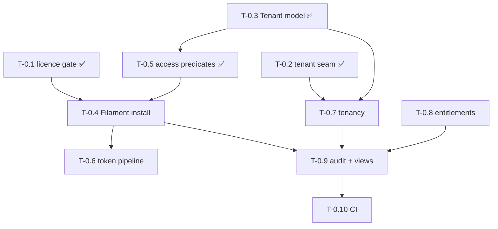

# Proposal 149 — Implementation Plan: Wave 0 (Foundation)

**Parent:** [`149-laravel-admin-parity-proposal.md`](./149-laravel-admin-parity-proposal.md)
**Status:** ✅ **WAVE 0 COMPLETE** (2026-11-16) — T-0.1 … T-0.10 done; Q-4 and Q-6 closed, Q-5 open (commercial). Wave 2 may start.
**Date:** 2026-11-16
**Scope:** ~3–4 weeks, one engineer
**Owner decisions applied:** D-1 (commercial), D-2 (operator + customer), OQ-6 (tenancy in v1), OQ-7 (Pro stays on WP → this is a port), Q-1 (operator = estate flag), Q-2 (licence = per estate)

## Completion log

| Task | State | Evidence |
|---|---|---|
| T-0.1 licence boundary | ✅ done | Gate passes on the clean tree; a planted `extends WP_MCP_AI_Tool_Base` fails it with exit 1; probe removed |
| T-0.2 tenant seam | ✅ done | 7 new tests / 14 assertions green; the wiring test fails when the registrations are removed; full app suite **731 passed / 4,257 assertions (container)**; all three real Octane event objects accepted, tenant cleared for each |
| T-0.3 `Tenant` model | ✅ done | 7 new tests; dev MySQL migrated (default + `nvoos` operator estate, existing user backfilled as `owner`); licence key verified encrypted at rest |
| T-0.5 access predicates | ✅ done | 8 new tests incl. the Q-1 trap (customer estate administrator → `/ops` denied); suite now **746 passed / 4,282 assertions** |
| T-0.4 Filament panels | ✅ done | Filament **5.11**; `/ops` and `/admin` routed (`ops`, `ops/login`, `ops/logout`, `admin`, …); 11 tests; suite now **757 passed / 4,299 assertions** |
| T-0.6 token pipeline | ✅ done | `admin:theme` generator + committed `AdminTheme.php`; drift gate proven to fail on a mutated token; 7 tests incl. WCAG 2.2 contrast; suite now **764 passed / 4,340 assertions** |
| Q-4 status tokens | ✅ closed | `success`/`warning`/`info` added to `core.json` + `semantic.json` + both theme modes; storefront regenerated and green (30/30 token tests); admin palette now fills all six Filament keys |
| T-0.7 panel tenancy | ✅ done | `->tenant(Tenant::class, 'slug', 'tenant')` + `HasTenants` + `SetTenantContext`; guard test replaced by 6 tenancy tests; suite now **771 passed / 4,380 assertions** |
| T-0.8 entitlement | ✅ done | Fixed a **latent outage** (4 in-use feature keys absent from the plan catalogue), `singleton`→`scoped`, `TenantEntitlement` decorator, config seam; suites: app **785 / 4,405**, adapter **286 / 1,534**, core **1,762 / 6,255** |
| T-0.9 audit + views | ✅ done | Append-only `nvoos_admin_audit` (records failures too, redacts credentials at any depth), `nvoos_admin_views` + estate-scoped repository; 15 tests; app suite **800 / 4,449** |
| T-0.10 CI wiring | ✅ done | `admin:theme --check` step + `sync-toolkit-manifests.php --check` step (closes Q-6); both gates proven to fail |

### Wave 0 exit — what is now true

- The commercial admin cannot silently absorb GPL code (licence gate over `docker/**`).
- Tenant state cannot leak across Octane requests or queue jobs.
- An estate is a first-class object with operator status, per-estate licensing and membership.
- Two panels exist with different access predicates, and a customer administrator is provably not an operator.
- The palette is generated from ADS and drift-gated; WCAG 2.2 AA is asserted on every authored pair.
- Entitlement is per estate, `scoped()`, and its vocabulary is gated against the route table and the manifests.
- Every mutating admin action is audited, failures included, with credentials redacted.

Wave 2's first commitment: **no resource ships without a cross-tenant 404 test** — the one T-0.7 exit item that cannot exist until a resource does.

---

## 1. Objective

Stand up a Laravel admin that **cannot** become a legal, security, or
authorization liability later — while building zero business pages.

Wave 0 ships:

1. An enforced licence boundary over `docker/**`.
2. A tenant seam that is safe under Octane.
3. Two panels (`/ops`, `/admin`) with different access predicates.
4. An entitlement service wired into the manifest schema.
5. A design-token pipeline (DTCG → Filament theme) with a drift gate.
6. Two admin tables: audit + saved views.

**Wave 0 delivers no operator value.** It delivers the rails everything else
rides on. If a wave-0 task does not prevent a class of defect, it is out of
scope.

---

## 2. Pre-flight findings

Four things were found while planning that were not visible from the proposal.
**B1 and B2 are blockers** — tenancy must not land before B2 is fixed.

### B1 — The licence boundary does not cover `docker/` 🔴

`bin/check-license-boundary.sh` asserts four trees:

```sh
check_tree "lib/core/src"          "GPL"          "GPL (package is MIT)"
check_tree "includes"              "Proprietary"  "Proprietary (package is GPL)"
check_tree "addons/pro/includes"   "GPL"          "GPL (package is Proprietary)"
check_tree "addons/canvas"         "GPL"          "GPL (package is Proprietary)"
```

`docker/laravel/app-skeleton` is scanned by **nothing**. Decision D-1 makes the
Laravel app commercial, so an import from the GPL `includes/` tree would silently
relicense the whole product. Nothing today prevents it.

**Compounding fact:** `docker/laravel/app-skeleton/composer.json` declares
`"license": "MIT"`. That is the Laravel skeleton default and is now wrong.

### B2 — `TenantContext` is a static with no reset hook 🔴

```php
final class TenantContext
{
    private static ?string $tenantId = null;

    public static function current(): string
    {
        return self::$tenantId ?? Assistant::DEFAULT_TENANT;
    }

    public static function set(?string $tenantId): void { self::$tenantId = $tenantId; }
    public static function forget(): void { self::$tenantId = null; }
}
```

Measured:

| Fact | Evidence |
|---|---|
| `current()` is used at **20+ call sites** | `AssistantController`, `CommandCenterController`, `OrchestrationStatsController`, `BlueprintCatalogue`, `BlueprintInstaller`, `LaravelAssistantService`, `LaravelTeamService` |
| `set()` and `forget()` are **never called** in production code | grep over `app/` returns only `current()` |
| No listener resets it | `config/octane.php` has a `RequestTerminated` block, but nothing touches `TenantContext` |

Today this is harmless: the tenant is always `'default'`. The moment Filament
tenancy (T-0.7) starts calling `set()` per request, the static survives the
request on a long-lived Octane worker and **tenant A's id leaks into tenant B's
queries**. That is a cross-tenant data-leak waiting for a feature to activate it.

This is the same class as the documented Octane gotcha in the
`mcp-ai-wpoos-laravel-runtime` skill ("a bound, not singleton, repository is
rebuilt per request; do not promote stateful readers to singletons or a
long-lived worker serves stale data") — except this one is a static, which
Octane cannot reset for you.

**Fix before any tenancy work.**

### B3 — There is no `Tenant` model 🟡

`app/Models/` holds `Assistant`, `Team`, `TeamMember`, `User`. `tenant_id` is a
plain string column (`Assistant::DEFAULT_TENANT = 'default'`).

Filament's `->tenant()` requires an Eloquent model. Two candidates:

| Option | Fit | Risk |
|---|---|---|
| `Team` as tenant | Model exists | **Wrong domain.** `tenant_id` is estate-level; a customer with two teams would become two tenants, and `team_id` ≠ `tenant_id` in every record |
| New `Tenant` model over the existing `tenant_id` string | Matches `TenantContext` semantics exactly | Needs a table + membership pivot |

**Recommendation: new `Tenant` model.** It is the smallest change that keeps
`tenant_id` meaning what every existing query already assumes.

### B4 — One provider, one panel-less app 🟢

`bootstrap/providers.php` lists only `AppServiceProvider::class`. No Filament,
no Livewire, no admin scaffolding. Clean slate — nothing to unwind.

---

## 3. Task breakdown

Tasks are ordered by dependency. 🔴 = blocker, must land first.

### T-0.1 — Licence boundary over `docker/` 🔴 ✅ DONE

**Landed.** Measured: gate passes on the clean tree,
and a planted `class TmpBoundaryProbe extends WP_MCP_AI_Tool_Base` fails it with
`❌ docker/laravel/app-skeleton couples to the GPL plugin` and exit 1.

**A design correction to this plan:** the first draft of the prefix guard
(`WP_MCP_AI_|includes/admin`) would have failed immediately — the app has 23
files that legitimately mention WordPress in **docblocks** (the port provenance
record, e.g. "Port of `WP_MCP_AI_REST_Okf`") and in **stored meta-key strings**
(`_wp_mcp_ai_team_members`) that must match WordPress for bundle portability.
The gate therefore anchors on keywords that only appear in real code
references (`new`, `extends`, `implements`, `instanceof`, `class_exists`,
`function_exists`, `interface_exists`, `require`/`include … includes/`), which
is clean on today's tree and still catches genuine linkage.

**Files**

- `bin/check-license-boundary.sh` — append after the existing `check_tree` calls:

```sh
# ---------------------------------------------------------------------------
# The Laravel admin is COMMERCIAL (Proposal 149 D-1). It may consume the MIT
# engine (lib/core, lib/laravel-adapter) and nothing else. A single import from
# the GPL includes/ tree would relicense the product.
# ---------------------------------------------------------------------------
check_tree "docker/laravel/app-skeleton/app"         "GPL" "GPL (app is Commercial)"
check_tree "docker/laravel/app-skeleton/config"      "GPL" "GPL (app is Commercial)"
check_tree "docker/laravel/app-skeleton/database"    "GPL" "GPL (app is Commercial)"
check_tree "docker/laravel/app-skeleton/tests"       "GPL" "GPL (app is Commercial)"

# Direction guard: the WordPress-specific prefix must never appear in the app.
check_no_wp_api() {
	local tree="docker/laravel/app-skeleton"
	local offenders
	offenders=$(grep -rlE "WP_MCP_AI_|wp_mcp_ai_|includes/admin" \
		--include="*.php" "$tree/app" "$tree/config" "$tree/database" 2>/dev/null || true)
	if [ -z "$offenders" ]; then
		pass "$tree — no WordPress-prefixed symbols (licence boundary intact)"
	else
		fail "$tree references WordPress symbols — GPL contamination of a commercial tree"
		show_offenders "$offenders"
	fi
}
check_no_wp_api
```

- `docker/laravel/app-skeleton/composer.json` — `"license": "MIT"` → `"proprietary"`.

**Why the prefix guard rather than a blanket `require_tree`:** the tree mixes
Laravel stubs (MIT, no `@license` docblock) with commercial code, so a positive
`require_tree` over the whole tree would fail on the stubs. The prefix guard
tests the thing that actually matters — whether app code reaches into the GPL
plugin.

**Exit gate**

```sh
bash bin/check-license-boundary.sh     # green, and the new lines are exercised
```

Add a deliberate violation locally (paste `WP_MCP_AI_Tool_Base` into a scratch
controller), confirm the gate fails, then revert. A gate never seen to fail is
not a gate.

### T-0.2 — Make the tenant seam Octane-safe 🔴 ✅ DONE

**Landed.** Two reset mechanisms, because they cover disjoint execution modes:

| Mode | Reset | Why it cannot be the other one |
|---|---|---|
| Octane HTTP request | `RequestTerminated` listener | — |
| Octane task / tick worker | `TaskTerminated` / `TickTerminated` listener | These never run HTTP terminating callbacks |
| `queue:work` worker (`oos-laravel-worker`) | `JobProcessed` / `JobExceptionOccurred` in `AppServiceProvider` | A queue worker fires **no** Octane events at all |
| PHPUnit | `Tests\TestCase::setUp()` | Tests run many operations in one process |

**Plan deviation:** this plan originally said "register as `scoped()` in
`AppServiceProvider`". That was written for a hypothetical container service;
the real class is a static facade with 20+ call sites, so converting it would
have touched every consumer for no gain. The static kept its API and gained
lifecycle resets instead — verified by test rather than asserted.

Also added `TenantContext::isPinned()`, because comparing `current()` to
`DEFAULT_TENANT` cannot distinguish "explicitly pinned to default" from "unset"
— and it is the difference the resets care about.

**Verified:**

```
TenantContextIsolationTest      7 tests / 14 assertions   (host PHP)
full app suite (host)         731 tests / 4,255 assertions  ✅
full app suite (container)    731 tests / 4,257 assertions  ✅  (php artisan test)
phpcs phpcs-laravel.xml.dist   818 files, 0 errors 0 warnings ✅
```

Removing the three `config/octane.php` registrations fails
`test_every_octane_termination_event_is_wired` with
"RequestTerminated must reset the tenant context or Octane leaks it across
operations" — the gate was seen to fail.

**Live Octane validation (run in `oos-laravel-app`):** the real event objects
were constructed and handed to the listener. Reflection shows why the handler
is typed `object` and not one event class — the three constructors have
different arities:

| Event | Constructor |
|---|---|
| `RequestTerminated` | `(Application $app, Application $sandbox, Request $request, Response $response)` |
| `TaskTerminated` | `(Application $app, Application $sandbox, $data, $result)` |
| `TickTerminated` | `(Application $app, Application $sandbox)` |

A listener typed to `RequestTerminated` could not be registered against
`TickTerminated`; a typed union would break on the next Octane minor. The
untyped handler accepts all three, and the tinker run confirmed the pin is
cleared for each:

```
RequestTerminated -> pinned=no
TaskTerminated    -> pinned=no
TickTerminated    -> pinned=no
```

Still **not** proven: a live end-to-end pin/unpin through Octane over HTTP.
Nothing calls `set()` yet (that is T-0.7), so the behaviour is verified at the
listener boundary. Re-run an HTTP smoke after T-0.7 lands.

**Files****

- `docker/laravel/app-skeleton/app/Support/TenantContext.php`

Keep the public API (`current` / `set` / `forget`) so the 20+ call sites do not
change. Two mechanisms, **both**:

```php
/**
 * Resolves the active tenant for this request.
 *
 * Octane reuses the worker across requests, so the tenant MUST be reset on
 * request termination. Two layers:
 *   1. scoped() — the container drops the instance between requests.
 *   2. the Octane RequestTerminated listener in config/octane.php — belt and
 *      braces for queue jobs and any code path holding a stale reference.
 */
```

- Register as `scoped()` in `AppServiceProvider` (not `singleton`).
- `config/octane.php` — add to the `RequestTerminated` listener array:

```php
RequestTerminated::class => [
    // ... existing entries ...
    \App\Listeners\ForgetTenantContext::class,
],
```

- New `app/Listeners/ForgetTenantContext.php` calling `TenantContext::forget()`.

- `docker/laravel/app-skeleton/tests/Feature/TenantContextIsolationTest.php`:

```php
public function test_tenant_does_not_leak_between_requests(): void
{
    TenantContext::set('tenant-a');
    $this->get('/api/v1/features')->assertOk();

    // simulate Octane request termination
    event(new RequestTerminated(
        $this->app, $this->app['request'], $this->app['response']
    ));

    TenantContext::set(null);
    $this->assertSame(Assistant::DEFAULT_TENANT, TenantContext::current());
}
```

**Exit gate**

The isolation test fails before the fix and passes after. Verify by commenting
out the listener.

### T-0.3 — `Tenant` model + membership 🟡 ✅ DONE

Carries the Q-1 decision: **operator status is a property of the estate**, so
`is_operator` ships in the first migration rather than as a later `users` column.

**Files**

- `database/migrations/*_create_tenants_table.php` — `id` (string, PK), `name`,
  `slug` (unique), **`is_operator`** (bool, default false, indexed),
  **`licence_key`** (nullable string), **`plan`** (nullable string, validated
  against `ProPlanCatalog`), timestamps. Guarded by `Schema::hasTable`.
- `database/migrations/*_create_tenant_user_table.php` — `tenant_id`, `user_id`,
  `role` (reuses `CapabilityMap::TEAM_ROLES` vocabulary), unique pair.
- `app/Models/Tenant.php` — `users()`, `assistants()`, `isOperator()`,
  `scopeOperators()`.
- Backfill, guarded and idempotent:
  - one `'default'` tenant (`is_operator = false`) so existing `tenant_id`
    values keep resolving;
  - attach every existing user to it as `owner` (otherwise the first deploy
    leaves the existing operator locked out of `/admin`);
  - **exactly one** operator tenant, `slug = 'nvoos'`, created only when the
    environment is not production — production seeds it manually so a deploy
    cannot manufacture an operator estate.

**Exit gate**

Fresh SQLite (CI engine) and the existing dev DB both migrate; every pre-existing
assistant/team still resolves through `TenantContext::current()`; exactly one
tenant has `is_operator = true` in local/testing.

### T-0.4 — Filament + Livewire install 🟢 ✅ DONE

**Landed.** Filament **5.11** (installed in the container — the vendor tree is a
Docker volume — then `composer.json` + `composer.lock` copied back to
`app-skeleton`, which stays the source of truth).

| Panel | id | Path | Routes |
|---|---|---|---|
| Vendor | `operator` | `/ops` | `ops`, `ops/login`, `ops/logout` |
| Customer (default) | `admin` | `/admin` | `admin`, `admin/login`, `admin/logout` |

`User` now implements `FilamentUser`; `canAccessPanel(Panel)` **delegates** to
`AdminAccessPolicy::accessPanel($this, $panel->getId())` — the policy remains the
only definition, and an unregistered panel id fails closed.

**Three decisions made while implementing:**

1. **Resource namespaces are separate** — `App\Filament\Operator\*` vs
   `App\Filament\Admin\*`. A shared discovery path would let an operator
   surface render in the customer panel, which is a privilege leak rather than
   a styling bug.
2. **An operator reaches BOTH panels.** The first test run failed asserting the
   opposite, and the test was wrong, not the policy: an operator is a member of
   the operator estate, and the proposal's rule for `/admin` is "tenant member
   with >= manager". `/ops` is the *extra* privilege on top. Pinned by
   `test_operator_status_is_what_separates_the_two_panels`, which asserts the
   two users differ on the **estate flag alone** with identical `users.role`.
3. **Tenancy is deliberately still off.** `->tenant()` is T-0.7. Until then the
   customer panel must register **no resources**, because an unscoped resource
   reads every estate's rows. `test_the_customer_panel_registers_no_resources_until_tenancy_lands`
   fails the moment one is added — a forcing function, deleted in the same
   commit that enables tenancy.

**Deploy fix:** Filament's CSS/JS are build output published into
`public/` (gitignored), so a fresh checkout renders unstyled panels.
`docker/laravel/entrypoint.sh` now runs `filament:assets` once per checkout,
guarded on the presence of `public/css/filament/filament/app.css`.

**Operational note — adding a panel needs `octane:reload`, not just
`optimize:clear`.** After the providers landed, `/admin/login` returned **404**
while `/ops/login` returned 200, with both routes present in `route:list`. The
running Octane worker held the route table from before the panels existed;
`optimize:clear` clears *file* caches and does not touch a warm worker. After
`octane:reload`, all four routes answered correctly:

```
/ops/login     200
/admin/login   200
/admin   (guest) 302 -> /admin/login
/ops     (guest) 302 -> /ops/login
```

This is the same class as the documented stale-route symptom on Velocity — when
a route exists in `route:list` but 404s over HTTP, suspect the warm process.

**Sync-check caveat:** `diff -rq app-skeleton/bootstrap app/bootstrap` will
always report `bootstrap/cache/{packages,services}.php` as differing — those are
generated caches (only `.gitignore` is tracked there), not source. The
skeleton→runtime copy should take `bootstrap/providers.php` and
`bootstrap/app.php` explicitly rather than the whole directory.

**Exit gate met:** guest → `/ops` redirects to `/ops/login`; customer estate
administrator → `/ops` **403**; operator → `/ops` 200; manager → `/admin` 200;
viewer → `/admin` 403.

**Files**

- `composer.json` — add `filament/filament` (pin the major).
- `app/Providers/Filament/OperatorPanelProvider.php`
- `app/Providers/Filament/AdminPanelProvider.php`
- `bootstrap/providers.php` — add both.

Panel config, both:

```php
->id('operator')                // or 'admin'
->path('ops')                   // or 'admin'
->authGuard('web')
->login()
->colors([...])                 // generated from DTCG — see T-0.6
->middleware([...])             // web + auth + the admin audit middleware
```

`AdminPanelProvider` additionally:

```php
->tenant(Tenant::class)
->tenantMenu(true)
```

**Exit gate**

`php artisan about` lists Filament; `GET /ops` redirects to the Filament login;
`GET /admin` 404s for an unauthenticated user.

### T-0.5 — Access predicates 🟢 ✅ DONE

**Plan deviation:** the plan specified `canAccessPanel(Panel $panel)` on `User`.
`Panel` is a Filament class and Filament is not installed until T-0.4, so this
task implemented the **predicates** in `AdminAccessPolicy` — the part Q-1
decides and the part that must be tested — and left the one-line Filament
adapter for T-0.4. The model method must delegate to the policy rather than
re-implement it, or the two will drift.

Resolved by Q-1: **there is no `users.is_operator`.** Operator access is
membership in the estate whose `tenants.is_operator` is true.

**Files**

- `app/Models/User.php` — `canAccessPanel(Panel $panel): bool`
- `app/Policies/AdminAccessPolicy.php`

```php
public function canAccessPanel(Panel $panel): bool
{
    return match ($panel->getId()) {
        // NV staff. Never tenant-scoped: the operator must see every estate.
        // Operator-ness is a property of the ESTATE (tenants.is_operator), not
        // of the person — a customer's estate administrator is an
        // administrator and must never qualify.
        'operator' => $this->isOperatorMember()
                      && CapabilityMap::has($this, 'manage_options'),

        // Customer estate member with at least manager on an estate they
        // belong to. Viewer is read-only, so the panel is refused entirely.
        'admin'    => $this->tenantMemberships()
                          ->where('role', '!=', 'viewer')
                          ->exists(),

        default    => false,
    };
}

private function isOperatorMember(): bool
{
    return $this->tenants()->where('tenants.is_operator', true)->exists();
}
```

**Four tests, and the fourth is the one that matters:**

| Case | Expect |
|---|---|
| customer estate administrator → `/ops` | **403** (the trap Q-1 exists to prevent) |
| operator-tenant owner → `/ops` | 200 |
| tenant viewer → `/admin` | 403 |
| tenant manager → `/admin` | 200 |

**Exit gate**

The four cases pass, and `isOperatorMember()` is asserted to read the **tenant**
flag — a test that sets `users.role = 'administrator'` on a customer-estate user
must still 403 on `/ops`.

### T-0.6 — Token pipeline: DTCG → Filament theme 🟢 ✅ DONE

**Q-3 answered by the exporter itself:** the NDS document does **not** carry
the semantic layer Filament needs. `examples/nvoos-astro-velocity/mcp/tools/ops.ts`
→ `ADS_UNMAPPED` records that NDS has no on-accent text token, no error/danger
token and no composite shadow token, so `accent-ink`, `danger` and `focus-ring`
are reported as unmapped on every export. All three exist in ADS.

**Therefore the admin reads ADS directly and never round-trips through NDS** —
round-tripping would lose exactly the danger colour and focus ring an admin
cannot do without. That is §10's "fourth consumer, never a fourth definition"
applied literally.

**Landed as PHP, not Node.** The Laravel CI job (`laravel-app.yml`) runs
`php artisan test` on SQLite and has no npm step, so a Node generator would
have needed a new CI job. A pure PHP generator keeps the drift gate inside the
existing suite.

| Piece | File |
|---|---|
| Generator (pure, no container) | `app/Support/AdminThemeGenerator.php` |
| Command (`admin:theme`, `--check`) | `app/Console/Commands/AdminThemeCommand.php` |
| Generated, committed artefact | `app/Support/AdminTheme.php` |
| Drift + WCAG gate | `tests/Feature/AdminThemeDriftTest.php` |
| Token location | `config/oos.php` → `oos.admin_theme.tokens_path` |

**Resolution:** light theme wins, then the semantic layer, with `{core.*}`
references resolved recursively (`focus-ring` resolves both of its references).
`$`-prefixed keys are skipped — treating them as tokens is the leak that cost
the storefront token build a fix (Proposal 095).

**Measured palette:**

```
primary #0f6b4f (accent)   danger #b3261e   gray #6b6b6b (muted)
MISSING: success, warning, info
```

**The gap is reported, never invented.** ADS is an editorial palette — brand,
ink and one error colour; it has no success/warning/info token. The generator
omits them so Filament falls back to its own palette, and reports them at build
time. Closing the gap means adding the tokens to `core.json`/`semantic.json`
(one definition, four consumers), not picking hexes in the generator. Flagged
for the owner as a design decision.

**Bootstrap chicken-and-egg:** the panel providers reference the generated
class, so the app cannot boot to run the command that generates it. The
generator has no dependencies, so the artefact is bootstrapped once by
instantiating it directly (`php -r 'require …; (new AdminThemeGenerator($path))->php()'`).
Anyone regenerating later uses the command.

**Container path gotcha:** `/app` is a bind mount, so `/app/../../../` is `/`,
not the repo — a bind mount does not preserve the host path. The container
mounts the repo at `/workspace/oos`, so `NVOOS_TOKENS_PATH` is set in the
compose file's shared environment anchor. The config default
(`base_path('../../../examples/…')`) stays correct for a normal checkout and
for CI.

**Exit gate met:** with the token file mutated to `#0a5c43`, both
`php artisan admin:theme --check` and the Pest test fail; restored, both pass.
The five authored pairs pass WCAG 2.2 AA (ink/muted/danger on surface 4.5:1,
accent-ink on accent 4.5:1, line-strong on surface 3:1).

**Not done (deliberately):** dark mode. The generator resolves `light` only;
dark is a follow-up that must reuse the same generator rather than fork it.

**Files**

- `bin/build-admin-theme.mjs` (or a PHP artisan command) — read the NDS/ADS
  DTCG document, emit `resources/css/filament/admin/theme.css` with the
  semantic layer as CSS custom properties, mapped onto Filament's palette keys.
- `bin/check-admin-theme.mjs` — fail if the source DTCG changed without
  regeneration (the `check:tokens` precedent from the storefront).
- A Pest test asserting the compiled theme's semantic values equal the DTCG
  source.

**Exit gate**

`npm run build:admin-theme && npm run check:admin-theme` green; changing a DTCG
colour without regenerating fails the check.

### T-0.7 — Enable tenancy on the admin panel 🟡 ✅ DONE

**Landed.** `/admin` is now estate-scoped; `/ops` deliberately is not.

| Piece | Detail |
|---|---|
| Panel | `->tenant(Tenant::class, 'slug', 'tenant')` |
| Tenant resolution | `User implements HasTenants` — `getTenants()` and `canAccessTenant()` |
| Context bridge | `App\Http\Middleware\SetTenantContext` via `->tenantMiddleware([...], isPersistent: true)` |
| Ownership relations | `Assistant::tenant()`, `Team::tenant()` (`belongsTo` on `tenant_id`) |

**Three details that are load-bearing, not stylistic:**

1. **`ownershipRelationship: 'tenant'` is the scoping contract.** Filament
   resolves it to `whereBelongsTo($tenant, 'tenant')` on each resource model.
   The default (plural `tenants`) would look for a belongsToMany and match
   nothing. The `BelongsTo` + `tenant_id` shape is asserted by
   `test_tenant_scoped_models_declare_the_ownership_relationship`.
2. **`SetTenantContext` is the point of the whole task.** Every assistant and
   team query already reads `TenantContext::current()`; nothing had ever called
   `set()`. Filament resolving a tenant is useless until it reaches that seam.
3. **`canAccessTenant()` fails closed on `viewer`.** There is no read-only
   enforcement inside Filament resources yet, so admitting a viewer would hand
   them write actions. Relax to plain membership in the same change that adds
   per-action ability checks.

**Route table after the change:**

```
GET  admin                  filament.admin.tenant       (RedirectToTenantController)
GET  admin/{tenant}         filament.admin.pages.dashboard
GET  admin/login            filament.admin.auth.login
```

**Exit gate — partly deferred by necessity:** the original gate was "a Pest
test per tenant-aware resource: tenant A reading tenant B gets 404". There are
no resources yet, so cross-tenant *record* isolation cannot be tested. What is
pinned: the panel is scoped, the operator panel is not, `/admin/{other-estate}`
returns 404 for a non-member, `getTenants()` omits viewer memberships, and the
middleware pins the resolved estate. **The per-resource 404 tests are the first
item of Wave 2**, and no resource may ship without one.

**Test replaced, not deleted:**
`test_the_customer_panel_registers_no_resources_until_tenancy_lands` existed to
fail when a resource was added before scoping. Scoping now exists, so the guard
became `test_only_the_customer_panel_is_tenant_scoped` +
`test_tenant_scoped_models_declare_the_ownership_relationship`.

### T-0.8 — Entitlement service 🟢 ✅ DONE

**This task was not what the plan predicted.** The plan assumed an
`Entitlements` service had to be built. `LicensedProEntitlement` already
existed and was complete — the real defects were elsewhere, and one of them was
an outage waiting for the first licensed install.

**Defect 1 — a licensed install would deny its own Pro surface (critical).**
Three vocabularies disagreed:

| Vocabulary | Values in use | In `ProPlanCatalog`? |
|---|---|---|
| Route middleware `pro.entitlement:*` | `schedules`, `records` | **no** |
| Toolkit manifest `feature` | `commerce`, `documents` | **no** |
| Plan catalogue | 12 compliance features | — |

Measured before the fix: all four returned `false` for **every** plan,
including `enterprise`. The `allow` dev driver masks it completely; the first
`license` or `config` deployment would have 402'd the entire Pro surface.

*Fix:* the four keys are now in every plan, placed in `compliance` (the base)
because that **preserves pre-fix behaviour** — any other placement would have
silently changed what a customer gets. Re-tiering is a commercial decision,
logged as **Q-5**.

*Durable guard:* `test_every_route_gated_feature_exists_in_the_plan_catalogue`
walks the live router's `pro.entitlement:*` middleware and
`test_every_manifest_feature_exists_in_the_plan_catalogue` walks
`ToolkitManifestLoader::all()`. Both fail if a feature is gated without being
entitled — the exact check that would have caught this at review time. Verified
to fail by deleting `records` from the base plan.

Also added to `ProPlanCatalogTest`:
`testEachPlanContainsEveryFeatureOfTheSmallerPlans` — the plan lists are
cumulative **by repetition**, so a feature added to one list and not the next
silently downgrades the larger plan.

**Defect 2 — `singleton()` pinned the first estate for the worker's life.**
`ProEntitlementInterface` was bound `singleton()`; per-estate resolution on top
of that is impossible. Now `scoped()`, which Octane actually flushes
(`FlushTemporaryContainerInstances` → `forgetScopedInstances()`). Pinned by
`test_the_binding_is_scoped_so_it_is_flushed_between_operations`
(`forgetScopedInstances()` must yield a different instance).

**Defect 3 — nothing resolved a licence per estate.** New
`App\Support\TenantEntitlement` decorator:

| Estate state | Resolution |
|---|---|
| Has `tenants.licence_key` | licence server, **regardless of the install driver** |
| No key | install driver from `oos.pro_entitlement` |

The estate wins because the install driver describes the **host** (a dev box is
`allow`) while the key describes the **customer**. A customer estate must never
inherit a permissive host default. Pinned by
`test_an_estate_licence_overrides_a_permissive_install_driver`: with driver
`allow` + a key + no licence server, `source()` is `license` and `allows()` is
**false** — proving the key took effect by failing closed.

**Defect 4 (found by the suite) — entitlement became a database dependency.**
The decorator added a hard `tenants` lookup, and `/api/v1/features` calls
`plan()` on every request. Two suites (`ConnectedAppsTest`,
`EndpointCapabilitiesTest`) deliberately run without migrations → 9 failures
with "no such table: tenants". Guarded with a memoised `Schema::hasTable()`;
a missing table degrades to the install driver (which still honours `deny`).
`EntitlementWithoutEstateTableTest` runs with no migrations and pins it.

**Config seam (was missing entirely).** `config('oos.pro_entitlement')` had no
home in the shipped config file, so the runtime was permanently on `allow` and
could not be configured without publishing the file by hand. Added to
`lib/laravel-adapter/config/nvoos.php` with `NVOOS_PRO_*` env wiring, and
documented in `.env.example`.

**Shared construction.** `ProEntitlementFactory` (adapter, MIT) is now the one
place a driver is built from config, used by both the package binding and the
app decorator — a second copy would drift the moment an option is added.

**Plan correction:** the planned `RequiresEntitlement` middleware and
`requires`/`requires_tier` manifest fields already existed in another form.
`EnsureProEntitlement` (alias `pro.entitlement`) is applied to the Pro route
groups, and `ToolkitManifest::feature()` is the declared entitlement hook —
it was simply never validated against the catalogue. Building either would have
created a second, competing mechanism.

**Exit gate met:** gated route 402s under `deny` (`error.code:
pro_entitlement_required`, `error.feature: records`) and 200s under `allow`;
both completeness gates pass and were seen to fail when the catalogue was
mutated.

### T-0.9 — Admin audit + saved views tables 🟢 ✅ DONE

| Piece | File |
|---|---|
| Append-only audit | `nvoos_admin_audit` (no `updated_at`, insert-only writer) |
| Saved views | `nvoos_admin_views` + `AdminSavedView` + `SavedViewRepository` |
| Writer + redaction | `App\Support\Admin\AdminAuditLogger` |
| Middleware | `App\Http\Middleware\AuditAdminRequests` on **both** panels |

**Schema corrections from the plan.** The planned `resource` / `record_id` /
`action` / `before` / `after` columns assume record-level diffs, which need
model events — and no resources exist yet. Writing them now would be a column
set that never fills. The shipped shape records what a request-level audit can
honestly capture: `panel`, `method`, `path`, `route`, `status`, `payload`,
`ip`, `created_at`. **Per-record before/after lands with the first resource in
Wave 2**, where model events exist.

**`user_id` is deliberately not a foreign key.** A cascading delete would erase
the record of what a removed user did — the exact case an audit trail exists to
answer.

**Two behaviours worth naming:**

1. **Failures are recorded.** An exception unwinds *past* this middleware
   before Laravel renders it, so the catch branch records the status the
   exception will become and rethrows. Without it, every rejected write would
   be invisible — the half of the trail that matters during an incident.
2. **Livewire transport is excluded.** Filament renders forms as Livewire
   components, so their traffic is POSTs to `/livewire/update`. Auditing them
   would bury the actions in UI mechanics.

**Redaction is structural.** Any payload key containing a credential fragment
(`password`, `secret`, `token`, `credential`, `authorization`, `api_key`,
`licence_key`, `private_key`) is replaced at any nesting depth. Substring
matching over-redacts (`max_tokens` matches `token`) and that is the intended
trade: an over-redacted log is an inconvenience, an under-redacted one is an
incident. Verified by posting a payload containing `SUPER-SECRET-VALUE`,
`hunter2` and `PRO-KEY` and asserting none reaches the row.

**Estate scoping:** a saved view belongs to (estate, user, resource, name); the
same user on another estate starts empty, which is what "views for THIS
customer's table" has to mean. Operator actions record `tenant_id = null`
because the operator panel belongs to no single estate.

**Exit gate met:** exactly one row per mutating request (POST/PUT/PATCH/DELETE),
none for reads, failures recorded with status, and no credential in any row.

### T-0.10 — CI wiring 🟢 ✅ DONE

| Job | Addition |
|---|---|
| Licence boundary (`license-boundary.yml`) | already runs the script — the `docker/**` checks from T-0.1 come free |
| `App suite (SQLite)` (`laravel-app.yml`) | all new tests run automatically |
| New step: **Admin theme is current** | `php artisan admin:theme --check` — names the fix, before the suite |
| New step: **Toolkit manifest mirror is current** | `php bin/sync-toolkit-manifests.php --check` — closes **Q-6** |

**Why a separate step when `AdminThemeDriftTest` already covers it:** the test
reports a failed assertion; the step reports `Admin theme is OUT OF DATE with
the design tokens. Run: php artisan admin:theme`. Same gate, actionable error.

**Q-6 closed with the existing pattern.** `laravel-app.yml` already gates two
other committed mirrors (`sync-blueprints.php`, `sync-schedule-presets.php`),
so `bin/sync-toolkit-manifests.php --check` follows the same contract rather
than inventing one. It also reports **orphaned** manifests — one that left the
addon but stayed in the mirror would otherwise keep serving a toolkit that no
longer exists.

**Both new gates were seen to fail:**

```
# toolkit mirror drift
$ printf '{}' >> resources/pro-toolkits/commerce.json
$ php bin/sync-toolkit-manifests.php --check
sync-toolkit-manifests: stale: commerce.json      # exit 1

# admin theme drift (mutated ADS token)
$ php artisan admin:theme --check
Admin theme is OUT OF DATE with the design tokens. # exit 1
```

**CI path check:** `laravel-app.yml` runs from `docker/laravel/app-skeleton`, so
`base_path('../../../examples/…')` resolves to the repo root — the token default
needs no CI override (only the container needs `NVOOS_TOKENS_PATH`, because a
bind mount does not preserve host paths).

---

## 4. Sequencing



**Done:** T-0.1, T-0.2 (day 1, blockers), then T-0.3 + T-0.5 together once Q-1
settled — the policy predicates are testable without Filament, and T-0.4 now
binds them rather than defining them.

---

## 5. Test plan (Wave 0 baseline)

| Suite | Test | Asserts |
|---|---|---|
| Feature | `TenantContextIsolationTest` | No tenant bleed across simulated requests |
| Feature | `PanelAccessTest` (4 cases) | `/ops` = staff; `/admin` = tenant manager |
| Feature | `TenantIsolationTest` (per resource) | Cross-tenant read → 404 |
| Feature | `EntitlementGateTest` | Unlicensed → 404; licensed → 200 |
| Feature | `AdminAuditTest` | One row per mutation; no secret in the row |
| Unit | `AdminThemeDriftTest` | Compiled theme == DTCG source |
| E2E | `admin-foundation.spec.ts` | Two audiences; theme toggle; audit line visible |

**Baseline discipline:** record the counts you actually saw (the repo rule —
"CI proving 'not broken' is weaker evidence than a count you actually saw").
Current app baseline is 694 passed / 4,070 assertions; Wave 0 should add ~15
tests without changing that number downward.

---

## 6. Rollback

Every task is additive:

| Task | Rollback |
|---|---|
| T-0.1 | revert the script + composer licence field |
| T-0.2 | the listener is inert without `set()`; safe to leave |
| T-0.3 | migrations are additive with a backfill; `down()` drops |
| T-0.4 | remove the two providers from `bootstrap/providers.php` |
| T-0.7 | remove `->tenant()` — panels still work, single-tenant |

No task mutates an existing column, so no data migration is irreversible.

---

## 7. Out of scope (Wave 0)

- Any business page (that is Wave 2+).
- The React canvas bundle (Wave 6).
- Manifests beyond the `requires` schema addition (Wave 3).
- WordPress reading manifests (Wave 3, per OQ-5).
- White-label theming (OQ-8).
- The packaging/capability matrix that OQ-7 needs commercially — **still
  required before Wave 3**, but it does not block Wave 0.

---

## 8. Open items carried forward

| # | Question | State |
|---|---|---|
| Q-1 | How is "NV operator staff" identified today? | ✅ **Resolved** — see below |
| Q-2 | Where does the licence live per estate? | ✅ **Resolved** — see below |
| Q-3 | Does the NDS DTCG export include the semantic layer Filament needs? | ✅ **Resolved** — NDS drops `accent-ink`/`danger`/`focus-ring`; the admin reads ADS directly (T-0.6) |
| Q-4 | Add `success`/`warning`/`info` to the ADS palette? | ✅ **Closed (2026-11-16)** — added to `core.json` + `semantic.json` + both theme modes; storefront regenerated and green; admin fills all six Filament keys |
| Q-5 | Which plan should `schedules`/`records`/`commerce`/`documents` sit in? | Open — placed in **`compliance`** to preserve pre-fix behaviour; re-tiering is a commercial decision |
| Q-6 | Toolkit manifests are duplicated (`resources/pro-toolkits/` ↔ `addons/pro/includes/toolkits/manifests/`) | ✅ **Closed (2026-11-16)** — `bin/sync-toolkit-manifests.php --check` wired into `laravel-app.yml`, proven to fail on drift and on orphans |

### Q-1 — Operator identity ✅ RESOLVED

**The search:** no operator marker exists. `is_operator`, `isOperator`,
`is_staff`, `operator_staff` return **zero hits** across `app/`, `database/`
and `routes/`. The only identity facts in the schema are:

| Fact | Where | Values |
|---|---|---|
| Site role | `users.role` (092-g) | `subscriber`…`administrator`, with legacy `'admin'` normalised at read time |
| Team role | `team_members.role` | `owner`, `admin`, `manager`, `member`, `viewer` |
| Tenant | `TenantContext` (static) | flat string, always `'default'` today |
| Plan | `ProPlanCatalog` | `compliance`, `professional`, `enterprise` |

The dev database holds exactly one user (`spike@example.com`, `role='admin'`),
so "operator" has never needed a marker — the operator was simply the only
human. That is why the question surfaced only now.

**Rejected options:**

| Option | Why not |
|---|---|
| `users.role = 'operator'` (6th site role) | `CapabilityMap::ROLES` is deliberately WordPress's five-role set so the console cannot tell the runtimes apart. A sixth role leaks into `Gate::before`, the nav matrix and the `/features` capability payload |
| `users.is_operator` boolean | It answers a *per-person* question, but the entitlement it gates is *per-estate*. You would still need an operator tenant to hold the platform licence, so the column buys nothing over the tenant flag and adds a second source of truth |
| Derive from `role === 'administrator'` | **The trap.** A customer's estate administrator is an administrator. This is exactly how a customer ends up inside `/ops` |
| Separate `operator_staff` table | Over-engineered for a handful of people |

**Decision: operator status is a property of the estate.**

`tenants.is_operator` (boolean, exactly one row true) + membership in it with
`manage_options` ⇒ `/ops` access. This lands in T-0.3 (the tenant model) so the
column exists from the first migration.

Why it composes where the alternatives do not:

1. **It reuses T-0.3 instead of adding a parallel concept** — one boolean on a
table being created anyway.
2. **`/ops` still needs a tenant.** Entitlement, licence and audit are
   estate-scoped, so even a `users.is_operator` design needs an operator
   estate. The tenant flag *is* that estate.
3. **It fails closed for customers by construction.** A customer estate has
   `is_operator = false`; no predicate on `users.role` can accidentally grant
   `/ops`.
4. **Cross-estate visibility becomes expressible.** An operator needs to read
   every estate; that is a separate `cross_tenant` ability granted by operator
   membership, not a side effect of being an administrator somewhere.

### Q-2 — Licence location ✅ RESOLVED

Per estate, not per install: `tenants.licence_key` + `tenants.plan`, resolved
through the **existing** `ProEntitlementInterface`.

**What already exists (and changes T-0.8):**

- `Nvoos\Laravel\Adapter\LicensedProEntitlement` is a complete licence-server
  client — fail-closed, stale-while-error, cache key hashed over
  (server, instance, product, key), explicit operator overrides.
- `Nvoos\Core\Domain\Service\Entitlement\ProPlanCatalog` is the shared
  plan → feature table, read by both runtimes.
- Config seam: `oos.pro_entitlement.{driver,license_key,server_url,instance_id,product,features,ttl,…}`,
  merged from `lib/laravel-adapter/config/nvoos.php` under the `oos` key.

Measured current state in the dev container: `ProEntitlement`, `plan=compliance`,
`source=allow` — the documented fail-open dev driver, and there are **no
entitlement env vars** in `.env.example`, so the only way to configure it is an
app-level config file.

**So T-0.8 is not "build an Entitlements service"** — that would duplicate
`LicensedProEntitlement`. It is:

1. make resolution tenant-aware (read the tenant's licence, not the install's),
2. add the missing config seam (`nvoos.php` has no `pro_entitlement` block and
   no `env()` wiring, so an install cannot configure it at all), and
3. **fix the singleton.**

> ⚠️ `ProEntitlementInterface` is bound as `$this->app->singleton(...)`
> (`NvoosServiceProvider`, ~line 163). Under Octane that is the *same bug class
> as `TenantContext`*: the first tenant to resolve an entitlement pins the
> instance for the life of the worker, and every later tenant reads another
> estate's plan. Making entitlement tenant-aware **requires** `scoped()`, or the
> fix ships a billing-correct but access-wrong system.

**Consequence for §5:** the `/ops` panel's entitlement is the operator estate's
(vendor) licence; a customer's `/admin` panel reads theirs. The same
`ProPlanCatalog` answers both.
