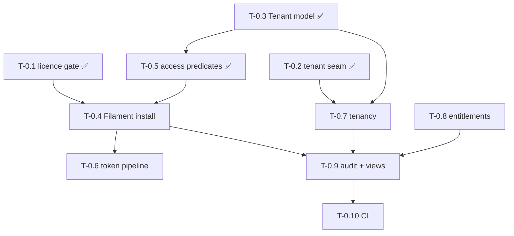

# Proposal 149 — Implementation Plan: Wave 0 (Foundation)

**Parent:** [`149-laravel-admin-parity-proposal.md`](./149-laravel-admin-parity-proposal.md)
**Status:** ✅ **WAVE 0 COMPLETE** (2026-11-16) — T-0.1 … T-0.10 done; Q-4 and Q-6 closed, Q-5 open (commercial). 🟡 **WAVE 2 STARTED** (2026-11-16) — seven slices shipped: estates and licences on `/ops` (§8), teams on `/admin` with the deferred cross-tenant 404 test (§9), failed jobs on `/ops/queue` (§10, plus the credential-expiry fix it surfaced), credential rotation on `/ops/credentials` (§11), assistants on `/admin/assistants` (§12), scheduler liveness on `/ops/scheduler` (§13), and the settings projection (§15). **The Wave 2 exit gate (key rotation + DLQ drain) is met.** An eighth slice — settings ownership (§16) — a ninth — the two settings pages (§17) — a tenth — the read-only workflow run log (§18) — an eleventh — the token manager's estate scope (§19) — a twelfth — console estate resolution (§21) — and a thirteenth — the tool catalogue (§22) — shipped 2026-11-17. Together they closed the cross-tenant settings defect, the "editable nowhere" gap the projection opened, the estate leak in workflow run history, a cross-tenant revocation path on the live token manager, and the console API's dependency on the `default` estate.
**Date:** 2026-11-16
**Scope:** ~3–4 weeks, one engineer
**Owner decisions applied:** D-1 (commercial), D-2 (operator + customer), OQ-6 (tenancy in v1), OQ-7 (Pro stays on WP → this is a port), Q-1 (operator = estate flag), Q-2 (licence = per estate)

## Completion log

| Task | State | Evidence |
|---|---|---|
| T-0.1 licence boundary | ✅ done | Gate passes on the clean tree; a planted `extends WP_MCP_AI_Tool_Base` fails it with exit 1; probe removed |
| T-0.2 tenant seam | ✅ done | 7 new tests / 14 assertions green; the wiring test fails when the registrations are removed; full app suite **731 passed / 4,257 assertions (container)**; all three real Octane event objects accepted, tenant cleared for each |
| T-0.3 `Tenant` model | ✅ done | 7 new tests; dev MySQL migrated (default + `nvoos` operator estate, existing user backfilled as `owner`); licence key verified encrypted at rest |
| T-0.5 access predicates | ✅ done | 8 new tests incl. the Q-1 trap (customer estate administrator → `/ops` denied); suite now **746 passed / 4,282 assertions** |
| T-0.4 Filament panels | ✅ done | Filament **5.11**; `/ops` and `/admin` routed (`ops`, `ops/login`, `ops/logout`, `admin`, …); 11 tests; suite now **757 passed / 4,299 assertions** |
| T-0.6 token pipeline | ✅ done | `admin:theme` generator + committed `AdminTheme.php`; drift gate proven to fail on a mutated token; 7 tests incl. WCAG 2.2 contrast; suite now **764 passed / 4,340 assertions** |
| Q-4 status tokens | ✅ closed | `success`/`warning`/`info` added to `core.json` + `semantic.json` + both theme modes; storefront regenerated and green (30/30 token tests); admin palette now fills all six Filament keys |
| T-0.7 panel tenancy | ✅ done | `->tenant(Tenant::class, 'slug', 'tenant')` + `HasTenants` + `SetTenantContext`; guard test replaced by 6 tenancy tests; suite now **771 passed / 4,380 assertions** |
| T-0.8 entitlement | ✅ done | Fixed a **latent outage** (4 in-use feature keys absent from the plan catalogue), `singleton`→`scoped`, `TenantEntitlement` decorator, config seam; suites: app **785 / 4,405**, adapter **286 / 1,534**, core **1,762 / 6,255** |
| T-0.9 audit + views | ✅ done | Append-only `nvoos_admin_audit` (records failures too, redacts credentials at any depth), `nvoos_admin_views` + estate-scoped repository; 15 tests; app suite **800 / 4,449** |
| T-0.10 CI wiring | ✅ done | `admin:theme --check` step + `sync-toolkit-manifests.php --check` step (closes Q-6); both gates proven to fail |

### Wave 0 exit — what is now true

- The commercial admin cannot silently absorb GPL code (licence gate over `docker/**`).
- Tenant state cannot leak across Octane requests or queue jobs.
- An estate is a first-class object with operator status, per-estate licensing and membership.
- Two panels exist with different access predicates, and a customer administrator is provably not an operator.
- The palette is generated from ADS and drift-gated; WCAG 2.2 AA is asserted on every authored pair.
- Entitlement is per estate, `scoped()`, and its vocabulary is gated against the route table and the manifests.
- Every mutating admin action is audited, failures included, with credentials redacted.

Wave 2's first commitment: **no resource ships without a cross-tenant 404 test** — the one T-0.7 exit item that cannot exist until a resource does.

---

## 1. Objective

Stand up a Laravel admin that **cannot** become a legal, security, or
authorization liability later — while building zero business pages.

Wave 0 ships:

1. An enforced licence boundary over `docker/**`.
2. A tenant seam that is safe under Octane.
3. Two panels (`/ops`, `/admin`) with different access predicates.
4. An entitlement service wired into the manifest schema.
5. A design-token pipeline (DTCG → Filament theme) with a drift gate.
6. Two admin tables: audit + saved views.

**Wave 0 delivers no operator value.** It delivers the rails everything else
rides on. If a wave-0 task does not prevent a class of defect, it is out of
scope.

---

## 2. Pre-flight findings

Four things were found while planning that were not visible from the proposal.
**B1 and B2 are blockers** — tenancy must not land before B2 is fixed.

### B1 — The licence boundary does not cover `docker/` 🔴

`bin/check-license-boundary.sh` asserts four trees:

```sh
check_tree "lib/core/src"          "GPL"          "GPL (package is MIT)"
check_tree "includes"              "Proprietary"  "Proprietary (package is GPL)"
check_tree "addons/pro/includes"   "GPL"          "GPL (package is Proprietary)"
check_tree "addons/canvas"         "GPL"          "GPL (package is Proprietary)"
```

`docker/laravel/app-skeleton` is scanned by **nothing**. Decision D-1 makes the
Laravel app commercial, so an import from the GPL `includes/` tree would silently
relicense the whole product. Nothing today prevents it.

**Compounding fact:** `docker/laravel/app-skeleton/composer.json` declares
`"license": "MIT"`. That is the Laravel skeleton default and is now wrong.

### B2 — `TenantContext` is a static with no reset hook 🔴

```php
final class TenantContext
{
    private static ?string $tenantId = null;

    public static function current(): string
    {
        return self::$tenantId ?? Assistant::DEFAULT_TENANT;
    }

    public static function set(?string $tenantId): void { self::$tenantId = $tenantId; }
    public static function forget(): void { self::$tenantId = null; }
}
```

Measured:

| Fact | Evidence |
|---|---|
| `current()` is used at **20+ call sites** | `AssistantController`, `CommandCenterController`, `OrchestrationStatsController`, `BlueprintCatalogue`, `BlueprintInstaller`, `LaravelAssistantService`, `LaravelTeamService` |
| `set()` and `forget()` are **never called** in production code | grep over `app/` returns only `current()` |
| No listener resets it | `config/octane.php` has a `RequestTerminated` block, but nothing touches `TenantContext` |

Today this is harmless: the tenant is always `'default'`. The moment Filament
tenancy (T-0.7) starts calling `set()` per request, the static survives the
request on a long-lived Octane worker and **tenant A's id leaks into tenant B's
queries**. That is a cross-tenant data-leak waiting for a feature to activate it.

This is the same class as the documented Octane gotcha in the
`mcp-ai-wpoos-laravel-runtime` skill ("a bound, not singleton, repository is
rebuilt per request; do not promote stateful readers to singletons or a
long-lived worker serves stale data") — except this one is a static, which
Octane cannot reset for you.

**Fix before any tenancy work.**

### B3 — There is no `Tenant` model 🟡

`app/Models/` holds `Assistant`, `Team`, `TeamMember`, `User`. `tenant_id` is a
plain string column (`Assistant::DEFAULT_TENANT = 'default'`).

Filament's `->tenant()` requires an Eloquent model. Two candidates:

| Option | Fit | Risk |
|---|---|---|
| `Team` as tenant | Model exists | **Wrong domain.** `tenant_id` is estate-level; a customer with two teams would become two tenants, and `team_id` ≠ `tenant_id` in every record |
| New `Tenant` model over the existing `tenant_id` string | Matches `TenantContext` semantics exactly | Needs a table + membership pivot |

**Recommendation: new `Tenant` model.** It is the smallest change that keeps
`tenant_id` meaning what every existing query already assumes.

### B4 — One provider, one panel-less app 🟢

`bootstrap/providers.php` lists only `AppServiceProvider::class`. No Filament,
no Livewire, no admin scaffolding. Clean slate — nothing to unwind.

---

## 3. Task breakdown

Tasks are ordered by dependency. 🔴 = blocker, must land first.

### T-0.1 — Licence boundary over `docker/` 🔴 ✅ DONE

**Landed.** Measured: gate passes on the clean tree,
and a planted `class TmpBoundaryProbe extends WP_MCP_AI_Tool_Base` fails it with
`❌ docker/laravel/app-skeleton couples to the GPL plugin` and exit 1.

**A design correction to this plan:** the first draft of the prefix guard
(`WP_MCP_AI_|includes/admin`) would have failed immediately — the app has 23
files that legitimately mention WordPress in **docblocks** (the port provenance
record, e.g. "Port of `WP_MCP_AI_REST_Okf`") and in **stored meta-key strings**
(`_wp_mcp_ai_team_members`) that must match WordPress for bundle portability.
The gate therefore anchors on keywords that only appear in real code
references (`new`, `extends`, `implements`, `instanceof`, `class_exists`,
`function_exists`, `interface_exists`, `require`/`include … includes/`), which
is clean on today's tree and still catches genuine linkage.

**Files**

- `bin/check-license-boundary.sh` — append after the existing `check_tree` calls:

```sh
# ---------------------------------------------------------------------------
# The Laravel admin is COMMERCIAL (Proposal 149 D-1). It may consume the MIT
# engine (lib/core, lib/laravel-adapter) and nothing else. A single import from
# the GPL includes/ tree would relicense the product.
# ---------------------------------------------------------------------------
check_tree "docker/laravel/app-skeleton/app"         "GPL" "GPL (app is Commercial)"
check_tree "docker/laravel/app-skeleton/config"      "GPL" "GPL (app is Commercial)"
check_tree "docker/laravel/app-skeleton/database"    "GPL" "GPL (app is Commercial)"
check_tree "docker/laravel/app-skeleton/tests"       "GPL" "GPL (app is Commercial)"

# Direction guard: the WordPress-specific prefix must never appear in the app.
check_no_wp_api() {
	local tree="docker/laravel/app-skeleton"
	local offenders
	offenders=$(grep -rlE "WP_MCP_AI_|wp_mcp_ai_|includes/admin" \
		--include="*.php" "$tree/app" "$tree/config" "$tree/database" 2>/dev/null || true)
	if [ -z "$offenders" ]; then
		pass "$tree — no WordPress-prefixed symbols (licence boundary intact)"
	else
		fail "$tree references WordPress symbols — GPL contamination of a commercial tree"
		show_offenders "$offenders"
	fi
}
check_no_wp_api
```

- `docker/laravel/app-skeleton/composer.json` — `"license": "MIT"` → `"proprietary"`.

**Why the prefix guard rather than a blanket `require_tree`:** the tree mixes
Laravel stubs (MIT, no `@license` docblock) with commercial code, so a positive
`require_tree` over the whole tree would fail on the stubs. The prefix guard
tests the thing that actually matters — whether app code reaches into the GPL
plugin.

**Exit gate**

```sh
bash bin/check-license-boundary.sh     # green, and the new lines are exercised
```

Add a deliberate violation locally (paste `WP_MCP_AI_Tool_Base` into a scratch
controller), confirm the gate fails, then revert. A gate never seen to fail is
not a gate.

### T-0.2 — Make the tenant seam Octane-safe 🔴 ✅ DONE

**Landed.** Two reset mechanisms, because they cover disjoint execution modes:

| Mode | Reset | Why it cannot be the other one |
|---|---|---|
| Octane HTTP request | `RequestTerminated` listener | — |
| Octane task / tick worker | `TaskTerminated` / `TickTerminated` listener | These never run HTTP terminating callbacks |
| `queue:work` worker (`oos-laravel-worker`) | `JobProcessed` / `JobExceptionOccurred` in `AppServiceProvider` | A queue worker fires **no** Octane events at all |
| PHPUnit | `Tests\TestCase::setUp()` | Tests run many operations in one process |

**Plan deviation:** this plan originally said "register as `scoped()` in
`AppServiceProvider`". That was written for a hypothetical container service;
the real class is a static facade with 20+ call sites, so converting it would
have touched every consumer for no gain. The static kept its API and gained
lifecycle resets instead — verified by test rather than asserted.

Also added `TenantContext::isPinned()`, because comparing `current()` to
`DEFAULT_TENANT` cannot distinguish "explicitly pinned to default" from "unset"
— and it is the difference the resets care about.

**Verified:**

```
TenantContextIsolationTest      7 tests / 14 assertions   (host PHP)
full app suite (host)         731 tests / 4,255 assertions  ✅
full app suite (container)    731 tests / 4,257 assertions  ✅  (php artisan test)
phpcs phpcs-laravel.xml.dist   818 files, 0 errors 0 warnings ✅
```

Removing the three `config/octane.php` registrations fails
`test_every_octane_termination_event_is_wired` with
"RequestTerminated must reset the tenant context or Octane leaks it across
operations" — the gate was seen to fail.

**Live Octane validation (run in `oos-laravel-app`):** the real event objects
were constructed and handed to the listener. Reflection shows why the handler
is typed `object` and not one event class — the three constructors have
different arities:

| Event | Constructor |
|---|---|
| `RequestTerminated` | `(Application $app, Application $sandbox, Request $request, Response $response)` |
| `TaskTerminated` | `(Application $app, Application $sandbox, $data, $result)` |
| `TickTerminated` | `(Application $app, Application $sandbox)` |

A listener typed to `RequestTerminated` could not be registered against
`TickTerminated`; a typed union would break on the next Octane minor. The
untyped handler accepts all three, and the tinker run confirmed the pin is
cleared for each:

```
RequestTerminated -> pinned=no
TaskTerminated    -> pinned=no
TickTerminated    -> pinned=no
```

Still **not** proven: a live end-to-end pin/unpin through Octane over HTTP.
Nothing calls `set()` yet (that is T-0.7), so the behaviour is verified at the
listener boundary. Re-run an HTTP smoke after T-0.7 lands.

**Files****

- `docker/laravel/app-skeleton/app/Support/TenantContext.php`

Keep the public API (`current` / `set` / `forget`) so the 20+ call sites do not
change. Two mechanisms, **both**:

```php
/**
 * Resolves the active tenant for this request.
 *
 * Octane reuses the worker across requests, so the tenant MUST be reset on
 * request termination. Two layers:
 *   1. scoped() — the container drops the instance between requests.
 *   2. the Octane RequestTerminated listener in config/octane.php — belt and
 *      braces for queue jobs and any code path holding a stale reference.
 */
```

- Register as `scoped()` in `AppServiceProvider` (not `singleton`).
- `config/octane.php` — add to the `RequestTerminated` listener array:

```php
RequestTerminated::class => [
    // ... existing entries ...
    \App\Listeners\ForgetTenantContext::class,
],
```

- New `app/Listeners/ForgetTenantContext.php` calling `TenantContext::forget()`.

- `docker/laravel/app-skeleton/tests/Feature/TenantContextIsolationTest.php`:

```php
public function test_tenant_does_not_leak_between_requests(): void
{
    TenantContext::set('tenant-a');
    $this->get('/api/v1/features')->assertOk();

    // simulate Octane request termination
    event(new RequestTerminated(
        $this->app, $this->app['request'], $this->app['response']
    ));

    TenantContext::set(null);
    $this->assertSame(Assistant::DEFAULT_TENANT, TenantContext::current());
}
```

**Exit gate**

The isolation test fails before the fix and passes after. Verify by commenting
out the listener.

### T-0.3 — `Tenant` model + membership 🟡 ✅ DONE

Carries the Q-1 decision: **operator status is a property of the estate**, so
`is_operator` ships in the first migration rather than as a later `users` column.

**Files**

- `database/migrations/*_create_tenants_table.php` — `id` (string, PK), `name`,
  `slug` (unique), **`is_operator`** (bool, default false, indexed),
  **`licence_key`** (nullable string), **`plan`** (nullable string, validated
  against `ProPlanCatalog`), timestamps. Guarded by `Schema::hasTable`.
- `database/migrations/*_create_tenant_user_table.php` — `tenant_id`, `user_id`,
  `role` (reuses `CapabilityMap::TEAM_ROLES` vocabulary), unique pair.
- `app/Models/Tenant.php` — `users()`, `assistants()`, `isOperator()`,
  `scopeOperators()`.
- Backfill, guarded and idempotent:
  - one `'default'` tenant (`is_operator = false`) so existing `tenant_id`
    values keep resolving;
  - attach every existing user to it as `owner` (otherwise the first deploy
    leaves the existing operator locked out of `/admin`);
  - **exactly one** operator tenant, `slug = 'nvoos'`, created only when the
    environment is not production — production seeds it manually so a deploy
    cannot manufacture an operator estate.

**Exit gate**

Fresh SQLite (CI engine) and the existing dev DB both migrate; every pre-existing
assistant/team still resolves through `TenantContext::current()`; exactly one
tenant has `is_operator = true` in local/testing.

### T-0.4 — Filament + Livewire install 🟢 ✅ DONE

**Landed.** Filament **5.11** (installed in the container — the vendor tree is a
Docker volume — then `composer.json` + `composer.lock` copied back to
`app-skeleton`, which stays the source of truth).

| Panel | id | Path | Routes |
|---|---|---|---|
| Vendor | `operator` | `/ops` | `ops`, `ops/login`, `ops/logout` |
| Customer (default) | `admin` | `/admin` | `admin`, `admin/login`, `admin/logout` |

`User` now implements `FilamentUser`; `canAccessPanel(Panel)` **delegates** to
`AdminAccessPolicy::accessPanel($this, $panel->getId())` — the policy remains the
only definition, and an unregistered panel id fails closed.

**Three decisions made while implementing:**

1. **Resource namespaces are separate** — `App\Filament\Operator\*` vs
   `App\Filament\Admin\*`. A shared discovery path would let an operator
   surface render in the customer panel, which is a privilege leak rather than
   a styling bug.
2. **An operator reaches BOTH panels.** The first test run failed asserting the
   opposite, and the test was wrong, not the policy: an operator is a member of
   the operator estate, and the proposal's rule for `/admin` is "tenant member
   with >= manager". `/ops` is the *extra* privilege on top. Pinned by
   `test_operator_status_is_what_separates_the_two_panels`, which asserts the
   two users differ on the **estate flag alone** with identical `users.role`.
3. **Tenancy is deliberately still off.** `->tenant()` is T-0.7. Until then the
   customer panel must register **no resources**, because an unscoped resource
   reads every estate's rows. `test_the_customer_panel_registers_no_resources_until_tenancy_lands`
   fails the moment one is added — a forcing function, deleted in the same
   commit that enables tenancy.

**Deploy fix:** Filament's CSS/JS are build output published into
`public/` (gitignored), so a fresh checkout renders unstyled panels.
`docker/laravel/entrypoint.sh` now runs `filament:assets` once per checkout,
guarded on the presence of `public/css/filament/filament/app.css`.

**Operational note — adding a panel needs `octane:reload`, not just
`optimize:clear`.** After the providers landed, `/admin/login` returned **404**
while `/ops/login` returned 200, with both routes present in `route:list`. The
running Octane worker held the route table from before the panels existed;
`optimize:clear` clears *file* caches and does not touch a warm worker. After
`octane:reload`, all four routes answered correctly:

```
/ops/login     200
/admin/login   200
/admin   (guest) 302 -> /admin/login
/ops     (guest) 302 -> /ops/login
```

This is the same class as the documented stale-route symptom on Velocity — when
a route exists in `route:list` but 404s over HTTP, suspect the warm process.

**Sync-check caveat:** `diff -rq app-skeleton/bootstrap app/bootstrap` will
always report `bootstrap/cache/{packages,services}.php` as differing — those are
generated caches (only `.gitignore` is tracked there), not source. The
skeleton→runtime copy should take `bootstrap/providers.php` and
`bootstrap/app.php` explicitly rather than the whole directory.

**Exit gate met:** guest → `/ops` redirects to `/ops/login`; customer estate
administrator → `/ops` **403**; operator → `/ops` 200; manager → `/admin` 200;
viewer → `/admin` 403.

**Files**

- `composer.json` — add `filament/filament` (pin the major).
- `app/Providers/Filament/OperatorPanelProvider.php`
- `app/Providers/Filament/AdminPanelProvider.php`
- `bootstrap/providers.php` — add both.

Panel config, both:

```php
->id('operator')                // or 'admin'
->path('ops')                   // or 'admin'
->authGuard('web')
->login()
->colors([...])                 // generated from DTCG — see T-0.6
->middleware([...])             // web + auth + the admin audit middleware
```

`AdminPanelProvider` additionally:

```php
->tenant(Tenant::class)
->tenantMenu(true)
```

**Exit gate**

`php artisan about` lists Filament; `GET /ops` redirects to the Filament login;
`GET /admin` 404s for an unauthenticated user.

### T-0.5 — Access predicates 🟢 ✅ DONE

**Plan deviation:** the plan specified `canAccessPanel(Panel $panel)` on `User`.
`Panel` is a Filament class and Filament is not installed until T-0.4, so this
task implemented the **predicates** in `AdminAccessPolicy` — the part Q-1
decides and the part that must be tested — and left the one-line Filament
adapter for T-0.4. The model method must delegate to the policy rather than
re-implement it, or the two will drift.

Resolved by Q-1: **there is no `users.is_operator`.** Operator access is
membership in the estate whose `tenants.is_operator` is true.

**Files**

- `app/Models/User.php` — `canAccessPanel(Panel $panel): bool`
- `app/Policies/AdminAccessPolicy.php`

```php
public function canAccessPanel(Panel $panel): bool
{
    return match ($panel->getId()) {
        // NV staff. Never tenant-scoped: the operator must see every estate.
        // Operator-ness is a property of the ESTATE (tenants.is_operator), not
        // of the person — a customer's estate administrator is an
        // administrator and must never qualify.
        'operator' => $this->isOperatorMember()
                      && CapabilityMap::has($this, 'manage_options'),

        // Customer estate member with at least manager on an estate they
        // belong to. Viewer is read-only, so the panel is refused entirely.
        'admin'    => $this->tenantMemberships()
                          ->where('role', '!=', 'viewer')
                          ->exists(),

        default    => false,
    };
}

private function isOperatorMember(): bool
{
    return $this->tenants()->where('tenants.is_operator', true)->exists();
}
```

**Four tests, and the fourth is the one that matters:**

| Case | Expect |
|---|---|
| customer estate administrator → `/ops` | **403** (the trap Q-1 exists to prevent) |
| operator-tenant owner → `/ops` | 200 |
| tenant viewer → `/admin` | 403 |
| tenant manager → `/admin` | 200 |

**Exit gate**

The four cases pass, and `isOperatorMember()` is asserted to read the **tenant**
flag — a test that sets `users.role = 'administrator'` on a customer-estate user
must still 403 on `/ops`.

### T-0.6 — Token pipeline: DTCG → Filament theme 🟢 ✅ DONE

**Q-3 answered by the exporter itself:** the NDS document does **not** carry
the semantic layer Filament needs. `examples/nvoos-astro-velocity/mcp/tools/ops.ts`
→ `ADS_UNMAPPED` records that NDS has no on-accent text token, no error/danger
token and no composite shadow token, so `accent-ink`, `danger` and `focus-ring`
are reported as unmapped on every export. All three exist in ADS.

**Therefore the admin reads ADS directly and never round-trips through NDS** —
round-tripping would lose exactly the danger colour and focus ring an admin
cannot do without. That is §10's "fourth consumer, never a fourth definition"
applied literally.

**Landed as PHP, not Node.** The Laravel CI job (`laravel-app.yml`) runs
`php artisan test` on SQLite and has no npm step, so a Node generator would
have needed a new CI job. A pure PHP generator keeps the drift gate inside the
existing suite.

| Piece | File |
|---|---|
| Generator (pure, no container) | `app/Support/AdminThemeGenerator.php` |
| Command (`admin:theme`, `--check`) | `app/Console/Commands/AdminThemeCommand.php` |
| Generated, committed artefact | `app/Support/AdminTheme.php` |
| Drift + WCAG gate | `tests/Feature/AdminThemeDriftTest.php` |
| Token location | `config/oos.php` → `oos.admin_theme.tokens_path` |

**Resolution:** light theme wins, then the semantic layer, with `{core.*}`
references resolved recursively (`focus-ring` resolves both of its references).
`$`-prefixed keys are skipped — treating them as tokens is the leak that cost
the storefront token build a fix (Proposal 095).

**Measured palette:**

```
primary #0f6b4f (accent)   danger #b3261e   gray #6b6b6b (muted)
MISSING: success, warning, info
```

**The gap is reported, never invented.** ADS is an editorial palette — brand,
ink and one error colour; it has no success/warning/info token. The generator
omits them so Filament falls back to its own palette, and reports them at build
time. Closing the gap means adding the tokens to `core.json`/`semantic.json`
(one definition, four consumers), not picking hexes in the generator. Flagged
for the owner as a design decision.

**Bootstrap chicken-and-egg:** the panel providers reference the generated
class, so the app cannot boot to run the command that generates it. The
generator has no dependencies, so the artefact is bootstrapped once by
instantiating it directly (`php -r 'require …; (new AdminThemeGenerator($path))->php()'`).
Anyone regenerating later uses the command.

**Container path gotcha:** `/app` is a bind mount, so `/app/../../../` is `/`,
not the repo — a bind mount does not preserve the host path. The container
mounts the repo at `/workspace/oos`, so `NVOOS_TOKENS_PATH` is set in the
compose file's shared environment anchor. The config default
(`base_path('../../../examples/…')`) stays correct for a normal checkout and
for CI.

**Exit gate met:** with the token file mutated to `#0a5c43`, both
`php artisan admin:theme --check` and the Pest test fail; restored, both pass.
The five authored pairs pass WCAG 2.2 AA (ink/muted/danger on surface 4.5:1,
accent-ink on accent 4.5:1, line-strong on surface 3:1).

**Not done (deliberately):** dark mode. The generator resolves `light` only;
dark is a follow-up that must reuse the same generator rather than fork it.

**Files**

- `bin/build-admin-theme.mjs` (or a PHP artisan command) — read the NDS/ADS
  DTCG document, emit `resources/css/filament/admin/theme.css` with the
  semantic layer as CSS custom properties, mapped onto Filament's palette keys.
- `bin/check-admin-theme.mjs` — fail if the source DTCG changed without
  regeneration (the `check:tokens` precedent from the storefront).
- A Pest test asserting the compiled theme's semantic values equal the DTCG
  source.

**Exit gate**

`npm run build:admin-theme && npm run check:admin-theme` green; changing a DTCG
colour without regenerating fails the check.

### T-0.7 — Enable tenancy on the admin panel 🟡 ✅ DONE

**Landed.** `/admin` is now estate-scoped; `/ops` deliberately is not.

| Piece | Detail |
|---|---|
| Panel | `->tenant(Tenant::class, 'slug', 'tenant')` |
| Tenant resolution | `User implements HasTenants` — `getTenants()` and `canAccessTenant()` |
| Context bridge | `App\Http\Middleware\SetTenantContext` via `->tenantMiddleware([...], isPersistent: true)` |
| Ownership relations | `Assistant::tenant()`, `Team::tenant()` (`belongsTo` on `tenant_id`) |

**Three details that are load-bearing, not stylistic:**

1. **`ownershipRelationship: 'tenant'` is the scoping contract.** Filament
   resolves it to `whereBelongsTo($tenant, 'tenant')` on each resource model.
   The default (plural `tenants`) would look for a belongsToMany and match
   nothing. The `BelongsTo` + `tenant_id` shape is asserted by
   `test_tenant_scoped_models_declare_the_ownership_relationship`.
2. **`SetTenantContext` is the point of the whole task.** Every assistant and
   team query already reads `TenantContext::current()`; nothing had ever called
   `set()`. Filament resolving a tenant is useless until it reaches that seam.
3. **`canAccessTenant()` fails closed on `viewer`.** There is no read-only
   enforcement inside Filament resources yet, so admitting a viewer would hand
   them write actions. Relax to plain membership in the same change that adds
   per-action ability checks.

**Route table after the change:**

```
GET  admin                  filament.admin.tenant       (RedirectToTenantController)
GET  admin/{tenant}         filament.admin.pages.dashboard
GET  admin/login            filament.admin.auth.login
```

**Exit gate — partly deferred by necessity:** the original gate was "a Pest
test per tenant-aware resource: tenant A reading tenant B gets 404". There are
no resources yet, so cross-tenant *record* isolation cannot be tested. What is
pinned: the panel is scoped, the operator panel is not, `/admin/{other-estate}`
returns 404 for a non-member, `getTenants()` omits viewer memberships, and the
middleware pins the resolved estate. **The per-resource 404 tests are the first
item of Wave 2**, and no resource may ship without one.

**Test replaced, not deleted:**
`test_the_customer_panel_registers_no_resources_until_tenancy_lands` existed to
fail when a resource was added before scoping. Scoping now exists, so the guard
became `test_only_the_customer_panel_is_tenant_scoped` +
`test_tenant_scoped_models_declare_the_ownership_relationship`.

### T-0.8 — Entitlement service 🟢 ✅ DONE

**This task was not what the plan predicted.** The plan assumed an
`Entitlements` service had to be built. `LicensedProEntitlement` already
existed and was complete — the real defects were elsewhere, and one of them was
an outage waiting for the first licensed install.

**Defect 1 — a licensed install would deny its own Pro surface (critical).**
Three vocabularies disagreed:

| Vocabulary | Values in use | In `ProPlanCatalog`? |
|---|---|---|
| Route middleware `pro.entitlement:*` | `schedules`, `records` | **no** |
| Toolkit manifest `feature` | `commerce`, `documents` | **no** |
| Plan catalogue | 12 compliance features | — |

Measured before the fix: all four returned `false` for **every** plan,
including `enterprise`. The `allow` dev driver masks it completely; the first
`license` or `config` deployment would have 402'd the entire Pro surface.

*Fix:* the four keys are now in every plan, placed in `compliance` (the base)
because that **preserves pre-fix behaviour** — any other placement would have
silently changed what a customer gets. Re-tiering is a commercial decision,
logged as **Q-5**.

*Durable guard:* `test_every_route_gated_feature_exists_in_the_plan_catalogue`
walks the live router's `pro.entitlement:*` middleware and
`test_every_manifest_feature_exists_in_the_plan_catalogue` walks
`ToolkitManifestLoader::all()`. Both fail if a feature is gated without being
entitled — the exact check that would have caught this at review time. Verified
to fail by deleting `records` from the base plan.

Also added to `ProPlanCatalogTest`:
`testEachPlanContainsEveryFeatureOfTheSmallerPlans` — the plan lists are
cumulative **by repetition**, so a feature added to one list and not the next
silently downgrades the larger plan.

**Defect 2 — `singleton()` pinned the first estate for the worker's life.**
`ProEntitlementInterface` was bound `singleton()`; per-estate resolution on top
of that is impossible. Now `scoped()`, which Octane actually flushes
(`FlushTemporaryContainerInstances` → `forgetScopedInstances()`). Pinned by
`test_the_binding_is_scoped_so_it_is_flushed_between_operations`
(`forgetScopedInstances()` must yield a different instance).

**Defect 3 — nothing resolved a licence per estate.** New
`App\Support\TenantEntitlement` decorator:

| Estate state | Resolution |
|---|---|
| Has `tenants.licence_key` | licence server, **regardless of the install driver** |
| No key | install driver from `oos.pro_entitlement` |

The estate wins because the install driver describes the **host** (a dev box is
`allow`) while the key describes the **customer**. A customer estate must never
inherit a permissive host default. Pinned by
`test_an_estate_licence_overrides_a_permissive_install_driver`: with driver
`allow` + a key + no licence server, `source()` is `license` and `allows()` is
**false** — proving the key took effect by failing closed.

**Defect 4 (found by the suite) — entitlement became a database dependency.**
The decorator added a hard `tenants` lookup, and `/api/v1/features` calls
`plan()` on every request. Two suites (`ConnectedAppsTest`,
`EndpointCapabilitiesTest`) deliberately run without migrations → 9 failures
with "no such table: tenants". Guarded with a memoised `Schema::hasTable()`;
a missing table degrades to the install driver (which still honours `deny`).
`EntitlementWithoutEstateTableTest` runs with no migrations and pins it.

**Config seam (was missing entirely).** `config('oos.pro_entitlement')` had no
home in the shipped config file, so the runtime was permanently on `allow` and
could not be configured without publishing the file by hand. Added to
`lib/laravel-adapter/config/nvoos.php` with `NVOOS_PRO_*` env wiring, and
documented in `.env.example`.

**Shared construction.** `ProEntitlementFactory` (adapter, MIT) is now the one
place a driver is built from config, used by both the package binding and the
app decorator — a second copy would drift the moment an option is added.

**Plan correction:** the planned `RequiresEntitlement` middleware and
`requires`/`requires_tier` manifest fields already existed in another form.
`EnsureProEntitlement` (alias `pro.entitlement`) is applied to the Pro route
groups, and `ToolkitManifest::feature()` is the declared entitlement hook —
it was simply never validated against the catalogue. Building either would have
created a second, competing mechanism.

**Exit gate met:** gated route 402s under `deny` (`error.code:
pro_entitlement_required`, `error.feature: records`) and 200s under `allow`;
both completeness gates pass and were seen to fail when the catalogue was
mutated.

### T-0.9 — Admin audit + saved views tables 🟢 ✅ DONE

| Piece | File |
|---|---|
| Append-only audit | `nvoos_admin_audit` (no `updated_at`, insert-only writer) |
| Saved views | `nvoos_admin_views` + `AdminSavedView` + `SavedViewRepository` |
| Writer + redaction | `App\Support\Admin\AdminAuditLogger` |
| Middleware | `App\Http\Middleware\AuditAdminRequests` on **both** panels |

**Schema corrections from the plan.** The planned `resource` / `record_id` /
`action` / `before` / `after` columns assume record-level diffs, which need
model events — and no resources exist yet. Writing them now would be a column
set that never fills. The shipped shape records what a request-level audit can
honestly capture: `panel`, `method`, `path`, `route`, `status`, `payload`,
`ip`, `created_at`. **Per-record before/after lands with the first resource in
Wave 2**, where model events exist.

**`user_id` is deliberately not a foreign key.** A cascading delete would erase
the record of what a removed user did — the exact case an audit trail exists to
answer.

**Two behaviours worth naming:**

1. **Failures are recorded.** An exception unwinds *past* this middleware
   before Laravel renders it, so the catch branch records the status the
   exception will become and rethrows. Without it, every rejected write would
   be invisible — the half of the trail that matters during an incident.
2. **Livewire transport is excluded.** Filament renders forms as Livewire
   components, so their traffic is POSTs to `/livewire/update`. Auditing them
   would bury the actions in UI mechanics.

**Redaction is structural.** Any payload key containing a credential fragment
(`password`, `secret`, `token`, `credential`, `authorization`, `api_key`,
`licence_key`, `private_key`) is replaced at any nesting depth. Substring
matching over-redacts (`max_tokens` matches `token`) and that is the intended
trade: an over-redacted log is an inconvenience, an under-redacted one is an
incident. Verified by posting a payload containing `SUPER-SECRET-VALUE`,
`hunter2` and `PRO-KEY` and asserting none reaches the row.

**Estate scoping:** a saved view belongs to (estate, user, resource, name); the
same user on another estate starts empty, which is what "views for THIS
customer's table" has to mean. Operator actions record `tenant_id = null`
because the operator panel belongs to no single estate.

**Exit gate met:** exactly one row per mutating request (POST/PUT/PATCH/DELETE),
none for reads, failures recorded with status, and no credential in any row.

### T-0.10 — CI wiring 🟢 ✅ DONE

| Job | Addition |
|---|---|
| Licence boundary (`license-boundary.yml`) | already runs the script — the `docker/**` checks from T-0.1 come free |
| `App suite (SQLite)` (`laravel-app.yml`) | all new tests run automatically |
| New step: **Admin theme is current** | `php artisan admin:theme --check` — names the fix, before the suite |
| New step: **Toolkit manifest mirror is current** | `php bin/sync-toolkit-manifests.php --check` — closes **Q-6** |

**Why a separate step when `AdminThemeDriftTest` already covers it:** the test
reports a failed assertion; the step reports `Admin theme is OUT OF DATE with
the design tokens. Run: php artisan admin:theme`. Same gate, actionable error.

**Q-6 closed with the existing pattern.** `laravel-app.yml` already gates two
other committed mirrors (`sync-blueprints.php`, `sync-schedule-presets.php`),
so `bin/sync-toolkit-manifests.php --check` follows the same contract rather
than inventing one. It also reports **orphaned** manifests — one that left the
addon but stayed in the mirror would otherwise keep serving a toolkit that no
longer exists.

**Both new gates were seen to fail:**

```
# toolkit mirror drift
$ printf '{}' >> resources/pro-toolkits/commerce.json
$ php bin/sync-toolkit-manifests.php --check
sync-toolkit-manifests: stale: commerce.json      # exit 1

# admin theme drift (mutated ADS token)
$ php artisan admin:theme --check
Admin theme is OUT OF DATE with the design tokens. # exit 1
```

**CI path check:** `laravel-app.yml` runs from `docker/laravel/app-skeleton`, so
`base_path('../../../examples/…')` resolves to the repo root — the token default
needs no CI override (only the container needs `NVOOS_TOKENS_PATH`, because a
bind mount does not preserve host paths).

---

## 4. Sequencing



**Done:** T-0.1, T-0.2 (day 1, blockers), then T-0.3 + T-0.5 together once Q-1
settled — the policy predicates are testable without Filament, and T-0.4 now
binds them rather than defining them.

---

## 5. Test plan (Wave 0 baseline)

| Suite | Test | Asserts |
|---|---|---|
| Feature | `TenantContextIsolationTest` | No tenant bleed across simulated requests |
| Feature | `PanelAccessTest` (4 cases) | `/ops` = staff; `/admin` = tenant manager |
| Feature | `TenantIsolationTest` (per resource) | Cross-tenant read → 404 |
| Feature | `EntitlementGateTest` | Unlicensed → 404; licensed → 200 |
| Feature | `AdminAuditTest` | One row per mutation; no secret in the row |
| Unit | `AdminThemeDriftTest` | Compiled theme == DTCG source |
| E2E | `admin-foundation.spec.ts` | Two audiences; theme toggle; audit line visible |

**Baseline discipline:** record the counts you actually saw (the repo rule —
"CI proving 'not broken' is weaker evidence than a count you actually saw").
Current app baseline is 694 passed / 4,070 assertions; Wave 0 should add ~15
tests without changing that number downward.

---

## 6. Rollback

Every task is additive:

| Task | Rollback |
|---|---|
| T-0.1 | revert the script + composer licence field |
| T-0.2 | the listener is inert without `set()`; safe to leave |
| T-0.3 | migrations are additive with a backfill; `down()` drops |
| T-0.4 | remove the two providers from `bootstrap/providers.php` |
| T-0.7 | remove `->tenant()` — panels still work, single-tenant |

No task mutates an existing column, so no data migration is irreversible.

---

## 7. Out of scope (Wave 0)

- Any business page (that is Wave 2+).
- The React canvas bundle (Wave 6).
- Manifests beyond the `requires` schema addition (Wave 3).
- WordPress reading manifests (Wave 3, per OQ-5).
- White-label theming (OQ-8).
- The packaging/capability matrix that OQ-7 needs commercially — **still
  required before Wave 3**, but it does not block Wave 0.

---

## 8. Open items carried forward

| # | Question | State |
|---|---|---|
| Q-1 | How is "NV operator staff" identified today? | ✅ **Resolved** — see below |
| Q-2 | Where does the licence live per estate? | ✅ **Resolved** — see below |
| Q-3 | Does the NDS DTCG export include the semantic layer Filament needs? | ✅ **Resolved** — NDS drops `accent-ink`/`danger`/`focus-ring`; the admin reads ADS directly (T-0.6) |
| Q-4 | Add `success`/`warning`/`info` to the ADS palette? | ✅ **Closed (2026-11-16)** — added to `core.json` + `semantic.json` + both theme modes; storefront regenerated and green; admin fills all six Filament keys |
| Q-5 | Which plan should `schedules`/`records`/`commerce`/`documents` sit in? | Open — placed in **`compliance`** to preserve pre-fix behaviour; re-tiering is a commercial decision |
| Q-6 | Toolkit manifests are duplicated (`resources/pro-toolkits/` ↔ `addons/pro/includes/toolkits/manifests/`) | ✅ **Closed (2026-11-16)** — `bin/sync-toolkit-manifests.php --check` wired into `laravel-app.yml`, proven to fail on drift and on orphans |

### Q-1 — Operator identity ✅ RESOLVED

**The search:** no operator marker exists. `is_operator`, `isOperator`,
`is_staff`, `operator_staff` return **zero hits** across `app/`, `database/`
and `routes/`. The only identity facts in the schema are:

| Fact | Where | Values |
|---|---|---|
| Site role | `users.role` (092-g) | `subscriber`…`administrator`, with legacy `'admin'` normalised at read time |
| Team role | `team_members.role` | `owner`, `admin`, `manager`, `member`, `viewer` |
| Tenant | `TenantContext` (static) | flat string, always `'default'` today |
| Plan | `ProPlanCatalog` | `compliance`, `professional`, `enterprise` |

The dev database holds exactly one user (`spike@example.com`, `role='admin'`),
so "operator" has never needed a marker — the operator was simply the only
human. That is why the question surfaced only now.

**Rejected options:**

| Option | Why not |
|---|---|
| `users.role = 'operator'` (6th site role) | `CapabilityMap::ROLES` is deliberately WordPress's five-role set so the console cannot tell the runtimes apart. A sixth role leaks into `Gate::before`, the nav matrix and the `/features` capability payload |
| `users.is_operator` boolean | It answers a *per-person* question, but the entitlement it gates is *per-estate*. You would still need an operator tenant to hold the platform licence, so the column buys nothing over the tenant flag and adds a second source of truth |
| Derive from `role === 'administrator'` | **The trap.** A customer's estate administrator is an administrator. This is exactly how a customer ends up inside `/ops` |
| Separate `operator_staff` table | Over-engineered for a handful of people |

**Decision: operator status is a property of the estate.**

`tenants.is_operator` (boolean, exactly one row true) + membership in it with
`manage_options` ⇒ `/ops` access. This lands in T-0.3 (the tenant model) so the
column exists from the first migration.

Why it composes where the alternatives do not:

1. **It reuses T-0.3 instead of adding a parallel concept** — one boolean on a
table being created anyway.
2. **`/ops` still needs a tenant.** Entitlement, licence and audit are
   estate-scoped, so even a `users.is_operator` design needs an operator
   estate. The tenant flag *is* that estate.
3. **It fails closed for customers by construction.** A customer estate has
   `is_operator = false`; no predicate on `users.role` can accidentally grant
   `/ops`.
4. **Cross-estate visibility becomes expressible.** An operator needs to read
   every estate; that is a separate `cross_tenant` ability granted by operator
   membership, not a side effect of being an administrator somewhere.

### Q-2 — Licence location ✅ RESOLVED

Per estate, not per install: `tenants.licence_key` + `tenants.plan`, resolved
through the **existing** `ProEntitlementInterface`.

**What already exists (and changes T-0.8):**

- `Nvoos\Laravel\Adapter\LicensedProEntitlement` is a complete licence-server
  client — fail-closed, stale-while-error, cache key hashed over
  (server, instance, product, key), explicit operator overrides.
- `Nvoos\Core\Domain\Service\Entitlement\ProPlanCatalog` is the shared
  plan → feature table, read by both runtimes.
- Config seam: `oos.pro_entitlement.{driver,license_key,server_url,instance_id,product,features,ttl,…}`,
  merged from `lib/laravel-adapter/config/nvoos.php` under the `oos` key.

Measured current state in the dev container: `ProEntitlement`, `plan=compliance`,
`source=allow` — the documented fail-open dev driver, and there are **no
entitlement env vars** in `.env.example`, so the only way to configure it is an
app-level config file.

**So T-0.8 is not "build an Entitlements service"** — that would duplicate
`LicensedProEntitlement`. It is:

1. make resolution tenant-aware (read the tenant's licence, not the install's),
2. add the missing config seam (`nvoos.php` has no `pro_entitlement` block and
   no `env()` wiring, so an install cannot configure it at all), and
3. **fix the singleton.**

> ⚠️ `ProEntitlementInterface` is bound as `$this->app->singleton(...)`
> (`NvoosServiceProvider`, ~line 163). Under Octane that is the *same bug class
> as `TenantContext`*: the first tenant to resolve an entitlement pins the
> instance for the life of the worker, and every later tenant reads another
> estate's plan. Making entitlement tenant-aware **requires** `scoped()`, or the
> fix ships a billing-correct but access-wrong system.

**Consequence for §5:** the `/ops` panel's entitlement is the operator estate's
(vendor) licence; a customer's `/admin` panel reads theirs. The same
`ProPlanCatalog` answers both.

---

## 8. Wave 2 — first slice: estates and licences (`/ops`)

**State:** shipped 2026-11-16, ahead of the rest of Wave 2. It exists to prove
the spine (panel → policy → resource → observer → audit) once, on a surface with
no console equivalent, before twenty more pages copy the pattern.

### 8.1 Why this surface first

Wave 2's `/admin` list (assistants, teams, professions, chat profiles, memory,
media, transcripts, tool catalogue) is **already built** — in the Complete
Console's 39 feature areas. Porting those to Filament first would maintain one
page twice, in two UIs, for no new capability. `/ops` is the opposite: licences,
key rotation, DLQ and device health have no console page, and licences are the
commercial spine (D-1/D-2). Estates won because they already had a store
(`tenants`, T-0.3), an entitlement path (T-0.8) and a policy (T-0.5).

### 8.2 What shipped

| Piece | Path | Note |
|---|---|---|
| Resource + page | `app/Filament/Operator/Resources/Estates/{EstateResource,Pages/ManageEstates}.php` | `/ops/estates`; list + edit modal |
| Policy | `app/Policies/TenantPolicy.php` | Operator-only; `create`/`delete` denied outright |
| Record-level audit | `app/Observers/TenantObserver.php` | The T-0.9 debt, filled the moment a resource existed |
| Audit columns | `database/migrations/2026_11_16_130000_add_record_columns_to_admin_audit.php` | `resource`, `record_id`, `action`, `before`, `after` + composite index |
| Logger | `AdminAuditLogger::recordResource()` | Same structural redaction as request payloads |
| Model hardening | `Tenant::$hidden = ['licence_key']` | The `encrypted` cast protects the DB, not `toArray()` |

### 8.3 Decisions worth keeping

- **Two row kinds in `nvoos_admin_audit`.** `resource IS NULL` is a request row
  (middleware, "who tried"); `resource` set is a record row (observer, "what
  changed"). A resource write produces one of each. A bulk action cannot be
  represented by a single request row, which is why the diffs are not folded
  into it.
- **No actor, no audit row.** Console seeds and queue jobs mutate estates with
  nobody signed in; a row with `user_id = null` would name an action nobody
  took. Those writes are covered by `updated_at`.
- **`is_operator` is not a form field.** Granting `/ops` is a deploy decision; a
  mistyped form must not be able to hand a customer the vendor panel. Pinned by
  a test that posts `is_operator: true` and asserts it is ignored.
- **The licence key is write-only.** A password input hides characters, not the
  value: it is still in the HTML and in Livewire's snapshot. The field is
  blanked via `afterStateHydrated()` and dehydrates only when re-typed, and the
  table column is computed (`Set` / `Not set`) rather than bound to the column.
  Two tests assert neither the list nor the edit modal contains the canary.
- **`plan` is metadata, not authorization.** `TenantEntitlement` resolves from
  `licence_key` (→ the licence driver) and never reads `tenants.plan`, so the UI
  says so in the field's helper text rather than implying the label grants
  features.

### 8.4 Deliberately not done

- **No create / no delete.** An estate is an authorization boundary;
  provisioning also seeds the first membership. Deleting one would orphan every
  assistant and team scoped to its `tenant_id`.
- **No licence verification action.** It needs the licence-server round-trip and
  a cache-busting story; the entitlement path already has its own suites.
- **The cross-tenant 404 commitment is still open.** T-0.7 deferred it because no
  tenant-scoped resource existed; this slice is on the *operator* panel, which
  is not tenant-scoped. It lands with the first `/admin` resource, and no
  `/admin` resource may ship without it.

### 8.5 Validation record (2026-11-16)

- `php artisan test --filter=OperatorEstatesTest`: **12 passed / 44 assertions**
  — operator 200, customer administrator 403, guest redirect to `/ops/login`,
  the key absent from both the list and the mounted edit form, key set and
  encrypted at rest, blank field preserving the stored key, a record-level audit
  row with `[redacted]` licence, no row without an actor, `is_operator`
  ignored, policy denies create/delete and refuses the customer.
- Full app suite: **814 passed / 4,497 assertions** (was 802 / 4,453; +12
  tests), run in a one-off container over `docker/laravel/app` on SQLite
  in-memory with the compose env (`NVOOS_TOKENS_PATH`, PM fixtures) — the shape
  of CI's `App suite (SQLite)` job.
- `phpcs --standard=phpcs-laravel.xml.dist --error-severity=1
  --warning-severity=8` over the skeleton: **264 files, 0 errors**.

### 8.6 Next slice

One `/admin` resource (tenant-scoped) carrying the deferred cross-tenant 404
test, so the commitment in §8.4 is discharged before the surface count grows.
After that, `/ops` continues with key rotation and the DLQ manager — both
already have services (`AuthProvider::issueCredential()`,
`OperationsController`) to reuse rather than reimplement.

---

## 9. Wave 2 — second slice: teams (`/admin`)

**State:** shipped 2026-11-16. This is the slice the T-0.7 commitment was
waiting for.

### 9.1 The commitment, discharged

Wave 0 could not test cross-tenant isolation because no tenant-scoped resource
existed. `/admin/teams` is the first one, so the rule is now enforced twice:

| Layer | Rule | Test |
|---|---|---|
| Tenant route | a member of estate B asking for estate A gets **404** (`canAccessTenant()`) | `test_a_member_of_another_estate_gets_a_404_for_the_tenant` |
| Record query | a **site administrator** in estate A cannot resolve estate B's team by id | `test_a_team_belonging_to_another_estate_is_not_resolvable` |
| Action | the edit action is not even offered for a foreign record | same test (`assertTableActionHidden`) |

The second row is the one that matters: `manage_options` is a *site*
capability, so a predicate built on it alone would cross every estate boundary.
The policy requires estate ownership of the record in addition.

### 9.2 What shipped

| Piece | Path | Note |
|---|---|---|
| Resource + page | `app/Filament/Admin/Resources/Teams/{TeamResource,Pages/ManageTeams}.php` | `/admin/{estate}/teams`; list + create/edit modals |
| Policy | `app/Policies/TeamPolicy.php` | estate membership → record ownership → team role |
| Audit | `app/Observers/TeamObserver.php` + `app/Observers/Concerns/RecordsAdminChanges.php` | one implementation for every administrable model |
| Writes | `TeamResource::create/update/deleteThroughService()` | `TeamServiceInterface` owns tenant, slug and creator-as-owner |

### 9.3 Decisions worth keeping

- **Writes go through the service, not `Model::create()`.** The service already
  derives `tenant_id` from `TenantContext`, keeps the slug unique per estate and
  makes the creator an owner. A form cannot be trusted with any of the three.
- **Reads apply two scopes.** Filament's tenant scope plus the REST contract's
  membership rule: a non-administrator sees only their teams, a site
  administrator sees the estate — matching `TeamController::index()` and
  `TeamAccess::isMember()`.
- **The observer logic is one trait.** `RecordsAdminChanges` holds the
  actor-required, timestamp-excluded, secrets-redacted rules; `TenantObserver`
  and `TeamObserver` only name their resource, so the two cannot drift.
- **No bulk delete.** The last-owner rule needs the record, so deletion is
  per-record only.

### 9.4 Latent Wave 0 defect found by the slice

`AdminAuditLogger::tenantId()` called `Panel::getTenant()` with no argument. In
Filament 5 that method **resolves a tenant by key**
(`getTenant(string $key): Model`), so the call is a fatal — and it never fired
because no tenant-scoped panel had written an audit row before. The correct
accessor is the facade, `Filament::getTenant()`. Fixed, and the teams audit test
now pins it.

### 9.5 Validation record (2026-11-16)

- `php artisan test --filter=AdminTeamsTest`: **12 passed / 58 assertions**.
- Full app suite: **826 passed / 4,555 assertions** (was 814 / 4,497; +12).
- `phpcs --standard=phpcs-laravel.xml.dist`: **270 files, 0 errors**.

### 9.6 Next slice

`/ops` key rotation and the DLQ manager, both reusing existing services. The
`/admin` surface count stays at one until the next resource brings its own
cross-tenant test — the rule is now a pattern with a precedent, not a promise.

---

## 10. Wave 2 — third slice: failed jobs (`/ops/queue`)

**State:** shipped 2026-11-16. This is the other half of the Wave 2 exit gate
("key rotation and DLQ drain").

### 10.1 Why this is not the console's DLQ

The console's operations page reads `nvoos_jobs` — the durable job-status rows
this runtime writes itself. `failed_jobs` is Laravel's own dead-letter table,
written by a worker that exhausted its retries. Different producers, different
questions: the console answers "what did my submitted job do", the panel answers
"what is rotting on the worker". Neither is a duplicate.

### 10.2 What shipped

| Piece | Path | Note |
|---|---|---|
| Page + table | `app/Filament/Operator/Pages/QueueMonitor.php`, `resources/views/filament/operator/queue.blade.php` | `/ops/queue`; row actions + bulk |
| Read model | `app/Models/FailedJob.php` | Read-only mapping of `failed_jobs`; the panel never saves it |

### 10.3 Decisions worth keeping

- **Retry is the real requeue, not a delete.** It pushes the original payload
  back onto the connection that recorded it through `QueueFactory`, then forgets
  the failed row — the same sequence as `queue:retry`, without a subprocess, so
  it is testable against the database queue.
- **Forget and flush never requeue.** Deleting a dead letter must not resurrect
  it; the tests assert `jobs` stays empty.
- **The audit row is written by hand.** `AuditAdminRequests` ignores Livewire
  traffic on purpose, so without an explicit `recordResource()` call an operator
  could drain the queue and leave no trace. One row per retry/forget; one
  summarising row (`record_id = all`, `count`) per bulk action.
- **No payload or stack trace in the audit row.** A failed job's payload can
  contain user data; the row records queue and connection only, and a test
  asserts the exception text and job class never appear.
- **A payload naming a missing class is still retryable.** The panel only pushes
  the payload; it never deserialises or executes it.

### 10.4 Validation record (2026-11-16)

- `php artisan test --filter=OperatorQueueTest`: **11 passed / 42 assertions**.
- Full app suite: **840 passed / 4,609 assertions** (+3 from the expiry suite
  below).
- `phpcs --standard=phpcs-laravel.xml.dist`: **276 files, 0 errors** (skeleton +
  the changed adapter file).

### 10.5 Credential expiry — a defect found while scoping rotation

`AuthProvider::issueCredential()` accepted `expires_in_seconds`, computed an
`expiresAt`, and returned it on the `Credential` entity — but `createToken()`
takes no expiry and the adapter never wrote one to `personal_access_tokens`.
A token that *looks* time-limited and never expires is a credential-hygiene
defect, and it made rotation meaningless: the replacement could not be given a
lifetime.

Fixed in `lib/laravel-adapter`: the expiry is now written onto the token row,
and `CredentialExpiryTest` (**3 passed / 12 assertions**) pins that the row and
the entity agree, that the default stays "no expiry" rather than becoming an
accidental short token, and that the plaintext is never stored.

### 10.6 Next slice

`/ops` key rotation — the one-time-secret display is the design work: the
The plaintext has to be shown once and then be unrecoverable, which means choosing
between a persistent notification and a dedicated post-rotate page rather than
letting Filament prefill a field (the mistake `EstateResource` documents). The
issuance and expiry primitives are now correct, so the slice is presentation and
audit.

---

## 11. Wave 2 — fourth slice: assistant credentials (`/ops/credentials`)

**State:** shipped 2026-11-16. Completes the Wave 2 exit gate ("key rotation and
DLQ drain").

### 11.1 The design problem, and the answer

A rotated credential must be shown exactly once. Filament's default behaviour is
the opposite: it prefills a form field from the record, and a password input
hides characters without removing the value from the HTML or from Livewire's
snapshot — the same mistake `EstateResource` documents for the licence key.

So the new token never enters a form field. It is held in a public Livewire
property and rendered in a panel on the page until the operator dismisses it:

- never written to the database (only Sanctum's hash is stored),
- never written to the audit row (which records the expiry and how many
  credentials were replaced),
- never placed in a notification (which would push it through the cache-backed
  notification mailbox),
- cleared by `dismissIssued()` or by leaving the page. Losing it is not an
  incident — rotate again, which the panel says in as many words.

The plaintext does travel in the Livewire snapshot while the panel is visible.
That is unavoidable for a copy-this-value flow and is bounded to the operator's
own page.

### 11.2 Rotation semantics: issue first, revoke second

The reverse order would strip an assistant's access whenever issuance throws (a
licence problem, a missing `manage_oos`), which is the failure that matters.
Concretely: capture the existing token ids, issue the replacement, then delete
only those captured ids.

`AuthProvider::issueCredential()` is the only issuance path, so the `manage_oos`
gate applies automatically — and the expiry it now persists (§10.5) is what
makes the replacement time-limited.

### 11.3 What shipped

| Piece | Path | Note |
|---|---|---|
| Page + table | `app/Filament/Operator/Pages/Credentials.php`, `resources/views/filament/operator/credentials.blade.php` | `/ops/credentials`; rotate (30/90/180/365 days) and revoke |
| Aggregates | same class, `buildStats()` | One query for the whole table; metadata columns only |

### 11.4 Decisions worth keeping

- **The table lists assistants, not tokens.** An operator rotates a credential
  *for an assistant*; listing tokens would make the unit of work a row that
  disappears when rotated.
- **Only `oos-assistant-*` names are counted.** Another feature's Sanctum token
  is not this page's business — pinned by a test.
- **Revoke is hidden when there is nothing to revoke**, and revoking never mints
  a replacement.
- **The token hash is never selected**, matching `TokenManagerController`.

### 11.5 Validation record (2026-11-16)

- `php artisan test --filter=OperatorCredentialsTest`: **11 passed / 55 assertions**
  — including that the shown value resolves through
  `PersonalAccessToken::findToken()`, carries the requested expiry, is absent
  from the token row and the audit row, and stops working after the next
  rotation.
- Full app suite: **851 passed / 4,664 assertions** (was 840 / 4,609; +11).
- `phpcs --standard=phpcs-laravel.xml.dist`: **278 files, 0 errors**.

### 11.6 Next slice

Wave 2's exit gate is now met. The remaining `/ops` surfaces with no console
equivalent are onboarding, Auth0 setup and asset inventory; on `/admin`, one
tenant-scoped resource at a time, each with its own cross-tenant test (§9.6).

---

## 12. Wave 2 — fifth slice: assistants (`/admin/assistants`)

**State:** shipped 2026-11-16. The second tenant-scoped `/admin` resource, and
the first one that had to **extract** a write path rather than adopt an existing
service.

### 12.1 Why this one first on the `/admin` list

Teams (§9) reused `TeamServiceInterface`. Assistants had no contract to reuse:
the five write invariants lived inline in `AssistantController`, because the
controller was the only writer. A Filament action calling `Model::save()` would
have made the form the second implementation of all five.

So the slice is a **refactor plus a resource**, in that order:

| Piece | Path | Note |
|---|---|---|
| Writer | `app/Services/AssistantWriter.php` | The five invariants, extracted from the controller |
| Policy | `app/Policies/AssistantPolicy.php` | membership → record ownership |
| Estate scope | `app/Support/EstateScope.php` | `TeamPolicy`'s rule 2, shared |
| Audit | `app/Observers/AssistantObserver.php` | through `RecordsAdminChanges` |
| Resource + page | `app/Filament/Admin/Resources/Assistants/{AssistantResource,Pages/ManageAssistants}.php` | `/admin/{estate}/assistants`; list + create/edit modals |
| Model | `app/Models/Assistant.php` | `$appends` the profession selection for form hydration |

### 12.2 The five invariants, now in one place

1. **Estate assignment** — `tenant_id` from `TenantContext`, never the payload;
   not fillable.
2. **Per-estate slug uniqueness** — suffixed `-2`, `-3`, … within the estate
   only, mirroring the `(tenant_id, slug)` unique index.
3. **`primary_role_slugs` → `meta`** — the profession selection is metadata,
   because the catalogue is reference data and the slug is the identity.
4. **`advanced` → flat `meta`** — the 14-key whitelist with per-key coercion;
   absent keys untouched, present-but-empty keys removed.
5. **`is_default` exclusivity** — clearing is scoped to the assistant's estate.

`AssistantController` now validates and delegates; `AssistantResource` delegates
the same way. `AssistantTenancyTest`, `AssistantProfessionTest` and
`AssistantAdvancedFieldsTest` (18 tests) still pin the REST surface through the
shared writer, so the extraction is proven by the existing suite as well as the
new one.

### 12.3 Decisions worth keeping

- **One rule, one implementation.** `TeamPolicy`'s estate-ownership check moved
  into `EstateScope` in the same change that needed it twice. Two copies of a
  cross-tenant predicate is how one of them gets fixed alone.
- **A virtual attribute beats a Filament hook.** The profession selection is in
  `meta`, and `EditAction` hydrates from `$record->attributesToArray()`. Appending
  `primary_role_slugs` to the model makes the form hydrate with no
  `mutateFormDataBeforeFill` hook — and `toRecord()` is explicit, so the console
  wire shape is unchanged.
- **Blank slug is absent.** A form submits every field, so `slug: ''` must derive
  from the title rather than from the `'assistant'` fallback — otherwise every
  assistant created from the panel would land on the same slug.
- **The fourteen `advanced` keys are not on the form yet.** They survive a panel
  edit (the writer only touches `meta` when `advanced` is present) and stay
  editable in the console and the REST surface. Rendering `list`/`map` shapes in
  a Filament form is its own slice; a test pins the preservation.
- **The table asserts invisibility, not hidden actions.** For a record the
  table cannot resolve, Filament raises `ActionNotResolvableException` instead of
  reporting the action hidden — a weaker and more fragile claim than “this estate
  cannot see that record”. `assertCanNotSeeTableRecords()` states the actual rule.
- **No bulk delete.** Deletion is per-record so the estate check runs per record.

### 12.4 Validation record (2026-11-16)

- `php artisan test --filter=AdminAssistantsTest`: **16 passed / 70 assertions**
  — surface reachable, guest redirected, foreign estate 404 on the tenant route,
  the list scoped to one estate, the foreign record unresolvable by query *and*
  policy *and* table, slug derivation and `-2` suffixing, cross-estate slug
  reuse, `tenant_id` ignored from the payload, `is_default` exclusivity with a
  foreign default surviving, a record-level audit row, no row without an actor,
  `advanced` keys preserved, profession selection hydrated and preserved, delete,
  viewer refused.
- Full app suite: **867 passed / 4,734 assertions** (was 851 / 4,664; +16).
- `phpcs --standard=phpcs-laravel.xml.dist --error-severity=1
  --warning-severity=8`: **285 files, 0 errors, 0 warnings**.
- `bash bin/check-license-boundary.sh`: intact.

### 12.5 Next slice

Remaining `/admin` resources, one at a time, each with its own cross-tenant
test: professions, chat profiles, memory, media, transcripts, tool catalogue.
`EstateScope` and `RecordsAdminChanges` now mean a resource brings only its
policy, its write path and its form.

---

## 13. Wave 2 — sixth slice: scheduler liveness (`/ops/scheduler`)

**State:** shipped 2026-11-16.

### 13.1 The correction that shaped this slice

§11.6 listed "cron" among the `/ops` surfaces with no console equivalent. That
was half wrong, and the correction is the slice:

- The console's Schedule Manager (`Pro/SchedulesController`) already owns
  **definitions** — create, edit, delete, toggle, trigger one named schedule,
  history, results, fleet stats. Rebuilding that in Filament would be one page
  twice, in two UIs, which is the maintenance cost §8.1 exists to avoid.
- **Liveness** has no owner. `nvoos_schedules` is advanced only by
  `nvoos:run-schedules`, which only fires where the `scheduler` container role
  runs `php artisan schedule:work`. Without that role the rows keep their old
  `next_run_at` and every console page still looks healthy — it lists
  definitions, not clocks. The plan's own `admin-cron-manager` entry was asking
  for exactly this question, not for a second CRUD form.

### 13.2 What shipped

| Piece | Path | Note |
|---|---|---|
| Model | `app/Models/Schedule.php` | read-only, like `FailedJob`; owns `healthLabel()` |
| Page | `app/Filament/Operator/Pages/Scheduler.php` | `/ops/scheduler`; no row actions |
| View | `resources/views/filament/operator/scheduler.blade.php` | overdue callout above the table |

Four health states, one column, one definition:

| State | Meaning |
|---|---|
| `paused` | disabled — never due, by intent |
| `untimed` | enabled with no `next_run_at`; nothing will ever advance it |
| `overdue` | enabled, clock in the past; **the tick is not running** |
| `scheduled` | healthy |

Two actions, both existing service methods, neither a per-schedule trigger:

- **Time untimed schedules** → `ScheduleRunner::bootstrap()`. Not firing: the
  first occurrence is always in the future, so a backlog can be timed without
  being run.
- **Run due now** → `ScheduleRunner::due()` + `run()`. This *is* the tick,
  invoked by hand after the scheduler was down. The console's `trigger` fires one
  named schedule regardless of whether it is due; this fires whichever are
  overdue and advances their clocks, so a catch-up cannot leave a row
  permanently due.

Deliberately absent: create/edit/delete/toggle and per-schedule trigger. Those
belong to the console.

### 13.3 Decisions worth keeping

- **A dead tick is diagnosed by a lagging indicator, and that is stated.** A
  schedule whose next run is still in the future looks healthy even if nothing
  will ever run it. Lateness is the honest signal available without a scheduler
  heartbeat, which the runtime does not record — so it is documented as lagging
  rather than dressed up as a health check.
- **A failure does not wedge the catch-up.** `ScheduleRunner::run()` records the
  failure in `nvoos_schedule_runs` and still advances the clock; the page counts
  failures into one audit row (`{count, failed}`) instead of one row per
  schedule, because a fifty-schedule catch-up is one operator decision.
- **Nothing due writes nothing.** No run row, no audit row. Pressing the button
  on an idle platform is not an event, and an audit log full of no-ops stops
  being read.
- **The model exists for the table, not for writes.** Filament needs an Eloquent
  query to paginate and resolve rows; clocks stay owned by `ScheduleRunner`,
  which is what keeps a row from being due forever after one tick.

### 13.4 Validation record (2026-11-16)

- `php artisan test --filter=OperatorSchedulerTest`: **13 passed / 54
  assertions** — operator reaches the page, customer administrator 403, guest
  redirected to `/ops/login`, viewer 403, page predicate false for a non-operator,
  all four health states, an overdue row surfaced in the callout, a disabled
  overdue row neither counted nor run, bootstrap sets a clock without writing a
  run, run-due records a successful run and advances the clock, a failing handler
  counted but not fatal, nothing-due writing no rows, an unparseable cron left
  untimed with no audit row.
- Full app suite: **880 passed / 4,788 assertions** (was 867 / 4,734; +13).
- `phpcs --standard=phpcs-laravel.xml.dist --error-severity=1
  --warning-severity=8`: **289 files, 0 errors, 0 warnings**.
- `bash bin/check-license-boundary.sh`: intact.

### 13.5 Next slice, and one recorded follow-up

**Follow-up (not faked in this slice):** the page cannot say *when* the tick last
ran, only that a clock is late. A scheduler heartbeat — one row written by
`nvoos:run-schedules` on every tick — would turn lateness into "the tick last ran
4 minutes ago", and would also cover the case where there are no schedules at
all. It needs a table, so it is its own small slice; guessing from existing
timestamps would be a heuristic dressed as a diagnosis.

**Next surface:** the remaining `/ops` gaps are onboarding and Auth0 setup, both
of which need decisions outside the app (provisioning steps; an identity-provider
contract). On `/admin`, professions, chat profiles, memory, media, transcripts
and the tool catalogue remain — one at a time, each with its own cross-tenant
test (`EstateScope` + `RecordsAdminChanges` now carry the shared weight).

---

## 14. Surface ownership (2026-11-17)

Wave 2 proved the spine (panel → policy → resource → observer → audit) on six
slices. What it did not have was a recorded answer to the question every
remaining page asks: **who may reach this surface, from which presentation,
through which writer, under which entitlement, and what does a reduced
presentation actually receive?**

That answer is now data, not prose:

| Artifact | Path |
|---|---|
| Rationale, standards basis and decision rules R1–R10 | [`149-laravel-admin-parity-surface-ownership.md`](./149-laravel-admin-parity-surface-ownership.md) |
| Contract — 42 rows, schema v1, closed vocabularies | `docker/laravel/app-skeleton/contracts/surface-ownership.json` |
| CI gate — four tests | `docker/laravel/app-skeleton/tests/Feature/SurfaceOwnershipTest.php` |

**D-6 is applied here:** the admin is the superset of *capability*, the console
is a *plan-scoped product surface*, and both are presentations over one writer
per mutation. "Two versions" means two renderings, not two rulebooks. This
supersedes the earlier "console-owned, no Filament page" default for settings,
tokens and tools; orchestration definitions stay console-owned by the §13.1
ruling, now recorded as a row rather than a paragraph.

### 14.1 The four rulings that change work

- **Settings** — admin-first. The console receives a scope-filtered schema;
  `scope` + `console` fields on `SettingsSchema::fields()`, filtered at the
  controller. Today every field reaches every authenticated caller.
- **Tokens** — two surfaces, not one. Assistant credential rotation stays
  `/ops` (operator); personal access tokens are a `subset` console surface with
  a planned operator cross-estate view. The token hash is never selected.
- **Tools** — read-only everywhere. The console's honest projection is the
  assistant's enabled tools plus presets, not the 223-entry registry.
- **Orchestration** — definitions stay `console: full` (per §13.1); **runs** are
  the one admin-shaped gap (`console: read-only`, `admin: planned`) and are the
  recommended next slice.

### 14.2 What the gate enforces

1. every `route_backed` console key has exactly one row, and no row names an
   undeclared key;
2. rows use the closed vocabularies (`audience`, `state`, `writer`,
   `plan_gate` prefixes);
3. a `subset` or `read-only` surface **must** declare its server-side
   projection — this is the rule that stops a "limited" console from being a
   DOM-only reduction;
4. every Filament surface class has a row, and every declared file exists.

Rule 4 is the Wave 7 "new page without a disposition" gate, applied two waves
early. It matches `app/Filament/*/Resources/*/*Resource.php` and
`app/Filament/*/Pages/*.php`; Filament's derived `Manage*` resource pages are
not rows.

`bin/audit-surface-ownership.php` prints the burn-down from the same contract
(`--json` for tooling). As of 2026-11-17: **42 surfaces, 6 built on a Filament
panel** (4 `/ops`, 2 `/admin`), **29 served by the console**, **27 console-only**,
**9 planned only** (8 `/ops`, 1 `/admin`). That is the real Wave 2 scoreboard —
the console covering a surface does not count as admin parity.

### 14.3 Validation record

- Contract parses; **42 rows**, **45 console keys partitioned**, **6 Filament
  files declared and present**.
- A standalone replica of the four test assertions passes on 2026-11-17.
- **The PHPUnit run has not happened.** `oos-laravel-app` and
  `oos-laravel-worker` are unhealthy, and the app suite needs the container's
  vendor symlinks. The first real execution is CI's `App suite (SQLite)` job.
  Do not cite this gate as green until that job is.

### 14.4 Next slices, in leverage order

1. ✅ **Shipped** — `SettingsSchema` scope + console projection (§6.1, §15).
2. ✅ **Shipped** — settings ownership: estate platform split, one writer, storage-key map (§16). This was the blocker: a form over a global store would have let one estate rewrite platform settings.
3. ✅ **Shipped** — `/admin/settings` and `/ops/settings`, generated from the catalogue (§17).
4. ✅ **Shipped** — the read-only workflow run log on `/admin` (§18), including the `tenant_id` the run table was missing.
5. ✅ **Shipped** — the tool catalogue on `/admin` (§22), read-only, reading the same rows as `/api/v1/tools`.
6. ✅ **Shipped** — the profession catalogue on `/admin` (§23), read-only, and
   the first slice to correct a `writer` (`admin` → `none`) rather than only a
   `state`. The category label map is now single-source across three callers.
7. ✅ **Shipped** — estate assistant credentials on `/admin` (§24), `subset`:
   list and revoke, no issue/rotate, because rotation is the operator surface.
   The console and the panel now share one reader and one revoke primitive.
8. ✅ **Shipped** — the admin audit trail on `/ops` (§25), read-only and
   cross-estate by design. The same slice made the credential revoke write a
   record row, which it previously did not: panel traffic goes over
   `/livewire/update`, which the request audit middleware skips.
9. ✅ **Shipped** — personal access tokens on `/admin` (§26) plus
   `GET/POST/DELETE /api/v1/personal-tokens`. User-scoped, so the routes sit
   outside estate resolution; `oos-personal:*` names keep them out of both
   credential surfaces. The `/ops` cross-estate view stays `planned`.
10. PAT manager split from assistant credentials. → Done: §19 untangled the
   contract, and §26 shipped the user-scoped half that was missing. Remaining:
   the operator cross-estate view.

---

## 15. Wave 2 — seventh slice: settings projection (`/settings`)

**State:** shipped 2026-11-17. This is the first slice built from the surface
ownership matrix, and the first where the console is *reduced* rather than
merely absent.

### 15.1 What shipped

| Piece | Path | Note |
|---|---|---|
| Field ownership | `app/Support/SettingsSchema.php` | every field declares `scope` (`operator`/`tenant`/`user`) and `console` (`visible`/`readonly`/`hidden`) |
| Projection | same file | `forSurface('console')` drops hidden fields; `forSurface('admin')` is the full catalogue; `tabsForSurface()` drops an emptied tab |
| Reader | `app/Http/Controllers/SettingsController.php` | `schema`, `index`, `values` and `updateValues` all use the console projection |
| Gate | `tests/Feature/SettingsProjectionTest.php` | 8 tests, including a generated "no operator-scope key reaches the console" rule |

`enable_logging` is the first operator-scope field. The console therefore loses
the `advanced` tab; the SPA builds tabs and fields from the payload, so no
client change was needed.

### 15.2 Decisions worth keeping

- **Omitted, not nulled.** A `null` still tells the client the setting exists,
  and a client rendering `null` offers a write the server will ignore — the R2
  failure in reverse.
- **Filter in the projection, never in `fields()`.** `keys()` and
  `sensitiveKeys()` stay complete because the security snapshot path depends on
  them; shrinking the catalogue would silently drop `openai_api_key` from
  snapshots.
- **Ignore, don't reject, a hidden key in a write payload.** The visible keys in
  the same request still write. A 422 would confirm the field exists.
- **`readonly` is supported but unused.** Nothing needs it yet, and a disabled
  control for a field the server would reject is worse than omission; adding it
  later is a data change, not a code change.
- **Scope is ownership, not enforcement.** The route is already
  `can:manage_options`; `scope` records who a setting belongs to so the admin
  projection can stay complete.

### 15.3 Validation record

- `php -l`: clean on the schema, controller and test.
- Standalone projection check (no framework): catalogue **9** fields, admin
  **9**, console **8**; console tabs `general,providers`; `enable_logging`
  absent from console and present in admin; `keys()`/`sensitiveKeys()`
  unaffected.
- HTTP tests written but **not executed** — `oos-laravel-app` and
  `oos-laravel-worker` are unhealthy. CI's `App suite (SQLite)` is the first run.
- Existing settings tests remain compatible: they only touch fields still in the
  console projection (`openai_api_key`, `default_model`, `temperature`,
  `default_provider`).

### 15.4 Follow-ups recorded

- **WordPress twin divergence.** The plugin's `/settings/schema` still returns
  `enable_logging`, and the Pro SPA bootstrap still exposes it. On WordPress the
  console user is the wp-admin user, so no privilege boundary is crossed — but
  the same page now differs per runtime. Align when the WP settings schema is
  next touched.
- **`ollama_endpoint`** stays tenant-writable although the server fetches it
  (open question S-5). Closing it is a security decision, not a projection one.
- **Temporary product gap — CLOSED 2026-11-17.** With no `/admin` settings page,
  `enable_logging` was editable **nowhere** on this runtime: it left the console
  and had no admin form to land in. §17 shipped the admin and operator forms, so
  the gap lasted one slice. The rule it produced still stands: do not mark a
  field `hidden` without a surface that can still write it.
- **Next slice:** `/admin` settings page reading `forSurface('admin')` through
the same store, so the full form exists before any further field is reduced.
→ Shipped as §17, after the storage split it needed (§16).

---

## 16. Wave 2 — eighth slice: settings ownership (`/settings` storage)

**State:** shipped 2026-11-17. This slice has no page. It closes the blocker
that §15.4 recorded: the admin form could not be built honestly because the
store had no estate dimension.

### 16.1 The defect, stated precisely

`SettingsStore` wrote one table, `nvoos_settings`, keyed on `key` alone. On
WordPress that is correct — one install is one estate. On a multi-tenant Laravel
deployment it means every estate shares `default_model` and `openai_api_key`.
Nothing caught it because the only writer was the console, and nothing pins a
tenant on `/api/v1`: `TenantContext::current()` returns `'default'` for every
console request, so one estate's write and another estate's read both landed on
the same row and looked consistent.

That is an OWASP API1 (BOLA) defect, not a presentation quirk. `/admin/settings`
is what makes it reachable by a customer.

### 16.2 What shipped

| Piece | Path | Note |
|---|---|---|
| Estate layer | `database/migrations/2026_11_17_100000_create_nvoos_tenant_settings_table.php` | `(tenant_id, key)` composite primary; copies pre-split rows to `default` |
| Two-layer reads | `lib/laravel-adapter/src/Adapter/SettingsStore.php` | estate rows over platform rows over config over `DEFAULTS` |
| One writer | `app/Support/Settings/SettingsService.php` | routes by `scope`; maps surface key → storage key; ignores non-writable keys |
| Model catalogue | `app/Support/SettingsSchema.php` | `storage` on every field; `writableFor()`; S-5 applied |
| Console route | `app/Http/Controllers/SettingsController.php` | envelope only; projection and casts come from the service |
| Runtime readers | `DiagnosticsController`, `SecurityController` | ask the key the provider client asks |
| Wiring | `app/Providers/AppServiceProvider.php` | estate store, `nvoos.settings.platform`, `SettingsService` |
| Tests | `tests/Feature/SettingsOwnershipTest.php` | 11 tests |

### 16.3 Decisions worth keeping

- **The tenant is a resolver, not an id.** `ProviderRouter` is a singleton and
  constructs twelve provider clients with one injected store *during boot* —
  before any tenant middleware runs. A fixed id would pin every provider call in
  the process to whichever estate was current at boot. A closure moves the
  decision to each `all()`. This is the difference between "works in a test" and
  "works in Octane".
- **The store stays scope-blind; the service routes.** Teaching the adapter
  which keys are operator-scope would mean a key list in `lib/` that drifts from
  `SettingsSchema`. One store per layer plus one router is smaller and has a
  single source of truth.
- **Copy, don't delete, on migration.** Every deployment that predates this has
  one estate, so the copy is the whole story there; a deployment that already
  holds several keeps resolving through the platform layer until each estate
  writes its own value. Deleting the originals would break an estate that has
  never opened the page. Cleanup is a later, separate decision (§16.5).
- **S-5 is applied, not deferred.** `ollama_endpoint` is operator scope. The
  customer is not blocked from Ollama: `default_provider` and `default_model`
  stay tenant-scope, so they select the provider and the model against the
  operator's endpoint. What closes is the ability to choose an address the
  server fetches — an SSRF primitive — from a tenant form.
- **The surface key and the storage key are different names on purpose.** The
  WordPress twin has always mapped `google_api_key` → `gemini_api_key` and
  `ollama_endpoint` → `ollama_endpoint_url` (`FIELD_MAP`). Renaming either side
  would break one of the two runtimes; recording the map in `SettingsSchema` is
  what makes the form honest.
- **Two wiring defects were fixed because the form would have inherited them.**
  Nothing wrote `gemini_api_key` while the settings surface wrote the *display*
  key, and nothing wrote `ollama_endpoint_url` while the provider client read
  `ollama_base_url`. A full admin form writing keys the runtime does not read is
  worse than no form, because it looks like it worked.

### 16.4 Validation record

- `php -l`: clean on all ten changed PHP files.
- `vendor/bin/phpcs --standard=phpcs-laravel.xml.dist`: clean on all ten.
- Standalone catalogue check (no framework): **9** fields, console **7**
  (`general,providers`), admin **9**, writable admin **7**, writable ops **9**;
  `storageKey('google_api_key') === 'gemini_api_key'`,
  `storageKey('ollama_endpoint') === 'ollama_endpoint_url'`;
  `keys()`/`sensitiveKeys()` complete.
- `bin/audit-surface-ownership.php`: contract parses, **42** rows, burn-down
  unchanged (6 Filament-built, 29 console-served).
- **The PHPUnit run has not happened.** `oos-laravel-app` and
  `oos-laravel-worker` are unhealthy. CI's `App suite (SQLite)` is the first
  execution of `SettingsOwnershipTest` and the revised `SettingsProjectionTest`.

### 16.5 Follow-ups recorded

- **~~The console API still resolves the default estate.~~ CLOSED 2026-11-17 by
  §21.** Nothing pinned a tenant on `/api/v1`, so a multi-estate user's console
  read `default`. The API now resolves the estate from membership, accepts an
  `X-Tenant-Id` selector verified against that membership, and refuses an
  unprovisioned account. The `/admin` panel is unchanged: `SetTenantContext`
  still pins it.
- **Legacy tenant-scope rows remain in `nvoos_settings`.** They are the
  pre-split copy and the deployment default. Drop them one release after every
  estate has written its own provider keys.
- **`user` scope is unbuilt.** No field uses it. A user layer needs a third
  table and a decision about which "user" (console session vs assistant actor);
  routing it silently to the estate layer would be a bug with a long fuse.
- **Next slice:** `/admin/settings`, the full form on `writableFor('admin')`
  with operator-scope fields disabled under the S-1 hint, plus `/ops/settings`
  for the operator layer.

---

## 17. Wave 2 — ninth slice: the settings pages (`/admin` + `/ops`)

**State:** shipped 2026-11-17. This is the first surface where the same writer
feeds two admin presentations and the console, and the first where the
"two versions" question is answered by projection rather than by forking a page.

### 17.1 What shipped

| Piece | Path | Note |
|---|---|---|
| Form builder | `app/Filament/Concerns/BuildsSettingsForm.php` | generated from `SettingsSchema`; not a hand-written form |
| Estate form | `app/Filament/Admin/Pages/Settings.php` | full catalogue; operator fields disabled under the S-1 hint |
| Platform form | `app/Filament/Operator/Pages/Settings.php` | operator scope only; writes the platform layer |
| View | `resources/views/filament/settings-form.blade.php` | shared by both pages |
| Contract | `contracts/surface-ownership.json` | `settings` split into `settings.estate` and `settings.platform` |
| Tests | `tests/Feature/AdminSettingsTest.php` | 8 tests |

### 17.2 Decisions worth keeping

- **S-1 is applied as "hint", not "omit".** An administrator who cannot see
  `enable_logging` cannot tell whether it exists, is broken, or is hidden from
  them. All three are worse than "NV Digital manages this". The field renders
  disabled, with the owner named.
- **The hint is not the control.** The component sets `dehydrated(false)`, and
  `SettingsService::write()` filters by `writableFor('admin')` regardless — a
  crafted Livewire payload never passes through a component. Two guards, because
  the first one is a UI fact and the second is an authorisation fact.
- **`/ops` is operator scope only, and that is a correctness decision.** That
  panel is deliberately not tenant-scoped, so `TenantContext` resolves `default`.
  A `default_model` field there would edit one estate while looking like a
  platform setting — a failure that appears to work, which is the worst kind.
- **"Disabled" is derived from the surface's write projection.** The first
  implementation keyed off `scope === 'operator'`, which disabled the very
  fields `/ops` exists to write; the operator test caught it on the first run.
  `isWritableHere()` asks `writableFor($surface)`, so the two pages cannot
  disagree about who owns a field.
- **The form is generated, never authored.** A hand-written form drifts silently
  the first time a field is added, and the drift looks like "that field just
  isn't editable". Generation makes "add a field" one edit.
- **Secrets are never hydrated.** The masked placeholder never enters the form
  state: `afterStateHydrated` blanks it and `dehydrated(filled)` means an empty
  box is "unchanged", not "clear it".
- **The audit row records keys, not values.** Settings include provider
  credentials, and the audit table is durable. `recordResource('settings', …)`
  stores `['keys' => [...]]`.

### 17.3 Validation record — executed, not inferred

`oos-laravel-app` came up healthy during this slice, so the suite ran locally
against the synced skeleton:

- `AdminSettingsTest` + `SettingsOwnershipTest` + `SettingsProjectionTest` +
  `SurfaceOwnershipTest` + `AdminPanelAccessTest` + `AdminPanelTest`:
  **60 passed, 563 assertions**.
- `php -l` and `phpcs` (CI ruleset) clean on every changed file.
- `bin/audit-surface-ownership.php`: **43 surfaces**, **8 Filament-built**
  (5 `/ops`, 3 `/admin`), 29 console-served, 9 planned only.
- Full local suite: **905 tests, 6 failures**, all traceable to the scratch
  container rather than to this change — four `WifiKpisTest` cases from an
  unbound addon interface, and two "no tests found" classes that exist only as
  stale files in the scratch `/app` (they are not in `app-skeleton`). CI runs the
  clean checkout and is the authority.

### 17.4 Follow-ups recorded

- **No "reset to inherited" action.** Deleting an estate row reveals the
  platform/configured value again, but the UI does not offer it. Add it with the
  first field whose default is expensive to retype.
- **~~The console API still resolves the default estate~~ (§16.5). Closed by
  §21.** The console's header support is a separate change; see §21.6 for the
  deployment constraint that follows.
- **WordPress twin divergence** (§15.4): the plugin still shows
  `enable_logging` and `ollama_endpoint` to the console.
- **Next slice:** workflow runs in `/admin` (read-only) — the one orchestration
  surface the console serves badly (§14.1).

---

## 18. Wave 2 — tenth slice: the workflow run log (`/admin`)

**State:** shipped 2026-11-17. The first slice where the console's *own* read
path had to change, because the data it reads was never estate-scoped.

### 18.1 What shipped

| Piece | Path | Note |
|---|---|---|
| Estate column | `database/migrations/2026_11_17_110000_add_tenant_to_workflow_runs.php` | `tenant_id` default `default`, indexed |
| Writer | `app/Support/WorkflowRunner.php` | records the estate that executed the run |
| Model + scope | `app/Models/WorkflowRun.php` | `tenant` global scope: the single isolation rule |
| Reader | `app/Support/WorkflowRuns.php` | summaries, `find`, titles, JSON decode |
| Console endpoints | `app/Http/Controllers/WorkflowRunController.php` | delegates to the reader; `show()` 404s cross-estate |
| Panel | `app/Filament/Admin/Pages/WorkflowRunLog.php` | read-only table + inspect modal |
| Tests | `tests/Feature/AdminWorkflowRunsTest.php` | 5 tests; `WorkflowRunTest` asserts the writer |

### 18.2 Decisions worth keeping

- **The schema had to change first.** A read-only list over `nvoos_workflow_runs`
  would have listed every estate's runs, and the inspector would have shown
  their per-node `events`. That is API3 on object properties, not a rendering
  bug. Porting the page without the column would have made the leak reachable
  from a customer panel.
- **Isolation lives on the model, not on each query.** `WorkflowRun` applies a
  `tenant` global scope, so the console endpoints and the panel cannot drift.
  The reader exists for the payload shape; the scope exists for the boundary.
- **The console endpoints were scoped too.** They had the same leak. Scoping to
  `TenantContext::current()` meant a multi-estate deployment under-reported on
  the console (`default` only) instead of over-reporting, and a single-estate
  deployment was unchanged. §21 replaced that fallback with real resolution, so
  the reader's scope now follows membership rather than a default.
- **Read-only means no mutating action, not a permission check.** There is no
  re-run, no delete, no graph edit — a surface that can replay a run has a
  different blast radius and deserves its own decision.
- **Only the after-the-fact surface was ported.** Definitions stay console-owned
  (§13.1); rebuilding the workflow editor in Filament would maintain one page
  twice.
- **The run stores `workflow_id`, not the title.** A workflow can be renamed
  after it ran, and the run should still say what it ran. The list resolves
  titles with a memoised per-row lookup rather than a join, which would make
  `id` ambiguous with the content table.

### 18.3 Validation record — executed

- `AdminWorkflowRunsTest` + `WorkflowRunTest` + `WorkflowTriggerTest` +
  `SurfaceOwnershipTest`: **34 passed, 507 assertions**.
- `php -l` and `phpcs` (CI ruleset): clean.
- `bin/audit-surface-ownership.php`: **43 surfaces**, **9 Filament-built**
  (5 `/ops`, 4 `/admin`), 29 console-served, 25 console-only, 9 planned only.

### 18.4 Follow-ups recorded

- **`orchestrationStats` still reads unscoped.** The stats endpoint aggregates
  counts; it should read through the same estate scope. It has no panel
  equivalent yet, so it was left unchanged rather than half-changed.
- **Existing rows are attributed to `default`.** A multi-estate deployment that
  ran workflows before this migration cannot recover the true estate: the row
  records no author. Documented rather than guessed.
- **No run retention.** The table is append-only and grows; a pruning decision
  belongs with the console's DLQ policy, not with this page.

---

## 19. Wave 2 — eleventh slice: the token manager's estate scope

**State:** shipped 2026-11-17. This slice shipped no new page. It fixed a
cross-tenant **write** on a live console surface and corrected the ownership
matrix that had mislabelled it.

### 19.1 The defect

`TokenManagerController` backs the console's `tokenManager` key. It listed every
token named `oos-assistant-%` — the whole table, every estate — and its revoke /
delete path only checked that the URL's assistant id matched the id inside the
token name. No estate check existed anywhere.

So an estate administrator could:

- read another estate's assistant credential ids, assistant titles, issuing user
  ids and timestamps;
- **revoke or delete** them by id.

The second is the serious one: a cross-tenant write reachable from
`can:manage_options`, which every estate administrator holds.

### 19.2 The matrix was wrong too

The contract mapped `tokenManager` to a row called *personal access tokens*,
claiming the console showed a user's own PATs with `revoke / delete / lift`. It
does not: it shows assistant credentials. The rationale document said the same
thing (§6.2), so the error was consistent rather than a typo — which is how it
survived a review.

Corrected:

| Row | Change |
|---|---|
| `credentials.estate` (new) | assistant credentials for the estate's own assistants; `console: subset`, key `tokenManager`; projection names the resolution rule |
| `tokens.personal` (rewritten) | genuinely unbuilt, `console: null`, admin/ops planned |
| `credentials.assistant` | unchanged — the operator's cross-estate rotation surface |

Surface count: 44. `tokenManager` still maps to exactly one row, so the gate's
partition invariant holds.

### 19.3 The fix

- `overview()` resolves the estate's assistant ids first and filters the token
  query by the literal `oos-assistant-{id}` names those ids produce. That is also
  better than the old `like 'oos-assistant-%'` scan: it is index-shaped and does
  not depend on a pattern match.
- `destroy()` refuses any assistant outside the estate before looking at the
  credential, so a foreign id answers the same 404 as an unknown one (R4).
- An estate with no assistants returns an empty payload without querying tokens
  at all.

Why the assistant id, not a join: `personal_access_tokens` has no tenant column,
and its `tokenable` is the *issuing user* — on this runtime that is usually the
operator. The token name is the only reliable link to the assistant's estate.

### 19.4 Validation record — executed

- `TokenManagerTest` + `SurfaceOwnershipTest`: **16 passed, 474 assertions**,
  including the two new cases:
  - `the overview lists only the current estate's credentials` — two estates,
    each sees exactly one;
  - `a credential from another estate cannot be revoked` — 404 and the row
    survives.
- `php -l` and `phpcs` (CI ruleset): clean.
- `bin/audit-surface-ownership.php`: **44 surfaces**, 9 Filament-built,
  29 console-served, 10 planned only.

### 19.5 Follow-ups recorded

- **`/admin` has no credential page yet.** `credentials.estate` declares
  `admin: planned`. The console is the working surface; the panel page is the
  port, not a fix.
- **`tokens.personal` is a real, unbuilt feature.** It needs its own endpoint, a
  user filter and an operator cross-estate view. It now has a row that says so
  instead of borrowing another surface's key.
- **The fixture trap worth remembering:** `Assistant::$fillable` deliberately
  omits `tenant_id`, so `create(['tenant_id' => …])` silently lands in the
  default estate. The first version of the new test did exactly that and passed
  the wrong thing; it now assigns the column explicitly.

---

## 22. Wave 2 — thirteenth slice: the tool catalogue (`/admin/tools`)

**State:** shipped 2026-11-17. The first slice that **corrected the matrix**
rather than implementing it as written.

### 22.1 What the matrix asked for, and why it was wrong

The `tools` row carried this note: *"Read-only on both. The console sees the full
catalogue today; the intended console projection is the assistant's enabled tools
plus presets."*

That is not implementable without breaking the product. `ToolPicker` reads
`/api/v1/tools` **so an administrator can enable a tool the assistant does not
have yet** — reducing the payload to the assistant's current tools would empty
the picker and make it impossible to add one. A tool catalogue is a reference
list, not a tenant-owned record set, so the BOPLA concern behind `projection`
does not apply to it: there is no property a plan holder should not see.

Row corrected to `admin: read-only` with an explicit `projection` saying
*no reduction, and that is the decision* — so the next reader does not "fix" it.

### 22.2 What shipped

| Piece | Path | Note |
|---|---|---|
| Reader | `app/Support/ToolCatalogue.php` | rows, summary, readiness vocabulary, filter |
| Console | `app/Http/Controllers/ToolsController.php` | envelope only; delegates |
| Panel | `app/Filament/Admin/Pages/Tools.php` | search + readiness filter, no actions |
| View | `resources/views/filament/admin/tools.blade.php` | plain table, inline styles |
| Tests | `tests/Feature/AdminToolCatalogueTest.php` | 7 tests |

### 22.3 Decisions worth keeping

- **One reader, two presentations** (R1 in its read form). The console row shape
  is a client contract (`ToolsClient`, `ToolPicker`), so the mapping lives in
  `ToolCatalogue` and both callers delegate rather than each mapping the registry.
- **A payload-shape test for the console.** `test_the_console_payload_keeps_its_shape`
  asserts the six keys, `total`, `servable` and `endpoint_contract_version`. A
  future "projection" attempt now fails a named test instead of a SPA page.
- **Blade rather than a Filament table.** The rows come from the registry as
  arrays; the page's whole job is a search box and a readiness filter over a few
  hundred rows. A plain table is verifiable with `assertSee` and cannot silently
  lose its data source — and this runtime cannot be rendered in a browser from an
  agent session, so unverifiable framework behaviour is a liability.
- **Filtering is server-side**, so the count in the header is the count that is
  actually shown and the page cannot claim a tool is servable when it is not.

### 22.4 Validation record — executed

- `AdminToolCatalogueTest` + `SurfaceOwnershipTest`: **11 passed, 444 assertions**.
- `php -l` and `phpcs` (CI ruleset): clean.
- `bin/audit-surface-ownership.php`: **44 surfaces**, **10 Filament-built**
  (5 `/ops`, 5 `/admin`), 29 console-served, 24 console-only, 9 planned only.

### 22.5 Follow-ups recorded

- **The console still receives the full catalogue with no pagination.** A few
  hundred rows is acceptable today; if the registry grows into the thousands,
  paginate — do not project.
- **`annotations` is passed through untouched.** It is a readiness construct, and
  the page does not render it; a future "tool detail" drawer is the natural home.

---

## 20. Dashboards redundancy review (S-3) — decision, not a slice

**State:** review complete 2026-11-17. **No code changed.**

S-3 asked for the dashboards to ship and then be reviewed for redundancy before
consolidating. The review is
[`149-dashboards-redundancy-review.md`](./149-dashboards-redundancy-review.md);
this section records the outcome so the plan does not need the other file open.

### 20.1 The inventory is 10, not 23

The 23 figure referred to the plugin's admin **pages**. Both runtimes declare the
same ten dashboards: `cre`, `law`, `registration`, `eca`, `health`, `vitals`,
`ezuite`, `shopify`, `flowhub`, `observability`. Only `eca` is served on this
runtime; the rest report `disabled` with their toolkit flag.

### 20.2 Two genuine duplicates

| Pair | Evidence | Verdict |
|---|---|---|
| `ezuite` ≡ `flowhub` | identical five metric keys with identical formats, and the same single list with `name`/`count` columns | **duplicate** — one panel shape, two connectors |
| `health` ≡ `vitals` | identical filter set (`member_id`, `days_back` 7/30/90), identical structure, columns differ only | **duplicate one level up** — split by toolkit flag, which is a visibility rule, not a surface |

`shopify` is a partial duplicate: it shares `cached_items` and the
connector-health framing but adds GraphQL budget metrics, so it joins the same
dashboard with its own metric group rather than standing alone.

`cre`, `law`, `registration` and `eca` are similar in **shape** and different in
every substantive dimension — filters, metrics, audience, toolkit. Collapsing
them removes domains, not duplication.

### 20.3 Recommendation

**10 → 7.** Connector health (`ezuite` + `flowhub` + `shopify`), Member metrics
(`health` + `vitals`), and `cre`, `law`, `registration`, `eca`, `observability`
unchanged.

Three is not reachable without deleting domains. The remaining consolidation is
the **renderer** (the `filters`/`metrics`/`charts`/`lists` contract), which is
already Wave 3's manifest plan — a different kind of merge.

### 20.4 Why it is not implemented here

1. WordPress is the catalogue's source of truth; merging only the Laravel
   catalogue breaks label parity on the first request.
2. `DashboardsTest` pins the disabled set and its toolkit flags; changing the
   set is a deliberate test change.
3. Retired ids need aliases — console URLs and, on WordPress, dashboard-widget
   registration both carry them.

Schedule with Wave 5, with a matching WordPress change. The contract's
`dashboards` row now records the finding so it is not re-derived.

### 20.5 Still open

The other half of S-3 — does an unlicensed toolkit **disappear** from the
console, or render an **upsell**? Deferred to Wave 3: absence is an
authorisation statement and an upsell is a product surface, and that choice
should be made once for the manifest system, not per dashboard.

---

## 23. Wave 2 — fourteenth slice: the profession catalogue (`/admin/professions`)

**State:** shipped 2026-11-17. The first slice that **corrected a `writer`**
rather than only a `state`, and the first to answer the user's framing question
directly.

### 23.1 What the matrix asked for, and why it was wrong

The `professions` row said `admin: planned`, `writer: admin`, with the note
*"save_profession is deliberately not registered on Laravel; the write path
stays WordPress-side."*

Those two statements cannot both hold. `writer` names the layer that owns the
write path; if the write path is WordPress-side and not registered here, no
surface on this runtime owns it, so the honest value is `none` — the same value
`tools` and `audit-log` carry. Leaving `writer: admin` would have invited a page
with a create button that either lies about persistence or, worse, grows a
second writer on a catalogue that is code-owned reference data.

Row corrected to `admin: read-only` with an explicit `projection` and
`writer: none`.

### 23.2 The framing question this settles ("admin full, console limited")

A surface can only be `full` on `/admin` when the Laravel runtime **owns** the
write path. Where the console owns it, `/admin` gets a read-only supervisor view
and does **not** get a duplicate write path: two writers for one record set is
how the two surfaces start disagreeing, and §16's single-writer rule exists for
exactly that.

The admin is the more powerful surface through *reach*, not through duplicated
product writes: operator-scope settings, the `/ops` panel, estate-wide
visibility, and supervision of what the console owns. "The admin has everything
the console has, and more" is therefore true — with "more" meaning breadth of
oversight plus operator settings, not a second copy of every console form.

### 23.3 What shipped

| Piece | Path | Note |
|---|---|---|
| Reader | `app/Support/ProfessionCatalogue.php` | rows, summary, category labels, `categories()`, `filter()`, `totals()` |
| Console | `app/Http/Controllers/ProfessionController.php` | delegates the row mapping; payload unchanged |
| Team catalogue | `app/Http/Controllers/TeamCatalogueController.php` | delegates the category label; duplicate map removed |
| Panel | `app/Filament/Admin/Pages/Professions.php` | search + category filter, no actions, no form |
| View | `resources/views/filament/admin/professions.blade.php` | plain table, inline styles, catalogue version in the header |
| Tests | `tests/Feature/AdminProfessionCatalogueTest.php` | 11 tests |

### 23.4 Decisions worth keeping

- **One reader, three callers.** `GET /api/v1/professions`, the team-catalogue
  member list and the panel all read `ProfessionCatalogue`. The category label
  map existed twice before this slice and would have existed three times.
- **`tools` is a sum, not a distinct count.** The same tool is recommended by
  several professions; collapsing duplicates would understate the catalogue.
  `totals()` says so in the docblock because the next reader will want to
  "fix" it.
- **`categories()` is derived from the rows**, so the filter can never offer a
  category with nothing behind it, and a category added by a licensed catalogue
  renders as itself through the `ucfirst()` fallback.
- **A structural read-only test.** `test_the_page_accepts_no_payload` asserts the
  page does not use `InteractsWithForms` and does not implement `HasForms`.
  Adding a write form now requires changing a named test, which forces the
  contract row to move from `read-only` in the same commit.
- **The catalogue version is rendered.** Professions are versioned reference
  data; "which generation is this runtime serving?" is the first question when a
  definition looks stale, and it was previously only visible over the API.

### 23.5 Validation record — executed

- `AdminProfessionCatalogueTest` + `ProfessionCatalogueTest` +
  `TeamCatalogueTest` + `SurfaceOwnershipTest`: **29 passed, 517 assertions**
  (Docker, `oos-laravel-app`).
- `php -l` clean; `phpcs` (CI ruleset) clean after phpcbf normalised the new
  support class from WordPress spacing to PSR-12.
- Two pre-existing collection-time errors in `ProjectManagementToolParityTest`
  and `ProjectManagementWriteParityTest` appear in this container because their
  data provider returns `[]` when the WordPress corpus file is absent. Not
  caused by this slice and not touched.

### 23.6 Follow-ups recorded

- **No detail view.** The list shows category, description and tool count; the
  recommended-tool slugs are only in `GET /api/v1/professions/{slug}`. Add an
  expandable row when someone needs it — as a read, never as a form.
- **A writable profession overlay is a separate proposal.** It needs storage,
  a merge rule against the code catalogue, and a `catalogueVersion()` that
  actually moves. Do not bolt it onto this page.

---

## 31. Wave 2 — twenty-first slice: runtime health (`/ops/site-health`)

**State:** shipped 2026-11-17. A port of the WordPress Site Health integration,
reduced to what this runtime can honestly observe.

### 31.1 What the matrix asked for

`site-health`: `ops: planned`, `writer: ops`, no note. Research (§32) found the
WordPress source: `WP_MCP_AI_Site_Health` registers **eleven** `site_status_tests`
with core Site Health — API connectivity, model availability, credentials, tool
functionality, MCP schema compliance, database schema, cache backend, queue
storage, cron configuration, security posture, file integrity.

### 31.2 What is ported, and what is not

| WordPress probe | Here | Why |
|---|---|---|
| API connectivity | `providers` | registered provider slugs from the router |
| Model availability | — | per-assistant data, not a runtime probe |
| Credentials validation | — | would need to read secrets to mean anything |
| Tool functionality | `tools` | registry size + servable count |
| MCP schema compliance | — | needs the WordPress auditor; no equivalent |
| Database schema | `database` | connection + the twelve runtime tables |
| Cache backend | `cache` | a real put/get/forget round-trip |
| Queue storage | `queue` | pending + failed depth |
| Cron configuration | `scheduler` | overdue schedules — the only evidence a runner is alive |
| Security posture | `security` | debug flag, app key presence, secure cookie |
| File integrity | — | hashes the WordPress plugin tree; not applicable |

Eight probes. The status vocabulary is WordPress's on purpose — `good`,
`recommended`, `critical` — so an operator who has seen Site Health does not have
to learn a second one.

### 31.3 What shipped

| Piece | Path | Note |
|---|---|---|
| Prob | `app/Support/Health/SiteHealth.php` | eight probes, totals, worst-wins overall |
| Panel | `app/Filament/Operator/Pages/SiteHealthPage.php` | no actions, no state |
| View | `resources/views/filament/operator/site-health.blade.php` | badge table, inline styles |
| Tests | `tests/Feature/AdminSiteHealthTest.php` | 11 tests |

### 31.4 Decisions worth keeping

- **Observables, not configuration.** "The cache is configured" is not a health
check; a put/get round-trip is. The same reasoning makes `scheduler` look at
*overdue* schedules rather than at the schedule list, because configuration
proves nothing about the runner.
- **`database` is `recommended`, not `critical`, when a table is missing.** The
stores guard optional tables, so a missing one is "run migrate", not "the
runtime is down".
- **Config flags only, never values.** `security` reads `app.debug`, whether
`app.key` is empty, and `session.secure` — never a credential.
- **Worst-wins is explicit.** The first draft assigned status inside a loop over
the findings, so a later warning silently downgraded an earlier critical. Caught
by the test that sets both, and fixed before merge.
- **`writer: none`.** Every probe re-runs on load and nothing is stored, so
`writer: ops` (the placeholder) was wrong; `none` is the §23 rule applied again.

### 31.5 Validation record — executed

- `AdminSiteHealthTest`: **11 passed, 30 assertions**.
- `php -l` clean; `phpcs` (CI ruleset) clean.

---

## 35. `datasets` — researched three times, blocked for a better reason

**State:** recorded 2026-11-17. The conclusion moved twice before it settled, and
the final answer is evidence rather than assumption.

### 35.1 The three passes

| Pass | Conclusion | Basis |
|---|---|---|
| §32 | Blocked on an HF client, a quota'd store and a registry | the WordPress page is a browser plus download |
| §35.1 | Looks free — the classes exist | `lib/core/src/Tool/` ships **eleven** HuggingFace dataset tools, including `huggingface_dataset_preview_rows` and `huggingface_recommended_datasets` |
| §35.2 | Still blocked, for a sharper reason | verified in the registry: none of them is registered |

### 35.2 The actual blocker

The eleven tools are listed in `lib/core/resources/tool-readiness.php` as
`readiness: unverified`, with the reason *“Auto-added by the auditor; not
classified yet.”* `ManifestToolRegistrar` registers only `$manifest->servable()`,
so `ToolRegistry::has()` is false for every one of them and no assistant can call
them.

A browser rendered now would list datasets the runtime cannot use — exactly the
objection §32 raised, this time evidenced rather than assumed.

### 35.3 What would unblock it

Classify the eleven tools: give each a `ready` entry and an HTTP client, or mark
them deliberately `unavailable`. That is a **readiness-classification task with
network implications** (the tools would become callable and would make outbound
requests), not a page. It belongs in a proposal about the HuggingFace tool set,
not in a parity slice.

### 35.4 A separate finding worth acting on later

Eleven tools sitting at `unverified` with an auditor's placeholder reason is a
manifest-quality gap that spans more than HuggingFace. `/admin/tools` already
shows the class per tool, so an operator can see it; nothing is hidden. A
classification sweep would move the servable count up and is worth its own pass.

---

## 36. `onboarding` and `identity-provider`

**State:** recorded 2026-11-17. One is not applicable, one is not a port.

### 36.1 `onboarding` → `absent`

`WP_MCP_AI_Onboarding_Wizard` is 2,414 lines of four-step first-run flow (welcome,
provider key, assistant presets, finish), built around
`wp_mcp_ai_activation_redirect` — a plugin-activation transient this runtime has
no equivalent for.

Its two real writes already have homes: provider keys are `/ops/settings`, and
seeding assistants from presets is `/admin/assistants`. Rebuilding the wizard
would be a guided shell over surfaces that exist, and duplicating the writes is
how two settings paths start to disagree.

If a first-run experience is ever wanted, the honest shape is a **derived
checklist** (is a provider key set, does an estate have an assistant) in the
`site-health` / `assets` pattern — named as new work, not called onboarding
parity.

### 36.2 `identity-provider` → stays `planned`

Nothing to port: a grep for `identity_provider` / `IdentityProvider` / `saml` /
`openid` / `oidc` across the WordPress plugin returns only an A2A agent card,
which is unrelated. No identity-provider implementation exists on **either**
runtime.

It stays `planned` rather than `absent` because an operator SSO surface is a
plausible product decision rather than an impossible one. What it needs, in order:

1. a scope decision (OIDC only, or SAML as well),
2. a client that maps a subject to a `User` and an estate membership,
3. provisioning rules for a subject with no membership,
4. only then a page.

---

## 37. Wave 2 — twenty-fourth slice: conversation import (`/ops/conversation-import`)

**State:** shipped 2026-11-17, as a `subset`. The last buildable row.

### 37.1 What §32 said, and what was right about it

§32: *“a feature rather than a page: file parsing, a policy map, chunked
idempotent import and a report artifact. Needs its own proposal.”*

That was right about the WordPress subsystem — **fifteen classes**: five adapters
(ChatGPT, Claude, Gemini, OpenAI JSONL, ShareGPT), a zip archive reader, a CCT
writer, a deleter, a media handler, a memory miner, a privacy filter and an async
queue.

It was wrong about the smallest useful slice. Two shapes, synchronous, capped and
upsert-by-session is a genuine import, so it shipped as `subset` with the
reduction declared.

### 37.2 What shipped

| Piece | Path | Note |
|---|---|---|
| Importer | `app/Support/Import/ConversationImport.php` | parse, caps, role map, session keys, truncation |
| Panel | `app/Filament/Operator/Pages/ConversationImportPage.php` | preview, then import |
| View | `resources/views/filament/operator/conversation-import.blade.php` | textarea + report |
| Tests | `tests/Feature/AdminConversationImportTest.php` | 17 tests |

Accepted: ShareGPT (`[{conversations: [{from, value}]}]`) and generic
(`[{session_id, messages: [{role, content}]}]`). Caps: 2,097,152 bytes, 500
conversations, 200 messages per conversation (excess truncated and reported).

### 37.3 Decisions worth keeping

- **Paste, not upload.** An upload path needs a temporary file store, a MIME gate
and a size check before the bytes are readable. A paste is one code path with no
filesystem surface — the right trade for a deliberately narrow first version.
- **Idempotency came free.** `TranscriptStoreInterface::save()` upserts by
`session_id`, so the session key is derived deterministically (the export's own id,
otherwise a hash of the first message and the index). Re-pasting corrects rather
than duplicates, and a test asserts the row count stays at one.
- **Preview is a separate step.** A 500-conversation body imported blind on one
click is not something a user can undo row by row.
- **Excess is truncated *and counted*.** Silently dropping message 201 would make
the import lie about what it stored.
- **Roles come from a closed set**, and an unknown speaker label falls back to
`user` rather than passing through — an import must not be able to invent a role
`ChatOrchestrator` does not understand.
- **A bulk import leaves a record row.** Counts only, never content.

### 37.4 A correction this slice forced on its own test

The first draft asserted that invalid UTF-8 is *scrubbed on write*. It cannot be
reached: JSON must be valid UTF-8, so `json_decode` rejects the whole body before
any message is built — and `json_encode` in the test could not even produce the
fixture. The test now asserts what actually happens (the body is rejected at the
JSON boundary with nothing written), and the scrub stays as defence-in-depth for
the day a byte-level source — the upload path that is not ported — lands.

### 37.5 Validation record — executed

- `AdminConversationImportTest`: **17 passed, 45 assertions**.
- Plus `SurfaceOwnershipTest`, `AdminComplianceReportTest`,
  `AdminAssetInventoryTest`: **46 passed, 765 assertions, 0 failures**.
- `php -l` clean; `phpcs` (CI ruleset) clean on all three files.

### 37.6 The stale-copy trap fired again

Deleting the abandoned `datasets` files from the source tree was not enough:
`cp -a` never deletes, so `SurfaceOwnershipTest` found a **stale**
`app/Filament/Operator/Pages/Datasets.php` in `/app` and failed on an undeclared
Filament surface. Removing the files from both sides fixed it. When a slice
*removes* files, clean the container too — the sync is additive only.

---

## 34. Wave 2 — twenty-third slice: compliance reports (`/ops/reports`)

**State:** shipped 2026-11-17. The last row that was blocked only on an exporter.

### 34.1 What the WordPress generator does

`WP_MCP_AI_Report_Generator` accepts `$type` and `$scope`, gathers six sections
(controls, risks, audit trail, compliance status, evidence, frameworks) and writes
HTML, CSV or JSON to `wp-content/uploads/mcp-ai-reports/`.

Two findings shaped this slice:

1. **PDF/DOCX/Excel are not implemented in WordPress either.** They return
   `WP_Error('… requires additional libraries. HTML/CSV/JSON are available now.')`.
   §33.6 argued against shipping a PDF engine for one table; WordPress had already
   reached the same conclusion.
2. **Its CSV is sectioned**, not a flat table: a `Metadata` block, then a heading
   plus header row per section. That is the artifact shape an auditor recognises,
   so it is mirrored rather than replaced with something tidier.

### 34.2 Two sections, because two can be evidenced

| Section | Source |
|---|---|
| Assets | `AssetRegister` (§33) |
| Audit trail | `AuditTrail` over `nvoos_admin_audit` (newest 1000) |

WordPress's controls, risks, evidence and frameworks come from a Pro compliance
database this runtime does not have. They are **omitted, not emitted empty** — a
“Risks” heading with no rows reads as “no risks”, which is a claim rather than an
absence. The omission is asserted by a test.

### 34.3 What shipped

| Piece | Path | Note |
|---|---|---|
| Report | `app/Support/Reports/ComplianceReport.php` | build, sectioned CSV, JSON, filename, content type |
| Panel | `app/Filament/Operator/Pages/Reports.php` | renders the report; two streamed downloads |
| View | `resources/views/filament/operator/reports.blade.php` | metadata, summary, 25-row preview |
| Reader | `app/Support/Admin/AuditTrail.php` | `rows()` gained an optional `$limit` |
| Tests | `tests/Feature/AdminComplianceReportTest.php` | 11 tests |

### 34.4 Decisions worth keeping

- **The page is the HTML report.** WordPress writes an HTML artifact; here the page
is the renderer and the downloads serialise the same `ComplianceReport`. A third
output would be a second renderer to keep in sync.
- **`writer: ops` with `state: read-only`.** The surface writes no report data —
every file is streamed from memory — but each download records an audit row. That
is the one write, and an export of a security register must leave a trace of who
exported it. This is the distinction between “writes its own data” (`writer`) and
“writes anything at all” (`state`), and it is the only row where the two diverge.
- **`AuditTrail::rows()` gained a limit rather than a second reader.** A report that
silently stopped at the page's 200-row ceiling would look complete. The default
still protects the page; the report passes 1000 and the CSV heading says so.
- **`now()` rather than `time()`** for the filename stamp, so the value respects a
frozen clock and matches every other timestamp this runtime writes.
- **The audit row records counts, never content** — format, asset count, audit-row
count. Pinned by a test that asserts `content` is absent.

### 34.5 Validation record — executed

- `AdminComplianceReportTest`: **11 passed, 45 assertions**.
- Plus `AdminAssetInventoryTest`, `AdminAuditLogTest`, `AdminSiteHealthTest`,
  `SurfaceOwnershipTest`: **52 passed, 785 assertions, 0 failures**.
- `php -l` clean; `phpcs` (CI ruleset) clean on all four files.
- `bin/audit-surface-ownership.php`: **44 surfaces · 18 Filament-built**
  (9 `/ops`, 10 `/admin`) · planned-only **4**.

### 34.6 A CSV trap worth remembering

`fputcsv()` encloses a field that contains **any whitespace**, not just the
delimiter — so a multi-word section heading is written as `"Audit trail (newest
1000)"`. A test that asserts the unquoted heading fails on correct output. Assert
the bytes the writer produces, or assert on parsed rows; do not assume a bare
heading.

---

## 33. Wave 2 — twenty-second slice: the information-asset register (`/ops/assets`)

**State:** shipped 2026-11-17. The one `/ops` row that had no substitute, and the
slice that corrected §32's own research note.

### 33.1 The assumption §32 got wrong

§32 recorded the prerequisite as *“a migration plus a store”*. That was wrong.
Reading `WP_MCP_AI_Asset_Inventory` in full showed the register is
**auto-discovered**, not hand-maintained: it walks code directories, probes option
presence, lists integrations, counts CPTs and documentation, and only then stores
the result in an option refreshed weekly.

It stores because its discovery walks the plugin tree and that is expensive. This
runtime's discovery is a handful of cheap queries, so the register is **computed
per request**. No migration, no table, no store — and no staleness. A stored
snapshot in a compliance register goes stale on the next migration, which is
worse than no register at all.

Correcting the note matters: a future agent reading §32 would have written a
migration for data that should never be stored.

### 33.2 What is registered

| Source | Becomes | Classification rule |
|---|---|---|
| Settings layers | 2 configuration assets | `nvoos_settings` restricted, tenant settings confidential |
| Provider credentials | 1 asset per provider with a key **set** | restricted, presence only |
| Runtime tables | 1 asset per table that exists, with a row count | by content: credential material restricted, conversation/config data confidential, rest internal |
| Provider clients | 1 asset per registered provider | confidential |
| Shipped packages | application code, runtime packages | confidential |
| Machine-read contracts | surface ownership, console endpoints | internal |

33 tables are mapped, so the register names every store the deployment actually
has rather than a curated subset.

### 33.3 What shipped

| Piece | Path | Note |
|---|---|---|
| Register | `app/Support/Assets/AssetRegister.php` | discovery, classification, statistics, filter |
| Panel | `app/Filament/Operator/Pages/AssetInventory.php` | search + classification filter, no actions |
| View | `resources/views/filament/operator/asset-inventory.blade.php` | badge table + per-classification counts |
| Tests | `tests/Feature/AdminAssetInventoryTest.php` | 14 tests |

### 33.4 Decisions worth keeping

- **Vocabulary copied verbatim.** The four ISO classifications and the eight
asset types are the WordPress constants, so an estate migrating between runtimes
keeps one set of report labels — and `reports` (§32) can key off them.
- **Highest classification first.** The register sorts restricted → public
because the first question an auditor asks is “what is in here, and how sensitive
is the worst of it”. A test asserts the sort never descends then climbs again.
- **Presence, never value.** `getApiKey()` returns the value to the caller, so it
is read transiently to reduce to a boolean. The test seeds a real key and asserts
the secret appears in neither the register nor the rendered page.
- **No filesystem walk.** Mtimes over `lib/core` cost more than the page is worth,
and ISO 27001 asks for classification and ownership, not mtimes. Code assets are
recorded by package presence and the description says so.
- **Row counts, capped honestly.** A count is one query per table and is the
volume number an auditor asks for. `-1` becomes “row count unavailable” rather
than a zero that reads like “empty”.
- **`writer: none`.** Nothing is stored, so `writer: ops` (the placeholder) was
wrong — the §23 rule, fourth time.

### 33.5 Validation record — executed

- `AdminAssetInventoryTest`: **14 passed, 246 assertions**.
- Plus `AdminSiteHealthTest`, `SurfaceOwnershipTest`, `AdminAuditLogTest`,
  `OperatorCredentialsTest`, `AdminAutomationDefinitionsTest`: **62 passed, 825
  assertions, 0 failures**.
- `php -l` clean; `phpcs` (CI ruleset) clean on all three files.

### 33.6 What `reports` still needs

The data half is now done: `byClassification()`, `byType()` and `statistics()`
are exactly the shapes a compliance report consumes. What remains is an
**exporter** — format writers and a delivery path. The row records the argument
against starting with PDF/DOCX: ship CSV/JSON over the register first (no new
dependency), and add a format only when a compliance customer names the one they
need.

---

## 32. The `/ops` tail, researched: four blocked, one built

**State:** recorded 2026-11-17. The last four `planned` rows had **no notes at
all**, which is what a placeholder looks like. Each was traced to its WordPress
source before deciding anything.

| Row | WordPress source | Finding |
|---|---|---|
| `assets` | `WP_MCP_AI_Asset_Inventory_Admin` | **ISO 27001 asset register**, not a media library. No table, model or store here. Prerequisite: the register itself. |
| `datasets` | `WP_MCP_AI_Datasets_Admin_Page` | HuggingFace browser + download. Needs an HF client, a quota'd store and a registry. |
| `conversation-import` | `WP_MCP_AI_Conversation_Import_Admin` | Upload → preview → policy → queue → JSON report. Feasible here, but a feature, not a page. |
| `reports` | `WP_MCP_AI_Report_Generator` | Compliance reports **over the asset inventory**, so blocked on `assets`. |
| `site-health` | `WP_MCP_AI_Site_Health` | Eleven probes, eight portable. **Built in §31.** |

### 32.1 Why none of the four is a page

Three of them are blocked on a **data model** rather than a presentation, and one
is a feature with a queue and a file format. Building any of them as a read-only
shell would put a plausible-looking surface in front of nothing:

- an asset register page with no register,
- a dataset browser with no download path — a catalogue of things the user
  cannot have,
- a compliance report over no register — an empty document that looks
  authoritative.

So they stay `planned` with `writer: ops` (the WP side does write, and the port
is intended) and the prerequisite recorded on the row.

### 32.2 The order, if this tail is ever prioritised

1. `assets` — migration + store first; it is the only one with no substitute.
2. `reports` — follows immediately, because it reports over `assets`.
3. `conversation-import` — its own proposal; the queue already exists.
4. `datasets` — last, because it is the only one that needs an external service.

### 32.3 Effect on the burn-down

`planned only` fell from 7 to **6**, all `/ops`: `onboarding` and
`identity-provider` (blocked on decisions outside the app) plus the four above.
`/admin` remains at **0**.

---

## 30. Wave 2 — twentieth slice: automation definitions (`/admin/automations`)

**State:** shipped 2026-11-17. The orchestration surface, and the first page
whose reader takes **no** estate parameter.

### 30.1 What the matrix asked for

`automation-definitions`: `admin: planned`, `console: full`, `writer: console`,
note *“Console-owned by ruling (§13.1). Definitions are CRUD; rebuilding them in
Filament would maintain one page twice. The admin candidate is a read-only
view.”*

That note was already the design. It just could not be built honestly until §29 —
the `triggers` half was cross-estate.

### 30.2 Two record sets, one page

| Set | Source | Why it is here |
|---|---|---|
| Workflows | content records (`mcp_ai_workflow`) via `ContentStoreInterface` | a workflow with no trigger runs only when someone fires it |
| Triggers | `nvoos_triggers`, estate-scoped since §29 | a trigger names the workflow it runs |

Showing one without the other leaves "what automations exist here" half-answered.
`scheduleManager` is already `/ops/scheduler` and `workflowPresets` has no
reader, so neither is duplicated here.

### 30.3 What shipped

| Piece | Path | Note |
|---|---|---|
| Reader | `app/Support/Automation/AutomationCatalogue.php` | workflows, triggers, filter, totals |
| Panel | `app/Filament/Admin/Pages/AutomationDefinitions.php` | search only, no actions |
| View | `resources/views/filament/admin/automation-definitions.blade.php` | two tables, inline styles |
| Tests | `tests/Feature/AdminAutomationDefinitionsTest.php` | 10 tests |

### 30.4 Decisions worth keeping

- **A webhook URL is reduced to its host.** Slack and most providers embed the
secret in the path, so a read-only list that echoed the URL would be a
credential dump with a friendly name. The row carries the host and a
`has_webhook` flag; `config` is reduced to its `schedule` value for the same
reason. Pinned by `test_a_webhook_url_is_reduced_to_its_host`.
- **The reader takes no estate parameter.** Both sources read `TenantContext`,
which `SetTenantContext` pins to the panel tenant on every `/admin` request. A
parameter would invite a caller to choose an estate the panel cannot render,
and there is no second consumer to disagree with (unlike `EstateCredentials`,
which is shared with the API).
- **`read-only` declares an action reduction, not a field one**, and the
projection says so — otherwise the next reader assumes something is being
hidden.
- **No fire control.** Firing runs a workflow with the caller's identity; that is
the console's action, and a panel button that redirected to the console would be
a link pretending to be an action.

### 30.5 Validation record — executed

- `AdminAutomationDefinitionsTest`: **10 passed, 32 assertions**.
- Plus `SurfaceOwnershipTest`, the four other new panel suites, `TriggersTenancyTest`,
`WorkflowTriggerTest` and `ApiTenantResolutionTest`: **94 passed, 734
assertions, 0 failures**.
- `php -l` clean; `phpcs` (CI ruleset) clean on all three files.
- `bin/audit-surface-ownership.php`: **44 surfaces · 15 Filament-built**
  (6 `/ops`, 10 `/admin`); console-only down to **21**.

### 30.6 A test-harness trap worth remembering

`Sanctum::actingAs()` changes the **default** guard, and Filament resolves its
tenant against the panel guard. A fixture helper that authenticates with
`Sanctum::actingAs()` leaves a later `/admin` request looking unauthenticated —
the page returns **302** and every `assertSee` fails against a login redirect.
Use `$this->actingAs()` (web) in panel tests, even for the API call that seeds
the fixture.

---

## 29. Wave 2 — nineteenth slice: triggers are estate data

**State:** shipped 2026-11-17. The second instance of the §27 defect class, and
the one that unblocks the orchestration surface.

### 29.1 The defect

`nvoos_triggers` had no tenant column, and `TriggersController` named the table
directly in six places:

| Method | Before |
|---|---|
| `index` | `DB::table('nvoos_triggers')->orderBy('name')` — every estate |
| `store` | insert with no estate |
| `update` / `fire` | `->find($id)` — any estate's row |
| `destroy` | `->where('id', $id)` — any estate's row |

Any tenant user could list, rewrite, delete and **fire** another estate's
triggers. `fire` is the sharp edge: it executes the trigger's workflow with the
caller's user id, so a cross-estate fire ran someone else's automation under the
caller's identity.

### 29.2 The half that only shows up once triggers have estates

`TriggerDispatcher::due()` is deliberately unscoped — the scheduler is a system
job that must see every estate's due triggers — but the **workflow lookup inside
`fire()` goes through the estate-scoped content store**. With no estate context,
every non-default estate's trigger looked its workflow up in the default estate
and skipped as `workflow_not_found`. That bug predates this slice and was
invisible while every trigger was effectively global.

`nvoos:fire-triggers` now pins `TenantContext` to each trigger's estate before
firing and resets it in a `finally`, so a stale estate cannot leak into the next
iteration.

### 29.3 What shipped

| Piece | Path | Note |
|---|---|---|
| Migration | `2026_11_17_130000_add_tenant_to_triggers.php` | `tenant_id` default `default`, `(tenant_id, name)` index, guarded |
| Controller | `app/Http/Controllers/TriggersController.php` | one `query()` helper; six call sites routed through it |
| Command | `app/Console/Commands/FireTriggers.php` | per-trigger estate context, reset in `finally` |
| Tests | `tests/Feature/TriggersTenancyTest.php` | 6 tests |

### 29.4 Decisions worth keeping

- **404, not 403, for a foreign id** — identical to the answer for a
nonexistent id, so the route cannot confirm which ids exist.
- **`due()` stays unscoped.** Scoping it would silently stop every estate's
scheduled automations; the scheduler is the one caller that legitimately spans
estates, and it carries the scope per row instead.
- **The context reset lives in `finally`.** A `continue` in the catch block would
otherwise skip it and let one trigger's estate leak into the next.
- **Existing rows default to `default`**, same reasoning as §27.

### 29.5 Validation record — executed

- `TriggersTenancyTest` + `WorkflowTriggerTest`: **19 passed, 61 assertions**.
- `php -l` clean; `phpcs` (CI ruleset) clean on all four files.
- The command test is the one that matters: a workflow and trigger created in
  `estate-b` fire from `nvoos:fire-triggers` with no request context, and the run
  row lands with `tenant_id = estate-b`.

### 29.6 Unblocked

`automation-definitions` can now get an honest read-only `/admin` view — the
contract row records the unblock. `workflowPresets` still has no reader, and
`scheduleManager` is already served by `/ops/scheduler`, so the page should list
workflows and triggers, not all three keys.

---

## 28. Chat profiles are WordPress-only, so the row is `absent`

**State:** recorded 2026-11-17. A disposition, not a build. This was the last
`/admin` row in `planned`.

### 28.1 Why no page

`chat-profiles` sat at `admin: planned`, `writer: admin` with no note. Checked
against the code, it is not a parity gap that a page can close — Proposal 015 is
WordPress-only by construction, in all three of its parts:

| Part | WordPress | This runtime |
|---|---|---|
| Registry | `WP_MCP_AI_Chat_Profile_Registry` (`write` / `read-only`) | none |
| Preference | user meta + `wp_mcp_ai_settings` | none |
| Enforcement | `wp_mcp_ai_before_tool_execution` gate pipeline | none |

A page over two hard-coded labels with no enforcement would offer a "read-only"
toggle that changes nothing — the UI fiction the ownership contract exists to
prevent, and worse than an absent surface because it advertises a restriction the
server does not apply.

`writer` corrected from `admin` to `none` for the same reason as `professions`
(§23): no class on this runtime persists a profile. State corrected to `absent`,
because this is not a to-do for the parity track.

### 28.2 What a real port would need, in order

1. **An enforcement gate** in the Laravel tool-execution path, covering both the
   REST tool route and the chat agentic loop. Without it there is nothing to
   select. The WordPress implementation reuses a filter pipeline; here it would
   be a decorator over `ToolRegistry` or a check inside `ChatOrchestrator`.
2. **A preference store.** `SettingsService` already supports a `user` scope, so
   the preference itself is a data change rather than a schema change.
3. **A page.** Last, because it is the only part that is safe to defer.

The order matters: a page first has no way to prove it does anything, and a test
that "read-only blocks a write" is the only evidence that the port works.

### 28.3 Effect on the burn-down

`planned only` fell from 8 to **7**, and the `/admin` column to **0**. Every
remaining planned row is `/ops`: `onboarding` and `identity-provider` (both
blocked on decisions outside the app), and `site-health`, `assets`, `datasets`,
`conversation-import`, `reports` (no data source yet).

---

## 27. Wave 2 — eighteenth slice: remote sites were never estate-scoped (`§27`)

**State:** shipped 2026-11-17. A security fix, not a page. Same class as §19.

### 27.1 The defect

`nvoos_remote_sites` shipped with **no tenant column**, and `RemoteSiteStore`
read and wrote it unscoped:

| Method | Before |
|---|---|
| `all()` | `DB::table('nvoos_remote_sites')->orderBy('name')` — every estate |
| `find()` / `row()` | `->find($id)` — any estate's id |
| `update()` / `delete()` / `recordTest()` | `->where('id', $id)` — any estate's row |

The routes already sat inside `ResolveApiTenant`, so an estate **was** resolved on
every request and then ignored. Any estate administrator could list, edit,
delete and **test** every other estate's connections. `test` is the worst of the
four: it performs an outbound request *with that row's sealed credentials*, so a
cross-estate reach both disclosed the endpoint and sent the secret to whatever
URL the row named.

The contract had recorded `console: full` with no `projection`, which is exactly
what a missing scope looks like from the matrix's side: nothing declared a
reduction because nothing had one.

### 27.2 What shipped

| Piece | Path | Note |
|---|---|---|
| Migration | `2026_11_17_120000_add_tenant_to_remote_sites.php` | `tenant_id` default `default`, `(tenant_id, name)` index, guarded |
| Store | `app/Support/RemoteSites/RemoteSiteStore.php` | one `query()` helper every method goes through |
| Binding | `app/Providers/AppServiceProvider.php` | resolver closure, `bind` not `scoped` |
| Tests | `tests/Feature/RemoteSitesApiTest.php` | 5 new, one per verb plus the write direction |

### 27.3 Decisions worth keeping

- **One `query()` helper.** Every method in the store starts there, so a future
method cannot forget the scope. The alternative — adding `->where('tenant_id')`
to six call sites — is a change one forgotten line undoes.
- **The estate is a resolver, not a constructor value.** `RemoteSiteStore` can be
resolved before `ResolveApiTenant` has run, so an id captured at construction
would pin the store to whichever estate was current at boot. Same reasoning as
`SettingsStore` (§16.2), and `bind` rather than `scoped` for the same reason.
- **Existing rows default to `default`.** No signal can attribute them to another
estate; null would either hide real connections or force a nullable branch in
every query, and that branch is where a future scope gets dropped.
- **`down()` does nothing.** Dropping the column would silently re-expose every
estate's rows, and the rows are user data.
- **404, not 403, for a foreign id.** The same answer as a nonexistent id, so the
route cannot confirm which ids exist.

### 27.4 Validation record — executed

- `RemoteSitesApiTest` + `RemoteSiteStoreTest` + `RemoteSiteVerifierTest`:
  **34 passed, 106 assertions**.
- Plus `ApiTenantResolutionTest` and `SurfaceOwnershipTest`: **46 passed, 549
  assertions, 0 failures** — the existing 29 remote-site tests were unaffected,
  which is the point: they all operate in the default estate.
- `php -l` clean; `phpcs` (CI ruleset) clean.

### 27.5 The same defect class, now fixed in §29

`nvoos_triggers` had **no tenant column either**, and `TriggersController` read
it with `DB::table('nvoos_triggers')` in six places — no estate filter. The
console's `triggers` key was cross-estate, and `automation-definitions`
(`console: full`) could not honestly get an `/admin` presentation until the same
migration landed. Fixed in §29, which also unblocked that page.

---

## 26. Wave 2 — seventeenth slice: personal access tokens (`/admin/personal-tokens`)

**State:** shipped 2026-11-17. The third and last token row, and the first
`/admin` surface whose data is **not** estate-scoped.

### 26.1 What the matrix asked for, and what the slice narrowed

The row said `admin: planned`, `ops: planned`, `writer: shared`, with the note
*“A user-scoped PAT surface needs its own endpoint, its own user filter and an
operator cross-estate view.”*

All three halves shipped except the last. `writer` narrowed from `shared` to
`admin`: the operator cross-estate view is still unbuilt, and `shared` would
claim a write path that does not exist (the §23 rule applied again). "Whose
tokens can I see" is the whole question on a cross-estate token surface, so a
half-built one is worse than an honestly-planned one.

### 26.2 Two design constraints that decided the shape

1. **Sanctum abilities are not enforced anywhere.** No `tokenCan()` call and no
   `abilities:` middleware exists in this runtime; authorization comes from the
   user's *current* role through `CapabilityMap`. A token is therefore a way to
   present your own authority over HTTP, not to hold a frozen subset of it — and
   a demotion takes effect on the next request. The stored ability is `['*']`
   because that is the truth; `['edit_posts']` (the assistant-credential default)
   would assert a restriction nothing enforces. No ability selector is offered
   for the same reason: it would be a promise the server does not keep.
2. **A token is not estate data.** It belongs to a person across every estate
   they can reach, so the routes sit **outside** `ResolveApiTenant` — otherwise
   a multi-estate user would 409 out of their own credentials. Added to that
   test's allowlist with the reason.

### 26.3 What shipped

| Piece | Path | Note |
|---|---|---|
| Reader + mint + revoke | `app/Support/PersonalTokens.php` | prefix, sanitisation, expiry bounds, metadata-only reads |
| Endpoint | `app/Http/Controllers/PersonalTokenController.php` | `GET`/`POST`/`DELETE /api/v1/personal-tokens` |
| Routes | `routes/api.php` | `auth:sanctum`, own throttle per verb |
| Panel | `app/Filament/Admin/Pages/PersonalTokensPage.php` | mint, list, two-step revoke |
| View | `resources/views/filament/admin/personal-tokens.blade.php` | plaintext-once block |
| Tests | `tests/Feature/AdminPersonalTokensTest.php` | 13 tests |

### 26.4 Decisions worth keeping

- **The name prefix is the separation.** Personal tokens are
`oos-personal:*`; `credentials.estate` and the console token manager match
`oos-assistant-*` names exactly, so neither surface can list or revoke the
other's rows. One record set per surface, enforced by the name rather than a
shared boolean column — and tested in both directions.
- **An expiry is mandatory and bounded** (1–365 days, default 30). A personal
token with no expiry is a permanent credential pasted into a chat window, so the
surface refuses to create one. Sanctum rejects an expired token, so the status
column reports what the runtime actually does.
- **Labels are sanitised, not rejected.** `[A-Za-z0-9 ._-]`, collapsed
whitespace, 60 chars, `token` fallback. `%` and `*` cannot reach the name, so a
hostile label cannot inject a LIKE wildcard; `_` is kept because `ci_runner` is
a normal label and the prefix pattern is unaffected by it.
- **The plaintext is absent from the audit trail.** `recordResource()` logs the
label, expiry and abilities — never the secret. A record row carrying a live
credential would defeat hashing it.
- **Dismissing the plaintext is not cosmetic.** Revoking the armed token also
clears it: leaving a secret on screen after it stopped working would be
misleading.
- **A viewer may mint but not open the page.** The panel refuses viewers
outright; the API lets them mint a token that carries viewer authority. That is
a deliberate split, and it is tested.

### 26.5 Validation record — executed

- `AdminPersonalTokensTest`: **13 passed, 63 assertions**.
- Plus `ApiTenantResolutionTest`, `SurfaceOwnershipTest`, `TokenManagerTest`,
  `AdminEstateCredentialsTest`, `AdminAuditLogTest`: **58 passed, 634
  assertions, 0 failures**.
- `php -l` clean; `phpcs` (CI ruleset) clean on all six changed files.
- `bin/audit-surface-ownership.php`: **44 surfaces · 14 Filament-built**
  (6 `/ops`, 9 `/admin`); planned-only down to **8**.

### 26.6 Follow-ups recorded

- **`/ops/personal-tokens` is still `planned`.** It needs a cross-estate list
  and an operator revoke for incident response, both of which need an explicit
  decision about whether an operator may revoke another person's token.
- **Assistant credentials default to `['edit_posts']`.** If abilities is ever
  enforced, every existing assistant credential silently loses access. Either
  enforce nothing (status quo) or migrate the default to `['*']` in the same
  slice that starts enforcing.
- **No “last used from” column.** Sanctum records `last_used_at` only. An IP or
  user-agent column would be a migration on a vendor table; do it only if token
  forensics becomes a real requirement.

---

## 25. Wave 2 — sixteenth slice: the admin audit trail (`/ops/audit-log`)

**State:** shipped 2026-11-17. The first `/ops` surface since §17, and the one
that closes a hole §24 opened.

### 25.1 What the matrix asked for

`audit-log`: `ops: planned`, `writer: none`, note *“Read-only view of
nvoos_admin_audit. Append-only by construction; no surface may write it.”* That
was already the whole design; only the page was missing.

### 25.2 The hole this slice found

`AuditAdminRequests` skips `/livewire/update` as UI mechanics, so **panel actions
leave no request row**. `AdminAuditLogger::recordResource()` is the only path
that records them, and §24's credential revoke did not call it — a destructive,
irreversible action with no trace. Fixed in this slice, before the page that
would have made the omission visible.

### 25.3 What shipped

| Piece | Path | Note |
|---|---|---|
| Model | `app/Models/AdminAudit.php` | append-only: `$timestamps = false`, `$guarded = ['*']` |
| Reader | `app/Support/Admin/AuditTrail.php` | rows, totals, panels, estates, resources, filters |
| Page | `app/Filament/Operator/Pages/AuditLog.php` | five filters, no actions |
| View | `resources/views/filament/operator/audit-log.blade.php` | plain table, inline styles |
| Audit call | `app/Filament/Admin/Pages/EstateCredentialsPage.php` | revoke now writes a scoped record row |
| Tests | `tests/Feature/AdminAuditLogTest.php` | 12 tests |

### 25.4 Decisions worth keeping

- **Both row kinds are shown.** Request rows (`resource` null) answer “who tried
and was refused”; record rows (`resource` set) answer “what changed”. A page
that showed only the second would hide every 403/422 — the half of a trail that
matters when something went wrong. The `kind` filter exists so an operator can
still isolate either.
- **`operator` is a filter value, not a wildcard.** Rows with no estate are
operator actions; they are a category, and hiding them would break the trail's
continuity across an estate's own history.
- **Cross-estate on purpose.** This is the one `/ops` surface where reading every
estate is the requirement, not a leak. The projection says so, so the next
reader does not “fix” it into a tenant scope.
- **No re-redaction.** `AdminAuditLogger::redact()` runs on every write path; a
second pass in the reader would give false confidence while changing nothing.
- **`LIMIT` is visible in the header.** The table grows forever, so the page says
“newest 200” rather than implying it shows everything.

### 25.5 Validation record — executed

- `AdminAuditLogTest`: **12 passed, 37 assertions**.
- Plus the seven other panel suites listed in §24.4 and `AdminToolCatalogueTest`
  / `AdminProfessionCatalogueTest` / `AdminSettingsTest` / `AdminTeamsTest` /
  `AdminAssistantsTest`: **106 passed, 756 assertions, 0 failures**.
- `php -l` clean; `phpcs` (CI ruleset) clean.
- `bin/audit-surface-ownership.php`: **44 surfaces · 13 Filament-built**
  (6 `/ops`, 8 `/admin`); planned-only down to 9.

### 25.6 Follow-ups recorded

- **No pagination.** `LIMIT` 200 with filters. If the trail becomes the primary
  tool for a compliance review, paginate by `id` cursor — the `(tenant_id,
  created_at)` and `(user_id, created_at)` indexes already support it.
- **Erase-on-request has no story.** The trail keeps a `user_id` with no FK on
  purpose (a deleted user's actions must survive), so a data-erasure request
  against this table needs a decision before it needs code.
- **`payload` is stored but not rendered.** It is the most sensitive column in
  the table and the least useful in a list. Render it behind an explicit reveal
  when someone needs it, not by default.

---

## 24. Wave 2 — fifteenth slice: estate credentials (`/admin/credentials`)

**State:** shipped 2026-11-17. The first slice that ports a **write** to `/admin`
that was previously console-only, and the first `subset` on the admin side.

### 24.1 What the matrix asked for

`credentials.estate`: `admin: planned`, `console: subset`, `writer: shared`, with
the projection already written (estate-scoped assistant ids, metadata only, 404
across estates). `shared` was the tell — the contract already expected two
writing surfaces, and only one existed.

Shipped as `admin: subset`. The reduction on `/admin` is **actions, not fields**:
list and revoke are offered; issuing is not. Issuing is rotation —
`/ops/credentials` creates the replacement before deleting the old ids — and
rotation is `credentials.assistant`, `writer: ops`. A customer-facing "issue"
button would either duplicate that flow with different semantics or hand a
plaintext credential to a page not built to burn it after one render.

### 24.2 What shipped

| Piece | Path | Note |
|---|---|---|
| Reader + revoke | `app/Support/EstateCredentials.php` | overview, revoke, estate helpers; hash never selected |
| Console | `app/Http/Controllers/TokenManagerController.php` | envelope + error vocabulary only; delegates |
| Panel | `app/Filament/Admin/Pages/EstateCredentialsPage.php` | list + two-step revoke; no issue/rotate |
| View | `resources/views/filament/admin/estate-credentials.blade.php` | armed/confirm pair per row |
| Tests | `tests/Feature/AdminEstateCredentialsTest.php` | 9 tests |

### 24.3 Decisions worth keeping

- **Tenant id is a parameter, not ambient state.** `EstateCredentials` takes an
explicit estate id. The panel resolves tenancy through Filament and does not
populate `TenantContext` on every request; reading ambient state there would
have listed the wrong estate or silently the default one. The page fails closed
with an empty id rather than falling back.
- **Two-step revoke.** First click arms the row and the button becomes "Confirm
revoke"; only the second click deletes. There is no undo because revocation is
deletion: Sanctum re-reads `personal_access_tokens` on every request, so a
soft-revoked row would keep authenticating — a credential that looks revoked but
still works.
- **The estate is re-resolved at revoke time.** The armed state carries the
credential id and the assistant id, but `revoke()` re-checks ownership against
the panel tenant, so a stale page or a tampered Livewire payload cannot reach
across estates. A refused revoke reports "not found in this estate" and leaves
the row.
- **One revoke primitive.** The console and the panel call the same method. A
second implementation would drift on the one rule that matters.
- **`tokens.personal` stays unbuilt.** It is a different record set (user-scoped
PATs, not assistant credentials) and the matrix already says so; this page
deliberately lists only `oos-assistant-*` names.

### 24.4 Validation record — executed

- `AdminEstateCredentialsTest` **9 passed, 28 assertions** (Docker).
- `AdminEstateCredentialsTest` + `TokenManagerTest` + `SurfaceOwnershipTest` +
  `OperatorCredentialsTest` + `CredentialExpiryTest` + `ApiTenantResolutionTest`
  + `AdminPanelAccessTest`: **55 passed, 610 assertions, 0 failures** — so the
  extraction left the console contract and its cross-estate 404 intact.
- `php -l` clean; `phpcs` (CI ruleset) clean.
- `bin/audit-surface-ownership.php` reported this row as **console-only** after
the page shipped, because `$builtStates` omitted `subset`. That is wrong per the
contract's own vocabulary — a subset surface is *rendered* with a reduced field
set or reduced actions, so it is built. Fixed in the same slice; the corrected
script reports **44 surfaces / 12 Filament-built (5 `/ops`, 8 `/admin`)**, and
it also stops under-counting `settings.platform`, whose `/admin` presentation
was already `subset` (the S-1 "rendered disabled" decision).
- Same two pre-existing `ProjectManagement*ParityTest` collection-time errors as
  §23.5 (missing corpus file), unrelated and untouched.

### 24.5 Follow-ups recorded

- **No pagination.** A handful of credentials per estate; if a fleet grows to
  hundreds, paginate — do not project.
- **`last_used_at` is selected but not rendered.** The console does not show it
  either. Adding it to one surface without the other is how the shared row shape
  starts to diverge; add it to both or neither.

---

## 21. Wave 2 — twelfth slice: console estate resolution (`/api/v1`)

**State:** shipped 2026-11-17. This is the gap §16.5 recorded, and the one four
earlier slices had to work around by scoping defensively.

### 21.1 The defect

`TenantContext` was pinned only by the Filament panel's `SetTenantContext`
middleware. Nothing pinned it on `/api/v1`, so every console request resolved the
`default` estate. Two different defects sat behind that one fact:

1. **A cross-tenant leak** for any caller who is not a member of `default` — a
   read *and* write exposure across assistants, teams, settings, transcripts,
   the token manager and workflow runs.
2. **A silently-wrong answer** for a caller who belongs to several estates: the
   console showed `default` with no indication it was the wrong estate.

### 21.2 The standard, and the options it rules out

The [OWASP Multi-Tenant Security Cheat Sheet](https://cheatsheetseries.owasp.org/cheatsheets/Multi_Tenant_Security_Cheat_Sheet.html)
is explicit, and its wording is the design:

> "Treat client-supplied tenant identifiers as **selectors only**. Verify that the
authenticated principal is authorized to act in the selected tenant."

> "establish tenant context early in the request lifecycle (middleware/interceptor)"

> "mount tenant-aware middleware only on routes where tenant context is required"

> "Monitor and alert on denied or unexpected cross-tenant access attempts"

Three alternative designs were considered and rejected on measured grounds, not
taste:

| Option | Why not |
|---|---|
| **Subdomain per estate** (`acme.api.example.com`) | Needs DNS, a wildcard certificate and a per-tenant resolver in front of the app. Correct at scale; disproportionate to a single deployment serving a handful of estates. |
| **Path prefix** (`/api/v1/t/{estate}/...`) | Forks every path from the WordPress twin, which serves the same console client. The matrix's whole premise is one route contract on two runtimes. |
| **Tenant claim in the token** | The console authenticates with Sanctum **cookie sessions**, not a JWT. There is no verified claim to read. A claim would only cover the bearer-token clients. |

So: a header selector verified against membership, resolved in middleware.

### 21.3 The four outcomes

`App\Http\Middleware\ResolveApiTenant`:

| Request | Response |
|---|---|
| `X-Tenant-Id` naming a membership | that estate |
| `X-Tenant-Id` naming anything else | **404** `tenant_not_found` (R4: an estate the caller cannot enter must be indistinguishable from one that does not exist) |
| no header, exactly one membership | that estate — the single-estate case, which is every deployment today |
| no header, no memberships | **403** `tenant_unprovisioned` — never a fallback to `default` |
| no header, several memberships | **409** `tenant_required`, with a message naming the header and `/session/me` |

OWASP's own worked example answers 403 for "tenant access denied". This repo's
R4 says 404 for a cross-tenant object, and the estate **is** an object — so 404
wins here, consistently with `TeamAccess`. The important property is that the
answer does not vary with whether the estate exists.

A refused selection is logged (`api.tenant_selection_refused`, with user id,
requested estate and path) per the cheat sheet's monitoring section. It does not
log the estate's name or any data.

### 21.4 What shipped

| Piece | Path | Note |
|---|---|---|
| Resolver | `app/Http/Middleware/ResolveApiTenant.php` | selector → membership check → `TenantContext::set()`; cleared in `finally` |
| Mounting | `routes/api.php` | on the authenticated console group; `/session/me` deliberately outside it |
| Identity | `app/Http/Controllers/SessionController.php` | `me` returns `tenant` + `estates[]` so a client can learn what to select |
| Role map | `app/Support/CapabilityMap.php` | `estateRoleFor()` — the live copy of the site-role → estate-role map |
| Fixtures | `database/factories/UserFactory.php` | users are provisioned into `default`; `inEstate()`, `withoutEstate()` |
| Gate | `tests/Feature/ApiTenantResolutionTest.php` | 8 tests, including the route-coverage gate |

`finally { TenantContext::forget(); }` is not decoration: the queue worker is a
long-lived process that fires no Octane events, and `dispatchSync` inside a
request would otherwise inherit the request's estate.

### 21.5 The fixture work this forced, and what it caught

First run against strict resolution: **356 failures**. Every one was a fixture
creating a user with no estate — a state production cannot reach, because the
membership migration backfills every existing user into `default`.

The fix was to make fixtures realistic, not to weaken the policy:

- `UserFactory` now provisions the created user into `default`, deriving the
  membership role from the site role via `CapabilityMap::estateRoleFor()`. That
  keeps `AdminPanelAccessTest`'s viewer/manager expectations intact.
- `inEstate($id, $role)` provisions **one** estate (the cross-estate fixture),
  and `withoutEstate()` is the one state that pins the 403.
- 22 call sites used `->attach($id, ['role' => …])`, which now collides with the
  factory's row. They became `->syncWithoutDetaching([$id => ['role' => …]])`.
  The obvious shorthand is wrong: `syncWithoutDetaching($id, $attributes)` takes
  `$detaching` as its second argument, so attributes passed there are silently
  treated as a boolean.
- Three tests drove tenancy by pinning `TenantContext` directly. They now use the
  real mechanism — a second actor whose only membership is the estate under test,
  or the header. One of them, `TeamTest`, had been asserting a global slug
  uniqueness rule through an unscoped seam rather than through resolution.
- `Assistant::$fillable` omits `tenant_id` on purpose ("the tenant is never
  supplied by a request body"), so `create(['tenant_id' => …])` silently lands in
  the default estate. A fixture written that way passed the wrong assertion until
  it was corrected.

### 21.6 Deployment constraint — read before shipping this

The console SPA does **not** send `X-Tenant-Id` yet; its clients build headers
per API class and there is no shared interceptor.

- **Single-estate users are unaffected.** They resolve implicitly, exactly as
  before.
- **A user with two or more memberships gets 409** on every tenant-scoped call
  until the SPA selects one. That is the correct server behaviour and a visible
  one, not a silent wrong estate — but it is a break.

**Do not release this to an environment that has multi-estate console users
before the SPA ships the header and a picker.** The server contract is ready:
`/session/me` returns `estates[]` and `tenant`, so the client has everything it
needs.

### 21.7 Validation record — executed

- `ApiTenantResolutionTest`: **8 passed (23 assertions)** — implicit resolution,
  explicit selection, non-member 404, ambiguity 409, unprovisioned 403, the
  identity endpoint, context clearing, and the route-coverage gate.
- Full suite: **920 tests, 5,125 assertions, 6 failures**, all pre-existing
  environment gaps in the scratch container (two stale parity classes, four
  `WifiKpisTest` cases from an unbound addon interface). No new failures.
- `phpcs` (CI ruleset): clean across **267 files**.

### 21.8 Follow-ups recorded

- **SPA header + estate picker** — the blocking follow-up (§21.6).
- **Refusal alerting is a log line.** The cheat sheet asks for alerting on
  repeated denials; there is no metrics pipeline in this runtime yet.
- **`default` is still the implicit single-estate case.** That is a deployment
  convenience, not a security decision: the caller must be a member.
- **`user`-scope settings remain unbuilt** (§16.5) — the third storage layer,
  unrelated to this slice but the same table.
