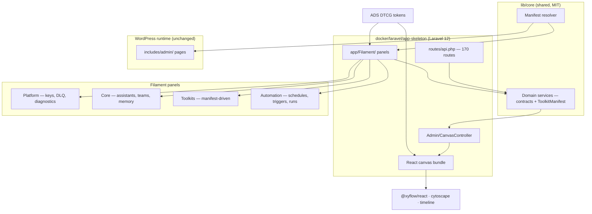
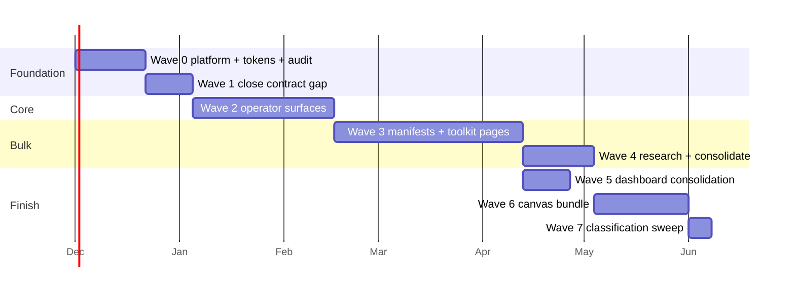

# Proposal 149 — Laravel Admin Parity: Porting the WordPress Admin Surface the Console Does Not Cover

**Status:** 🟡 PARTIALLY ACCEPTED — owner decisions D-1, D-2, D-5 resolved; architecture (D-3, Filament + canvas bundle) still pending review; Wave 0 plan ready
**Date:** 2026-11-16
**Relates to:** Proposal 090 (`docker/laravel`, the Laravel runtime flip) · Proposal 090-b (admin surfaces, Phases 0–5) · Proposal 090-d (tool port) · Proposal 090-g (identity/org authorization) · Proposal 090-h (workflow engine) · Proposal 083 (`examples/nvoos-complete-velocity`, the Complete Console) · Proposal 095 (ADS tokens / `nvoos-astro-mcp`) · Proposal 097 (cross-surface token sharing with NDS) · Proposal 107 (content surface) · Proposal 143 (Service Exchange, the expert-deploy estate) · `addons/nvoos-design-system` (NDS DTCG importer) · Skills: `mcp-ai-wpoos-laravel-runtime`, `mcp-ai-wpoos-spa-rest-contract`, `mcp-ai-wpoos-spa-ui`, `mcp-ai-wpoos-toolkit-creation`, `mcp-ai-wpoos-toolkit-universalisation`
**Author:** NV oOS coding agent (Zed)
**Research companions:** none yet — §4 cites external sources inline
**Implementation plan:** [`149-laravel-admin-parity-implementation-plan.md`](./149-laravel-admin-parity-implementation-plan.md) (Wave 0, ready for review)

---

## 0. Decision Record

| # | Decision | Date | Consequence |
|---|---|---|---|
| D-1 | The Laravel admin is **commercial**, not MIT. The **free tier is the WordPress plugin**. | 2026-11-16 (owner) | The admin may consume only MIT `lib/core` / `lib/laravel-adapter`; a licence gate over `docker/**` becomes a Wave 0 blocker (§11, §14 R1) |
| D-2 | The admin serves **operators *and* customers**. | 2026-11-16 (owner) | Two panels with different access predicates (§6.4); tenancy and entitlements move from v2 to Wave 0 (§15 OQ-6) |
| D-3 | Architecture: **Filament 5 panels + self-mounting React canvas bundle**. | 2026-11-16 (this proposal) | §5 Option C, §6 |
| D-4 | WordPress admin remains a **first-class supported surface**, not legacy. | 2026-11-16 (implied by D-1) | Manifests are shared between the free and paid products from Wave 3 (OQ-5 becomes mandatory) |
| D-5 | **Pro remains available for WordPress.** The Laravel admin is an upsell, not a replacement. | 2026-11-16 (owner) | This stays a **port** (~26–31 weeks). No customer runtime-migration track, no cutover programme. Wave 7 remains a classification sweep |

All owner decisions are now resolved. The only carried-forward items are
engineering questions in the Wave 0 plan (§8 Q-1…Q-3) and the commercial
packaging matrix (needed before Wave 3, blocks nothing in Wave 0).

---

## 1. Problem Statement

**The gap is real, measured, and larger than the console was ever designed to cover.**

The WordPress plugin ships an admin surface of **244 PHP page classes** — 85 in
`includes/admin/` (Core) and 159 in `addons/pro/includes/admin/` (Pro). The
The Complete Console (`examples/nvoos-complete-velocity`, React 19 SPA over the
Laravel API) covers **45 endpoint keys**
(`docker/laravel/app-skeleton/contracts/console-endpoints.json`, contract
version 2). Of those, **39 are declared `route`-backed and 6 are not** (4
`external-product`, 1 `toolkit-shaped`, 1 `connected-service`).

> **Measurement caveat.** The 39/6 split is the *contract* declaration. The
> *runtime* truth is what `GET /api/v1/features` reports from the live router,
> and the last figure recorded in the `mcp-ai-wpoos-laravel-runtime` skill was
> **33 true / 12 false**. Six keys had no live route at that measurement — i.e.
> they were shipped in the contract but not in `routes/api.php`. That class of
> drift is precisely what `manifest()['gaps']` exists to expose, and closing it
> is Wave 1 (§11). Re-take the number before starting Wave 1:
> `php artisan tinker --execute='$m=App\Support\EndpointCapabilities::map(); echo count(array_filter($m));'`

That means the console is, by design, a *product* surface: chat, assistants,
orchestration, toolkits, schedules, command centre, and the operator tooling a
customer needs. Everything else — and "everything else" is where the operator
work actually happens — still requires a WordPress login.

This proposal answers a deceptively simple question:

> When a site runs the Laravel runtime instead of WordPress (Proposal 090), what
> happens to the 200+ admin surfaces that exist only in `wp-admin`?

Today the answer is "they do not exist", which is why the Laravel flip is
incomplete. `EndpointCapabilities` already names the condition in its own
vocabulary: `RUNTIME_ADAPTABLE` — *"Portable surface WordPress already has; not
ported to this runtime yet."* **This proposal is the plan to drive that list to
zero, and to classify the remainder as deliberately-not-ported.**

### 1.1 Why this cannot be "port the pages"

A naive port is a multi-year project. The admin surface is not 244 distinct
problems; it is **ten recurring archetypes plus a short bespoke tail**:

| Archetype | Base | Pro | Total | Shape |
|---|---:|---:|---:|---|
| Settings (options form) | 14 | 60 | **74** | Form → validate → option write |
| Research (AI research surface) | 2 | 31 | **33** | Prompt → job → result list |
| Dashboard (metrics) | 10 | 13 | **23** | Cards + charts over aggregates |
| Bespoke operator tooling | 58* | 20 | **78** | See §2.3 |
| Metabox (CPT side panel) | — | 9 | **9** | Embedded record editor |
| Consolidate / ingest wizard | — | 7 | **7** | Multi-step import + merge |
| CPT column / row action | — | 4 | **4** | List-table extension |
| Blueprints | — | 4 | **4** | Catalogue + install |
| Command centre | — | 4 | **4** | Cross-toolkit overview |
| Menu registration | — | 5 | **5** | Navigation only |
| Shared base / trait | 1 | 2 | **3** | Not pages |

\* Base "bespoke" includes infrastructure files that are not pages at all
(`admin-scripts`, `admin-ajax-handlers`, renderer helpers, `chart-js-helper`).

And the archetypes are **already consolidated in the WordPress code itself**:

- **25** Pro pages extend `WP_MCP_AI_Toolkit_Settings_Base` — a **7-tab** shell
  (overview, configuration, tools, research, remote sites, help, MCP server)
  with four abstract methods (`get_toolkit_slug`, `get_toolkit_name`,
  `render_overview_tab`, `render_configuration_tab`) plus `get_tools_list()`.
- **20** Pro pages extend `WP_MCP_AI_CPT_Settings_Page_Base`.
- **33** pages use the `WP_MCP_AI_Research_Page_Enhancements` trait.
- **4** consolidate pages extend `WP_MCP_AI_Consolidate_Add_Base`.
- **2** toolkits are already fully manifest-driven
  (`addons/pro/includes/toolkits/manifests/{commerce,documents}.json`) with
  `screens`, `settings[]`, `entities[].columns[]` and `dashboard.cards[]`.

**So the port target is a schema engine plus a bespoke tail, not 244 screens.**
That is the central technical claim of this proposal, and everything in §6–§12
follows from it.

### 1.2 Why it matters commercially

Proposal 143 (Service Exchange) deploys an expert's MCP estate on Cloudways and
hands them a control plane. An estate whose operator must still log into
`wp-admin` to rotate a key, drain a dead-letter queue, or read the run timeline
is not a product — it is a demo with a support contract. **Admin parity is the
difference between "Laravel is an alternative runtime" and "Laravel is the
runtime".**

---

## 2. Current State (measured 2026-11-16)

### 2.1 Runtime inventory

| Layer | Location | Stack | Count |
|---|---|---|---|
| WordPress admin (Core) | `includes/admin/` | PHP + WP admin CSS/JS | 85 files |
| WordPress admin (Pro) | `addons/pro/includes/admin/` | PHP, 5 top-level menus (`crm-`, `pm-`, `media-`, `fnb-`, `chat-channels-`) | 159 files |
| Laravel runtime | `docker/laravel/app-skeleton/` | Laravel 12, Sanctum 4, Vite 7, Tailwind 4 — **no Inertia, no Livewire, no Filament** | 170 API routes |
| Console SPA | `examples/nvoos-complete-velocity/` | React 19, react-router 6, zustand 5, `@xyflow/react` 12, cytoscape, jQuery (legacy paths) | 45 endpoint keys |
| Design system (NDS) | `addons/nvoos-design-system/` | DTCG importer, admin import surface | — |
| Design tokens (ADS) | `examples/nvoos-astro-velocity/src/tokens/` | DTCG 2025.10 with drift gate | — |

Laravel's `resources/js/` contains only `app.js` and `bootstrap.js`; the Vitе
toolchain is installed and effectively unused. `routes/web.php` is a health
endpoint plus `welcome.blade.php`. **There is no first-party Laravel UI.**

### 2.2 The console's covered set (45 keys)

`chat`, `chatClient`, `transcripts`, `memory`, `tools`, `upload`, `assistants`,
`settings`, `approvals`, `triggers`, `teams`, `portability`, `security`,
`operations`, `diagnostics`, `paperStore`, `tokenManager`, `cost`,
`orchestrationStats`, `proOps`, `scheduleManager`, `workflowBuilder`,
`workflowPresets`, `workflowNodes`, `workflowRuns`, `wpBase`, `recordsSchema`,
`toolkits`, `dashboardsSchema`, `chatChannels`, `remoteSites`, `skills`,
`mcpApps`, `mediaCc`, `professions`, `orgTeams`, `blueprints`, `commandCenter`,
`shortcuts`, `slashCommands`, `okf`, plus four external-product keys
(`contentGraph`, `docsHub`, `mediaStudio`, `documentEditor`).

Reason classes declared in the contract: **39 `route`**, 4 `external-product`,
1 `toolkit-shaped`, 1 `connected-service`.

Notable: `settings` **is** covered, and so are assistants, teams, approvals,
tokens, schedules, workflows, remote sites, MCP apps, skills, OKF and blueprints.
The console is not thin — it is *narrow by product intent*.

### 2.3 What is genuinely missing

**Core (`includes/admin/`) — ~37 surfaces with no console equivalent and no
Laravel route:**

| Surface | File | Archetype |
|---|---|---|
| Onboarding wizard | `onboarding-wizard` | Multi-step setup |
| Assistant builder (visual) | `build-assistant-page` | Form + preview |
| Assistant create | `add-assistant-page` | CRUD child |
| Team create | `add-team-page` | CRUD child |
| Workflow editor | `workflow-editor-page` | **Canvas** |
| DAG builder | `admin-dag-builder` | **Canvas** |
| Run timeline | `admin-run-timeline` | **Timeline / replay** |
| Cron manager | `admin-cron-manager` | Scheduler ops |
| Dead-letter queue | `admin-dlq-manager` | Queue ops |
| Key rotation | `admin-key-rotation` | Secret ops |
| Security audit | `security-audit-admin` | Log + filter |
| Security monitor | `security-monitor-admin` | Live metrics |
| Security training | `security-training-admin` | Course tracking |
| Supplier security | `supplier-security-admin` | Records |
| MCP server diagnostic | `mcp-server-diagnostic` | Probe console |
| Provider diagnostics | `provider-diagnostics` | Probe console |
| REST context diagnostic | `rest-context-diagnostic` | Probe console |
| Performance reporter | `performance-reporter` | Report builder |
| Report generator | `report-generator` | Report builder |
| Datasets | `datasets-admin-page` | Records |
| Asset inventory | `asset-inventory-admin` | Records |
| OKF bundle manager | `okf-bundle-manager-admin-page` | Bundle CRUD |
| Conversation import | `conversation-import-admin` | Import wizard |
| Chat profile (user profile) | `user-profile-chat-profile` | Profile section |
| Memory (user profile) | `user-profile-memory` | Profile section |
| Auth0 setup | `auth0-setup` | Connection setup |
| Pro licence / Pro database | `pro-license`, `pro-database` | Licence + DB status |
| Site Health connection pool | `site-health-connection-pool` | Status |
| Multi-agent dashboard | `admin-multi-agent-dashboard` | Dashboard |
| Orchestration dashboard | `admin-orchestration-dashboard` | Dashboard |
| Crawl4AI monitor | `admin-crawl4ai-monitor` | Job monitor |
| Gmail crawl | `admin-gmail-crawl` | Job monitor |
| Markup telemetry | `admin-markup-telemetry-page` | Metrics |
| Media library columns | `admin-media-library-columns` | List extension |
| Slash commands dashboard | `admin-slash-commands-dashboard` | (console key exists) |
| Profession / team research | `admin-profession-research-page`, `admin-team-research-page` | Research |
| Test pages | `admin-test-assistant`, `-model`, `-profession`, `-team` | Probe console |

**Pro (`addons/pro/includes/admin/`) — 159 files, of which the console covers
only the four command centres, the schedule manager page, the workflow builder
page, the token manager and the skill manager.** The bulk of Pro is:

- **25 toolkit settings pages** (one per domain: CRM, PM, F&B, media, legal,
  registration, architecture, comics, quizzes, ECA, CRE debt, Shopify sync,
  site creator, ezuite, flowhub, image/video production, …) — all the same
  7-tab archetype.
- **31 research pages** (one per domain) — all the same trait.
- **20 CPT settings pages** — one shared base.
- **13 dashboards**, **7 consolidate wizards**, **9 metaboxes**,
  **4 CRM/PM/media blueprints + command centres**.

### 2.4 The surface that should *not* be ported

These are WordPress-shaped and have no meaning on a Laravel runtime. They must
be **classified**, not ported (see §13, `not-applicable`):

`admin-elementor-integration`, `admin-jetengine-integration`,
`admin-woocommerce-integration`, `admin-plugins-integration`,
`admin-media-library-columns` (WP media list), the CPT metaboxes in Pro that
attach to WordPress post types (unless the Laravel runtime owns equivalent
records), and `okf-concepts-metabox` / `architectural-*-metabox` where the CPT
itself is WordPress-only.

**Estimate after classification: ~180 surfaces to port, collapsing to 10
archetype renderers plus a bespoke tail of ~12 pages.**

---

## 3. Definitions

**Parity** = every operator task that is possible in `wp-admin` is possible in
the Laravel admin **for the same user, with the same authorization outcome, and
with no loss of auditability** — not byte-identical screens.

**Non-goals:**

1. Visual fidelity to `wp-admin`. The Laravel admin is a new product surface,
   not a WordPress theme.
2. A shared PHP codebase between the WP admin classes and the Laravel admin.
   The WP classes are WP-Coupled (`add_menu_page`, `register_setting`,
   `WP_List_Table`); the port is a re-implementation against the same domain
   services in `lib/core` and `lib/laravel-adapter`.
3. Porting WordPress-only integrations (§2.4).
4. Replacing the console. The console remains the customer product surface;
   the admin is the operator surface. Where they overlap, the console wins and
   the admin links out.
5. Multi-tenant SaaS isolation. Single-estate tenancy in this proposal; team
   scoping follows `TeamAccess` (090-g).

---

## 4. Industry Research

### 4.1 Laravel admin frameworks — the 2026 consensus

Multiple independent 2026 comparisons converge on the same split:

- **Filament is the de-facto standard** for Laravel admin panels: MIT licence,
  10M+ downloads, the largest plugin ecosystem, and materially faster
  rendering than Nova. One review puts it at "Filament v3 for 90% of new
  admins" with Nova reserved for procurement-constrained cases.
  ([edmondscommerce](https://edmondscommerce.co.uk/research/php/laravel-admin-panels/),
  [rpmstack](https://www.rpmstack.com/insights/laravel-filament-vs-nova),
  [codeaeffchen](https://codeaeffchen.com/insights/laravel-filament-admin-panels/))
- **Nova is the paid first-party option** (≈£99–£299/site) and remains the
  better answer for **Vue/Inertia teams** and organisations that want vendor
  support.
  ([laracopilot](https://laracopilot.com/blog/laravel-nova-vs-filament/),
  [backpackforlaravel](https://backpackforlaravel.com/articles/basics/admin-panel-package))
- **The honest counter-argument** is that a code-defined admin (Filament, Nova)
  makes every new operator field a developer ticket, whereas metadata-driven
  products let operators self-serve. That critique lands hardest on
  **settings-style surfaces** — exactly the archetype that dominates this
  inventory.
  ([jetadmin](https://www.jetadmin.io/blog/best-laravel-admin-panels/))
- **Panel-per-domain is the documented scaling pattern.** Filament's own
  advanced docs prescribe modular/DDD architecture with each domain as a
  Composer package under `app-modules/`, and the community guidance for
  multi-panel deployments is that separate guards, middleware and data scopes
  are where default conventions start to fight you.
  ([Filament 5 modular architecture](https://filamentphp.com/docs/5.x/advanced/modular-architecture),
  [Filament at scale](https://msaied.com/articles/filament-at-scale-multi-panel-auth-custom-panels-and-table-query-tuning-1))

**Takeaway for NV oOS:** Filament's resource/archetype model maps almost
one-to-one onto the measurement in §1.1 (74 settings pages, 33 research pages,
23 dashboards). The metadata critique is *already answered* in this repo by the
toolkit manifest engine — the correct design is Filament rendering a manifest,
not 74 hand-written PHP classes.

### 4.2 Admin UX standards

The admin-panel UX literature is unusually consistent:

- **The data table is the workhorse.** Table support must include search,
  filters, sorting, column visibility, pagination, bulk actions and sticky
  headers, with **one shared state object** keeping those behaviours consistent
  across views.
  ([enterprise UI patterns](https://yslootahtech.com/blog/enterprise-ui-patterns),
  [admin panel design](https://nextdigit.in/blogs/admin-panel-design-best-practices))
- **Three-level information hierarchy** — level 1 (metrics, alerts, primary
  actions) on load; level 2 (filters, config, detail tables) one interaction
  away; level 3 (audit logs, history, advanced settings) on demand. Progressive
  disclosure is the mechanism.
  ([SaaS admin panel design](https://taqwah.agency/blog/saas-admin-panel-design-guide))
- **Bulk actions must be visually tied to the selection** — a selection-driven
  action bar, not a static toolbar.
  ([bulk action UX](https://www.eleken.co/blog-posts/bulk-actions-ux))
- **Detail views must not lose list context.** Inspect-without-navigating-away
  (drawer / side panel) is the pattern that distinguishes a modern admin from a
  page-per-record CRUD app.
  ([admin portal design](https://www.bolderapps.com/blog-posts/admin-portal-design))
- **Settings pages need grouped field rendering** and should minimise tab
  stops across dozens of repeated controls — "this pattern belongs in the design
  system rather than being rebuilt in each page".
  ([accessible complex settings](https://setting.page/accessibility-patterns-for-complex-settings-panels-in-data-h))

**Takeaway:** the toolkit 7-tab shell is *already* the level-1/2/3 hierarchy
(overview → configuration/tools → research/remote/help). The port should
preserve that IA rather than invent one.

### 4.3 Accessibility — WCAG 2.2 AA is the floor

The repo already gates the storefront on WCAG 2.2 (`contrast-audit.test.ts`,
SC 1.4.3 4.5:1 and SC 1.4.11 3:1). The admin must meet the same bar, and WCAG
2.2 adds four criteria that bite specifically in dense admin UI:

| SC | Level | Admin impact |
|---|---|---|
| **2.5.8 Target Size (Minimum)** | AA | ≥ 24×24 CSS px for every icon button, table row action, tab close, drag handle |
| **2.4.11 Focus Not Obscured (Minimum)** | AA | Sticky table headers, sticky bulk-action bars and toasts must not cover the focused row |
| **3.3.7 Redundant Entry** | A | Multi-step wizards (consolidate, onboarding, import) must not re-ask for data already given |
| **3.3.8 Accessible Authentication** | AA | Paste must be allowed in token/key fields; no cognitive-function tests |
| 2.4.13 Focus Appearance | AAA | Recommended anyway — the ADS `focus-ring` token should drive a visible 2 px ring |

([W3C — What's New in WCAG 2.2](https://www.w3.org/WAI/standards-guidelines/wcag/new-in-22/),
[Deque WCAG 2.2](https://dequeuniversity.com/resources/wcag-2.2/),
[DEESU on target size and focus](https://deesu.org/blog/wcag-2-2-target-size-focus-visibility))

### 4.4 Schema-driven forms

The industry guidance is that forms-as-data pays off exactly where forms are
numerous and structurally similar — internal tools, admin panels, and
schema-driven CRUD:

> "It is especially strong for internal tools, admin panels, and schema-driven
> CRUD flows, where forms often map directly to structured records."
> — [SurveyJS](https://surveyjs.io/stay-updated/blog/best-json-form-editor)

The failure modes are well documented too: storing the schema in client state
instead of the backend, duplicating validation between client and server, and
re-inventing reactivity cleanup per form.
([Laravel + Vue dynamic forms](https://dev.to/addwebsolutionpvtltd/creating-dynamic-forms-with-laravel-and-vue-3-4pdj),
[LogRocket on schema-driven validation](https://blog.logrocket.com/stop-fighting-schema-driven-form-validation/))

**Takeaway:** the manifest engine must own the schema **server-side**, emit it
through an endpoint, and render it on both surfaces (WP admin and Laravel
admin). Options are read back per-role — the same schema drives different field
sets for different capabilities, which is the role-aware form case called out in
the JSON-Schema literature.

### 4.5 Migration strategy — parallel run, not a classic strangler

Microsoft's Strangler Fig definition is precise: a façade sits in front of the
legacy system and **incrementally shifts requests** from old to new until the
legacy path can be removed.
([Azure Architecture Center](https://learn.microsoft.com/en-us/azure/architecture/patterns/strangler-fig))
The pattern's value is that it "turns a risky big-bang rewrite into a series of
small, reversible changes".
([oneuptime](https://oneuptime.com/blog/post/2026-01-30-strangler-fig-pattern/view))

**But this migration is not a true Strangler Fig, and the proposal should not
claim it is.** There is no façade interposing between `wp-admin` and the
Laravel admin — they are two separate operator surfaces over two separate
runtimes. The published cautionary note is directly applicable:

> implementations should not be described as direct Strangler Fig
> implementations unless internal evidence confirms capability-level
> interception, parallel operation, progressive traffic routing and staged
> retirement of legacy functionality.
> — [Catapult CX](https://catapult.cx/blog/strangler-fig-pattern-legacy-modernisation/)

What this proposal actually does is **parallel run with a capability ledger**
(the parallel-run playbook's shape, minus the proxy):

- **Capability-level accounting** — `EndpointCapabilities` keys are the ledger
  rows. A capability is migrated when its key flips, not when a page ships.
- **Parallel operation** — the WordPress admin keeps working unchanged for WP
  estates; a Laravel estate simply has no `wp-admin` to fall back to, which is
  why the ledger must reach zero before Proposal 090 completes.
- **Reversibility** — every wave is a additive route + panel; disabling a
  Filament panel is a config change, not a rollback migration.
- **Staged retirement** — §2.4 and Appendix A's `not-applicable` / `retired`
  dispositions are the retirement record.

### 4.6 What the research does *not* support

Nothing found supports porting a large legacy admin **page-by-page** into a
framework. The consistent recommendation in every source above is: model the
domain, let the framework render the archetype, hand-build only the outliers.
That is the shape adopted in §6.

---

## 5. Architectural Options

Five candidate architectures were evaluated against seven criteria. Scoring:
**5 = excellent, 1 = poor**.

| Criterion | A. Extend console | B. Inertia + React | C. Filament + bespoke bundle | D. Inertia + Svelte | E. Keep WP admin |
|---|---|---|---|---|---|
| Archetype coverage per unit of work | 2 | 3 | **5** | 3 | 1 |
| Reuse of existing repo investment | **5** | **5** | 3 | 1 | **5** |
| Design-token (NDS/ADS) parity | **5** | **5** | 3 | 4 | 2 |
| Authorization parity with `CapabilityMap` | **5** | **5** | **5** | **5** | 1 |
| Canvas surfaces (`@xyflow/react`, cytoscape) | **5** | **5** | 3 | 1 | 4 |
| Bundle weight / table performance at 10k rows | 4 | 4 | 3 | **5** | 2 |
| Time to first parity wave | 2 | 3 | **5** | 2 | **5** |
| **Total** | 28 | 30 | **27** | 21 | 20 |

### A. Extend the Complete Console

Add ~180 admin pages to `examples/nvoos-complete-velocity`.

- ➕ One app, one framework, one design system, full component reuse.
- ➖ The console is the **customer product** (MIT, `examples/`, Velocity-deployed,
  `spa-v2`-adjacent). Admin is operator-only, capability-gated, and must never
  ship to a customer bundle. Mixing them forces a code-split-by-role build that
  nobody wants to maintain, and it puts DLQ/key-rotation UI in the same bundle
  tree as the storefront-facing chat.
- ➖ `react-router` (not Inertia) means every admin page needs a REST controller
  *and* a client route *and* a `runtime-config` key — three places to drift.

### B. Inertia 2 + React 19, inside the Laravel app

- ➕ Laravel owns routing and policies; the client is a thin renderer.
- ➕ Reuses React 19, `@zag-js/react`, `@xyflow/react`, cytoscape and the ADS
  token pipeline; ONE framework across console and admin.
- ➖ You build the admin framework yourself: table, filters, bulk actions,
  drawers, form schema, notifications, saved views. Filament ships all of it.

### C. Filament 5 panels (domain-partitioned) + a self-mounting React bundle for canvas pages — **recommended**

- ➕ Filament's Resource/Schema/Table model *is* the archetype model. 74 settings
  pages and 20 CPT pages become resources; 23 dashboards become widgets.
- ➕ MIT, Laravel-native, `php artisan make:filament-*` generators, mature
  table/filter/bulk-action/infolist/action-modal primitives, policy integration.
- ➕ Multi-panel maps cleanly onto `EndpointCapabilities` domains and onto the
  five existing Pro menus.
- ➕ The canvas tail reuses the pattern this repo has **already shipped and
  hardened**: `/manage` injects a self-mounting prebuilt bundle
  (`public/manage-assets/astro-admin.js` → `#astro-admin-root`). A Filament
  "page" that mounts `admin-canvas.js` on `#nvoos-canvas-root` is the same
  mechanism, already battle-tested on Cloudways/Velocity.
- ➖ Livewire/Alpine is a third JS stack. Mitigated: the bespoke bundle is plain
  React; no page mixes both.
- ➖ Token parity needs a compiled Filament theme (§10).

### D. Inertia 2 + Svelte 5

- ➕ Smallest bundles, fine-grained reactivity, no `useEffect` footgun class, scoped
  CSS. Genuinely the best *runtime* of the four.
- ➖ **Third framework** in the repo (Astro islands = React, console = React,
  admin = Svelte), and the canvas surfaces (`@xyflow/react`, cytoscape,
  `@zag-js/react`) would all need Svelte equivalents — a rewrite of the exact
  components that are hardest to rewrite.
- Verdict: correct choice *if* the admin were the first frontend in the repo.
  It is not. Deferred with an explicit trigger (§15, OQ-3).

### E. Keep `wp-admin` as the operator surface for Laravel estates

- ➕ Zero work.
- ➖ Requires WordPress alongside Laravel forever, which negates Proposal 090.
- ➖ An estate with two databases and two auth systems is an operational
  liability, and Service Exchange (143) cannot ship it.

---

## 6. Recommendation — Option C

**Build one Laravel admin application inside `docker/laravel/app-skeleton`:
Filament 5 for the archetype bulk, a self-mounting React bundle for the five
canvas/telemetry surfaces, both themed from ADS tokens, both authorized through
the existing `CapabilityMap` + `TeamAccess` gates.**

### 6.1 Why not "Filament for everything"

Filament cannot credibly host the workflow builder, the DAG builder, the run
timeline scrubber, or the security-monitor live charts. Those already exist as
React (`@xyflow/react` + cytoscape in `spa-v2`). The self-mounting bundle keeps
them without a rewrite and without Inertia.

### 6.2 Why not "bespoke for everything"

Building tables, filters, bulk actions, drawers, modals, notifications, saved
queries, form validation and infolists by hand is ~6–9 months of framework work
before the first admin page ships. Filament is that work, already done, MIT.

### 6.3 Target topology



**One deploy, one auth (Sanctum), one policy layer, two renderers.**

### 6.4 Panel map

| Panel | Path | Contents | Maps to |
|---|---|---|---|
| `operator` | `/ops` | **NV staff only.** Onboarding, licences, DB/status, key rotation, DLQ, cron, provider/MCP/REST diagnostics, Site Health, auth0, security audit | `commandCenter`, `security`, `operations`, `diagnostics` |
| `core` | `/admin/core` | Assistants (+builder), teams, professions, chat profiles, memory, media, transcripts, tools | `assistants`, `teams`, `professions`, `tools`, `memory` |
| `toolkits` | `/admin/toolkits` | All 25+ toolkit settings + research + consolidate, manifest-rendered, **entitlement-gated** | `toolkits`, `recordsSchema` |
| `toolkits/{domain}` | `/admin/toolkits/crm` etc. | Per-domain command centre, dashboards, blueprints, typed records | `proOps`, `workflowPresets` |
| `automation` | `/admin/automation` | Schedules, triggers, workflows (list), runs (list), approvals | `scheduleManager`, `triggers`, `workflowRuns`, `approvals` |
| `automation/canvas` | `/admin/automation/editor` | **React bundle** — workflow editor, DAG builder, run timeline | `workflowBuilder`, `workflowNodes` |

**Two audiences, two panels with different access predicates.** Owner
decision 2026-11-16: the admin is **operator *and* customer facing**, and
**commercial** (the free tier is the WordPress plugin). That makes the split
load-bearing, not cosmetic:

| Audience | Panels | Access predicate |
|---|---|---|
| NV operator (`/ops`) | `operator` | NV internal staff flag **and** `manage_options`. Never tenant-scoped — an operator must be able to see every estate. |
| Customer (`/admin`) | `core`, `toolkits`, `automation` | Tenant member with `>= manager` **and** an active entitlement for the surface. |

Destructive infrastructure actions (key rotation, DLQ drain/replay, cron
management, provider diagnostics, licence writes) exist **only** in `operator`.
A customer estate never renders them — not disabled, absent.

### 6.5 Two tiers, one manifest

The owner decision makes the tier model explicit, and the existing reason
vocabulary already describes both tiers without extension:

| Tier | Runtime | Pro bundled | Manifests present | Existing reason code |
|---|---|---|---|---|
| Free | WordPress | no | Core only | `not-installed` (Pro keys) |
| Commercial | Laravel | yes | Full catalogue | `route` |

This is why the manifest engine is not a migration artifact: it is the
**shared configuration layer between the free and paid products**. One schema,
two renderers (WordPress `includes/admin/`, Laravel Filament). A surface that
exists on one tier and not the other must be explained by a reason code, not by
an undocumented gap — see §15 OQ-7.

Panels are registered per domain, not one mega-panel, following Filament's
modular-architecture guidance.

---

## 7. The Archetype Catalogue

Ten renderers cover ~180 surfaces. Each has a manifest contract, a WP renderer
(already exists) and a Filament renderer (to build).

### 7.1 `settings` — 74 surfaces

**Contract** (extends the existing manifest shape):

```json
{
  "slug": "commerce",
  "settings": [
    { "key": "currency", "label": "Display currency", "type": "text",
      "default": "USD", "description": "…",
      "capability": "manage_options", "secret": false }
  ]
}
```

Filament mapping: one `Schema` per toolkit, `->group()` per config section,
server-side validation generated from `type` + `required` + `enum`, secrets
rendered through a `password` field that never echoes the stored value
(mirrors `WP_MCP_AI_Admin_Settings_Base::mask_sensitive_setting_value`).

**Invariant carried over:** `is_sensitive_setting_key` / masking behaviour must
be identical. A port that echoes a stored API key is a security regression.

### 7.2 `research` — 33 surfaces

Contract: `{ domain, prompt_template, default_assistant, output_collection,
capability }`. Filament: a page with a form + a `Poll` on a job status +
`PaperStore`-backed results table. Reuses the existing
`POST /api/v1/pro/toolkits/{slug}/research` route (090-c).

### 7.3 `dashboard` — 23 surfaces

Contract: `dashboard.cards[]` with `source`, `aggregate`, `filter` (already in
the manifests). Filament: `StatsOverview` widgets; card definitions resolved
from the manifest so a new card is data, not a class.
**Rule: do not port 23 dashboards 1:1.** Consolidate to three (platform,
domain, security) with manifest-driven cards — see §11 Wave 5.

### 7.4 `metabox` — 9 surfaces

Filament has no metaboxes; the equivalent is an edit page with relation
managers. Each metabox becomes a `RelationManager` or a form section.

### 7.5 `consolidate` — 7 surfaces

Multi-step import wizard → Filament wizard (`HasWizard`), with the
**Redundant Entry** rule applied (SC 3.3.7): the merge step must pre-fill from
the upload step.

### 7.6 `command-center` — 4 surfaces

Cross-toolkit overview → Filament page with widgets. Keep the existing IA; do
not redesign.

### 7.7 `blueprints` — 4 surfaces

Catalogue + install → Filament resource with a custom action that calls the
existing install route.

### 7.8 `probe` — 6 surfaces (new archetype, no WP name)

MCP server diagnostic, provider diagnostic, REST context diagnostic, test
assistant/model/profession/team. All are "send a request, show the envelope".
One renderer, parameterised by endpoint + form schema.

### 7.9 `records` — datasets, asset inventory, supplier security, OKF bundles, conversations

Generic CRUD over `recordsSchema` (route already exists). This is the surface
that most benefits from being schema-driven.

### 7.10 `canvas` — 4 surfaces

Workflow editor, DAG builder, run timeline, security-monitor live chart.
**React bundle.** Do not attempt in Livewire.

---

## 8. Authorization Parity

The single most dangerous failure mode of this port is a page that renders but
is not gated — the exact bug class Proposal 090-g fixed ("the console hid the
buttons, the API did not care").

### 8.1 The rule

**Every admin page's policy must resolve through `CapabilityMap`, and every
Filament action must call `->authorize()`.** A Filament resource without a
policy is a defect, not a default.

### 8.2 Mapping

| WP capability | Laravel gate | Filament |
|---|---|---|
| `manage_options` | `can:manage_options` | `->visible(fn () => Gate::allows('manage_options'))` |
| `edit_posts` / `delete_others_posts` | `edit_posts` / editor separation | `canViewAny` / `canDelete` on the resource |
| `manage_astro` (bridge) | `manage_astro` | policy method |
| `manage_oos` | `manage_oos` (090-b, added late) | panel access |
| Team role (`owner`…`viewer`) | `TeamAccess` | panel tenancy scope |

### 8.3 Panel access

Each panel declares `->authGuard('web')` and a `canAccessPanel()` that checks
the domain's capability. A user with only `viewer` on a team must see records
read-only and **zero** destructive actions — not disabled buttons, absent
actions (hiding a button is UX; the policy is the enforcement).

### 8.4 Secrets

Key rotation, provider API keys, remote-site credentials and the password vault
are the highest-risk surfaces. Rules:

1. No read path returns a credential — uniform mask + `has_credentials`
   boolean (already the `nvoos_remote_sites` invariant).
2. Writes go through `credentialsFor()`-style single openers only.
3. Every secret write emits an audit line.
4. Paste must be permitted (SC 3.3.8); no auto-trim of pasted keys.

### 8.5 The third axis: entitlement

Owner decision 2026-11-16 (commercial admin) adds an authorization dimension
that did not exist while the admin was conceived as operator-only. The rule is
now:

> **visible = policy(role) ∧ tenancy(team) ∧ entitlement(plan)**

Policy answers *may this person do this*. Tenancy answers *on whose estate*.
Entitlement answers *did they buy it*. A customer `administrator` on their own
estate still has no CRM if CRM was not licensed — and that must be enforced
server-side, because a hidden nav item is UX, not authorization (the 090-g
rule, applied to a new axis).

Implementation (T-0.8, shipped 2026-11-16):

- **Resolution is per estate.** `App\Support\TenantEntitlement` decorates the
  shared `ProEntitlementInterface`: an estate with `tenants.licence_key`
  resolves against the licence server regardless of the install driver; an
  estate without one uses `oos.pro_entitlement`. The install driver describes
  the host, the key describes the customer — a customer estate must never
  inherit a permissive host default.
- **The contract is `scoped()`, not `singleton()`.** Octane flushes scoped
  bindings between operations; a singleton would pin the first estate's
  entitlement for the worker's life.
- **Gating reuses what existed.** `EnsureProEntitlement` (alias
  `pro.entitlement`) already guards the Pro route groups, and
  `ToolkitManifest::feature()` is the declared entitlement hook. No second
  mechanism was added.
- **The vocabulary is gated.** Two tests assert that every
  `pro.entitlement:<feature>` on a live route and every manifest `feature`
  exists in `ProPlanCatalog` — this caught four in-use keys
  (`schedules`, `records`, `commerce`, `documents`) that no plan entitled,
  which would have 402'd the whole Pro surface on the first licensed install.
- **Entitlement survives a missing schema.** `/api/v1/features` reads `plan()`
  on every request, so a hard estate lookup is guarded and degrades to the
  install driver when the table is absent.
- A per-surface test remains the rule: unlicensed → 402
  (`pro_entitlement_required`), licensed → 200. Locale-level 404 is reserved
  for resources added in Wave 2, where a missing record must not disclose ids.

---

## 9. Data & Service Reuse

The admin is a **renderer**, not a second backend.

| Need | Reuse |
|---|---|
| Assistants, teams, org | `lib/core` domain contracts + `lib/laravel-adapter` repositories (already bound) |
| Toolkit records | `recordsSchema` + `nvoos_toolkit_records` |
| Paper Store | `PaperStoreInterface` / `JsonPaperStore` |
| Schedules / triggers / runs | `nvoos_schedules`, `nvoos_triggers`, `nvoos_workflow_runs` |
| Research jobs | `POST /api/v1/pro/toolkits/{slug}/research` (090-c) |
| Activity/cost/security | telemetry stores (`nvoos_*` migrations) |
| Manifests | `ToolkitManifest` (`lib/core`) + `addons/pro/includes/toolkits/manifests/*.json` |

**No new tables** except two admin-only ones (§9.1).

### 9.1 New tables (2)

| Table | Purpose | Why not reuse |
|---|---|---|
| `nvoos_admin_audit` | Who changed what in the admin, page + record + before/after diff | The security audit log is a *security* store; admin change history is an *operations* store with a different retention rule |
| `nvoos_admin_views` | Saved table views (filters + sort + column visibility) per user per resource | The industry guidance on shared table state; no existing store |

### 9.2 Manifest growth

Expand from 2 manifests to ~25. This is **data authoring, not engineering** —
and it is the same data the WP admin pages should eventually read, giving both
surfaces one source of truth (Proposal 097's cross-surface principle applied to
admin config).

---

## 10. Design-Token Parity (ADS → Filament; NDS deliberately bypassed)

The repo already has three token consumers: the Astro storefront (`--ads-*`),
the console (`spa-v2` NDS palettes), and the NDS addon (DTCG importer).

**Rule: the admin is a fourth consumer, never a fourth definition.**

**Implementation (T-0.6) — the admin reads ADS directly, not NDS.** The NDS
export deliberately drops `accent-ink`, `danger` and `focus-ring`
(`ADS_UNMAPPED` in `examples/nvoos-astro-velocity/mcp/tools/ops.ts`) because NDS
has no on-accent, error or composite-shadow token. Round-tripping through NDS
would lose exactly the danger colour and focus ring an admin panel needs, so
the generator reads `src/tokens/{core,semantic,themes/default}.json` itself.

1. `php artisan admin:theme` resolves the light theme over the semantic layer,
   resolves `{core.*}` references, and writes a committed
   `app/Support/AdminTheme.php`.
2. Both panels take `->colors(AdminTheme::FILAMENT_COLORS)` — one palette, two
   panels, so a customer estate and the vendor panel cannot disagree on what
   "danger" looks like.
3. `php artisan admin:theme --check` and `AdminThemeDriftTest` fail when a
   token changes without regeneration.
4. `AdminThemeDriftTest` also asserts WCAG 2.2 AA on the five authored pairs.

**Gap closed (Q-4, 2026-11-16).** ADS originally had no `success`, `warning`
or `info` token — an editorial palette carries brand, ink and one error colour.
The generator reported the gap rather than inventing hexes, and the tokens were
then added to `core.json` + `semantic.json` + both theme modes, so all four
consumers inherit them together. Measured values and ratios:

| Token | Light | Dark | Light contrast |
|---|---|---|---|
| `success` | `#2e7d32` | `#4ade80` | 5.13:1 |
| `warning` | `#8a5300` | `#fbbf24` | 6.33:1 |
| `info` | `#0b5fa5` | `#7cc4ff` | 6.57:1 |

`success` is a grass green rather than the brand accent's teal-green so a
success badge is distinguishable **by hue**, not only by shade — otherwise it
reads as a primary button.

The storefront's contrast audit gates every semantic colour, so the three new
tokens required three new gated pairs; adding a token without a pair fails
`covers every color token in semantic.json`.

**Carried forward:**

- **Dark mode** is not generated yet; `AdminThemeGenerator` resolves `light`
  only and must gain the dark pass rather than fork. Filament's dark mode and
  the storefront's `[data-theme="dark"]` must come from the same resolution.
- **The Wave 6 canvas bundle** will consume the same generated values. Emit them
  as CSS custom properties at that point — not before, so no unused artefact is
  committed.
- **High-contrast mode** rides `data-contrast="high"` exactly as the storefront
  does; the ADS `line-strong` token is what makes SC 1.4.11 hold.

**Non-negotiable pairs** (mirrors `contrast-audit.test.ts`):

| Pair | Minimum |
|---|---|
| body text on surface | 4.5:1 (SC 1.4.3) |
| control border on surface (`line-strong`) | 3:1 (SC 1.4.11) |
| focus ring on adjacent colour | 3:1 |
| destructive action text | 4.5:1 |

Asserted in `AdminThemeDriftTest::test_the_authored_pairs_meet_wcag_2_2`.

---

## 11. Migration Waves

Each wave is independently shippable and has an exit gate. **The tracking
mechanism is `EndpointCapabilities`:** every admin surface gets a key with a
reason class, and the wave's exit gate is "no key in this wave still reports
`runtime-adaptable`".

### Wave 0 — Foundation (3–4 weeks)

- **Licence boundary gate (blocker).** Extend `bin/check-license-boundary.sh`
  with `check_tree "docker/laravel/app-skeleton" "GPL"` plus an import guard
  that fails if the Laravel app references `includes/`. The commercial admin
  may consume `lib/core` + `lib/laravel-adapter` (both MIT) and nothing from
  the GPL tree; today nothing enforces that (§14 Risk R1).
- Install Filament 5 + Livewire; register the `operator` panel at `/ops` and
  the `admin` panel at `/admin` with **tenant scoping**
  (`->tenant(...)` — tenancy moved into v1, see §15 OQ-6).
- `AdminPolicy` base + `CapabilityMap` wiring; `canAccessPanel` on both panels;
  the operator panel additionally requires the NV staff flag.
- `Entitlements` service + `EntitlementMiddleware` + `requires` in the manifest
  schema (§8.5).
- Token pipeline: DTCG → Filament theme, with the drift gate.
- `nvoos_admin_audit` + `nvoos_admin_views` migrations.
- Shell: nav, breadcrumbs, global search, notifications, dark/light/high-contrast.
- **Exit gate:** an operator can log in to `/ops` and a tenant admin to `/admin`;
  each sees only their own panels; an unlicensed toolkit 404s; theme toggles;
  every action writes an audit row. `bash bin/check-license-boundary.sh` green;
  `php artisan test` green; a Playwright smoke asserts the two-audience split,
  theme and audit.

### Wave 1 — Close the contract/runtime gap (2 weeks)

The console already *expects* these; they are the cheapest visible wins.

- Re-measure first. `manifest()['gaps']` must be reproduced on a running stack
  before any work starts — the gap set, not the proposal, is the work list.
- For each gap, either register the missing route (and its domain service) or
  reclassify the key's reason in **both** copies of the contract
  (`EndpointCapabilities::REASONS` and `contracts/console-endpoints.json` — the
  contract test fails if they disagree).
- The 6 declared non-route keys need a recorded ruling too: `external-product`
  keys stay discovered-not-ported, `connected-service` stays configuration-gated,
  and `toolkit-shaped` either becomes a real route through the manifest engine
  (Wave 3) or is retired.
- Contract test must move each key between lists in the same commit
  (`EndpointCapabilitiesTest` asserts both directions).
- **Exit gate:** `/api/v1/features` reports `endpoint_gaps: []`; the console
  smoke (G1) still passes with zero WordPress requests.

### Wave 2 — Core operator surfaces (4–6 weeks)

`operator` panel (/ops, NV staff only): onboarding wizard, licences, Pro
database status, key rotation, DLQ manager, cron manager, Site Health,
provider/MCP/REST diagnostics, auth0 setup, security audit/monitor/training,
asset inventory, datasets, conversation import, OKF bundles, report generator.

`core` panel (/admin, tenant-scoped): assistants, teams, professions, chat
profiles, memory, media, transcripts, tool catalogue.

- One Filament page per surface, except the six `probe` surfaces → one renderer.
- **Exit gate:** every listed surface reachable and gated; each has a Pest test
  asserting 403 for a subscriber and 200 for an administrator; Playwright covers
  key rotation and DLQ drain end-to-end against the real stack.

### Wave 3 — The toolkit archetype bulk (6–8 weeks, parallelisable per domain)

- Expand manifests from 2 → ~25 (settings + entities + dashboard cards).
- Build the manifest resolver + generic toolkit Filament page (7 tabs).
- First domain proves the pattern (recommend `commerce`, already manifest-backed),
  then the remaining 24 land as **data**, one manifest per PR.
- CPT settings pages (20) are the same renderer with `entities[]` only.
- **Exit gate:** all 25+ toolkit settings pages and 20 CPT pages served from
  manifests; a manifest lint (`bin/audit-admin-manifests.php`) fails CI if a
  toolkit with a settings page lacks a manifest entry.

### Wave 4 — Research + consolidate (3 weeks)

- 33 research pages from manifest fields (Wizard + poll + results table).
- 7 consolidate wizards from the `consolidate` contract.
- **Exit gate:** every research surface has a parametrised test (subscriber 403,
  manager 200, job status polls, reject path shown).

### Wave 5 — Consolidate the dashboards (2 weeks)

- **Do not port 23 dashboards.** Ship three: `platform`, `domain`, `security`.
- Manifest `dashboard.cards[]` decides which cards appear per domain.
- **Exit gate:** the 23 WP dashboards are each mapped in a table in this doc's
  appendix to one of the three, or to "retired (no operator value)".

### Wave 6 — Canvas surfaces (4 weeks)

- `admin-canvas.js` React bundle: workflow editor, DAG builder, run timeline,
  security-monitor live chart.
- Self-mount on `#nvoos-canvas-root` from a Filament page — the `/manage`
  pattern (two-bundle drift gate applies).
- **Exit gate:** an existing WordPress workflow graph loads, executes and its
  run renders on the timeline (Proposal 090-h engine); CSP-equivalent headers
  or nonce strategy pinned by test.

### Wave 7 — Classification sweep (1 week)

- Every remaining `wp-admin` page gets a recorded disposition:
  `ported`, `not-applicable` (WP-only integration), or `retired` (superseded).
- Publish the disposition table in this doc's appendix and wire a PHPUnit test
  that fails when a new `includes/admin/*.php` file has no disposition row.

**Total: ~26–31 weeks of engineering, with Waves 3–5 parallelisable across
domains.** Scope locked by D-5 (2026-11-16): Pro remains on WordPress, so this
is a port with no customer-migration track.

Wave 0 is specified in
[`149-laravel-admin-parity-implementation-plan.md`](./149-laravel-admin-parity-implementation-plan.md)
— task-by-task, file-level, with exit gates.

---

## 12. Per-Page Playbook

Every admin page follows the same eight steps. This is the artifact that keeps
three agents working in parallel consistent.

1. **Classify** — pick the archetype; if none fits, stop and propose a new
   archetype (§7), do not hand-build.
2. **Manifest** — add or extend the JSON entry (settings keys, entity columns,
   dashboard cards).
3. **Domain** — confirm the Laravel domain service exists. If not, port it to
   `lib/core` first (never put domain logic in a Filament page).
4. **Policy** — add the gate; write the 403 test *before* the happy path.
5. **Renderer** — resource/page from the archetype renderer.
6. **Token** — no hard-coded colour; ADS vars only.
7. **Tests** — Pest (policy + validation + write), Playwright (one journey),
   and the accessibility gate (§13.3).
8. **Disposition** — record the row in Appendix A; flip the
   `EndpointCapabilities` key.

**Anti-patterns explicitly banned:**

- Business logic inside a Filament `Page`/`Resource` (must live in `lib/core`).
- A resource without a policy.
- A settings field that echoes a stored secret.
- `->disabled()` in place of `Gate::allows()`.
- A second definition of a design token.
- A page that queries the database directly instead of a domain repository.

---

## 13. Testing Strategy

### 13.1 Backend

| Layer | Tool | Gate |
|---|---|---|
| Policies + validation + writes | Pest in `docker/laravel/app-skeleton/tests` | per-page, 403 + 200 |
| Manifest schema | `bin/audit-admin-manifests.php` (CI) | every toolkit page has a manifest |
| Contract | `EndpointCapabilitiesTest` | key lists + reasons, both directions |
| Regression | existing 694 app tests | no baseline loss |

### 13.2 End-to-end

Playwright against the real stack (the console smoke precedent), covering the
**journeys that must never break**: sign in → rotate a key → see the audit line;
drain a DLQ job; run a research job; execute a workflow and read the timeline;
toggle high-contrast.

### 13.3 Accessibility

- `@axe-core/playwright` on every admin route in the smoke sweep — **zero**
  violations, the storefront precedent.
- A manual checklist for the four new WCAG 2.2 criteria (§4.3), signed once per
  wave.
- Contrast: reuse `contrast_check` against the compiled theme's semantic pairs.

### 13.4 Performance

- A 10k-row table must paginate server-side (no client-side hydration of the
  full set) and answer first paint under the storefront's LHCI-equivalent
  budget. Add a Pest perf assertion on the repository query (no N+1: assert
  query count).
- Svelte/Blade debate aside: **the canvas bundle must not ship to non-canvas
  pages.** Assert via a build-size test that `admin-canvas.js` is loaded only
  from the canvas page.

---

## 14. Risks

| Risk | Likelihood | Impact | Mitigation |
|---|---|---|---|
| **R1 — GPL contamination of the commercial admin** | Medium | **Fatal** (kills the commercial model) | Wave 0 licence gate: `check_tree "docker/laravel/app-skeleton" "GPL"` + import guard refusing `includes/` references. The Laravel app may consume only MIT `lib/core` / `lib/laravel-adapter` |
| **R2 — Third-party GPL contribution to a ported surface** | Low | **High** | NV Digital owns the original code, so relicensing the commercial port is permitted; an *external* contributor's GPL patch to the same surface is not. Record contributor provenance for `includes/admin/**` before porting a page |
| A page ships ungated | Medium | **Critical** | Policy-first playbook step; 403 test before happy path; CI test that every Filament resource declares a policy |
| A page ships without an entitlement check | Medium | **High** (revenue leak) | `requires` in the manifest schema; per-surface 404 test; Wave 0 `EntitlementMiddleware` |
| Customer can reach a destructive operator action | Low | **Critical** | Those routes exist only in the `operator` panel, which requires the NV staff flag. Asserted by a Playwright test that a tenant admin cannot see `/ops` |
| Secret echoed in a settings form | Medium | **Critical** | Reuse `is_sensitive_setting_key` semantics; a test that POSTs an empty secret and asserts the stored value is unchanged |
| Tenancy leak (customer A reads customer B) | Low | **Critical** | Filament tenant scoping on every customer panel + a Pest test per resource asserting cross-tenant 404 |
| Third JS stack (Livewire) raises maintenance cost | High | Medium | Canvas bundle is plain React; no page mixes both; document the boundary |
| Manifest engine becomes a fourth abstraction to maintain | Medium | Medium | Manifests must be *consumed by both* WP admin and Laravel admin — one reader in `lib/core`, two callers (OQ-5 makes this mandatory) |
| Token drift between ADS/NDS/Filament | High | Medium | Compiled-theme drift gate (§10) |
| Wave 3 balloons because manifests are wrong | High | Medium | Land `commerce` first as the reference, lock its shape, then generate |
| Filament upgrade churn | Medium | Low | Pin the major; the codebase is pages + schemas, not framework forks |
| Scope creep into "improve the WP page while porting" | **High** | Medium | Parity means parity. Behaviour changes need their own proposal |

---

## 15. Open Questions (owner decisions)

**OQ-1 — Licence scope. ✅ RESOLVED (owner, 2026-11-16): commercial.**
The admin is a commercial surface. The free tier is the WordPress plugin. This
makes the licence invariant load-bearing: the Laravel app may consume
`lib/core` + `lib/laravel-adapter` (MIT) and **nothing** from the GPL
`includes/` tree. Enforced by the Wave 0 gate (§11), not by convention.

**OQ-2 — Audience. ✅ RESOLVED (owner, 2026-11-16): operator *and* customer.**
Two panels with different access predicates (§6.4): `/ops` for NV staff
(unrestricted by tenancy), `/admin` for tenant members (tenant-scoped +
entitlement-gated). This supersedes the earlier operator-only recommendation
and is the reason tenancy and entitlements are Wave 0 rather than v2.

**OQ-3 — Svelte trigger.** Svelte is deferred, not rejected. Revisit if any of:
(a) the canvas bundle's bespoke surface grows beyond ~8 pages, (b) the forge
adopts Svelte islands (the strongest case in the repo), or (c) the admin
becomes the primary product surface. At that point an Inertia+Svelte shell
becomes rational.

**OQ-4 — Do we retire the 23 WP dashboards or map them?**
Recommendation: retire to three (platform/domain/security). Owner sign-off
needed because operators may rely on a specific card.

**OQ-5 — Does `wp-admin` keep the same manifests?**
**Now mandatory, not optional.** If WordPress is the free tier indefinitely
(OQ-1), the single-source-of-truth argument stops being an optimisation: the
manifest is the layer that keeps the free and commercial products describing
the same capability. WordPress reads manifests from day one of Wave 3; the KPI
is one JSON file, two renderers.

**OQ-6 — Team tenancy in v1? ✅ RESOLVED (owner, 2026-11-16): yes.**
A customer-facing admin makes tenancy a Wave 0 requirement, not a v2 nice-to-have.
Filament panel tenancy (`->tenant(...)`) scopes every customer panel; the
operator panel deliberately opts out. Team-level scoping still resolves through
`TeamAccess` for record-level rules (090-g).

**OQ-7 — Does Pro remain available for WordPress, or become Laravel-only? ✅ RESOLVED (owner, 2026-11-16): Pro stays on WordPress.**

The admin is an **upsell**, not a replacement. Consequences:

- **This stays a port.** Total effort remains ~26–31 weeks (§16); no customer
  runtime migration, no data cutover, no migration comms plan.
- **Wave 7 is a classification sweep**, not a deprecation programme.
- **The commercial differentiator is operator ergonomics**, not Pro feature
  access: the cross-toolkit command centre, manifest-driven settings, and the
  run timeline are what justify the Laravel SKU — because most Pro capability
  is available on both tiers. The admin's navigation should therefore be
  organised around **workflow**, not around which toolkit was purchased.
- **A packaging/capability matrix is still required** before Wave 3, so that
  "free WP has X, paid Laravel does not" is always explained by a `reason`
  code rather than discovered by a customer. It blocks Wave 3, not Wave 0.

Superseded framing: the earlier "Pro becomes Laravel-only" branch would have
turned Wave 7 into a migration programme and re-scoped this proposal entirely.

**OQ-8 — White-label in v1?**
A customer-facing commercial admin invites "can it be *our* brand?". The ADS
token pipeline makes this cheap (one theme per estate, `brand:<slug>` — the
theme-policy precedent from Proposal 105), but it needs a decision on how far
it goes: colours/fonts only, or logo + nav + email? Recommendation: tokens
only in v1 (no per-customer code paths).

---

## 16. Sequencing Summary



Waves 3–5 overlap deliberately: once the manifest shape is locked on `commerce`,
domain manifests are parallel, independent PRs.

---

## Appendix A — Disposition Table (to be completed during Wave 7)

Legend: **P** ported · **N** not-applicable (WP-only) · **R** retired
(superseded) · **C** canvas bundle.

### Core (`includes/admin/`, 85 files)

| File | Archetype | Disposition | Wave |
|---|---|---|---|
| `admin-settings` (+ base/renderer) | settings | P | 0–1 |
| `admin-token-manager` | settings/records | P (console covers list) | 2 |
| `admin-approvals` | records | P (console) | — |
| `admin-assistant-portability` | probe/wizard | P (console) | — |
| `onboarding-wizard` | wizard | P | 2 |
| `build-assistant-page`, `add-assistant-page` | form | P | 2 |
| `add-team-page` | form | P | 2 |
| `admin-cron-manager` | records | P | 2 |
| `admin-dlq-manager` | records | P | 2 |
| `admin-key-rotation` | secret ops | P | 2 |
| `security-audit-admin` | records | P | 2 |
| `security-monitor-admin` | dashboard (live) | C | 6 |
| `security-training-admin` | records | P | 2 |
| `supplier-security-admin` | records | P | 2 |
| `mcp-server-diagnostic`, `provider-diagnostics`, `rest-context-diagnostic` | probe | P (one renderer) | 2 |
| `admin-test-assistant`, `-model`, `-profession`, `-team` | probe | P (same renderer) | 2 |
| `performance-reporter`, `report-generator` | report builder | P | 2 |
| `datasets-admin-page` | records | P | 2 |
| `asset-inventory-admin` | records | P | 2 |
| `okf-bundle-manager-admin-page` | records | P | 2 |
| `conversation-import-admin` | wizard | P | 2 |
| `user-profile-chat-profile`, `user-profile-memory` | profile section | P | 2 |
| `auth0-setup` | connection setup | P | 2 |
| `pro-license` | licence | P | 2 |
| `pro-database` | status | P | 2 |
| `site-health-connection-pool` | status | P | 2 |
| `admin-multi-agent-dashboard` | dashboard | → §11 Wave 5 | 5 |
| `admin-orchestration-dashboard` | dashboard | → §11 Wave 5 | 5 |
| `admin-crawl4ai-monitor`, `admin-gmail-crawl` | job monitor | P | 2 |
| `admin-markup-telemetry-page` | metrics | P | 2 |
| `admin-slash-commands-dashboard` | records | P (console key exists) | 1 |
| `admin-profession-research-page`, `admin-team-research-page` | research | P | 4 |
| `workflow-editor-page`, `admin-dag-builder`, `admin-run-timeline` | canvas | C | 6 |
| `admin-elementor-integration` | — | **N** | 7 |
| `admin-jetengine-integration` | — | **N** | 7 |
| `admin-woocommerce-integration` | — | **N** (Laravel owns commerce via 148) | 7 |
| `admin-plugins-integration` | — | **N** | 7 |
| `admin-media-library-columns` | — | **N** (WP media list) | 7 |
| `iso27001-badge`, `chart-js-helper`, `admin-scripts`, `admin-ajax-handlers`, `*-renderer`, `model-manager-ajax`, `custom-filters-applicator`, `editable-capability-flags-renderer`, `tools-filter-bar-renderer`, `tools-orchestration-renderer`, `orchestration-renderer`, `model-config-renderer`, `node-package-hints` | infrastructure | **R** (no direct equivalent) | 7 |
| `admin-create-assistant-button`, `admin-create-team-button` | nav | **R** | 7 |
| `admin-workflow-triggers` | records | P (console `triggers`) | — |
| `admin-test-page-base` | base | **R** | 7 |

### Pro (`addons/pro/includes/admin/`, 159 files)

| Group | Count | Disposition | Wave |
|---|---:|---|---|
| `*-toolkit-settings-page` (extends toolkit base) | 25 | P — manifest renderer | 3 |
| `*-settings-page` (extends CPT base) | 20 | P — manifest renderer | 3 |
| `*-research-page` (research trait) | 31 | P — one renderer | 4 |
| `*-dashboard-page` | 13 | → three consolidated dashboards | 5 |
| `*-command-center-page` | 4 | P | 3 |
| `*-blueprints-page` | 4 | P | 3 |
| `*-consolidate-page` | 7 | P — wizard renderer | 4 |
| `*-metabox` | 9 | P or **N** (CPT dependent) | 3 / 7 |
| `*-admin-menu` | 5 | **R** (panel nav replaces) | 7 |
| `*-dashboard-widget` (`ezuite`, `flowhub`, `shopify-sync`) | 3 | P (widget) | 3 |
| `*-admin-columns`, `*-ai-actions`, `*-bulk-ai`, `*-ai-integration` | 4 | P (table actions) | 3 |
| toolkit/shared bases + traits | 2 | **R** (superseded by manifest) | 7 |
| `ai-tool-builder`, `skill-manager`, `skill-research`, `skill-settings` | 4 | P | 2–3 |
| `unified-blueprints`, `pro-maintenance`, `pro-incidents`, `pro-status-dashboard`, `pro-webhook-status`, `pro-agent-command-center`, `pro-remote-sites-admin`, `pro-schedule-manager-page`, `pro-workflow-builder-page`, `pro-toolkit-mcp-servers-page`, `password-vault-admin`, `okf-enrichment-admin`, `reg-*-page`, `icp-admin-page`, `imaging-admin-page`, `media-*`, `nv-cloud-settings`, `cloudways-settings`, `dietpi-settings`, `node-package-hints`, `ext-cog-settings`, `multilingual-settings`, `social-media-settings`, `support-ticket-settings`, `ecommerce-settings`, `addons-page`, `packages-settings`, `pro-metabox-remote-connections`, `pro-metabox-toolkit-mcp-servers`, `pro-status-ajax`, `pro-cpt-ai-integration` | ~40 | P (classified per-file) or **N** (`cloudways`/`dietpi`/`nv-cloud` are host-management, not app) | 2–4 |

> The Pro appendix is grouped rather than enumerated because Wave 3 replaces
> 45 of these files with two renderers. A full per-file disposition is a Wave 7
> deliverable and is enforced by the CI test described in §11.

---

## Appendix B — Key Mapping (console → admin)

| `EndpointCapabilities` key | Console page | Admin surface | Status |
|---|---|---|---|
| `chat`, `chatClient` | Chat | — (admin links out) | — |
| `assistants` | Assistants | `core` panel CRUD + builder | Wave 2 |
| `teams`, `orgTeams` | Teams | `core` panel | Wave 2 |
| `professions` | Professions | `core` panel + research | Wave 2/4 |
| `tools` | Tools | `core` panel (read-only catalogue) | Wave 2 |
| `memory`, `transcripts` | — | `core` panel | Wave 2 |
| `upload`, `mediaCc` | Media | `core` panel | Wave 2 |
| `settings` | Settings | `platform` panel | Wave 1 |
| `approvals` | Approvals | `automation` panel | Wave 2 |
| `triggers`, `scheduleManager` | Orchestration | `automation` panel | Wave 2 |
| `workflowBuilder`, `workflowNodes` | Builder | **canvas bundle** | Wave 6 |
| `workflowRuns` | Runs | `automation` list + **canvas timeline** | Wave 2 / 6 |
| `workflowPresets` | Presets | `automation` records | Wave 2 |
| `security` | Security | `platform` panel | Wave 2 |
| `operations`, `diagnostics`, `cost`, `orchestrationStats` | Ops | `platform` panel | Wave 2 |
| `tokenManager` | Tokens | `platform` panel | Wave 2 |
| `remoteSites` | Remote sites | `platform` panel | Wave 2 |
| `mcpApps` | MCP apps | `core` panel | Wave 2 |
| `skills`, `okf`, `shortcuts`, `slashCommands` | — | `core` panel | Wave 2 |
| `paperStore`, `recordsSchema`, `dashboardsSchema` | — | **manifest engine** | Wave 3 |
| `toolkits`, `proOps` | Toolkits | `toolkits` panel | Wave 3 |
| `commandCenter`, `blueprints` | Command centre | `toolkits/{domain}` | Wave 3 |
| `chatChannels` | — | `platform` panel (connected-service) | Wave 2 |
| `wpBase` | — | — (WP-only) | **N** |
| `contentGraph`, `docsHub`, `mediaStudio`, `documentEditor` | External | — (external-product) | — |

---

## Appendix C — Sources

External:

- Microsoft Azure Architecture Center — *Strangler Fig Pattern* — https://learn.microsoft.com/en-us/azure/architecture/patterns/strangler-fig
- oneuptime — *How to Implement the Strangler Fig Pattern* — https://oneuptime.com/blog/post/2026-01-30-strangler-fig-pattern/view
- Catapult CX — *Strangler Fig Pattern for Legacy Modernisation* — https://catapult.cx/blog/strangler-fig-pattern-legacy-modernisation/
- W3C — *What's New in WCAG 2.2* — https://www.w3.org/WAI/standards-guidelines/wcag/new-in-22/
- Deque University — *WCAG 2.2 Updates* — https://dequeuniversity.com/resources/wcag-2.2/
- DEESU — *WCAG 2.2 Target Size and Focus Visibility* — https://deesu.org/blog/wcag-2-2-target-size-focus-visibility
- Filament — *Modular architecture (DDD)* — https://filamentphp.com/docs/5.x/advanced/modular-architecture
- Mohamed Said — *Filament at Scale: multi-panel auth & table query tuning* — https://msaied.com/articles/filament-at-scale-multi-panel-auth-custom-panels-and-table-query-tuning-1
- Edmonds Commerce — *Laravel Admin Panel Research: Filament vs Nova* — https://edmondscommerce.co.uk/research/php/laravel-admin-panels/
- RPMStack — *Filament vs Nova in 2026* — https://www.rpmstack.com/insights/laravel-filament-vs-nova
- Laracopilot — *Laravel Nova vs Filament 2026* — https://laracopilot.com/blog/laravel-nova-vs-filament/
- Backpack — *Admin Panel Package: A Laravel Dev's Guide for 2026* — https://backpackforlaravel.com/articles/basics/admin-panel-package
- JetAdmin — *10 Best Laravel Admin Panels in 2026* — https://www.jetadmin.io/blog/best-laravel-admin-panels/
- Eleken — *Bulk action UX: 8 design guidelines* — https://www.eleken.co/blog-posts/bulk-actions-ux
- YzlooTah Tech — *Enterprise UI Patterns* — https://yslootahtech.com/blog/enterprise-ui-patterns
- NextDigit — *Admin Panel Design: 12 Best Practices* — https://nextdigit.in/blogs/admin-panel-design-best-practices
- Taqwah — *SaaS Admin Panel Design* — https://taqwah.agency/blog/saas-admin-panel-design-guide
- Bolder Apps — *Admin Portal Design and Portal UI Systems* — https://www.bolderapps.com/blog-posts/admin-portal-design
- setting.page — *Accessible Settings for Complex Admin Panels* — https://setting.page/accessibility-patterns-for-complex-settings-panels-in-data-h
- SurveyJS — *Best JSON Form Editor Picks in 2026* — https://surveyjs.io/stay-updated/blog/best-json-form-editor
- LogRocket — *The schema-driven approach to validation* — https://blog.logrocket.com/stop-fighting-schema-driven-form-validation/
- DEV — *Creating Dynamic Forms with Laravel and Vue 3* — https://dev.to/addwebsolutionpvtltd/creating-dynamic-forms-with-laravel-and-vue-3-4pdj

Internal:

- `docker/laravel/app-skeleton/app/Support/EndpointCapabilities.php`
- `docker/laravel/app-skeleton/contracts/console-endpoints.json`
- `addons/pro/includes/admin/class-wp-mcp-ai-toolkit-settings-base.php` (7-tab shell)
- `addons/pro/includes/admin/class-wp-mcp-ai-cpt-settings-page-base.php`
- `addons/pro/includes/toolkits/manifests/{commerce,documents}.json`
- `includes/admin/class-wp-mcp-ai-admin-settings-base.php` (secret masking)
- `examples/nvoos-astro-velocity/src/pages/manage/index.astro` + `public/manage-assets/` (self-mounting bundle precedent)
- `examples/nvoos-astro-velocity/src/lib/tokens/` + `tests/unit/contrast-audit.test.ts` (token + WCAG gates)
- `.agents/skills/mcp-ai-wpoos-laravel-runtime/SKILL.md` (§5 authorization model, §10 surfaces)
- `docs/project/plans/090-g-*` (identity/org authorization)
