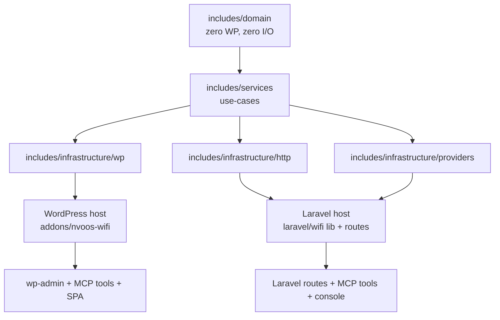

# Proposal 150 — NV oOS WiFi: A Portable Social-WiFi and Wi-Fi Observability Addon

**Status:** 🟡 DRAFT — architecture recommended; four owner decisions pending (§0.2)
**Date:** 2026-11-16
**Relates to:** ADR 001 (`docs/project/architecture-decisions/ADR_001_module_boundaries.md`) · Proposal 090 (`docker/laravel`, the Laravel runtime) · Proposal 092 (Astro Bridge, the addon template this follows) · Proposal 095 (ADS tokens) · Proposal 107 (content surface) · Proposal 143 (Service Exchange) · Proposal 145 (OKF core extraction — the licensing precedent for portable domain code) · Skills: `mcp-ai-wpoos-toolkit-creation`, `mcp-ai-wpoos-toolkit-audit`, `mcp-ai-wpoos-toolkit-universalisation`, `mcp-ai-wpoos-laravel-runtime`
**Author:** NV oOS coding agent (Zed)
**Research companion:** [`150-nvoos-wifi-research.md`](./150-nvoos-wifi-research.md)
**Implementation plan:** [`150-nvoos-wifi-implementation-plan.md`](./150-nvoos-wifi-implementation-plan.md)

---

## 0. Decision Record

### 0.1 Decisions taken in this proposal

| # | Decision | Consequence |
|---|---|---|
| D-1 | **One product, three tool families, one toolkit slug: `wifi`.** "WiFi Social", "WiFi X-Ray" and "WiFi Cognition" are surfaces over one domain spine, not three products. | One schema, one consent model, one adapter contract. Three brands, one codebase. |
| D-2 | **Location: `addons/nvoos-wifi/`.** Not `plugins/`, not `addons/pro/includes/tools/wifi/`. | §4, with the evidence. |
| D-3 | **Template: `addons/nvoos-astro-bridge/`.** | `includes/` (PHP, PSR-4) + `src/` (TypeScript), own `composer.json`, own `phpcs.xml.dist`, `uninstall.php`. |
| D-4 | **Layering uses repo vocabulary, not generic DDD.** `interfaces/ domain/ infrastructure/{wp,http,providers}/ services/ repositories/ tools/ admin/ rest/` | Obeys ADR 001; a Laravel host can consume it without translation. |
| D-5 | **Portability is enforced by a gate, not by intention.** `bin/check-domain-purity.php` already exists (added this session) and runs in `ci:all`. | ADR 001's rule becomes executable. §6. |
| D-6 | **Tool registration via `wp_mcp_ai_default_tools`.** | Works in **Base** — no Pro licence required to use WiFi tools. Verified shape in §7.2. |
| D-7 | **No Content Graph Pro mirror.** | WiFi is not Content Graph. Halves the porting surface. |
| D-8 | **FreeRADIUS is the AAA authority; we never reimplement 802.1X/EAP.** | Hard non-goal, recorded in §11. |
| D-9 | **MAC is not identity. Device ID semantics throughout.** | Schemas are written device-first from day one (research §4.2). |
| D-10 | **Sensing (802.11bf) is a Phase 4 partner track.** | Not a Phase 0–2 deliverable (research §3.4, §7). |
| D-11 | Proposal number **150** — 149 is the highest existing entry. | Verified by directory listing. |

### 0.2 Owner decisions still open

These block the Phase 0 scaffold but **not** the architectural direction. Each has a
recommendation.

| # | Question | Recommendation | Why | Blocking |
|---|---|---|---|---|
| OQ-1 | **Package name** | `nvoos/wifi` | Matches the `nvoos/core` / `nvoos/laravel-adapter` require style already in the Laravel skeleton. `nvdigitalsolutions/nvoos-wifi` is verbose and breaks the pattern. | Phase 0 |
| OQ-2 | **Composer `type`** | `library` | `wordpress-plugin` invites `composer/installers` to relocate the package into `wp-content/plugins` when installed in the Laravel app — a silent, confusing failure. `library` keeps the vendor path stable, and the WP plugin is the *addon*, not a Composer-installed artifact. | Phase 0 |
| OQ-3 | **Console without Pro** | Build WiFi's own SPA endpoint + controller | `WP_MCP_AI_Pro_SPA_Config` only emits `endpoints.toolkits` when `defined('WP_MCP_AI_PRO_FILE')`. If the console must render on a Base install, WiFi needs its own controller. **Recommend: yes, own controller** — the WiFi console is the product's front door and cannot be Pro-gated. | Phase 1 |
| OQ-4 | **One package or split** (`lib/wifi-core` + addon) | **One layered addon** | Proposal 145 (OKF) shows the split costs real money in release plumbing. One addon with a provably pure `domain/` gets the same portability for a fraction of the overhead. Revisit only if a second consumer actually appears. | Phase 0 |

---

## 1. Problem Statement

NV Digital sells social WiFi. The public reference (`virtuallyjamaica.com`) is
**not** a thin splash page — it was fetched and read during this research (research
§1.1), and it already markets: multi-provider login (Facebook, Instagram, Twitter,
LinkedIn, email, phone), custom capture questionnaires, pre-login video ads, a
front-desk **coupon system** with quota/data/duration limits and printable batch
codes, welcome-email automation, MailChimp/Salesforce/HubSpot/Zendesk integrations,
Google Audience remarketing, **multi-brand AP support**, and — critically —
*"evidence based decisions… like space planning"*.

So the feature set is broad. The problem is that **every one of those claims is
currently unfalsifiable**, and the standards moved underneath the entire category in
a way that makes the gap widen, not shrink:

- **802.11bh-2024** made MAC addressing deliberately unstable and introduced
  **Device ID** as the sanctioned continuity mechanism.
- **802.11bf-2025** made sensing a first-class WLAN function.
- **802.11bi-2026** layered privacy onto bh.
- The Wi-Fi Alliance shipped **130 Data Elements KPIs** with an agent→collector
  model — a vocabulary the product does not speak.
- 76% of the WBA's 2026 respondents named **security and privacy as concern #1**,
  while only 32% were pursuing AI/cognitive networks.

Concretely: the product promises evidence-based space planning, but has **no
standards KPI vocabulary and no `method` on any metric** — so the evidence is
unpublished and unrepeatable. It promises to "keep the network secure", but has no
walled-garden test suite — so security is asserted rather than measured. It captures
identity, but consent is entangled with access — so under Jamaica's DPA 2020 the
consent is not "freely given" (research §6.3).

> **The thesis:** the gap is not the portal. It is that the portal's claims rest on
> measurement that does not exist. The durable product is:
>
> **A venue's WiFi network that can explain itself** — what happened, to how many
> real people, under what consent, with evidence, and in language the venue owner
> can act on.

Legacy WiFi analytics answers that with MAC counts. Under MAC randomisation those
counts inflate unique visitors by 300–500% (research §6.1). A venue acting on that
number over-staffs, over-orders, or mis-signs a lease. **Shipping a MAC-counting
dashboard is not a weak product — it is a liability**, and the standards have
already told us the replacement.

### 1.1 Why this is a *measurement* product, not a *feature* product

The reference site already has the features. Adding a fourteenth splash-page widget
is not a business. What cannot be bought off the shelf is the discipline:

| Existing claim | Machinery that makes it defensible | This proposal |
|---|---|---|
| "Evidence based decisions" | DE-shaped KPI vocabulary + `method` on every metric | `domain/Kpi_Schema`, D-9 |
| "Space planning" | Device-identity model that survives MAC rotation | `domain/Device_Identity` |
| "Keep the network secure" | Walled-garden / session-inheritance / DNS-leak tests | T-1.8 redteam suite |
| Identity capture | Per-purpose, freely-given, withdrawable consent | `domain/Consent_Record` |
| Multi-brand AP support | A port with a mock adapter, so support scales past manual work | `Interface_WiFi_Controller_Adapter` |

Every row is a *strengthening of something already sold*, not a new product line.
That is the cheapest possible route to a defensible position — and it is why this is
an addon rather than a new platform.

### 1.2 Why this belongs in NV oOS at all

Because the four things a WiFi cognition product needs are the four things this
repo already has:

| Need | Existing NV oOS machinery |
|---|---|
| A tool/agent surface over an external system | Tool registry + `wp_mcp_ai_default_tools` |
| Multi-provider AI inference | `ProviderRouter`, `ChatOrchestrator` in `lib/core` |
| Consent-aware, retrievable memory | Agent memory layer, RAG/RRF retrieval (`lib/core`) |
| A second runtime for the same domain logic | `lib/laravel-adapter` + Laravel skeleton |

A portal-only competitor has to build all four. We have to build the **spine** and
the **adapters** — which is exactly the shape of an addon.

### 1.3 Measured baseline (what we are actually starting from)

| Fact | Value | Verified |
|---|---|---|
| Existing proposal entries | 149 → this is 150 | ✅ directory listing |
| Addons in `addons/` | 32 → 33 with WiFi | ✅ directory listing |
| `lib/` hosts | 4: `core`, `craft-adapter`, `laravel-adapter`, `wordpress-adapter` | ✅ |
| Laravel skeleton stack | PHP `^8.2`, `laravel/framework ^12`, **`laravel/mcp ^1.2` already present** | ✅ `docker/laravel/app-skeleton/composer.json` |
| Laravel consumes | `nvoos/core ^1.0`, `nvoos/laravel-adapter ^1.0` via `type: path` | ✅ |
| `includes/domain/` purity today | **0 strict violations across 112 files** | ✅ `composer run quality:domain-purity` |
| `includes/application/` | **Does not exist** (ADR 001 describes target state) | ✅ gate reports "skipped" |
| npm `capport` packages | **0** | ✅ registry search |
| npm RADIUS server packages | **0** (codec only, last published 2018) | ✅ |

Two of these are worth pausing on. **`laravel/mcp ^1.2` is already installed in the
Laravel skeleton** — the MCP transport the WiFi tool surface needs is already a
dependency there, not new work. And **`includes/application/` does not exist**,
which means ADR 001 is a *target*, not a description; the WiFi addon should be
built to the target and become the reference implementation of it.

---

## 2. What We Are Building — Three Families, One Spine

The owner's three working names are not three products. They are three **surfaces
over one domain model**, and the split must be honest about what is measured versus
inferred (research §4.1).

| Family | Question it answers | Data basis | Liability |
|---|---|---|---|
| **WiFi Social** | *Who is here, and did they consent?* | Portal + identity + consent records | GDPR/DPA — high |
| **WiFi X-Ray** | *What is the radio actually doing?* | Controller telemetry, DE-shaped KPIs | Measurement — low (it is standard-defined) |
| **WiFi Cognition** | *What does it mean, and what should we do?* | Inference over the above | Inference — **high, must be labelled** |

**The brand rule (non-negotiable, from research §4.1):**

> **X-Ray states measurements. Cognition states inferences, and never presents one
> as the other.**

"X-Ray" is therefore the diagnostics sub-brand. That framing is also a defensive
position: 802.11bf standardises *measurement*, so claiming measurement is
defensible; claiming *perception* is our own assertion and must carry our own
confidence intervals.

### 2.1 The spine

```
Portal capture ──┐
                 ├──→ Identity & Consent ──→ Session ──→ Access Policy
Controller ──────┤                              │
 telemetry       │                              ▼
                 └──→ KPI normaliser (DE-shaped) ──→ Evidence store
                                                        │
                                                        ▼
                                        Cognition layer (inference, labelled)
                                                        │
                                                        ▼
                                              MCP tools / REST / console
```

Everything above is domain code. Everything that touches WordPress, a controller
API, or HTTP lives behind a port. That is the whole architectural argument in one
sentence, and §5 through §7 are its consequences.

---

## 3. The Portability Question — direct answer

The owner asked:

> *"I think it might be better to keep this as an addon that way it can be portable
> into the Laravel or WP backend, does that make sense?"*

**Yes — with one condition, and the condition is the whole design.**

An addon is portable **only if its domain layer never learns what host it is
running in.** "Make it an addon" is necessary but not sufficient. The failure mode
is well documented in this repo: `addons/pro/includes/tools/wifi/` *would* be an
addon-shaped thing, and it would still be unportable, because a Pro toolkit is
WP-coupled **by contract**:

| Pro-toolkit coupling | Why Laravel can never consume it |
|---|---|
| `execute()` returns `WP_Error` | `WP_Error` is a WordPress class |
| `init.php` calls `get_option('wp_mcp_ai_settings')` | Options API is WordPress |
| Settings page, admin menu, schedule presets, workflow presets | All eleven registration surfaces are `wp-admin` / Pro-plugin internals |
| Text domain `mcp-ai-wpoos` | Tied to the plugin's l10n pipeline |

That is not a criticism of the Pro toolkit design — it is *correct* for what a Pro
toolkit is. It simply means a Pro toolkit is not a candidate for cross-runtime
portability, and anyone who assumes otherwise will discover it at the worst
possible moment.

**So: yes to the addon, conditional on a provably pure `domain/`.** The condition is
enforced mechanically (§6), not by code review.

### 3.1 Three hosts, one spine — and precedent

`lib/` already proves the pattern with **four hosts**:

```
lib/core                 ← framework-agnostic engine
lib/wordpress-adapter    ← WP host
lib/laravel-adapter      ← Laravel host
lib/craft-adapter        ← Craft host   ← the third host proves it generalises
```

Craft is the important one. It is not a hypothetical: a third host already exists,
which means the port boundary has been crossed twice and is real. WiFi follows the
same shape:



Both hosts call the *same* domain service and return the *same* payload. That is
what Phase 0 exists to prove (§ implementation plan T-0.5).

---

## 4. Location — `addons/` vs `plugins/` — direct answer

The owner asked:

> *"should it be in the addons folder or plugins?"*

**`addons/nvoos-wifi/`.** The evidence:

| Directory | What it actually contains | Verdict |
|---|---|---|
| `plugins/` | 5 entries, **all Content Graph product family**: `nvoos-content-graph*`, `nvoos-forge-bridge`, `docs-hub`-adjacent. These are byte-mirror targets for standalone wp.org distributions of one product family. | ❌ Wrong namespace. A WiFi plugin there implies a CG relationship that does not exist. |
| `addons/` | **32 entries**, the genuine integration/product plugin surface: `nvoos-astro-bridge`, `docs-hub`, `mcp-gateway`, `schedule-anything-*`, `media-worker`, `nvoos-design-system`, … | ✅ Correct. Includes wp.org-ready addons (`docs-hub` carries `.wordpress-org/`, `readme.txt`, `.distignore`). |
| `addons/pro/includes/tools/wifi/` | A Pro toolkit. WP-coupled by contract; all eleven registration surfaces are Pro internals; unusable from Laravel. | ❌ Defeats the portability requirement entirely. |

**Additional confirmation from the root `composer.json`:** autoload is
`classmap: ["includes/"]` only. Addons are therefore **independent plugins** that
load through the `wp_mcp_ai_default_tools` filter, not through the core autoloader.
That is exactly the decoupling an addon needs.

### 4.1 Template: `addons/nvoos-astro-bridge/`

Chosen because it is the closest structural analogue — a `nvoos-`-prefixed addon
with its own tooling:

```
addons/nvoos-astro-bridge/
├── nvoos-astro-bridge.php     ← plugin header + bootstrap
├── composer.json              ← own PSR-4, own PHP req
├── phpcs.xml.dist             ← own ruleset
├── uninstall.php              ← uninstall discipline
├── includes/                  ← PHP, PSR-4 → NvoosAstroBridge\{Sub}\{Class}
├── src/                       ← TypeScript (AdminApp.tsx, hooks/, types/)
├── build/                     ← compiled SPA
├── tests/
└── README.md, CHANGELOG.md, LICENSE, THIRD_PARTY_NOTICES.md
```

**Two traps this template exposes, both verified:**

1. **`src/` is TypeScript, not PHP.** A reader who assumes generic DDD folders
   (`src/Domain/`, `src/Infrastructure/`) will put PHP in the wrong place. PHP goes
   under **`includes/`**.
2. **Its `phpcs.xml.dist` does *not* reference the four custom `WPMCPAI` sniffs.**
   For a *tool-bearing* addon that is a gap — `CanonicalReturnEnvelopeSniff` and
   `SanitizeAtEntrySniff` are the enforcement of the tool rules this product must
   obey. WiFi's ruleset must add all four by relative path, with **the correct
   directories**: three under `phpcs/WPMCPAI/Sniffs/Tools/` and
   `ScopeDeclaredSniff` under `phpcs/WPMCPAI/Sniffs/Decisions/` (**there is no
   `Sniffs/Scope/`**). Recorded as implementation-plan task T-0.3.

### 4.2 Root-level gates the addon must not break

| Gate | Effect on the addon | Action |
|---|---|---|
| Root `phpcs` scan | Exclusion is **opt-in per addon** (43 `exclude-pattern` lines; astro-bridge at line 68) — a new addon is *not* excluded by default | Add `*/addons/nvoos-wifi/**` in the same shape, and give the addon its own ruleset |
| `bin/generate-tool-coverage-manifest.sh` | Scans only `includes/tools` + `addons/pro/includes/tools` | Addon is **exempt** — but therefore loses the data-driven schema-contract smoke test. WiFi must ship its own equivalent (T-0.13). |
| `quality:domain-purity` | Scans `includes/*` only | Addon needs the gate pointed at its own `includes/domain/` too (T-0.4) |
| `docs:check-folder-readmes` | Applies to `includes/` and `addons/pro/includes/` | Follow the convention anyway — every PHP folder gets a `README.md` |

---

## 5. Architecture

### 5.1 Target tree

```
addons/nvoos-wifi/
├── nvoos-wifi.php                     Plugin header, bootstrap, version constants
├── uninstall.php                      Data-removal (opt-in; see §9.4)
├── composer.json                      type: library (OQ-2), PSR-4 → includes/
├── phpcs.xml.dist                     WordPress + the four WPMCPAI sniffs
├── includes/
│   ├── interfaces/                    ← PORTS: everything the outside world provides
│   │   ├── Interface_WiFi_Controller_Adapter.php
│   │   ├── Interface_WiFi_Portal_Store.php
│   │   ├── Interface_WiFi_Consent_Store.php
│   │   ├── Interface_WiFi_Clock.php
│   │   ├── Interface_WiFi_Id_Generator.php
│   │   └── Interface_WiFi_Kpi_Sink.php
│   ├── domain/                        ← ZERO WP, ZERO I/O, stdlib only
│   │   ├── Device_Identity.php        Device ID semantics, rotation-aware
│   │   ├── Consent_Record.php         Granular, timestamped, withdrawable
│   │   ├── Access_Policy.php          Duration/bandwidth/device-count rules
│   │   ├── Session.php                Bandwidth×time accounting
│   │   ├── Kpi_Schema.php             Wi-Fi Data Elements-shaped vocabulary
│   │   ├── Kpi_Sample.php             A measured value + its method
│   │   ├── Venue.php                  Tenant root
│   │   └── Result.php                 Domain result object (never WP_Error)
│   ├── services/                      ← USE-CASES (injected ports only)
│   │   ├── Class_Session_Service.php
│   │   ├── Class_Consent_Service.php
│   │   ├── Class_Kpi_Service.php
│   │   └── Class_Cognition_Service.php
│   ├── infrastructure/
│   │   ├── wp/                        WP host: options, CPTs, capabilities, REST
│   │   ├── http/                      HTTP client ports (uses WP HTTP / Laravel HTTP)
│   │   └── providers/                 Controller adapters
│   │       ├── Class_Mock_Controller_Adapter.php   ← ships FIRST
│   │       └── Class_Unifi_Controller_Adapter.php  ← Phase 2
│   ├── repositories/                  Persistence (WP: CPT/meta; Laravel: Eloquent)
│   ├── tools/                         MCP tool classes
│   ├── admin/                         wp-admin surfaces
│   ├── rest/                          REST controllers
│   └── portal/                        RFC 8908 + splash rendering
├── src/                               TypeScript console (Vite/React)
├── build/                             Compiled console
├── contracts/
│   ├── console-endpoints.json         The SPA contract (Proposal 149 pattern)
│   └── wifi-kpi.dtcg.json             Token/metric schema if themed
└── tests/
    ├── unit/                          Domain tests — no WP boot required
    ├── integration/                   WP host tests
    └── redteam/                       ghostlink-derived attack suite
```

### 5.2 What each layer may and may not do

| Layer | May | May NOT | Gate |
|---|---|---|---|
| `interfaces/` | Declare method signatures | Contain logic | phpcs only |
| `domain/` | Pure PHP, value objects, invariants, computation | `WP_*`, `$wpdb`, `get_option`, filesystem, network, `WP_Error` | **`quality:domain-purity` strict — hard fail** |
| `services/` | Orchestrate domain + injected ports | Reach a global, an option, or an HTTP client directly | Purity gate (once promoted to `application/`) |
| `infrastructure/` | Call WordPress, HTTP, controller APIs | Contain business rules | — |
| `tools/` | Canonical envelope, two-gate sanitisation | `array('success'=>false)` | `WPMCPAI.Tools.*` sniffs, sev 5 |

**Why `Result` exists:** the domain cannot return `WP_Error` (that is the strict
purity rule, and it is precisely what the gate flags in the transitional
`includes/services/` layer today). So the domain returns its own `Result`, and the
**infrastructure layer** maps `Result` → `WP_Error` at the WordPress boundary and
`Result` → Laravel exception/response at the Laravel boundary. This is the single
most important structural consequence of portability, and it is easy to get wrong.

### 5.3 Laravel host shape

The Laravel side is **not** a copy of the WordPress side. It is a thin host over the
same `domain/` and `services/`:

```
laravel app
├── composer.json          require "nvoos/wifi": "*" (path repo, type: library)
├── routes/wifi.php        Route::get('/wifi/venues/{id}/kpis', [WifiController::class, 'kpis'])
└── app/Wifi/
    ├── WifiServiceProvider.php     binds the interfaces → Eloquent/HTTP impls
    └── WifiController.php          calls the SAME Class_Kpi_Service
```

`laravel/mcp ^1.2` is already a dependency there, so the MCP tool surface ports with
the service, not as a rewrite.

**Acceptance test for portability (Phase 0 exit):** the same `Class_Kpi_Service::for_venue()`
call returns byte-identical JSON from a WordPress REST route and a Laravel route,
while `quality:domain-purity` reports 0 strict violations. If those two conditions
hold, the addon is genuinely portable. If either fails, it is an addon-shaped
monolith and the whole premise of this proposal fails with it.

---

## 6. Portability Enforcement

ADR 001 stated the rule. Until this session it was **unenforced** — `phpcs.xml.dist`
carried only an `exclude-pattern`, and nothing failed a build for a domain class
calling `get_option()`.

**Now:**

```
composer run quality:domain-purity          # strict + advisory report, exit 1 on strict
composer run quality:domain-purity:strict   # exit 1 on advisory too
php bin/check-domain-purity.php --report    # never fails
php bin/check-domain-purity.php --verbose   # no advisory cap
```

Wired into `ci:all`. Current state, measured this session:

| Layer | Policy | Files | Findings |
|---|---|---|---|
| `includes/domain/` | **strict** | 112 | **0** ✅ |
| `includes/application/` | strict | — | absent (§1.2) |
| `includes/services/` | advisory | — | 1,169 (transitional) |
| `includes/repositories/` | advisory | — | 126 (transitional) |

The gate is token-based (`token_get_all`), so comments and string literals do not
produce false positives, and member calls (`$this->get_option()`) are correctly
ignored. Advisory output is capped at 15 lines per layer with an accurate
suppressed-count, so it stays readable in CI logs.

**The addon's obligation:** point the gate at `addons/nvoos-wifi/includes/domain/` and
`.../services/` as **strict**, so the portability claim is tested on every PR
(T-0.4). The advisory layers in `includes/` are pre-existing debt with its own
migration track (Proposal 090-adjacent); this proposal does not take it on.

---

## 7. Tool Inventory

### 7.1 Three families

| Family | Tool slug | Purpose | Phase |
|---|---|---|---|
| **Social** | `wifi_list_venues` | Venues the caller may see | 1 |
| | `wifi_get_venue` | One venue's configuration + status | 1 |
| | `wifi_capture_consent` | Record granular consent (access ≠ marketing) | 1 |
| | `wifi_withdraw_consent` | Withdrawal path, logged | 1 |
| | `wifi_grant_session` | Issue an access session under policy | 1 |
| | `wifi_list_sessions` | Active/recent sessions | 1 |
| | `wifi_issue_coupon` | Batch-generate front-desk coupon codes (quota/data/duration) | 1 |
| | `wifi_redeem_coupon` | Redeem + real-time status, idempotent | 1 |
| **X-Ray** | `wifi_get_kpis` | DE-shaped KPI read for a window | 2 |
| | `wifi_get_clients` | Client inventory (device-identity based) | 2 |
| | `wifi_get_radio_health` | Retry/airtime/MLO-link diagnostics | 2 |
| | `wifi_compare_periods` | Two-window KPI diff | 2 |
| **Cognition** | `wifi_explain_anomaly` | Inference over KPI deltas, **labelled as inference** | 3 |
| | `wifi_recommend_actions` | Ranked, cited recommendations | 3 |
| | `wifi_audit_campaign` | Did a marketing push actually move footfall? | 3 |
| **Portal** | `wifi_get_capport_document` | RFC 8908 JSON for an RFC 8910 client | 1 |
| **Platform** | `wifi_health_check` | Adapter reachability, credential validity | 0 |

**17 tools across 4 phases.** Phase 0 ships exactly one (`wifi_health_check`),
because Phase 0's job is to prove the pipe, not to populate it.

The coupon tools exist because the reference product already sells a front-desk coupon
workflow (research §1.1). `Access_Policy` already models quota/data/duration, so the
tools are a thin surface over an existing domain object — not new domain work.

### 7.2 Registration contract (verified)

From `includes/tools-init.php:28-38`, the filter shape is
`array<class_name => absolute_file_path>`:

```php
add_filter(
    'wp_mcp_ai_default_tools',
    static function ( $default_tools ) {
        if ( ! is_array( $default_tools ) ) {
            return $default_tools;
        }
        $default_tools['WP_MCP_AI_Tool_WiFi_Health_Check']
            = NVOOS_WIFI_PATH . 'includes/tools/class-wp-mcp-ai-tool-wifi-health-check.php';
        return $default_tools;
    }
);
```

Because this is a **Base** filter, WiFi tools work without a Pro licence (D-6).
That is a deliberate commercial choice: the tools are the wedge, the console and
the hosted estate are the product.

### 7.3 Console manifest (Pro-gated, optional)

From `addons/pro/includes/toolkits/class-wp-mcp-ai-pro-toolkit-manifests.php:180-184`:

```php
$extra = (array) apply_filters( 'wp_mcp_ai_pro_toolkit_manifests', array() );
foreach ( $extra as $slug => $document ) {
    self::register( is_array( $document ) ? $document : array(), (string) $slug );
}
```

So the addon can contribute a `wifi` toolkit manifest to the Pro console **when Pro
is present**, and degrade gracefully when it is not. This is the correct integration
point and it costs one filter. See OQ-3 for the standalone-console question.

### 7.4 Registration surfaces — and why the count differs

The `mcp-ai-wpoos-toolkit-creation` skill documents **eleven** surfaces, and warns
that missing one means "tools don't show up". **All eleven are Pro-plugin
internals** (Pro module registry, Pro central registry, Pro admin section, Pro
settings page, Pro settings status map, two Pro CLI commands, Pro schedule presets,
Pro workflow presets, SA toolkit manager, Pro coverage manifest).

A **standalone addon has a different, smaller surface set** — this is the finding
that justifies not making WiFi a Pro toolkit:

| # | Surface | Pro toolkit | Standalone addon (WiFi) |
|---|---|---|---|
| 1 | Loader | Pro module registry | Plugin bootstrap (`nvoos-wifi.php`) |
| 2 | Tool map | Pro central registry | `wp_mcp_ai_default_tools` filter |
| 3 | Enable toggle | `enable_<slug>_toolkit` checkbox | Own settings option |
| 4 | Admin menu | Pro settings page | Own top-level menu |
| 5 | Status map | Pro settings status | Own status page |
| 6 | WP-CLI | Pro CLI commands | Own `wp nvoos-wifi …` namespace |
| 7 | Schedule presets | Pro presets | Own presets (or none in Phase 1) |
| 8 | Workflow presets | Pro workflow presets | Own (or none in Phase 1) |
| 9 | SA toolkit | SA toolkit manager | N/A |
| 10 | Coverage manifest | Pro manifest | Own smoke harness (exempt from script) |
| 11 | Console manifest | Implicit | `wp_mcp_ai_pro_toolkit_manifests` (optional) |

**Nine surfaces, four of which are genuinely new code rather than an edit to a
shared file.** That is the real cost of standalone, and it is worth paying for
portability — but it must be in the plan, not discovered later.

---

## 8. Mapping — concept to toolkit to artifact

The owner asked *"pair this concept with the architectural toolkit and would we
have mapping as well?"* Yes. Two mappings, both load-bearing.

### 8.1 Product capability → existing NV oOS subsystem

This is the answer to "why build it here": most of the hard parts already exist.

| WiFi capability | Reuses | Where |
|---|---|---|
| Guest identity & consent capture | Agent memory + consent-aware storage | `lib/core` memory |
| KPI explanation in natural language | `ChatOrchestrator` + `ProviderRouter` | `lib/core` |
| Anomaly narrative with citations | RAG/RRF retrieval over KPI history | `lib/core` |
| Tool surface for agents | Tool registry + MCP transport | `includes/tools` + `laravel/mcp` |
| Marketing attribution ("did the push work?") | CRM + campaign orchestration | `addons/pro` toolkits |
| Monthly venue report (PDF) | Document generation | design-document-generation |
| Venue brand kit & splash assets | Brand kit / image generation | design-brand-kit, design-image-generation |
| Content calendar for venue promotions | Content calendar | design-content-calendar |
| Console UI | NDS design tokens + SPA patterns | `addons/nvoos-design-system` |
| Second runtime | `lib/laravel-adapter` | Proposal 090 |

**Notably: nine of ten rows are already built.** The genuinely new work is the
controller adapter layer, the consent model, the KPI normaliser, and the portal —
which is the honest scope of this proposal.

### 8.2 Standards → artifact

Traceability from research §4 to concrete files. This is the table a reviewer should
be able to check line by line.

| Standard | Requirement | Artifact |
|---|---|---|
| 802.11bh-2024 (Device ID) | Identity is opaque, rotatable per association | `domain/Device_Identity.php`; `method` field on every uniqueness KPI |
| 802.11bi-2026 (privacy) | Minimise collection at the radio layer | Adapter exposes only DE fields; no raw frame capture |
| 802.11bf-2025 (sensing) | Measurement is standard; inference is not | Phase 4; X-Ray/Cognition brand split (§2) |
| 802.11bn (UHR, 2028) | Metric vocabulary survives dense-overlap | `Kpi_Schema` includes retry, airtime fairness, MLO link balance |
| 802.11bx (WIN, pre-standard) | "AI as traffic" — the product's own inference consumes airtime | Cognition tools declare their own traffic cost |
| WFA Data Elements v2.1 | 130 KPIs, agent→collector | `Kpi_Schema` keyed to DE names; `infrastructure/providers/*` each normalise to it |
| RFC 8952 / 8908 / 8910 | Captive portal API + DHCP/RA identification | `portal/` + `wifi_get_capport_document`; MIT package |
| RFC 9724 / 9797 | RCM is expected, not exceptional | No MAC-keyed schema anywhere |
| Jamaica DPA 2020 | Informed, specific, freely given, withdrawable, separate marketing consent, cross-border | `domain/Consent_Record.php` + `Class_Consent_Service` (§9) |

---

## 9. Consent and Data-Protection Model

This section exists because **76% of the market names privacy as concern #1**
(research §5.1), and because Jamaica's DPA 2020 is the binding regime in the primary
market (research §6.3). Getting this wrong is not a compliance footnote; it
invalidates the product's central metric.

### 9.1 The one rule that reshapes the UX

> **Access is granted whether or not marketing consent is given.**

"Freely given" cannot survive conditioning internet access on marketing opt-in. So
the splash flow is:

1. Identity capture (email or phone) — required for access.
2. Access terms consent — required for access.
3. **Marketing consent — separate toggle, pre-unchecked, refusing costs nothing.**

The session is issued on completion of 1 + 2. Step 3's answer is recorded either
way, including a recorded *refusal*, which is as important as a grant.

### 9.2 Consent record shape

| Field | Why |
|---|---|
| `subject_device_id` | Opaque; not a MAC |
| `venue_id` | Consent is venue-scoped, not global |
| `purpose` | `access` \| `marketing` \| `analytics` — **one row per purpose** |
| `granted` (bool) + `granted_at` | Records refusals too |
| `withdrawn_at` | Withdrawal is a state transition, not a delete |
| `basis` | `consent` \| `contract` \| `legitimate_interest` |
| `policy_version` | Which notice text they actually saw |
| `residency` | Cross-border transfer tracking |

### 9.3 Withdrawal and export

- `wifi_withdraw_consent` flips `withdrawn_at`; it does **not** delete history.
- A withdrawal triggers downstream suppression: marketing segment removal, memory
  flagging. It does not retroactively erase aggregate KPIs (which contain no
  personal data by construction — that is why Device ID is opaque).
- Export is per-subject and returns every row keyed to their device identity.

### 9.4 Uninstall behaviour

`uninstall.php` must **not** silently destroy consent evidence — that evidence is
the legal record that access was authorised. Default is **preserve**; a documented
constant (`NVOOS_WIFI_REMOVE_DATA_ON_UNINSTALL`) opts into removal. This diverges
from the usual "clean uninstall" habit, and the reason is worth writing in the
file's header so a future maintainer does not "fix" it.

---

## 10. Commercial Packaging

Recorded because it constrains the architecture (OQ-3 especially).

| Tier | Contains | Runtime |
|---|---|---|
| **Free (addon)** | 15 tools, portal, mock adapter, RFC 8908 document, own console | WordPress (Base or Pro) |
| **Paid: Pro toolkit manifest** | Console integration under the NV oOS Pro umbrella | WordPress + Pro |
| **Paid: hosted estate** | Managed controllers, multi-venue rollups, cognition at scale | Laravel (Proposal 143 Service Exchange) |

The Free tier being genuinely useful is what makes the tools the wedge rather than a
demo. That is why D-6 chose the Base filter over the Pro registry.

---

## 11. Alternatives Rejected

| Alternative | Why rejected |
|---|---|
| **`addons/pro/includes/tools/wifi/`** (a Pro toolkit) | WP-coupled by contract (§3); all eleven surfaces are Pro internals; unreachable from Laravel. Defeats the primary requirement. |
| **`plugins/nvoos-wifi/`** | `plugins/` is the Content Graph product family — 5 entries, byte-mirror targets. Wrong namespace. |
| **Three separate products** (Social / X-Ray / Cognition) | Three schemas, three consent models, three adapter contracts. The standards (bh, DE, CAPPORT) are the same for all three. One toolkit, three families. |
| **Split `lib/wifi-core` + addon** | Proposal 145 shows the release plumbing cost. One layered addon with a gated `domain/` achieves the same portability. Revisit only if a second consumer appears. |
| **Rebuild RADIUS / 802.1X** | `radius` on npm is a codec last published 2018. FreeRADIUS exists and is correct. Hard non-goal (D-8). |
| **MAC-based analytics (incumbent approach)** | Inflates uniques 300–500% under RCM (§1). Produces wrong numbers that drive real decisions. Non-starter. |
| **802.11bf sensing in Phase 0–2** | Hardware-specific, physics-hard, wrong buyer. `@ruvnet/ruview` exists as a harness to integrate with, not rebuild (D-10). |
| **Fork `virtuallyjamaica.com`'s portal** | It is the commodity half. A portal-only product has no defensible metric. |
| **Content Graph Pro mirror** | WiFi is not Content Graph. Halves the porting surface (D-7). |

---

## 12. Open Questions

| # | Question | Owner or agent | Blocks |
|---|---|---|---|
| OQ-1 | Package name `nvoos/wifi`? | **Owner** | Phase 0 |
| OQ-2 | Composer `type: library`? | **Owner** | Phase 0 |
| OQ-3 | WiFi console standalone or under Pro? | **Owner** | Phase 1 |
| OQ-4 | One addon or split package? | **Owner** | Phase 0 |
| OQ-5 | Which controller is the Phase 2 reference target? (UniFi assumed) | Owner | Phase 2 |
| OQ-6 | Is there an existing venue/controller estate to test against? | Owner | Phase 2 |
| OQ-7 | "Wi-Fi X-Ray" trademark clearance (JM, US) | Owner / legal | Phase 3 launch |
| OQ-8 | Data residency: does any target market require in-country storage? | Owner / legal | Phase 1 |

**Naming caveat (must survive to launch):** "Wi-Fi X-Ray" is **not** an established
product name — the closest existing art is MIT's Wi-Vi. Keep "X-Ray" as the
diagnostics sub-brand only, and clear the mark before any external use.

---

## 13. Risks

| # | Risk | Severity | Mitigation |
|---|---|---|---|
| R1 | Addon drifts into WP coupling; portability becomes fiction | 🔴 High | Purity gate strict on `addons/nvoos-wifi/includes/domain/` from day one (T-0.4); Phase 0 exit requires the dual-runtime payload test (§5.3) |
| R2 | MAC-randomisation metrics ship wrong numbers | 🔴 High | Device ID from the start; every uniqueness KPI carries `method`; V-1 closed before any published figure |
| R3 | Consent model fails "freely given" | 🔴 High | Separate toggles, pre-unchecked marketing, refusal recorded, withdrawal tested (§9) |
| R4 | Sensing scope creeps into Phase 1–2 | 🟡 Med | D-10 is a decision-record entry, not a guideline |
| R5 | Controller API versions break adapters | 🟡 Med | Ports are ours; adapters versioned; Mock adapter keeps tests green |
| R6 | GPL-2.0 contamination from hostapd/ubus helpers | 🟡 Med | Process boundary only (research §3.8); `THIRD_PARTY_NOTICES.md` |
| R7 | Pro-console dependency blocks the Free tier's front door | 🟡 Med | OQ-3 recommends own controller |
| R8 | "Wi-Fi X-Ray" name collision | 🟢 Low | Sub-brand framing + trademark search (OQ-7) |
| R9 | Addon escapes the coverage manifest and loses schema smoke tests | 🟢 Low | Own equivalent harness (T-0.6) |

---

## 14. Consequences

**If accepted:**

- `addons/nvoos-wifi/` becomes the 33rd addon and the **reference implementation of
  ADR 001's target layering** — the first component in the repo built to the target
  rather than migrated toward it.
- The purity gate gains a second consumer and becomes genuinely load-bearing.
- WiFi tools ship in **Base**, expanding the free surface.
- A second runtime validates the `lib/laravel-adapter` story with a non-Content-Graph
  domain, which is a stronger proof than another CG mirror.

**What this proposal deliberately does not do:**

- It does not migrate `includes/services/` to `application/` (pre-existing debt).
- It does not build sensing.
- It does not touch Content Graph.
- It does not change the eleven Pro-toolkit surfaces.

---

## 15. Related documents

- [`150-nvoos-wifi-research.md`](./150-nvoos-wifi-research.md) — evidence base, confidence marks, verification debt
- [`150-nvoos-wifi-implementation-plan.md`](./150-nvoos-wifi-implementation-plan.md) — phases P0–P3, task IDs, validation commands
- [`../architecture-decisions/ADR_001_module_boundaries.md`](../architecture-decisions/ADR_001_module_boundaries.md)
- [`../../developer/folder-readme-convention.md`](../../developer/folder-readme-convention.md)
- [`../ADDON_INVENTORY.md`](../ADDON_INVENTORY.md) — 32 → 33 entries on scaffold
