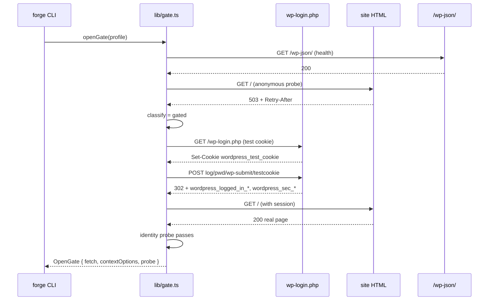

# Proposal 152 — gated sources: forging a WordPress site behind maintenance / coming-soon / staging auth

> Status: **Proposed 2026-11-20; implemented the same day**. P0–P3 shipped;
> P4 (bridge `gate` route) stays deferred as designed. See §0.
> Extends 096 (the generator), 098 / 114 (design import), 115 (inventory),
> 116 (bot protection + `WP_FETCH_PROXY`), 118 (vision capture), 130–132
> (rendered-head / tracking / redirect capture), 137 (bands), 139 (media),
> 140 / 142 (measured gates).
> Companion implementation plan: not yet written (P0 is the deliverable this
> proposal argues for).
>
> Origin: the 2026-11-20 pre-launch audit. A client WordPress site was still in
> its builder's Coming Soon mode, so every **HTML** request answered
> `503 + Retry-After`, while `/wp-json/` answered `200`. `forge analyze --design`
> printed `⚠ Design extraction failed … 503` and **continued**. The only thing
> the pipeline could have forged was the holding page — the one artifact we
> never want to ship. The operator workaround (ask the owner to disable Coming
> Soon) is no longer the only path: the forge now authenticates into the gate,
> and when it cannot, it refuses to forge rather than forging the wrong page.
>
> ---
>
> ## 0. Implementation note (2026-11-20)
>
> Shipped in this branch:
>
> | Phase | What landed |
> |---|---|
> | P0 | `lib/gate.ts` probe + classification + remediation; `forge gate` verb (exit 0/3/4/5/6); `--allow-blocked`; fixture `WP_FIXTURE_GATE` modes; `tests/gate-cli.test.ts` |
> | P1 | wp-login session (test cookie → POST → `Set-Cookie` harvest), cookie/storageState/bypass precedence, host-scoped global fetch wrapper with manual redirects and `no-store`, `analyze` fail-closed |
> | P2 | Playwright cookies via `gateContextOptions()` in every `newContext` site (`geometry`, `interactions`, `animations`, `region-colors`, `screenshot`, `tracking`, `band-diff`); `tests/gate.test.ts` |
> | P3 | `SiteProfile.gate` (references only), `.env.example` block, README env row + section, `mcp/tools/gate.ts` (`gate_probe`), `design_apply` fail-closed, skill `reference/gated-sources.md` |
> | P5 | The remediation ladder prints from the probe (`forge gate`); a separate `--remediation` flag was not needed |
>
> Deliberate deviations from the plan below:
>
> - **`--allow-blocked` does not persist a manifest flag.** It prints a loud
>   warning; the empty design block is the durable evidence, and the artifact
>   already fails `verify`. Adding a profile field for a transient operator
>   override would have muddied `SiteProfile.gate` (which is config).
> - **The fingerprint-free threshold defaults to 200 visible chars, not 400,**
>   and requires a corroborating signal (`noindex`, or `/wp-json/` unhealthy).
>   The first cut flagged the hermetic fixture's own 18-character homepage —
>   the false positive that blocks a legitimate forge. A real holding page all
>   but always says `noindex`; the threshold and markers are profile-pinnable.
> - **P4 (bridge `gate` route) not implemented** — the plan already marked it
>   optional/deferred, and it needs a bridge release.
>
> ---

---

## 1. Executive summary

The forge has **two fetch planes** and only one of them is authenticated.

| Plane | What reads it | Auth today |
|---|---|---|
| `wp/v2` + `wc/v3` REST | the content loader (`lib/wp-client.ts`, `WpAuth`) | Basic (Application Password) or Bearer — `WP_APPLICATION_USER` / `WP_APPLICATION_PASSWORD` |
| **Rendered HTML** | design import, inventory (sitemap + links + nav), SEO head, redirects, tracking, and every browser measurement (geometry, band facts, chrome, colours, interactions, animations, pixel/vision) | **none** |

A pre-launch site gates plane 2, not plane 1. The API stays open (that is why
the audit could count `0 posts`); the HTML answers `503` or serves a holding
page. Result: content forges, design does not, and the build silently degrades
to "the coming-soon page with the client's posts underneath".

The fix is small in surface area and large in consequence:

1. **One gate module** (`lib/gate.ts`) that opens a *page session* once per
   process and hands every call site a credential-aware `fetch` and a
   Playwright `contextOptions()`.
2. **Credentials as variables** — `WP_GATE_*` env vars (plus the standard
   `CF_ACCESS_CLIENT_*` pair for Cloudflare Access), resolved from the host
   environment or the existing AES-GCM vault. Never in the profile, never in
   the generated repo, never in an artifact.
3. **A page-identity probe that fails closed.** "Is this the site or the
   holding page?" is answered from evidence (status, `Retry-After`,
   `/wp-json/` health, plugin fingerprints, rendered-text mass vs the REST
   title) — and a gated source makes the design passes exit non-zero with
   remediation, unless the operator explicitly passes `--allow-blocked`.

The critical technical fact that shapes everything else, verified 2026-11-20:
**an Application Password cannot log into `wp-login.php`**
(developer.wordpress.org, "Application Passwords"), so it cannot satisfy a
plugin gate that checks `is_user_logged_in()`. REST auth and page auth are
different credentials, and the forge must support both.

Estimated shape: 1 new lib + 1 probe CLI verb + 1 MCP read tool + ~9 Playwright
call sites accepting context options + 1 scaffold `.env.example` block + docs.
No schema migration, no template change, no sanitizer version bump, no change to
the generated site's runtime env.

---

## 2. What actually happens today

### 2.1 The two planes, in code

```ts
// lib/wp-client.ts — authenticated, typed, paginated.
const client = WpClient.fromProfile( profile, { auth } );   // basic | bearer
await client.fetchAll( 'wp/v2/posts', { perPage: 100 } );

// lib/design.ts — plain fetch, no credentials, no options beyond loopback.
const input = await fetchDesignInput( profile.url, fetch, { allowLoopback } );
if ( ! home.ok ) throw new Error( `Design fetch failed: ${ home.status }…` );
```

`fetchDesignInput` has exactly three knobs (`url`, `fetchImpl`,
`allowLoopback`) and no header injection. The same is true of
`lib/inventory.ts` (`fetchText` sets only `user-agent`), `lib/seo-*`,
`lib/redirects.ts`, `lib/tracking.ts`, `lib/animations.ts`, and the
`lib/capture.ts` source-screenshot path. The browser passes in
`lib/geometry.ts` all call `browser.newContext({ deviceScaleFactor: 1 })` — no
cookies, no `storageState`, no extra headers.

### 2.2 The failure table (what a gated source looks like from the forge)

| Probe | Result | Meaning | What the forge does today |
|---|---|---|---|
| `GET /wp-json/` | `200` | REST is open | content loads |
| `GET /` | `503` + `Retry-After` | the site's own pre-launch mode | design pass warns, continues |
| `GET /` | `200`, tiny text, `noindex` | plugin serving a holding page at 200 | **forged as if it were the site** |
| `GET /` | `401` + `WWW-Authenticate: Basic` | staging server auth (nginx/`.htpasswd`, WP Engine, Kinsta) | design pass warns, continues |
| `GET /` | `302` → `*.cloudflareaccess.com` | Cloudflare Access | design pass warns, continues |
| `GET /` | `403` + MalCare body | WAF IP block (116) | already diagnosed separately |
| `GET /` | `200`, large text, but *yesterday's* copy | full-page CDN cache serving anonymous HTML | silently forges stale content |

The last two rows matter for the design of the fix: **a status code alone is not
a verdict**, and an authenticated request can still come back as anonymous HTML
from a CDN cache. Both are handled in §4.7.

### 2.3 Why "content-only" forging is worse than stopping

The audit's own evidence: stock Elementor kit tokens
(`#6EC1E4` / `#61CE70` / `#7A7A7A` / `#54595F`), `posts: 0`, a `sample-page`,
and three readable objects in `wp/v2/search`. A pipeline that proceeds anyway
produces a *plausible-looking* empty site with default colours — the most
expensive failure mode in this repo's history (`nothing-to-forge.md` §1, §4).
Every gate this project has built since 114 exists to stop exactly that.

### 2.4 The specific defect

`runAnalyze` catches the design-fetch error and continues:

```js
⚠ Design extraction failed (continuing without): Design fetch failed: 503 …
```

That is the right behaviour for an *optional enrichment* and the wrong
behaviour for a **blocked source**. The rest of the pipeline then measures
nothing, scaffolds template defaults, and reports success. Proposal 152 replaces
"continue" with "classify, explain, and stop unless told otherwise".

---

## 3. Research — how WordPress gates itself (and how clients legitimately get in)

### 3.1 Core maintenance mode (verified against developer.wordpress.org)

`wp_is_maintenance_mode()` returns true when `ABSPATH . '.maintenance'` exists,
`$upgrading` is younger than **10 minutes**, and the
`enable_maintenance_mode` filter does not disable it. `wp_maintenance()` then:

```php
header( 'Retry-After: 600' );
wp_die( 'Briefly unavailable for scheduled maintenance…', 'Maintenance', 503 );
```

Three consequences:

- **Core maintenance has no login bypass.** A session cookie changes nothing,
  so the forge must not try to authenticate through it. It is a *wait* (10
  minutes), not an authorization problem — report it as `rate-limited` and honour
  `Retry-After`.
- A `wp-content/maintenance.php` drop-in can replace the page entirely — that is
  a *custom* gate and is classified by the probe, not by the status code.
- Because `.maintenance` expires on its own, a retry 10+ minutes later usually
  succeeds. This is the one case where "try again later" is the correct
  remediation.

### 3.2 The plugin coming-soon family — a taxonomy

Most pre-launch gates fall into five mechanisms. The forge supports the first
four; the fifth is deliberately not solved (§3.7).

| # | Mechanism | How a legitimate client gets through | Notes |
|---|---|---|---|
| 1 | **Logged-in + role allowlist** | a WP **session cookie** for a user whose role is allowlisted | the dominant family; Elementor, WP Maintenance Mode, most "coming soon" plugins |
| 2 | **Bypass slug / query token** | a configured URL segment or query parameter | often exposed as a "secret link" in the plugin UI |
| 3 | **IP allowlist** | request from an allowlisted egress IP | works with `WP_FETCH_PROXY`; not something the forge can set |
| 4 | **Edge / server auth** | HTTP Basic, or a Cloudflare Access service token | staging hosts, `auth_basic`, WP Engine "Authentication", Cloudflare Access |
| 5 | **Search-bot UA bypass** | (spoof `Googlebot`) | **not supported — see §3.7** |

**Verified example (WP Maintenance Mode / Designmodo, v2.6.26).** Fetched from
the plugin's SVN trunk on 2026-11-20:

- `check_user_role()` returns true for `is_super_admin()` (on single site, that
  is `delete_users` — i.e. an administrator) **or** when the user's roles
  intersect `general.frontend_role` / `general.backend_role`.
- `check_exclude()` matches the request URI **and** `REMOTE_ADDR` against
  `general.exclude` — a slug/IP allowlist; the defaults are `feed`,
  `wp-login`, `login`.
- The gate answers `503` + `Retry-After` (default 3600 s) and calls
  `nocache_headers()`.
- `check_search_bots()` lets a configured list of crawler UAs through when
  `bypass_bots` is on.

So for this plugin: **role allowlist or a cookie session** (mechanism 1), **a
bypass slug** (2), or **an IP allowlist** (3). Elementor's Tools → Maintenance
Mode offers the same shape (`logged-in users` / custom roles as the exclusion).
SeedProd-family plugins typically use a bypass query/cookie pair (2).

### 3.3 Edge and host gates

| Gate | Credential | Verified |
|---|---|---|
| nginx / Apache `auth_basic`, WP Engine staging, Kinsta basic auth | HTTP Basic (`user:pass`) | standard HTTP; `WWW-Authenticate: Basic` is the tell |
| Cloudflare Access | `CF-Access-Client-Id` + `CF-Access-Client-Secret` headers under a **Service Auth** policy | fetched: clients.cloudflare.com service-tokens doc, 2026-11-20 |
| Cloudflare "Under Attack" / managed challenge | none — it is a JS challenge | not solvable without a browser; report and hand back to the operator |
| Cloudways / host maintenance | operator action | out of band |

Cloudflare's own documentation states the request shape:

```sh
curl -H "CF-Access-Client-Id: <CLIENT_ID>" \
     -H "CF-Access-Client-Secret: <CLIENT_SECRET>" https://app.example.com
```

and that organizations created after **2026-10-05** default to *strict service
token authentication* (401/403 instead of a 302 to the IdP, no
`CF_Authorization` cookie, Service Auth policy required). The probe must accept
401/403 as "edge-authenticated but wrong token", not as "site is down".

### 3.4 The two credential planes (the fact that decides the architecture)

WordPress has two independent ways to prove identity:

| Plane | Credential | Proves identity to… | Sets a cookie? |
|---|---|---|---|
| REST | **Application Password** (Basic, RFC 7617), or a bearer token | `determine_current_user` on the API request itself | **no** |
| Page | **real password** via `POST /wp-login.php` | every `is_user_logged_in()` / `current_user_can()` check | **yes** (`wordpress_logged_in_<hash>`) |

The WordPress handbook is explicit: Application Passwords *"cannot be used to
log into wp-admin via `wp-login.php`"* and are *"intended for API
authentication"*. That is why adding `WP_APPLICATION_USER` alone will never get
past a coming-soon page — and why the forge now needs a second, explicitly
page-scoped credential.

They are not redundant:

- **REST/app password stays** — it is how the forge reads drafts, private posts
  (`context=edit`), and WooCommerce when the key pair is restricted.
- **Page session is new** — it exists only to satisfy the HTML gate.

### 3.5 Session mechanics (implementable facts)

- `POST /wp-login.php` with `log`, `pwd`, `wp-submit`, `redirect_to`,
  `testcookie=1`. `GET /wp-login.php` first so `wordpress_test_cookie` is set;
  WordPress rejects the login without it.
- On success, `Set-Cookie` carries `wordpress_logged_in_<COOKIEHASH>` (the
  front-end cookie), `wordpress_sec_<COOKIEHASH>` (the path-scoped admin
  cookie), and `wordpress_test_cookie`. `<COOKIEHASH>` is derived from the site
  URL — **harvest the `Set-Cookie` headers rather than computing the hash**, so
  multisite and subdirectory installs work without special cases.
- `nocache_headers()` on the gate response means a well-behaved client sees
  `Cache-Control: no-cache, must-revalidate, max-age=0`. Send
  `Cache-Control: no-store` on the authenticated requests anyway (§6.3).
- A failed login is a **302 back to `wp-login.php`**, not a 401. Parse the
  redirect, do not parse the HTML.
- Security plugins (Wordfence, Limit Login Attempts, Solid Security) rate-limit
  and lock out repeated failures, and 2FA will reject a bare password. One
  attempt per build, no retry loop (§6.4).

### 3.6 Standards and practice we are following

| Standard | What it constrains here |
|---|---|
| **RFC 7617** (Basic auth) | header shape for app passwords and staging auth; HTTPS only |
| **RFC 9110 §10.2.3** (`Retry-After`) | delay-seconds or HTTP-date; honour it, never busy-retry a 503/429 |
| **RFC 6265bis** (cookies) | `Secure`/`HttpOnly` are server choices; a client must scope by domain/path, and must not forward cross-site |
| **OWASP Secrets Management Cheat Sheet** | no secrets in code, logs, or artifacts; centralised storage; rotation and revocation |
| **12-Factor App, III (Config)** | credentials live in the environment, never in the repo |
| **Playwright `storageState`** | the standard JSON interchange for cookies + localStorage per origin — the natural hand-off between an HTTP login and a browser context |
| Cloudflare Access docs | the service-token header pair and the strict-mode semantics |

### 3.7 What we will not do

| Anti-pattern | Why not |
|---|---|
| Spoof `Googlebot`/`bingbot` to hit a `bypass_bots` setting | deceptive, against crawler and CDN terms, and fragile — the plugin's UA list is a *convenience for search engines*, not an access mechanism |
| Solve a Cloudflare "Under Attack" / reCAPTCHA / Turnstile challenge headlessly | circumventing a security control; the operator must allowlist the builder or provide a bypass |
| Forge session cookies or brute-force a password | same class; and it would get the build IP banned |
| Disable the gate on a production site to make a build pass | changes the client's launch posture for a developer convenience; build from staging or use a bypass instead |
| Persist a session to disk by default | a session cookie is a password-equivalent; opt-in only, `0600`, forge home, gitignored |
| Follow a redirect to another host while carrying the session | the classic credential-leak path (§6.2) |

---

## 4. Design

### 4.1 Principles

- **P1 — One gate, references only.** The profile names *where* a secret comes
  from (`userEnv`, `passwordEnv`, vault entry names). It never contains a value.
- **P2 — Two planes, one config surface.** REST auth is unchanged; the page
  gate is additive and can be on/off independently.
- **P3 — Origin-scoped by construction.** The session is attached only when the
  request host equals the profile's CMS host.
- **P4 — Fail closed.** A gated source aborts the measuring passes with a typed
  error and remediation. `--allow-blocked` is the explicit, logged opt-out.
- **P5 — Prove the page.** Every design-reading pass runs the identity probe
  first; "200" is never sufficient evidence that the page is the site.
- **P6 — Never fight the infrastructure.** `Retry-After` is honoured, one login
  per process, exponential backoff on 429, no retry after an auth rejection.
- **P7 — Secrets hygiene by default.** No logging, masked display
  (`maskSecret()` already exists), `no-store`, no artifacts, no MCP echo.

### 4.2 Profile block (`SiteProfile.gate`, optional)

Most sites need **no profile change** — the default env-var names below are
enough. The block exists for three cases: a non-default login URL, a
plugin-specific bypass, and an operator pin on the verification markers.

```jsonc
// sites/<name>.json — optional, contains no secrets
{
  "url": "https://cms.example.com",
  "gate": {
    "mode": "auto",                          // auto | login | bypass | session | off
    "loginUrl": "/wp-login.php",             // relative to `url`
    "userEnv": "WP_GATE_USERNAME",           // default
    "passwordEnv": "WP_GATE_PASSWORD",       // default
    "session": {
      "cookieEnv": "WP_GATE_COOKIE",         // raw "a=1; b=2" (2FA sites, CI)
      "storageStateEnv": "WP_GATE_STORAGE_STATE"
    },
    "bypass": {                              // plugin token, not a secret in the profile
      "query": { "seedprod_bypass": "1" },
      "headers": {}
    },
    "edge": { "cloudflareAccess": true },    // reads CF_ACCESS_CLIENT_ID/_SECRET
    "verify": {                              // operator pins for the probe
      "rejectMarkers": ["coming-soon", "wpmm-"],
      "minVisibleChars": 400
    }
  }
}
```

TypeScript (in `lib/types.ts`, beside `ForgeMedia` / `ForgeDeploy`):

```ts
export interface ForgeGate {
	mode?: 'auto' | 'login' | 'bypass' | 'session' | 'off';
	loginUrl?: string;
	userEnv?: string;
	passwordEnv?: string;
	session?: { cookieEnv?: string; storageStateEnv?: string };
	bypass?: { query?: Record< string, string >; headers?: Record< string, string > };
	edge?: { cloudflareAccess?: boolean; httpBasic?: boolean };
	verify?: { rejectMarkers?: string[]; acceptMarkers?: string[]; minVisibleChars?: number };
}
```

### 4.3 Environment contract — "login details as variables"

```sh
# --- page gate (rendered HTML only; never shipped to the generated project) ---
WP_GATE_MODE=auto                  # auto | login | bypass | session | off
WP_GATE_USERNAME=forge-reader
WP_GATE_PASSWORD=…                 # or a vault entry: forge gate --login --vault
WP_GATE_LOGIN_URL=                 # default <url>/wp-login.php
WP_GATE_COOKIE=                    # "wordpress_logged_in_…=…; wordpress_sec_…=…"
WP_GATE_STORAGE_STATE=             # path to a Playwright storageState JSON
WP_GATE_QUERY=                     # "bypass=1&seed=abc"  (appended to HTML URLs)
WP_GATE_HEADERS_JSON=              # {"X-Forge-Bypass":"…"}
CF_ACCESS_CLIENT_ID=               # standard Cloudflare Access service token
CF_ACCESS_CLIENT_SECRET=
WP_GATE_HTTP_AUTH=                 # "user:pass" for staging basic auth
WP_GATE_NO_STORE=1                 # default on; documented opt-out for debugging
```

`.env.example` (emitted by `scaffold`, values blank — the existing rule: "only
credentials stay blank"):

```sh
# Page gate — a pre-launch site answers 503 / a holding page on HTML while
# /wp-json/ stays open. Fill ONE of:
#   WP_GATE_USERNAME + WP_GATE_PASSWORD   (a user the gate's role allowlist accepts)
#   WP_GATE_COOKIE                        (a captured session; 2FA sites)
#   WP_GATE_STORAGE_STATE                 (a captured Playwright state file)
# Leave all blank on a public site; the forge then never sends credentials.
```

**Precedence** (first match wins, later mechanisms still contribute headers):

1. `WP_GATE_MODE=off` → no gate at all (today's behaviour).
2. `WP_GATE_COOKIE` → a pre-captured session (no login attempt).
3. `WP_GATE_STORAGE_STATE` → cookies read from the state file.
4. `WP_GATE_USERNAME` + `WP_GATE_PASSWORD` → log in once, harvest cookies.
5. `WP_GATE_QUERY` / `WP_GATE_HEADERS_JSON` → bypass tokens.
6. Edge headers (`CF_ACCESS_CLIENT_*`, `WP_GATE_HTTP_AUTH`) are **additive** —
   a site can be behind Cloudflare Access *and* a coming-soon plugin.

Resolution order for the values themselves: **process env → vault entry**
(`gate/<host>/password`, `gate/<host>/cookie`) → interactive prompt (`forge gate
--login`). Precisely the order `github.ts` already uses for `GITHUB_TOKEN`.

### 4.4 `lib/gate.ts` — the module

```ts
export type GateState = 'open' | 'gated' | 'edge-auth' | 'rate-limited' | 'unknown';

export interface GateProbe {
	state: GateState;
	status: number;
	retryAfter?: number;              // seconds, parsed per RFC 9110
	restHealthy: boolean;             // GET /wp-json/ → 200
	server?: string; cfCache?: string;
	fingerprint?: GateFingerprint;    // 'elementor-coming-soon' | 'wp-maintenance-mode' | …
	visibleChars?: number;
	evidence: string[];               // human-readable, secret-free
	remediation: string[];            // ordered, copy-paste-ready
}

export interface OpenGate {
	probe: GateProbe;
	/** Credential-aware fetch — same signature as global fetch. */
	fetch: typeof fetch;
	/** Cookies/headers for Playwright, scoped to the CMS origin. */
	contextOptions(): { storageState?: string; extraHTTPHeaders?: Record< string, string >; cookies?: BrowserCookie[] };
	/** Redacted description for logs and MCP payloads. */
	describe(): { state: GateState; mechanism: string[]; origin: string };
	close(): Promise< void >;
}

export async function openGate( profile: SiteProfile, options?: { fetch?: typeof fetch; prompt?: boolean } ): Promise< OpenGate >;
```

Responsibilities, in order:

1. `assertSafeHttpUrl( profile.url )` — **before** any credential is read (115 /
   MCP policy; unchanged).
2. Resolve config (env → vault → prompt). A missing secret is a typed
   `GateError( 'gate_credentials_missing' )` naming the variable.
3. Acquire a session (§3.5) **lazily** — only when the first HTML request
   happens, so a REST-only command never touches the login endpoint.
4. Wrap `fetch`: attach cookies/headers **iff** `hostnameOf(url) ===
   hostnameOf(profile.url)`; set `Cache-Control: no-store`; `redirect:
   'manual'` and re-check the host before following.
5. Expose `contextOptions()` for Playwright.
6. Redact everything (`maskSecret`, never a raw cookie in `describe()`).

### 4.5 Wiring — every rendered-HTML surface

| Surface | Module / function | Injection |
|---|---|---|
| Design input (homepage + stylesheets + section facts) | `lib/design.ts` `fetchDesignInput` | `fetchImpl` already a parameter |
| Design analysis in CLI | `scripts/forge.mjs` `runAnalyze` | pass `gated.fetch` |
| Design in MCP | `mcp/tools/design.ts` `design_apply` | open the gate from the profile |
| Wizard | `lib/wizard.ts` `setupWizard` | open once, reuse |
| Inventory (sitemap, links, nav anchors) | `lib/inventory.ts` `discoverInventory( profile, deps )` | `deps.fetch` |
| SEO head / front-page description | `scripts/forge.mjs` `runAnalyze` head capture (`lib/seo-audit.ts` is verify-side and reads the build only) | same fetch |
| Redirect map / tracking / vocabulary | `lib/redirects.ts`, `tracking.ts`, `semantic` capture | same fetch |
| Geometry, band facts, chrome, sticky, mobile nav, topbar, footer | `lib/geometry.ts` (`measureGeometry`, `measureBandFacts`, `measureChromeGeometry`, `measureStickyHeader`, `measureMobileNav`, `measureNavToggle`, `measureTopbar`, `measureFooterBrand`, `measureFooterSocials`) | add `contextOptions` to each `browser.newContext(…)` |
| Interactions / animations | `lib/interactions.ts`, `lib/animations.ts` | same Playwright context |
| Colour / pixel / vision | `lib/region-colors.ts`, `lib/screenshot.ts`, `lib/capture.ts` | source capture gets the gate; the **built** site never does |

`scripts/wp-fixture-server.mjs` gains a gate mode so every one of these is
testable with no live site (§8).

### 4.6 Login flow



### 4.7 Page-identity verification (the part that stops "forging the coming-soon page")

The probe answers *"is this the site?"*, not just *"did it respond?"*:

```ts
async function probe( profile, fetchImpl ): Promise< GateProbe > {
	const home = await fetchImpl( profile.url, { redirect: 'manual' } );
	const rest = await fetchImpl( `${ profile.url }/wp-json/` );
	const text = await readBounded( home );
	return classify( {
		status: home.status,
		retryAfter: parseRetryAfter( home.headers ),
		restHealthy: rest.status === 200,
		server: home.headers.get( 'server' ),
		cfCache: home.headers.get( 'cf-cache-status' ),
		markers: fingerprint( text, profile.gate?.verify ),
		visibleChars: visibleTextLength( text ),
		restTitle: await frontPageTitle( profile ),   // wp/v2, cheap
	} );
}
```

Classification rules (each one is a test case in §8):

| Evidence | State | Correct action |
|---|---|---|
| `503` + `Retry-After` + `/wp-json/` 200 | `gated` (site mode) | authenticate; if that fails or `mode=off`, stop |
| `503` + `Retry-After` + `/wp-json/` 503/000 | `rate-limited` (host/WAF) | back off, honour `Retry-After` |
| `401`/`403` + `WWW-Authenticate: Basic` | `edge-auth` | send `WP_GATE_HTTP_AUTH` |
| `302` to `*.cloudflareaccess.com` | `edge-auth` | send the service token |
| `200` + reject marker (`coming-soon`, `wpmm-`, `seedprod`, `upc_`) | `gated` (plugin holding page) | authenticate/bypass |
| `200` + `visibleChars` far below the REST title/body mass | `gated` (fingerprint-free plugin) | authenticate; report the comparison |
| `200` + normal text + rest healthy | `open` | proceed |
| `200` + `cf-cache-status: HIT` on an authenticated request | `unknown` | warn: CDN may be serving anonymous HTML |

The last row is the subtle one. A full-page cache keyed without the login
cookie can hand an "authenticated" build the anonymous page. Two mitigations, in
order: `Cache-Control: no-store` on every gated request, and a
`cf-cache-status: HIT` check that downgrades the verdict to `unknown` and prints
the purge/bypass instruction.

### 4.8 CLI and MCP surfaces

```sh
# diagnose only — the operator's first command on a new site
node scripts/forge.mjs gate sites/<name>.json

# diagnose + interactive login, optionally persist the session to the vault
node scripts/forge.mjs gate sites/<name>.json --login --vault

# every HTML-reading command now runs the probe first
node scripts/forge.mjs analyze https://cms.example.com --design --write sites/<name>.json
node scripts/forge.mjs sites/<name>.json --target ./out

# the explicit escape hatch (never passed by the wizard)
node scripts/forge.mjs analyze https://cms.example.com --design --allow-blocked
```

| Exit | Meaning |
|---|---|
| `0` | `open` (or `gated` but authenticated successfully) |
| `3` | `gated` and not unlockable — remediation printed |
| `4` | `edge-auth` — wrong/missing edge credential |
| `5` | `rate-limited` — `Retry-After: N` printed |

MCP (Proposal 095 dual-era pattern, `mcp/registry.ts`):

- **`gate_probe`** — read-only (`READ_ONLY_TOOL` annotations), same request
  pipeline (`limiter → Host → Origin → authorize`), returns `GateProbe` with
  `evidence`/`remediation` and **no secret material** (`describe()` only).
- `site_analyze` / `design_apply` gain a typed `gate_blocked` error instead of
  a warning. The MCP surface never prompts for a password; it reports which env
  var to set.

---

## 5. Remediation ladder (what we tell the operator)

Ordered, cheapest first; the probe prints these with the site's own values:

1. **Add the automation user's role to the gate's allowlist.**
   - WP Maintenance Mode: Settings → General → "Roles allowed" (frontend).
   - Elementor: Tools → Maintenance Mode → "Who can see it" = logged-in users
     (or the custom-roles list).
   - Then set `WP_GATE_USERNAME` / `WP_GATE_PASSWORD`.
2. **Or use the plugin's bypass slug/token** → `WP_GATE_QUERY`.
3. **Or allowlist the builder's egress IP** (WP Maintenance Mode's `exclude`
   accepts IPs; Cloudflare/WAF allowlist) — composes with `WP_FETCH_PROXY`.
4. **Or an edge credential** — Cloudflare Access service token
   (`CF_ACCESS_CLIENT_ID`/`_SECRET` under a Service Auth policy), or staging
   Basic auth (`WP_GATE_HTTP_AUTH`).
5. **Or build from staging** where the gate is off; promote the artifact.
6. **Only if NV controls the host:** remove the gate out of band — `wp option
   update elementor_maintenance_mode_mode ''`, delete `.maintenance`, or the
   host's maintenance toggle. Cross-reference the
   `nv-digital-cloudways-wpcli` skill; this is an operator action, never
   something the forge does.

Never in the ladder: spoofing a crawler UA, solving a challenge, or turning the
gate off on production.

---

## 6. Security and secrets

### 6.1 Threat model

| Risk | Control |
|---|---|
| Secret leaks into a generated file / profile / artifact | values only from env or vault; `nvoos.json` and `.env.example` carry names not values; CI grep gate (§8) |
| Secret leaks into logs / MCP output | `maskSecret()`; `describe()` returns mechanism names only; `--verbose` prints header *names* |
| Session sent to a third party (fonts, CDN, media, Wayback) | host equality check before attaching; media hosts never receive the WP session |
| Session follows a redirect off-origin | `redirect: 'manual'` + host re-check (Node's fetch strips `Authorization` cross-origin but **not** a manually set `Cookie`) |
| Authenticated HTML cached and served to the public | `Cache-Control: no-store` + `cf-cache-status` warning |
| Account lockout from retries | one login per process; no retry after 401/302-to-login; backoff on 429 |
| Over-privileged account | recommend a dedicated role in the plugin's allowlist; document that some gates effectively require `manage_options` |
| Session at rest | opt-in only; forge home `0700`, file `0600`, `*` gitignored (the vault already does all three) |

### 6.2 Origin scoping — the rule, stated once

> A credential is attached to a request **iff** the request's hostname equals
> the profile's CMS hostname. Anything else — a stylesheet on a font CDN, an
> image on a media domain, a sitemap on `web.archive.org`, a 30x to an SSO
> host — is fetched anonymously.

`lib/ssrf.ts` already refuses userinfo-smuggled URLs and private ranges; the
gate must run **after** it, never instead of it.

### 6.3 No-store, always

```ts
headers[ 'cache-control' ] = 'no-store';
headers[ 'pragma' ] = 'no-cache';
```

The failure this prevents is not theoretical: an edge cache that keys only on
URL would serve the authenticated page to every visitor. `WP_GATE_NO_STORE=0`
exists for debugging and is documented as unsafe.

### 6.4 Lifecycle

- Revoke the Application Password (`wp user application-password delete`) and
  rotate the gate user's password at handover.
- Cloudflare service tokens: set a duration and use the rotation grace window.
- The vault entry is per-site (`gate/<host>/…`), so one site's rotation never
  touches another's.

---

## 7. Implementation plan

### P0 — probe and fail-closed (the smallest shippable slice)

| Deliverable | File |
|---|---|
| `openGate` probe only (no login) + classification + remediation strings | `lib/gate.ts` |
| `forge gate <profile>` verb, exit 3/4/5 | `scripts/forge.mjs` |
| `--allow-blocked` on `analyze`/`--design`; default becomes "stop" | `scripts/forge.mjs` |
| Fixture gate mode (`WP_FIXTURE_GATE=503\|holding\|edge`) | `scripts/wp-fixture-server.mjs` |
| Unit tests: status table, `Retry-After` parse, fingerprints, text-mass comparison | `tests/gate.test.ts` |
| E2E: gated fixture + no credentials ⇒ `--design` exits non-zero | `tests/forge-e2e.test.ts` |

### P1 — HTTP session

- Login flow, cookie harvest, precedence, `contextOptions()` cookies.
- `gated.fetch` into `fetchDesignInput`, `discoverInventory`, SEO/redirect/
  tracking capture, `runAnalyze`, `design_apply`.
- Tests: cookie scoping, cross-host redirect drop, `no-store`, missing-secret
  error naming, redaction.

### P2 — browser session

- `contextOptions` accepted by the nine `geometry.ts` entry points and the
  interactions/animations/colour/pixel/capture paths.
- `WP_GATE_STORAGE_STATE` support (Playwright-native).
- Test: fixture echoes `document.cookie`; assert the session reached the page
  and the measurement is the real band geometry, not the holding page.

### P3 — profile + docs

- `SiteProfile.gate` (`lib/types.ts`), validation, `sites` CLI round-trip.
- `scaffold` emits the `.env.example` block (§4.3).
- README "Environment per site" gains a third row: **Build gate (source HTML)**.
- `mcp/tools/gate.ts` + registry entry (`gate_probe`, read-only).
- Skill update: a `reference/gated-sources.md` in
  `.agents/skills/mcp-ai-wpoos-astro-forge/`, with `nothing-to-forge.md` §3
  rewritten to point at it.

### P4 — optional bridge assist (deferred, recommended)

A `nvoos-forge/v1/gate` route on `plugins/nvoos-forge-bridge` returning
`{ maintenance: bool, mode: 'off'|'coming_soon'|'maintenance', plugin: '…' }`
using the Application Password the forge already holds. For sites that can
install the bridge this removes HTML guessing entirely — and it is the only
signal that distinguishes "gate off" from "gate serving a cached page".

### P5 — WP-CLI remediation helper (docs only)

`forge gate --remediation` prints the exact `wp option update …` /
`.maintenance` removal for the detected plugin, with the Cloudways skill's SSH
entry points. No remote execution.

Effort: P0 1–2 d · P1 2–3 d · P2 2–3 d · P3 1–2 d · P4 1–2 d.

---

## 8. Test strategy

The gate is *hermetic by construction*: the fixture server is already the
source of truth for `wp/v2` wire shapes, so it grows the gate behaviours.

```sh
WP_FIXTURE_GATE=503 npm test        # 503 + Retry-After on HTML, 200 on /wp-json/
WP_FIXTURE_GATE=holding npm test    # 200 + a coming-soon page (no status signal)
WP_FIXTURE_GATE=edge npm test       # 401 + WWW-Authenticate: Basic
```

| Test | Asserts |
|---|---|
| `tests/gate.test.ts` | classification table (§4.7) row by row; `Retry-After` as seconds and as HTTP-date |
| | login form POST shape; `wordpress_test_cookie` fetched first; 302-back = rejection |
| | cookie attached only to the CMS host; dropped on a cross-host redirect |
| | `no-store` present; `cf-cache-status: HIT` downgrades to `unknown` |
| | missing env var ⇒ typed error naming the variable; `describe()` has no secret |
| `tests/gate-redaction.test.ts` | every error/log path is scanned for the secret literal |
| `tests/forge-e2e.test.ts` (new case) | gated fixture + credentials ⇒ design pass succeeds and parity > 0 |
| | gated fixture + **no** credentials ⇒ `--design` exits non-zero, names remediation |
| | `--allow-blocked` ⇒ exit 0 with a warning **and** a manifest flag recording it |
| `tests/geometry-gate.test.ts` | `contextOptions()` cookies visible to the page; band geometry matches the gated page, not the 503 page |
| CI grep gate | `grep -rEi 'wordpress_logged_in|cf-access-client-secret|WP_GATE_PASSWORD=..+' <target>` over the build output and `verify-artifacts/` must be empty |

Definition of done:

- [ ] A gated source forges end to end (design + geometry + colours) with only
      `WP_GATE_USERNAME` / `WP_GATE_PASSWORD` set.
- [ ] A gated source with no credentials **never** scaffolds; the error names
      the mechanism and the exact variable.
- [ ] No credential appears in any file the forge writes, at any verbosity.
- [ ] The fixture gate cases run in CI on every `examples/nvoos-astro-forge/**`
      change, alongside the existing exit gate.
- [ ] README table + `.env.example` + skill reference updated in the same PR.

---

## 9. Metrics

| Metric | Target |
|---|---|
| Silent "forged the holding page" runs | **0** (reported as `gate_blocked`) |
| Credential occurrences in generated artifacts | **0** (CI grep) |
| Design-pass success rate on gated sources | ≥ 95 % with credentials supplied |
| Extra wall-clock per gated build | ≤ 1 login + 1 probe (no per-request cost) |
| Operator hand-holding | one `forge gate` command answers "why did my build fail?" |

---

## 10. Risks and open questions

| Risk | Mitigation / status |
|---|---|
| Elementor's exact option keys/UI labels drift by version | the probe classifies from the **response**, never from an option name; the UI names in §5 are guidance, verify at P3 |
| 2FA / captcha on the gate user | password login is impossible by design → session cookie or bypass token; documented, never solved |
| Security plugins lock the builder IP after a failed login | one attempt, no retry; recommend the bypass mechanism instead |
| Multisite / subdirectory installs | harvest `Set-Cookie` instead of computing `COOKIEHASH` |
| Cookie header size vs WAF header limits | send only `wordpress_logged_in_*`, `wordpress_sec_*`, `wordpress_test_cookie` — drop `wp-settings-*` and `*_capabilities` |
| CDN full-page cache poisoning | `no-store` + `cf-cache-status` warning (§4.7) |
| A plugin's bypass param changes name between versions | `gate.bypass.query` is profile data, so a rename is a one-line profile edit, not a code change |
| `--allow-blocked` becomes a habit | never passed by the wizard; recorded in the manifest; surfaced by `verify` as a warning |
| Legal/ethical scope | the registry allowlist + `assertSafeHttpUrl` already constrain *which* hosts we touch; credentials are operator-supplied, never harvested |

Open questions for the owner:

1. Should `--allow-blocked` exist at all, or should a blocked source be a hard
   stop with no override? (Current recommendation: keep it, but make the
   manifest record it.)
2. P4 (bridge `gate` route) — worth it now, or only for sites NV hosts?
3. Do we want `forge gate --login` to write into the vault automatically, or
   always require `--vault`?

---

## Appendix A — verified evidence (2026-11-20)

| Claim | Source |
|---|---|
| `.maintenance` gate is 10 minutes, `$upgrading`, `enable_maintenance_mode` filter, no login bypass | `developer.wordpress.org/reference/functions/wp_is_maintenance_mode/` (source quoted) |
| Core maintenance sends `Retry-After: 600` + 503; `wp-content/maintenance.php` drop-in replaces it | `developer.wordpress.org/reference/functions/wp_maintenance/` (source quoted) |
| Application Passwords cannot log into `wp-login.php`; REST only; RFC 7617 Basic; revocable; WP-CLI management | `developer.wordpress.org/advanced-administration/security/application-passwords/` |
| WP Maintenance Mode 2.6.26: super-admin/role bypass, slug+IP `exclude`, 503+`Retry-After`, `nocache_headers()`, `bypass_bots` | `plugins.svn.wordpress.org/wp-maintenance-mode/trunk/includes/classes/wp-maintenance-mode.php` |
| Cloudflare Access service tokens: header pair, Service Auth policy, strict mode (401/403, no cookie), rotation | `developers.cloudflare.com/cloudflare-one/identity/service-tokens/` |
| Existing forge behaviour: design pass warns and continues on 503; `/wp-json/` 200 is the tell | `examples/nvoos-astro-forge/lib/design.ts`; skill `reference/nothing-to-forge.md` §3 |
| REST auth is already env-driven and typed | `lib/wp-client.ts` (`WpAuth`, `WP_APPLICATION_USER/PASSWORD`); `README.md` "Environment per site" |

Not verified here (flagged for P3): Elementor's maintenance-mode option names and
the exact SeedProd/Colorlib bypass parameter for the current release. The design
does not depend on either — they are classification fingerprints, not contracts.

---

## Appendix B — acceptance checklist

| # | Check | Where |
|---|---|---|
| 1 | `forge gate <profile>` classifies every row of the §4.7 table on the fixture | `tests/gate.test.ts` |
| 2 | Login path: test cookie → POST → Set-Cookie → authenticated `GET /` | `tests/gate.test.ts` |
| 3 | Cookie never leaves the CMS host (redirect + assets + Wayback) | `tests/gate.test.ts` |
| 4 | `no-store` on gated requests; `cf-cache-status` warning | `tests/gate.test.ts` |
| 5 | Playwright receives the session; geometry is the site's | `tests/geometry-gate.test.ts` |
| 6 | Blocked source with no credentials ⇒ non-zero exit + remediation | `tests/forge-e2e.test.ts` |
| 7 | Zero secrets in build output / artifacts | CI grep gate |
| 8 | `.env.example` lists the names, never values | `tests/scaffold.test.ts` |
| 9 | MCP `gate_probe` is read-only and secret-free | `tests/mcp-gate.test.ts` |
| 10 | Docs: README row + skill `reference/gated-sources.md` | review |

---

## Appendix C — worked example (the site that motivated this)

```sh
# 1. Diagnose. No credentials configured yet.
$ node scripts/forge.mjs gate sites/client.json
  state:        gated
  status:       503 (Retry-After 600)
  rest:         200  (/wp-json/ is open — this is the SITE's mode, not a WAF)
  fingerprint:  elementor-coming-soon
  remediation:
    1. Elementor → Tools → Maintenance Mode → "Who can see it" = logged-in users
    2. then set WP_GATE_USERNAME / WP_GATE_PASSWORD (a user with edit access)
    3. or (only if NV controls the host) pause Coming Soon for the run, then restore it
  exit 3

# 2. A user that the gate accepts, as variables — no secrets in the repo.
$ WP_GATE_USERNAME=forge-reader WP_GATE_PASSWORD='…' \
    node scripts/forge.mjs analyze https://cms.client.example --design --write sites/client.json

  gate:   logged in as forge-reader (role: editor) — page identity verified
  design: analysed 7 bands, 41 rules, accent #0f62fe
  …
$ node scripts/forge.mjs sites/client.json --target ./client-frontend

# 3. If the client cannot allowlist a user, build the same artifact from staging.
$ ASTRO_SITE=https://client.example.com NVOOS_FORGE_NOINDEX=1 \
    node scripts/forge.mjs sites/client-staging.json --target ./client-frontend
```

Without step 2 or 3, the previous behaviour was: a warning, then a scaffold of
the coming-soon page. That is the regression this proposal closes.
