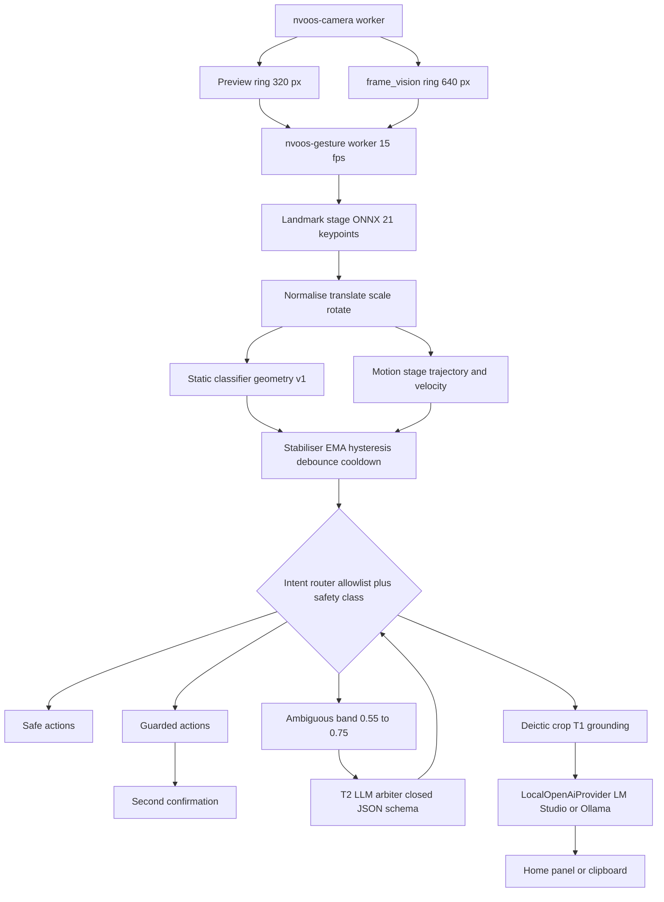

# Proposal 153 — NV oOS Cognition: Hand-Gesture Input (Camera) with LLM Polish

**Status:** 🚧 PARTIALLY SHIPPED (2026-11-21) — research complete; **M1–M5 implemented and green**; M0 (model pin) still open; M6's arbitration rulebook shipped but not wired to the router
**Date:** 2026-11-20 (status updated 2026-11-21)
**Priority:** MEDIUM-HIGH (new input modality; additive, feature-gated)
**Estimated effort:** 18–26 dev days (M0–M6), plus 3–5 days of reference-PC tuning
**Target release:** v0.5.x as an opt-in feature; default OFF in v0.5.0
**Relates to:** Proposal 067 (Cognition app) · 073 (camera preview) · 075 (object
detection + tracking) · 076 (local-VLM label polish) · 100 (snippet OCR) ·
127/128 (memory + destructive-op gate) · 144 (recognition/paste fidelity) ·
ADR 0001 (paste strategy) · ADR 0003 (engine ordering)
**Docs:** research [`153-cognition-hand-gesture-input-research.md`](153-cognition-hand-gesture-input-research.md)
· plan [`153-cognition-hand-gesture-input-implementation-plan.md`](153-cognition-hand-gesture-input-implementation-plan.md)
· vocabulary [`examples/nvoos-dictate/docs/gesture-vocabulary.md`](../../../examples/nvoos-dictate/docs/gesture-vocabulary.md)
· ADR [`examples/nvoos-dictate/docs/decisions/0008-hand-gesture-engine.md`](../../../examples/nvoos-dictate/docs/decisions/0008-hand-gesture-engine.md)
**Author:** NV oOS coding agent (Zed)

---

## Implementation status (2026-11-21)

| Milestone | State |
|---|---|
| **M0** — spike + model pin | ⛔ **Open.** `examples/gesture_probe.rs` ships, but no verified ONNX landmark export exists (MediaPipe distributes `.task`/TFLite). `models.rs` is therefore **fail-closed**: no URL, no hash, `download()` returns a typed error naming M0. Users supply a local `.onnx` via `Settings.gestures.model_path`. |
| **M1** — pure-Rust core | ✅ Shipped. `geometry`, `normalize`, `classifier`, `stabilize`, `motion`, `router`, `catalogue` — all always-compiled and unit-tested. |
| **M2** — landmark backend + controller + frame ring | ✅ Shipped. `landmarks.rs`, `models.rs`, `controller.rs` behind `feature = "gestures"`; the camera fills a second `frame_vision` ring (≤ 640 px) beside the 320 px preview from one decode. |
| **M3** — router, safety gate, dictation | ✅ Shipped. Explicit arming, single allowlist check, guarded `ToggleDictation`/`StopDictation` with a hold-to-confirm. `src/hotkey/` untouched. |
| **M4** — UI surfaces | ✅ Shipped. Settings tab, Diagnostics block, Home toggle + 10 Hz snapshot polling + 21-point skeleton overlay + armed chip + confidence bar + pending-confirm banner. |
| **M5** — T1 deictic grounding | ✅ **Shipped as "point + ask"** — the gesture supplies the referent, a typed question supplies the intent, and the crop goes to the local VLM through the existing multimodal transport. The *spoken* leg is not wired: exposing the last transcript from `dictation.rs` needs a deliberate change to the dictation state machine, so v1 asks in a text field. Off by default (`gestures.deictic_enabled`). |
| **M6** — T2 arbiter + hardening | 🟡 **Rulebook shipped, wiring deferred.** `gestures/arbiter.rs` implements the three rejection rules from §7.3 (not-allowed → none, guarded never promoted, fallback only when allowed *and* safe) with a no-pixels request type and 12 tests. The router is not yet calling it because the stabiliser does not publish an ambiguous band. |

Gate results are recorded in the companion plan's *Gate results* table. Every
number that needs a live model is marked ⛔ there — none were invented.

---

## 0. Reading of the brief

"Hand gestures through the Cognition app camera input / polish / enhance LLM"
is implemented as **three separable capabilities**, delivered in this order:

1. **Gesture as input** — recognise a small, deliberate vocabulary of hand poses
   and motions from the existing webcam feed and turn them into app actions.
2. **Gesture as reference** — point at something and speak ("what is this?"),
   using the gesture as the visual referent for a multimodal LLM call.
3. **Gesture as signal for polish** — when recognition is genuinely ambiguous, a
   local LLM arbitrates *between pre-approved actions only*, never inventing
   new ones.

They are separable on purpose: (1) is local, deterministic and shippable on its
own; (2) and (3) are opt-in and depend on a local model server the app already
knows how to talk to.

---

## 1. Context

The Cognition app is a capture machine: push-to-talk dictation, meeting
transcription, screen OCR, document OCR, media transcription, and a local memory
layer over all of it. Every input surface so far is **speech, screen, file, or
hotkey**. The camera is the one sensor the app already opens (Proposal 073) that
is used only for a passive preview and optional object detection (075).

Three facts make gestures a natural next step *now*:

1. **The capture and inference substrate already exists.** `camera/` owns a
   resident frame ring; `vision/` already runs an ONNX model at ~15 fps on the
   pinned `ort` 2.0 rc.9 and merges results into a pollable snapshot; `vision/`
   already knows how to hand a crop to a local VLM on a dedicated thread
   (`nvoos-vision-polish`) so a 500 ms round-trip never stalls the loop.
2. **MediaPipe's reference design is exactly this shape.** A palm detector plus
   a 21-landmark regressor, with frame-to-frame bbox reuse, then a tiny
   classifier over the landmarks. Published reference latency is 17.12 ms for
   the landmarker and 16.76 ms for the full gesture task on a Pixel 6
   (verified 2026-11-20).
3. **A placeholder already exists in config.** `Settings.vision.hand_model`
   ("Hand model id (MediaPipe-hand ONNX), or empty to disable") is declared and
   surfaced in `StatusInfo`/diagnostics, but nothing consumes it. This proposal
   gives it a purpose.

---

## 2. Problem

1. **Hands-free is impossible today for the most common Cognition actions.**
   Starting/stopping dictation, dismissing an overlay, accepting a suggestion, or
   scrolling a long transcript all require the keyboard or pointer. In a kitchen,
   a workshop, a warehouse, or a presentation, that is the difference between
   usable and unusable.
2. **Speech alone cannot express a referent.** "Send this to her", "what is
   this", "fix this one" are unresolvable from audio. A 21-point hand pose plus
   a bounding box supplies the missing argument, and the app already has the
   VLM transport to use it.
3. **The camera is currently a wasted sensor.** It is opened, gated, feature-
   flagged and privacy-reviewed — and then does nothing but draw a thumbnail.
4. **A naive implementation would be actively harmful.** Always-on gesture
   recognition creates a Midas-touch problem (every scratch becomes a command),
   sustained pointing causes arm fatigue, and classifier churn double-fires
   actions. A proposal that ignores those is worse than no feature.
5. **The safety bar is higher than for speech.** A misheard word is visible in
   the text box and undoable. A mis-fired gesture can stop a recording, paste
   over a clipboard, or dismiss work mid-sentence. The design must assume
   recognition *will* be wrong sometimes and make wrong cheap.

---

## 3. Decision

**Add an opt-in, feature-gated `gestures` module to the Cognition app that
consumes the existing camera frame ring, runs a 21-landmark ONNX model plus a
deterministic geometry classifier, stabilises the result with hysteresis +
debounce + cooldown, and routes a small allow-listed vocabulary through a
central safety gate — with a local LLM used only for (a) deictic grounding of a
pointed-at crop and (b) arbitration between already-approved actions.**

Locked design decisions:

| # | Decision | Rationale |
|---|---|---|
| D1 | **Geometry classifier is v1; a learned classifier is v2** | Ships without new weights or a dataset licence; deterministic and unit-testable. Direct analogue of Stage-1 cleanup. |
| D2 | **Reuse `ort` rc.9; no new inference runtime** | Repo pins rc.9 across `vision`/`snippet-onnx`/`memory`; `rten` 0.28 needs rustc 1.94/edition 2024 vs. the crate's 1.90/2021. |
| D3 | **A second, larger frame ring (`frame_vision`, ≤640 px)** | The preview ring is downsampled to 320 px (`capture.rs:162`); small hands at webcam distance lose too much detail. |
| D4 | **Explicit arming; never always-on** | Midas touch. Arming is `Open_Palm` held 600 ms *or* the existing PTT-style hotkey. |
| D5 | **Static and dynamic gestures are separate stages** | MediaPipe's stock classifier is per-frame; swipes/waves need a short trajectory buffer + velocity gate. |
| D6 | **One central intent router with a `safety` class per action** | A single gate (like Proposal 128's typed-confirmation gate) is auditable; scatter-gun checks are not. |
| D7 | **Guarded actions require a second confirmation** | Wrong gestures must be cheap. Start/stop dictation, paste and accept are guarded. |
| D8 | **LLM arbitration is closed-vocabulary and cannot raise a safety class** | Prevent prompt-injected or hallucinated actions; keep determinism where it matters. |
| D9 | **Deictic grounding never rewrites the user's dictated text** | Silent edits are the Proposal 144 defect class. Answers go to the Home panel/clipboard. |
| D10 | **No facial recognition, no identity, no frame egress** | Existing bright line for `vision/`; restated and enforced in copy and code. |
| D11 | **Gesture is never the only path** | WCAG 2.5.1 / Apple HIG; every gesture has a keyboard/pointer equivalent shipped in the same milestone. |

### 3.1 Why a small vocabulary, not 33 classes

HaGRIDv2 has 33 gesture classes across 1,086,158 images (verified 2026-11-20).
That breadth is a dataset property, not a product requirement. In a dictation
app:

- 8 static classes + 5 motion primitives cover the interaction grammar;
- the majority of the 33 HaGRID classes are two-handed (7 in v2), culturally
  loaded (thumbs up/down, middle finger, `rock`, `holy`), or sign-language
  signs — only a handful read as neutral app commands;
- `ILoveYou` (a MediaPipe canned class) is explicitly **excluded** for the same
  reason;
- the middle-finger class appears in HaGRID and is explicitly **denylisted** in
  any learned classifier.

A narrow vocabulary is also a *safety* mechanism: fewer classes, fewer false
positives, and each class can be individually justified.

### 3.2 Explicit non-goals

- No cursor control, no "air mouse", no drawing in the air.
- No sign-language recognition or translation claims of any kind.
- No continuous hand tracking as an input stream to the LLM.
- No gesture-triggered outbound tool calls (MCP, email, purchase, delete).
- No always-on listening/seeing: camera off ⇒ gestures off.
- No cloud inference.
- No macOS-specific implementation in v1 (the sidecar route is designed but
  CI-verified only; see §11).

---

## 4. Architecture



Threading rules (mirrors `vision/controller.rs`, do not regress):

- `nokhwa::Camera` stays on `nvoos-camera`; only `Send` handles cross into
  `AppState`.
- The landmark model lives on `nvoos-gesture` and is dropped before a model
  file is replaced (Windows file-lock rule already learned in 127).
- The LLM arbiter and deictic calls run on a **dedicated** `nvoos-gesture-llm`
  thread with its own tokio runtime — never on the 15 fps loop.
- When both `vision` and `gestures` are enabled, the **vision loop drives the
  frame tick** and calls the gesture stage after detection (one frame in, two
  results out) to avoid double decoding and double CPU.

### 4.1 Stage contracts

```rust
// Always compiled (feature-independent, like camera::PreviewFrame).
pub struct HandLandmarks {
    pub track_id: Option<u64>,
    pub handedness: Handedness,      // Left | Right | Unknown
    pub score: f32,                  // landmark model confidence
    pub points: [Point3; 21],        // normalised image coords
    pub world: Option<[Point3; 21]>, // metres, optional
    pub bbox: Rect,                  // source pixels
    pub at_ms: u64,
}

pub struct GestureObservation {
    pub gesture: GestureId,     // static or dynamic
    pub confidence: f32,
    pub handedness: Handedness,
    pub bbox: Rect,             // crop source for deictic grounding
    pub held_ms: u32,
    pub at_ms: u64,
}

pub struct GestureIntent {
    pub action: ActionId,
    pub params: ActionParams,   // e.g. { direction: Left } / { dx, dy }
    pub source: IntentSource,   // Geometry | Learned | Llm
    pub requires_confirm: bool,
}
```

`GestureId` and `ActionId` are **closed enums**, not strings, so an unknown
value is unrepresentable rather than merely rejected.

---

## 5. Gesture vocabulary v1

### 5.1 Static poses (geometry classifier)

Normalisation before classification: translate so the wrist is the origin,
scale by the wrist→middle-MCP distance, rotate so the index-MCP→pinky-MCP axis
is horizontal. Finger "extended" = the DIP joint is farther from the wrist than
the PIP joint by a tuned ratio and the joint chain is near-collinear. All
thresholds live in one `Thresholds` struct with unit tests.

| ID | Pose | Predicate (summary) | Default action | Safety |
|---|---|---|---|---|
| `G-OPEN` | Open palm | 4 fingers extended, thumb abducted | **Arm** (hold 600 ms) | Safe |
| `G-FIST` | Closed fist | 4 fingers curled, thumb across | **Cancel / dismiss** | Safe |
| `G-POINT` | Pointing up | index only extended | **Deictic target** (with PTT) | Safe |
| `G-PINCH` | Pinch | thumb-tip↔index-tip < 0.35 palm width | **Select pinned track** | Safe |
| `G-VICTORY` | Victory | index + middle extended, others curled | **New paragraph** in dictation | Safe |
| `G-THUMB_UP` | Thumb up | thumb extended + up, others curled | **Accept** (only with a prompt open) | Guarded |
| `G-THUMB_DOWN` | Thumb down | mirror of above | **Reject** (only with a prompt open) | Guarded |
| `G-STOP` | Palm toward camera, fingers spread | palm normal facing camera | **Stop dictation/meeting** | Guarded |

`G-STOP` is deliberately distinct from `G-OPEN` by palm orientation, so the
arming pose and the emergency-stop pose cannot be confused at the same moment.

### 5.2 Motion primitives (trajectory stage)

Computed over a 500 ms ring buffer of palm-centre positions, normalised by palm
width so distance from the camera does not change the threshold.

| ID | Motion | Predicate | Default action | Safety |
|---|---|---|---|---|
| `D-SWIPE_R` | Swipe right | Δx > 1.8 palm widths, \|Δy\| < 0.6, duration < 500 ms | **Next** (field/item) | Safe |
| `D-SWIPE_L` | Swipe left | mirror | **Previous** | Safe |
| `D-SWIPE_U` | Swipe up | Δy (image) > 1.8 palm widths | **Scroll up** | Safe |
| `D-SWIPE_D` | Swipe down | mirror | **Scroll down** | Safe |
| `D-WAVE` | Wave | ≥3 horizontal direction reversals in 1 s | **Toggle overlay visibility** | Safe |

Reserved but **not mapped** in v1: circle (needs a temporal model), two-hand
poses (Apple HIG: don't require two hands), push/pull (confusable with
approaching/leaving the desk).

### 5.3 Action classes and the safety gate

| Class | Examples | Rule |
|---|---|---|
| **Safe** | new paragraph, scroll, dismiss overlay, arm, toggle preview | Fire after stabilisation. Always undoable or non-destructive. |
| **Guarded** | start/stop dictation, stop meeting, paste, accept suggestion | Requires `requires_confirm` and a visible prompt (click, hotkey, or a second gesture within 3 s). |
| **Forbidden** | delete transcript, purge memory, delete model, send email, purchase, any MCP tool call | Not representable as an `ActionId`. The router cannot emit them. |

Every action also has a keyboard/pointer equivalent registered in the same
milestone (WCAG 2.5.1 / Apple HIG), documented in the Settings tab.

---

## 6. Recognition pipeline details

### 6.1 Stabiliser (the part that makes it feel solid)

1. **EMA on landmarks** — α = 0.5, per coordinate, reset on track loss.
2. **Score smoothing** — exponential moving average over the classifier
   probability vector.
3. **Hysteresis** — enter a gesture at ≥ 0.75, hold until < 0.55.
4. **Debounce** — 3 of the last 4 frames must agree.
5. **Cooldown** — 500 ms per action after firing; `G-STOP` bypasses cooldown.
6. **Track gating** — a gesture only fires for a hand that has been present for
   ≥ 3 frames (kills the "hand entering frame" phantom).

All six are pure functions over a small ring buffer and therefore unit-testable
without a camera or a model. This is where most of the perceived quality lives,
and it is deliberately independent of the model choice.

### 6.2 Model catalogue (additive to `vision/models.rs`)

| id | Purpose | Input | Approx size | Licence action |
|---|---|---|---|---|
| `hand-landmark-full` | 21 landmarks + handedness | 224×224 RGB | 10–25 MB | verify model-card terms at pin; pin SHA-256 |
| `hand-landmark-lite` | same, smaller/faster | 192×192 | 5–10 MB | same |
| `gesture-classifier-v2` | optional learned static classifier over 63 normalised features | 63 floats | < 1 MB | **opt-in only** if derived from HaGRID (CC BY-SA variant) |

`hand_model` (already in `Settings.vision`) selects the landmark model. A new
`Settings.gestures` block owns everything else. Weights are downloaded at
runtime, hash-pinned, atomic-renamed — the same discipline as
`stt/model_registry.rs` and `vision/models.rs`. Nothing is compiled in.

**M0 must answer, with evidence:** does the chosen ONNX export load and run on
`ort` rc.9, what are its input/output names and shapes, what is its measured
latency on the reference PC, and does it reproduce MediaPipe's landmark
ordering? If any answer is no, the fallback is a different pinned export, not a
runtime change.

### 6.3 Frame resolution

`capture.rs` currently stores only `downsample(raw, w, h, 320)`. Add a second
`Arc<Mutex<Option<PreviewFrame>>>` written at ≤640 px, and let the detector and
the landmarker consume that. The preview continues to read the 320 px ring, so
UI bandwidth is unchanged. If the extra ring measurably increases camera CPU,
fall back to a single 480 px ring for both — the spike picks the number.

---

## 7. LLM integration

### 7.1 T0 — deterministic (always on, no model)

`gesture + context → action` from a static table. Handles > 90% of events in
design intent. Context inputs: which overlays are open, whether dictation is
active, foreground app category (existing cleanup categorisation), and the last
action (to suppress accidental repeats).

### 7.2 T1 — deictic grounding ("point and ask")

Flow:

1. User holds `G-POINT` (or `G-OPEN`) → the gesture snapshot records the hand
   bbox and timestamp.
2. User holds PTT and speaks: "what is this", "what does this say", "add this
   to the invoice".
3. After transcription, **only if** `settings.gestures.deictic_enabled`, crop
   the recorded box from `frame_vision`, PNG-encode it, base64 it, and send
   `{image, transcript}` through the existing `LocalOpenAiProvider` multimodal
   transport (`vision/polish.rs` already does exactly this shape for label
   polish).
4. The answer appears in the Home "Ask your camera" panel and is copied to the
   clipboard on request. **No text is inserted into another app** (§3 D9).

Guardrails: crop is downscaled to ≤512 px on the long edge, never persisted,
and the request carries a system prompt that restates no-face-identification
and no-guessing. Timeout 8 s; failure surfaces as "couldn't reach the local
model", never as a fabricated answer.

### 7.3 T2 — ambiguity arbitration (closed vocabulary)

Triggered only when the stabiliser reports an ambiguous window (top-2 scores
within 0.08, or the winning score in 0.55–0.75). Request payload contains
**no pixels**:

```json
{
  "candidates": [{"id": "G-FIST", "score": 0.63}, {"id": "G-PINCH", "score": 0.58}],
  "context": {"overlay": "none", "dictation_active": false, "app_category": "chat",
              "last_action": "G-OPEN", "ms_since_last_action": 420},
  "allowed_actions": ["dismiss_overlay", "select_pinned_track", "none"]
}
```

The model must answer with `{"action": "...", "reason": "..."}`. The router:

- rejects any action not in `allowed_actions` (computed from the current
  context) → treats it as `none`;
- refuses to promote a guarded action to safe;
- falls back to the T0 best guess only if that guess is `Safe`;
- otherwise drops the event and logs a counter (no user-visible error).

Budget: 250 ms. Config: `gestures.llm_arbiter_enabled` (default **false**),
`gestures.llm_arbiter_model` (discovered from the server's `/v1/models`).

### 7.4 What is deliberately not LLM

- Static classification (geometry is better, faster, deterministic).
- Motion detection (velocity thresholds are better).
- Whether to confirm (safety policy is not a model decision).
- Any rewrite of dictated text (Proposal 144's lesson).

---

## 8. Settings, IPC, and UI surfaces

### 8.1 `Settings.gestures` (new, `#[serde(default)]`)

```rust
pub struct GesturesConfig {
    pub enabled: bool,                 // default false
    pub arm_gesture: String,           // "open_palm" | "hotkey"
    pub arm_hold_ms: u32,              // default 600
    pub min_confidence: f32,           // default 0.75
    pub exit_confidence: f32,          // default 0.55
    pub debounce_frames: u8,           // default 3 (of 4)
    pub cooldown_ms: u32,              // default 500
    pub classifier: String,            // "geometry" | "learned"
    pub learned_model: String,         // id in the gesture catalogue
    pub motions_enabled: bool,         // default true
    pub allowed_actions: Vec<String>,  // subset of ActionId
    pub deictic_enabled: bool,         // default false
    pub deictic_provider: String,      // "lm_studio" | "ollama"
    pub deictic_model: String,
    pub llm_arbiter_enabled: bool,     // default false
    pub llm_arbiter_model: String,
    pub show_skeleton: bool,           // default true
    pub mirror_preview: bool,          // default true (see handedness note)
}
```

`Settings.vision.hand_model` stays as the *landmark model* selector and is
documented as such (it is currently a placeholder).

### 8.2 IPC (registered in `lib.rs::run`, mirroring the vision commands)

| Command | Purpose |
|---|---|
| `gestures_available()` | `cfg!(feature = "gestures")` + camera presence |
| `start_gestures()` / `stop_gestures()` | Start/stop the worker; never starts the camera implicitly |
| `get_gesture_state()` | Latest observation snapshot + armed flag + counters |
| `get_gesture_events(limit)` | Recent intent ring buffer for the UI |
| `get_gesture_models()` / `download_gesture_model(id)` | Catalogue + pinned download |
| `set_gesture_arming(bool)` | Manual arm/disarm from the UI |
| `test_deictic_connection()` / `set_deictic_token(...)` / `clear_deictic_token()` | Same shape as the LM Studio/Ollama credential commands |
| `ask_camera(question)` | Explicit T1 invocation from the Home panel |

Events to the webview: `gesture://observation` (throttled to 10 Hz),
`gesture://fired` (one per action), `gesture://armed`.

### 8.3 UI

| Surface | Change |
|---|---|
| Home → Camera panel | Skeleton overlay (`show_skeleton`), current label + confidence bar, "Armed" chip with countdown, last action |
| Home → new card "Ask your camera" | Question box + answer area; only visible when `deictic_enabled` |
| Settings → Gestures tab | Enable, arming mode, thresholds with live preview, vocabulary checkboxes, "learn more" legend, deictic + arbiter blocks with Test connection |
| Diagnostics → Gestures card | Frames, landmarks/s, classifier ms, stabiliser drops, intents fired by action, LLM calls/results/timeouts, last error, model install state |
| Onboarding | One-screen legend of the 8 default gestures with an animated skeleton; skippable |

The overlay draws on the existing `<canvas>` used by Proposal 075, so no new
rendering dependency.

---

## 9. Privacy and security

- **Frames never leave the process** except a deictic crop the user explicitly
  requested. No background egress, no telemetry of landmarks.
- **No face detection, recognition, or identity inference.** Enforced by: no
  face model in the catalogue; a system prompt that forbids identification;
  tool/UI copy that states it.
- **Landmarks are biometric-adjacent** — not persisted, not logged at info
  level, not written to `config.json`. Debug dumps require a debug build *and*
  an env var, and write to the gitignored `dist/`.
- **Camera lifecycle is unchanged.** Gestures do not start the camera; they
  attach to a running camera. An armed state does not survive a camera stop.
- **Local servers only.** The deictic/arbiter transports reuse the
  `local-http-vs-remote-https` invariant already enforced in
  `cleanup/local_openai.rs`.
- **No outbound side effects.** Forbidden actions are unrepresentable (§5.3).

---

## 10. Accessibility

Committing to the documented standards (see research §5):

| Requirement | Implementation |
|---|---|
| WCAG 2.5.1 — no path-based/multipoint-only functionality | Every gesture action has a keyboard/pointer equivalent, listed in Settings |
| WCAG 2.1.1 Keyboard | Equivalents are real bindings, not "use the mouse" |
| WCAG 2.5.4 Motion actuation | Gestures are opt-in with an explicit disable; nothing requires body motion to complete a task |
| Apple HIG — more than one way | Same as above; gestures are accelerators |
| Apple HIG — discoverable, distinct, learnable | 8 default gestures, visible legend, live preview while adjusting thresholds |
| Apple HIG — no required body position/hand | No sustained pointing; no two-handed poses; no hand-specific requirements (handedness is normalised, not assumed) |
| Feedback and unavailability | Skeleton + label + armed chip; a rejected gesture shows "not recognised — try again" rather than silence |
| Reduced motion | Skeleton animation respects the OS reduced-motion setting; static outline fallback |

---

## 11. Platform matrix

| Platform | v1 | Notes |
|---|---|---|
| **Windows** | Full | `ort` CPU; camera via `nokhwa`; existing reference platform |
| **macOS** | Landmark stage via sidecar (CI-verified) | `DetectHumanHandPoseRequest` in the Swift helper, `handpose` subcommand, same v1 sidecar protocol with additive frames. No local Swift build on the Windows reference machine — the gate is CI + the boot-smoke job, exactly as for OCR. |
| **Linux** | Landmark stage only if a pinned ONNX path is chosen | No first-party hand-pose API; camera path already exists. Not a v1 release target. |

Because the Rust core owns classification, stabilisation, routing and UI, the
platform difference is confined to one trait:

```rust
pub trait HandPoseBackend: Send {
    fn detect(&mut self, frame: &PreviewFrame) -> AppResult<Vec<HandLandmarks>>;
    fn name(&self) -> &'static str;
}
```

Two implementations: `OrtHandPose` (Windows/Linux) and `SidecarHandPose`
(macOS). Same pattern as `snippet/ocr.rs` engine dispatch.

---

## 12. Performance budget

| Metric | Budget | Fallback if missed |
|---|---|---|
| Landmark inference | ≤ 35 ms/frame | drop to `hand-landmark-lite`, then 10 fps |
| Classification | < 1 ms (geometry) / ≤ 2 ms (learned) | geometry only |
| End-to-end gesture→action | ≤ 120 ms p95 | increase debounce (costs recall, not safety) |
| Armed idle CPU | < 2% of one core | 10 fps loop |
| Disabled CPU | 0% | — |
| Memory | ≤ 80 MB RSS increase | lite model |
| LLM arbiter | ≤ 250 ms, never blocks | drop event |
| Deictic call | ≤ 8 s, never blocks | error toast |

All measured on the reference PC with `examples/gesture_probe.rs`; release
build numbers go in the implementation plan's verification table.

---

## 13. Success metrics

| Metric | Target | How measured |
|---|---|---|
| Static gesture accuracy (controlled, 6 users × 10 reps) | ≥ 95% for the 8 defaults | `gesture_probe --fixture` + the M1 unit corpus |
| False-positive fires per 10 min of armed idle | < 1 | instrumented counters |
| Median gesture→action latency | < 120 ms | `LastGestureStats` |
| Stabiliser reject rate (flicker suppression working) | > 90% of raw churn removed | unit-test corpus + live counters |
| Deictic answer usefulness (5-user pilot) | ≥ 3/5 "useful" per session | informal pilot notes in the plan |
| Accessibility parity | 100% of mapped actions have a keyboard equivalent | settings audit test |
| Regression | `cargo test` green on default + `gestures` feature; clippy `-D warnings` | CI |

---

## 14. Risks

| Risk | Likelihood | Impact | Mitigation |
|---|---|---|---|
| ONNX export of the landmark model is not numerically faithful | Medium | High | M0 gate: compare against reference landmarks on fixture images; fallback export |
| Small hands at 0.5–4 m fail at 320 px | High | Medium | `frame_vision` ring at 640 px; `hand-landmark-lite` for speed |
| Mirroring inverts handedness | Certain if unhandled | Medium | Flip handedness when `mirror_preview`, or classify from unmirrored buffer; explicit unit test |
| Midas touch in real use | Medium | High | Arming, small vocabulary, debounce, cooldown, an explicit "no gesture" bar |
| Arm fatigue | Medium | Medium | No sustained poses; hold ≤ 600 ms for arming only |
| User expects 33 gestures | Medium | Low | Legend + docs frame it as a deliberate vocabulary; no promise of arbitrary classes |
| Model licence surprises | Medium | High | M0 records the model card + licence; nothing ships without it |
| Feature-union build silently drops the surface | Medium | Medium | Add `gestures` to the documented complete-build union; string-probe marker (`HandLandmarks`) |
| CPU contention with `vision` | Medium | Medium | Co-scheduled loop when both enabled; one frame, two results |
| Hotkey/PTT regression | Low | High | Do not touch `src/hotkey/`; a gesture PR that edits it is wrong by definition |
| Misleading "AI understands you" framing | Medium | Medium | Copy states confidence and failure; no anthropomorphic claims |

---

## 15. Rollout

| Phase | Deliverable | Default |
|---|---|---|
| M0 | `gesture_probe` spike: model loads on rc.9, landmarks sane, latency measured | n/a |
| M1 | Pure-Rust normalise + geometry classifier + stabiliser + motion stage, fully unit-tested | hidden |
| M2 | ONNX landmark stage + `GestureController` + camera ring change | off |
| M3 | Intent router + safety gate + IPC + dictation integration | off |
| M4 | Home overlay, Settings tab, Diagnostics card, legend, keyboard equivalents | off |
| M5 | T1 deictic grounding (`ask_camera`) | off |
| M6 | T2 arbiter + hardening + ADR + docs | off |
| v0.5.x | Opt-in toggle in Settings; no onboarding nudge | off |
| v0.6 | Default-on for new installs *if* false-positive metric holds | on, reversible |

---

## 16. Decision required

1. **Approve the scope split** (§0): gesture-as-input ships independently of the
   two LLM tiers, so a slip in model licensing cannot block the modality.
2. **Approve the vocabulary** (§5): 8 static + 5 motion, `ILoveYou` and
   middle-finger excluded by policy.
3. **Approve the safety model** (§5.3): safe / guarded / forbidden, with
   forbidden actions unrepresentable.
4. **Approve the default-off stance** through v0.5.x and the metric that would
   justify default-on in v0.6.
5. **Confirm the frame-ring change is acceptable** (§6.3) — it is the only
   change that touches an existing, non-gesture module.
6. **Confirm the macOS sidecar route is acceptable** (§11) as a CI-verified,
   non-blocking leg rather than local Swift compilation.

If approved, M0 starts with `examples/gesture_probe.rs` and nothing else — the
spike decides the model, and the model decides everything downstream.
