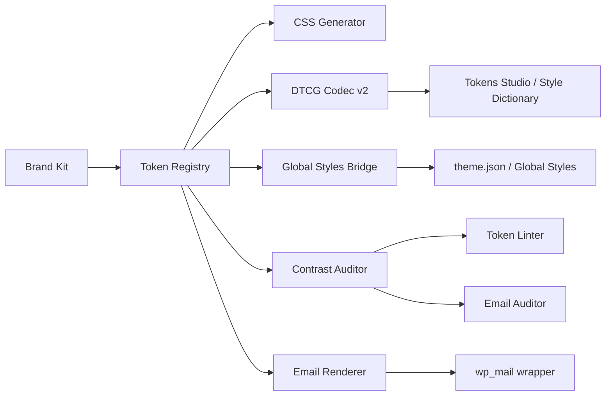

# NV oOS Design System — Brand Ops Enhancement & WordPress.org 1.0.0 Proposal

**Date:** November 28, 2026
**Status:** Implemented — validation complete (PHPUnit 120/120, PHPCS 0 errors, Plugin Check 0 blocking errors); screenshots captured and the package is ready to submit
**Proposal number:** 169
**Target:** `addons/nvoos-design-system/` (now 1.0.0)
**Research companion:** [`169-nvoos-design-system-wporg-brand-ops-research.md`](./169-nvoos-design-system-wporg-brand-ops-research.md)
**Predecessors:** [047](./047-nvoos-design-system-addon-proposal.md) · [048](./048-nvoos-design-system-deferred-email-enhancements.md) · [058](./058-nvoos-design-system-dtcg-token-import-proposal.md)
**Distribution:** WordPress.org plugin directory (free, GPL-3.0-or-later), slug `nvoos-design-system`

---

## Executive summary

`nvoos-design-system` already has the two ingredients that no incumbent on WordPress.org combines: a **design-token engine** and a **branded-email wrapper**. It is GPL, standalone, test-covered, and already exports/imports DTCG. What it does not yet have is a **spec-conformant interchange layer**, a **WordPress-native publishing target**, a **contrast system**, and a **WordPress.org-ready package**.

This proposal turns the addon into a credible **brand-operations plugin** — one source of truth for brand tokens across the site, the block editor's Global Styles, and every outgoing email — and prepares a **1.0.0** submission.

Five outcomes define 1.0.0:

1. **DTCG 2025.10 conformance** — colour/dimension/composite values in spec shape, aliases resolved, `$root`/`$extends`/`$deprecated`/`$extensions` handled, Tokens Studio round-trip proven.
2. **Global Styles bridge** — publish tokens into `theme.json` at runtime via `wp_theme_json_data_theme`, with no theme-file writes.
3. **Brand kit** — logo, identity and core tokens in one branded workspace, exportable as DTCG + `theme.json` + a brand guide.
4. **WCAG 2.2 contrast system** — a single contrast engine shared by the token linter and the email auditor, plus focus and target-size tokens.
5. **Safe-by-default email** — the wrapper becomes opt-in with per-source modes and a local audit log instead of silently rebranding every email on activation.

The work is estimated at **5–6 weeks** for one engineer, plus review time. It deliberately keeps the flat token registry and adds a codec/bridge layer rather than rewriting the engine.

---

## 1. Problem and opportunity

### 1.1 The product is stronger than its packaging

The v0.3.0 codebase already ships:

- ~70 tokens across 8 groups, 3 presets, CSS `:root`, `@property`, dark/high-contrast/reduced-motion blocks.
- DTCG export **and** import (all-or-nothing, 256 KB cap).
- Five accessible email templates, a guarded global `wp_mail` wrapper, multipart plain-text, opt-in WooCommerce rebrand, Paper Store reuse.
- An email auditor covering security, structure, contrast, dark mode and the 102 KB Gmail clip limit.
- Eight AI tools (generate/list/preview/audit/activate/test-send/export/import).
- Nonces, `manage_options`, non-autoload options, uninstall cleanup, 11 PHPUnit files.

But the directory package does not exist, the DTCG values are not spec-shaped, there is no Global Styles integration, and the email wrapper is **on by default** — a behaviour that will surprise users and reviewers.

### 1.2 The category is open

- The `design tokens` tag on WordPress.org has **9 plugins, all under 100 active installs** (November 2026 snapshot).
- The `brand kit` search is dominated by page-builder template kits; there is **no brand-operations leader**.
- **No plugin combines** standards-based tokens, `theme.json` publishing, WCAG auditing and a branded-email wrapper.

The moat is not "another token editor". It is **one source of truth across web, editor and email**, exported in the format designers already use.

### 1.3 Why now

- DTCG 2025.10 is **stable** (28 October 2025); Tokens Studio, Style Dictionary and Terrazzo all read the DTCG shape.
- `theme.json` v3 is established (WordPress 6.6+), and `wp_theme_json_data_theme` gives plugins a supported runtime merge point.
- WCAG 2.2 adds focus, target-size and non-text-contrast criteria that token systems are uniquely positioned to satisfy.
- The European Accessibility Act applies to EU B2C services (since 28 June 2025), making accessible email a compliance concern.
- Gmail still clips at ~102 KB, hiding footers and unsubscribe links — the plugin already budgets for it, which is a sellable safety feature.

---

## 2. Goals and non-goals

### Goals (1.0.0)

| # | Goal | Measure |
|---|---|---|
| G1 | Ship a wp.org-approvable 1.0.0 | PCP 0 errors; submission accepted |
| G2 | DTCG 2025.10 round-trip | 100% of golden fixtures; Tokens Studio import succeeds |
| G3 | Publish to Global Styles | Palette/fonts/spacing appear in a block theme without file writes |
| G4 | Brand kit | Identity + tokens editable and exportable in one place |
| G5 | WCAG 2.2 token linting | Every preset passes declared text/UI pairs; failures explain the ratio |
| G6 | Safe email default | Wrapper off on fresh installs; opt-in with per-source modes |
| G7 | Zero external calls by default | No network request unless the admin triggers AI generation |

### Non-goals (deferred)

- Multi-brand / agency fleet management (future external addon).
- A full asset library (icon sets, illustrations, photography) — brand kit is identity + tokens only.
- BYO AI keys inside the plugin (1.1; 1.0 uses the NV oOS base plugin's keys).
- PDF brand-guide generation (HTML export in 1.0; PDF later).
- A React SPA admin (the current PHP settings page is sufficient for 1.0).
- Editing theme files or bundling a theme.

---

## 3. Current-state findings that drive the design

The full evidence pack is in the research companion. The load-bearing findings:

| ID | Finding | Consequence |
|---|---|---|
| R1–R3 | Colour/dimension/shadow values export as raw strings | DTCG codec v2 required |
| R4 | Aliases rejected on import | Alias resolution + preservation required |
| R5–R6 | 5 DTCG types supported; unknown types silently become `string` | Type-complete codec; no guessing |
| R7 | No `$root`, `$extends`, `$deprecated`, `$extensions`, JSON Pointer | Group semantics + preservation |
| R8 | `esc_html()` applied to CSS values inside `<style>` | CSS output must be validated, not HTML-escaped |
| R9 | Colour sanitisation is prefix-based | Strict per-type validators |
| R10 | Email wrapper defaults to `letterhead` | Default off + opt-in modes |
| R11 | PHP floor mismatch (8.1 header vs 7.4 README) | Documentation fix |
| R12 | No `readme.txt`, `.distignore`, listing assets | wp.org packaging workstream |
| R13 | No `theme.json` integration | Global Styles bridge |
| R14–R15 | No web-token contrast audit; no focus/target tokens | Contrast service + new tokens |
| R19–R20 | AI generation requires the base plugin; no service disclosure | Positioning + readme disclosure |

---

## 4. Proposed solution

Seven workstreams. A–C are release-blocking; D–F are the 1.0 differentiators; G is post-approval polish.



### A. WordPress.org 1.0.0 package (release-blocking)

**A1. Version and headers.** Bump to **1.0.0**; keep `Requires PHP: 8.1`; set `Requires at least: 6.0` with runtime gates for `theme.json` v3 (6.6+); `Tested up to: 7.1`; text domain `nvoos-design-system`.

**A2. Remove the transition shims.** Delete `--cds-*` aliases, `.cds-*` classes and legacy option/class aliases. Keep a one-release `nvoos_nds_legacy_aliases` filter that returns `false`, and a migration notice for Crocoblock-DS upgraders. This satisfies "no dead code" expectations and halves the emitted CSS.

**A3. readme.txt.** Headers + short description ≤150 chars + Description, Installation, FAQ, Screenshots, Changelog (1.0.0 only), Upgrade Notice, **External Services**, Privacy. Keep the file under ~10 KB; move older history to `changelog.txt`.

**A4. Listing assets.** `.wordpress-org/` with icon-128, icon-256, banner-772×250, banner-1544×500, and six screenshots (tokens, brand kit, contrast audit, DTCG import/export, Global Styles preview, email picker/audit).

**A5. `.distignore`.** Exclude `tests/`, `node_modules/`, `composer.*`, `phpunit*`, `phpcs*`, `.github/`, docs, and dev scripts.

**A6. PCP gate.** Run Plugin Check with the repo/security/performance/accessibility categories; fix errors, document warnings, add a CI script (model: `bin/run-docs-hub-plugin-check.sh`).

**A7. i18n and uninstall.** Generate `languages/nvoos-design-system.pot`; add a guarded `load_plugin_textdomain()` for non-wp.org ZIPs; loop multisite sites in `uninstall.php`; keep the CPT private.

**A8. Provenance and licensing.** SPDX headers; audit the five templates for third-party provenance (Cerberus-derived patterns need attribution); confirm no bundled library outside GPL-compatible terms; keep front-end credit-free (Guideline 10).

### B. DTCG 2025.10 codec v2 (release-blocking)

Keep the flat registry. Add `NV_oOS_Design_System_DTCG_Codec` with:

- `to_dtcg( Data_Token $token ): array` — emits `$type`, `$value`, `$description`, and `$extensions` when lossy.
- `from_dtcg( array $token, string $path ): array` — returns `value`, `meta`, `errors`.
- `resolve_aliases( array $doc ): array` — `{group.token}` resolution, chained references, cycle detection.
- `apply_group_semantics( array $doc ): array` — `$root`, `$extends` deep merge, `$deprecated` inheritance.
- `validate( array $doc ): array` — structural + type validation, no guessing.

**Value mapping**

| NDS type | DTCG 2025.10 | Export rule | Import rule |
|---|---|---|---|
| `color` | `color` object | Convert hex/rgb/hsl → `{colorSpace, components, alpha?, hex}` | Accept object **and** legacy string |
| `size`, `spacing` | `dimension` | `{value, unit}` for px/rem | Accept object and `"1rem"` strings |
| `font` | `fontFamily` | string or array | Accept both |
| `shadow` | `shadow` | Parse CSS shadow → object; unparseable → `string` + extension | Decompose object; accept string |
| `transition` | `duration` + optional `transition` | Emit duration for simple values; transition object when parseable | Decompose; accept string |
| — | `fontWeight`, `number`, `cubicBezier`, `strokeStyle`, `border`, `gradient`, `typography` | Add token types + editors (P1) | Full support |
| Unknown | — | **Never** fall back to `string` silently; emit `$type: "string"` only with an explicit `$extensions` marker and a warning | Reject unknown types |

**Lossless escape hatch.** Every non-representable detail (original CSS value, input type, dark/high-contrast linkage, alias path) is stored under:

```json
"$extensions": {
  "com.nvdigitalsolutions.nds": {
    "legacyValue": "var(--e-global-color-primary)",
    "inputType": "color",
    "darkOf": "color_surface",
    "highContrastOf": "color_text",
    "alias": "core.brand.primary",
    "unit": "em"
  }
}
```

The spec requires unknown extensions to be preserved; this makes the round-trip honest instead of lossy.

**Aliases.** Import resolves aliases to values but stores the alias path in `$extensions` so export can emit `"{core.brand.primary}"` again. Full alias editing in the admin is P1; the 1.0 requirement is round-trip fidelity.

**Composite typography.** Export a synthesized `typography` group (body/heading styles) when the token set contains a recognised font + size + line-height triad; import decomposes it back into flat tokens. This gives Figma users a usable type style without changing the registry.

**File format.** Export as `nvoos-design-system.tokens.json` (and optionally `.tokens`), MIME-appropriate download headers, pretty/minified toggle, group filter, `$description` include/exclude.

**Golden fixtures.** Every normative example from the format module + a Tokens Studio DTCG export + the ADS `nds_export` output + a cycle fixture + a `$root`/`$extends` fixture. The suite must fail if a value is emitted as a non-conformant type.

### C. Global Styles bridge (release-blocking for the `theme.json` claim)

Add `NV_oOS_Design_System_Global_Styles_Bridge`:

- Hooks `wp_theme_json_data_theme` (since WP 6.1).
- Merges (never replaces) the theme's data via `get_data()` + `update_with()`.
- Emits `version: 3` on WP 6.6+, `version: 2` on 6.1–6.5.
- Uses a setting `nvoos_nds_global_styles` (default **off**), enabled from the onboarding wizard or the Tokens tab.

**Mapping**

| Token group | `theme.json` target |
|---|---|
| `colors` | `settings.color.palette[]` — merge into the existing list or origin-keyed object |
| `typography` | `settings.typography.fontFamilies[]`, `fontSizes[]` |
| `spacing` | `settings.spacing.spacingSizes[]` |
| `shadows` | `settings.shadow.presets[]` |
| `borders` | `settings.border.radiusSizes[]` |
| `sizing`, `transitions`, `emails` | `settings.custom.nds.*` (emits `--wp--custom--nds--*`) |
| Optional "apply styles" | `styles.color.text/background`, `styles.typography`, `styles.elements.link/button` |

**Safety.** Never write to `theme.json` files. If the active theme is classic (no `theme.json`), the bridge still works on 6.1+ because the resolver supplies an empty document. Add a Site Health check that reports whether Global Styles sync is active and whether the theme supports it.

**Export/import.** Download a `theme.json` partial; import an existing `theme.json`/theme.json partial to seed token values (colours, font sizes, spacing) with a preview diff.

### D. Brand kit (1.0 differentiator)

A new **Brand** tab under Settings → Design System, storing `nvoos_nds_brand` (autoload off):

| Field | Storage |
|---|---|
| Brand name, tagline, sub-brand | strings |
| Logo (light/dark), icon, favicon | attachment IDs + URLs |
| Contact email, social links | strings/URLs |
| Brand colours, fonts, spacing, radius | token references (not copies) |
| Brand voice note | textarea (optional, for AI generation context) |

**Brand kit export** (`nvoos-brand-kit/v1`): identity JSON + DTCG document + `theme.json` partial + active email template IDs. **Brand guide export**: a self-contained printable HTML page (cover, palette with contrast ratios, type scale, logo usage, email preview). No PDF in 1.0.

**Rule:** the brand kit references tokens by ID; it never duplicates values. One edit updates web, editor and email.

### E. Contrast and WCAG 2.2 system (1.0 differentiator)

Add `NV_oOS_Design_System_Contrast_Auditor` as the single contrast engine:

- WCAG relative luminance + ratio; 4.5:1 for text, 3:1 for large text/UI/focus.
- Derives pairs from token naming conventions (`*_text`/`*_bg`, `*_link`/`*_bg`, `*_button_text`/`*_button_bg`, `*_border`/`*_bg`, `*_focus`/`*_bg`) plus an explicit `contrast_pairs` setting.
- Shows a pass/fail badge per colour token and an audit report with ratios.
- Suggests the nearest compliant colour (OKLCH or HSL lightness adjustment, 1% steps) with a "Use suggestion" action.
- **Warns, never blocks**; the admin can ship a non-compliant brand deliberately.
- The email auditor calls the same service instead of its private `contrast_ratio()`.

**New tokens** (added to all presets):

- `color_focus_ring`, `focus_ring_width`, `focus_ring_offset` (2.4.11/2.4.13).
- `size_target_min` = `24px` (2.5.8).
- `color_border_strong` for non-text 3:1 borders (1.4.11).
- `motion_reduced_duration` already handled by the reduced-motion block.

**Admin accessibility.** The Tokens tab must itself pass WCAG 2.2 AA: labelled controls, visible focus, 24×24 targets, no colour-only status (pair badges with text/icons).

### F. Email hardening (1.0 differentiator)

**F1. Safe default.** `get_active()` returns `''` when no template has been explicitly chosen. New installs have the wrapper **off**. Upgrades from 0.x keep their active template but set `wrap_mode = all` and show a one-time notice.

**F2. Wrap modes.** `nvoos_nds_wrap_mode`:

| Mode | Behaviour |
|---|---|
| `off` (default) | never wrap |
| `text_only` | wrap only plain-text bodies (safest for HTML-fragment plugins) |
| `fragments` | wrap HTML fragments but skip full documents |
| `all` | previous 0.x behaviour |

Plus a per-message filter `nvoos_nds_email_should_wrap( $wrap, $atts, $context )`.

**F3. Audit log.** Last 50 sends (option or CPT): timestamp, subject (optional, redacted), source (`core`/`woocommerce`/`form`/`other`), template, bytes, wrapped/skipped reason, success. Never store the body.

**F4. Compatibility checks in the auditor.** Add: VML single-block check (Outlook duplicate-button bug), image-blocking check (CTA must have background colour + alt text), `lang`/`dir`, `role="presentation"`, `color-scheme` meta, preheader presence, 80 KB warning / 102 KB error.

**F5. Preheader.** A new `{{preheader}}` merge tag and an email setting; hidden text block rendered before the body.

**F6. Test send.** Multiple recipients (comma-separated), per-template preview, and a Site Health check that reports the active wrap mode, template and last send.

**F7. AI generation.** 1.0 keeps the existing base-plugin-key path and documents it precisely ("AI generation requires the NV oOS plugin and a configured OpenAI or Gemini key"). 1.1 may add an encrypted BYO key with a provider allowlist.

### G. UX and operations (post-1.0 / P2)

- Activation wizard: Brand basics → Token preset → Enable Global Styles? → Enable branded email?
- Settings API migration (`register_setting()` + `sanitize_callback`) and a small REST surface (`nvoos-design-system/v1/tokens|presets|contrast`) for future tooling.
- WP-CLI: `wp nds export`, `wp nds import`, `wp nds contrast`, `wp nds email test`.
- Site Health tests: CSS cache present, option size, Global Styles sync, email wrap mode, logo configured.
- Docs: user guide, developer hooks, DTCG guide, `theme.json` guide, email compatibility guide, Crocoblock-DS migration.

---

## 5. Implementation phases

Estimates assume one engineer with repo familiarity; review time is separate.

### Phase 0 — Stabilise and package (week 1)

| Task | Output |
|---|---|
| Fix CSS escaping (R8) and strict validators (R9) | Validated CSS values; raw output after validation |
| Default email wrapper off (R10) + upgrade notice | `wrap_mode` option, `get_active()` fallback |
| Fix PHP-floor mismatch + stale README (R11/R16) | Docs and headers agree |
| Create `readme.txt`, `.distignore`, `.wordpress-org/` skeleton (R12) | Submission package |
| Multisite uninstall loop (R17) | Clean uninstall |
| Baseline PCP run | Error/warning inventory |

**Exit gate:** PCP errors triaged; no CSS-escaping defect; fresh install sends unmodified email.

### Phase 1 — DTCG codec v2 (weeks 2–3)

| Task | Output |
|---|---|
| `DTCG_Codec` + colour/dimension converters | Spec-shaped values |
| Alias resolution + cycle detection | Figma-native semantic tokens |
| `$root` / `$extends` / `$deprecated` / `$extensions` | Group semantics + preservation |
| Composite support (typography, border, transition, gradient, strokeStyle) | Type completeness |
| Golden fixtures + Tokens Studio round-trip | Conformance suite |
| Export options (pretty, filter, descriptions) | Download UX |

**Exit gate:** all fixtures round-trip; Tokens Studio imports the export in DTCG mode; a `$root`/`$extends` file imports with the expected flattened tokens.

### Phase 2 — Global Styles + contrast (weeks 3–4)

| Task | Output |
|---|---|
| `Global_Styles_Bridge` + mapping + merge | Palette/fonts/spacing in a block theme |
| `theme.json` export/import | Round-trip with a theme |
| `Contrast_Auditor` + pair derivation + suggestions | Token linter |
| Focus/target/non-text tokens | WCAG 2.2 coverage |
| Admin accessibility pass | Labelled, keyboard-operable UI |

**Exit gate:** a block theme shows the palette and font sizes without file writes; every preset's declared pairs report pass/fail with ratios; admin page passes a keyboard + contrast smoke test.

### Phase 3 — Brand kit + email hardening (weeks 4–5)

| Task | Output |
|---|---|
| Brand tab + `nvoos_nds_brand` storage | Identity workspace |
| Brand kit + brand guide export | DTCG + theme.json + HTML guide |
| Wrap modes, audit log, preheader | Safe email |
| Auditor: VML, image-blocking, color-scheme | Compatibility guarantees |
| AI-generation wording + docs | Honest positioning |

**Exit gate:** a fresh install sends unmodified email; opting in wraps only the selected sources; the audit log records 10 sends; the brand guide renders offline.

### Phase 4 — 1.0.0 release and submission (week 5)

| Task | Output |
|---|---|
| Version 1.0.0; remove shims | Clean release |
| POT + i18n audit | Translations ready |
| Screenshots (6) + banner/icon | Listing assets |
| PCP final (0 errors) + PHPCS + PHPCompatibility | Quality gates |
| readme final + External Services + Privacy | Submission |
| Tag + SVN upload | wp.org submission |

**Exit gate:** PCP 0 errors; readme validates; stable tag 1.0.0; no external calls on a fresh install; uninstall leaves no orphan options/posts.

---

## 6. Backlog (IDs, priority, acceptance)

| ID | Item | Priority | Acceptance |
|---|---|---|---|
| DS-01 | CSS output: validate at entry, emit raw | P0 | Font stack with quotes renders correctly; no `&quot;` in CSS |
| DS-02 | Strict per-type validators | P0 | `;{}<>` and non-allowlisted `url()` rejected; tests |
| DS-03 | Email wrapper default off | P0 | Fresh install sends unchanged email; upgrade notice shown |
| DS-04 | `wrap_mode` + per-message filter | P0 | Four modes; 10-send audit log; tests |
| DS-05 | readme.txt + `.distignore` + assets | P0 | Validator passes; screenshots 6; banner/icon present |
| DS-06 | 1.0.0 shim removal | P0 | No `--cds-*` in emitted CSS; filter escape hatch |
| DS-07 | Multisite uninstall | P0 | All sites cleaned on network uninstall |
| DS-08 | DTCG colour/dimension codec | P0 | Spec fixtures pass; Tokens Studio import succeeds |
| DS-09 | Alias resolution + preservation | P0 | Chained + circular fixtures; export re-emits aliases |
| DS-10 | `$root` / `$extends` / `$deprecated` / `$extensions` | P1 | Deep-merge fixture; extensions preserved |
| DS-11 | Composite types | P1 | Typography/border/transition/gradient/strokeStyle fixtures |
| DS-12 | Unknown-type handling | P0 | Never silently `string`; warning + extension marker |
| DS-13 | Global Styles bridge | P0 | Palette/fonts/spacing in a block theme; no file writes |
| DS-14 | `theme.json` export/import | P1 | Valid v3 partial; import seeds tokens with diff |
| DS-15 | Contrast service + token linter | P0 | 4.5/3.0 thresholds; suggestions; preset report |
| DS-16 | Focus/target/non-text tokens | P1 | Presets include them; CSS emitted; documented |
| DS-17 | Brand kit tab + storage | P1 | Identity saved; referenced tokens, not copies |
| DS-18 | Brand guide export | P2 | Offline HTML with palette + ratios + email preview |
| DS-19 | Email auditor upgrades | P1 | VML/image-blocking/color-scheme/preheader checks |
| DS-20 | Preheader merge tag | P1 | Rendered hidden block; filterable |
| DS-21 | AI wording + External Services | P0 | Readme matches code; no over-claim |
| DS-22 | Settings API migration | P2 | `register_setting()` + sanitize callback; no behaviour change |
| DS-23 | WP-CLI commands | P2 | export/import/contrast/email test |
| DS-24 | Site Health tests | P2 | Five checks with actionable messages |
| DS-25 | Admin a11y pass | P1 | Keyboard, focus, 24×24, labelled controls |
| DS-26 | POT + i18n audit | P0 | No missing translator comments; POT builds |
| DS-27 | PCP CI script | P0 | Fails on errors; documented warnings |
| DS-28 | Docs set | P1 | Six guides; linked from readme |

---

## 7. WordPress.org submission checklist

### 7.1 Readme header (proposed)

```
=== NV oOS Design System — Brand Tokens & Emails ===
Contributors: nvdigitalsolutions
Tags: design tokens, brand kit, theme.json, accessibility, email templates
Requires at least: 6.0
Tested up to: 7.1
Requires PHP: 8.1
Stable tag: 1.0.0
License: GPLv3 or later
License URI: https://www.gnu.org/licenses/gpl-3.0.html
One source of truth for your brand: design tokens, Global Styles, WCAG contrast checks, and branded email templates.
```

Short description length: 116 characters (under the ~150-character cap). Five tags exactly.

### 7.2 Required sections

| Section | Content |
|---|---|
| Description | What it does; token groups; DTCG; Global Styles; emails; accessibility. No sales pitch, no competitor names. |
| Installation | Upload/activate; run the wizard; choose preset; optionally enable Global Styles and branded email. |
| FAQ | "Does it require a theme?" "Does it change my emails automatically?" (No — opt-in.) "Does it send data anywhere?" (No.) "Do I need the NV oOS plugin?" (Only for AI generation.) |
| Screenshots | 1 Tokens, 2 Brand kit, 3 Contrast audit, 4 DTCG import/export, 5 Global Styles, 6 Email picker/audit. |
| Changelog | 1.0.0 only; older history in `changelog.txt`. |
| Upgrade Notice | `--cds-*` removal; global styles off by default; email wrapper opt-in. |
| External Services | OpenAI and Google Gemini only when the admin generates a template and the NV oOS base supplies a key; links to terms/privacy; no account, no telemetry, no calls otherwise. |
| Privacy | Local options/posts only; no tracking; uninstall removes data. |

### 7.3 Review-sensitive points to pre-empt

- **Global `wp_mail` filter:** explain the sentinel/full-document/text-plain guards and the default-off posture in the readme FAQ.
- **AI calls:** disclose hosts, trigger, and key source; state that no data leaves the site otherwise.
- **No trialware:** all 1.0 features are functional; any future Pro lives in a separate external addon.
- **Trademarks:** "NV oOS" is the author's own brand; the slug does not begin with another product's term.
- **Credits:** none on the front end; email templates contain no plugin branding (verified).
- **Version discipline:** stable tag == PHP header == 1.0.0.

---

## 8. Testing and validation

| Layer | Gate |
|---|---|
| Unit | PHPUnit: codec fixtures, CSS escaping, contrast, Global Styles merge, email modes, validators |
| Static | PHPCS (repo ruleset), PHPCompatibility 8.1+, `php -l` |
| Plugin Check | PCP 0 errors; warnings documented |
| Integration | Block theme (Twenty Twenty-Five), WooCommerce emails, an SMTP plugin, a classic theme |
| Interchange | Tokens Studio DTCG import; Style Dictionary/Terrazzo parse (no build required) |
| Email clients | Gmail (clip), Outlook (VML), Apple Mail (dark mode), a text-only client |
| Accessibility | Admin keyboard + contrast smoke test; preset contrast report |
| Manual | Fresh install (no email change), opt-in flow, uninstall (single + multisite) |

**Definition of done for 1.0.0:** all P0 backlog items closed; PCP 0 errors; 100% DTCG fixtures; six screenshots; readme validated; no external calls on a fresh install.

---

## 9. Risks and mitigations

| Risk | Likelihood | Mitigation |
|---|---|---|
| DTCG codec scope balloons | High | Codec layer + fixtures; defer alias *editing* to 1.1; lossy data in `$extensions` |
| `theme.json` merge conflicts with themes | Medium | Merge, never replace; default off; document precedence; Site Health check |
| Global email wrapper rejected by reviewers | Medium | Default off; per-source modes; guards documented; opt-in notice |
| Brand kit becomes an asset manager | Medium | Identity + tokens only; assets are attachment references |
| CSS value validation breaks legitimate values | Medium | Allowlist + warning + `$extensions` escape; tests for font stacks, `clamp()`, `color-mix()` |
| AI external-service disclosure is insufficient | Low | Dedicated readme section; no calls without a key; links to provider terms |
| wp.org slug/naming conflict | Low | `nvoos-design-system` is unique; "NV oOS" is the author's brand |
| GPLv3 vs GPLv2+ convention | Low | Keep GPLv3+ (allowed); record owner decision |
| Review queue delay | Medium | Submit once, cleanly; avoid rapid re-submissions (Guideline 14) |

---

## 10. Success metrics

| Metric | Target |
|---|---|
| wp.org approval | First or second submission |
| Active installs (90 days) | 500–1,000 (realistic for the niche) |
| Rating | ≥4.5 |
| Branded-email opt-in | ≥30% of installs |
| DTCG round-trip | 100% fixtures |
| Preset contrast | 100% of declared pairs pass |
| PCP | 0 errors |
| Support load | <5% of installs open a ticket |

---

## 11. Open decisions (owner)

| ID | Decision | Recommendation |
|---|---|---|
| D1 | Default email wrapper: off vs on | **Off** (opt-in) |
| D2 | Global Styles sync default | **Off**, prompted in onboarding |
| D3 | AI generation in 1.0 | **Base-plugin-only**, documented; BYO key in 1.1 |
| D4 | Non-DTCG units (`em`, `%`, `vh`) | Store as `string` + `$extensions`, warn |
| D5 | Licence | Keep **GPLv3 or later** (allowed); do not relicense without owner sign-off |
| D6 | Pro tier | None in 1.0; future **external** addon (multi-brand/agency) |
| D7 | Brand kit scope | **Lean** (identity + tokens); defer asset library |
| D8 | `Requires at least` | **6.0** with runtime gates; do not block 6.0–6.5 users |

---

## 12. Sources

See the research companion, §5. Primary sources: DTCG 2025.10 format and colour modules; Tokens Studio token-format docs; WordPress `theme.json` v3 reference and `wp_theme_json_data_theme`; WCAG 2.2; WordPress Plugin Readmes and Detailed Plugin Guidelines; 2026 email-client rendering guidance; wp.org tag/search snapshots.

---

## Appendix A — `theme.json` merge sketch

```php
add_filter(
	'wp_theme_json_data_theme',
	static function ( $theme_json ) {
		if ( ! get_option( 'nvoos_nds_global_styles', false ) ) {
			return $theme_json;
		}

		$data    = $theme_json->get_data();
		$palette = isset( $data['settings']['color']['palette'] )
			? $data['settings']['color']['palette']
			: array();

		// Preserve origin-keyed palettes (`theme` / `default`); append to the flat list otherwise.
		if ( is_array( $palette ) && isset( $palette['theme'] ) ) {
			$palette['theme'] = array_merge( $palette['theme'], $nds_palette );
		} else {
			$palette = array_merge( (array) $palette, $nds_palette );
		}

		return $theme_json->update_with(
			array(
				'version'  => ( wp_get_wp_version() >= '6.6' ) ? 3 : 2,
				'settings' => array(
					'color'      => array( 'palette' => $palette ),
					'typography' => array( 'fontSizes' => $nds_font_sizes ),
					'spacing'    => array( 'spacingSizes' => $nds_spacing ),
					'custom'     => array( 'nds' => $nds_custom ),
				),
			)
		);
	}
);
```

## Appendix B — DTCG fixture list (minimum)

1. Colour in sRGB (object) and legacy hex string.
2. Dimension in `px` and `rem`; `0` with a unit.
3. Font family as string and array.
4. Font weight numeric and keyword.
5. Duration in `ms` and `s`.
6. Cubic Bézier.
7. Number.
8. Stroke style string and object.
9. Border composite with references.
10. Transition composite.
11. Shadow single object and layered array.
12. Gradient with references.
13. Typography composite.
14. Alias chain (3 levels) and a circular alias (must fail).
15. `$root` group and `$extends` deep merge.
16. `$deprecated` on token and group.
17. `$extensions` preservation.
18. Group `$type` inheritance.
19. JSON Pointer `$ref` to `$value` and to a component.
20. Tokens Studio DTCG export.

## Appendix C — Brand guide export outline

1. Cover: brand name, tagline, date.
2. Logo usage: light/dark variants, clear space, minimum size.
3. Palette: swatch, token name, hex, contrast ratio on light/dark.
4. Typography: families, scale, line heights.
5. Spacing and radius scale.
6. Motion: duration/easing, reduced-motion note.
7. Email preview: header, body, CTA, footer.
8. Token reference: table of token IDs → CSS variables.

---

## Appendix D — Implementation status and validation evidence (1.0.0)

**Status:** implemented and validated on 2026-11-28. The only remaining release step is capturing the six screenshots listed in `.wordpress-org/SCREENSHOTS.md` and submitting the ZIP.

### D.1 Delivered

| Area | Delivered in 1.0.0 |
|---|---|
| DTCG codec | `class-nvoos-nds-dtcg-codec.php` — colour/dimension/fontWeight/number/duration/shadow conversion, alias resolution with cycle detection, `$extends` deep merge, `$root` folding, `$deprecated`, `$extensions` (`com.nvdigitalsolutions.nds`) |
| Import/export | Codec-backed exporter (`nvoos-design-system.tokens.json`); transactional, alias-aware importer with legacy-string compatibility and a 256 KB cap |
| Global Styles | `wp_theme_json_data_theme` bridge, opt-in, in-memory only; palette/fontFamilies/fontSizes/spacingSizes/shadows; schema v3 on WP 6.6+ |
| Brand kit | Identity record + JSON export + printable HTML brand guide with contrast ratios |
| Contrast | `Contrast_Auditor` (WCAG 2.2, 4.5:1 text / 3:1 large, border, focus); focus-ring and 44 px target-size tokens in every preset |
| Email safety | Wrapper off by default; four modes (`off`/`text_only`/`fragments`/`all`); `nvoos_nds_email_should_wrap`; metadata-only 50-entry send log; no default template |
| Optional integrations | No hard dependency on any plugin. NV oOS tools register only when its interfaces exist; Paper Store no-ops without its manager class; AI generation uses the WordPress AI Client (`wp_ai_client_prompt()`), with `nvoos_nds_email_generation_provider` as the only swap-in seam and no stored provider credential |
| Email audit | Structure, security, accessibility, contrast, dark mode, size, plus compatibility checks: `color-scheme`, preheader, duplicate VML roundrect, image-only CTA |
| CSS integrity | Legacy `--cds-*` block removed; CSS values validated at entry and emitted raw (no `esc_html()` inside `<style>`) |
| Packaging | `readme.txt`, `.distignore`, `.gitattributes`, `.wordpress-org/` icons + banners + six screenshots, POT (390 msgids) |
| Lifecycle | Multisite-aware `uninstall.php`; version 1.0.0; PHP 8.1 floor; header/readme name parity |

### D.2 Validation evidence

| Gate | Command | Result |
|---|---|---|
| PHP syntax | `php -l` over every PHP file | Pass (0 errors) |
| PHPUnit | `vendor/bin/phpunit --no-coverage addons/nvoos-design-system/tests/test-*.php` | **163 tests, 481 assertions, 0 failures** across 16 files (10 skipped without their optional integration) |
| WordPress Coding Standards | `vendor/bin/phpcs --standard=phpcs.xml.dist addons/nvoos-design-system` | **0 errors**, 12 warnings (unused hook params, reserved array keys) |
| PHP compatibility | `phpcs --standard=PHPCompatibilityWP --runtime-set testVersion 8.1-8.4` | Pass (exit 0) |
| Plugin Check | `bin/run-design-system-plugin-check.sh` | **0 errors, 0 warnings** (no `AIProvider` rows: there is no direct provider path) |

### D.3 Known non-blocking warnings

- **No direct AI-provider integration.** Generation goes through the WordPress AI Client (`wp_ai_client_prompt()`) and is skipped with an admin notice when core has no provider configured. The earlier direct OpenAI/Gemini HTTP path was removed, so Plugin Check reports no `AIProvider` rows and the plugin stores no provider credential. `nvoos_nds_email_generation_provider` still lets a site swap in its own implementation.
- **12 PHPCS warnings.** Unused parameters in WordPress hook signatures (required by the hook contract), reserved template slugs such as `default`/`class` used as array keys, and one test-only docblock. None affect runtime behaviour.
- **PHPUnit deprecations.** 30 doc-comment `@covers` annotations that PHPUnit 11 would prefer as attributes, and 10 tests that skip when their optional integration (WooCommerce, a block theme) is absent. Repo-wide convention, not a 1.0.0 blocker.

### D.4 Screenshots and submission

All six screenshots were captured on 2026-11-28 from a clean WordPress install (Minimal preset, Letterhead template, sample `Asteria` brand kit) and are stored as `.wordpress-org/screenshot-1.png` … `screenshot-6.png`. The ordered captions are in `readme.txt` under `== Screenshots ==`.

Build the submission ZIP with `.distignore` (or `git archive`, which honours `.gitattributes` and omits `languages/.gitkeep`), then upload it to the WordPress.org plugin submission form.

### D.5 Ecosystem sequencing decision

The research companion's §5 recommends Design System first (shared `--nds-*` substrate), Content Graph AI second (existing install base, free read-only explorer with AI optional), Page Agent third, and excludes proprietary or server-side addons from the directory entirely.

---

## Appendix E — Optional-integration contract (wp.org compliance)

This plugin must remain fully functional with **zero** other plugins installed. Any integration with NV oOS, Crocoblock, Elementor or WooCommerce is additive and gated:

| Surface | Gate | Standalone behaviour |
|---|---|---|
| AI tools (`nds_*`) | `interface_exists( 'WP_MCP_AI_Tool_Interface' )` + `wp_mcp_ai_register_tools` hook | Tools never register; no admin notice |
| AI provider credentials | Not stored | Generation goes through the WordPress AI Client; `nvoos_nds_email_generation_provider` can supply HTML instead |
| Paper Store mirror/import | `class_exists( ... Paper_Store ... )` inside the bridge | UI shows “Paper Store is not available on this site”; JSON import/export still works |
| JetEngine / JSF / JFB / Elementor CSS | `class_exists`/`did_action` checks in each integration | Integration styles simply do not load |
| WooCommerce rebrand | `class_exists( 'WooCommerce' )` | Checkbox hidden/disabled; no effect on other mail |

Rules for future changes:

1. No `Requires Plugins` header and no activation-time dependency check.
2. No admin notice, pointer or dashboard widget that asks the user to install another plugin.
3. Every cross-plugin call is capability-gated at the call site (not only at boot).
4. A standalone seam (filter or public method) exists for any feature that an integration enhances.
5. Keep the readme line “Standalone by design. No other plugin is required.” and do not advertise host-plugin-only tools as core features.
